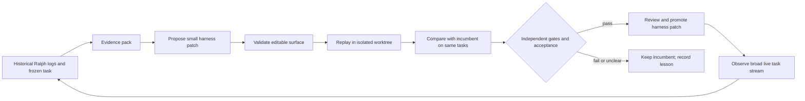

# Proposed architecture for the restored broad loop

## Control flow

Run this as an **outer loop** on a schedule or after a batch of ordinary Ralph tasks. The normal Ralph loop remains the product-development executor. One outer-loop iteration should propose one small, named change, replay it, then either promote or reject it. Do not let a candidate edit the live checkout while the current loop is active.

## Authority and editable surface

Version the immutable policy separately from experimental guidance. The existing `.ralph/PROMPT.md` and `AGENT.md` are the current sources of procedure; the `Current Priority` banner is the ordering authority. During the current focus, owner-only and hook-guarded files remain off-limits. After restoration, define an owner-approved editable allowlist for the sidecar, initially limited to *new* task-context templates and practice-card retrieval configuration. Changes to instruction files, hook wiring, gate scripts, the external driver, `fix_plan.md` priority, and credentials require a separate owner change review; the improvement controller must not autonomously patch them. This is a proposed future policy, not a claim that present restrictions have been removed.

Give candidates a typed manifest: `candidate_id`, base commit, task set, editable paths, exact diff hash, model/backend, prompt revision, time/memory budget, and expected effect. Reject paths outside the allowlist, symlinks escaping the candidate tree, deleted mandatory instructions, and changes to test selection or scoring. Validate rendered instructions for contradictions against the authoritative files before any replay.

## Isolated replay

1. Freeze a task from a completed or safely reproducible Ralph milestone and its starting commit. Copy only task inputs and allowed reference files into a private worktree or container. Preserve a manifest of fixture/database revisions and PostgreSQL oracle version.
2. Run incumbent and candidate from **the same task start state**, with the same backend/model family, time budget, resource cap, and declared tool policy. Use separate worktrees, ports, temp directories, cgroup unit names, result paths, and database clusters. Never share live reference clusters or the loop's WIP checkout. Begin with serial replay; parallelism is safe only after isolation is proved.
3. Capture tool trajectory, generated patch, tests, gate logs, status block, elapsed time, token/cost data if available, and whether the task was completed. Redact secrets and limit stored raw logs. A failed or timed-out run is an outcome, not a missing datum.
4. Score with an evaluator outside the candidate's workspace. Re-run focused checks and required commit-equivalent gates on the produced patch, plus a held-out compatibility check where applicable. Evaluate state consistency and whether the agent followed task order. Do not commit or push the replay patch.
5. Compare paired runs and candidate failures. An improvement agent may read training trajectories and summary metrics, but never hidden test definitions, scores for held-out tasks, or grader credentials. The controller owns promotion.

For historical replay, be careful: a task solved in the repository can leak its answer through later source history, notes, or search. Use a checkout at the task's original start and keep later commits and mined solutions inaccessible to the executor. Better still, reserve future tasks as a prospective holdout. A replay that cannot enforce this separation is useful for debugging but should not count as unbiased evidence of better performance.

## Experience memory

Adapt Harness²'s per-domain library into short records: symptom, task family, changed harness component, mechanism hypothesized, paired-run evidence, regressions, confidence, and applicable repository revision range. Index by SQL/parser, planner/executor, storage/WAL, concurrency, protocol/catalog, benchmark/performance, and harness operations. Retrieve only relevant records; retain links to raw local evidence for audit. Require an expiry or revalidation trigger when the backend, gate recipe, or task distribution changes. This keeps lessons from becoming an unbounded, stale prompt.

## Promotion

Promotion is a separate, reviewable change: exact candidate diff, evaluation manifest, score table, gate logs, and rollback command. Re-run validation against current HEAD before merging or enabling a default. If no candidate clears the bar, retain the incumbent and record the failed hypothesis. After promotion, watch live loop metrics and nightly failures for a fixed window; revert on a concrete correctness, state, or productivity regression. The outer loop's write privilege should end at a proposal artifact until an owner-approved promotion path is established.
