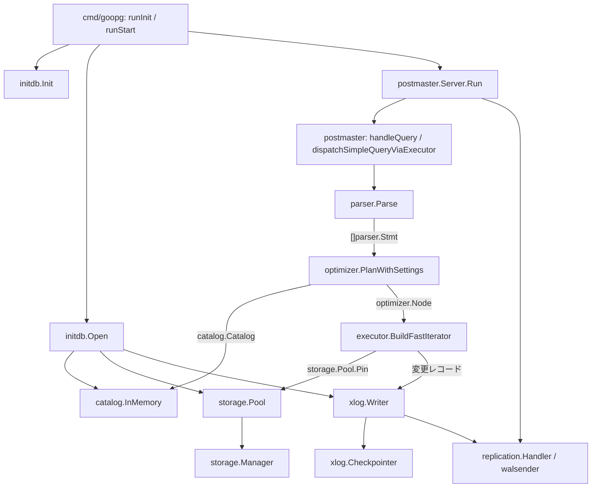
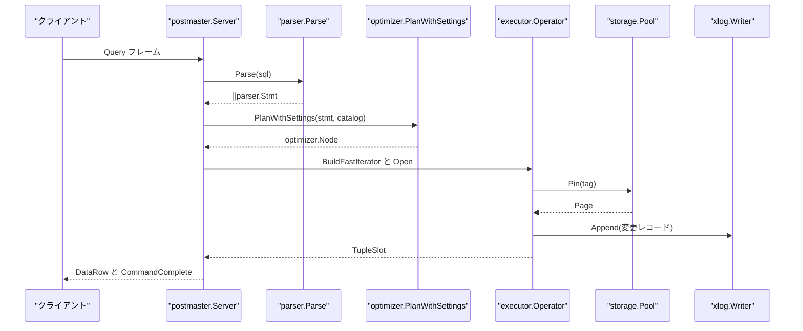

# プロジェクト概要

<details>
<summary>関連ソースファイル</summary>

- [`README.md`](https://github.com/ryogrid/goopg/blob/19856410e8d497d59787e1ab35a2febb3f5953d6/README.md)
- [`cmd/goopg/main.go`](https://github.com/ryogrid/goopg/blob/19856410e8d497d59787e1ab35a2febb3f5953d6/cmd/goopg/main.go)
- [`internal/access/transam/xlog/writer.go`](https://github.com/ryogrid/goopg/blob/19856410e8d497d59787e1ab35a2febb3f5953d6/internal/access/transam/xlog/writer.go)
- [`internal/catalog/catalog.go`](https://github.com/ryogrid/goopg/blob/19856410e8d497d59787e1ab35a2febb3f5953d6/internal/catalog/catalog.go)
- [`internal/executor/executor.go`](https://github.com/ryogrid/goopg/blob/19856410e8d497d59787e1ab35a2febb3f5953d6/internal/executor/executor.go)
- [`internal/executor/operator.go`](https://github.com/ryogrid/goopg/blob/19856410e8d497d59787e1ab35a2febb3f5953d6/internal/executor/operator.go)
- [`internal/executor/opnode.go`](https://github.com/ryogrid/goopg/blob/19856410e8d497d59787e1ab35a2febb3f5953d6/internal/executor/opnode.go)
- [`internal/initdb/initdb.go`](https://github.com/ryogrid/goopg/blob/19856410e8d497d59787e1ab35a2febb3f5953d6/internal/initdb/initdb.go)
- [`internal/initdb/open.go`](https://github.com/ryogrid/goopg/blob/19856410e8d497d59787e1ab35a2febb3f5953d6/internal/initdb/open.go)
- [`internal/optimizer/plan.go`](https://github.com/ryogrid/goopg/blob/19856410e8d497d59787e1ab35a2febb3f5953d6/internal/optimizer/plan.go)
- [`internal/optimizer/planner.go`](https://github.com/ryogrid/goopg/blob/19856410e8d497d59787e1ab35a2febb3f5953d6/internal/optimizer/planner.go)
- [`internal/parser/ast.go`](https://github.com/ryogrid/goopg/blob/19856410e8d497d59787e1ab35a2febb3f5953d6/internal/parser/ast.go)
- [`internal/parser/parser.go`](https://github.com/ryogrid/goopg/blob/19856410e8d497d59787e1ab35a2febb3f5953d6/internal/parser/parser.go)
- [`internal/postmaster/dispatch.go`](https://github.com/ryogrid/goopg/blob/19856410e8d497d59787e1ab35a2febb3f5953d6/internal/postmaster/dispatch.go)
- [`internal/postmaster/query.go`](https://github.com/ryogrid/goopg/blob/19856410e8d497d59787e1ab35a2febb3f5953d6/internal/postmaster/query.go)
- [`internal/postmaster/server.go`](https://github.com/ryogrid/goopg/blob/19856410e8d497d59787e1ab35a2febb3f5953d6/internal/postmaster/server.go)
- [`internal/replication/walsender.go`](https://github.com/ryogrid/goopg/blob/19856410e8d497d59787e1ab35a2febb3f5953d6/internal/replication/walsender.go)
- [`internal/storage/bufpool.go`](https://github.com/ryogrid/goopg/blob/19856410e8d497d59787e1ab35a2febb3f5953d6/internal/storage/bufpool.go)
- [`internal/storage/page.go`](https://github.com/ryogrid/goopg/blob/19856410e8d497d59787e1ab35a2febb3f5953d6/internal/storage/page.go)

</details>

goopg は PostgreSQL 18 と互換の振る舞いを目指す、Go 製の実験的なデータベースサーバである。PostgreSQL の「バックエンドプロセス 1 本 = 1 接続」モデルを、1 プロセス内の goroutine に置き換えている点が最大の違いである。上流 PostgreSQL 18.3 のソースを `postgres/` サブモジュールに置き、ビヘイビアとディスク形式のオラクルとして使う。対象プラットフォームは x86-64 Linux のみで、研究目的の実装であり本番利用は想定されていない（`README.md`）。

制御は `cmd/goopg` の CLI から入る。`goopg init` が `initdb.Init` でデータディレクトリと初期カタログを作り、`goopg start` が `initdb.Open` で WAL をリプレイしてランタイム（カタログ・バッファプール・トランザクションマネージャ・WAL）を組み立て、`postmaster.Server.Run` で PostgreSQL ワイヤプロトコルの接続を受け付ける。クライアントから届いた SQL は `parser.Parse` → `optimizer.PlanWithSettings` → `executor.BuildFastIterator` の順に流れ、読み取りは `storage.Pool` のページに、書き込みは `xlog.Writer` の WAL レコードになり、結果が `DataRow` / `CommandComplete` として接続へ返る。このページは全体の見取り図と各セクションへの入口を示し、詳細は各ページに譲る。

## コンポーネント

- **[2 システムアーキテクチャ](2-Architecture.md)** — 1 プロセス・多数 goroutine のモデル、起動と復旧、クエリ実行、WAL という層をまたぐ全体の流れを扱う。
- **[3 サーバーと接続](3-Server.md)** — `cmd/goopg` のライフサイクル、PostgreSQL ワイヤプロトコル v3、認証、SQL ディスパッチ、COPY と拡張クエリプロトコルを扱う。
- **[4 SQL パーサー](4-SQL-Parser.md)** — 字句解析、LALR 文法と手書きパーサーのルーティング、`Stmt` / `Expr` の AST、アナライザによる名前・型解決を扱う。
- **[5 クエリプランナー](5-Query-Planner.md)** — `Path` とコストモデル、結合順序探索、サブクエリの非相関化、集約・ウィンドウ・並列計画を扱う。
- **[6 実行エンジン](6-Executor.md)** — Volcano 型の `Operator` 反復子、`Datum` / `TupleSlot`、スキャン・結合・集約・DML/DDL の各演算子を扱う。
- **[7 ストレージ](7-Storage.md)** — 8 KiB の `Page`、バッファプール、ストレージマネージャ、FSM / Visibility Map、AIO、VACUUM を扱う。
- **[8 B-tree インデックス](8-Btree.md)** — インデックスページの分割と探索、キー符号化、一意性の強制、amcheck による検証を扱う。
- **[9 トランザクションと MVCC](9-Transactions.md)** — `transam`、CLOG、スナップショット、行ロックと MultiXact、SSI、デッドロック検出を扱う。
- **[10 WAL と耐久性](10-WAL.md)** — `xlog.Writer`、チェックポイント、クラッシュ復旧、PG18 互換の WAL レコード形式と LSN を扱う。
- **[11 レプリケーションとバックアップ](11-Replication.md)** — 物理・論理レプリケーション、walsender / walreceiver、レプリケーションスロット、ベースバックアップを扱う。
- **[12 カタログとシステムビュー](12-Catalog.md)** — `catalog.InMemory`、PG18 互換のカタログヒープ、システムビューと information_schema、relcache / plancache を扱う。
- **[13 ユーティリティとランタイム](13-Utilities.md)** — GUC 設定、ADT とデータ型、エラーコード、メモリコンテキスト、エンコーディング、ポート層を扱う。
- **[14 ノード IR とシリアライズ](14-Node-IR.md)** — `parser.Expr` と内部 IR の往復、`pg_node_tree` テキストの出力と読み戻しを扱う。
- **[15 ビルドと開発ツール](15-Build-and-Tooling.md)** — `Makefile`、goyacc による生成物、テスト・ベンチマーク・解析用ツールを扱う。
- **[16 用語集](16-Glossary.md)** — ページ、タプル、スロット、スナップショットなど、層をまたいで使われる語の対応表を提供する。

## サブシステム図

図の各ボックスは実在するパッケージと関数である。`cmd/goopg` が初期化と起動の入口になり、起動時に `initdb.Open` がカタログ・バッファプール・WAL を結び付け、実行時は接続ごとのディスパッチが parser → planner → executor を呼ぶ。executor は読み取りでストレージに、書き込みで WAL に接続し、WAL はチェックポイントとレプリケーションの両方に共有される。



## データフロー

1. **初期化** — `goopg init` は `initdb.Init` を呼び、`PG_VERSION`、`postgresql.conf`、`base/<oid>`、`global/` のカタログヒープと B-tree、初期 WAL、`pg_control` を書く（`cmd/goopg/main.go:runInit`、`internal/initdb/initdb.go:Init`）。
2. **起動と復旧** — `goopg start` は設定を読んで `initdb.Open` を呼ぶ。`Open` は `pg_control` を読み、必要なら WAL をデータファイルへリプレイし、`initdb.Runtime` に `Catalog` / `Pool` / `TxnMgr` / `WAL` / `Checkpointer` を詰めて返す（`cmd/goopg/main.go:runStart`、`internal/initdb/open.go:Open`、`internal/initdb/open.go:Runtime`）。
3. **接続受付** — `postmaster.New` が `postmaster.Config` からサーバを組み立て、`Server.Run` が `acceptLoop` と `serveConn` で接続ごとの goroutine を起動する。起動パケットと認証の後、`runPostStartupLoop` がフレームを読む（`internal/postmaster/server.go:New`、`internal/postmaster/server.go:Run`、`internal/postmaster/server.go:serveConn`）。
4. **SQL の解析** — シンプルクエリは `handleQuery` から `dispatchSimpleQueryViaExecutor` に入り、`parser.Parse` が SQL 文字列を `[]parser.Stmt` にする（`internal/postmaster/query.go:handleQuery`、`internal/postmaster/dispatch.go:dispatchSimpleQueryViaExecutor`、`internal/parser/parser.go:Parse`）。
5. **計画** — `optimizer.PlanWithSettings` が `catalog.Catalog` を引いて名前と型を解決し、`optimizer.Node` の計画木を返す。プランナーはキャッシュ済みの計画を破壊しない（`internal/optimizer/planner.go:PlanWithSettings`）。
6. **実行** — `executor.BuildFastIterator` が計画木を演算子に変換し、`Open` / `Next` / `Close` の反復で行を取り出す。スキャン演算子は `storage.Pool.Pin` でページを固定し、DML は変更を WAL レコードとして `xlog.Writer.Append` する（`internal/executor/opnode.go:BuildFastIterator`、`internal/storage/bufpool.go:Pin`、`internal/access/transam/xlog/writer.go:Append`）。
7. **耐久化** — COMMIT は `xlog.Writer.FlushUpTo` で WAL を fdatasync し、チェックポイントは `xlog.Checkpointer` がバッファプールのダーティページを書き戻す。クラッシュ時は手順 2 のリプレイが WAL から状態を復元する（`internal/access/transam/xlog/writer.go:FlushUpTo`）。
8. **応答** — executor の `TupleSlot` は `DataRow` に、文の完了は `CommandComplete` と `ReadyForQuery` になり、接続 goroutine からクライアントへ返る（`internal/postmaster/server.go:runPostStartupLoop`）。
9. **レプリケーション** — 複製接続では `replication.Handler.HandleCommand` が `IDENTIFY_SYSTEM` や `START_REPLICATION` を処理し、`xlog.Writer` の LSN とスロットを使って WAL を送る（`internal/replication/walsender.go:HandleCommand`）。



## 共有データ型

パイプラインの各段は、前段の出力を次段の入力として渡す。その境界に現れる型を押さえると、子ページの議論が読みやすい。以下はすべて実際の定義の引用である。

### `parser.Stmt` — SQL 文の抽象

`internal/parser/ast.go:Stmt`（12 行）:

```go
// Node is implemented by every AST node. Pos returns the byte offset
// of the node's first token, used by error messages.
type Node interface {
	Pos() int
}

// Stmt is implemented by every top-level SQL statement.
type Stmt interface {
	Node
	stmtNode()
}
```

`Stmt` は `Pos()` と非公開の `stmtNode()` を持つ封じられたインターフェースで、`parser.Parse` はこのスライスを返す。`Pos` は先頭トークンのバイト位置であり、構文エラーや計画エラーの位置に使われる。文型ごとの具象型（`SelectStmt`、`InsertStmt` など）が `stmtNode()` を実装し、planner は動的型で分岐する。

### `optimizer.Node` — 計画木の契約

`internal/optimizer/plan.go:Node`（16 行）:

```go
// Node is implemented by every plan-tree node. Pos is the byte offset
// of the originating SQL token; Output is the row schema this node
// emits to its parent.
type Node interface {
	Pos() int
	Output() Schema
}
```

`Output()` はそのノードが親に渡す列スキーマであり、根の `Node` から `RowDescription` を組み立てられる。計画木はプランキャッシュで複数セッションに共有されうるため、実行時に破壊してはならないという不変条件がある。

### `executor.Operator` — 実行の反復子

`internal/executor/operator.go:Operator`（23 行）:

```go
// Operator is the iterator interface every executor node implements.
//
// Lifecycle:
//
//	Open(ctx) -> Next ... Next -> EOF -> Close
//
// Open prepares any per-statement state (pinning resources,
// pre-computing constant subexpressions). Next advances by one row
// and returns either (row, nil) or (nil, EOF) at end of stream. Close
// releases resources; Close MUST be called even after Next returned
// an error.
type Operator interface {
	Open(ctx *Context) error
	Next() (TupleSlot, error)
	Close() error
	Schema() optimizer.Schema
}
```

ライフサイクルは `Open` → `Next` の繰り返し → `EOF` → `Close` である。`Close` は `Next` がエラーを返した後でも必ず呼ぶ。`Context` は文ごとの実行状態（パラメータ、スナップショット、ストレージハンドル）を運ぶ。

### `storage.BufferTag` — ページの同一性

`internal/storage/page.go:BufferTag`（83 行）:

```go
// RelFileNode is the (tablespace, database, relation, fork) tuple used by
// smgr to resolve a backing file. Upstream calls this RelFileLocator; we
// keep the older name because it's shorter and the v0 codebase doesn't yet
// have to disambiguate from upstream's variants.
//
// TblOid is 0 for the default tablespace (mirrors catalog.Table.Tablespace/
// catalog.Index.Tablespace's "0 means pg_default" convention — see
// resolveTablespaceClause in internal/executor/operators_ddl.go), in which
// case the file resolves under the existing base/<DBOid>/ layout unchanged.
// A non-zero TblOid routes through pg_tblspc/<TblOid>/... (M0122-0007
// tablespace physical relocation).
type RelFileNode struct {
	TblOid uint32
	DBOid  uint32
	RelOid uint32
	Fork   ForkNumber
}

// BufferTag is RelFileNode + BlockNumber. Used as the buffer-pool
// hash-table key.
type BufferTag struct {
	Rel   RelFileNode
	Block BlockNumber
}
```

`RelFileNode` は `(TblOid, DBOid, RelOid, Fork)` の 4 つ組でバッキングファイルを決める。`TblOid=0` は `pg_default` を意味し、`base/<DBOid>/<RelOid>` に解決される。`BufferTag` はこれにブロック番号を加えたもので、バッファプールのハッシュキーそのものになる。同じ `RelOid` でも fork が違えば別ファイルである点が不変条件である。

## 主要な設計判断

- **PostgreSQL 18 を振る舞いのオラクルにする。** パーサ、プランナ、実行結果、ディスク形式を上流 18.3 に合わせ、上流のテストスイートを移植して互換性を測る（`README.md`）。
- **1 プロセス・goroutine モデルを採る。** PostgreSQL のバックエンドプロセスは接続ごとの goroutine に写像され、チェックポイント、WAL バックグラウンド書き込み、walsender、apply worker は独立した goroutine として動く（`README.md`、`internal/postmaster/server.go`）。
- **解析・計画・実行を分離する。** parser は AST を返すだけ、planner は `optimizer.Node` を返すだけ、executor は計画木だけを受け取る。各段の境界が共有データ型になっている（`internal/parser/ast.go`、`internal/optimizer/plan.go`、`internal/executor/operator.go`）。
- **WAL を正本とし、カタログはヒープから再構築する。** コミット状態は WAL から復元され、ユーザテーブルは `pg_class` / `pg_attribute` のヒープから起動時にロードされる。JSON の副経路は使わない（`README.md`、`internal/initdb/open.go`）。
- **ストレージはまだ OS ページキャッシュ経由である。** ダイレクト I/O は研究軸の 1 つだが未実装で、現在の I/O はカーネルのページキャッシュを通る（`README.md`）。
- **x86-64 Linux のみを対象とする。** 他のプラットフォームとアーキテクチャは現時点でスコープ外であり、研究用の実装であって本番向けではない（`README.md`）。

Sources:
- `README.md`
- `cmd/goopg/main.go`
- `internal/access/transam/xlog/writer.go`
- `internal/catalog/catalog.go`
- `internal/executor/executor.go`
- `internal/executor/operator.go`
- `internal/executor/opnode.go`
- `internal/initdb/initdb.go`
- `internal/initdb/open.go`
- `internal/optimizer/plan.go`
- `internal/optimizer/planner.go`
- `internal/parser/ast.go`
- `internal/parser/parser.go`
- `internal/postmaster/dispatch.go`
- `internal/postmaster/query.go`
- `internal/postmaster/server.go`
- `internal/replication/walsender.go`
- `internal/storage/bufpool.go`
- `internal/storage/page.go`

<sub>Generated by deepwiki-4myself from `goopg` @ `19856410e`</sub>
