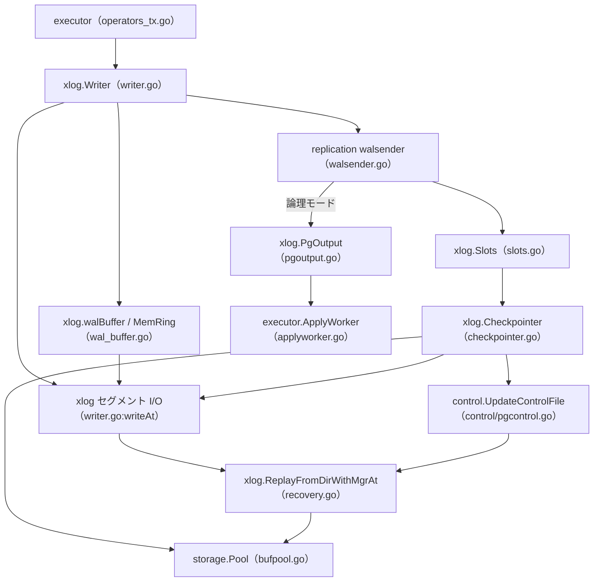

# WAL と耐久性

<details>
<summary>関連ソースファイル</summary>

- [`internal/access/transam/xlog/writer.go`](https://github.com/ryogrid/goopg/blob/19856410e8d497d59787e1ab35a2febb3f5953d6/internal/access/transam/xlog/writer.go)
- [`internal/access/transam/xlog/format.go`](https://github.com/ryogrid/goopg/blob/19856410e8d497d59787e1ab35a2febb3f5953d6/internal/access/transam/xlog/format.go)
- [`internal/access/transam/xlog/checkpointer.go`](https://github.com/ryogrid/goopg/blob/19856410e8d497d59787e1ab35a2febb3f5953d6/internal/access/transam/xlog/checkpointer.go)
- [`internal/access/transam/xlog/recovery.go`](https://github.com/ryogrid/goopg/blob/19856410e8d497d59787e1ab35a2febb3f5953d6/internal/access/transam/xlog/recovery.go)
- [`internal/access/transam/xlog/slots.go`](https://github.com/ryogrid/goopg/blob/19856410e8d497d59787e1ab35a2febb3f5953d6/internal/access/transam/xlog/slots.go)
- [`internal/access/transam/xlog/pgoutput.go`](https://github.com/ryogrid/goopg/blob/19856410e8d497d59787e1ab35a2febb3f5953d6/internal/access/transam/xlog/pgoutput.go)
- [`internal/access/transam/xlog/reader.go`](https://github.com/ryogrid/goopg/blob/19856410e8d497d59787e1ab35a2febb3f5953d6/internal/access/transam/xlog/reader.go)
- [`internal/access/transam/xlog/reorder.go`](https://github.com/ryogrid/goopg/blob/19856410e8d497d59787e1ab35a2febb3f5953d6/internal/access/transam/xlog/reorder.go)
- [`internal/access/transam/xlog/stream_replayer.go`](https://github.com/ryogrid/goopg/blob/19856410e8d497d59787e1ab35a2febb3f5953d6/internal/access/transam/xlog/stream_replayer.go)
- [`internal/access/transam/xlog/decoder.go`](https://github.com/ryogrid/goopg/blob/19856410e8d497d59787e1ab35a2febb3f5953d6/internal/access/transam/xlog/decoder.go)
- [`internal/access/transam/xlog/insert_pos.go`](https://github.com/ryogrid/goopg/blob/19856410e8d497d59787e1ab35a2febb3f5953d6/internal/access/transam/xlog/insert_pos.go)
- [`internal/access/transam/xlog/retention.go`](https://github.com/ryogrid/goopg/blob/19856410e8d497d59787e1ab35a2febb3f5953d6/internal/access/transam/xlog/retention.go)
- [`internal/access/transam/xlog/slot_decoder.go`](https://github.com/ryogrid/goopg/blob/19856410e8d497d59787e1ab35a2febb3f5953d6/internal/access/transam/xlog/slot_decoder.go)
- [`internal/replication/walsender.go`](https://github.com/ryogrid/goopg/blob/19856410e8d497d59787e1ab35a2febb3f5953d6/internal/replication/walsender.go)
- [`internal/storage/bufpool.go`](https://github.com/ryogrid/goopg/blob/19856410e8d497d59787e1ab35a2febb3f5953d6/internal/storage/bufpool.go)
- [`internal/executor/applyworker.go`](https://github.com/ryogrid/goopg/blob/19856410e8d497d59787e1ab35a2febb3f5953d6/internal/executor/applyworker.go)
- [`internal/access/transam/control/pgcontrol.go`](https://github.com/ryogrid/goopg/blob/19856410e8d497d59787e1ab35a2febb3f5953d6/internal/access/transam/control/pgcontrol.go)

</details>

WAL（Write-Ahead Log）は、データページをディスクへ書く前に変更内容を追記型のログとして永続化し、クラッシュ後にそのログから未反映の変更を再適用するための仕組みです。goopg の WAL は PostgreSQL 互換のページヘッダ、`XLogRecord`、CRC32C、セグメントファイル名を持ち、`pg_waldump` などの外部ツールが読める形で `pg_wal` に書かれます。実行エンジンやストレージの変更は `Writer.Append` でレコードになり、コミット時には `FlushUpTo` で耐久化されます。チェックポイントはダーティページを WAL-before-data の順序で書き出して redo 点を進め、クラッシュ復旧は `pg_control` の redo 点から WAL を読み直して `ApplyRecord` を適用します。同じ WAL は物理スタンバイへストリーミングされ、論理スロットでは行変更としてデコードされて pgoutput でサブスクライバへ送られます。

## コンポーネント

- [10.1 WAL レコード形式](10-WAL/10.1-WAL-Format.md) — `XLogRecord` の 24 バイトヘッダ、CRC32C、8 KiB ページヘッダ、ブロック参照、`Rmgr` / `xl_info` の写像、セグメント名を定義します。
- [10.2 WAL ライターとバッファ](10-WAL/10.2-WAL-Writer.md) — `Writer.Append`、8 ストライプの LSN 予約、`walBuffer` と `MemRing`、group commit、`fdatasync` / `fsync` を扱います。
- [10.3 チェックポイント](10-WAL/10.3-Checkpoint.md) — redo の公開、ダーティページの paced flush、チェックポイントレコード、`pg_control` 更新、WAL retention を扱います。
- [10.4 クラッシュ復旧とリプレイ](10-WAL/10.4-Crash-Recovery.md) — `pg_control` の判定、WAL 走査、`ApplyRecord`、redo 起点、破損テールと `ErrEarlyEndOfWAL` を扱います。
- [10.5 レプリケーションスロットと同期コミット](10-WAL/10.5-Replication-Slots.md) — `Slots` の永続化、`RestartLSN` / `ConfirmedFlushLSN`、WAL 保持、`SyncRep` の FIRST/ANY 待機を扱います。
- [10.6 論理デコードと pgoutput](10-WAL/10.6-Logical-Decoding.md) — `SlotDecoder`、`ReorderBuffer`、`PgOutput` の wire format、`ApplyWorker` によるサブスクライバ適用を扱います。

## サブシステム図



`Writer` は変更を WAL レコードとして `pg_wal` のセグメントへ書き、`Checkpointer` はバッファプールのダーティページと `pg_control` を更新します。`Slots` は WAL の保持下限を決め、`walsender` は物理 WAL または `PgOutput` の論理メッセージを送出します。クラッシュ復旧は `pg_control` の redo を入力に同じセグメントを読み直します。

## データフロー

1. **変更の記録** — 実行エンジンやストレージの変更は `Writer.Append(payload)` に渡されます。`state.tryAppend` が LSN を予約し、`walBuffer` と `MemRing` にバイト列を置きます。バッファに収まらない場合は `appendPGCompat` が drain してから書き、commit 側は `FlushUpTo` で WAL を耐久化します（`internal/access/transam/xlog/writer.go:Writer.Append`、`FlushUpTo`）。
2. **チェックポイント** — `Checkpointer` は redo 点を公開し、`FlushAllPaced` でダーティページを書き出し、`XLOG_CHECKPOINT_REDO` / `XLOG_RUNNING_XACTS` / チェックポイントレコードを追加します。マーカーが durable になってから `control.UpdateControlFile` で `pg_control` の `CheckPoint` と `checkPointCopy.redo` を更新し、`SlotAwareRetainer` で不要なセグメントを整理します（`internal/access/transam/xlog/checkpointer.go:runCheckpointOpts`、`internal/access/transam/xlog/retention.go:SlotAwareRetainer.Retain`）。
3. **クラッシュ復旧** — 起動時は `pg_control` の `checkPointCopy.redo` を読み、`ReplayFromDirWithMgrAt` が `ReadAll` でセグメントを走査し、`replayRecordsFrom` が `ApplyRecord` を適用します。ページの `pd_lsn` と CLOG の終端状態により再適用は冪等です（`internal/access/transam/xlog/recovery.go:ReplayFromDirWithMgrAt`、`ApplyRecord`、`replayStartAt`）。
4. **物理レプリケーション** — walsender はスロットの `RestartLSN` から `RecordIterator` を作り、WAL バイト列をスタンバイへ送ります。スタンバイは受信 WAL をローカル `Writer` に追記し、`StreamReplayer` が `ApplyRecord` で適用します。Standby Status Update は `Slots.AdvanceConfirmedFlushLSN` と WAL retention を前進させます（`internal/replication/walsender.go:replyStartReplication`、`internal/access/transam/xlog/slots.go:AdvanceConfirmedFlushLSN`）。
5. **論理レプリケーション** — `SlotDecoder` がスロットの `RestartLSN` から WAL を読み、`Classify` → `Decoder` → `ReorderBuffer` → `PgOutput` の順でコミット済みの行変更を pgoutput メッセージに変換します。サブスクライバの `LogicalReceiver` が `DecodeMessage` し、`ApplyWorker` がローカルトランザクションとして適用します（`internal/access/transam/xlog/slot_decoder.go:SlotDecoder.Run`、`internal/access/transam/xlog/pgoutput.go:PgOutput.Change`）。

## 共有データ型

### Record — WAL 読み取りの共通単位

`internal/access/transam/xlog/reader.go:Record`（15〜20 行）:

```go
type Record struct {
	StartLSN uint64
	EndLSN   uint64
	Payload  []byte
	XLog     *XLogDecodedRecord
}
```

`StartLSN` / `EndLSN` はページヘッダを含む WAL ストリーム上の絶対位置で、`StartLSN` は 1-based、`EndLSN` は最後のバイトの LSN です。`Payload` はネイティブ `RecordKind` を持つ goopg レコードの本体、`XLog` は PG 形式のヘッダ・ブロック参照・main data を持つ構造化ビューです。復旧・物理レプリケーション・論理デコードはすべてこの型を受け取ります。

### Change — 論理デコードの行イベント

`internal/access/transam/xlog/reorder.go:Change`（64〜75 行）:

```go
type Change struct {
	Kind     ChangeKind
	LSN      uint64
	Rel      storage.RelFileNode
	Block    storage.BlockNumber
	LineSlot uint16
	OldTuple []byte
	NewTuple []byte
	// MsgPrefix and MsgContent are a ChangeMessage's prefix and bytes.
	MsgPrefix  string
	MsgContent []byte
}
```

`Kind` は `ChangeInsert` / `ChangeUpdate` / `ChangeDelete` / `ChangeMessage`、`LSN` はイベントをデコードした WAL 位置です。`Rel` と `Block` / `LineSlot` が対象行を指し、`OldTuple` / `NewTuple` が前後像を持ちます。`ChangeMessage` のときだけ `MsgPrefix` / `MsgContent` が使われます。`Decoder` はこの型を xid ごとに `ReorderBuffer` へ積み、コミット時に `PgOutput` へ渡します。

### CheckPointFields — redo 点とクラスタ状態

`internal/access/transam/xlog/recovery.go:CheckPointFields`（738〜776 行）:

```go
type CheckPointFields struct {
	// RedoLSN0 is the 0-based byte position of the checkpoint's redo
	// point. PG's xlogreader validates it against ReadRecPtr.
	RedoLSN0 uint64
	ThisTLI  uint32
	// PrevTLI defaults to ThisTLI. Only an end-of-recovery checkpoint
	// differs (it names the timeline forked off from).
	PrevTLI uint32
	// FullPageWrites mirrors the full_page_writes GUC as the buffer pool
	// currently sees it, not the postgresql.conf text: PG samples
	// Insert->fullPageWrites under the WAL insert lock.
	FullPageWrites bool
	WalLevel       uint32
	NextXid        uint64
	NextOid        uint32
	// NextMulti/NextMultiOffset/OldestMulti come from the multixact
	// allocator. A cluster that has never created a multixact reports
	// NextMulti = OldestMulti = FirstMultiXactId (1), NextMultiOffset = 0.
	NextMulti       uint32
	NextMultiOffset uint32
	OldestXid       uint32
	// OldestXidDB / OldestMultiDB name the database holding the horizon.
	// Upstream's bootstrap seeds both with Template1DbOid; a fresh PG 18
	// cluster reports 1 for each, so 0 (goopg's old value) was never a
	// value real PG writes.
	OldestXidDB   uint32
	OldestMulti   uint32
	OldestMultiDB uint32
	// OldestCommitTsXid / NewestCommitTsXid are InvalidTransactionId (0)
	// while track_commit_timestamp is off — which is goopg's only mode
	// today, and what a real PG 18 pg_controldata reports. goopg used to
	// hardcode 3 here, a value PG never writes with commit ts disabled.
	OldestCommitTsXid uint32
	NewestCommitTsXid uint32
	// OldestActiveXid: PG stamps InvalidTransactionId (0) on shutdown
	// checkpoints (recovery derives it from PrescanPreparedTransactions)
	// and GetOldestActiveTransactionId() on online ones.
	OldestActiveXid uint32
}
```

`RedoLSN0` はクラッシュ復旧の開始点で、チェックポイントレコードと `pg_control` の `checkPointCopy.redo` が同じ値を持ちます。`ThisTLI` / `PrevTLI` はタイムライン、`NextXid` / `NextOid` / `NextMulti` は復旧後に引き継ぐカウンタ、`OldestXid` / `OldestMulti` は horizon です。`CheckPointFields.withDefaults` が下限を埋めるため、部分的な構造でも PG が受理する形になります。

### Slot — 保持位置の永続アンカー

`internal/access/transam/xlog/slots.go:Slot`（44〜87 行）:

```go
type Slot struct {
	Name              string   `json:"name"`
	Kind              SlotKind `json:"kind"`
	RestartLSN        uint64   `json:"restart_lsn"`
	ConfirmedFlushLSN uint64   `json:"confirmed_flush_lsn"`
	// Invalidated, when true, marks the slot as no longer usable
	// because the WAL it was holding back was removed (the
	// standby's lag exceeded `max_slot_wal_keep_size`). An
	// invalidated slot persists so operators can `pg_drop_replication_slot`
	// it explicitly, but the retention path stops honouring its
	// RestartLSN and a reconnecting walsender will refuse to start
	// streaming. Mirrors upstream's "invalidated" state in
	// postgres/src/backend/replication/slot.c. See
	// docs/design/0005-0001-streaming-replication-architecture.md
	// (§ Replication slot retention semantics).
	Invalidated bool `json:"invalidated"`

	// Plugin names the output plugin a logical slot drives
	// (e.g. "pgoutput"). Empty for physical slots. Maps to
	// upstream's pg_replication_slots.plugin column. See
	// docs/design/0008-0001-logical-decoding-pipeline.md.
	Plugin string `json:"plugin,omitempty"`
	// Database is the database name a logical slot is anchored
	// in. Empty for physical slots (which span the whole cluster).
	// Maps to upstream's pg_replication_slots.database.
	Database string `json:"database,omitempty"`
	// CatalogXmin is the oldest transaction id whose catalog row
	// versions a logical slot may still need to reconstruct
	// historic snapshots for. Zero for physical slots and for
	// freshly created logical slots; populated by the decoder as
	// it advances. Maps to upstream's
	// pg_replication_slots.catalog_xmin.
	CatalogXmin uint64 `json:"catalog_xmin,omitempty"`

	// DatabaseOID is the PG Oid of the database a logical slot is
	// anchored in (0 = InvalidOid for physical slots). Stored in the
	// binary state file but not in the JSON fallback format.
	DatabaseOID uint32 `json:"-"`

	// Active is in-memory only; the durable state file records
	// the slot's existence, while Active reflects whether a
	// walsender connection currently owns it.
	Active bool `json:"-"`
}
```

`RestartLSN` はスタンバイが再接続時に必要な最古の WAL、`ConfirmedFlushLSN` はスタンバイが durable と確認した最後の LSN です。`Invalidated` は WAL 削除によってスロットが使えなくなったことを示し、`Active` は現在 walsender が所有しているか（永続化しない）を表します。`MinRestartLSN` が保持下限を決め、`MaxSlotKeepBytes` を超えたスロットは invalidated になります。

### ReplayedCheckpoint — スタンバイの restartpoint 候補

`internal/access/transam/xlog/stream_replayer.go:ReplayedCheckpoint`（74〜82 行）:

```go
type ReplayedCheckpoint struct {
	// StartLSN is the record's internal 1-based start (PG's ReadRecPtr is
	// StartLSN-1); EndLSN is PG's EndRecPtr.
	StartLSN uint64
	EndLSN   uint64
	// Fields and Time are the record's decoded CheckPoint struct.
	Fields CheckPointFields
	Time   int64
}
```

`StartLSN - 1` が PG の `ReadRecPtr`、`EndLSN` が `EndRecPtr` に対応します。スタンバイの `StreamReplayer` は最後に適用したチェックポイントをこの型で保持し、`runRecoveryFlush` が `Fields.RedoLSN0` を `pg_control.checkPointCopy.redo` に採用します。

## 主要な設計判断

- **WAL は PostgreSQL 互換のバイト列** — 24 バイト `XLogRecord`、8 KiB ページヘッダ、CRC32C、`Rmgr` / `xl_info` を使い、外部の PG ツールとスタンバイが読める形式にしています（`internal/access/transam/xlog/format.go:encodeRecordXLog`）。
- **LSN はページヘッダを含むバイト位置** — `StartLSN` は 1-based、ページ境界では 24/40 バイトのヘッダが挟まるため、レコードの LSN は連続しません。`EndLSN` は最後のバイトの LSN です（`internal/access/transam/xlog/writer.go:Writer.Append`）。
- **WAL-before-data** — チェックポイントの `flushBatch` はページを書く前にページの最大 `pd_lsn` まで WAL をフラッシュします。ページだけが先行して永続化されることはありません（`internal/storage/bufpool.go:flushBatch`）。
- **リプレイは冪等** — ページ適用は `pd_lsn` が既に進んでいれば no-op、CLOG は終端状態への書き込みです。同じ範囲を再適用しても結果は変わりません（`internal/access/transam/xlog/recovery.go:ApplyRecord`）。
- **単一チェックポインタと 8 ストライプ append** — チェックポイントは `runMu` で直列化し、通常の WAL 追記は 8 本のストライプで並行化します。LSN 予約は `insertPosTracker` が原子的に行います（`internal/access/transam/xlog/checkpointer.go:runCheckpointOpts`、`internal/access/transam/xlog/insert_pos.go:insertPosTracker`）。
- **スロットが WAL の保持を決める** — チェックポイント LSN だけでは消せない WAL を、無効化されていないスロットの `MinRestartLSN` まで保持します。`max_slot_wal_keep_size` を超えたスロットは invalidated にして保持を解放します（`internal/access/transam/xlog/retention.go:SlotAwareRetainer.Retain`）。
- **論理デコードはコミット境界でのみ出力** — 変更は `ReorderBuffer` に xid ごとに蓄積し、コミット時にだけ `Begin → Change* → Commit` を出力します。アボートはキューを捨て、wire には出しません（`internal/access/transam/xlog/decoder.go:ApplyCommit`、`ApplyAbort`）。

Sources:

- `internal/access/transam/xlog/writer.go`
- `internal/access/transam/xlog/format.go`
- `internal/access/transam/xlog/checkpointer.go`
- `internal/access/transam/xlog/recovery.go`
- `internal/access/transam/xlog/slots.go`
- `internal/access/transam/xlog/pgoutput.go`
- `internal/access/transam/xlog/reader.go`
- `internal/access/transam/xlog/reorder.go`
- `internal/access/transam/xlog/stream_replayer.go`
- `internal/access/transam/xlog/decoder.go`
- `internal/access/transam/xlog/insert_pos.go`
- `internal/access/transam/xlog/retention.go`
- `internal/access/transam/xlog/slot_decoder.go`
- `internal/replication/walsender.go`
- `internal/storage/bufpool.go`
- `internal/executor/applyworker.go`
- `internal/access/transam/control/pgcontrol.go`

<sub>Generated by deepwiki-4myself from `goopg` @ `19856410e`</sub>
