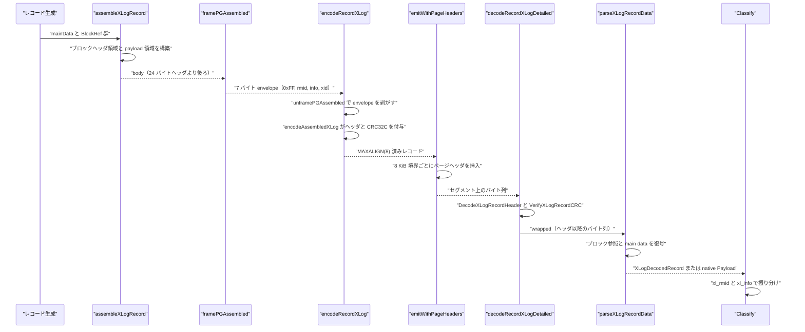
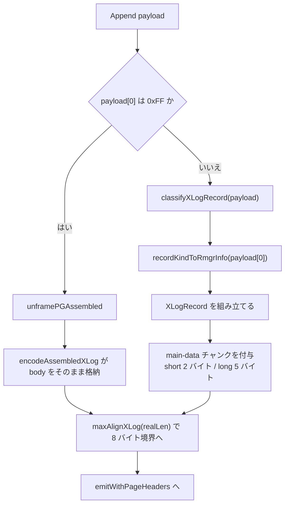

# WAL レコード形式

<details>
<summary>関連ソースファイル</summary>

- [`internal/access/transam/xlog/classifier.go`](https://github.com/ryogrid/goopg/blob/19856410e8d497d59787e1ab35a2febb3f5953d6/internal/access/transam/xlog/classifier.go)
- [`internal/access/transam/xlog/format.go`](https://github.com/ryogrid/goopg/blob/19856410e8d497d59787e1ab35a2febb3f5953d6/internal/access/transam/xlog/format.go)
- [`internal/access/transam/xlog/pg_assembled_emit.go`](https://github.com/ryogrid/goopg/blob/19856410e8d497d59787e1ab35a2febb3f5953d6/internal/access/transam/xlog/pg_assembled_emit.go)
- [`internal/access/transam/xlog/relmap.go`](https://github.com/ryogrid/goopg/blob/19856410e8d497d59787e1ab35a2febb3f5953d6/internal/access/transam/xlog/relmap.go)
- [`internal/access/transam/xlog/rmgr_map.go`](https://github.com/ryogrid/goopg/blob/19856410e8d497d59787e1ab35a2febb3f5953d6/internal/access/transam/xlog/rmgr_map.go)
- [`internal/access/transam/xlog/seq_log.go`](https://github.com/ryogrid/goopg/blob/19856410e8d497d59787e1ab35a2febb3f5953d6/internal/access/transam/xlog/seq_log.go)
- [`internal/access/transam/xlog/xlog_assemble.go`](https://github.com/ryogrid/goopg/blob/19856410e8d497d59787e1ab35a2febb3f5953d6/internal/access/transam/xlog/xlog_assemble.go)
- [`internal/access/transam/xlog/xlog_emit.go`](https://github.com/ryogrid/goopg/blob/19856410e8d497d59787e1ab35a2febb3f5953d6/internal/access/transam/xlog/xlog_emit.go)
- [`internal/access/transam/xlog/xlog_page.go`](https://github.com/ryogrid/goopg/blob/19856410e8d497d59787e1ab35a2febb3f5953d6/internal/access/transam/xlog/xlog_page.go)
- [`internal/access/transam/xlog/xlog_record.go`](https://github.com/ryogrid/goopg/blob/19856410e8d497d59787e1ab35a2febb3f5953d6/internal/access/transam/xlog/xlog_record.go)
- [`internal/access/transam/xlog/pg_xlog_decode.go`](https://github.com/ryogrid/goopg/blob/19856410e8d497d59787e1ab35a2febb3f5953d6/internal/access/transam/xlog/pg_xlog_decode.go)
- [`internal/access/transam/xlog/predict_xlog_record_len.go`](https://github.com/ryogrid/goopg/blob/19856410e8d497d59787e1ab35a2febb3f5953d6/internal/access/transam/xlog/predict_xlog_record_len.go)

</details>

goopg の WAL は、PostgreSQL と同一のページヘッダと `XLogRecord` ヘッダを持つバイト列として書き出されます。`internal/access/transam/xlog` パッケージは、レコード本体（ブロック参照・フルページイメージ・main data）の組み立て、24 バイトヘッダと CRC32C の付与、8 KiB ページ境界へのページヘッダ挿入、セグメントファイル名の生成、そして読み戻したバイト列からのヘッダ復号・ブロック参照復号・リプレイ向け分類までを担います。本ページは、[10 WAL と耐久性](../10-WAL.md) のうち「1 レコードがどのようなバイト列になるか」を扱い、書き込み側のバッファリングやリプレイ手順そのものは [10.2 WAL ライターとバッファ](10.2-WAL-Writer.md)、[10.4 クラッシュ復旧とリプレイ](10.4-Crash-Recovery.md) に譲ります。

## 責務

- 24 バイトの `XLogRecord` ヘッダ（`xl_tot_len` / `xl_xid` / `xl_prev` / `xl_info` / `xl_rmid` / パディング / `xl_crc`）のエンコードとデコードを提供する（`internal/access/transam/xlog/xlog_record.go:EncodeXLogRecordHeader`、`internal/access/transam/xlog/xlog_record.go:DecodeXLogRecordHeader`）。
- PostgreSQL 互換の CRC32C（Castagnoli 多項式）を、ペイロード全体の後ろにヘッダ先頭 20 バイトを続ける順序で計算し、`xl_crc` に格納する（`internal/access/transam/xlog/xlog_record.go:XLogCRC32C`、`internal/access/transam/xlog/xlog_record.go:VerifyXLogRecordCRC`）。
- 8 KiB のページ境界ごとに short（24 バイト）/ long（40 バイト）ページヘッダを挿入し、ページをまたぐレコードには `XLP_FIRST_IS_CONTRECORD` と `xlp_rem_len` を設定する（`internal/access/transam/xlog/xlog_emit.go:emitWithPageHeaders`、`internal/access/transam/xlog/xlog_page.go:XLogPageHeader`）。
- レコード本体を「ブロック参照ヘッダ領域 + ペイロード領域」の PostgreSQL 形式で構築する。フルページイメージの free-space hole 除去もここで行う（`internal/access/transam/xlog/xlog_assemble.go:assembleXLogRecordInto`、`internal/access/transam/xlog/xlog_assemble.go:appendFullPageImage`）。
- goopg 内部の `RecordKind` バイト列を、実在の PostgreSQL リソースマネージャ ID と `xl_info` オペコードに写像する（`internal/access/transam/xlog/rmgr_map.go:recordKindToRmgrInfo`、`internal/access/transam/xlog/format.go:classifyXLogRecord`）。
- あらかじめ組み立て済みの PG レコードを 7 バイトの輸送用エンベロープに包み、既存の `Append` 経路へ流す。エンベロープはディスクには書かれない（`internal/access/transam/xlog/pg_assembled_emit.go:framePGAssembled`、`internal/access/transam/xlog/pg_assembled_emit.go:unframePGAssembled`）。
- 読み戻したレコードを `XLogDecodedRecord`（ヘッダ、ブロック参照、main data）へ復号し、ネイティブ形式と PG 形式を判別する（`internal/access/transam/xlog/pg_xlog_decode.go:decodeRecordXLogDetailed`、`internal/access/transam/xlog/pg_xlog_decode.go:parseXLogRecordData`）。
- 論理デコード向けに、復号済みレコードをトランザクション ID ごとの変更イベントへ分類する（`internal/access/transam/xlog/classifier.go:Classify`）。
- セグメントファイル名の生成・解析（`internal/access/transam/xlog/format.go:FormatSegmentNameTLI`、`internal/access/transam/xlog/xlog_page.go:XLogFileName`、`internal/access/transam/xlog/xlog_page.go:ParseXLogFileName`）。
- 個別レコード型のエンコーダを提供する。代表例はシーケンス（`internal/access/transam/xlog/seq_log.go:EncodeSeqLogPG`）と `pg_filenode.map`（`internal/access/transam/xlog/relmap.go:EncodeRelmapUpdatePG`）。

## 処理フロー

書き込み側は「レコード本体を組み立てる → エンベロープを付ける → 24 バイトヘッダと CRC を付ける → ページヘッダを差し込む」、読み込み側は「ヘッダ復号 → CRC 検証 → ブロック参照/main data 復号 → 分類」の順に進みます。以下のシーケンスは `EncodeHeapInsertPG` を例に、`assembleXLogRecord` から `Classify` までの実在の呼び出し経路を示します。



1. **本体の組み立て** — `assembleXLogRecord` は `BlockRef` を昇順に走査し、各ブロックの `XLogRecordBlockHeader`（id、fork_flags、data_length）をヘッダ領域へ、イメージとブロックデータをペイロード領域へ書きます。main data がある場合は最後に `xlrBlockIDDataShort`（2 バイト）または `xlrBlockIDDataLong`（5 バイト）のチャンクヘッダを付けます（`internal/access/transam/xlog/xlog_assemble.go:assembleXLogRecordInto`）。
2. **エンベロープ付与** — `framePGAssembled` は `0xFF`、`rmid`、`info`、`xid` の 7 バイトを先頭に置きます。これは `Append([]byte)` のインターフェースを変えずに、組み立て済みの本体を運ぶための輸送形式です（`internal/access/transam/xlog/pg_assembled_emit.go:framePGAssembled`）。
3. **ヘッダ付与** — `encodeRecordXLog` は先頭バイトが `pgAssembledMarker` なら `unframePGAssembled` で envelope を剥がし、`encodeAssembledXLog` に委譲します。ここでは本体を再ラップせず、`TotLen = 24 + len(body)` の `XLogRecord` を書きます（`internal/access/transam/xlog/format.go:encodeRecordXLog`、`internal/access/transam/xlog/pg_assembled_emit.go:encodeAssembledXLog`）。エンベロープでない場合は `classifyXLogRecord(payload)` が `payload[0]` を `recordKindToRmgrInfo` に渡し、ネイティブ本体を 1 つの main-data チャンクとして包みます。
4. **ページヘッダ挿入** — `emitWithPageHeaders` は `startPos` がページ境界なら先頭にページヘッダを置き、以降はページ残量ずつレコードをコピーします。ページをまたぐ残りがある場合は次のページ先頭に contrecord ヘッダを挿入します（`internal/access/transam/xlog/xlog_emit.go:emitWithPageHeaders`、`internal/access/transam/xlog/xlog_emit.go:buildPageHeader`）。
5. **復号** — `decodeRecordXLogDetailed` は 24 バイトヘッダを復号し、`TotLen` の範囲を検証して `VerifyXLogRecordCRC` を呼びます。続く `parseXLogRecordData` はヘッダ領域を走査してブロック参照と main-data チャンクを読み、ペイロード領域からイメージ・ブロックデータ・main data を切り出して `XLogDecodedRecord` を返します（`internal/access/transam/xlog/pg_xlog_decode.go:decodeRecordXLogDetailed`、`internal/access/transam/xlog/pg_xlog_decode.go:parseXLogRecordData`）。
6. **分類** — `Classify` は `Record.Payload` が空なら `classifyDecodedXLog` に回し、`XLog.Header` の `Rmid` / `Info` でコミット・アボート・論理メッセージ・ヒープ変更を振り分けます。ネイティブ payload がある場合は `payload[0]` の `RecordKind` で分岐します（`internal/access/transam/xlog/classifier.go:Classify`、`internal/access/transam/xlog/classifier.go:classifyDecodedXLog`）。

## 主要ファイル

| ファイル | 役割 |
| --- | --- |
| `internal/access/transam/xlog/xlog_record.go` | `XLogRecord` の定義、24 バイトヘッダのエンコード/デコード、CRC32C の計算と検証、`Rmgr` 定数。`EncodeXLogRecordHeader` / `DecodeXLogRecordHeader` / `VerifyXLogRecordCRC`。 |
| `internal/access/transam/xlog/xlog_page.go` | `XLogPageHeader` / `XLogLongPageHeader` の定義とエンコード/デコード、ページ検証器 `xlogPageValidator`、セグメント名 `XLogFileName` / `ParseXLogFileName`。 |
| `internal/access/transam/xlog/xlog_emit.go` | ページ境界へのヘッダ挿入 `emitWithPageHeaders`、ヘッダ生成 `buildPageHeader`、読み戻し時のヘッダ除去 `extractRecordBytes`。 |
| `internal/access/transam/xlog/xlog_assemble.go` | ブロック参照 `BlockRef` とフルページイメージ `FullPageImage` から PG 形式のレコード本体を構築する `assembleXLogRecord` / `assembleXLogRecordInto`、hole 除去 `appendFullPageImage`。 |
| `internal/access/transam/xlog/format.go` | ネイティブ payload の分類 `classifyXLogRecord`、レコードの枠付け `encodeRecordXLog`、セグメント名 `FormatSegmentNameTLI`、EOS 判定 `isZeroXLogRecordHeader`。 |
| `internal/access/transam/xlog/pg_assembled_emit.go` | 組み立て済み PG レコードの輸送エンベロープ `framePGAssembled` / `unframePGAssembled`、ヘッダ付与 `encodeAssembledXLog`、各レコード型のエンコーダ群（`EncodeHeapInsertPG` など）。 |
| `internal/access/transam/xlog/rmgr_map.go` | `RecordKind` バイトから `(Rmgr, xl_info)` への写像 `recordKindToRmgrInfo`。 |
| `internal/access/transam/xlog/pg_xlog_decode.go` | ヘッダ・ブロック参照・main data の復号 `decodeRecordXLogDetailed` / `parseXLogRecordData`、復号型 `XLogBlockRef` / `XLogDecodedRecord`。 |
| `internal/access/transam/xlog/predict_xlog_record_len.go` | エンコードせずに `xl_tot_len` と MAXALIGN 後の長さを予測する `predictXLogRecordLen`。 |
| `internal/access/transam/xlog/classifier.go` | 復号済みレコードを論理デコード用の変更イベントへ振り分ける `Classify` / `classifyDecodedXLog`。 |
| `internal/access/transam/xlog/seq_log.go` | `XLOG_SEQ_LOG` のエンコード `EncodeSeqLogPG`、シーケンスページ再構築 `BuildSequencePage`、リプレイ `replayDecodedXLogSeqLog`。 |
| `internal/access/transam/xlog/relmap.go` | `pg_filenode.map` のエンコード/検証 `EncodeRelMapFile` / `ValidateRelMapFile`、`XLOG_RELMAP_UPDATE` のエンコード `EncodeRelmapUpdatePG` とリプレイ。 |

## 公開 API / エントリポイント

パッケージ外から利用される主な関数です（シグネチャはソースのまま）。

```go
func FormatSegmentName(segNo uint64) string
func FormatSegmentNameTLI(segNo uint64, tli uint32) string

func XLogCRC32C(data []byte) uint32
func EncodeXLogRecordHeader(dst []byte, h XLogRecord, payload []byte) error
func DecodeXLogRecordHeader(src []byte) (XLogRecord, error)
func VerifyXLogRecordCRC(headerBytes, payload []byte, want uint32) error

func EncodeXLogPageHeader(dst []byte, h XLogPageHeader) error
func DecodeXLogPageHeader(src []byte) (XLogPageHeader, error)
func EncodeXLogLongPageHeader(dst []byte, h XLogLongPageHeader) error
func DecodeXLogLongPageHeader(src []byte) (XLogLongPageHeader, error)

func XLogFileName(tli uint32, segno uint64, segSize int64) string
func ParseXLogFileName(name string, segSize int64) (tli uint32, segno uint64, ok bool)

func EncodeSeqLogPG(rel storage.RelFileNode, tupleBytes []byte) ([]byte, error)
func BuildSequencePage(tupleBytes []byte) (storage.Page, error)

func EncodeRelMapFile(mappings []RelMapping) []byte
func ValidateRelMapFile(image []byte) ([]RelMapping, error)
func EncodeRelmapUpdatePG(dbid, tsid uint32, image []byte) ([]byte, error)

func EncodeHeapInsertPG(rel storage.RelFileNode, blk storage.BlockNumber, lineSlot uint16, tuple []byte, initPage bool) ([]byte, error)
func EncodeHeapDeletePG(rel storage.RelFileNode, blk storage.BlockNumber, lineSlot uint16, xmax storage.TransactionID, oldTuple []byte) ([]byte, error)
func EncodeHeapHotUpdatePG(rel storage.RelFileNode, blk storage.BlockNumber, oldSlot, newSlot uint16, xmax storage.TransactionID, newTuple []byte) ([]byte, error)
func EncodeCheckpointPG(shutdown bool, redoLSN0 uint64, tli uint32, nextXid uint64, nextOid uint32, oldestActiveXid uint32) ([]byte, error)
func EncodeCheckpointRedoPG() ([]byte, error)
func EncodeRunningXactsPG(nextXid, oldestRunning, latestCompleted uint32, xids []uint32) ([]byte, error)

func Classify(d *Decoder, r Record) error
```

`Encode*PG` 系が返す `[]byte` は、ディスク上のレコードではなく **7 バイトのエンベロープを含む `Append` 用 payload** です。実際のヘッダと CRC は `encodeRecordXLog` が付与します。呼び出し側が予約サイズを先に決めたい場合は `predictXLogRecordLen` が `(realRecLen, paddedLen)` を返します（`internal/access/transam/xlog/predict_xlog_record_len.go:predictXLogRecordLen`）。

## 主要データ構造

### Rmgr — リソースマネージャ ID

`internal/access/transam/xlog/xlog_record.go:Rmgr`（50 行）:

```go
type Rmgr uint8
```

値は PostgreSQL の `RM_*_ID` と一致します。`RmgrXLog = 0`、`RmgrXact = 1`、`RmgrStorage = 2`、`RmgrCLOG = 3`、`RmgrDbase = 4`、`RmgrTblspc = 5`、`RmgrRelMap = 7`、`RmgrStandby = 8`、`RmgrHeap2 = 9`、`RmgrHeap = 10`、`RmgrBtree = 11`、`RmgrSeq = 15`、`RmgrLogicalMessage = 21` です。`MaxKnownRmgr` は `RmgrLogicalMessage`（21）に等しく、これを超えて `RmgrGoopgCustomBase = 128` 未満の値はデコーダが拒否します。128 以上は PostgreSQL のカスタム rmgr 範囲で、goopg は `RmgrGoopgCatalog = RmgrGoopgCustomBase` を「PG に対応物がないレコード」の総関数フォールバックとして保持しています（`internal/access/transam/xlog/xlog_record.go:Rmgr`、`internal/access/transam/xlog/rmgr_map.go:recordKindToRmgrInfo`）。

### XLogRecord — 24 バイトのレコードヘッダ

`internal/access/transam/xlog/xlog_record.go:XLogRecord`（141〜148 行）:

```go
type XLogRecord struct {
	TotLen uint32 // xl_tot_len — total bytes including the 24-byte header
	XID    uint32 // xl_xid     — TransactionId is uint32 in upstream
	Prev   uint64 // xl_prev    — start LSN of the previous record
	Info   uint8  // xl_info    — flag bits (XLR_*)
	Rmid   Rmgr   // xl_rmid    — resource manager id
	CRC    uint32 // xl_crc     — set by EncodeXLogRecordHeader, validated by reader
}
```

ディスク上の並びはリトルエンディアンで、`TotLen`(0..3)、`XID`(4..7)、`Prev`(8..15)、`Info`(16)、`Rmid`(17)、ゼロ埋めパディング(18..19)、`CRC`(20..23) です。`TotLen` はヘッダ 24 バイトを含むレコード全長で、`EncodeXLogRecordHeader` は `TotLen == 24 + len(payload)` を検証します。したがって `TotLen` と実ペイロード長が食い違うレコードは生成できません。`Prev` は直前レコードの開始 LSN（0 は「前レコードなし」）で、WAL の連鎖を逆方向にたどるためのリンクです。`CRC` は「ペイロード → ヘッダ先頭 20 バイト」の順で計算され、計算時には `CRC` 自身の 4 バイトをゼロにした状態を使います（`internal/access/transam/xlog/xlog_record.go:EncodeXLogRecordHeader`、`VerifyXLogRecordCRC`）。

`Info` の下位 4 ビットは WAL フレームワーク用（`XLRInfoMask = 0x0F`）、上位 4 ビットはリソースマネージャ用（`XLRRmgrInfoMask = 0xF0`）です。下位ビットで現在定義されているのは `XLRSpecialRelUpdate = 0x01` と `XLRCheckConsistency = 0x02` だけなので、それ以外のビットが立つヘッダは `ErrInvalidRecordHeader` になります。`Rmid` は `0..MaxKnownRmgr`（21）または `128..255` のカスタム範囲だけが受理され、その間の値は「未知の rmid」として拒否されます（`internal/access/transam/xlog/xlog_record.go:DecodeXLogRecordHeader`）。

### XLogPageHeader / XLogLongPageHeader — 8 KiB ページの先頭

`internal/access/transam/xlog/xlog_page.go:XLogPageHeader`（87〜93 行）:

```go
type XLogPageHeader struct {
	Magic    uint16 // xlp_magic
	Info     uint16 // xlp_info — flag bits (XLP_*)
	TLI      uint32 // xlp_tli — timeline of the first record on this page
	PageAddr uint64 // xlp_pageaddr — absolute byte LSN of this page
	RemLen   uint32 // xlp_rem_len — bytes left of a continued record (0 if not a contrecord page)
}
```

`internal/access/transam/xlog/xlog_page.go:XLogLongPageHeader`（98〜103 行）:

```go
type XLogLongPageHeader struct {
	Std        XLogPageHeader
	SysID      uint64 // xlp_sysid — matches pg_control's system_identifier
	SegSize    uint32 // xlp_seg_size — cross-check (must equal wal_segment_size)
	XLogBlcksz uint32 // xlp_xlog_blcksz — cross-check (must equal XLOGBlockSize)
}
```

short ヘッダは論理 20 バイトを MAXALIGN して 24 バイト、long ヘッダは 40 バイトです。`Magic` は `XLOGPageMagic = 0xD118`（PG18 相当）で、`Info` のビットは `XLPFirstIsContRecord = 0x0001`、`XLPLongHeader = 0x0002`、`XLPBkpRemovable = 0x0004`、`XLPFirstIsOverwriteContRecord = 0x0008` のいずれかでなければなりません。`PageAddr` はそのページの WAL ストリーム上の絶対バイト位置で、`xlogPageValidator.check` はデコードした `PageAddr` が期待値と一致するかまで検証します（リサイクル済みセグメントの防御）。`RemLen` は contrecord ページでのみ意味を持ち、レコードの**未パディング**残りバイト数が入ります。

### BlockRef / FullPageImage — 組み立て入力

`internal/access/transam/xlog/xlog_assemble.go:BlockRef`（36〜58 行）:

```go
type BlockRef struct {
	// ID is the block reference id (0..xlrMaxBlockID). PostgreSQL emits
	// references in ascending id order; SameRel back-references the rel of
	// the immediately preceding reference.
	ID uint8
	// Rel identifies the relation file. A shared catalog (Rel.DBOid == 0)
	// encodes as the global tablespace OID (1664); otherwise Rel.TblOid == 0
	// encodes as the pg_default tablespace OID (1663), matching PostgreSQL's
	// RelFileLocator. B4.1a.
	Rel storage.RelFileNode
	// Block is the block number within Rel's fork.
	Block storage.BlockNumber
	// Data is the rmgr-specific block data (BKPBLOCK_HAS_DATA). Must fit uint16.
	Data []byte
	// Image, when non-nil, attaches a full-page image (BKPBLOCK_HAS_IMAGE).
	Image *FullPageImage
	// WillInit marks the block as re-initialized from the record
	// (BKPBLOCK_WILL_INIT) so redo need not read the prior page.
	WillInit bool
	// SameRel omits the RelFileLocator and reuses the preceding reference's
	// rel (BKPBLOCK_SAME_REL). Invalid on the first reference.
	SameRel bool
}
```

`internal/access/transam/xlog/xlog_assemble.go:FullPageImage`（64〜69 行）:

```go
type FullPageImage struct {
	// Page is the raw block image; must be exactly storage.BlockSize bytes.
	Page storage.Page
	// Apply requests BKPIMAGE_APPLY (redo restores the image unconditionally).
	Apply bool
}
```

`BlockRef` の不変条件は `assembleXLogRecordInto` が強制します。`ID` は `xlrMaxBlockID`（32）以下、`Data` は `0xFFFF` バイト以下、最初の参照に `SameRel` を立てることはできません。`Data` の有無が `BKPBLOCK_HAS_DATA`、`Image` の有無が `BKPBLOCK_HAS_IMAGE` に対応し、呼び出し側がフラグを指定するのではなく内容から導出されます。`SameRel` の参照は直前の `RelFileLocator` を再利用するため、2 番目以降のブロックでだけ有効です。

### XLogBlockRef / XLogDecodedRecord — 復号後のビュー

`internal/access/transam/xlog/pg_xlog_decode.go:XLogBlockRef`（302〜311 行）:

```go
type XLogBlockRef struct {
	ID         byte
	Rel        storage.RelFileNode
	Block      storage.BlockNumber
	HasImage   bool
	ImageApply bool
	WillInit   bool
	Image      storage.Page
	Data       []byte
}
```

`internal/access/transam/xlog/pg_xlog_decode.go:XLogDecodedRecord`（316〜322 行）:

```go
type XLogDecodedRecord struct {
	Header       XLogRecord
	RecordOrigin uint16
	TopLevelXID  uint32
	MainData     []byte
	Blocks       []XLogBlockRef
}
```

復号時は、ヘッダ領域を走査して各ブロックの `dataLen` と `imgLen` を積算し、その合計と残りバイト数が一致しなければ `ErrCorruptRecord` になります。ブロックイメージは `bkpImageHasHole` が立っていれば `holeOffset` と `imgLen` から元の 8 KiB ページへ再構成され、立っていなければ `imgLen` がちょうど `storage.BlockSize` でなければなりません（`internal/access/transam/xlog/pg_xlog_decode.go:decodeXLogBlockImage`）。`MainData` と `Blocks[].Data` は `cloneXLogBytes` でコピーされるため、復号結果は入力バッファの寿命に依存しません。

## 内部構造

### ネイティブペイロードと組み立て済み PG レコードの二経路

`encodeRecordXLog` の分岐は先頭バイトだけで決まります。`0xFF`（`pgAssembledMarker`）なら組み立て済み、それ以外ならネイティブ `RecordKind` です。



ネイティブ経路では `classifyXLogRecord` が `payload` の先頭バイトを `recordKindToRmgrInfo` に渡し、`(Rmgr, xl_info)` を得ます。このとき `xl_xid` は常に 0 です。実際のトランザクション ID はペイロード本体にあり、ヘッダには載りません（`internal/access/transam/xlog/format.go:classifyXLogRecord`）。空ペイロードは `RmgrXLog` / `0xF0`（`xlogInfoDefault`）になります。

一方、`0xFF` 経路のエンベロープは **ディスクには一切書かれません**。`unframePGAssembled` が 7 バイトを読み取った後、`body` だけが `encodeAssembledXLog` に渡されます。`0xFF` が予約されているのは、既存の `RecordKind` が高々 132 程度までしか使われていないためです（`internal/access/transam/xlog/pg_assembled_emit.go:pgAssembledMarker`）。この区別により、`EncodeHeapInsertPG` などが返す「エンベロープ付き payload」と、`EncodeHeapInsert` などが返す「ネイティブ payload」を同じ `Append` で扱えます。

### ネイティブ形式と PG 形式の判別

復号側は、main-data チャンクの先頭バイトが `RecordKind` に見え、かつヘッダの `(Rmid, Info, XID)` が `classifyXLogRecord(mainData)` の結果と一致する場合にだけ、それをネイティブ `Payload` として扱います（`internal/access/transam/xlog/pg_xlog_decode.go:nativeHeaderMatchesMainData`）。さらに `RecordKindSmgrCreate` と `RecordKindClogTruncate` については、固定長 `smgrRecordSize` / `xactRecordSize` と一致するかまで確認します。これは、PG 形式の `xl_clog_truncate` などの先頭バイトが偶然ネイティブの `RecordKind` と衝突した場合に、構造化された `XLogDecodedRecord` 経路へ正しく流すためのガードです。判別に失敗したレコードは `decoded.XLog` に残り、`decodeRecordXLog` は「structured xlog fragments を持つ」として `ErrCorruptRecord` を返します（`internal/access/transam/xlog/format.go:decodeRecordXLog`）。

### ページ・セグメントのアドレス計算

1 ページは `XLOGBlockSize = 8192` バイトです。`emitWithPageHeaders` は `pos % XLOGBlockSize == 0` の位置にページヘッダを置き、`pos % segSize == 0` なら long ヘッダ（40 バイト）、それ以外なら short ヘッダ（24 バイト）を選びます（`internal/access/transam/xlog/xlog_emit.go:pageHeaderSizeAt`、`buildPageHeader`）。したがって WAL の LSN は「ページヘッダを含むバイト位置」であり、レコードがページをまたぐと LSN 空間上では不連続になります。

セグメント名は `FormatSegmentNameTLI` が `%08X%08X%08X`（TLI、LOG、SEG）で生成します。`totalBytes = segNo * DefaultSegmentSize`（16 MiB）に対し、`LOG = totalBytes >> 32`、`SEG = (totalBytes & 0xFFFFFFFF) / DefaultSegmentSize` です（`internal/access/transam/xlog/format.go:FormatSegmentNameTLI`）。`XLogFileName` は同じ値を `segno % (1<<32 / segSize)` で計算する等価な実装で、`ParseXLogFileName` は 24 桁の 16 進文字列を厳密にパースし、不正なら `ok=false` を返します（`internal/access/transam/xlog/xlog_page.go:XLogFileName`、`ParseXLogFileName`）。

### フルページイメージの hole 除去

`FullPageImage` は 8 KiB ページ全体を受け取りますが、標準ページヘッダの `pd_lower` と `pd_upper` の間（free space）はディスクに書きません。`fpiHole` が `lower >= SizeOfPageHeaderData`、`upper > lower`、`upper <= BlockSize` を満たす場合だけ hole とみなし、`bkpImageHasHole` を立てて `holeOffset = lower`、`imgLen = BlockSize - (upper - lower)` を記録します。条件を満たさないページは hole なしで全 8192 バイトを書きます（`internal/access/transam/xlog/xlog_assemble.go:fpiHole`、`appendFullPageImage`）。

### 論理デコード向けの分類

`Classify` はレコードを「ユーザーデータの変更」だけに絞り込みます。ネイティブ payload では `RecordKindHeapInsert` / `HeapHotUpdate` / `HeapUpdate` / `HeapDelete` / `XactCommit` / `XactAbort` を処理し、`HeapVacuum`、`BtreeInsert`、`BtreeSplit`、`PageImage`、`Checkpoint` は黙って読み飛ばします。ヒープ挿入の xid はタプル先頭 4 バイトの `xmin` から取り出し、削除の xid はペイロードの `xmax` から取ります（`internal/access/transam/xlog/classifier.go:xminFromTuple`）。復号済み PG 形式では `RmgrXact` のコミット/アボート、`RmgrLogicalMessage` の論理メッセージ、`RmgrHeap` の挿入・削除・HOT 更新を `xl_info` のマスク値で判定します。

## エッジケースと不変条件

- **ヘッダ長と総長** — 入力が 24 バイト未満なら `ErrCorruptRecord`。`TotLen < 24` または `TotLen > len(stream)` も `ErrCorruptRecord` です。`TotLen` は MAXALIGN 前の長さで、実際の消費バイト数は `maxAlignXLog(TotLen)`（8 バイト境界）です（`internal/access/transam/xlog/pg_xlog_decode.go:decodeRecordXLogDetailed`）。
- **CRC の順序** — `xl_crc` は「ペイロード全体 → ヘッダの 0..19 バイト」の順で計算します。`VerifyXLogRecordCRC` は渡されたヘッダの 20..23 をスクラッチコピー上でゼロにしてから同じ順序で再計算し、一致しなければ `ErrCorruptRecord` を返します（`internal/access/transam/xlog/xlog_record.go:VerifyXLogRecordCRC`）。
- **ヘッダの予約領域** — オフセット 18..19 のパディングが非ゼロなら `ErrInvalidRecordHeader`。`Rmid` が `MaxKnownRmgr`（21）より大きく `RmgrGoopgCustomBase`（128）未満なら未知の rmid として拒否されます。`Info` の下位 4 ビットに未定義ビットがあれば同じく拒否です（`internal/access/transam/xlog/xlog_record.go:DecodeXLogRecordHeader`）。
- **main-data チャンクの重複** — `parseXLogRecordData` は main-data チャンクを読んだ後に再び short/long ヘッダを検出すると `ErrCorruptRecord` を返します。ヘッダ領域の走査で `datatotal` と実ペイロード長が一致しない場合、末尾に余分なバイトがある場合も破損扱いです（`internal/access/transam/xlog/pg_xlog_decode.go:parseXLogRecordData`）。
- **SAME_REL の前提** — `SameRel` が立っているのに直前の `RelFileLocator` が存在しない場合、復号は `ErrCorruptRecord`。組み立て側も最初のブロックに `SameRel` を許しません（`internal/access/transam/xlog/xlog_assemble.go:assembleXLogRecordInto`、`internal/access/transam/xlog/pg_xlog_decode.go:decodeXLogBlockRefHeader`）。
- **ブロックデータ長** — 組み立て時に `len(Data) > 0xFFFF` はエラー、`ID > xlrMaxBlockID`（32）もエラーです。ブロックヘッダの `data_length` は `uint16` なので、この上限を超えるデータは 1 つのブロック参照に載せられません。
- **フルページイメージ長** — `Page` が `storage.BlockSize` でなければ `appendFullPageImage` はエラーを返します。復号側でも hole なしのイメージが 8192 バイトでない場合、または hole の `off`/`len` がページ範囲を外れる場合は `ErrCorruptRecord` です（`internal/access/transam/xlog/xlog_assemble.go:appendFullPageImage`、`internal/access/transam/xlog/pg_xlog_decode.go:decodeXLogBlockImage`）。
- **圧縮イメージは「未対応」であって「破損」ではない** — `bkpImageCompressMS` が立つ PostgreSQL の圧縮バックアップブロックは `ErrUnsupportedRecord` で拒否されます。これはディスクに永続化された正規のレコードであり、破損として読み捨てると後続レコードを失うためです（`internal/access/transam/xlog/pg_xlog_decode.go:decodeXLogBlockRefHeader`）。
- **EOS とページ検証** — 24 バイトすべてがゼロのヘッダは、事前確保済みセグメント末尾の EOS センチネルとして扱われます（`internal/access/transam/xlog/format.go:isZeroXLogRecordHeader`）。ページ検証器は、セグメント先頭で long ヘッダがあること、`xlp_seg_size` が設定値と一致すること、`xlp_xlog_blcksz` が 8192 であること、`xlp_pageaddr` が実際のページ位置と一致すること、TLI が後退しないことを検査します。違反は `ErrInvalidPageHeader` となり、呼び出し側では WAL の終端として扱われます（`internal/access/transam/xlog/xlog_page.go:xlogPageValidator.check`、`checkSpan`）。
- **contrecord の `xlp_rem_len`** — ページをまたぐ際の残量は `realRecLen - consumed`、つまり **MAXALIGN パディングを含まない** `xl_tot_len` 基準の値です。パディング込みの `len(record)` を使うと PostgreSQL が「invalid contrecord length」を報告します（`internal/access/transam/xlog/xlog_emit.go:emitWithPageHeaders`）。
- **チェックポイントのオペコード** — online は `0x10`、shutdown は `0x00`、PG17+ の redo マーカーは `0xE0` です。online チェックポイントは `EncodeCheckpointRedoPG` のレコードを redo 点に置き、リカバリはその位置のレコードが正確に `XLOG_CHECKPOINT_REDO` であることを要求します（`internal/access/transam/xlog/format.go:xlogCheckpointOnline`、`xlogCheckpointShutdown`、`xlogCheckpointRedo`、`internal/access/transam/xlog/pg_assembled_emit.go:EncodeCheckpointRedoPG`）。
- **relmap の固定長** — `pg_filenode.map` は 524 バイト固定（マジック `0x592717`、最大 64 エントリ、CRC はオフセット 520）です。`EncodeRelMapFile` は 65 件以上で panic し、`ValidateRelMapFile` はサイズ・マジック・件数・CRC を検証します。リプレイは一時ファイルへ書いて `fsync` した後に `rename` するため、対象の `pg_filenode.map` が半端な内容で置き換わることはありません（`internal/access/transam/xlog/relmap.go:EncodeRelMapFile`、`ValidateRelMapFile`、`replayDecodedXLogRelmapUpdate`）。
- **シーケンスレコード** — main data は `xl_seq_rec` の 12 バイト（spcOid=1663、dbOid、relNumber）と生のタプルです。ページ再構築時は 4 バイトの `SEQ_MAGIC = 0x1717` を MAXALIGN した 8 バイトの special area に置き、タプルをオフセット 1 に手動で配置します（`internal/access/transam/xlog/seq_log.go:EncodeSeqLogPG`、`BuildSequencePage`、`replayDecodedXLogSeqLog`）。
- **論理デコードの寛容さ** — `Classify` はタプル本体が 4 バイト未満で `xmin` を取れない場合、エラーにせず `nil` を返してストリームを止めません。CRC は既にリカバリ側で検証済みなので、これは破損ではなく内部不変条件の崩れとして扱われます（`internal/access/transam/xlog/classifier.go:xminFromTuple`）。

Sources:

- `internal/access/transam/xlog/classifier.go`
- `internal/access/transam/xlog/format.go`
- `internal/access/transam/xlog/pg_assembled_emit.go`
- `internal/access/transam/xlog/relmap.go`
- `internal/access/transam/xlog/rmgr_map.go`
- `internal/access/transam/xlog/seq_log.go`
- `internal/access/transam/xlog/xlog_assemble.go`
- `internal/access/transam/xlog/xlog_emit.go`
- `internal/access/transam/xlog/xlog_page.go`
- `internal/access/transam/xlog/xlog_record.go`
- `internal/access/transam/xlog/pg_xlog_decode.go`
- `internal/access/transam/xlog/predict_xlog_record_len.go`

<sub>Generated by deepwiki-4myself from `goopg` @ `19856410e`</sub>
