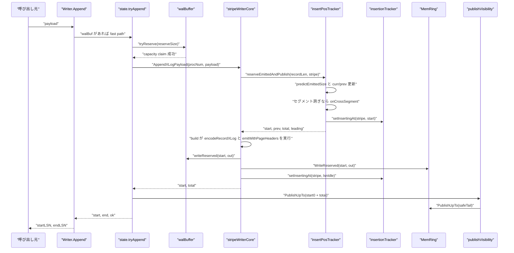
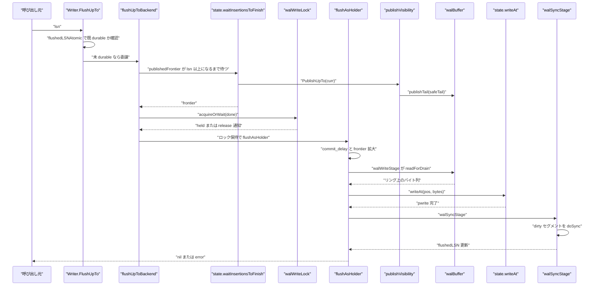

# WAL ライターとバッファ

<details>
<summary>関連ソースファイル</summary>

- [`internal/access/transam/xlog/append_xlog_payload.go`](https://github.com/ryogrid/goopg/blob/19856410e8d497d59787e1ab35a2febb3f5953d6/internal/access/transam/xlog/append_xlog_payload.go)
- [`internal/access/transam/xlog/insert_pos.go`](https://github.com/ryogrid/goopg/blob/19856410e8d497d59787e1ab35a2febb3f5953d6/internal/access/transam/xlog/insert_pos.go)
- [`internal/access/transam/xlog/insert_pos_publish.go`](https://github.com/ryogrid/goopg/blob/19856410e8d497d59787e1ab35a2febb3f5953d6/internal/access/transam/xlog/insert_pos_publish.go)
- [`internal/access/transam/xlog/insertion_tracker.go`](https://github.com/ryogrid/goopg/blob/19856410e8d497d59787e1ab35a2febb3f5953d6/internal/access/transam/xlog/insertion_tracker.go)
- [`internal/access/transam/xlog/mem_ring.go`](https://github.com/ryogrid/goopg/blob/19856410e8d497d59787e1ab35a2febb3f5953d6/internal/access/transam/xlog/mem_ring.go)
- [`internal/access/transam/xlog/mem_ring_concurrent.go`](https://github.com/ryogrid/goopg/blob/19856410e8d497d59787e1ab35a2febb3f5953d6/internal/access/transam/xlog/mem_ring_concurrent.go)
- [`internal/access/transam/xlog/padded_mutex.go`](https://github.com/ryogrid/goopg/blob/19856410e8d497d59787e1ab35a2febb3f5953d6/internal/access/transam/xlog/padded_mutex.go)
- [`internal/access/transam/xlog/reorder.go`](https://github.com/ryogrid/goopg/blob/19856410e8d497d59787e1ab35a2febb3f5953d6/internal/access/transam/xlog/reorder.go)
- [`internal/access/transam/xlog/reserve_emitted.go`](https://github.com/ryogrid/goopg/blob/19856410e8d497d59787e1ab35a2febb3f5953d6/internal/access/transam/xlog/reserve_emitted.go)
- [`internal/access/transam/xlog/segment_pad.go`](https://github.com/ryogrid/goopg/blob/19856410e8d497d59787e1ab35a2febb3f5953d6/internal/access/transam/xlog/segment_pad.go)
- [`internal/access/transam/xlog/segment_pad_emit.go`](https://github.com/ryogrid/goopg/blob/19856410e8d497d59787e1ab35a2febb3f5953d6/internal/access/transam/xlog/segment_pad_emit.go)
- [`internal/access/transam/xlog/stripe_append.go`](https://github.com/ryogrid/goopg/blob/19856410e8d497d59787e1ab35a2febb3f5953d6/internal/access/transam/xlog/stripe_append.go)
- [`internal/access/transam/xlog/stripe_append_emitted.go`](https://github.com/ryogrid/goopg/blob/19856410e8d497d59787e1ab35a2febb3f5953d6/internal/access/transam/xlog/stripe_append_emitted.go)
- [`internal/access/transam/xlog/stripe_writer_core.go`](https://github.com/ryogrid/goopg/blob/19856410e8d497d59787e1ab35a2febb3f5953d6/internal/access/transam/xlog/stripe_writer_core.go)
- [`internal/access/transam/xlog/sync_linux.go`](https://github.com/ryogrid/goopg/blob/19856410e8d497d59787e1ab35a2febb3f5953d6/internal/access/transam/xlog/sync_linux.go)
- [`internal/access/transam/xlog/sync_other.go`](https://github.com/ryogrid/goopg/blob/19856410e8d497d59787e1ab35a2febb3f5953d6/internal/access/transam/xlog/sync_other.go)
- [`internal/access/transam/xlog/wal_buffer.go`](https://github.com/ryogrid/goopg/blob/19856410e8d497d59787e1ab35a2febb3f5953d6/internal/access/transam/xlog/wal_buffer.go)
- [`internal/access/transam/xlog/wal_write_lock.go`](https://github.com/ryogrid/goopg/blob/19856410e8d497d59787e1ab35a2febb3f5953d6/internal/access/transam/xlog/wal_write_lock.go)
- [`internal/access/transam/xlog/writer.go`](https://github.com/ryogrid/goopg/blob/19856410e8d497d59787e1ab35a2febb3f5953d6/internal/access/transam/xlog/writer.go)
- [`internal/access/transam/xlog/publish_visibility.go`](https://github.com/ryogrid/goopg/blob/19856410e8d497d59787e1ab35a2febb3f5953d6/internal/access/transam/xlog/publish_visibility.go)
- [`internal/access/transam/xlog/tail_publisher.go`](https://github.com/ryogrid/goopg/blob/19856410e8d497d59787e1ab35a2febb3f5953d6/internal/access/transam/xlog/tail_publisher.go)
- [`internal/access/transam/xlog/wal_buffer_publish_tail.go`](https://github.com/ryogrid/goopg/blob/19856410e8d497d59787e1ab35a2febb3f5953d6/internal/access/transam/xlog/wal_buffer_publish_tail.go)

</details>

`Writer` は、SQL 実行中の各バックエンドから渡された payload を PostgreSQL 互換の WAL レコードへエンコードし、8 本の insert ストライプで LSN を予約して、`wal_buffers` サイズのリングバッファへ書き込みます。バッファ上のバイト列は、容量超過時または `FlushUpTo` の要求時にセグメントファイルへ drain され、`fdatasync`（または `fsync`）で耐久化されます。バックエンド自身が書き込みと同期を行う group commit と、専用 walwriter による先回り書き込みの両方が同じ `walWriteLock` と 3 つの LSN ウォーターマーク（write / drain / flush）を共有します。本ページはレコードのバイト形式そのものではなく、[10.1 WAL レコード形式](10.1-WAL-Format.md) で組み立てられたレコードを、どのように並行予約し・メモリに保持し・ディスクへ流すかを扱います。

## 責務

- `Writer.Append` で payload を受け取り、`state.tryAppend` の fast path と `state.appendPGCompat` の slow path を使い分ける（`internal/access/transam/xlog/writer.go:Writer.Append`）。
- `appendLockStripes = 8` 本のキャッシュライン padded ミューテックスで、異なるバックエンドのレコード書き込みを並行化する（`internal/access/transam/xlog/padded_mutex.go:appendLockSet`、`stripeForProcNum`）。
- `insertPosTracker` で `(curr, prev)` を不可分に更新し、各レコードの開始 LSN と `xl_prev` に刻む前レコード LSN を予約する（`internal/access/transam/xlog/insert_pos.go:insertPosTracker.reserve`、`internal/access/transam/xlog/insert_pos_publish.go:reserveAndPublish`）。
- セグメント境界をまたぐ予約を新しいセグメント先頭へ再配置し、空いたギャップを `XLOG_NOOP` パッドレコードまたはゼロ埋めで埋める（`internal/access/transam/xlog/reserve_emitted.go:reserveEmittedAndPublish`、`internal/access/transam/xlog/segment_pad.go:buildSegmentPadRecord`、`internal/access/transam/xlog/segment_pad_emit.go:emitSegmentPad`）。
- 予約済みだが未書き込みのストライプを `insertionTracker` に記録し、drain 側が安全に公開できる上限を `lowestActiveLSN` で計算する（`internal/access/transam/xlog/insertion_tracker.go:insertionTracker`）。
- `walBuffer` に LSN アドレスでバイト列を保持し、`resident() + reservedBytes <= cap` の不変条件を CAS で守る（`internal/access/transam/xlog/wal_buffer.go:walBuffer.tryReserve`、`writeReserved`）。
- walsender 用の `MemRing` に最近の WAL バイトをミラーし、ディスクを読まずにストリーミングできるようにする（`internal/access/transam/xlog/mem_ring.go:MemRing`、`internal/access/transam/xlog/mem_ring_concurrent.go:WriteReserved`）。
- `tailPublisher` と `publishVisibility` で「全ストライプが書き終えた地点」まで両リングの tail を単調に進める（`internal/access/transam/xlog/tail_publisher.go:publishUpTo`、`internal/access/transam/xlog/publish_visibility.go:publishVisibility`）。
- `FlushUpTo` / `flushUpToBackend` / `flushAsHolder` で group commit を行い、`walWriteStage` でリングを drain、`walSyncStage` で dirty セグメントを同期する（`internal/access/transam/xlog/writer.go:flushUpToBackend`、`walWriteStage`、`walSyncStage`）。
- `walWriteLock` の tri-state acquire と世代チャネルで、待機中の committer を release ごとに起こし、既に耐久化済みなら I/O なしで返す（`internal/access/transam/xlog/wal_write_lock.go:walWriteLock.acquireOrWait`）。
- セグメントの作成・事前ゼロ埋め・次セグメントの先読み・古いセグメントの再利用を管理する（`internal/access/transam/xlog/writer.go:openSegment`、`preallocateSegment`、`eagerPreallocSegment`、`removeOldSegments`）。
- 論理デコード側の `ReorderBuffer` は、コミット順出力のための別レイヤのメモリ構造として同じパッケージに置かれている（`internal/access/transam/xlog/reorder.go:ReorderBuffer`）。

## 処理フロー

まず fast path です。バッファに空きがある限り、呼び出し元の goroutine がストライプ lock を取り、LSN を予約し、エンコードしたバイト列を `walBuffer` と `MemRing` の両方へ直接書きます。ディスク I/O は発生しません。



1. `Writer.Append` は空 payload を `ErrEmptyPayload` で拒否し、`state.walBuf != nil` なら `state.tryAppend` を呼びます（`internal/access/transam/xlog/writer.go:Writer.Append`）。
2. `tryAppend` は `predictXLogRecordLen(payload)` でパディング後のレコード長を求め、`walBufferReservationClaim` で「セグメント跨ぎの gap + レコード本体」の最悪値を計算します。これは最大 `2 * predictEmittedSize(...)` です（`internal/access/transam/xlog/wal_buffer.go:walBufferReservationClaim`）。
3. `walBuffer.tryReserve` が CAS ループで `resident() + reservedBytes + n <= cap` を確認して容量を請求します。失敗すると `tryAppend` は `ok=false` を返し、`Writer.Append` は slow path へ落ちます（`internal/access/transam/xlog/wal_buffer.go:tryReserve`）。
4. `stripeWriterCore.AppendXLogPayload` は `appendXLogPayload` を呼び、`predictXLogRecordLen` の結果を `AppendBuiltEmitted` に渡します（`internal/access/transam/xlog/append_xlog_payload.go:appendXLogPayload`）。
5. `AppendBuiltEmitted` は `stripeAppendBuiltEmitted` に委譲し、procNum から選んだストライプ lock の下で `reserveEmittedAndPublish` を呼びます。ここで `predictEmittedSize`、`(curr, prev)` 更新、`insertionTracker.setInsertingAt(stripe, start)` が同じ `posMu` 臨界区間に入ります（`internal/access/transam/xlog/stripe_append_emitted.go:stripeAppendBuiltEmitted`、`internal/access/transam/xlog/reserve_emitted.go:reserveEmittedAndPublish`）。
6. 予約がセグメント境界をまたぐ場合、`onCrossSegment` が `emitSegmentPad` を呼び、`[curr, boundary)` に `XLOG_NOOP` パッドを書くか、24 バイト未満で整形式レコードにならない場合はゼロ埋めします。予約本体は `boundary` に着地し、`prev` はパッドの開始 LSN を指します（`internal/access/transam/xlog/segment_pad_emit.go:emitSegmentPad`）。
7. build closure は確定した `prev` で `encodeRecordXLog(payload, prev)` を実行し、`emitWithPageHeaders` でページヘッダを差し込みます。出力長は予約時の `total` と一致しなければ `errStripeAppendBuildSizeMismatch` になります（`internal/access/transam/xlog/stripe_append_emitted.go:stripeAppendBuiltEmitted`）。
8. バイト列は `walBuffer.writeReserved(start, out)` と `MemRing.WriteReserved(start, out)` に書かれ、最後に `setInsertingAt(stripe, lsnIdle)` でストライプを idle に戻します。`PublishUpTo` は `tailPublisher.publishUpTo` → `walBuffer.publishTail` → `MemRing.PublishUpTo` の順で可視化ウォーターマークを進めます（`internal/access/transam/xlog/publish_visibility.go:publishVisibility`）。

次に commit 時の flush です。`FlushUpTo` は既に durable なら即返し、そうでなければ `writeMu` を巡って group commit に参加します。



1. `Writer.FlushUpTo` は `lsn <= flushedLSNAtomic` なら何もせず返します。これは PostgreSQL の `XLogFlush` における `record <= LogwrtResult.Flush` の早期終了に相当します（`internal/access/transam/xlog/writer.go:Writer.FlushUpTo`）。
2. `flushUpToBackend` は `flushWaiters` を増やし、`state.waitInsertionsToFinish(lsn)` で「まだ書き込み中のストライプが lsn 未満に存在しない」地点まで待ちます。待機中は `PublishUpTo` が呼ばれ、tail が進みます（`internal/access/transam/xlog/writer.go:waitInsertionsToFinish`）。
3. `walWriteLock.acquireOrWait` は `TryLock` に成功すれば holder になり、失敗すれば世代チャネル `gen` で release を待ちます。待機から目覚めた場合はロックを保持せず `held=false` で戻り、呼び出し側が `flushedLSNAtomic` を再確認します（`internal/access/transam/xlog/wal_write_lock.go:acquireOrWait`）。
4. holder になった `flushAsHolder` は、`commit_delay` が設定されていて `flushWaiters >= commitSiblings` ならロックを保持したまま指定マイクロ秒だけ眠り、batch を広げます。その後 `publishedFrontier` を再取得して `frontier` を拡大します（`internal/access/transam/xlog/writer.go:flushAsHolder`）。
5. `flushWindows` は `walWriteStage` と `walSyncStage` を順に呼び、それぞれ `OnWALWrite` / `OnWALSync` の wait event で囲みます（`internal/access/transam/xlog/writer.go:flushWindows`）。
6. `walWriteStage` は `walBuf.head` から `rq.write` までを `drainBufferUpTo` → `drainBufferBytes` で読み、`readForDrain` の 2 スライスを `state.writeAt` でセグメントへ pwrite し、`advanceHead` でリングを解放します（`internal/access/transam/xlog/writer.go:walWriteStage`、`drainBufferBytes`）。
7. `walSyncStage` は `dirty` マップから `rq.flush` 以下のセグメントを昇順に取り出し、`state.doSync` で `dataSync`（Linux は `fdatasync`）または `fullSync`（`fsync`）を呼びます。全セグメントの同期後に `flushedLSN` と `flushedLSNAtomic` を更新します（`internal/access/transam/xlog/writer.go:walSyncStage`、`internal/access/transam/xlog/sync_linux.go:dataSync`）。

## 主要ファイル

| ファイル | 役割 |
| --- | --- |
| `internal/access/transam/xlog/writer.go` | 公開 `Writer`、`Config`、内部 `state`、`Append` / `AppendRaw` / `FlushUpTo` / `BackgroundWrite`、`appendPGCompat` の Path A/B、`drainBufferBytes`、`writeAt`、`openSegment`、`preallocateSegment`、`removeOldSegments`、`Close`。 |
| `internal/access/transam/xlog/wal_buffer.go` | バイトアドレス指定のリング `walBuffer`。`tryReserve` / `releaseReservation` / `append` / `readForDrain` / `advanceHead` / `writeReserved` と容量不変条件。 |
| `internal/access/transam/xlog/insert_pos.go` | LSN 予約器 `insertPosTracker`。`reserve` / `reserveLocked` / `load` / `resetPosition` とセグメント跨ぎの再配置。 |
| `internal/access/transam/xlog/insert_pos_publish.go` | `(curr, prev)` 更新と `insertionTracker` への BEGIN 公開を同じ `posMu` 下で行う `reserveAndPublish`。 |
| `internal/access/transam/xlog/reserve_emitted.go` | ページヘッダ込みの出力長を予約時に確定する `reserveEmittedAndPublish`。リング窓チェックと跨ぎ再予測。 |
| `internal/access/transam/xlog/insertion_tracker.go` | ストライプごとの書込み中 LSN を保持する `insertionTracker`。`lsnIdle = -1`、`lowestActiveLSN`。 |
| `internal/access/transam/xlog/padded_mutex.go` | 64 バイト境界にパディングした `paddedMutex`、8 本の `appendLockSet`、`stripeForProcNum`、`lockByProcNum`。 |
| `internal/access/transam/xlog/stripe_append.go` | ストライプ lock 下の append composer `stripeAppend` / `stripeAppendBuild` とエラー sentinel。 |
| `internal/access/transam/xlog/stripe_append_emitted.go` | 予測・予約・build・リング書込みを 1 回で行う `stripeAppendBuiltEmitted`。 |
| `internal/access/transam/xlog/stripe_writer_core.go` | 7 つのプリミティブを束ねる `stripeWriterCore` と `Append` / `AppendBuiltEmitted` / `PublishUpTo` / `Load`。 |
| `internal/access/transam/xlog/append_xlog_payload.go` | `predictXLogRecordLen` と `AppendBuiltEmitted` を組み合わせる `appendXLogPayload`。 |
| `internal/access/transam/xlog/segment_pad.go` | セグメント末尾ギャップ用の `RmgrXLog`/`XLOG_NOOP` レコードを組み立てる `buildSegmentPadRecord`。 |
| `internal/access/transam/xlog/segment_pad_emit.go` | パッドレコードをページヘッダ付きで両リングへ書く `emitSegmentPad` と `padLayout`、`pageHeaderBytesIn`。 |
| `internal/access/transam/xlog/mem_ring.go` | walsender 用リング `MemRing`。`Append` / `ReadAt` / `Range` / `BytesResident` / `Hits` / `Misses`。 |
| `internal/access/transam/xlog/mem_ring_concurrent.go` | ストライプ並行版 `WriteReserved` / `PublishUpTo` / `AdvanceWindow`。 |
| `internal/access/transam/xlog/publish_visibility.go` | `tailPublisher` と両リングの tail をまとめて進める `publishVisibility`。 |
| `internal/access/transam/xlog/tail_publisher.go` | 安全 tail を単調 CAS で公開する `tailPublisher` と `publishUpTo`。 |
| `internal/access/transam/xlog/wal_buffer_publish_tail.go` | `walBuffer.tail` を単調に進める CAS-max の `publishTail`。 |
| `internal/access/transam/xlog/wal_write_lock.go` | tri-state の `walWriteLock`。`acquireOrWait` / `lock` / `release` と世代チャネル。 |
| `internal/access/transam/xlog/sync_linux.go` | Linux の `dataSync`（`fdatasync`）と `fullSync`（`fsync`）。 |
| `internal/access/transam/xlog/sync_other.go` | 非 Linux の `f.Sync()` フォールバック。 |
| `internal/access/transam/xlog/reorder.go` | 論理デコード用 `ReorderBuffer`。`Append` / `Commit` / `Abort` と Delete+Insert の Update 畳み込み。 |

## 公開 API / エントリポイント

```go
func NewWriter(cfg Config) (*Writer, error)

func (w *Writer) Append(payload []byte) (uint64, uint64, error)
func (w *Writer) AppendRaw(stream []byte) (uint64, uint64, error)
func (w *Writer) FlushUpTo(lsn uint64) error
func (w *Writer) BackgroundWrite() error
func (w *Writer) RemoveOldSegments(keepLSN uint64) (removed, recycled int, err error)
func (w *Writer) RemoveOldSegmentsWithEstimate(keepLSN uint64, distanceEstimateBytes, completionTarget float64) (removed, recycled int, err error)
func (w *Writer) Close() error

func (w *Writer) Subscribe(ch chan<- struct{})
func (w *Writer) Unsubscribe(ch chan<- struct{})
func (w *Writer) MemRing() *MemRing

func (w *Writer) WrittenLSN() uint64
func (w *Writer) FlushedLSN() uint64
func (w *Writer) DrainedLSN() uint64

func (w *Writer) SetCommitDelayUs(us int64)
func (w *Writer) SetCommitSiblings(n int)
func (w *Writer) SetWalWriterFlushAfter(bytes int64)

func (w *Writer) WALBuffersCapacity() int64
func (w *Writer) WALBuffersBytesResident() int64
func (w *Writer) WALBuffersOverflowDrainBytes() uint64
func (w *Writer) WALBuffersFlushDrainBytes() uint64
func (w *Writer) FsyncCount() int64

func NewMemRing(capBytes int64) *MemRing
func (r *MemRing) ReadAt(pos int64, out []byte) (int, bool)
func (r *MemRing) Range() (head, tail int64)
func (r *MemRing) BytesResident() int64

func NewReorderBuffer() *ReorderBuffer
func (rb *ReorderBuffer) Append(xid storage.TransactionID, c Change)
func (rb *ReorderBuffer) Commit(xid storage.TransactionID) ([]Change, uint64, bool)
func (rb *ReorderBuffer) Abort(xid storage.TransactionID) bool
func (rb *ReorderBuffer) Active() int
func (rb *ReorderBuffer) OldestBeginLSN() uint64
```

`Append` は 1-based の開始 LSN と終了 LSN を返します。`AppendRaw` は物理レプリケーションの walreceiver が受け取ったバイト列を再フレーミングせずにそのまま書き込むための入口です（`internal/access/transam/xlog/writer.go:AppendRaw`）。`NewWriter` は `Config.SyncMethod` が `"fdatasync"` と `"fsync"` 以外なら `ErrUnsupportedSyncMethod` を返し、既存データディレクトリが旧形式なら `ErrWALFormatMismatch` で起動を拒否します（`internal/access/transam/xlog/writer.go:NewWriter`、`loadState`）。

## 主要データ構造

### Writer — 公開ハンドルとウォーターマーク

`internal/access/transam/xlog/writer.go:Writer`（276〜415 行）:

```go
type Writer struct {
	// done is closed exactly once by Close to wake parked flush waiters and
	// reject new appends. closeOnce/closeErr make Close idempotent.
	done      chan struct{}
	closeOnce sync.Once
	closeErr  error

	// writeLSNAtomic mirrors state.writeLSN so external observers
	// (notably the checkpointer's max_wal_size trigger) can read
	// the current write position without serialising through the
	// op channel.
	writeLSNAtomic atomic.Uint64

	// flushedLSNAtomic mirrors state.flushedLSN — the highest LSN whose
	// bytes have been fdatasync'd to the segment files. Published by the
	// writer goroutine AFTER each sync barrier so a reader that observes
	// lsn <= flushedLSNAtomic knows lsn is durable. FlushUpTo reads it to
	// skip the group-flush queue entirely when the target is already
	// durable — the goopg analog of PG's `record <= LogwrtResult.Flush`
	// fast exit in XLogFlush (analysis/perf-optimize2, fix-03).
	flushedLSNAtomic atomic.Uint64

	// drainedLSNAtomic mirrors state.drainedLSN — the highest LSN whose bytes
	// have been drained from the ring to the segment files (pwritten to the OS
	// cache, not necessarily fdatasync'd). This is the goopg analog of PG's
	// logWriteResult; the background walwriter reads it to decide whether a
	// pre-write round has anything to do (docs/design/wal-backend-flush/, 03/04).
	// Invariant: writeLSNAtomic >= drainedLSNAtomic >= flushedLSNAtomic.
	drainedLSNAtomic atomic.Uint64

	// subscribers receive a non-blocking wake-up after every
	// successful Append. Used by RecordIterator (and walsender
	// goroutines) to block until more WAL is available instead of
	// polling WrittenLSN. Subscribers maintain their own buffer
	// channel; Writer drops the wake-up if the channel is full —
	// the iterator will catch up on the next event or by a manual
	// re-poll.
	subMu       sync.Mutex
	subscribers map[chan<- struct{}]struct{}

	// memRing is shared with state.memRing (one allocation,
	// two pointers). Exposed via MemRing() so the iterator
	// and observability code can read it without serialising
	// through the writer's loop. nil when
	memRing *MemRing

	// --- backend-driven flush (docs/design/wal-backend-flush/, slice 3) ---
	// writeMuOf reaches the state's WAL write lock; flushWaiters counts
	// in-flight FlushUpTo callers (the commit_siblings gate); commitDelayUs /
	// commitSiblings snapshot the GUCs; stickyErr lets losing committers
	// return a flush error without re-acquiring the lock (stampede guard).
	flushWaiters   atomic.Int32
	commitDelayUs  atomic.Int64
	commitSiblings atomic.Int32
	stickyErr      atomic.Pointer[flushErr]

	// walWriterFlushAfter is wal_writer_flush_after (bytes; BootVal 1MB): the
	// background walwriter fsync-throttle threshold. Stored for BackgroundWrite;
	// it only gates a skip once async-LSN early wakeups land (a timer tick always
	// satisfies PG's "≥ wal_writer_delay since last flush" rule and therefore
	// flushes) — see BackgroundWrite (docs/design/wal-backend-flush/ 03 §3.4).
	walWriterFlushAfter atomic.Int64

	// stateRef is a reference to the state struct, needed by
	// Writer.Append to call encodeAndBuffer directly (M0026
	// concurrent append path).
	stateRef *state

	// walBufferCounters shares atomics with state for the
	// M0013-0003 wal_buffers_* columns of pg_stat_wal_io.
	walBufferCounters *walBufferCounters

	// pageHeaders mirrors Config.PageHeaders so RecordIterator
	// (and any other reader holding a *Writer reference) can
	// decide whether to skip page-header bytes when streaming
	// records. Static for the Writer's lifetime.
	pageHeaders bool
	// segmentSize mirrors Config.SegmentSize so iterators can
	// distinguish a long-form (segment-boundary) page header
	// from a short-form one without having to thread cfg in.
	segmentSize int64

	// core is the M0107-0007 slice B WAL-insert striping packaging
	// struct (`docs/design/0107-0007v-wal-stripe-writer-core.md`).
	// Mounted here so the eventual call-site rewrite can replace
	// `state.append`'s body with `s.core.Append(procNum, encoded)`
	// and the drain goroutine's per-tick prelude with
	// `s.core.PublishUpTo(...)` — see
	// `docs/design/0107-0007w-wal-stripe-writer-core-mount.md`. The
	// core is constructed in `NewWriter` after `loadState` so it
	// borrows the same `walBuf` / `memRing` rings as the legacy path
	// (one allocation, two consumers — duplicating the rings would
	// fork on-disk visibility). The append paths reach it through
	// `AppendXLogPayload` since the slice B call-site rewrite
	// (644af04fe); tests reach it through the `stripeCore()` accessor
	// below.
	core *stripeWriterCore

	// OnWALWrite and OnWALSync are optional hooks called before
	// blocking WAL write / fdatasync operations.  The caller
	// (initdb.Open) sets them via activity.LookupGoroutine so
	// pg_stat_activity can report WALWrite / WALSync wait events.
	OnWALWrite func()
	OnWALSync  func()

	// OnWALWriteDone pairs with OnWALWrite — called immediately after the
	// ring→segment drain completes (success or error), mirroring
	// OnWALSyncDone's balance guarantee. Since the probe-audit split, the
	// commit path emits WALWrite for the park/drain phases and WALSync only
	// around the fdatasync barrier (PG WAIT_EVENT_WAL_WRITE /
	// WAIT_EVENT_WAL_SYNC).
	OnWALWriteDone func()

	// OnWALSyncDone pairs with OnWALSync — called immediately after
	// the fdatasync completes (success or error) so observability
	// code can balance every WaitEventStart with a WaitEventEnd.
	// (M0058-0006.)
	OnWALSyncDone func()

	// sharedFsyncTimeNanos accumulates real wall-clock time spent inside
	// FlushUpTo's fdatasync wait, backing pg_stat_io's (client backend,
	// wal, normal) fsync_time column (M0122-0003 track_io_timing
	// follow-up). initdb.Open's OnWALSyncDone hook calls
	// AddFsyncTimeNanos only when the calling backend's own
	// track_io_timing is on (via ActivityRegistry.LookupTrackedGoroutine),
	// mirroring storage.Pool's OnPinDone/AddReadTimeNanos gating exactly —
	// see AddFsyncTimeNanos's doc comment. Plain atomic.Int64 (not a
	// sharded stats.Counter) because fsyncs are already serialised through
	// group commit, unlike per-buffer read/write/extend ops.
	sharedFsyncTimeNanos atomic.Int64

	// walRecords counts the lifetime number of WAL records appended
	// (incremented once per successful Append call). walBytes counts
	// the lifetime total bytes written to WAL (record payload size,
	// not including the xlog record header). Both back EXPLAIN (WAL)
	// output (M0122-0003). Plain atomic.Int64 because the per-stripe
	// locks serialise the counter bumps within Append already.
	walRecords atomic.Int64
	walBytes   atomic.Int64
}
```

3 つのミラー `writeLSNAtomic` / `drainedLSNAtomic` / `flushedLSNAtomic` は、それぞれ「予約・書込み済み」「セグメントへ pwrite 済み」「fdatasync 済み」を表し、`write >= drained >= flushed` の順序を保ちます。`done` は `Close` で一度だけ閉じられ、`walWriteLock.acquireOrWait` の待機を `ErrClosed` で起こします。`stickyErr` はディスク障害時に、ロックを取れなかった committer が再取得せず同じエラーを返すための stampede 防止です。

### walBuffer — バイトアドレス指定リング

`internal/access/transam/xlog/wal_buffer.go:walBuffer`（42〜68 行）:

```go
type walBuffer struct {
	cap  int64        // fixed at construction; equals Config.WALBuffers
	buf  []byte       // ring backing storage; len == cap
	base atomic.Int64 // LSN that buf[0] currently represents (in bytes).
	// Atomic so concurrent stripe writers' writeReserved range checks and
	// ring-offset arithmetic can read it race-free while the state-loop
	// drain goroutine slides it forward under advanceHead. Only advanceHead
	// writes base (single writer: the drain/state-loop goroutine).
	// See docs/design/0107-0007ai-wal-buffer-head-base-atomic-async-drain.md.
	head atomic.Int64 // first un-drained byte LSN; head ≥ base. Atomic so
	// concurrent tryAppend goroutines' free() / resident() reads are
	// race-free while the state-loop drain goroutine advances it.
	// Only advanceHead writes head (single writer). See design doc above.
	tail atomic.Int64 // first unwritten byte LSN; tail ≥ head. Atomic so a
	// single drain goroutine's publishTail can advance the watermark while
	// concurrent stripe writers' readers (resident / readForDrain / readAt)
	// observe it race-free. See docs/design/0107-0007r-wal-buffer-tail-atomic.md.
	reservedBytes atomic.Int64 // bytes claimed by concurrent stripe writers that
	// have passed the free()-space check and hold appendMu.RLock() but have not
	// yet called PublishUpTo (so tail has not yet advanced to cover them).
	// Invariant: resident() + reservedBytes ≤ cap at all times.
	// tryReserve atomically increments this under a CAS loop; releaseReservation
	// decrements it after PublishUpTo advances tail. This prevents multiple
	// concurrent stripe writers from each seeing "enough free space" and all
	// proceeding to reserve LSN space that collectively overflows the buffer,
	// which would cause walBuffer.writeReserved to return errWALBufferReservedOutOfRange.
}
```

リングの実体は `buf` 1 個で、`(lsn - base) % cap` が物理オフセットです。`head` はまだ drain していない最初のバイト、`tail` は公開済みの最後の次バイト、`resident()` は `tail - head` です。`writeReserved` は `base` ではなく `head` を境界に使い、`[lsn, lsn+n)` が `[head, head+cap)` を外れたら `errWALBufferReservedOutOfRange` を返します。`advanceHead` は base を先に進めてから head を進め、読者が古い head と新しい base の組み合わせを見ても安全側になるようにしています（`internal/access/transam/xlog/wal_buffer.go:advanceHead`）。

### insertPosTracker — LSN 予約の権威

`internal/access/transam/xlog/insert_pos.go:insertPosTracker`（59〜79 行）:

```go
type insertPosTracker struct {
	posMu   sync.Mutex
	curr    uint64
	prev    uint64
	segSize uint64
	// onCrossSegment returns true when it wrote a PAD RECORD over the gap and
	// false when the gap was only zero-filled (too small for a well-formed
	// record — M0131-S30.6). Only a real pad record advances `prev`.
	onCrossSegment func(start, boundary, prev uint64) (padded bool)
	// windowEndFn, when non-nil, returns the exclusive upper LSN bound a
	// reservation's emitted bytes must fit within — the bytes-side ring's
	// writeReserved window end (walBuf.head + cap). reserveEmittedAndPublish
	// consults it INSIDE posMu before committing curr, so a reservation can
	// never outrun the physical ring window regardless of how the callers'
	// capacity-claim accounting transiently reads (a publish capped by a
	// slower active stripe can leave curr - tail > reservedBytes — the
	// TestPort_IsolationSuite writeReserved cascade, 2026-09-19). head is
	// monotonic, so a reservation admitted under the check can never fail
	// writeReserved's range check at write time. Nil = unbounded (tests).
	windowEndFn func() int64
}
```

`curr` は次レコードの 0-based ストリーム位置、`prev` は直前レコードのコンテンツ開始位置です。`reserveLocked` は `curr` と `prev` を同じ `posMu` 下で更新するため、peer が「curr だけ進んで prev が古い」状態を観測しません。セグメントをまたぐ予約は `boundary` に着地し、`prev = old`（パッドの開始）になります。`reserveEmittedAndPublish` はさらに `prev = start + leading` として、先頭ページヘッダを除いたレコード本体の開始を次レコードの `xl_prev` にします（`internal/access/transam/xlog/reserve_emitted.go:reserveEmittedAndPublish`）。

### insertionTracker — ストライプごとの書込み中 LSN

`internal/access/transam/xlog/insertion_tracker.go:insertionTracker`（102〜108 行）:

```go
type insertionTracker struct {
	// inserting[i] is the start LSN of the record currently being
	// written by stripe i, or lsnIdle when the stripe is not in
	// the middle of an insert. atomic.Int64 (not uint64) so the
	// signed comparison in lowestActiveLSN does not need a cast.
	inserting [appendLockStripes]atomic.Int64
}
```

idle は `lsnIdle = int64(-1)` で、`atomic.Int64` のゼロ値 0 ではありません。LSN 0 は新規クラスタの最初の正当な予約開始位置なので、0 を idle にすると最初のレコードの書込み中に tail を公開してしまう競合が生まれます。`lowestActiveLSN` は全スロットを Load し、idle 以外の最小値を返します。全 idle なら `lsnNoActive = math.MaxInt64` です（`internal/access/transam/xlog/insertion_tracker.go:lsnIdle`、`lowestActiveLSN`）。

### stripeWriterCore — プリミティブの束ね役

`internal/access/transam/xlog/stripe_writer_core.go:stripeWriterCore`（124〜131 行）:

```go
type stripeWriterCore struct {
	locks      *appendLockSet
	posTracker *insertPosTracker
	inserting  *insertionTracker
	publisher  *tailPublisher
	walBuf     *walBuffer
	memRing    *MemRing
}
```

`locks` / `posTracker` / `inserting` / `publisher` は core が所有し、`walBuf` / `memRing` は `Writer` から借用します。`newStripeWriterCore` は `segSize > 0` を要求し、`emitSegmentPad` を `posTracker.onCrossSegment` に取り付け、`walBuf` があれば `windowEndFn = head + cap` を設定します（`internal/access/transam/xlog/stripe_writer_core.go:newStripeWriterCore`）。

### MemRing — walsender 用ミラー

`internal/access/transam/xlog/mem_ring.go:MemRing`（38〜56 行）:

```go
type MemRing struct {
	mu sync.RWMutex

	buf  []byte // capacity = cap; never reallocated
	cap  int64
	head int64 // 0-based byte offset of oldest resident byte
	tail int64 // 0-based byte offset one past newest resident byte

	// hits / misses are observability counters surfaced via
	// Hits()/Misses() so M0010-0003's `pg_stat_wal_io` /
	// `pg_stat_replication.send_buffer_*` surface can read them
	// without taking the mutex. Per-P sharded via stats.Counter
	// so concurrent walsender ReadAt callers (one goroutine per
	// active replication connection) don't contend on a single
	// cache line — eliminates cross-core invalidation on the
	// streaming hot path. See M0107-0008 loop 8.
	hits   stats.Counter
	misses stats.Counter
}
```

`NewMemRing(0)` は nil を返し、呼び出し側は「リングなし・全読みディスク」として扱います。`ReadAt` は要求範囲が `[head, tail)` に完全に収まる場合だけヒットし、部分重複は `(0, false)` です。ストライプ並行経路では `WriteReserved` が head/tail を動かさずに書き、`PublishUpTo` だけが tail を進めます（`internal/access/transam/xlog/mem_ring.go:ReadAt`、`internal/access/transam/xlog/mem_ring_concurrent.go:PublishUpTo`）。

### walWriteLock — group commit の tri-state ロック

`internal/access/transam/xlog/wal_write_lock.go:walWriteLock`（24〜28 行）:

```go
type walWriteLock struct {
	mu    sync.Mutex    // the exclusive WAL-write lock itself
	genMu sync.Mutex    // guards the generation-channel swap
	gen   chan struct{} // closed once per release ("one flush completed")
}
```

`acquireOrWait` は `(true, nil)`（ロック取得）、`(false, nil)`（待機中に release が起きたので再確認）、`(false, ErrClosed)`（シャットダウン）の 3 状態を返します。`release` は `mu.Unlock` の後に現在の `gen` を閉じ、新しいチャネルへ差し替えます。`genMu` が capture と close+swap の両方を保護するため、待機者が「今後閉じられないチャネル」を掴むことはありません（`internal/access/transam/xlog/wal_write_lock.go:acquireOrWait`、`release`）。

### appendLockSet / paddedMutex — 8 ストライプ

`internal/access/transam/xlog/padded_mutex.go:paddedMutex`（21〜24 行）:

```go
type paddedMutex struct {
	mu sync.Mutex
	_  [56]byte // pad sync.Mutex (8 B) to 64 B (one cache line)
}
```

`internal/access/transam/xlog/padded_mutex.go:appendLockSet`（41〜43 行）:

```go
type appendLockSet struct {
	locks [appendLockStripes]paddedMutex
}
```

`appendLockStripes = 8` は PostgreSQL の `NUM_XLOGINSERT_LOCKS` に合わせた値です。`stripeForProcNum` は `procNum & 7` でストライプを選び、`lockByProcNum` が対応する mutex を取ります。`stripeNum` は `gls.BackendID()` があればその値を、なければ 0 を使います。initdb や walwriter などの未登録 goroutine が stripe 0 に集まるのは、slow path のセグメント跨ぎ処理が stripe 0 を前提にしているためです（`internal/access/transam/xlog/writer.go:stripeNum`）。

### tailPublisher — 安全 tail の単調公開

`internal/access/transam/xlog/tail_publisher.go:tailPublisher`（90〜96 行）:

```go
type tailPublisher struct {
	// published is the highest LSN observed to be safe (i.e., every
	// reservation strictly below it has been fully byte-written by
	// its owning stripe). Monotonically advances under CAS in
	// publishUpTo; never decreases.
	published atomic.Int64
}
```

`publishUpTo(upperBound, tracker)` は `candidate = min(upperBound, tracker.lowestActiveLSN())` を計算し、`candidate <= published` なら現在値を返し、そうでなければ CAS で前進させます。戻り値は `min(published, upperBound)` に cap されるため、peer が先に進めていても呼び出し元の要求より先の LSN を返しません（`internal/access/transam/xlog/tail_publisher.go:publishUpTo`）。

## 内部構造

### fast path と slow path の分岐

`Writer.Append` は `state.walBuf != nil` のとき `tryAppend` を試します。`tryAppend` は次のいずれかで `ok=false` を返し、`appendPGCompat` にフォールバックします。

- `walBuf` が nil、または `reserveSize` がリング容量そのものより大きい（`canHold` 失敗）。
- `tryReserve` が `walBufferCapacityExceeded` を返した（他のストライプの予約を含めると容量超過）。
- `AppendXLogPayload` が `walBufferCapacityExceeded` を返した（`posMu` 内のリング窓チェックで拒否。`curr` はまだ確定していない）。

`tryAppend` がそれ以外のエラーを返した場合、`Writer.Append` は slow path に再試行せず、そのエラーをそのまま返します。予約が既に確定しており、別 LSN で再試行すると失敗を隠してしまうためです（`internal/access/transam/xlog/writer.go:Writer.Append`、`tryAppend`）。

`appendPGCompat` の Path A は、`walBuf` がない・レコードがリングに収まらない・空きが足りない（`needsDrain`）のいずれかで選ばれます。Path A は `writeMu` に加えて `appendMu.Lock()` を drain から `writeAt`、`walBuf.reset`、`core.resetPosition` まで保持し、fast path の stripe writer を完全に止めます。これは Path A が LSN を `insertPosTracker` に予約せずに直接ディスクへ書くため、途中で stripe writer が同じ範囲を予約するとリングの tail が巻き戻る競合が起きるからです（`internal/access/transam/xlog/writer.go:appendPGCompat`）。

Path A も Path B と同じセグメント跨ぎ規則を適用します。`writePos + total > boundary` なら `buildSegmentPadRecord` と `emitWithPageHeaders` でパッドを作り、レコードを `boundary` に再配置します。パッドと本体は 1 回の `writeAt` でまとめて書かれ、クラッシュ時に「パッドなしのレコードだけが durable」になる状態を避けます。

### 予約容量の見積りとリング窓

`walBufferReservationClaim(recordLen, segSize)` は `predictEmittedSize(recordLen, 0, segSize)` の 2 倍を返します。セグメント跨ぎでは「ギャップのパッド」と「境界に再配置されたレコード」の 2 回の `writeReserved` が発生し、その合計は `gap + total < 2 * total` だからです。以前の `2*(recordLen+64)` は 3 ページ以上にまたがるレコードでページヘッダ分を過小評価し、`errWALBufferReservedOutOfRange` から drain の `resident > cap` panic に至る連鎖を起こしました（`internal/access/transam/xlog/wal_buffer.go:walBufferReservationClaim`）。

`tryReserve` を通った予約は、`PublishUpTo` が tail を進めた後に `releaseReservation` で `reservedBytes` から `resident()` へ移されます。予約は成功したが build やリング書込みが失敗し、`curr` だけが進んでしまった場合（burned reservation）、`tryAppend` と `appendPGCompat` はその範囲をゼロで埋めて `PublishUpTo` し、容量請求を解放します。これを怠ると `curr - tail > reservedBytes` の穴が残り、後続の `tryReserve` がリング窓を超えた予約を許可してしまいます（`internal/access/transam/xlog/stripe_append_emitted.go`、`internal/access/transam/xlog/writer.go:tryAppend`）。

### 3 つのウォーターマークと公開順序

- `writeLSN` / `writeLSNAtomic`: 予約・書込みが完了した最後のバイト。`Append` の戻り値の `end` と一致します。
- `drainedLSN` / `drainedLSNAtomic`: `walBuffer` からセグメントファイルへ pwrite された最後のバイト。OS キャッシュには載っているが、まだ fdatasync されていない可能性があります。
- `flushedLSN` / `flushedLSNAtomic`: fdatasync が完了した最後のバイト。`FlushUpTo` の早期終了判定に使われます。

`writeLSNAtomic >= drainedLSNAtomic >= flushedLSNAtomic` が常に成り立ちます。`tryAppend` は複数の goroutine が同時に `writeLSNMirror` を更新するため、`storeMaxLSN` の CAS-max を使います。単純な Store では、先に終わった大きい LSN を後から小さい LSN が上書きしてしまいます（`internal/access/transam/xlog/writer.go:storeMaxLSN`）。

公開は「書き込み」と「可視化」を分離しています。stripe writer は `writeReserved` でバイトを置くだけで tail を動かさず、drain 側の `publishVisibility` が `tailPublisher.publishUpTo` で安全 tail を計算してから `walBuffer.publishTail` と `MemRing.PublishUpTo` を呼びます。`publishTail` は CAS-max なので、複数の publisher が競合しても watermark は後退しません（`internal/access/transam/xlog/wal_buffer_publish_tail.go:publishTail`）。

### セグメント跨ぎのパッド

`reserveEmittedAndPublish` は予約が `boundary` を越えると、まず `boundary` で `predictEmittedSize` を再実行します。ページヘッダのスケジュールは `curr` のセグメント内位置に依存するため、再配置後の長さを再計算する必要があります。次に `windowEndFn` で「パッド + 再配置レコード」がリング窓に収まるか確認し、収まらなければ `ok=false` を返して呼び出し側に drain を促します。

`emitSegmentPad` はギャップをストリームバイト列として扱い、ページヘッダモードでは `pageHeaderBytesIn(gapStart, boundary, segSize)` を差し引いた長さのパッドレコードを作ります。`recLen < SizeOfXLogRecord` または `recLen == SizeOfXLogRecord+1` の場合は整形式レコードを作れないため、ギャップ全体をゼロで埋め、`padded=false` を返します。このとき `insertPosTracker` は `prev` をパッド開始へ進めません。ゼロ埋めは PostgreSQL の `AdvanceXLInsertBuffer` が未使用ページ末尾をゼロにする挙動に合わせたもので、ファイルを短いまま残してリプレイを途中で止める事故を防ぎます（`internal/access/transam/xlog/segment_pad_emit.go:emitSegmentPad`、`reserveEmittedAndPublish`）。

### group commit とバックグラウンド flush

`FlushUpTo` はまず `flushedLSNAtomic` を確認します。既に durable ならロックもチャネル往復も不要です。未 durable なら `flushUpToBackend` が `waitInsertionsToFinish` で「lsn 以下のストライプがすべて書き終わる」のを待ち、`walWriteLock` を tri-state で取得します。待機から目覚めてロックを取れなかった committer は、`flushedLSNAtomic` を再確認し、必要なら `stickyErr` を返して再取得を避けます。

holder は `commit_delay`（マイクロ秒）と `commit_siblings` を使って batch を広げ、`publishedFrontier` で frontier を再拡大してから `walWriteStage` / `walSyncStage` を実行します。`stickyErr` はディスクエラー時に設定され、後続の待機者が同じエラーを受け取ります（`internal/access/transam/xlog/writer.go:flushAsHolder`）。

`BackgroundWrite` は専用 walwriter から `wal_writer_delay` ごとに呼ばれ、`publishedFrontier` を読み、まだ durable でなければ `walWriteLock.lock()`（plain blocking）で `backgroundFlushLocked` に入ります。ここでは group commit の tri-state を使わず、`flushWindows` で write と flush を同じ frontier に対して行います。`wal_writer_flush_after` は保存されているものの、現状は async-LSN の early wakeup がないため毎 tick 全 frontier を flush します（`internal/access/transam/xlog/writer.go:BackgroundWrite`、`backgroundFlushLocked`）。

### セグメントファイルの生成と再利用

`state.writeAt` は `pos` を `SegmentSize` で割ってセグメント番号とオフセットを求め、1 回の呼び出しを複数セグメントに分割して `openSegment` 経由で `WriteAt`（AIO があれば `Submit` + `Wait`）します。書いたセグメントは `s.dirty[segNo] = true` になり、次の `walSyncStage` の同期対象になります（`internal/access/transam/xlog/writer.go:writeAt`）。

`openSegment` は `files` キャッシュを引き、なければ `FormatSegmentNameTLI(segNo, tli)` でファイルを開きます。新規作成時は `Preallocate` が true なら `preallocateSegment` で 64 KiB ずつゼロ埋めして `fsync` し、ディレクトリも `Sync` します。false なら `Truncate(SegmentSize)` で固定長に拡張するだけです。作成後は `eagerPreallocSegment(segNo+1)` が次セグメントをバックグラウンドで用意します（`internal/access/transam/xlog/writer.go:openSegment`、`preallocateSegment`）。

`eagerPreallocWorker` は一時ファイルをゼロ埋めしてから `os.Link` で最終パスにリンクします。同期パスが先にファイルを作っていた場合、`os.Link` は "already exists" で失敗しますが、それは正常な競合解決です（`internal/access/transam/xlog/writer.go:eagerPreallocWorker`）。

`removeOldSegments` は `keepLSN` を含むセグメントより前のものを削除対象にします。`MinWALSize` に応じた数の最新の古いセグメントは、`recycleSegmentFile` で未来の空きスロットへ rename し、`preallocateSegment` でゼロ埋めします。ゼロ埋めするのは、古いセグメントに残った CRC 正当なレコードをリカバリが「現在の WAL」と誤認しないためです（`internal/access/transam/xlog/writer.go:removeOldSegments`、`recycleSegmentFile`）。

### 論理デコード側の ReorderBuffer

`ReorderBuffer` は WAL ライターのバッファではありませんが、同じパッケージで WAL の消費側バッファを提供します。`Append(xid, change)` は xid ごとに変更を貯め、最初の変更 LSN を `beginLSN` にします。`Commit(xid)` は `foldChanges` で連続する `(ChangeDelete, ChangeInsert)` を同じリレーションなら 1 つの `ChangeUpdate` に畳み、`Abort(xid)` はキューを捨てます。`OldestBeginLSN` は未コミット xact の最小開始 LSN を返し、レプリケーションスロットが WAL を解放してよい下限の判断に使われます（`internal/access/transam/xlog/reorder.go:ReorderBuffer`、`foldChanges`）。論理デコードの全体像は [10.6 論理デコードと pgoutput](10.6-Logical-Decoding.md) を参照してください。

## エッジケースと不変条件

- **空 payload の拒否** — `Append` と `AppendRaw` は `len == 0` を `ErrEmptyPayload` で拒否します。長さ 0 のレコードヘッダは事前確保セグメントの EOS センチネルと衝突するためです（`internal/access/transam/xlog/writer.go:Append`、`AppendRaw`）。
- **予約サイズの境界** — `insertPosTracker.reserve` と `reserveAndPublish` は `size == 0 || size > segSize` で panic します。1 レコードは 1 セグメントに収まる必要があり、それより大きいレコードは呼び出し側が分割・パディングしなければなりません（`internal/access/transam/xlog/insert_pos.go:reserve`）。
- **ストライプ番号の範囲** — `setInsertingAt` と `insertingAt` は `0 <= stripe < 8` の外で panic します。誤った stripe index はプログラマのバグであり、公開 walker の状態を壊すより即座に表面化させる方針です（`internal/access/transam/xlog/insertion_tracker.go:setInsertingAt`）。
- **idle の -1 と LSN 0** — `lsnIdle` が -1 であるため、LSN 0 の最初のレコードをアクティブとして区別できます。`newInsertionTracker` は全スロットを明示的に `lsnIdle` で初期化します。ゼロ値のままにすると全ストライプが「LSN 0 を書込み中」と誤認されます（`internal/access/transam/xlog/insertion_tracker.go:newInsertionTracker`）。
- **リング容量の二重計上防止** — `resident() + reservedBytes <= cap` が常に必要です。`tryReserve` の CAS と `releaseReservation` はこの不変条件を維持し、失敗した予約はゼロフィル + `PublishUpTo` で tail に吸収させます（`internal/access/transam/xlog/wal_buffer.go:tryReserve`、`writer.go:tryAppend`）。
- **writeReserved の範囲** — `writeReserved` は `lsn < head` または `lsn+n > head+cap` で `errWALBufferReservedOutOfRange` を返します。境界判定に `base` ではなく `head` を使うのは、drain 済みで物理的には再利用可能なスロットを拒否しないためです（`internal/access/transam/xlog/wal_buffer.go:writeReserved`）。
- **セグメント跨ぎの 24 バイト境界** — パッド長が 24 未満、または 25（1 バイト本体でチャンクヘッダを置けない）のときはパッドレコードを作らずゼロ埋めし、`prev` を進めません。この場合、境界後のレコードはギャップ前の最後の有効レコードに直接リンクします（`internal/access/transam/xlog/segment_pad_emit.go:emitSegmentPad`）。
- **パッド失敗は致命的** — `onCrossSegment` はエラーを返せない契約なので、`newStripeWriterCore` の closure は `emitSegmentPad` のエラーを panic に変換します。`posMu` 下で予約は既に確定しており、ロールバックすると peer の観測した `curr` と矛盾するためです（`internal/access/transam/xlog/stripe_writer_core.go:newStripeWriterCore`）。
- **build のサイズ不一致** — build closure が `total` と異なる長さを返すと `errStripeAppendBuildSizeMismatch` になります。短い場合はゼロが WAL に混入し、長い場合は peer の予約範囲を上書きするため、書込み前に検出します（`internal/access/transam/xlog/stripe_append_emitted.go:stripeAppendBuiltEmitted`）。
- **END マーカーは失敗時も発火** — `stripeAppend` / `stripeAppendBuild` / `stripeAppendBuiltEmitted` は `defer insertTracker.setInsertingAt(stripe, lsnIdle)` を unlock より先に実行します。書込みや build が失敗しても、ストライプ slot がアクティブのまま残って drain の watermark を永久に塞ぐことを防ぎます（`internal/access/transam/xlog/stripe_append.go:stripeAppend`）。
- **flush 対象が未書込み** — `FlushUpTo(lsn)` で `lsn` が実際に書かれた frontier を超えると `ErrLSNNotWritten` になります。`waitInsertionsToFinish` は `writeLSNMirror` を先に確認し、到達不能な LSN で無限に spin しないようにしています（`internal/access/transam/xlog/writer.go:waitInsertionsToFinish`、`flushAsHolder`）。
- **fsync=off** — `Config.FsyncDisabled` が true のとき `doSync` は syscall をスキップします。ただし `flushedLSN` の更新、drain、pwrite はそのまま行われるため、プロセスクラッシュからの復旧は可能で、ホストクラッシュ耐久性だけが失われます（`internal/access/transam/xlog/writer.go:doSync`）。
- **未対応の同期方式** — `NewWriter` は `SyncMethod` が `"fdatasync"` / `"fsync"` 以外なら `ErrUnsupportedSyncMethod` を返します。`open_sync` / `open_datasync` / `fsync_writethrough` は未実装です（`internal/access/transam/xlog/writer.go:NewWriter`）。
- **Close の順序** — `Close` はまず `done` を閉じ、待機中の flusher を `ErrClosed` で起こしてから `writeMu.lock()` を取り、`state.close()` で最終 flush とファイル解放を行います。`BackgroundWrite` はロック取得後に `done` を再確認し、teardown 済みのファイルに触れません（`internal/access/transam/xlog/writer.go:Close`、`backgroundFlushLocked`）。
- **lock ordering** — 通常の append は `appendLockSet.lockByProcNum` → `insertPosTracker` の `posMu` → `insertionTracker` → リング書込みの順です。fast path は `appendMu.RLock` の下でストライプ lock を取ります。slow path は `writeMu` → `appendMu` の順で、flush holder は `writeMu` だけを保持し `appendMu` を取りません（`internal/access/transam/xlog/writer.go:appendPGCompat`、`flushAsHolder`）。
- **MemRing の全か無か** — `ReadAt` は要求範囲が完全に `[head, tail)` に入るときだけコピーし、部分ヒットでは `(0, false)` を返します。呼び出し側はそのままセグメントファイルから全体を読み直します（`internal/access/transam/xlog/mem_ring.go:ReadAt`）。
- **MemRing の位置不整合** — `Append` で `pos != tail` を検出すると、リングを新しい `pos` にリセットして既存の resident を捨てます。順序が崩れたリングのバイトを信用するより、ディスクから読み直す方が安全だからです（`internal/access/transam/xlog/mem_ring.go:Append`）。
- **再帰的な ReorderBuffer の畳み込み** — `Commit` は `ChangeDelete` の直後に同じ `Rel` の `ChangeInsert` がある場合だけ `ChangeUpdate` に畳みます。リレーションが異なる場合や順序が違う場合はそのまま返します（`internal/access/transam/xlog/reorder.go:foldChanges`）。

Sources:

- `internal/access/transam/xlog/append_xlog_payload.go`
- `internal/access/transam/xlog/insert_pos.go`
- `internal/access/transam/xlog/insert_pos_publish.go`
- `internal/access/transam/xlog/insertion_tracker.go`
- `internal/access/transam/xlog/mem_ring.go`
- `internal/access/transam/xlog/mem_ring_concurrent.go`
- `internal/access/transam/xlog/padded_mutex.go`
- `internal/access/transam/xlog/reorder.go`
- `internal/access/transam/xlog/reserve_emitted.go`
- `internal/access/transam/xlog/segment_pad.go`
- `internal/access/transam/xlog/segment_pad_emit.go`
- `internal/access/transam/xlog/stripe_append.go`
- `internal/access/transam/xlog/stripe_append_emitted.go`
- `internal/access/transam/xlog/stripe_writer_core.go`
- `internal/access/transam/xlog/sync_linux.go`
- `internal/access/transam/xlog/sync_other.go`
- `internal/access/transam/xlog/wal_buffer.go`
- `internal/access/transam/xlog/wal_write_lock.go`
- `internal/access/transam/xlog/writer.go`
- `internal/access/transam/xlog/publish_visibility.go`
- `internal/access/transam/xlog/tail_publisher.go`
- `internal/access/transam/xlog/wal_buffer_publish_tail.go`

<sub>Generated by deepwiki-4myself from `goopg` @ `19856410e`</sub>
