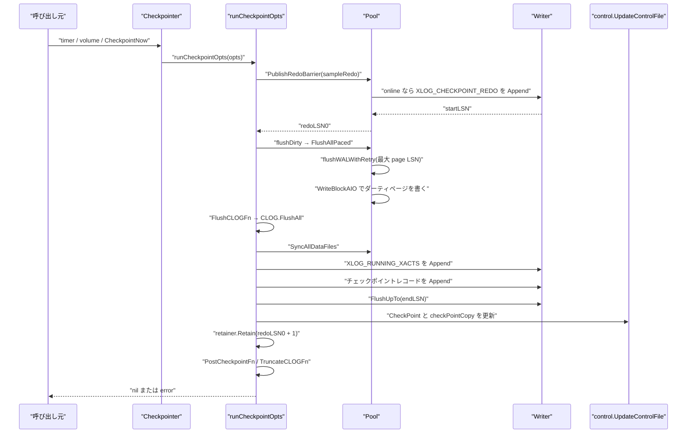
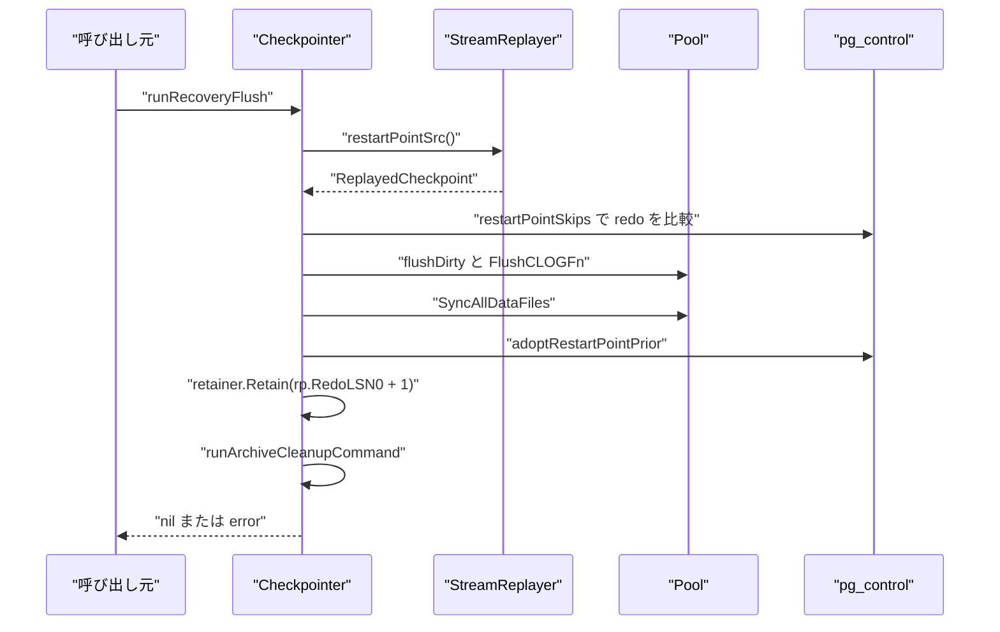

# チェックポイント

<details>
<summary>関連ソースファイル</summary>

- [`internal/access/transam/control/pgcontrol.go`](https://github.com/ryogrid/goopg/blob/19856410e8d497d59787e1ab35a2febb3f5953d6/internal/access/transam/control/pgcontrol.go)
- [`internal/access/transam/xlog/checkpointer.go`](https://github.com/ryogrid/goopg/blob/19856410e8d497d59787e1ab35a2febb3f5953d6/internal/access/transam/xlog/checkpointer.go)
- [`internal/access/transam/xlog/recovery.go`](https://github.com/ryogrid/goopg/blob/19856410e8d497d59787e1ab35a2febb3f5953d6/internal/access/transam/xlog/recovery.go)
- [`internal/access/transam/xlog/retention.go`](https://github.com/ryogrid/goopg/blob/19856410e8d497d59787e1ab35a2febb3f5953d6/internal/access/transam/xlog/retention.go)
- [`internal/access/transam/xlog/sync_linux.go`](https://github.com/ryogrid/goopg/blob/19856410e8d497d59787e1ab35a2febb3f5953d6/internal/access/transam/xlog/sync_linux.go)
- [`internal/executor/operators_checkpoint.go`](https://github.com/ryogrid/goopg/blob/19856410e8d497d59787e1ab35a2febb3f5953d6/internal/executor/operators_checkpoint.go)
- [`internal/initdb/pgcontrol.go`](https://github.com/ryogrid/goopg/blob/19856410e8d497d59787e1ab35a2febb3f5953d6/internal/initdb/pgcontrol.go)
- [`internal/initdb/wal_bootstrap.go`](https://github.com/ryogrid/goopg/blob/19856410e8d497d59787e1ab35a2febb3f5953d6/internal/initdb/wal_bootstrap.go)
- [`internal/storage/bgwriter.go`](https://github.com/ryogrid/goopg/blob/19856410e8d497d59787e1ab35a2febb3f5953d6/internal/storage/bgwriter.go)
- [`internal/storage/writeback.go`](https://github.com/ryogrid/goopg/blob/19856410e8d497d59787e1ab35a2febb3f5953d6/internal/storage/writeback.go)
- [`internal/storage/bufpool.go`](https://github.com/ryogrid/goopg/blob/19856410e8d497d59787e1ab35a2febb3f5953d6/internal/storage/bufpool.go)
- [`internal/access/transam/xlog/stream_replayer.go`](https://github.com/ryogrid/goopg/blob/19856410e8d497d59787e1ab35a2febb3f5953d6/internal/access/transam/xlog/stream_replayer.go)

</details>

チェックポイントは、バッファプール内のダーティページを WAL の redo 点と整合する順序でディスクへ書き出し、その redo 点とクラスタ状態を `pg_control` および WAL のチェックポイントレコードへ記録する仕組みです。goopg では `Checkpointer` がタイマー・`max_wal_size`・SQL `CHECKPOINT`・シャットダウン・復旧終了の各要求を直列化して処理し、`Pool.FlushAllPaced` による WAL-before-data のページ書き出し、CLOG とデータファイルの同期、`Writer` へのチェックポイントレコード追加、`control.UpdateControlFile` による `pg_control` 更新、`SlotAwareRetainer` による WAL セグメント整理までを 1 サイクルとして実行します。物理スタンバイでは同じ骨格を `runRecoveryFlush` が restartpoint として実行し、プライマリの WAL を一切生成しません。チェックポイントレコードのワイヤ形式は [10.1 WAL レコード形式](10.1-WAL-Format.md)、WAL の書込みとバッファは [10.2 WAL ライターとバッファ](10.2-WAL-Writer.md)、復旧時のリプレイは [10.4 クラッシュ復旧とリプレイ](10.4-Crash-Recovery.md) を参照してください。

## 責務

- タイマー（`checkpoint_timeout`）、WAL 量（`max_wal_size`）、SQL/CLI 要求、シャットダウン、復旧終了の各トリガーを `Checkpointer.Run` と `runCheckpointOpts` で直列に処理する（`internal/access/transam/xlog/checkpointer.go:Checkpointer.Run`、`runCheckpointOpts`）。
- redo 点をバッファフラッシュより前に決定して公開する。オンラインの PG 互換チェックポイントでは `XLOG_CHECKPOINT_REDO` レコードを追加し、その開始 LSN を redo にする（`internal/access/transam/xlog/checkpointer.go:runCheckpointOpts`、`internal/access/transam/xlog/pg_assembled_emit.go:EncodeCheckpointRedoPG`）。
- `redoPublisher.PublishRedoBarrier` で FPI 決定中のライターを待たせ、redo 公開とレコード追加を不可分にする。公開された redo は `Pool.needsImage` の FPI エポック境界になる（`internal/storage/bufpool.go:PublishRedoBarrier`、`needsImage`）。
- ダーティページを `FlushAllPaced` でバッチ書き出しし、各バッチでページの最大 `pd_lsn` まで WAL を先にフラッシュしてからページを書く（WAL-before-data）。`checkpoint_completion_target` に応じた pacer で時間を分散する（`internal/storage/bufpool.go:FlushAllPaced`、`internal/access/transam/xlog/checkpointer.go:buildPacer`）。
- CLOG のダーティページを `FlushCLOGFn` で同じフェーズに排出し、失敗時はチェックポイント自体を失敗させる（`internal/access/transam/xlog/checkpointer.go:runCheckpointOpts`）。
- データファイルを `SyncAllDataFiles` で fdatasync し、`pg_control` を更新する前にページの耐久性を確保する（`internal/storage/bufpool.go:SyncAllDataFiles`）。
- `XLOG_RUNNING_XACTS` とチェックポイントレコードを `Writer.Append` し、`FlushUpTo` で耐久化する。オンラインとシャットダウンで `XLOG_CHECKPOINT_ONLINE` / `XLOG_CHECKPOINT_SHUTDOWN` を使い分ける（`internal/access/transam/xlog/checkpointer.go:runCheckpointOpts`）。
- `pg_control` の `CheckPoint`、`checkPointCopy.redo`、TLI、`fullPageWrites`、nextXid/nextOid、multixact、GUC echo を更新し、CRC32C 付き 8192 バイトのイメージを単一 `WriteAt` + `fsync` で書く（`internal/access/transam/control/pgcontrol.go:UpdateControlFile`、`writeControlFileDurably`）。
- チェックポイントマーカーが durable になった後に `SlotAwareRetainer.Retain` を呼び、クラッシュ復旧とレプリケーションスロットの両方が不要とする WAL セグメントだけを削除・再利用する（`internal/access/transam/xlog/retention.go:SlotAwareRetainer.Retain`）。
- スタンバイでは `runRecoveryFlush` が再生済みチェックポイントを `pg_control` に adopt し、WAL を書かずに restartpoint を作る（`internal/access/transam/xlog/checkpointer.go:runRecoveryFlush`、`adoptRestartPointPrior`）。
- クラッシュ復旧では `replayStart` / `replayStartAt` が最後のチェックポイントを探し、その redo 点からリプレイを開始する（`internal/access/transam/xlog/recovery.go:replayStart`、`replayStartAt`、`isCheckpointRecord`）。
- initdb では `WriteBootstrapWAL` が `XLOG_CHECKPOINT_SHUTDOWN` を含む最初のセグメントを書き、その後 `writePgControl` が初期 `pg_control` を書く（`internal/initdb/wal_bootstrap.go:WriteBootstrapWAL`、`internal/initdb/pgcontrol.go:writePgControl`）。

## 処理フロー

プライマリのチェックポイントは、redo の公開 → ダーティページの書き出し → CLOG/データファイルの同期 → レコード追加 → `pg_control` 更新 → retention の順に進みます。



1. `CheckpointNow` は `announceImmediate` で `pendingImmediate` を増やし、`runCheckpointOpts` を同期呼び出しします。SQL の `CHECKPOINT` は `checkpointOp.Open` からこのメソッドを呼び、成功時は行を返しません（`internal/executor/operators_checkpoint.go:checkpointOp.Open`、`internal/access/transam/xlog/checkpointer.go:CheckpointNow`）。
2. `runCheckpointOpts` は `runMu` で他のチェックポイントと直列化します。`recoveryMode` が立っていれば `runRecoveryFlush` に分岐し、そうでなければ通常のチェックポイントに入ります（`internal/access/transam/xlog/checkpointer.go:runCheckpointOpts`）。
3. `computeRedo` は `volumeReporter.WrittenLSN()` にページヘッダ分（通常 0、ページ境界なら 24、セグメント境界なら 40）を足して redo 候補を作ります。PG 互換かつ非シャットダウンなら、代わりに `EncodeCheckpointRedoPG` を `Writer.Append` し、その `startLSN - 1` を redo にします（`internal/access/transam/xlog/checkpointer.go:runCheckpointOpts`）。
4. バッファプールが `redoPublisher` を実装していれば `PublishRedoBarrier(sampleRedo)` が `fpiPublishMu` の write lock の下で redo を確定・公開します。これにより、古い redo で FPI を決めたレコードが新しい redo 以降に着地することはありません（`internal/storage/bufpool.go:PublishRedoBarrier`）。
5. `flushDirty` は `pacedFlusher` と pacer があれば `FlushAllPaced` を、なければ `FlushAll` を呼びます。`FlushAllPaced` はダーティスロットを列挙し、バッチごとに `flushBatch` を呼んだ後、進捗を pacer に渡します（`internal/access/transam/xlog/checkpointer.go:flushDirty`、`internal/storage/bufpool.go:FlushAllPaced`）。
6. `flushBatch` は各ページの `pd_lsn` の最大値まで `flushWALWithRetry` で WAL を先にフラッシュしてから `WriteBlockAIO` でページを書きます。これが WAL-before-data の実体です。途中でスロットのタグが変わっていた場合は、古いタグのファイルへ新しいページ内容を書かないようスキップします（`internal/storage/bufpool.go:flushBatch`）。
7. CLOG の `FlushCLOGFn` とデータファイルの `SyncAllDataFiles` を実行します。`FlushCLOGFn` の失敗はチェックポイントを失敗させます。ここまでで redo 以前のページと CLOG がディスクに載ったことになります（`internal/access/transam/xlog/checkpointer.go:runCheckpointOpts`）。
8. `CheckPointFields` に TLI、`full_page_writes`、`wal_level`、nextXid、nextOid、multixact、redo を詰め、`withDefaults` で下限を適用します。PG 互換オンラインなら `EncodeRunningXactsPG` の `XLOG_RUNNING_XACTS` を追加してから `EncodeCheckpointPGFields` のチェックポイントレコードを追加します。シャットダウンでは running-xacts を省略し、`oldestActiveXid = 0` にします（`internal/access/transam/xlog/checkpointer.go:runCheckpointOpts`、`internal/access/transam/xlog/recovery.go:CheckPointFields.withDefaults`）。
9. チェックポイントレコードを `FlushUpTo(endLSN)` で durable にした後、`lastCheckpointRedoLSN`（1-based）、`lastCheckpointLSN`（end）、`lastCheckpointStartLSN`（start）を保存します。`pg_control` には `CheckPoint = startLSN - 1`、`CheckPointCopyRedo = redoLSN0` を書き、シャットダウンなら `DB_SHUTDOWNED`、通常は `DB_IN_PRODUCTION` にします（`internal/access/transam/xlog/checkpointer.go:runCheckpointOpts`、`internal/access/transam/control/pgcontrol.go:UpdateControlFile`）。
10. 最後に `numTimed` / `numRequested` と `writeTimeMs` を更新し、`retainer.Retain(redoLSN0 + 1)` で WAL を整理します。`PostCheckpointFn` と CLOG/subtrans truncation の失敗は警告ログに留まり、`PostReleaseFn` は解放したリレーションハンドル数を INFO で記録します（`internal/access/transam/xlog/checkpointer.go:runCheckpointOpts`）。

スタンバイの restartpoint は WAL を生成せず、再生済みチェックポイントを `pg_control` に採用します。



1. `runRecoveryFlush` はまず `restartPointSrc` から最後に再生した `ReplayedCheckpoint` を取得します（`internal/access/transam/xlog/checkpointer.go:runRecoveryFlush`、`internal/access/transam/xlog/stream_replayer.go:ReplayedCheckpoint`）。
2. `DataDir` がある場合、`restartPointSkips` が `pg_control.CheckPointCopyRedo` と `rp.Fields.RedoLSN0` を比較します。再生済みチェックポイントがない、または `pg_control` より新しくない場合は skip アームに入り、flush を行わず `raiseMinRecoveryPointToReplay` と（シャットダウン時のみ）`adoptRestartPoint` を実行します（`internal/access/transam/xlog/checkpointer.go:restartPointSkips`、`raiseMinRecoveryPointToReplay`）。
3. skip しない場合は `flushDirty` → `FlushCLOGFn` → `SyncAllDataFiles` を実行します。ここでも WAL-before-data は `FlushAllPaced` / `flushBatch` が担います。
4. `adoptRestartPointPrior` が `pg_control.CheckPoint` を `rp.StartLSN - 1`、`CheckPointCopyRedo` を `rp.Fields.RedoLSN0` に更新し、TLI・nextXid・nextOid・multixact・oldest 系・commit timestamp を `CheckPointFields` から写します。`DB_IN_ARCHIVE_RECOVERY` のときは `minRecoveryPoint` を `rp.EndLSN` まで進め、シャットダウンなら `DB_SHUTDOWNED_IN_RECOVERY` にします（`internal/access/transam/xlog/checkpointer.go:adoptRestartPointPrior`）。
5. 採用が起きた場合だけ `lastCheckpoint*` を更新し、`noteRestartPointDistance` でチェックポイント間隔の推定値を更新し、`retainer.Retain(rp.Fields.RedoLSN0 + 1)` と `TruncateSubtransFn`、`runArchiveCleanupCommand` を実行します（`internal/access/transam/xlog/checkpointer.go:runRecoveryFlush`）。

## 主要ファイル

| ファイル | 役割 |
| --- | --- |
| `internal/access/transam/xlog/checkpointer.go` | `Checkpointer` 本体。`Run`、`runCheckpointOpts`、`runRecoveryFlush`、redo 公開、pacer、統計、`pg_control` 更新、retention 呼び出し。 |
| `internal/access/transam/control/pgcontrol.go` | `ControlFileData`、`UpdateControlFile`、`BuildUpdatedControlImage`、`ReadControlFile`、`writeControlFileDurably`。 |
| `internal/access/transam/xlog/recovery.go` | `CheckPointFields`、`encodeCheckPointStruct`、`replayStart` / `replayStartAt`、`isCheckpointRecord`、`checkpointStructOf`、`DiscoverLastCheckpointLSN`。 |
| `internal/access/transam/xlog/retention.go` | `Retainer` インタフェースと `SlotAwareRetainer.Retain`。スロットの無効化、keep LSN の決定、セグメント削除・再利用。 |
| `internal/access/transam/xlog/stream_replayer.go` | `ReplayedCheckpoint` と `StreamReplayer.LastCheckpoint`。スタンバイの restartpoint 候補を保持する。 |
| `internal/access/transam/xlog/sync_linux.go` | WAL セグメント用の `dataSync`（`fdatasync`）と `fullSync`（`fsync`）。`Checkpointer` が呼ぶ `FlushUpTo(endLSN)` の経路で使われる。 |
| `internal/storage/bufpool.go` | `PublishRedoBarrier`、`needsImage`、`FlushAllPaced`、`flushBatch`、`SyncAllDataFiles`、WAL-before-data の実装。 |
| `internal/storage/bgwriter.go` | `Bgwriter`。200 ms 周期で `WriteDirtyPages` を呼ぶが fsync はしない。 |
| `internal/storage/writeback.go` | `accountCheckpointerWrite` / `accountBgwriterWrite`。`*_flush_after` ブロックごとに `SyncFileRangeHint` を出す。 |
| `internal/executor/operators_checkpoint.go` | SQL `CHECKPOINT` を `Context.Checkpointer.CheckpointNow` に接続する `checkpointOp`。 |
| `internal/initdb/wal_bootstrap.go` | `WriteBootstrapWAL`。最初のセグメントに long page header と 114 バイトの `XLOG_CHECKPOINT_SHUTDOWN` を書く。 |
| `internal/initdb/pgcontrol.go` | `writePgControl`、`buildPgControl`、`BackupControlImage`。初期 `pg_control` と BASE_BACKUP 用イメージ。 |

## 公開 API / エントリポイント

```go
func NewCheckpointer(flusher DirtyPageFlusher, wal checkpointWAL, cfg CheckpointerConfig) *Checkpointer

func (c *Checkpointer) Run(ctx context.Context) error
func (c *Checkpointer) CheckpointNow() error
func (c *Checkpointer) RequestCheckpoint() bool
func (c *Checkpointer) CheckpointShutdown() error
func (c *Checkpointer) CheckpointEndOfRecovery(prevTLI uint32) error

func (c *Checkpointer) SetInterval(d time.Duration)
func (c *Checkpointer) SetMaxWALBytes(b uint64)
func (c *Checkpointer) SetCompletionTarget(t float64)
func (c *Checkpointer) SetRetainer(r Retainer)
func (c *Checkpointer) SetRecoveryMode(enabled bool)
func (c *Checkpointer) SetRestartPointSource(fn func() (ReplayedCheckpoint, bool))
func (c *Checkpointer) SetReplayPositionSource(fn func() uint64)
func (c *Checkpointer) SetArchiveCleanupCommandSource(fn func() string)
func (c *Checkpointer) SetNextMultiXactFn(fn func() (next, nextOffset, oldest uint32))

func (c *Checkpointer) LastCheckpointLSN() uint64
func (c *Checkpointer) LastCheckpointRedoLSN() uint64
func (c *Checkpointer) LastCheckpointRecordLSN() uint64
func (c *Checkpointer) CheckPointDistanceEstimate() float64
func (c *Checkpointer) Stats() Stats

func control.UpdateControlFile(dataDir string, fn func(*control.ControlFileData)) error
func control.ReadControlFile(dataDir string) (*control.ControlFileData, error)
func control.BuildUpdatedControlImage(dataDir string, fn func(*control.ControlFileData)) ([]byte, error)

func NewBgwriter(pool *Pool, delay time.Duration, maxPages int) *Bgwriter
func (b *Bgwriter) Start()
func (b *Bgwriter) Stop()
func (b *Bgwriter) SetDelay(d time.Duration)
func (b *Bgwriter) SetMaxPages(n int)
```

`CheckpointNow` は呼び出し元の goroutine で同期的に完了します。`RequestCheckpoint` は `Run` が動いている場合だけ要求を受け付け、`requestC` に 1 件だけ積んで即座に返ります（`internal/access/transam/xlog/checkpointer.go:RequestCheckpoint`）。`CheckpointShutdown` は `DB_SHUTDOWNED` を、`CheckpointEndOfRecovery` は復旧前の TLI を `PrevTimeLineID` に持つシャットダウン型レコードを書きます（`CheckpointShutdown`、`CheckpointEndOfRecovery`）。

## 主要データ構造

### Checkpointer — 実行主体と状態

`internal/access/transam/xlog/checkpointer.go:Checkpointer`（293〜384 行）:

```go
type Checkpointer struct {
	flusher DirtyPageFlusher
	wal     checkpointWAL
	cfg     CheckpointerConfig

	// recoveryMode is set for a physical standby.  Recovery may flush dirty
	// data pages, but it must never manufacture a local checkpoint record:
	// the standby WAL stream is owned by the primary and its reconnect LSN is
	// derived from that stream's durable tail.
	recoveryMode atomic.Bool
	// restartPointSrc, set on a standby, reports the last checkpoint record
	// replay applied; runRecoveryFlush adopts it into pg_control after the
	// flush, as CreateRestartPoint does (M0122-0013). nil: no restartpoints.
	restartPointSrc atomic.Pointer[func() (ReplayedCheckpoint, bool)]
	// replayPosSrc, set on a standby, reports the replay position (the
	// end of the last applied record, in WrittenLSN's units). In recovery
	// the max_wal_size trigger measures it instead of the received WAL, as
	// PG's XLogPageRead tests XLogCheckpointNeeded(readSegNo) on the segment
	// replay is reading (M0122-0013). nil: the writer's position.
	replayPosSrc atomic.Pointer[func() uint64]
	// recoveryVolumeSegNo is the replay segment of the last recovery
	// volume request (+1; 0 before any): a request fires only from a newer
	// segment, PG's evaluation point — XLogPageRead tests once per segment
	// it leaves, not on every poll.
	recoveryVolumeSegNo atomic.Uint64

	// retainer, when non-nil, runs after each successful
	// checkpoint marker is durable. The slot-aware production
	// implementation lives in retention.go; tests can wire a
	// fake. nil disables WAL pruning entirely (the v0 default —
	// caller opts in by passing SetRetainer).
	retainer Retainer
	// archiveCleanupSrc reports archive_cleanup_command's current value
	// (PGC_SIGHUP, read at each restartpoint); nil: none (M0122-0013).
	archiveCleanupSrc atomic.Pointer[func() string]

	// intervalOverrideNS carries SIGHUP/reload-driven interval changes to
	// the Run loop (parity bundle D-2): the armed ticker is rebuilt from
	// this value at every fire, so a live SET/postgresql.conf reload takes
	// effect on the NEXT timeout checkpoint without restart.
	intervalOverrideNS     atomic.Int64
	lastCheckpointLSN      atomic.Uint64
	lastCheckpointRedoLSN  atomic.Uint64
	lastCheckpointStartLSN atomic.Uint64

	// volumeAnchor is the fallback RedoRecPtr for the max_wal_size
	// trigger before this process has completed its first checkpoint:
	// the writer position observed when Run started. Upstream always has
	// a RedoRecPtr — recovery seeds it from the checkpoint it started
	// from — so the elapsed-segment count is measured from "where this
	// server began writing" rather than from LSN 0. Anchoring at 0 would
	// make every restart of a cluster whose WAL has already passed
	// max_wal_size fire a checkpoint on the first poll (M0131-S30.4).
	volumeAnchor atomic.Uint64

	// distMu guards priorRedoLSN/checkPointDistanceEstimate. Checkpoints
	// are infrequent (seconds-to-minutes apart) so a plain mutex — rather
	// than lock-free float CAS — is fine here.
	distMu                     sync.Mutex
	priorRedoLSN               uint64
	checkPointDistanceEstimate float64

	// runMu makes checkpoints one at a time, as PG's single checkpointer
	// process does: the timer and volume triggers, SQL CHECKPOINT, base
	// backup, promotion and the shutdown checkpoint used to be able to run
	// runCheckpoint concurrently (M0122-0013).
	runMu sync.Mutex
	// pendingImmediate counts callers waiting for runMu that want an
	// IMMEDIATE checkpoint; immediateWake interrupts a spread checkpoint's
	// pacer sleep. Together they are PG's ImmediateCheckpointRequested:
	// CheckpointWriteDelay stops throttling once an immediate request is
	// queued, so the running checkpoint finishes at full speed and the
	// waiter's own checkpoint follows.
	pendingImmediate atomic.Int32
	immediateWake    chan struct{}
	// requestC carries RequestCheckpoint's no-wait requests to Run;
	// loopRunning reports whether Run is serving it.
	requestC    chan struct{}
	loopRunning atomic.Bool

	// Aggregate counters surfaced through pg_stat_checkpointer.
	// Mirror the upstream PG 18 view's counter shape:
	// num_timed     — timer-driven cycles
	// num_requested — SQL CHECKPOINT, CLI ctl, max_wal_size volume
	// write_time_ms — cumulative wall time inside flushDirty
	// statsResetAt  — timestamp of the last counter reset
	//                 (currently only set at construction)
	numTimed     stats.Counter
	numRequested stats.Counter
	writeTimeMs  stats.Counter
	statsResetAt atomic.Int64 // unix nanos
}
```

`lastCheckpointRedoLSN` は **redo 点**、`lastCheckpointStartLSN` は **チェックポイントレコード自体の開始 LSN**、`lastCheckpointLSN` はレコードの終了 LSN です。オンラインの PG 互換チェックポイントでは running-xacts レコードが挟まるため、redo とレコード開始は一致しません。`recoveryMode` が true の間は `runCheckpointOpts` が `runRecoveryFlush` に分岐し、ローカル WAL を書きません。`pendingImmediate` と `immediateWake` は、実行中の spread チェックポイントの pacer を止めて即時要求を優先させるための仕組みです。

### CheckpointerConfig — 間隔・しきい値・フック

`CheckpointerConfig` は `checkpoint_timeout`、`max_wal_size`、`checkpoint_completion_target`、`wal_segment_size`、`DataDir`、GUC echo、そして多数の運用フックをまとめます（`internal/access/transam/xlog/checkpointer.go:CheckpointerConfig`）。特に次のフィールドが挙動を決めます。

- `Interval`: 自動チェックポイントの周期。既定は 10 秒（`withDefaults`）。`SetInterval` は `intervalOverrideNS` を更新し、`Run` のタイマーが次の fire で新しい値を使います。
- `MaxWALBytes`: `max_wal_size` のバイト数。`checkpointSegments` が `max_wal_size / segment_size / (1 + completion_target)` を計算し、`elapsedSegmentsNeeded` が `CheckPointSegments - 1`（最低 1）を返します。これは PostgreSQL の `CalculateCheckpointSegments` / `XLogCheckpointNeeded` に合わせた計算です（`internal/access/transam/xlog/checkpointer.go:checkpointSegments`、`elapsedSegmentsNeeded`）。
- `CompletionTarget`: spread の割合。`buildPacer` が `Interval * CompletionTarget` を目標に、バッチごとの `progress` から待ち時間を計算します。`pendingImmediate > 0` または `immediateWake` で待機を打ち切ります（`internal/access/transam/xlog/checkpointer.go:buildPacer`）。
- `DataDir`: 空でなければ各チェックポイント後に `pg_control` を更新します。空の場合（テストなど）はスキップします。
- `PGCompatCheckpoints`: true なら 88 バイトの `CheckPoint` と明示的な opcode を使い、オンライン時に running-xacts を先行させます。false なら 1 バイトの `RecordKindCheckpoint` マーカーです。
- `NextXIDFn` / `NextOIDFn` / `TimelineIDFn` / `FullPageWritesFn` / `NextMultiXactFn`: チェックポイント時にライブ値をサンプルします。`NextXIDFn` と `NextOIDFn` は `pg_control` 側でも単調増加に丸められます。
- `FlushCLOGFn`: 失敗するとチェックポイントを失敗させます。`PostCheckpointFn` / `PostReleaseFn` / `TruncateCLOGFn` / `TruncateSubtransFn` はマーカー耐久後のベストエフォート処理です。

### CheckPointFields — WAL レコードと pg_control の共通状態

`internal/access/transam/xlog/recovery.go:CheckPointFields`（738〜776 行）:

```go
type CheckPointFields struct {
	// RedoLSN0 is the 0-based byte position of the checkpoint's redo
	// point. PG's xlogreader validates it against ReadRecPtr.
	RedoLSN0 uint64
	ThisTLI  uint32
	// PrevTLI defaults to ThisTLI. Only an end-of-recovery checkpoint
	// differs (it names the timeline forked off from).
	PrevTLI uint32
	// FullPageWrites mirrors the full_page_writes GUC as the buffer pool
	// currently sees it, not the postgresql.conf text: PG samples
	// Insert->fullPageWrites under the WAL insert lock.
	FullPageWrites bool
	WalLevel       uint32
	NextXid        uint64
	NextOid        uint32
	// NextMulti/NextMultiOffset/OldestMulti come from the multixact
	// allocator. A cluster that has never created a multixact reports
	// NextMulti = OldestMulti = FirstMultiXactId (1), NextMultiOffset = 0.
	NextMulti       uint32
	NextMultiOffset uint32
	OldestXid       uint32
	// OldestXidDB / OldestMultiDB name the database holding the horizon.
	// Upstream's bootstrap seeds both with Template1DbOid; a fresh PG 18
	// cluster reports 1 for each, so 0 (goopg's old value) was never a
	// value real PG writes.
	OldestXidDB   uint32
	OldestMulti   uint32
	OldestMultiDB uint32
	// OldestCommitTsXid / NewestCommitTsXid are InvalidTransactionId (0)
	// while track_commit_timestamp is off — which is goopg's only mode
	// today, and what a real PG 18 pg_controldata reports. goopg used to
	// hardcode 3 here, a value PG never writes with commit ts disabled.
	OldestCommitTsXid uint32
	NewestCommitTsXid uint32
	// OldestActiveXid: PG stamps InvalidTransactionId (0) on shutdown
	// checkpoints (recovery derives it from PrescanPreparedTransactions)
	// and GetOldestActiveTransactionId() on online ones.
	OldestActiveXid uint32
}
```

`withDefaults` は `ThisTLI` を 1、`PrevTLI` を `ThisTLI`、`WalLevel` を 1（replica）、`NextXid` を 3 以上、`NextOid` を 16384 以上、`NextMulti` / `OldestMulti` を 1 以上、`OldestXid` を 3 以上、`OldestXidDB` / `OldestMultiDB` を 1 に丸めます。これにより、呼び出し側が一部しか埋めなくても PG が受理する構造になります（`internal/access/transam/xlog/recovery.go:CheckPointFields.withDefaults`）。

### ControlFileData — pg_control の可変部分

`internal/access/transam/control/pgcontrol.go:ControlFileData`（67〜174 行）:

```go
type ControlFileData struct {
	// offset 0: system_identifier (uint64) — the cluster identity assigned
	// once at bootstrap (xlog.c:5099-5101 via InitControlFile) and never
	// mutated afterwards. DECODE-ONLY: encodeControlFileData deliberately
	// does not write it back, so UpdateControlFile's read-mutate-write cycle
	// preserves the original bytes and a caller that leaves this field zero
	// cannot clobber the cluster identity. M0131-S2.
	SystemIdentifier uint64
	// offset 16: DBState enum (uint32)
	State uint32
	// offset 24: pg_time_t / int64 — seconds since Unix epoch
	Time int64
	// offset 32: XLogRecPtr — location of most recent checkpoint record
	CheckPoint uint64
	// checkPointCopy substructure (CheckPoint struct, offset 40..128)
	// offset 40: checkPointCopy.redo (XLogRecPtr)
	CheckPointCopyRedo uint64
	// offset 48: checkPointCopy.ThisTimeLineID (uint32)
	CheckPointCopyThisTLI uint32
	// offset 52: checkPointCopy.PrevTimeLineID (uint32)
	CheckPointCopyPrevTLI uint32
	// offset 56: checkPointCopy.fullPageWrites (bool)
	CheckPointCopyFullPageWrites bool
	// offset 60: checkPointCopy.wal_level (int → uint32)
	CheckPointCopyWalLevel uint32
	// offset 64: checkPointCopy.nextXid (FullTransactionId = uint64).
	// PG18 stores epoch in the high 32 bits and the raw XID in the low
	// 32 bits; bootstrap value is FirstNormalTransactionId (3) with
	// epoch 0. M0106-0010 batched-45 wires the checkpointer to refresh
	// this from mvcc.Manager.NextXID() at every checkpoint so a
	// basebackup taken after user DDL carries the right starting XID.
	CheckPointCopyNextXid uint64
	// offset 72: checkPointCopy.nextOid (Oid = uint32).
	// Refreshed at every checkpoint from catalog.InMemory.NextOID()
	// so a crashed cluster can recover the OID counter from pg_control
	// without relying on pg_catalog.json. M0106-0013.
	CheckPointCopyNextOid uint32
	// M0131-S18.2: the remaining checkPointCopy members. Until this slice
	// they were never decoded, so they survived only by accident of
	// UpdateControlFile's read-modify-write cycle — any caller that wanted
	// to *set* one had no way to, and any future writer that assembled a
	// fresh buffer would have silently zeroed them. PG reads every one of
	// them at startup (InitWalRecovery / StartupMultiXact /
	// StartupCommitTs), so a zero here is not benign: oldestXid = 0 makes
	// SetTransactionIdLimit compute a bogus wrap-around horizon, and
	// oldestMulti = 0 trips "MultiXactId 0 does not exist".
	//
	// offset 76: checkPointCopy.nextMulti (MultiXactId = uint32)
	CheckPointCopyNextMulti uint32
	// offset 80: checkPointCopy.nextMultiOffset (MultiXactOffset = uint32)
	CheckPointCopyNextMultiOffset uint32
	// offset 84: checkPointCopy.oldestXid (TransactionId = uint32) —
	// cluster-wide minimum datfrozenxid
	CheckPointCopyOldestXid uint32
	// offset 88: checkPointCopy.oldestXidDB (Oid = uint32)
	CheckPointCopyOldestXidDB uint32
	// offset 92: checkPointCopy.oldestMulti (MultiXactId = uint32) —
	// cluster-wide minimum datminmxid
	CheckPointCopyOldestMulti uint32
	// offset 96: checkPointCopy.oldestMultiDB (Oid = uint32)
	CheckPointCopyOldestMultiDB uint32
	// offset 104: checkPointCopy.time (pg_time_t / int64)
	CheckPointCopyTime int64
	// offset 112: checkPointCopy.oldestCommitTsXid (TransactionId = uint32)
	CheckPointCopyOldestCommitTsXid uint32
	// offset 116: checkPointCopy.newestCommitTsXid (TransactionId = uint32)
	CheckPointCopyNewestCommitTsXid uint32
	// offset 120: checkPointCopy.oldestActiveXid (TransactionId = uint32).
	// Only meaningful for an ONLINE checkpoint under wal_level >= replica;
	// upstream stores InvalidTransactionId (0) otherwise (xlog.c:7050).
	CheckPointCopyOldestActiveXid uint32
	// offset 128: XLogRecPtr — fake LSN counter for unlogged relations
	UnloggedLSN uint64
	// offset 136: XLogRecPtr — minimum recovery point
	MinRecoveryPoint uint64
	// offset 144: TimeLineID (uint32)
	MinRecoveryPointTLI uint32
	// offset 152: XLogRecPtr — start of last base backup
	BackupStartPoint uint64
	// offset 160: XLogRecPtr — end of last base backup
	BackupEndPoint uint64
	// offset 168: bool — backup must end before recovery is consistent
	BackupEndRequired bool
	// GUC echo fields (offsets 172-200) — replicated from primary via
	// XLOG_PARAMETER_CHANGE; used by standby CheckRequiredParameterValues.
	// offset 172: wal_level (int → uint32)
	WalLevel uint32
	// offset 176: wal_log_hints (bool)
	WalLogHints bool
	// offset 180: MaxConnections (int → uint32)
	MaxConnections uint32
	// offset 184: max_worker_processes (int → uint32)
	MaxWorkerProcesses uint32
	// offset 188: max_wal_senders (int → uint32)
	MaxWalSenders uint32
	// offset 192: max_prepared_xacts (int → uint32)
	MaxPreparedXacts uint32
	// offset 196: max_locks_per_xact (int → uint32)
	MaxLocksPerXact uint32
	// offset 200: track_commit_timestamp (bool)
	TrackCommitTimestamp bool
	// offset 252: data_checksum_version (uint32). 0 ⇒ data-page checksums
	// disabled, 1 ⇒ enabled (PG_DATA_CHECKSUM_VERSION). Set by initdb
	// (--data-checksums) and never changed at runtime by goopg; the
	// storage Manager reads it to decide whether to checksum/verify every
	// block. See docs/design/0102-0019-initdb-data-checksums.md.
	DataChecksumVersion uint32
}
```

`SystemIdentifier` はデコード専用で、`encodeControlFileData` は書き戻しません。したがって `UpdateControlFile` の read-modify-write はクラスタ識別子を保存します。`CheckPoint` はチェックポイントレコードの開始位置（0-based PG LSN）、`CheckPointCopyRedo` はそこからリプレイを始める redo 点です。`State` は `DBStateShutdowned`（1）から `DBStateInProduction`（6）までの PostgreSQL の `DBState` と一致します（`internal/access/transam/control/pgcontrol.go:decodeControlFileData`、`encodeControlFileData`）。

### ReplayedCheckpoint — スタンバイが保持する最後のチェックポイント

`internal/access/transam/xlog/stream_replayer.go:ReplayedCheckpoint`（74〜82 行）:

```go
type ReplayedCheckpoint struct {
	// StartLSN is the record's internal 1-based start (PG's ReadRecPtr is
	// StartLSN-1); EndLSN is PG's EndRecPtr.
	StartLSN uint64
	EndLSN   uint64
	// Fields and Time are the record's decoded CheckPoint struct.
	Fields CheckPointFields
	Time   int64
}
```

`StreamReplayer` は `XLOG_CHECKPOINT_ONLINE` / `XLOG_CHECKPOINT_SHUTDOWN` を適用するたびに `lastCheckpoint` を更新します。`runRecoveryFlush` はこの値を `restartPointSrc` 経由で読み、`StartLSN - 1` を `pg_control.CheckPoint`、`Fields.RedoLSN0` を `CheckPointCopyRedo` として採用します（`internal/access/transam/xlog/stream_replayer.go:LastCheckpoint`、`internal/access/transam/xlog/checkpointer.go:adoptRestartPointPrior`）。

### Retainer / SlotAwareRetainer — チェックポイント後の WAL 整理

`internal/access/transam/xlog/retention.go:Retainer`（40〜47 行）:

```go
type Retainer interface {
	// Retain is invoked with the LSN of the just-flushed
	// checkpoint marker (i.e. the upper bound of WAL the
	// checkpointer just made redundant for crash recovery).
	// Implementations must not block the checkpointer for long;
	// the canonical implementation does cheap unlinks only.
	Retain(checkpointLSN uint64) error
}
```

`internal/access/transam/xlog/retention.go:SlotAwareRetainer`（53〜97 行）:

```go
type SlotAwareRetainer struct {
	// Writer is the WAL writer whose pg_wal/ directory is being
	// pruned. Required.
	Writer *Writer

	// Slots is the replication-slot registry. May be nil — a nil
	// registry collapses retention to "keep nothing earlier than
	// the checkpoint", which matches the upstream behaviour when
	// no slots exist.
	Slots *Slots

	// MaxSlotKeepBytes mirrors `max_slot_wal_keep_size`. <= 0
	// means unlimited (no slot is ever invalidated for lag).
	// Stored as int64 so the GUC's signed sentinel passes through
	// unchanged.
	MaxSlotKeepBytes int64

	// Logger receives the per-checkpoint retention summary
	// (segments removed, slots invalidated). Defaults to slog
	// default.
	Logger *slog.Logger

	// CheckPointDistanceEstimateFn, when non-nil, returns the current
	// moving-average estimate (bytes) of inter-checkpoint WAL volume —
	// wired to (*Checkpointer).CheckPointDistanceEstimate in production.
	// Combined with CompletionTarget and Writer's Config.MinWALSize/
	// MaxWALSize, it drives RemoveOldSegmentsWithEstimate's
	// XLOGfileslop-style sizing so segment recycling can grow past the
	// MinWALSize floor under sustained write volume (capped at
	// MaxWALSize). nil falls back to RemoveOldSegments' pre-existing
	// MinWALSize-only floor. M0122-0009 follow-up; see
	// docs/design/0122-0009-wal-segment-recycling.md.
	CheckPointDistanceEstimateFn func() float64

	// KeepLSNFn, when non-nil, returns an LSN whose WAL must be kept as
	// well, or 0 for no constraint: the WAL summarizer's oldest
	// unsummarized LSN (KeepLogSeg's summarize_wal clamp, xlog.c), so
	// segments are not removed before they are summarized.
	KeepLSNFn func() uint64

	// CompletionTarget mirrors checkpoint_completion_target, one of the
	// XLOGfileslop distance-formula inputs. Only consulted when
	// CheckPointDistanceEstimateFn is non-nil.
	CompletionTarget float64
}
```

`Retain` はまず `max_slot_wal_keep_size` を超えたスロットを `InvalidateLagging` で無効化し、次に `keepLSN = checkpointLSN` を非無効スロットの `MinRestartLSN` と `KeepLSNFn` で後方に広げます。最後に `Writer.RemoveOldSegmentsWithEstimate` または `RemoveOldSegments` を呼び、`keepLSN` を含むセグメント以降を残します。WAL のラグはチェックポイント LSN ではなく `Writer.WrittenLSN()` を基準に測ります（`internal/access/transam/xlog/retention.go:Retain`）。

### Bgwriter — チェックポイントとは独立した先回り書き込み

`internal/storage/bgwriter.go:Bgwriter`（29〜50 行）:

```go
type Bgwriter struct {
	pool     *Pool
	delay    atomic.Int64 // time.Duration
	maxPages atomic.Int64
	// kick wakes the loop after SetDelay so a new delay takes effect
	// at once, as the SIGHUP latch wakes PG's bgwriter from its sleep.
	kick   chan struct{}
	stop   chan struct{}
	done   chan struct{}
	logger *slog.Logger

	// OnLoopStart/OnLoopEnd, when set, bracket the goroutine's entire run
	// (called once each, not per-tick) so a caller can register this
	// goroutine's identity with the activity registry the same way
	// wal.Config's OnLoopStart/OnLoopEnd let initdb.Open track the WAL
	// writer goroutine (walProcNum). Without this the bgwriter's dirty-page
	// flushes (WriteDirtyPages → accountBgwriterWrite) have no registered
	// goroutine to attribute a wait event to (M0122-0003 writeback
	// simplification 3 follow-up).
	OnLoopStart func()
	OnLoopEnd   func()
}
```

`Bgwriter` は `bgwriter_delay`（既定 200 ms）ごとに `Pool.WriteDirtyPages(maxPages)` を呼び、`bgwriter_lru_maxpages` を超えない範囲でダーティページを先回りして書きます。fsync は行わず、耐久性はチェックポインタに任せます。`SetDelay` は `kick` で ticker をリセットし、`SetMaxPages(0)` は LRU 書き込みだけを止めます（`internal/storage/bgwriter.go:run`、`SetDelay`）。

### checkpointOpts — 1 サイクルの要求フラグ

`internal/access/transam/xlog/checkpointer.go:checkpointOpts`（964〜975 行）:

```go
type checkpointOpts struct {
	spread   bool // paced over checkpoint_completion_target (not IMMEDIATE)
	shutdown bool // shutdown checkpoint: pg_control state DB_SHUTDOWNED
	timed    bool // checkpoint_timeout cause: pg_stat_checkpointer num_timed
	// endOfRecovery is CHECKPOINT_END_OF_RECOVERY: "really a shutdown
	// checkpoint, just issued at a different time" (CreateCheckPoint) — a
	// shutdown-type record (no redo record, no running-xacts) whose
	// PrevTimeLineID is prevTLI, the timeline recovery forked off from, so
	// it marks the timeline change; the cluster stays in production.
	endOfRecovery bool
	prevTLI       uint32
}
```

`spread` は pacer の有無と統計種別（`numTimed` / `numRequested`）を決めます。`shutdown` は `DB_SHUTDOWNED` とシャットダウン型レコードを選び、`endOfRecovery` はレコード型だけシャットダウンにしつつ `pg_control` の state は production のままにします（`runCheckpointOpts`）。

## 内部構造

### redo 公開と FPI エポック

オンラインの PG 互換チェックポイントでは、redo は単なるサンプル値ではなく `XLOG_CHECKPOINT_REDO` レコードの開始 LSN です。`sampleRedo` はそのレコードを `Writer.Append` し、`startLSN - 1` を返します。append は `PublishRedoBarrier` の `fpiPublishMu` write lock の内側で行われるため、redo の公開とマーカーの着地が原子的になります。

バッファプール側では、公開された `redoRecPtr` が FPI のエポック境界です。`needsImage` はスロットの `nativeImageLSN <= redoRecPtr` なら次の変更にフルページイメージを付けます。チェックポイント終了後に別途エポックをリセットしないため、「redo サンプル後にリセットして、その間のイメージなしレコードが残る」という競合窓がありません（`internal/storage/bufpool.go:PublishRedoBarrier`、`needsImage`、`PublishRedoRecPtr`）。

### WAL-before-data と pacer

`FlushAllPaced` はダーティスロットを列挙し、`flushBatchSize`（1〜256）ごとに `flushBatch` を呼びます。`flushBatch` はバッチ内の最大 `pd_lsn` と `hintFlushBarrier` の大きい方まで `flushWALWithRetry` で WAL をフラッシュしてから、`WriteBlockAIO` でページを書きます。したがって、ページに記録された変更の WAL は必ずページより先に durable になります。

pacer は `buildPacer` が返す関数で、`progress` が 1.0 に達するまで `start + Interval*CompletionTarget*progress` を待ちます。`pendingImmediate > 0` なら待たずに返り、`immediateWake` が閉じられても待機を打ち切ります。これにより、SQL `CHECKPOINT` などの即時要求が spread チェックポイントの完了を待たされる時間を抑えます（`internal/access/transam/xlog/checkpointer.go:buildPacer`）。

### トリガーの評価

`Run` は `time.Timer` を使い、fire のたびに `effectiveInterval` で再設定するため、`SetInterval` の変更が次の周期から反映されます。タイマー経路は、`lastCheckpointStartLSN` が 0 でなく、かつ `WrittenLSN() <= lastCheckpointStartLSN` なら何もせずスキップします。これは PostgreSQL の idle-skip に相当します。

`max_wal_size` 経路は `VolumeCheckInterval`（既定 1 秒）ごとに `volumeTriggerFires` を評価します。`checkpointSegments` と `elapsedSegmentsNeeded` で必要経過セグメント数を求め、完了済みチェックポイントがあれば `lastCheckpointRedoLSN - 1`（0-based）、なければ `Run` 開始時の `volumeAnchor` をアンカーにします。スタンバイでは `replayPosSrc` があれば受信 WAL ではなく再生位置を使い、同じ再生セグメントで何度も restartpoint を要求しないよう `recoveryVolumeSegNo` で抑制します（`internal/access/transam/xlog/checkpointer.go:Run`、`volumeTriggerFires`）。

### チェックポイントレコードの 2 形式

`PGCompatCheckpoints` が true の場合、`EncodeRunningXactsPG` の running-xacts レコード（オンラインのみ）と `EncodeCheckpointPGFields(recordShutdown, cpFields)` の 88 バイト `CheckPoint` を書きます。opcode はオンラインが `0x10`、シャットダウンが `0x00` です。false の場合は `EncodeCheckpoint()` の 1 バイト `RecordKindCheckpoint` です。

復旧側の `isCheckpointRecord` は 3 形態を認識します。1 バイトの旧マーカー、`Payload` が 88 バイトの旧 PG 互換レコード、そして `XLog.Header.Rmid == RmgrXLog` かつ `MainData` が 88 バイトで `Info` が shutdown/online の明示 opcode レコードです。`checkpointStructOf` はどちらの経路でも 88 バイト構造を取り出します（`internal/access/transam/xlog/recovery.go:isCheckpointRecord`、`checkpointStructOf`）。

### リプレイ開始点の決定

`replayStart` は最後のチェックポイントレコードを探し、その 88 バイト構造の offset 0 から redo（0-based）を読み、`EndLSN > redo` を満たす直前のレコードまで開始位置を巻き戻します。`replayStartAt` は `pg_control` から渡された `redoLSN` が非ゼロなら、その値だけで開始インデックスを決めます。チェックポイント LSN 自体は `ReplayStats` 用にスキャンしますが、リプレイのアンカーには使いません（`internal/access/transam/xlog/recovery.go:replayStart`、`replayStartAt`）。

redo を使う理由は、チェックポイントのレコードが dirty-page/CLOG フラッシュの**後**に追加されるためです。`(redo, record]` の区間には、フラッシュ中にコミットされたトランザクションの WAL だけが残っている可能性があり、レコードからリプレイするとそのコミットを取り逃します。redo から余分にリプレイしても、ページの `pd_lsn` ガードと CLOG の終端状態書き込みにより冪等です。

### pg_control の安全な更新

`UpdateControlFile` は `BuildUpdatedControlImage` で 8192 バイトのイメージを作り、`writeControlFileDurably` で `O_RDWR` のまま固定長 `WriteAt` と `fsync` を行います。`O_TRUNC` を使わないので、書き込み途中でクラッシュしてもファイルが 0 バイトになることはなく、最悪でも CRC 不一致として検出できます。CRC32C は先頭 292 バイトに対して計算し、オフセット 292 に格納します（`internal/access/transam/control/pgcontrol.go:UpdateControlFile`、`writeControlFileDurably`）。

### initdb のブートストラップ

`WriteBootstrapWAL` は `pg_wal/000000010000000000000001` を作り、オフセット 0 に 40 バイトの long page header、オフセット 40 に 24 バイトの `XLogRecord` ヘッダと 2 バイトの short chunk ヘッダ、続いて 88 バイトの `CheckPoint` を書きます。レコード全体は 114 バイト（24 + 2 + 88）で、`Info` は `XLOG_CHECKPOINT_SHUTDOWN`、`Rmid` は `RmgrXLog`、`Prev` は 0 です。ページを書いた後、セグメントサイズまで `Truncate` し、`fsync` してから `writePgControl` に進みます（`internal/initdb/wal_bootstrap.go:WriteBootstrapWAL`、`encodeCheckPointBody`）。

初期 `pg_control` は `checkPoint = 0x01000028`（16 MiB + 40）、`checkPointCopy.redo` も同じ値、状態は `DB_SHUTDOWNED` です。`nextXid = 3`、`nextOid = 10000`、`nextMulti = 1`、`oldestXid = 3`、`oldestMulti = 1`、`unloggedLSN = 1000` が設定されます（`internal/initdb/pgcontrol.go:buildPgControl`）。

### 書き戻しヒントと bgwriter

チェックポインタと bgwriter のページ書き込みは、`*_flush_after` のブロック数に達するたびに `SyncFileRangeHint` を出します。`accountCheckpointerWrite` は `checkpointFlushAfterBlocks`、`accountBgwriterWrite` は `bgwriterFlushAfterBlocks` を使い、成功したヒントだけを `sharedCheckpointWritebackCount` / `sharedBgwriterWritebackCount` に数えます。ヒントは write-behind の促しであり、耐久性の保証ではありません（`internal/storage/writeback.go:accountCheckpointerWrite`、`accountBgwriterWrite`）。

## エッジケースと不変条件

- **redo はフラッシュ前に確定する** — `runCheckpointOpts` は `flushDirty` より前に redo を計算・公開します。オンライン PG 互換で、かつ flusher が `redoPublisher` を実装していれば、`XLOG_CHECKPOINT_REDO` の append が `PublishRedoBarrier` の write lock 内で行われ、`redoAppendErr` が非 nil ならチェックポイントは失敗します（`internal/access/transam/xlog/checkpointer.go:runCheckpointOpts`）。
- **シャットダウンは redo レコードを出さない** — `recordShutdown` が true のとき `sampleRedo` は `computeRedo` のままで、running-xacts も省略されます。シャットダウン中は redo とレコードの間に WAL が書かれないため、レコード自身が redo 点になります。
- **WAL-before-data** — `flushBatch` はページを書く前にバッチ最大 `pd_lsn` まで WAL をフラッシュします。ページの WAL が未 durable のままページだけ先行して永続化されることはありません（`internal/storage/bufpool.go:flushBatch`）。
- **FLUSH CLOG の失敗はチェックポイント失敗** — `FlushCLOGFn` がエラーを返すと `runCheckpointOpts` はその場で失敗します。redo を進めたのに CLOG が未反映だと、クラッシュ復旧でコミット状態を再構成できないためです（`internal/access/transam/xlog/checkpointer.go:runCheckpointOpts`）。
- **データファイル同期の失敗も致命的** — `SyncAllDataFiles` のエラーは `sync data files` として返され、`pg_control` は更新されません。ページの pwrite だけでは host crash 後の耐久性を保証できないためです（`internal/access/transam/xlog/checkpointer.go:runCheckpointOpts`、`internal/storage/bufpool.go:SyncAllDataFiles`）。
- **マーカー durability 後のみ後処理** — `lastCheckpoint*`、`pg_control`、retention、CLOG/subtrans truncation、post-checkpoint hooks はすべて `FlushUpTo(endLSN)` の後に実行されます。CLOG truncation はチェックポイントが指す redo より前の状態を消さないよう、保守的な horizon を使う責任を callee が負います（`internal/access/transam/xlog/checkpointer.go:runCheckpointOpts`）。
- **retention はレコードではなく redo から** — `retainer.Retain(redoLSN0 + 1)` が渡されます。チェックポイントレコードの LSN から削ると `(redo, record]` のコミット WAL を失い、redo 起点のリプレイが acked commit を再構成できなくなります（`internal/access/transam/xlog/checkpointer.go:runCheckpointOpts`）。
- **pg_control の nextXid / nextOid は単調** — `UpdateControlFile` のコールバックは `nextXid > cd.CheckPointCopyNextXid` と `nextOid > cd.CheckPointCopyNextOid` のときだけ更新します。巻き戻すとスタンバイのスナップショットや OID 割当てが壊れます（`internal/access/transam/xlog/checkpointer.go:runCheckpointOpts`）。
- **pg_control は truncate しない** — `writeControlFileDurably` は 8192 バイト固定長を `WriteAt` し、`fsync` します。`O_TRUNC` による 0 バイト窓を作らないため、クラッシュ時は CRC 不一致として扱えます（`internal/access/transam/control/pgcontrol.go:writeControlFileDurably`）。
- **restartpoint は WAL を書かない** — `runRecoveryFlush` は `Writer.Append` を一切呼びません。スタンバイのローカル WAL tail は walreceiver の再開位置であり、ローカルチェックポイントで進めるとプライマリのストリームからずれるためです（`internal/access/transam/xlog/checkpointer.go:runRecoveryFlush`）。
- **restartpoint の skip 条件** — 再生済みチェックポイントがない、または `pg_control.CheckPointCopyRedo >= rp.Fields.RedoLSN0` の場合は flush をスキップします。ただし `minRecoveryPoint` の引き上げと、シャットダウン時の `DB_SHUTDOWNED_IN_RECOVERY` 更新は行います（`internal/access/transam/xlog/checkpointer.go:restartPointSkips`、`adoptRestartPointPrior`）。
- **スタンバイのボリュームトリガー** — 受信 WAL ではなく `replayPosSrc` の再生位置でセグメント経過を測り、`recoveryVolumeSegNo` で同じ再生セグメントに対する重複要求を抑えます。受信だけが先行しても restartpoint は要求されません（`internal/access/transam/xlog/checkpointer.go:volumeTriggerFires`）。
- **max_wal_size の距離計算** — `checkpointSegments` は `max_wal_size / (1 + completion_target)` をセグメント数に直し、最低 1 に丸めます。`elapsedSegmentsNeeded` は `CheckPointSegments - 1` を返し、1 未満にはなりません（`internal/access/transam/xlog/checkpointer.go:checkpointSegments`、`elapsedSegmentsNeeded`）。
- **Run の idle skip** — タイマー経路は `lastCheckpointStartLSN` が 0 でなく、かつ `WrittenLSN() <= lastCheckpointStartLSN` ならスキップします。ボリューム経路と SQL/CLI の強制チェックポイントはこのショートカットを取りません（`internal/access/transam/xlog/checkpointer.go:Run`）。
- **checkpoint_completion_target の範囲** — `SetCompletionTarget` は 0 未満を 0、1 超を 1 にクランプします。`CompletionTarget <= 0` または `Interval <= 0` では pacer が nil になり、`FlushAll` の即時書き出しになります（`internal/access/transam/xlog/checkpointer.go:SetCompletionTarget`、`buildPacer`）。
- **バッチ内のスロット再利用** — `flushBatch` は `contentMu.RLock` 取得後にタグと state を再確認し、バッチ収集後に別リレーションへ再利用されたスロットをスキップします。古いタグのファイルへ新しいページ内容を書く cross-relation 破壊を防ぐためです（`internal/storage/bufpool.go:flushBatch`）。
- **WriteDirtyPages のカーソル** — bgwriter の `bgwriterHand` はスキャンした分だけ前進します。固定カーソルだと毎 tick 同じ先頭 `maxPages` だけを見て、後方のダーティページに到達できません（`internal/storage/bufpool.go:WriteDirtyPages`）。
- **バックアップイメージは live pg_control を汚さない** — `BackupControlImage` は `BuildUpdatedControlImage` でコピーを作り、`minRecoveryPoint` と `backupEndPoint` を設定します。live の `pg_control` は変更しません（`internal/initdb/pgcontrol.go:BackupControlImage`）。

Sources:

- `internal/access/transam/control/pgcontrol.go`
- `internal/access/transam/xlog/checkpointer.go`
- `internal/access/transam/xlog/recovery.go`
- `internal/access/transam/xlog/retention.go`
- `internal/access/transam/xlog/sync_linux.go`
- `internal/executor/operators_checkpoint.go`
- `internal/initdb/pgcontrol.go`
- `internal/initdb/wal_bootstrap.go`
- `internal/storage/bgwriter.go`
- `internal/storage/writeback.go`
- `internal/storage/bufpool.go`
- `internal/access/transam/xlog/stream_replayer.go`

<sub>Generated by deepwiki-4myself from `goopg` @ `19856410e`</sub>
