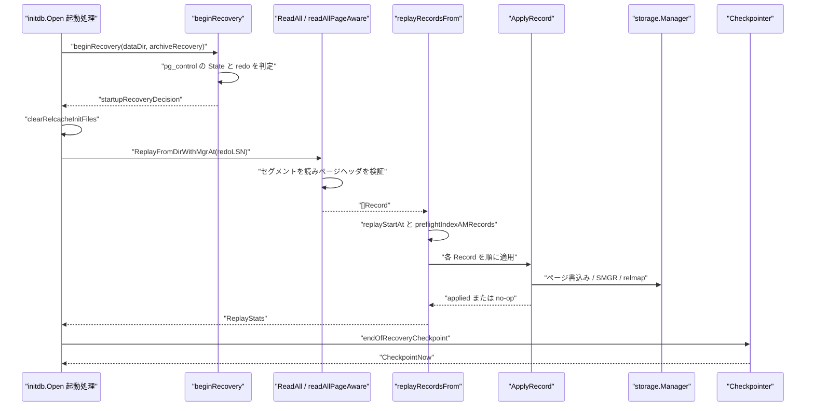
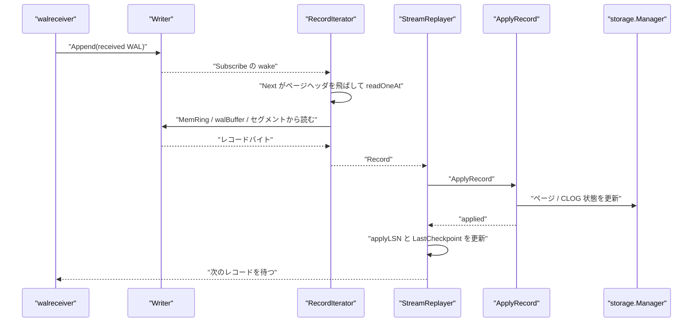

# クラッシュ復旧とリプレイ

<details>
<summary>関連ソースファイル</summary>

- [`internal/access/transam/xlog/archive_recovery.go`](https://github.com/ryogrid/goopg/blob/19856410e8d497d59787e1ab35a2febb3f5953d6/internal/access/transam/xlog/archive_recovery.go)
- [`internal/access/transam/xlog/find_next_record.go`](https://github.com/ryogrid/goopg/blob/19856410e8d497d59787e1ab35a2febb3f5953d6/internal/access/transam/xlog/find_next_record.go)
- [`internal/access/transam/xlog/iterator.go`](https://github.com/ryogrid/goopg/blob/19856410e8d497d59787e1ab35a2febb3f5953d6/internal/access/transam/xlog/iterator.go)
- [`internal/access/transam/xlog/pg_xact_parse.go`](https://github.com/ryogrid/goopg/blob/19856410e8d497d59787e1ab35a2febb3f5953d6/internal/access/transam/xlog/pg_xact_parse.go)
- [`internal/access/transam/xlog/pg_xlog_decode.go`](https://github.com/ryogrid/goopg/blob/19856410e8d497d59787e1ab35a2febb3f5953d6/internal/access/transam/xlog/pg_xlog_decode.go)
- [`internal/access/transam/xlog/reader.go`](https://github.com/ryogrid/goopg/blob/19856410e8d497d59787e1ab35a2febb3f5953d6/internal/access/transam/xlog/reader.go)
- [`internal/access/transam/xlog/reader_early_end.go`](https://github.com/ryogrid/goopg/blob/19856410e8d497d59787e1ab35a2febb3f5953d6/internal/access/transam/xlog/reader_early_end.go)
- [`internal/access/transam/xlog/recovery.go`](https://github.com/ryogrid/goopg/blob/19856410e8d497d59787e1ab35a2febb3f5953d6/internal/access/transam/xlog/recovery.go)
- [`internal/access/transam/xlog/recovery_cache.go`](https://github.com/ryogrid/goopg/blob/19856410e8d497d59787e1ab35a2febb3f5953d6/internal/access/transam/xlog/recovery_cache.go)
- [`internal/access/transam/xlog/reorder.go`](https://github.com/ryogrid/goopg/blob/19856410e8d497d59787e1ab35a2febb3f5953d6/internal/access/transam/xlog/reorder.go)
- [`internal/access/transam/xlog/stream_replayer.go`](https://github.com/ryogrid/goopg/blob/19856410e8d497d59787e1ab35a2febb3f5953d6/internal/access/transam/xlog/stream_replayer.go)
- [`internal/initdb/recovery_state.go`](https://github.com/ryogrid/goopg/blob/19856410e8d497d59787e1ab35a2febb3f5953d6/internal/initdb/recovery_state.go)

</details>

クラッシュ復旧は、`pg_control` に記録された最後のチェックポイントの redo 点から WAL を読み直し、未反映のページ・カタログ・SMGR 操作を再適用してから、復旧終了チェックポイントで新しい整合点を作る処理です。goopg は `beginRecovery` でクラッシュ復旧かどうかを判定し、`ReadAll` でセグメントをページヘッダごと走査して絶対 LSN 付きの `Record` 列に復号し、`replayRecordsFrom` が `ApplyRecord` を 1 レコードずつ適用します。適用はページの `pd_lsn` と CLOG の終端状態書き込みにより冪等なので、どこで再度クラッシュしても同じ範囲を安全にやり直せます。同じ `ApplyRecord` を `RecordIterator` で駆動するのがスタンバイの `StreamReplayer` で、アーカイブ復旧はタイムライン履歴をたどりながらセグメント単位で同じリプレイを行います。WAL の書き込み側は [10.2 WAL ライターとバッファ](10.2-WAL-Writer.md)、チェックポイントの作成は [10.3 チェックポイント](10.3-Checkpoint.md)、レコード形式は [10.1 WAL レコード形式](10.1-WAL-Format.md) を参照してください。

## 責務

- `pg_control` の `State` と `CheckPointCopyRedo` / `CheckPoint` を読み、クラッシュ復旧が必要か、redo をどこから始めるかを決める（`internal/initdb/recovery_state.go:beginRecovery`、`startupRecoveryDecision`）。
- 復旧開始前に `pg_control` を `DB_IN_CRASH_RECOVERY` または `DB_IN_ARCHIVE_RECOVERY` にし、`pg_internal.init` を全データベースから削除する（`internal/initdb/recovery_state.go:beginRecovery`、`clearRelcacheInitFiles`）。
- WAL ディレクトリの最初の残存セグメントからストリームを読み、ページヘッダを検証しつつ `Record` の絶対 `StartLSN` / `EndLSN` を復元する（`internal/access/transam/xlog/reader.go:readAllUncached`、`readAllPageAware`）。
- 起動中の複数モジュールが同じ WAL を繰り返しデコードしないよう、`ReadAll` の結果を復旧ウィンドウ中だけメモ化する（`internal/access/transam/xlog/recovery_cache.go:BeginRecoveryCache`、`ReadAll`）。
- 最後のチェックポイントと redo 点を求め、redo 以前のレコードをスキップする（`internal/access/transam/xlog/recovery.go:replayStartAt`、`replayStart`）。
- インデックス AM の未対応レコードを、1 ページも書く前にまとめて拒否する（`internal/access/transam/xlog/recovery.go:preflightIndexAMRecords`）。
- レコードをネイティブ `RecordKind` と PG 形式の `(xl_rmid, xl_info)` の両方でディスパッチし、ページ・B-tree・SMGR・DBASE・TBLSPC・relmap・CLOG・sequence へ適用する（`internal/access/transam/xlog/recovery.go:ApplyRecord`、`replayDecodedXLogRecord`）。
- コミット/アボートのサブトランザクション情報を `ParseXactRecord` で復号し、CLOG の xact スタンプ処理へ渡す（`internal/access/transam/xlog/pg_xact_parse.go:ParseXactRecord`）。
- 停止点が本当に WAL の終端かを `earlyEndOfWAL` で判定し、後ろに durable な WAL が残っている場合は `ErrEarlyEndOfWAL` で起動を拒否する（`internal/access/transam/xlog/reader_early_end.go:earlyEndOfWAL`、`durableWALAfter`）。
- スタンバイでは `RecordIterator` と `StreamReplayer` で到着した WAL を連続適用し、`ApplyLSN` と最後の `ReplayedCheckpoint` を公開する（`internal/access/transam/xlog/iterator.go:RecordIterator`、`internal/access/transam/xlog/stream_replayer.go:StreamReplayer.Run`）。
- アーカイブ復旧では `restore_command` とタイムライン履歴を使い、ターゲット LSN/XID で停止する（`internal/access/transam/xlog/archive_recovery.go:RunArchiveRecoveryWith`、`RecoveryStop`）。
- 復旧完了後に `CheckpointNow` を呼び、redo 点を前進させる（`internal/initdb/recovery_state.go:endOfRecoveryCheckpoint`）。

## 処理フロー

クラッシュ復旧のバッチ経路です。`beginRecovery` の判定から `ReadAll`、`ApplyRecord`、復旧終了チェックポイントまでをたどります。



1. `beginRecovery` は `control.ReadControlFile` で `pg_control` を読み、`State != DBStateShutdowned` または `CheckPointCopyRedo < CheckPoint` ならクラッシュ復旧と判定します。後者はオンラインチェックポイントの署名で、WAL が redo とレコードの間に書かれていることを意味します（`internal/initdb/recovery_state.go:beginRecovery`）。
2. クラッシュ復旧なら `pg_control` を `DBStateInCrashRecovery` に更新します。アーカイブ復旧要求なら `DBStateInArchiveRecovery` です。`pg_control` が存在しない場合は判定を諦め、redo 0 で全 WAL をリプレイする従来動作になります（`internal/initdb/recovery_state.go:beginRecovery`）。
3. `clearRelcacheInitFiles` は `catalog.RelcacheInitFileRemoveAll` で全データベースの `pg_internal.init` を削除します。復旧前のカタログを記述した init ファイルが残ると、リプレイ後のカタログと食い違うためです（`internal/initdb/recovery_state.go:clearRelcacheInitFiles`）。
4. `ReplayFromDirWithMgrAt` は `ReadAll(walDir, segmentSize)` を呼びます。`ReadAll` は復旧キャッシュが有効なら一度だけ `readAllUncached` を実行し、その結果を共有します（`internal/access/transam/xlog/recovery.go:ReplayFromDirWithMgrAt`、`internal/access/transam/xlog/recovery_cache.go:ReadAll`）。
5. `readAllUncached` は `firstAvailableSegment` で最初の残存セグメントを求め、`segmentSize` が 0 なら long page header から実際のサイズを検出します。`baseOffset = firstSegNo * segmentSize` として、`readAllPageAware` が返す LSN を絶対バイト位置にします（`internal/access/transam/xlog/reader.go:readAllUncached`）。
6. `readAllPageAware` はページ境界で short/long ヘッダを検証し、ページをまたぐレコードは `extractRecordBytes` でヘッダを除去して連結します。最初のページが `XLPFirstIsContRecord` なら `xlp_rem_len` 分を読み飛ばします（`internal/access/transam/xlog/reader.go:readAllPageAware`）。
7. `replayRecordsFrom` は `replayStartAt(records, redoLSN)` で開始インデックスを決めます。`redoLSN` が非ゼロなら `EndLSN > redoLSN` を満たす最初のレコードから始め、0 なら `replayStart` が最後のチェックポイントを探して redo まで巻き戻します（`internal/access/transam/xlog/recovery.go:replayStartAt`）。
8. `preflightIndexAMRecords(records[startIdx:])` が GIN/BRIN/GiST/SP-GiST/hash のレコードを先に検査し、1 つでもあれば何も適用せずに拒否します。途中まで適用してから失敗すると、データディレクトリが半端に進んだ状態で残るためです（`internal/access/transam/xlog/recovery.go:replayRecordsFrom`）。
9. 各 `Record` に対して `ApplyRecord` を呼びます。`Record.XLog` があり `Payload` が空なら `replayDecodedXLogRecord` に進み、`Payload[0]` が既知の `RecordKind` でもヘッダの `(xl_rmid, xl_info)` が一致しなければ decoded 経路に回します（`internal/access/transam/xlog/recovery.go:ApplyRecord`、`headerMatchesEmittedKind`）。
10. `ApplyRecord` はページイメージ、B-tree 分割、ヒープ挿入/削除/更新、SMGR、CLOG、DBASE、relmap などを適用し、変更がないマーカーは `applied=false` を返します。ページ適用は `pd_lsn` が既に進んでいれば no-op です（`internal/access/transam/xlog/recovery.go:ApplyRecord`、各 `replay*` 関数）。
11. `replayRecordsFrom` は `ReplayStats{Records, Applied, CheckpointLSN}` を返します。`interrupted` が true を返すと `ErrRecoveryShutdown` で中断します（`internal/access/transam/xlog/recovery.go:replayRecordsFrom`）。
12. 復旧後、`endOfRecoveryCheckpoint` が `CheckpointNow` を呼び、redo 点を進めます。失敗は警告に留まり、復旧自体の成功は維持されます（`internal/initdb/recovery_state.go:endOfRecoveryCheckpoint`）。

スタンバイの連続リプレイは、walreceiver がローカル `Writer` に追記した WAL を `RecordIterator` が読み、`StreamReplayer` が同じ `ApplyRecord` を呼びます。



1. `NewRecordIterator(w, walDir, segSize, startLSN)` は `startLSN` を 0-based の `pos` に変換します。`startLSN` がセグメントサイズの倍数なら、直前セグメントの末尾ではなく新しいセグメントの先頭に合わせるため 1 を足します（`internal/access/transam/xlog/iterator.go:NewRecordIterator`）。
2. `Next` は `Writer.WrittenLSN()` を上限に、ページ境界のヘッダとゼロ埋めパディングを読み飛ばしながら `readOneAt` で 1 レコード読みます。読めないバイトが「まだ drain されていない」のか「そもそも WrittenLSN を超えている」のかを `errWALBytesUndrained` と素の `ErrLSNNotWritten` で区別します（`internal/access/transam/xlog/iterator.go:Next`）。
3. `readBytesAt` はまず `Writer.MemRing()`、次に `Writer` の `walBuffer`、最後にセグメントファイルを読みます。読み込みは `RecordIterator` が保持する `segFile` キャッシュを使います（`internal/access/transam/xlog/iterator.go:readBytesAt`、`readSegmentSliceCached`）。
4. `StreamReplayer.Run` は `iter.Next(ctx)` の各レコードに `ApplyRecord` を適用し、コミット/アボートなら `onXactReplay(xid, committed)` を呼びます（`internal/access/transam/xlog/stream_replayer.go:StreamReplayer.Run`、`replayedXactInfo`）。
5. チェックポイントレコードを適用した場合、`decodeCheckPointStruct` の結果を `ReplayedCheckpoint` として `lastCheckpoint` に保存します。これが次の restartpoint の候補になります（`internal/access/transam/xlog/stream_replayer.go:Run`）。
6. `Run` は `applyLSN` を単調に進め、`LastApplied` / `ApplyLSN` / `LastCheckpoint` / `AtEndOfWAL` を公開します。プロモーションは `AtEndOfWAL` が true になってから新しいタイムラインを開始します（`internal/access/transam/xlog/stream_replayer.go:LastApplied`、`AtEndOfWAL`）。

## 主要ファイル

| ファイル | 役割 |
| --- | --- |
| `internal/access/transam/xlog/recovery.go` | `RecordKind` 定数、`ReplayRecords` / `ReplayFromDirWithMgrAt`、`ApplyRecord`、`replayDecodedXLogRecord`、`replayStart` / `replayStartAt`、`isCheckpointRecord`、`DiscoverLastCheckpointLSN`。 |
| `internal/access/transam/xlog/reader.go` | `Record`、`readAllUncached`、`readAllPageAware`、`recordStartsAt`、`durableUnknownRecord`、セグメントサイズ検出、ストリーム読み込み。 |
| `internal/access/transam/xlog/reader_early_end.go` | `ErrEarlyEndOfWAL`、`earlyEndOfWAL`、`durableWALAfter`。停止点より後ろに durable WAL がある場合の起動拒否。 |
| `internal/access/transam/xlog/recovery_cache.go` | `BeginRecoveryCache` / `EndRecoveryCache` / `ReadAll`。起動復旧中の WAL デコードを 1 回にメモ化。 |
| `internal/access/transam/xlog/iterator.go` | `RecordIterator` と `RawChunk`。`Next` / `NextRaw`、ページヘッダとパディングの読み飛ばし、`AtEndOfWAL`、MemRing 経由の読み込み。 |
| `internal/access/transam/xlog/stream_replayer.go` | `StreamReplayer`、`ReplayedCheckpoint`、`Run`、`ApplyLSN`、`LastCheckpoint`、`replayedXactInfo`。 |
| `internal/access/transam/xlog/archive_recovery.go` | `RunArchiveRecoveryWith`、タイムライン履歴の解決、`restore_command` によるセグメント取得、`RecoveryStop`、`ReadSegmentRecords`。 |
| `internal/access/transam/xlog/find_next_record.go` | `FindNextRecord`（`XLogFindNextRecord` 相当）。ページ境界から最初のレコード開始位置を返す。 |
| `internal/access/transam/xlog/pg_xact_parse.go` | `ParseXactRecord`。`XLOG_XACT_HAS_INFO` 以下の dbinfo / subxacts / relfilelocators チャンクを復号。 |
| `internal/access/transam/xlog/pg_xlog_decode.go` | `XLogBlockRef` / `XLogDecodedRecord`、`decodeRecordXLogDetailed`、`parseXLogRecordData`、`decodeXLogBlockRefHeader`。 |
| `internal/access/transam/xlog/reorder.go` | `ReorderBuffer`。論理デコード側でコミット順出力を保証するバッファ。 |
| `internal/initdb/recovery_state.go` | `beginRecovery`、`startupRecoveryDecision`、`clearRelcacheInitFiles`、`endOfRecoveryCheckpoint`。 |

## 公開 API / エントリポイント

```go
func ReplayRecords(mgr *storage.Manager, records []Record) (ReplayStats, error)
func ReplayRecordsFrom(mgr *storage.Manager, records []Record, redoLSN uint64) (ReplayStats, error)
func ReplayFromDir(dataDir string, segmentSize int64) (ReplayStats, error)
func ReplayFromDirWithMgr(mgr *storage.Manager, walDir string, segmentSize int64) (ReplayStats, error)
func ReplayFromDirWithMgrAt(mgr *storage.Manager, walDir string, segmentSize int64, redoLSN uint64) (ReplayStats, error)
func ReplayFromDirWithMgrAtInterruptible(mgr *storage.Manager, walDir string, segmentSize int64, redoLSN uint64, interrupted func() bool) (ReplayStats, error)

func ApplyRecord(mgr *storage.Manager, r Record) (bool, error)
func ExportedReplayStart(records []Record) (int, uint64)
func DiscoverLastCheckpointLSN(walDir string, segmentSize int64) (uint64, error)
func IsGoopgNativeRecord(r Record) bool

func ReadAll(walDir string, segmentSize int64) ([]Record, error)
func BeginRecoveryCache(walDir string)
func EndRecoveryCache()

func NewRecordIterator(w *Writer, walDir string, segSize int64, startLSN uint64) (*RecordIterator, error)
func (it *RecordIterator) Next(ctx context.Context) (Record, error)
func (it *RecordIterator) NextRaw(ctx context.Context, maxBytes int) (RawChunk, error)
func (it *RecordIterator) AtEndOfWAL() bool
func (it *RecordIterator) SetReadLimit(limit func() uint64)

func NewStreamReplayer(mgr *storage.Manager, baselineLSN uint64) *StreamReplayer
func (sr *StreamReplayer) Run(ctx context.Context, iter *RecordIterator) error
func (sr *StreamReplayer) ApplyLSN() uint64
func (sr *StreamReplayer) LastApplied() (start, end uint64, ok bool)
func (sr *StreamReplayer) LastCheckpoint() (ReplayedCheckpoint, bool)

func RunArchiveRecovery(mgr *storage.Manager, dataDir, restoreCommand string, segmentSize int64) (ArchiveRecoveryResult, error)
func RunArchiveRecoveryWith(ctx context.Context, mgr *storage.Manager, dataDir string, restoreCommand func() string, segmentSize int64, target TargetTimeline, stop RecoveryStop) (ArchiveRecoveryResult, error)
func ReadSegmentRecords(walDir string, segNo uint64, segmentSize int64) ([]Record, error)
func FindNextRecord(walDir string, tli uint32, segSize int64, lsn uint64) (rec uint64, ok bool, err error)

func ParseXactRecord(info uint8, mainData []byte) (XactParsed, error)
```

`ReplayRecords` はスライスを受け取り、`ReplayRecordsFrom` は `pg_control` の redo を明示できます。`ReplayFromDir*` はディレクトリから読みます。`ApplyRecord` はバッチ復旧とストリーミング復旧の共通カーネルです（`internal/access/transam/xlog/recovery.go:ApplyRecord`）。

## 主要データ構造

### Record — 復号済み WAL レコード

`internal/access/transam/xlog/reader.go:Record`（15〜20 行）:

```go
type Record struct {
	StartLSN uint64
	EndLSN   uint64
	Payload  []byte
	XLog     *XLogDecodedRecord
}
```

`StartLSN` / `EndLSN` はページヘッダを含む WAL ストリーム上の絶対バイト位置で、`StartLSN` は 1-based、`EndLSN` は最後のバイトの LSN です。`Payload` はネイティブ goopg レコードの本体、`XLog` は PG 形式の構造化ビューです。ネイティブ経路では `Payload[0]` が `RecordKind` になり、PG 形式では `XLog.Header`、`XLog.Blocks`、`XLog.MainData` を使います。

### XLogDecodedRecord / XLogBlockRef — PG 形式の復号結果

`internal/access/transam/xlog/pg_xlog_decode.go:XLogBlockRef`（302〜311 行）:

```go
type XLogBlockRef struct {
	ID         byte
	Rel        storage.RelFileNode
	Block      storage.BlockNumber
	HasImage   bool
	ImageApply bool
	WillInit   bool
	Image      storage.Page
	Data       []byte
}
```

`internal/access/transam/xlog/pg_xlog_decode.go:XLogDecodedRecord`（316〜322 行）:

```go
type XLogDecodedRecord struct {
	Header       XLogRecord
	RecordOrigin uint16
	TopLevelXID  uint32
	MainData     []byte
	Blocks       []XLogBlockRef
}
```

`XLogDecodedRecord` は 24 バイトヘッダ、origin/top-level xid チャンク、main data、ブロック参照を保持します。`XLogBlockRef.Image` は hole を再構成した 8 KiB ページで、`WillInit` は redo が既存ページを読まずに初期化してよいことを示します。`MainData` と各 `Data` は入力バッファからコピーされるため、`Record` の寿命と独立です（`internal/access/transam/xlog/pg_xlog_decode.go:parseXLogRecordData`）。

### RecordIterator — ストリーミング読み込み

`internal/access/transam/xlog/iterator.go:RecordIterator`（37〜78 行）:

```go
type RecordIterator struct {
	writer  *Writer
	walDir  string
	segSize int64
	wake    chan struct{}
	pos     int64 // 0-based byte offset corresponding to the LSN cursor
	// closed is an atomic flag so Close (e.g. called by walsender
	// teardown) and Next (running in a separate goroutine) don't race.
	// M0098-0002 exposed this via LockOSThread scheduling change.
	closed atomic.Bool
	// pageHeaders mirrors Writer.PageHeadersEnabled() at iterator
	// construction time. When true, the cursor walks page-header
	// bytes transparently: at every page boundary the iterator
	// skips a 24- or 40-byte XLogPageHeader, and record-byte reads
	// can span page boundaries (the next page's header sits between
	// fragments). See M0014-0001 step 2.
	pageHeaders bool
	// segFile caches the segment file the last read opened, so a scan that
	// walks a segment does not open and close it once per read.
	// review/260831 XL-9: readSegmentSlice opened the file per call, and
	// readOneAt reads twice per record (header, then body), so replaying one
	// segment did two opens per record.
	segFile     *os.File
	segFileNo   uint64
	segFileTLI  uint32
	lastWaitPos int64
	lastWaitEnd uint64
	// parkedAtEnd is set while Next is blocked at the *end of the WAL
	// stream*: the cursor has either reached the tail, or points at a
	// record whose bytes run past WrittenLSN and therefore were never
	// received. It is deliberately NOT set when Next blocks on bytes
	// that exist but are not yet readable (see errWALBytesUndrained),
	// because those will arrive on their own. Read via AtEndOfWAL.
	// Written only by the single goroutine driving Next, read by
	// observers (the promotion drain), hence atomic.
	parkedAtEnd atomic.Bool
	// readLimit, when set, caps how far Next reads: no record ending past
	// readLimit() is returned. The WAL summarizer bounds itself by the
	// flush LSN this way (walsummarizer.c reads up to GetFlushRecPtr), so a
	// summary never covers WAL a crash could still rewrite.
	readLimit func() uint64
}
```

`pos` は 0-based の次回読み込み位置、`wake` は `Writer.Subscribe` で登録された wake-up チャネルです。`parkedAtEnd` は「レコードが完全に届いていない」場合だけ true になり、単に drain 待ちの `errWALBytesUndrained` では true になりません。この区別がプロモーションの `AtEndOfWAL` 判定を安全にします。

### StreamReplayer — スタンバイの連続適用

`internal/access/transam/xlog/stream_replayer.go:StreamReplayer`（40〜67 行）:

```go
type StreamReplayer struct {
	mgr *storage.Manager

	// onXactReplay is an optional hook called for every commit/abort
	// record the replayer processes. The first argument is the
	// transaction's XID; the second is true for commit, false for
	// abort. Used by the standby to advance the local MVCC manager's
	// nextXID so replayed tuples become visible to queries.
	onXactReplay func(xid storage.TransactionID, committed bool)

	mu       sync.Mutex
	applyLSN uint64
	// lastStart is the StartLSN of the record that set applyLSN (0 before
	// any): promotion resumes WAL after it with xl_prev naming it.
	lastStart uint64
	records   uint64
	applied   uint64
	// iter is the iterator the current Run call is draining. Held so
	// observers outside the replay goroutine (the promotion drain)
	// can ask whether replay has reached end-of-WAL. nil before the
	// first Run.
	iter *RecordIterator
	// lastCheckpoint is the last checkpoint record replay applied, the
	// restartpoint candidate (see ReplayedCheckpoint); hasCheckpoint is
	// false before the first.
	lastCheckpoint ReplayedCheckpoint
	hasCheckpoint  bool
}
```

`applyLSN` は適用済みレコードの終端 LSN で、`Run` の中で単調に更新されます。`lastCheckpoint` はチェックポイントレコードを適用したときだけ更新され、restartpoint の候補になります。`onXactReplay` はミューテックス外で呼ばれ、MVCC マネージャのロックとのデッドロックを避けます。

### ReplayStats / ReplayedCheckpoint

`internal/access/transam/xlog/recovery.go:ReplayStats`（693〜697 行）:

```go
type ReplayStats struct {
	Records       int
	Applied       int
	CheckpointLSN uint64
}
```

`internal/access/transam/xlog/stream_replayer.go:ReplayedCheckpoint`（74〜82 行）:

```go
type ReplayedCheckpoint struct {
	// StartLSN is the record's internal 1-based start (PG's ReadRecPtr is
	// StartLSN-1); EndLSN is PG's EndRecPtr.
	StartLSN uint64
	EndLSN   uint64
	// Fields and Time are the record's decoded CheckPoint struct.
	Fields CheckPointFields
	Time   int64
}
```

`ReplayStats.Records` は読み込んだレコード数、`Applied` は実際にページやファイルを変更した数、`CheckpointLSN` は見つかった最後のチェックポイントの終端 LSN です。`ReplayedCheckpoint.StartLSN` から 1 を引いた値が PG の `ReadRecPtr`、`EndLSN` が `EndRecPtr` に対応します。

### ArchiveRecoveryResult / RecoveryStop — アーカイブ復旧

`internal/access/transam/xlog/archive_recovery.go:ArchiveRecoveryResult`（38〜81 行）:

```go
type ArchiveRecoveryResult struct {
	// EndOfLog is the end of the last record replayed — PG's EndOfLog, the
	// timeline switch point the promotion writes into the new timeline's
	// history file (xlog.c StartupXLOG → writeTimeLineHistory) and where the
	// new timeline's WAL begins. LastStart is that record's StartLSN; the
	// first record on the new timeline names LastStart-1 as its xl_prev
	// (0-based), as the streaming promotion does (StreamReplayer.LastApplied).
	// Both are 0 when nothing was replayed.
	EndOfLog, LastStart uint64
	// EndTLI is the timeline of the last segment replayed (PG's
	// EndOfLogTLI); 0 when nothing was replayed.
	EndTLI uint32
	// NewestTLI is the newest timeline whose history file exists locally or
	// in the archive, probing from the target (findNewestTimeLine). The
	// promotion's new timeline is NewestTLI+1, so it cannot collide with one
	// already in the archive.
	NewestTLI uint32
	// TargetTLI is the recovery target timeline (recoveryTargetTLI): the
	// timeline whose history recovery follows.
	TargetTLI uint32
	// ReachedTarget reports that the LSN target stopped recovery at StopLSN
	// (the ReadRecPtr of the record it stopped at), after applying that
	// record when StopAfter (recoveryStopLSN / recoveryStopAfter).
	ReachedTarget bool
	StopKind      StopKind
	StopLSN       uint64
	StopAfter     bool
	// StopXid, StopIsCommit and StopXactTime describe the transaction end
	// record an xid target stopped at (recoveryStopXid, recoveryStopTime:
	// xact_time, microseconds since 2000-01-01).
	StopXid      uint32
	StopIsCommit bool
	StopXactTime int64
	// StopPoint is where the recovered WAL ends at the target, as a PG
	// position: the stop record's start, or its end when StopAfter.
	StopPoint uint64
	// TargetHistory is TargetTLI's history file as read (nil for timeline 1
	// or when it has none). The history file is read through RECOVERYHISTORY
	// and not kept in pg_wal, so the promotion builds the new timeline's
	// history from these entries.
	TargetHistory []TimelineHistoryEntry
	// Timelines is the expected history, oldest first (expectedTLEs).
	Timelines []TimelineSpan
}
```

`internal/access/transam/xlog/archive_recovery.go:RecoveryStop`（435〜441 行）:

```go
type RecoveryStop struct {
	Set       bool
	LSN       uint64 // PG LSN (0-based)
	XidSet    bool
	Xid       uint32
	Inclusive bool
}
```

`ArchiveRecoveryResult.StopPoint` は停止レコードの開始位置、`StopAfter` が true なら終了位置です。`RecoveryStop.Inclusive` は `recovery_target_inclusive` に対応し、停止レコード自体を適用するかどうかを決めます。LSN は PG の 0-based `ReadRecPtr`、`XID` はトランザクション ID です。

### XactParsed — コミット/アボートのサブトランザクション

`internal/access/transam/xlog/pg_xact_parse.go:XactParsed`（58〜69 行）:

```go
type XactParsed struct {
	// Xinfo is the xl_xact_xinfo word, or 0 when XLOG_XACT_HAS_INFO is clear.
	Xinfo uint32
	// Subxacts are the subtransaction XIDs of the committing/aborting
	// transaction, in the record's order. Empty when the transaction used no
	// subtransactions (the common case).
	Subxacts []uint32
	// DroppedRels are the relations the transaction dropped (the
	// HAS_RELFILELOCATORS chunk), raw as PG wrote them. The WAL summarizer
	// sets their limit block to 0 (walsummarizer.c SummarizeXactRecord).
	DroppedRels []XactRelFileLocator
}
```

`ParseXactRecord` は `xact_time`（8 バイト）の後に `XLOG_XACT_HAS_INFO` の xinfo 語、`XACT_XINFO_HAS_DBINFO`、`XACT_XINFO_HAS_SUBXACTS`、`XACT_XINFO_HAS_RELFILELOCATORS` の順でチャンクを読みます。subxact 数と dropped rel 数は `maxParsedSubxacts = 1 << 20` を上限に拒否します（`internal/access/transam/xlog/pg_xact_parse.go:ParseXactRecord`）。

### startupRecoveryDecision — 起動時の復旧判定

`internal/initdb/recovery_state.go:startupRecoveryDecision`（23〜40 行）:

```go
type startupRecoveryDecision struct {
	// crashRecovery is true when the previous run did not shut down
	// cleanly, i.e. upstream would have set InRecovery = true.
	crashRecovery bool
	// redoLSN is pg_control's checkPointCopy.redo (0-based XLogRecPtr), or
	// 0 when there is no usable control file — see wal.ReplayRecordsFrom
	// for what 0 means to the replay path.
	redoLSN uint64
	// prevState is the DBState pg_control carried on entry, kept for the
	// log line and for the post-replay stamp's before/after reporting.
	prevState uint32
	// nextMulti is pg_control's checkPointCopy.nextMulti — the MultiXactId
	// the previous run would have handed out next. 0 when there is no
	// usable control file; multixact.NewStoreAt clamps anything below
	// FirstMultiXactId, so 0 degrades to the pre-M0131-S20.4 behaviour of
	// starting the allocator at FirstMultiXactId. M0131-S20.4.
	nextMulti uint32
}
```

`crashRecovery` が false なら `Open` は WAL をリプレイしません。`redoLSN` が 0 の場合は `replayStart` のストリームスキャンにフォールバックします。`prevState` はログと復旧後の状態遷移の記録に使われ、`nextMulti` は MultiXact アロケータの初期値に使われます。

## 内部構造

### 絶対 LSN とセグメントサイズの復元

`ReadAll` の戻り値は、保持されている最初のセグメント番号 `firstSegNo` とセグメントサイズから `baseOffset = firstSegNo * segmentSize` を計算し、各レコードの `StartLSN = baseOffset + offset + 1`、`EndLSN = baseOffset + offset + consumed` とします。WAL 保持でセグメント 0 が消えていても、ページの `pd_lsn` と比較できる絶対 LSN が得られます（`internal/access/transam/xlog/reader.go:readAllUncached`）。

`segmentSize` が 0 のときは `detectSegmentSizeAt` が最初のセグメントの long page header から `xlp_seg_size` を読みます。誤って 16 MiB と仮定すると、すべての LSN が実際とずれ、`pd_lsn` の冪等判定が効かずに既適用レコードを再適用してしまいます（`internal/access/transam/xlog/reader.go:readAllUncached`、`detectSegmentSizeAt`）。

### ページ走査と途中終了の分類

`readAllPageAware` は、ページ境界で all-zero ヘッダ（事前確保テール）なら静かに終了し、ページヘッダが自分の `xlp_pageaddr` を名乗らない場合はリサイクル済みセグメントとして停止します。レコード復号後の消費バイト数が組み立てた `fullBytes` の長さと一致しない場合や CRC が合わない場合も停止候補です（`internal/access/transam/xlog/reader.go:readAllPageAware`）。

停止が本当に end-of-WAL かは `earlyEndOfWAL` が `durableWALAfter` で確認します。`durableWALAfter` は停止位置以降の各ページについて、ページヘッダが自分のアドレスを名乗り、そのページ先頭のレコードの CRC が合う場合だけ「durable WAL が続いている」と判定します。その場合は `ErrEarlyEndOfWAL` を返し、`GOOPG_WAL_ALLOW_EARLY_END` が true のときだけ警告に降格します（`internal/access/transam/xlog/reader_early_end.go:earlyEndOfWAL`、`durableWALAfter`）。

### ErrUnsupportedRecord と破損の区別

CRC が通ったレコードでも、圧縮バックアップブロックや未対応のリソースマネージャのように goopg が適用できないものは `ErrUnsupportedRecord` です。これは「ディスクに永続化された意味のあるレコード」であり、破損テールとして読み捨てると後続レコードを失います。`readAllPageAware` は `ErrUnsupportedRecord` を呼び出し元へ伝播し、それ以外の復号失敗は停止点以降が durable でないことを確認したうえでテールとして扱います（`internal/access/transam/xlog/reader.go:readAllPageAware`）。

### ネイティブと PG 形式の振り分け

`ApplyRecord` は `r.XLog` があり `Payload` が空なら decoded 経路に進みます。`Payload` があっても `payload[0]` が未知の `RecordKind` なら decoded 経路です。既知でも `headerMatchesEmittedKind` が false なら decoded 経路に回します。これは、PG 形式の 88 バイトチェックポイントの `Payload[0]`（redo LSN の下位バイト）が偶然 `RecordKind` と一致する衝突を避けるためです（`internal/access/transam/xlog/recovery.go:ApplyRecord`、`headerMatchesEmittedKind`）。

decoded 経路は `xlog.Header.Rmid` で分岐します。`RmgrGoopgCatalog` は物理ページを持たないため no-op、`RmgrXLog` は parameter-change と FPI を適用し、チェックポイントや NOOP などは明示的な no-op 集合です。`RmgrHash` / `RmgrGin` / `RmgrGist` / `RmgrSPGist` / `RmgrBrin` は `indexAMUnsupportedError` で拒否し、2 相コミットの 3 opcode は `ErrUnsupportedRecord` で拒否します（`internal/access/transam/xlog/recovery.go:replayDecodedXLogRecord`）。

### 冪等性と再開

ページ適用は `pd_lsn` がレコードの `EndLSN` 以上なら no-op です。CLOG のコミット/アボートは終端状態への書き込みで、同じ値を再書き込みしても結果が変わりません。したがって、復旧中に再度クラッシュしても、`pg_control` の redo が古いままなら同じ範囲をやり直すだけで正しさを失いません（`internal/access/transam/xlog/recovery.go:ApplyRecord`、`stream_replayer.go` の冒頭コメント）。

### 復旧開始点

`replayStart` はスライス内の最後のチェックポイントを探し、`checkpointStructOf` が返す 88 バイト構造の offset 0 から redo を読みます。redo が 0-based なので、`records[startIdx-1].EndLSN > redo` の間だけ開始位置を巻き戻します。`replayStartAt` は `pg_control` の redo が非ゼロならストリームスキャンを行わず、`EndLSN > redoLSN` の最初のレコードを開始位置にします（`internal/access/transam/xlog/recovery.go:replayStart`、`replayStartAt`）。

`pg_control` の redo はチェックポイントレコードより前を指すことがあります。チェックポイントはページフラッシュの後に記録されるため、`(redo, record]` の区間にはフラッシュ中にコミットされたトランザクションの WAL が残っている可能性があります。redo から余分にリプレイしても冪等なので、データを失う方向にはなりません（`internal/access/transam/xlog/recovery.go:ReplayRecordsFrom`）。

### アーカイブ復旧とタイムライン

`RunArchiveRecoveryWith` は `pg_control.CheckPointCopyThisTLI` を開始タイムラインにし、`<tli>.history` を `restore_command` またはローカルから読んで最新タイムラインを探します。`TargetTimelineLatest` なら `findNewest` の結果、`TargetTimelineNumeric` なら指定 TLI が使われます。開始タイムラインがターゲットの履歴に含まれない場合や、チェックポイントが分岐点以降にある場合は `RestoreFatalError` で拒否します（`internal/access/transam/xlog/archive_recovery.go:RunArchiveRecoveryWith`）。

セグメント取得は「アーカイブを先に試し、失敗したら `pg_wal` のローカルコピー」の順です。ベースバックアップで復元された古い・部分的なローカルコピーより、アーカイブの完全なコピーを優先するためです。各セグメントは `ReadSegmentRecords` で読み、`ReplayRecords` で適用します。`RecoveryStop` の LSN または XID に到達すると、`Inclusive` に応じて停止レコードの前後で打ち切ります（`internal/access/transam/xlog/archive_recovery.go:RunArchiveRecoveryWith`、`ReadSegmentRecords`）。

### ストリーミングリプレイの待機

`RecordIterator.Next` は `WrittenLSN` を上限に読みますが、レコードが `WrittenLSN` を超える場合は `ErrLSNNotWritten` で待機します。バイトは存在するがリングにもセグメントにもまだ drain されていない場合は `errWALBytesUndrained` で、これは「到着済みだが一時的に読めない」状態です。`parkUntilWake` はこの区別を `parkedAtEnd` に反映し、`AtEndOfWAL` は本当の終端だけを報告します（`internal/access/transam/xlog/iterator.go:Next`、`parkUntilWake`、`AtEndOfWAL`）。

### サブトランザクションの復号

`ParseXactRecord` は `xl_xact_commit` / `xl_xact_abort` の main data から `XACT_XINFO_HAS_SUBXACTS` を読み、subxact の XID 列を取り出します。トップレベル XID だけを CLOG にスタンプすると、subxact の CLOG スロットが Unknown のまま残り、起動時の `MarkUnknownAsAborted` で ABORTED に変えられて、コミット済みの行が消えます。この復号がその欠落を防ぎます（`internal/access/transam/xlog/pg_xact_parse.go:ParseXactRecord`）。

### 論理デコード用の ReorderBuffer

`ReorderBuffer` は物理リプレイの一部ではありませんが、復旧後に WAL を論理デコードする際のコミット順バッファです。`Append(xid, change)` が xid ごとに変更を貯め、`Commit(xid)` が `foldChanges` で連続する Delete+Insert を Update に畳んで返し、`Abort(xid)` はキューを捨てます。`OldestBeginLSN` は未コミット xact の最小開始 LSN を返します（`internal/access/transam/xlog/reorder.go:ReorderBuffer`、`foldChanges`）。論理デコードの全体は [10.6 論理デコードと pgoutput](10.6-Logical-Decoding.md) を参照してください。

## エッジケースと不変条件

- **pg_control がない/壊れている** — `beginRecovery` は警告を出して `startupRecoveryDecision{}` を返します。`redoLSN = 0` で全 WAL をスキャンし、状態スタンプも行いません。手組みのデータディレクトリを許容するためです（`internal/initdb/recovery_state.go:beginRecovery`）。
- **オンラインチェックポイントの検出** — `CheckPointCopyRedo < CheckPoint` はオンラインチェックポイントの署名で、`State` が `DB_SHUTDOWNED` でも復旧対象になります。goopg のシャットダウンチェックポイントは `redo == CheckPoint` なので、クリーン再起動では発火しません（`internal/initdb/recovery_state.go:beginRecovery`）。
- **redo 0 のフォールバック** — `ReplayRecordsFrom(..., 0)` は `replayStart` のストリームスキャンを使います。`DiscoverLastCheckpointLSN` は保持範囲にチェックポイントが 1 つもない場合、再初期化を促すエラーを返します（`internal/access/transam/xlog/recovery.go:replayStart`、`DiscoverLastCheckpointLSN`）。
- **チェックポイントなし** — `replayStart` は `(0, 0)` を返し、先頭から全レコードをリプレイします。新規クラスタやチェックポイントを持たない WAL に対する安全側の動作です（`internal/access/transam/xlog/recovery.go:replayStart`）。
- **早期終端の拒否** — 停止点より後ろに「ページヘッダが自分のアドレスを名乗り、レコード CRC が通る」バイト列がある場合、`ErrEarlyEndOfWAL` で起動を拒否します。`GOOPG_WAL_ALLOW_EARLY_END` が true のときだけ警告に降格します（`internal/access/transam/xlog/reader_early_end.go:earlyEndOfWAL`）。
- **未対応レコードは終端ではない** — `ErrUnsupportedRecord` は CRC 検証後にだけ発生し、永続化された意味のあるレコードです。`readAllPageAware` はこれを呼び出し元へ返し、テール扱いしません（`internal/access/transam/xlog/reader.go:readAllPageAware`）。
- **all-zero ページヘッダ** — 事前確保テールの通常の終端です。ただし後ろに durable ページがあれば `earlyEndOfWAL` が穴として検出します（`internal/access/transam/xlog/reader.go:readAllPageAware`、`reader_early_end.go`）。
- **最初のページが contrecord** — 保持範囲の先頭セグメントが、削除済みセグメントで始まったレコードの途中から始まることがあります。`XLPFirstIsContRecord` と `xlp_rem_len` を読み、`MAXALIGN(rem_len)` バイトを捨てます。この部分レコードは保持ポイントより前なので再生不要です（`internal/access/transam/xlog/reader.go:readAllPageAware`）。
- **インデックス AM の事前拒否** — `preflightIndexAMRecords` は `records[startIdx:]` を走査し、GIN/BRIN/GiST/SP-GiST/hash のレコードがあれば 1 ページも書かずに拒否します。途中まで適用してから失敗すると、半端に進んだデータディレクトリが残るためです（`internal/access/transam/xlog/recovery.go:replayRecordsFrom`）。
- **2 相コミットの拒否** — `xlogXactPrepare` / `xlogXactCommitPrepared` / `xlogXactAbortPrepared` は `ErrUnsupportedRecord` で拒否します。PREPARE を飛ばして COMMIT_PREPARED だけ適用すると、ヒープ変更のない XID をコミット済みにしてしまうためです（`internal/access/transam/xlog/recovery.go:replayDecodedXLogRecord`）。
- **ヘッダ衝突の防止** — `headerMatchesEmittedKind` は `payload[0]` から期待される `(rmid, info)` と実際のヘッダを比較します。一致しなければ decoded 経路に回し、生の PG 構造体をネイティブ `RecordKind` として誤解釈しません（`internal/access/transam/xlog/recovery.go:headerMatchesEmittedKind`）。
- **subxact 数の上限** — `ParseXactRecord` は subxact 数と dropped rel 数が `1 << 20` を超えると拒否します。CRC 済みでも異常な件数は誤パースの可能性が高く、その値で巨大な配列を確保しないためです（`internal/access/transam/xlog/pg_xact_parse.go:ParseXactRecord`）。
- **`FindNextRecord` のページ境界** — `lsn` がページ境界でない場合はエラーです。ページが `XLPFirstIsContRecord` なら `xlp_rem_len` を読み飛ばし、tail がページ全体を埋める間は次のページへ進みます（`internal/access/transam/xlog/find_next_record.go:FindNextRecord`）。
- **iterator の開始 LSN** — `startLSN` がセグメントサイズの倍数のときは、`startLSN - 1` ではなく新しいセグメントの先頭に合わせます。`pg_basebackup` がセグメント境界に丸めた開始位置をそのまま渡すためです（`internal/access/transam/xlog/iterator.go:NewRecordIterator`）。
- **`AtEndOfWAL` の前提** — 呼び出し側は walreceiver など追記側を停止してから true を信頼する必要があります。停止前は「今は進めない」だけの一時状態であり、まだ到着中のレコードを飛ばす可能性があります（`internal/access/transam/xlog/iterator.go:AtEndOfWAL`）。
- **復旧キャッシュの範囲** — キャッシュは `BeginRecoveryCache` と `EndRecoveryCache` の間、`segmentSize == 0`、同じ `walDir` の場合だけ有効です。復旧中は WAL が不変なので、同じデコード結果を約 30 のカタログ復旧モジュールで共有できます（`internal/access/transam/xlog/recovery_cache.go:recoveryCacheGet`）。
- **アーカイブの停止点** — `RecoveryStop.LSN` は PG の 0-based `ReadRecPtr` と比較されます。`Inclusive` が false なら停止レコードを適用せず、true なら適用してから停止します。XID ターゲットは COMMIT/ABORT の `xl_xid` と等しい場合だけ一致します（`internal/access/transam/xlog/archive_recovery.go:RunArchiveRecoveryWith`）。
- **アーカイブの終了** — どのタイムラインにもセグメントが見つからない場合、`chosen == 0` で正常終了します。途中の `restore_command` の FATAL は `RestoreFatalError` として復旧を中断し、シャットダウン要求は `ErrRecoveryShutdown` になります（`internal/access/transam/xlog/archive_recovery.go:RunArchiveRecoveryWith`）。

Sources:

- `internal/access/transam/xlog/archive_recovery.go`
- `internal/access/transam/xlog/find_next_record.go`
- `internal/access/transam/xlog/iterator.go`
- `internal/access/transam/xlog/pg_xact_parse.go`
- `internal/access/transam/xlog/pg_xlog_decode.go`
- `internal/access/transam/xlog/reader.go`
- `internal/access/transam/xlog/reader_early_end.go`
- `internal/access/transam/xlog/recovery.go`
- `internal/access/transam/xlog/recovery_cache.go`
- `internal/access/transam/xlog/reorder.go`
- `internal/access/transam/xlog/stream_replayer.go`
- `internal/initdb/recovery_state.go`

<sub>Generated by deepwiki-4myself from `goopg` @ `19856410e`</sub>
