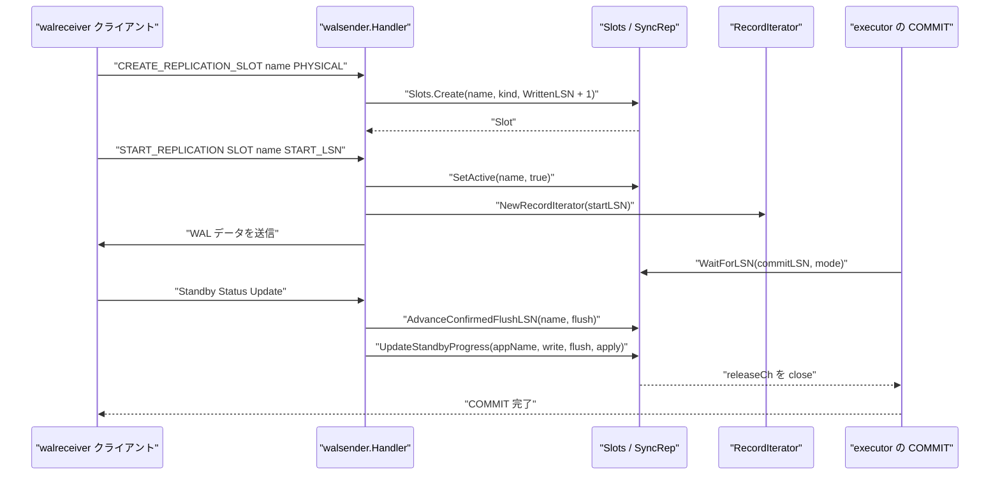
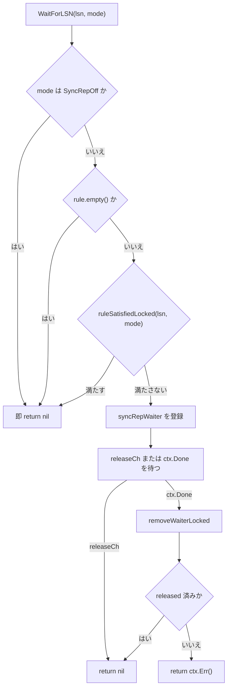

# レプリケーションスロットと同期コミット

<details>
<summary>関連ソースファイル</summary>

- [`internal/access/transam/xlog/iterator.go`](https://github.com/ryogrid/goopg/blob/19856410e8d497d59787e1ab35a2febb3f5953d6/internal/access/transam/xlog/iterator.go)
- [`internal/access/transam/xlog/replmon.go`](https://github.com/ryogrid/goopg/blob/19856410e8d497d59787e1ab35a2febb3f5953d6/internal/access/transam/xlog/replmon.go)
- [`internal/access/transam/xlog/retention.go`](https://github.com/ryogrid/goopg/blob/19856410e8d497d59787e1ab35a2febb3f5953d6/internal/access/transam/xlog/retention.go)
- [`internal/access/transam/xlog/slots.go`](https://github.com/ryogrid/goopg/blob/19856410e8d497d59787e1ab35a2febb3f5953d6/internal/access/transam/xlog/slots.go)
- [`internal/access/transam/xlog/slots_pg.go`](https://github.com/ryogrid/goopg/blob/19856410e8d497d59787e1ab35a2febb3f5953d6/internal/access/transam/xlog/slots_pg.go)
- [`internal/access/transam/xlog/subscriber_mon.go`](https://github.com/ryogrid/goopg/blob/19856410e8d497d59787e1ab35a2febb3f5953d6/internal/access/transam/xlog/subscriber_mon.go)
- [`internal/access/transam/xlog/syncrep.go`](https://github.com/ryogrid/goopg/blob/19856410e8d497d59787e1ab35a2febb3f5953d6/internal/access/transam/xlog/syncrep.go)
- [`internal/access/transam/xlog/syncrep_parse.go`](https://github.com/ryogrid/goopg/blob/19856410e8d497d59787e1ab35a2febb3f5953d6/internal/access/transam/xlog/syncrep_parse.go)
- [`internal/access/transam/xlog/tail_publisher.go`](https://github.com/ryogrid/goopg/blob/19856410e8d497d59787e1ab35a2febb3f5953d6/internal/access/transam/xlog/tail_publisher.go)
- [`internal/access/transam/xlog/writer.go`](https://github.com/ryogrid/goopg/blob/19856410e8d497d59787e1ab35a2febb3f5953d6/internal/access/transam/xlog/writer.go)
- [`internal/replication/walsender.go`](https://github.com/ryogrid/goopg/blob/19856410e8d497d59787e1ab35a2febb3f5953d6/internal/replication/walsender.go)
- [`internal/executor/operators_tx.go`](https://github.com/ryogrid/goopg/blob/19856410e8d497d59787e1ab35a2febb3f5953d6/internal/executor/operators_tx.go)

</details>

レプリケーションスロットは、スタンバイや論理デコーダが「まだ必要とする WAL」を固定し、`pg_wal` の保持・削除を安全に判断するための永続的なアンカーです。goopg では `Slots` が `pg_replslot/<name>/state` を PostgreSQL 互換の 200 バイト（論理スロットは 264 バイト）で管理し、`RestartLSN` と `ConfirmedFlushLSN` を更新します。チェックポイント後の `SlotAwareRetainer` は無効化されていないスロットの最小 `RestartLSN` まで保持対象を広げ、`max_slot_wal_keep_size` を超えたスロットを invalidated にします。同期コミットは `SyncRep` が `synchronous_standby_names` の FIRST/ANY ルールを解析し、COMMIT 側の `WaitForLSN` と walsender 側の `UpdateStandbyProgress` を待機者チャネルで結びます。WAL の書き込みとバッファは [10.2 WAL ライターとバッファ](10.2-WAL-Writer.md)、チェックポイントからの retention 呼び出しは [10.3 チェックポイント](10.3-Checkpoint.md)、スタンバイ側の適用は [10.4 クラッシュ復旧とリプレイ](10.4-Crash-Recovery.md) を参照してください。

## 責務

- 物理/論理スロットを `pg_replslot/<name>/state` に永続化し、プロセス内の `Slots` レジストリと同期する（`internal/access/transam/xlog/slots.go:Slots.Create`、`CreateLogical`、`writeSlotLocked`）。
- PostgreSQL 互換の 200 バイト `ReplicationSlotOnDisk` 形式（magic `0x1051CA1`、version 5、CRC32C）を読み書きし、論理スロットは 200 バイト以降に 64 バイトのデータベース名拡張を付ける（`internal/access/transam/xlog/slots_pg.go:marshalSlotBinary`、`unmarshalSlotBinary`）。
- スロットの `RestartLSN` / `ConfirmedFlushLSN` をスタンバイの Standby Status Update に合わせて単調に進める（`internal/access/transam/xlog/slots.go:AdvanceConfirmedFlushLSN`）。
- `max_slot_wal_keep_size` を超えたスロットを invalidated にし、以降の WAL 保持計算から除外する（`internal/access/transam/xlog/slots.go:InvalidateLagging`、`MinRestartLSN`）。
- 論理スロットの `catalog_xmin` を単調に進め、VACUUM/ prune のカタログ horizon を必要以上に進めない（`internal/access/transam/xlog/slots.go:AdvanceCatalogXmin`、`MinCatalogXmin`）。
- チェックポイント後の WAL 整理で、クラッシュ復旧に不要かつ全スロットが不要とするセグメントだけを削除・再利用する（`internal/access/transam/xlog/retention.go:SlotAwareRetainer.Retain`）。
- `synchronous_standby_names` を FIRST/ANY/レガシー形式で解析し、ルールを `syncRepRule` として保持する（`internal/access/transam/xlog/syncrep_parse.go:parseSyncRepRule`）。
- COMMIT 側の `WaitForLSN` を待機者リストに登録し、walsender の `UpdateStandbyProgress` が条件を満たした時点で解放する（`internal/access/transam/xlog/syncrep.go:SyncRep.WaitForLSN`、`UpdateStandbyProgress`、`releaseWaitersLocked`）。
- `pg_stat_replication` / `pg_stat_wal_receiver` / `pg_stat_subscription` 用の監視レジストリを提供する（`internal/access/transam/xlog/replmon.go:Senders`、`Receivers`、`internal/access/transam/xlog/subscriber_mon.go:Subscribers`）。
- walsender の `CREATE_REPLICATION_SLOT` / `DROP_REPLICATION_SLOT` / `START_REPLICATION` をスロットと同期コミットへ接続する（`internal/replication/walsender.go:replyCreateReplicationSlot`、`replyStartReplication`、`handleStandbyCopyData`）。

## 処理フロー

スロットの作成からスタンバイの ack、COMMIT の解放までの実経路です。



1. `replyCreateReplicationSlot` は `CREATE_REPLICATION_SLOT` の文法を解析し、PHYSICAL または LOGICAL pgoutput だけを受け付けます。スロットの開始 LSN は `Writer.WrittenLSN() + 1` です。`WrittenLSN` は最後に追記したバイトの LSN なので、次のレコードの先頭はその次になります（`internal/replication/walsender.go:replyCreateReplicationSlot`）。
2. `Slots.Create` はスロット名を検証し、`RestartLSN` と `ConfirmedFlushLSN` を `startLSN` に設定して `writeSlotLocked` で永続化します。論理スロットは `CreateLogical` が plugin と database を必須にします（`internal/access/transam/xlog/slots.go:Create`、`CreateLogical`）。
3. `writeSlotLocked` は `marshalSlotBinary` のバイト列を同じディレクトリの一時ファイルへ書き、`fsync`、`rename`、state ファイルとディレクトリの `fsync` の順で確定します。クラッシュ時に中途半端な `state` が残らないようにするためです（`internal/access/transam/xlog/slots.go:writeSlotLocked`）。
4. `START_REPLICATION` でスロット名が指定されると、walsender は `SetActive(name, true)` を呼び、終了時に `defer SetActive(name, false)` で解放します。すでに active なスロットは `ErrSlotInUse` になります（`internal/replication/walsender.go:replyStartReplication`、`internal/access/transam/xlog/slots.go:SetActive`）。
5. walsender は `NewRecordIterator(WAL, WALDirPath, WALSegmentSize, StartLSN)` を作り、`RecordIterator.Next` でページヘッダを読み飛ばしながら WAL レコードを送ります。`RecordIterator` は `WrittenLSN` を上限に、MemRing、`walBuffer`、セグメントの順でバイトを読みます（`internal/replication/walsender.go:replyStartReplication`、`internal/access/transam/xlog/iterator.go:RecordIterator`）。
6. スタンバイからの `Standby Status Update` は `handleStandbyCopyData` が復号します。`slotName` があれば `Slots.AdvanceConfirmedFlushLSN(name, flushLSN)` を呼び、`ConfirmedFlushLSN` と `RestartLSN` を `max(current, lsn)` で進めます（`internal/replication/walsender.go:handleStandbyCopyData`、`internal/access/transam/xlog/slots.go:AdvanceConfirmedFlushLSN`）。
7. 同じメッセージで `senderHandle.ApplyStandbyStatus` が監視用 LSN を更新し、`syncRep.UpdateStandbyProgress(appName, write, flush, apply)` が同期コミットの待機者を再評価します（`internal/replication/walsender.go:handleStandbyCopyData`、`internal/access/transam/xlog/replmon.go:Sender.ApplyStandbyStatus`）。
8. COMMIT 側では `executor` の `transactionOp` が `SyncRep.NeedsWait()` を確認し、`SyncCommitMode != SyncRepOff` なら `WaitForLSN(WAL.WrittenLSN(), mode)` を呼びます。ローカル WAL は xact marker フックが先にフラッシュ済みです（`internal/executor/operators_tx.go:transactionOp`、`internal/access/transam/xlog/syncrep.go:WaitForLSN`）。
9. `WaitForLSN` はルールが空なら即座に返し、満たされていなければ `syncRepWaiter` を登録して `releaseCh` で待ちます。`UpdateStandbyProgress` が `releaseWaitersLocked` を呼び、条件を満たした waiter のチャネルを閉じます（`internal/access/transam/xlog/syncrep.go:WaitForLSN`、`releaseWaitersLocked`）。

同期コミットのルール評価は次の分岐です。



`ruleSatisfiedLocked` は `synchronous_standby_names` が空なら常に true を返します。FIRST はリスト先頭の n 台すべてが targetLSN 以上であることを要求し、ANY はリスト内の任意の n 台が targetLSN 以上なら満たします。ANY の実装は各 standby の該当 LSN を集めて降順ソートし、n 番目が targetLSN 以上かを見ます（`internal/access/transam/xlog/syncrep.go:ruleSatisfiedLocked`、`syncRepRule.satisfied`）。

## 主要ファイル

| ファイル | 役割 |
| --- | --- |
| `internal/access/transam/xlog/slots.go` | `Slot` / `Slots`、作成・削除・取得・一覧、`RestartLSN` / `ConfirmedFlushLSN` の前進、`InvalidateLagging`、`MinRestartLSN`、`AdvanceCatalogXmin`、永続化。 |
| `internal/access/transam/xlog/slots_pg.go` | PostgreSQL 互換の 200 バイト slot state バイナリ、CRC32C、論理スロット用 64 バイト拡張。 |
| `internal/access/transam/xlog/retention.go` | `Retainer` と `SlotAwareRetainer`。スロットの invalidate、keep LSN の計算、セグメント削除・再利用。 |
| `internal/access/transam/xlog/syncrep.go` | `SyncRep`、`SyncRepMode`、待機者、FIRST/ANY の充足判定、`pg_stat_replication` 用 sync_state / sync_priority。 |
| `internal/access/transam/xlog/syncrep_parse.go` | `synchronous_standby_names` のトークナイザとパーサ。FIRST/ANY/レガシー形式、引用識別子。 |
| `internal/access/transam/xlog/replmon.go` | `Senders` / `Receivers` と `SenderState` / `ReceiverState`。`pg_stat_replication` / `pg_stat_wal_receiver` 用。 |
| `internal/access/transam/xlog/subscriber_mon.go` | `Subscribers` / `Subscriber` と `SubscriberState`。`pg_stat_subscription` 用。 |
| `internal/access/transam/xlog/tail_publisher.go` | `tailPublisher`。WAL 書き込み側の安全 tail を CAS で単調公開する基盤。 |
| `internal/access/transam/xlog/writer.go` | `WrittenLSN` / `FlushUpTo` / `MemRing` / `Subscribe`。スロット開始 LSN と同期コミットの待機対象を提供する。 |
| `internal/replication/walsender.go` | `CREATE_REPLICATION_SLOT` / `DROP_REPLICATION_SLOT` / `START_REPLICATION`、`RecordIterator` の駆動、Standby Status Update の処理。 |
| `internal/executor/operators_tx.go` | COMMIT 時に `SyncRep.NeedsWait` と `WaitForLSN` を呼ぶ。 |

## 公開 API / エントリポイント

```go
func OpenSlots(dataDir string) (*Slots, error)
func (s *Slots) Create(name string, kind SlotKind, startLSN uint64) (*Slot, error)
func (s *Slots) CreateLogical(name, plugin, database string, startLSN uint64) (*Slot, error)
func (s *Slots) Drop(name string) error
func (s *Slots) Get(name string) (Slot, error)
func (s *Slots) List() []Slot
func (s *Slots) AdvanceConfirmedFlushLSN(name string, lsn uint64) error
func (s *Slots) SetActive(name string, active bool) error
func (s *Slots) MinRestartLSN() uint64
func (s *Slots) MinCatalogXmin() uint64
func (s *Slots) AdvanceCatalogXmin(name string, xid uint64) error
func (s *Slots) InvalidateLagging(currentLSN uint64, maxKeepBytes int64) ([]string, error)

func NewSyncRep() *SyncRep
func (s *SyncRep) SetStandbyNames(value string) error
func (s *SyncRep) NeedsWait() bool
func (s *SyncRep) WaitForLSN(ctx context.Context, lsn uint64, mode SyncRepMode) error
func (s *SyncRep) UpdateStandbyProgress(appName string, write, flush, apply uint64)
func (s *SyncRep) ForgetStandby(appName string)
func (s *SyncRep) StandbyProgress(appName string) (write, flush, apply uint64)
func (s *SyncRep) SyncStateFor(appName string) string
func (s *SyncRep) SyncPriorityFor(appName string) int

func NewSenders() *Senders
func (s *Senders) Register(initial SenderState) *Sender
func (s *Senders) Unregister(se *Sender)
func (s *Senders) Snapshot() []SenderState

func NewReceivers() *Receivers
func (r *Receivers) Register(initial ReceiverState) *Receiver
func (r *Receivers) Unregister(rec *Receiver)
func (r *Receivers) Snapshot() (ReceiverState, bool)

func NewSubscribers() *Subscribers
func (s *Subscribers) Register(initial SubscriberState) *Subscriber
func (s *Subscribers) Unregister(sub *Subscriber)
func (s *Subscribers) Snapshot() []SubscriberState
```

`Slots` の `Create` は物理/論理の両方を扱い、`CreateLogical` は plugin と database を必須にします。`SyncRep.WaitForLSN` は `SyncRepOff` または空ルールなら即座に返るため、`synchronous_commit` だけ設定しても COMMIT はブロックしません（`internal/access/transam/xlog/syncrep.go:WaitForLSN`）。

## 主要データ構造

### Slot / Slots — 永続スロットとプロセス内レジストリ

`internal/access/transam/xlog/slots.go:Slot`（44〜87 行）:

```go
type Slot struct {
	Name              string   `json:"name"`
	Kind              SlotKind `json:"kind"`
	RestartLSN        uint64   `json:"restart_lsn"`
	ConfirmedFlushLSN uint64   `json:"confirmed_flush_lsn"`
	// Invalidated, when true, marks the slot as no longer usable
	// because the WAL it was holding back was removed (the
	// standby's lag exceeded `max_slot_wal_keep_size`). An
	// invalidated slot persists so operators can `pg_drop_replication_slot`
	// it explicitly, but the retention path stops honouring its
	// RestartLSN and a reconnecting walsender will refuse to start
	// streaming. Mirrors upstream's "invalidated" state in
	// postgres/src/backend/replication/slot.c. See
	// docs/design/0005-0001-streaming-replication-architecture.md
	// (§ Replication slot retention semantics).
	Invalidated bool `json:"invalidated"`

	// Plugin names the output plugin a logical slot drives
	// (e.g. "pgoutput"). Empty for physical slots. Maps to
	// upstream's pg_replication_slots.plugin column. See
	// docs/design/0008-0001-logical-decoding-pipeline.md.
	Plugin string `json:"plugin,omitempty"`
	// Database is the database name a logical slot is anchored
	// in. Empty for physical slots (which span the whole cluster).
	// Maps to upstream's pg_replication_slots.database.
	Database string `json:"database,omitempty"`
	// CatalogXmin is the oldest transaction id whose catalog row
	// versions a logical slot may still need to reconstruct
	// historic snapshots for. Zero for physical slots and for
	// freshly created logical slots; populated by the decoder as
	// it advances. Maps to upstream's
	// pg_replication_slots.catalog_xmin.
	CatalogXmin uint64 `json:"catalog_xmin,omitempty"`

	// DatabaseOID is the PG Oid of the database a logical slot is
	// anchored in (0 = InvalidOid for physical slots). Stored in the
	// binary state file but not in the JSON fallback format.
	DatabaseOID uint32 `json:"-"`

	// Active is in-memory only; the durable state file records
	// the slot's existence, while Active reflects whether a
	// walsender connection currently owns it.
	Active bool `json:"-"`
}
```

`internal/access/transam/xlog/slots.go:Slots`（92〜96 行）:

```go
type Slots struct {
	dir string
	mu  sync.RWMutex
	m   map[string]*Slot
}
```

`RestartLSN` はスタンバイが再接続時に必要とする最古の WAL 位置、`ConfirmedFlushLSN` はスタンバイが durable と確認した最後の LSN です。`Active` と `Invalidated` は意味が異なり、`Active` は「今 walsender が所有している」、`Invalidated` は「保持していた WAL が削除済みでもう使えない」を表します。`Active` は永続化されませんが、`Invalidated` は state ファイルに残ります。`Slots` は単一の `RWMutex` と map で、既定の `max_replication_slots = 10` 程度の小さな集合を想定しています。

### SlotKind — 物理/論理の区別

`internal/access/transam/xlog/slots.go:SlotKind`（36〜41 行）:

```go
type SlotKind string

const (
	SlotPhysical SlotKind = "physical"
	SlotLogical  SlotKind = "logical"
)
```

物理スロットはクラスタ全体の WAL を、論理スロットは特定データベースの論理デコードを対象にします。retention の `MinRestartLSN` と `InvalidateLagging` は両方を同じように扱います。

### SyncRepMode — synchronous_commit の待機レベル

`internal/access/transam/xlog/syncrep.go:SyncRepMode`（24〜42 行）:

```go
type SyncRepMode int

const (
	// SyncRepOff means commit returns immediately after local flush — the
	// dispatcher does not call WaitForLSN. Included as a sentinel so the
	// commit-path can switch on the same enum it would otherwise consume.
	SyncRepOff SyncRepMode = iota
	// SyncRepRemoteWrite waits until the standby has buffered the WAL bytes
	// (write_lsn ≥ target). Matches upstream SYNCHRONOUS_COMMIT_REMOTE_WRITE.
	SyncRepRemoteWrite
	// SyncRepRemoteFlush waits until the standby has fsynced the WAL bytes
	// (flush_lsn ≥ target). Matches upstream SYNCHRONOUS_COMMIT_REMOTE_FLUSH
	// (the default for synchronous_commit=on).
	SyncRepRemoteFlush
	// SyncRepRemoteApply waits until the standby has replayed the bytes and
	// they are visible to readers (apply_lsn ≥ target). Strongest level;
	// required by the M0102 sync subtest.
	SyncRepRemoteApply
)
```

`off` と `local` はどちらも `SyncRepOff` に写像されます。`local` はローカルフラッシュだけを要求し、リモート待機はしないためです。`remote_write` は standby の `write_lsn`、`remote_flush` は `flush_lsn`、`remote_apply` は `apply_lsn` を比較します（`internal/access/transam/xlog/syncrep.go:ParseSyncCommitLevel`、`standbyProgress.progressFor`）。

### SyncRep / syncRepRule — 待機者とルール

`internal/access/transam/xlog/syncrep.go:SyncRep`（96〜101 行）:

```go
type SyncRep struct {
	mu       sync.Mutex
	standbys map[string]standbyProgress
	waiters  []*syncRepWaiter
	rule     syncRepRule
}
```

`internal/access/transam/xlog/syncrep.go:standbyProgress`（64〜68 行）:

```go
type standbyProgress struct {
	WriteLSN uint64
	FlushLSN uint64
	ApplyLSN uint64
}
```

`internal/access/transam/xlog/syncrep.go:syncRepWaiter`（87〜92 行）:

```go
type syncRepWaiter struct {
	targetLSN uint64
	mode      SyncRepMode
	releaseCh chan struct{}
	released  bool
}
```

`internal/access/transam/xlog/syncrep.go:syncRepRule`（306〜318 行）:

```go
type syncRepRule struct {
	mode  syncRepRuleMode
	count int      // n in FIRST n / ANY n
	names []string // ordered list (FIRST cares about order)
}

type syncRepRuleMode int

const (
	syncRepRuleOff   syncRepRuleMode = iota // empty rule
	syncRepRuleFirst                        // FIRST n (...)
	syncRepRuleAny                          // ANY n (...)
)
```

`standbys` は application_name をキーにした最新 LSN のマップで、`waiters` は COMMIT 側の待機者です。`standbyProgress` は `UpdateStandbyProgress` で単調にクランプされ、古いメッセージが来ても後退しません。`syncRepRule` は `FIRST n` なら `names[0:n]` の全員、`ANY n` なら任意の n 台を要求します。`rule.empty()` は mode が off、names が空、count が 0 のいずれかで true です。

### SenderState / ReceiverState — 監視用スナップショット

`internal/access/transam/xlog/replmon.go:SenderState`（27〜57 行）:

```go
type SenderState struct {
	// PID is the per-connection identifier the goopg server assigns.
	// 0 means "no PID was supplied at registration time" — useful for
	// tests; production wiring always passes the connection's PID.
	PID uint32
	// ApplicationName is the standby's reported application name from
	// its StartupMessage, or "" when the parameter was absent.
	ApplicationName string
	// SlotName is the named slot the walsender acquired, or "" when
	// the connection ran without one (allowed but discouraged).
	SlotName string
	// State is the current walsender lifecycle phase. v0 only has
	// "streaming"; "startup" / "backup" / "stopping" are reserved
	// for upstream parity and future lifecycle wiring.
	State string
	// ClientAddr is the standby's TCP host:port. Empty when the
	// walsender ran against a non-TCP transport (test fixtures).
	ClientAddr string
	// SentLSN is the last byte position the sender wrote into its
	// outbound CopyData stream. Strictly monotonic per walsender.
	SentLSN uint64
	// WriteLSN, FlushLSN, ReplayLSN are the most recent values from
	// the standby's status replies. Zero until the standby has sent
	// at least one update.
	WriteLSN  uint64
	FlushLSN  uint64
	ReplayLSN uint64
	// BackendStart is the wall-clock instant the walsender registered
	// (i.e. began serving the standby).
	BackendStart time.Time
}
```

`internal/access/transam/xlog/replmon.go:ReceiverState`（206〜237 行）:

```go
type ReceiverState struct {
	// Status is one of "streaming", "stopped", "starting". v0 emits
	// "streaming" while a receiver is registered and "stopped"
	// otherwise (the row is then absent rather than reporting
	// "stopped" — the view is empty when no receiver runs).
	Status string
	// PID is the goroutine identity the receiver assigned (best-
	// effort; v0 uses os.Getpid since walreceivers are not
	// cross-process workers).
	PID uint32
	// ReceiveStartLSN is the LSN the receiver asked the primary to
	// resume from at handshake time.
	ReceiveStartLSN uint64
	// ReceivedLSN is the latest end-LSN of a record successfully
	// Append'd into the local WAL writer.
	ReceivedLSN uint64
	// LastMsgSendTime / LastMsgReceiptTime are the wall-clock
	// instants of the last keepalive / WAL-data frame the standby
	// observed. v0 currently sets both to LastMsgReceiptTime.
	LastMsgSendTime    time.Time
	LastMsgReceiptTime time.Time
	// SenderHost is the upstream address the receiver dialed
	// (from PrimaryAddr).
	SenderHost string
	// SlotName is the replication slot the receiver requested, or
	// "" when running slot-less (allowed for one-shot transports).
	SlotName string
	// Conninfo is the libpq-style connection string used. Stored
	// verbatim (no password masking yet) — v0 conninfo is host+port
	// only so this is just informational.
	Conninfo string
}
```

`SenderState` は walsender ごとの送信 LSN とスタンバイ報告 LSN を持ち、`Senders.Snapshot` が `(SlotName, PID)` 順でコピーを返します。`ReceiverState` はプロセスにつき最大 1 つの walreceiver を表し、`Receivers.Snapshot` は登録がなければ `ok=false` を返します。

### SubscriberState — 論理サブスクリプションのワーカー

`internal/access/transam/xlog/subscriber_mon.go:SubscriberState`（44〜78 行）:

```go
type SubscriberState struct {
	// SubID is the subscription's catalog OID, the upstream
	// `pg_subscription.oid`.
	SubID uint32
	// SubName is the subscription's name. Carried alongside SubID
	// so the view can render `subname` without a join.
	SubName string
	// WorkerType selects the row's role.
	WorkerType SubscriberWorkerType
	// PID is the per-worker identifier; for v0 this is the
	// goroutine's identity (best-effort) or a counter assigned by
	// the registry. Tests pass 0 to leave it unset.
	PID uint32
	// LeaderPID is non-zero only for tablesync workers — points
	// back at the subscription's leader apply worker.
	LeaderPID uint32
	// RelOID is non-zero only for tablesync workers — names the
	// relation being initially copied.
	RelOID uint32
	// ReceivedLSN is the latest LSN the worker has consumed from
	// the publisher's stream (highest commit LSN observed so far
	// for the leader; tablesync end-LSN once known for tablesync
	// workers).
	ReceivedLSN uint64
	// LastMsgSendTime / LastMsgReceiptTime are the wall-clock
	// instants of the last keepalive / WAL-data frame the worker
	// processed.
	LastMsgSendTime    time.Time
	LastMsgReceiptTime time.Time
	// LatestEndLSN / LatestEndTime mirror upstream's
	// `latest_end_lsn` / `latest_end_time`: the last (lsn, time)
	// pair the publisher reported as the end of WAL.
	LatestEndLSN  uint64
	LatestEndTime time.Time
}
```

`WorkerType` は `leader` と `tablesync` の 2 種類で、tablesync は `LeaderPID` と `RelOID` を持ちます。`LatestEndLSN` は `MarkMessage` で非ゼロの endLSN が渡されたときだけ単調に更新されます（`internal/access/transam/xlog/subscriber_mon.go:Subscriber.MarkMessage`）。

### Retainer / SlotAwareRetainer — スロット考慮の WAL 保持

`internal/access/transam/xlog/retention.go:Retainer`（40〜47 行）:

```go
type Retainer interface {
	// Retain is invoked with the LSN of the just-flushed
	// checkpoint marker (i.e. the upper bound of WAL the
	// checkpointer just made redundant for crash recovery).
	// Implementations must not block the checkpointer for long;
	// the canonical implementation does cheap unlinks only.
	Retain(checkpointLSN uint64) error
}
```

`internal/access/transam/xlog/retention.go:SlotAwareRetainer`（53〜97 行）:

```go
type SlotAwareRetainer struct {
	// Writer is the WAL writer whose pg_wal/ directory is being
	// pruned. Required.
	Writer *Writer

	// Slots is the replication-slot registry. May be nil — a nil
	// registry collapses retention to "keep nothing earlier than
	// the checkpoint", which matches the upstream behaviour when
	// no slots exist.
	Slots *Slots

	// MaxSlotKeepBytes mirrors `max_slot_wal_keep_size`. <= 0
	// means unlimited (no slot is ever invalidated for lag).
	// Stored as int64 so the GUC's signed sentinel passes through
	// unchanged.
	MaxSlotKeepBytes int64

	// Logger receives the per-checkpoint retention summary
	// (segments removed, slots invalidated). Defaults to slog
	// default.
	Logger *slog.Logger

	// CheckPointDistanceEstimateFn, when non-nil, returns the current
	// moving-average estimate (bytes) of inter-checkpoint WAL volume —
	// wired to (*Checkpointer).CheckPointDistanceEstimate in production.
	// Combined with CompletionTarget and Writer's Config.MinWALSize/
	// MaxWALSize, it drives RemoveOldSegmentsWithEstimate's
	// XLOGfileslop-style sizing so segment recycling can grow past the
	// MinWALSize floor under sustained write volume (capped at
	// MaxWALSize). nil falls back to RemoveOldSegments' pre-existing
	// MinWALSize-only floor. M0122-0009 follow-up; see
	// docs/design/0122-0009-wal-segment-recycling.md.
	CheckPointDistanceEstimateFn func() float64

	// KeepLSNFn, when non-nil, returns an LSN whose WAL must be kept as
	// well, or 0 for no constraint: the WAL summarizer's oldest
	// unsummarized LSN (KeepLogSeg's summarize_wal clamp, xlog.c), so
	// segments are not removed before they are summarized.
	KeepLSNFn func() uint64

	// CompletionTarget mirrors checkpoint_completion_target, one of the
	// XLOGfileslop distance-formula inputs. Only consulted when
	// CheckPointDistanceEstimateFn is non-nil.
	CompletionTarget float64
}
```

`SlotAwareRetainer.Retain` はチェックポイント LSN を基準に、無効化されていないスロットの `MinRestartLSN` と `KeepLSNFn` の小さい方まで保持対象を広げます。`MaxSlotKeepBytes > 0` のときは、先に `InvalidateLagging` で `currentLSN - RestartLSN > MaxSlotKeepBytes` のスロットを無効化します（`internal/access/transam/xlog/retention.go:Retain`）。

## 内部構造

### スロット state ファイルの互換形式

物理スロットの state は 200 バイトで、先頭に magic `0x1051CA1`、オフセット 4 に CRC32C、8 に version 5、12 に長さ 184 が入ります。CRC は `[8:200]` に対して計算し、`[16:200]` が `ReplicationSlotPersistentData` です。goopg はこの範囲に name、database OID、catalog_xmin、restart_lsn、invalidated、confirmed_flush を書き、plugin 名も 64 バイト NameData として格納します（`internal/access/transam/xlog/slots_pg.go:marshalSlotBinary`）。

論理スロットで `Database != ""` の場合だけ、200 バイトの後ろに 64 バイトのデータベース名を追加して 264 バイトにします。PostgreSQL は先頭 200 バイトだけを読むため、この拡張は無視されます。逆に goopg は 200 バイトの `unmarshalSlotBinary` で plugin が非空なら論理スロットと判定します（`internal/access/transam/xlog/slots_pg.go:marshalSlotBinary`、`unmarshalSlotBinary`）。旧 goopg が書いた JSON 形式は `readSlotFile` のフォールバックで読めます（`internal/access/transam/xlog/slots.go:readSlotFile`）。

### 作成・更新・削除の原子性

`writeSlotLocked` は一時ファイル `state.tmp-*` に書き、`Sync`、`Close`、`state` への `Rename`、state ファイルの `Sync`、スロットディレクトリの `Sync` の順で確定します。`OpenSlots` は起動時に `pg_replslot` を走査し、state の読み込みに失敗したらスロットを黙って捨てずにエラーを返します。保持アンカーを失った可能性を運用者に見せるためです（`internal/access/transam/xlog/slots.go:OpenSlots`、`writeSlotLocked`）。

`Drop` は `Active` なスロットを `ErrSlotInUse` で拒否し、ディレクトリを `RemoveAll` してから map から消します。walsender の `DROP_REPLICATION_SLOT ... WAIT` は最大 5 分間 20 ms 間隔で再試行し、それでも active ならエラーにします（`internal/access/transam/xlog/slots.go:Drop`、`internal/replication/walsender.go:replyDropReplicationSlot`）。

### LSN の前進と retention の関係

`Create` は `RestartLSN` と `ConfirmedFlushLSN` を同じ `startLSN` にします。`AdvanceConfirmedFlushLSN` は `ConfirmedFlushLSN` と `RestartLSN` の両方を `max(current, lsn)` へ進めます。コメントにもある通り、現在は `RestartLSN` を `ConfirmedFlushLSN` より遅らせるポリシーはなく、将来の `max_slot_wal_keep_size` 対応の余地として残されています（`internal/access/transam/xlog/slots.go:Create`、`AdvanceConfirmedFlushLSN`）。

`MinRestartLSN` は invalidated を除いた最小値、スロットがなければ 0 を返します。`SlotAwareRetainer` は 0 を「スロット制約なし」として扱い、チェックポイント LSN だけで保持範囲を決めます。`MinCatalogXmin` は `CatalogXmin != 0` のスロットだけを対象にし、物理スロットがカタログ horizon を不必要に固定しないようにします（`internal/access/transam/xlog/slots.go:MinRestartLSN`、`MinCatalogXmin`）。

### invalidate の順序と失敗時のロールバック

`InvalidateLagging` は `maxKeepBytes <= 0` または `currentLSN == 0` なら何もしません。各スロットについて `RestartLSN >= currentLSN` をゼロラグとして残し、`currentLSN - RestartLSN <= maxKeepBytes` も残します。超えたものだけ `Invalidated = true` にして永続化し、永続化に失敗したらメモリ上のフラグを false に戻してエラーを返します。これにより「メモリでは無効、ディスクでは有効」という不整合を避けます（`internal/access/transam/xlog/slots.go:InvalidateLagging`）。

`SlotAwareRetainer.Retain` は invalidate を keep horizon の計算より先に行います。無効化されたスロットが同じチェックポイントで WAL を固定し続けないようにするためです。ラグの基準はチェックポイント LSN ではなく `Writer.WrittenLSN()` です（`internal/access/transam/xlog/retention.go:Retain`）。

### synchronous_standby_names の文法

`tokenizeSyncRep` は空白、`,`、`(`、`)` を区切りにし、`"..."` を引用識別子として扱います。`""` はリテラルの `"` に戻されます。`parse` は先頭トークンが `FIRST` / `ANY` なら quorum 本体を読み、10 進数ならレガシーの `n (names)` を FIRST n として扱い、それ以外は裸の名前リストを FIRST 1 として扱います（`internal/access/transam/xlog/syncrep_parse.go:tokenizeSyncRep`、`syncRepParser.parse`）。

`count > len(names)` はパースエラーです。`FIRST 2 (a)` のような設定はルールとして成立しないため、`SetStandbyNames` はエラーを返しつつルールを空にして待機を無効化します。不正な GUC で COMMIT を永久にブロックしないためのフェイルセーフです（`internal/access/transam/xlog/syncrep_parse.go:parse`、`internal/access/transam/xlog/syncrep.go:SetStandbyNames`）。

### 待機者の解放とキャンセル

`WaitForLSN` は `mode == SyncRepOff` または `rule.empty()` なら即 return します。`ruleSatisfiedLocked` が true なら待機者を作らずに返します。そうでなければ `syncRepWaiter` を append し、`releaseCh` と `ctx.Done()` の select に入ります。`UpdateStandbyProgress` は LSN を単調クランプして `standbys[appName]` を更新し、`releaseWaitersLocked` を呼びます（`internal/access/transam/xlog/syncrep.go:WaitForLSN`、`UpdateStandbyProgress`）。

`releaseWaitersLocked` は `s.waiters[:0]` を再利用して、満たされた waiter の `releaseCh` を一度だけ close し、満たされないものだけを残します。ctx キャンセル時は `removeWaiterLocked` でリストから外しますが、その前に release が起きていれば `w.released` を見て nil を返します。COMMIT がすでに十分な ack を見ていた場合にエラーにしない、upstream の `SyncRepCancelWait` と同じ扱いです（`internal/access/transam/xlog/syncrep.go:releaseWaitersLocked`、`removeWaiterLocked`）。

### FIRST / ANY の充足判定

FIRST は `names[:count]` の全員が `standbys` に存在し、各 `progressFor(mode)` が `targetLSN` 以上であることを要求します。ANY はリスト内の各 standby の進捗（未登録は 0）を集め、降順ソートして `count-1` 番目が `targetLSN` 以上かを見ます。どちらも `count > len(names)` なら false です（`internal/access/transam/xlog/syncrep.go:syncRepRule.satisfied`）。

`SyncStateFor` は FIRST で `names[0:count]` を `"sync"`、それ以降を `"potential"`、ANY ではリスト内をすべて `"sync"`、off/空では `"async"` と返します。`SyncPriorityFor` は FIRST で 1-based の位置、ANY でリスト内なら 1、それ以外は 0 です（`syncRepRule.syncStateFor`、`syncPriorityFor`）。

### walsender と監視レジストリ

`Senders.Register` は `SenderState` を受け取り、`*Sender` ハンドルを返します。`Sender.SetSentLSN` と `ApplyStandbyStatus` は CAS で単調前進し、`Senders.Snapshot` は `(SlotName, PID)` 順にソートしたコピーを返します。`SenderState` には v0 では `sync_state` が含まれず、同期状態は `SyncRep.SyncStateFor` から別途取得します（`internal/access/transam/xlog/replmon.go:Senders.Register`、`Sender.SetSentLSN`、`ApplyStandbyStatus`）。

`Receivers` は最大 1 エントリで、`Unregister` は渡されたハンドルが現在のエントリと一致する場合だけ消します。再接続で新しい receiver が登録された後に古い goroutine の遅延 Unregister が来ても、新しいエントリを消さないためです。`Subscribers` は leader と tablesync の複数ワーカーを保持し、`(SubName, WorkerType, RelOID, PID)` 順で Snapshot を返します（`internal/access/transam/xlog/replmon.go:Receivers.Unregister`、`internal/access/transam/xlog/subscriber_mon.go:Subscribers.Snapshot`）。

### tailPublisher と WAL 可視性

`tailPublisher` は書き込み側の安全 tail を `published` に CAS で単調公開するプリミティブです。スロットや同期コミットのコードが直接呼ぶわけではありませんが、walsender が読む WAL の可視性は `Writer.WrittenLSN` とリングの drain 状態に支えられており、その背後の safety watermark がこの型です。`publishUpTo` は `min(upperBound, tracker.lowestActiveLSN())` を候補にし、後退しない公開値を返します（`internal/access/transam/xlog/tail_publisher.go:publishUpTo`）。

## エッジケースと不変条件

- **slot 名の制約** — 空、63 バイト超、`[a-z0-9_]` 以外を含む名前は `ErrSlotInvalidName` です。PostgreSQL の `ReplicationSlotValidateName` と同じ制約です（`internal/access/transam/xlog/slots.go:validSlotName`）。
- **重複作成** — 同じ名前のスロットが既にあれば `ErrSlotExists`。kind が physical/logical 以外なら `ErrSlotKindMismatch` です（`internal/access/transam/xlog/slots.go:Create`）。
- **active slot の削除** — `Drop` は `Active` なスロットを `ErrSlotInUse` で拒否します。`DROP_REPLICATION_SLOT ... WAIT` は最大 5 分待ってからエラーにします（`internal/access/transam/xlog/slots.go:Drop`、`internal/replication/walsender.go:replyDropReplicationSlot`）。
- **上限の未適用** — `ErrSlotMaxExceeded` は定義されていますが、`slots.go` の `Create` は `max_replication_slots` を参照しません。このファイルの範囲では上限チェックは行われません（`internal/access/transam/xlog/slots.go`）。
- **開始 LSN の +1** — walsender は `WrittenLSN() + 1` をスロットの開始 LSN にします。`WrittenLSN` は最後に追記したバイトの LSN で、次のレコードの先頭はその次です。+1 を忘れると `NewRecordIterator` の `pos = startLSN - 1` が前レコードの末尾に着地します（`internal/replication/walsender.go:replyCreateReplicationSlot`）。
- **state 読み込み失敗** — `OpenSlots` は壊れた state を黙って捨てず、エラーを返して起動を止めます。保持アンカーを失ったスロットを無視すると、WAL を早く削除してしまう危険があるためです（`internal/access/transam/xlog/slots.go:OpenSlots`）。
- **invalidated の永続化失敗** — `InvalidateLagging` は `writeSlotLocked` が失敗したらメモリ上の `Invalidated` を false に戻します。ディスクとメモリの状態を一致させるためです（`internal/access/transam/xlog/slots.go:InvalidateLagging`）。
- **invalidated スロットは WAL を固定しない** — `MinRestartLSN` と `MinCatalogXmin` は `Invalidated` をスキップします。無効化されたスロットは `pg_drop_replication_slot` で明示的に消すまで残りますが、保持計算には参加しません（`internal/access/transam/xlog/slots.go:MinRestartLSN`、`MinCatalogXmin`）。
- **スロットなしの retention** — `MinRestartLSN` が 0 を返すと、`SlotAwareRetainer` はチェックポイント LSN だけを基準にします。スロットがない場合の v0 の無制限保持と同じ挙動です（`internal/access/transam/xlog/retention.go:Retain`）。
- **max_slot_wal_keep_size <= 0** — スロットの invalidate を無効化します。PostgreSQL の `max_slot_wal_keep_size = -1`（無制限）に対応します（`internal/access/transam/xlog/slots.go:InvalidateLagging`）。
- **active でも invalidate される** — `InvalidateLagging` は `Active` を除外しません。ラグが上限を超えた walsender は次の status reply で失敗し、スタンバイはベースバックアップからの再構築が必要になります（`internal/access/transam/xlog/slots.go:InvalidateLagging`）。
- **catalog_xmin は単調** — `AdvanceCatalogXmin` は `xid <= CatalogXmin` を無視し、`xid == 0` も no-op です。カタログ horizon を後退させると、未デコードの論理スロットが必要とするタプルを VACUUM が消してしまいます（`internal/access/transam/xlog/slots.go:AdvanceCatalogXmin`）。
- **ルールの count が名前数を超える** — `FIRST 2 (a)` のような値はパースエラーです。`SetStandbyNames` はエラーを返しつつルールを空にし、COMMIT をブロックしません（`internal/access/transam/xlog/syncrep_parse.go:parse`、`internal/access/transam/xlog/syncrep.go:SetStandbyNames`）。
- **空ルールの同期コミット** — `synchronous_commit` だけ設定して `synchronous_standby_names` が空の場合、`NeedsWait` は false、`WaitForLSN` も即 return します。設定だけで COMMIT がハングしないようになっています（`internal/access/transam/xlog/syncrep.go:NeedsWait`、`WaitForLSN`）。
- **application_name なしの standby** — 空の appName はルール内のどの名前とも一致しません。upstream と同じく、application_name を持たない standby は同期レプリケーションに参加できません（`internal/access/transam/xlog/syncrep.go:UpdateStandbyProgress`）。
- **LSN の後退防止** — `UpdateStandbyProgress` は write/flush/apply をそれぞれ過去の値と比較し、小さい値は無視します。順序が入れ替わった status message でレジストリが後退しないためです（`internal/access/transam/xlog/syncrep.go:UpdateStandbyProgress`）。
- **ctx キャンセルと release の競合** — `WaitForLSN` が ctx で抜けるとき、すでに `released` が true なら nil を返し、まだなら `ctx.Err()` を返します。二重 close を避けつつ、release 済みの COMMIT を失敗扱いにしないためです（`internal/access/transam/xlog/syncrep.go:WaitForLSN`）。
- **論理スロットの必須項目** — `CreateLogical` は plugin と database が空なら `ErrSlotKindMismatch` を返します。一方、汎用の `Create` は `SlotLogical` を受け取っても plugin/database を設定しないため、`CreateLogical` を経由しない論理スロットは state 上の plugin が空になります。`unmarshalSlotBinary` は plugin が空だと物理スロットと判定するため、作成経路によって再起動時の kind が変わり得ます（`internal/access/transam/xlog/slots.go:Create`、`CreateLogical`、`internal/access/transam/xlog/slots_pg.go:unmarshalSlotBinary`）。
- **監視 Snapshot の順序** — `Senders.Snapshot` は `(SlotName, PID)`、`Subscribers.Snapshot` は `(SubName, WorkerType, RelOID, PID)` でソートします。同じ集合に対する SELECT の行順を安定させるためです（`internal/access/transam/xlog/replmon.go:Senders.Snapshot`、`internal/access/transam/xlog/subscriber_mon.go:Subscribers.Snapshot`）。

Sources:

- `internal/access/transam/xlog/iterator.go`
- `internal/access/transam/xlog/replmon.go`
- `internal/access/transam/xlog/retention.go`
- `internal/access/transam/xlog/slots.go`
- `internal/access/transam/xlog/slots_pg.go`
- `internal/access/transam/xlog/subscriber_mon.go`
- `internal/access/transam/xlog/syncrep.go`
- `internal/access/transam/xlog/syncrep_parse.go`
- `internal/access/transam/xlog/tail_publisher.go`
- `internal/access/transam/xlog/writer.go`
- `internal/replication/walsender.go`
- `internal/executor/operators_tx.go`

<sub>Generated by deepwiki-4myself from `goopg` @ `19856410e`</sub>
