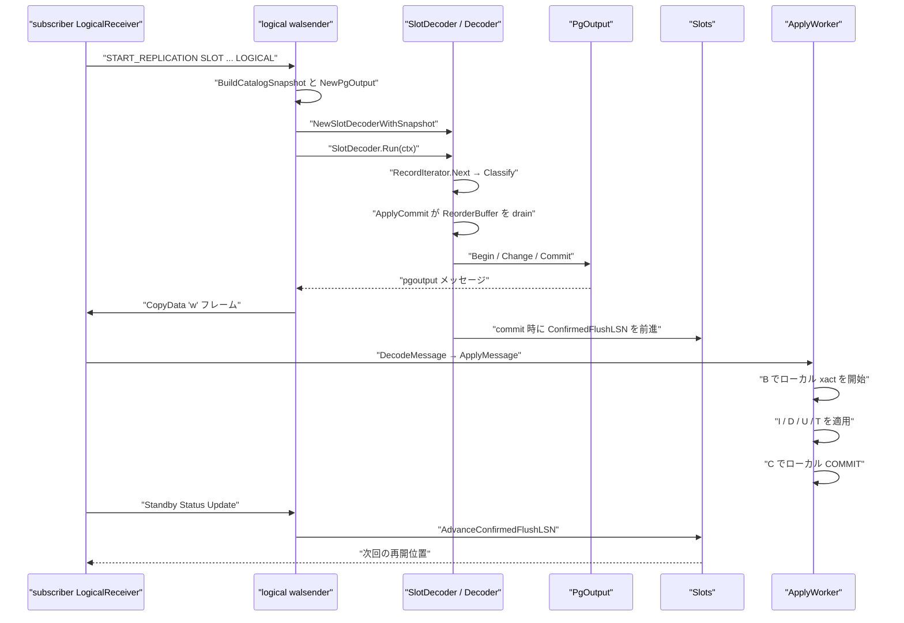
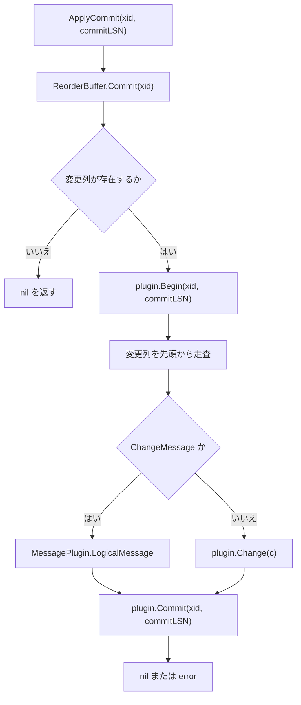

# 論理デコードと pgoutput

<details>
<summary>関連ソースファイル</summary>

- [`internal/access/transam/xlog/decoder.go`](https://github.com/ryogrid/goopg/blob/19856410e8d497d59787e1ab35a2febb3f5953d6/internal/access/transam/xlog/decoder.go)
- [`internal/access/transam/xlog/classifier.go`](https://github.com/ryogrid/goopg/blob/19856410e8d497d59787e1ab35a2febb3f5953d6/internal/access/transam/xlog/classifier.go)
- [`internal/access/transam/xlog/reorder.go`](https://github.com/ryogrid/goopg/blob/19856410e8d497d59787e1ab35a2febb3f5953d6/internal/access/transam/xlog/reorder.go)
- [`internal/access/transam/xlog/tail_publisher.go`](https://github.com/ryogrid/goopg/blob/19856410e8d497d59787e1ab35a2febb3f5953d6/internal/access/transam/xlog/tail_publisher.go)
- [`internal/access/transam/xlog/logical_message.go`](https://github.com/ryogrid/goopg/blob/19856410e8d497d59787e1ab35a2febb3f5953d6/internal/access/transam/xlog/logical_message.go)
- [`internal/access/transam/xlog/pgoutput.go`](https://github.com/ryogrid/goopg/blob/19856410e8d497d59787e1ab35a2febb3f5953d6/internal/access/transam/xlog/pgoutput.go)
- [`internal/access/transam/xlog/pgoutput_decoder.go`](https://github.com/ryogrid/goopg/blob/19856410e8d497d59787e1ab35a2febb3f5953d6/internal/access/transam/xlog/pgoutput_decoder.go)
- [`internal/access/transam/xlog/publish_visibility.go`](https://github.com/ryogrid/goopg/blob/19856410e8d497d59787e1ab35a2febb3f5953d6/internal/access/transam/xlog/publish_visibility.go)
- [`internal/access/transam/xlog/repllog.go`](https://github.com/ryogrid/goopg/blob/19856410e8d497d59787e1ab35a2febb3f5953d6/internal/access/transam/xlog/repllog.go)
- [`internal/access/transam/xlog/seq_log.go`](https://github.com/ryogrid/goopg/blob/19856410e8d497d59787e1ab35a2febb3f5953d6/internal/access/transam/xlog/seq_log.go)
- [`internal/access/transam/xlog/slot_decoder.go`](https://github.com/ryogrid/goopg/blob/19856410e8d497d59787e1ab35a2febb3f5953d6/internal/access/transam/xlog/slot_decoder.go)
- [`internal/access/transam/xlog/snapshot.go`](https://github.com/ryogrid/goopg/blob/19856410e8d497d59787e1ab35a2febb3f5953d6/internal/access/transam/xlog/snapshot.go)
- [`internal/executor/applyworker.go`](https://github.com/ryogrid/goopg/blob/19856410e8d497d59787e1ab35a2febb3f5953d6/internal/executor/applyworker.go)
- [`internal/replication/logicalreceiver.go`](https://github.com/ryogrid/goopg/blob/19856410e8d497d59787e1ab35a2febb3f5953d6/internal/replication/logicalreceiver.go)
- [`internal/replication/logicalwalsender.go`](https://github.com/ryogrid/goopg/blob/19856410e8d497d59787e1ab35a2febb3f5953d6/internal/replication/logicalwalsender.go)

</details>

論理デコードは、WAL のヒープ変更とトランザクション境界を、コミット済みの行イベント列へ変換し、pgoutput の `B` / `C` / `R` / `I` / `D` / `U` / `T` / `M` メッセージとしてサブスクライバへ送る仕組みです。パブリッシャ側では `SlotDecoder` がスロットの `RestartLSN` から `RecordIterator` を回し、`Classify` が `Decoder` に変更を渡し、`ReorderBuffer` が xid ごとに蓄積してコミット時に順序を保って `PgOutput` を駆動します。サブスクライバ側では `LogicalReceiver` が `'w'` CopyData から pgoutput メッセージを取り出し、`ApplyWorker` が `B` でローカルトランザクションを開き、`I` / `D` / `U` / `T` を適用し、`C` でコミットします。論理スロットの永続化と WAL 保持は [10.5 レプリケーションスロットと同期コミット](10.5-Replication-Slots.md)、WAL レコードのデコードは [10.1 WAL レコード形式](10.1-WAL-Format.md)、物理リプレイは [10.4 クラッシュ復旧とリプレイ](10.4-Crash-Recovery.md) を参照してください。

## 責務

- スロットごとに `RecordIterator` を回し、`Classify` で WAL レコードを `Decoder` へ振り分ける（`internal/access/transam/xlog/slot_decoder.go:SlotDecoder.Run`）。
- xid ごとに変更を `ReorderBuffer` へ蓄積し、コミット時に `Begin → Change* → Commit` の順で出力プラグインを呼ぶ（`internal/access/transam/xlog/decoder.go:Decoder.ApplyChange`、`ApplyCommit`）。
- アボートしたトランザクションの変更を出力せずに破棄する（`internal/access/transam/xlog/decoder.go:ApplyAbort`）。
- xid ごとの変更をコミット順に並べ、連続する Delete + Insert を Update に畳む（`internal/access/transam/xlog/reorder.go:ReorderBuffer.Commit`、`foldChanges`）。
- 論理メッセージ `XLOG_LOGICAL_MESSAGE` を復号し、トランザクショナルなら xid のキューへ、非トランザクショナルなら即座にプラグインへ渡す（`internal/access/transam/xlog/logical_message.go:DecodeLogicalMessage`、`Decoder.applyLogicalMessage`）。
- スロット作成時のカタログと MVCC ビューを凍結し、pgoutput がタプルを安定したスキーマで解釈できるようにする（`internal/access/transam/xlog/snapshot.go:BuildCatalogSnapshot`、`SlotSnapshot`）。
- pgoutput v1 の `B` / `C` / `R` / `I` / `D` / `U` / `T` / `M` メッセージをバイト列として書き出す（`internal/access/transam/xlog/pgoutput.go:PgOutput.Begin`、`Commit`、`Change`、`Message`）。
- リレーションごとに最初の変更で `R` を 1 回だけ送り、`emittedRel` で重複を抑える（`internal/access/transam/xlog/pgoutput.go:writeRelation`、`emittedRel`）。
- パブリケーションの `FOR TABLE` / `FOR ALL TABLES` と `publish` フラグに従って変更をフィルタする（`internal/access/transam/xlog/pgoutput.go:RelationFilter`、`internal/replication/logicalwalsender.go:publicationFilter`）。
- パブリッシャの `PgOutput` 出力を `'w'` CopyData フレームに包み、論理ストリーム用の合成 LSN を単調に進める（`internal/replication/logicalwalsender.go:walsenderPgoutputAdapter`）。
- サブスクライバで pgoutput メッセージを復号し、`ApplyWorker` でローカルトランザクションとして適用する（`internal/replication/logicalreceiver.go:LogicalReceiver.handleCopyData`、`internal/executor/applyworker.go:ApplyWorker.ApplyMessage`）。
- 適用済みコミット LSN を `applyLSN` として進め、Standby Status Update でパブリッシャの `confirmed_flush_lsn` を前進させる（`internal/replication/logicalreceiver.go:sendStatus`）。
- シーケンス変更を物理 WAL の `XLOG_SEQ_LOG` として記録する。これはページ再構築用の物理レコードで、論理行変更としては pgoutput に流れない（`internal/access/transam/xlog/seq_log.go:EncodeSeqLogPG`）。

## 処理フロー

パブリッシャの `START_REPLICATION ... LOGICAL` からサブスクライバの適用・ack までの実経路です。



1. `runLogicalWalsender` は `BuildCatalogSnapshot` で接続データベースのカタログを凍結し、`NewPgOutput(snap, adapter)` を作ります。`publication_names` が指定されていれば `buildPublicationFilter` を `SetFilter` し、`messages` オプションがあれば `SetMessages` を呼びます（`internal/replication/logicalwalsender.go:runLogicalWalsender`）。
2. `NewSlotDecoderWithSnapshot` は `Slots.Get(slotName)` でスロットを取得し、kind が `SlotLogical` であることを確認して、`slot.RestartLSN` を開始位置とする `RecordIterator` を作ります（`internal/access/transam/xlog/slot_decoder.go:NewSlotDecoderWithSnapshot`）。
3. `SlotDecoder.Run` は `iter.Next(ctx)` の各レコードを `Classify(s.decoder, rec)` に渡します。ヒープ挿入・削除・更新、コミット、アボート、論理メッセージがここで `Decoder` に入ります（`internal/access/transam/xlog/slot_decoder.go:Run`、`internal/access/transam/xlog/classifier.go:Classify`）。
4. `Decoder.ApplyChange` は変更を `ReorderBuffer` に積むだけで、まだプラグインを呼びません。`ApplyAbort` はキューを捨てます。これにより未コミットの変更が wire に出ることはありません（`internal/access/transam/xlog/decoder.go:ApplyChange`、`ApplyAbort`）。
5. コミットレコードでは `Decoder.ApplyCommit(xid, commitLSN)` が `ReorderBuffer.Commit(xid)` で変更列を取り出し、`plugin.Begin(xid, commitLSN)`、各 `Change`、`plugin.Commit(xid, commitLSN)` の順に呼びます。トランザクショナルな論理メッセージは `ChangeMessage` として同じ列に並び、`MessagePlugin.LogicalMessage` で `Begin` と `Commit` の間に出力されます（`internal/access/transam/xlog/decoder.go:ApplyCommit`）。
6. `PgOutput.Begin` は `B` フレームを書き、`Change` は必要なら `R` を先に送ってから `I` / `D` / `U` を書きます。`Commit` は `C` フレームを書きます（`internal/access/transam/xlog/pgoutput.go:PgOutput.Begin`、`Change`、`Commit`）。
7. `walsenderPgoutputAdapter.Write` は 1 回の `Write` を 1 つの `'w'` CopyData フレームに包みます。論理ストリームの LSN は物理 WAL の位置ではなく `nextLSN` で合成され、各メッセージに単調増加する `startLSN` / `endLSN` が付きます（`internal/replication/logicalwalsender.go:walsenderPgoutputAdapter.Write`）。
8. `SlotDecoder.Run` はコミットレコードを見つけると `AdvanceConfirmedFlushLSN(slotName, rec.EndLSN+1)` を呼びます。`ConfirmedFlushLSN` は次に再開する排他的境界なので、レコード末尾そのものではなく `EndLSN + 1` を保存します（`internal/access/transam/xlog/slot_decoder.go:Run`、`recordIsXactCommit`）。
9. サブスクライバの `LogicalReceiver.handleCopyData` は `'w'` の `WALBytes` を `xlog.DecodeMessage` で復号し、`ApplyWorker.ApplyMessage` に渡します。コミット LSN が返れば `applyLSN` を CAS で前進させ、即座に `sendStatus` を送ります（`internal/replication/logicalreceiver.go:handleCopyData`）。
10. `ApplyWorker` は `B` でローカルトランザクションを開始し、`R` でリモートリレーションをローカルカタログへ解決し、`I` / `D` / `U` / `T` を適用し、`C` で `txnMgr.Commit` します。`M` はテーブル変更ではないため no-op です（`internal/executor/applyworker.go:ApplyMessage`、`applyCommit`）。
11. `sendStatus` は `flush_lsn` / `replay_lsn` / `write_lsn` をすべて `applyLSN` として送ります。パブリッシャの `handleStandbyCopyData` が `AdvanceConfirmedFlushLSN` と `SyncRep.UpdateStandbyProgress` を呼び、スロットと同期コミット待機者が前進します（`internal/replication/logicalreceiver.go:sendStatus`、`internal/replication/walsender.go:handleStandbyCopyData`）。

`Decoder.ApplyCommit` の内部フローは次のとおりです。



## 主要ファイル

| ファイル | 役割 |
| --- | --- |
| `internal/access/transam/xlog/decoder.go` | `OutputPlugin` / `Decoder`。xid ごとの変更蓄積、コミット時の `Begin → Change* → Commit`、アボート時の破棄。 |
| `internal/access/transam/xlog/logical_message.go` | `LogicalMessage`、`EncodeLogicalMessagePG` / `DecodeLogicalMessage`、`MessagePlugin`、`applyLogicalMessage`。 |
| `internal/access/transam/xlog/slot_decoder.go` | `SlotDecoder`。スロットごとの `RecordIterator` 駆動、`Classify`、コミット時の `ConfirmedFlushLSN` 前進。 |
| `internal/access/transam/xlog/snapshot.go` | `RelationDef` / `ColumnDef` / `CatalogSnapshot` / `SlotSnapshot`。スロット作成時のカタログ凍結。 |
| `internal/access/transam/xlog/pgoutput.go` | `PgOutput`。`B` / `C` / `R` / `I` / `D` / `U` / `T` / `M` のエンコード、タプルのテキスト化、リレーションキャッシュ。 |
| `internal/access/transam/xlog/pgoutput_decoder.go` | `DecodedMessage` / `DecodedRelation` / `DecodedColumn`、`DecodeMessage`。受信側の pgoutput パーサ。 |
| `internal/executor/applyworker.go` | `ApplyWorker`。`B` でローカル xact 開始、`R` のキャッシュ、`I` / `D` / `U` / `T` の適用、`C` のコミット、tablesync の昇格。 |
| `internal/replication/logicalwalsender.go` | `runLogicalWalsender`、`walsenderPgoutputAdapter`、`publicationFilter`。パブリッシャ側の CopyData 送出。 |
| `internal/replication/logicalreceiver.go` | `LogicalReceiver`。再接続ループ、`START_REPLICATION`、pgoutput 復号、`applyLSN`、Standby Status Update。 |
| `internal/access/transam/xlog/repllog.go` | `apply_commit` / `apply_error` / `tablesync_*` などの構造化イベント名。 |
| `internal/access/transam/xlog/publish_visibility.go` | WAL の安全 tail を両リングへ公開する `publishVisibility`。ストリーミングの可視性基盤。 |
| `internal/access/transam/xlog/seq_log.go` | `XLOG_SEQ_LOG` の物理エンコードとシーケンスページ再構築。論理行変更としては扱わない。 |

## 公開 API / エントリポイント

```go
func NewDecoder(plugin OutputPlugin) *Decoder
func (d *Decoder) ApplyChange(xid storage.TransactionID, c Change)
func (d *Decoder) ApplyCommit(xid storage.TransactionID, commitLSN uint64) error
func (d *Decoder) ApplyAbort(xid storage.TransactionID)
func (d *Decoder) Active() int
func (d *Decoder) OldestBeginLSN() uint64
func (d *Decoder) SetDatabase(dbOid uint32)

func NewSlotDecoder(slots *Slots, slotName string, w *Writer, walDir string, segSize int64, plugin OutputPlugin) (*SlotDecoder, error)
func NewSlotDecoderWithSnapshot(slots *Slots, slotName string, w *Writer, walDir string, segSize int64, plugin OutputPlugin, snap SlotSnapshot) (*SlotDecoder, error)
func (s *SlotDecoder) Run(ctx context.Context) error
func (s *SlotDecoder) Close() error
func (s *SlotDecoder) SetDatabase(dbOid uint32)

func NewPgOutput(snap *CatalogSnapshot, w io.Writer) *PgOutput
func (p *PgOutput) SetFilter(f RelationFilter)
func (p *PgOutput) SetMessages(on bool)
func (p *PgOutput) Begin(xid storage.TransactionID, commitLSN uint64) error
func (p *PgOutput) Commit(xid storage.TransactionID, commitLSN uint64) error
func (p *PgOutput) Change(c Change) error
func (p *PgOutput) Message(transactional bool, lsn uint64, prefix string, payload []byte) error
func (p *PgOutput) LogicalMessage(xid storage.TransactionID, lsn uint64, transactional bool, prefix string, content []byte) error

func DecodeMessage(payload []byte) (*DecodedMessage, error)

func NewApplyWorker(cat catalog.Catalog, pool *storage.Pool, txnMgr *transam.Manager) *ApplyWorker
func (w *ApplyWorker) ApplyMessage(m *xlog.DecodedMessage) (uint64, error)
func (w *ApplyWorker) SafeRollback()
func (w *ApplyWorker) SetSubscriptionContext(ps *catalog.PubSub, subName string)
func (w *ApplyWorker) SetStatHandle(sub *xlog.Subscriber)

func NewLogicalReceiver(cfg LogicalReceiverConfig) *LogicalReceiver
func DialLogicalReceiver(ctx context.Context, cfg LogicalReceiverConfig) (*LogicalReceiver, error)
func (r *LogicalReceiver) Run(ctx context.Context) error
func (r *LogicalReceiver) ApplyLSN() uint64
func (r *LogicalReceiver) Close() error
```

`NewSlotDecoder` はスロットが `SlotLogical` であることを要求し、`RestartLSN` からイテレータを作ります。`NewPgOutput` は `CatalogSnapshot` と `io.Writer` を受け取り、`SetFilter` / `SetMessages` でパブリケーションとメッセージ出力を制御します（`internal/access/transam/xlog/slot_decoder.go:NewSlotDecoder`、`internal/access/transam/xlog/pgoutput.go:NewPgOutput`）。

## 主要データ構造

### OutputPlugin / Decoder — 出力契約とオーケストレーション

`internal/access/transam/xlog/decoder.go:OutputPlugin`（46〜60 行）:

```go
type OutputPlugin interface {
	// Begin emits the per-xact prologue — pgoutput's `B`
	// message. xid is the transaction id; commitLSN is the WAL
	// position of the commit record so the subscriber can
	// compute lag.
	Begin(xid storage.TransactionID, commitLSN uint64) error
	// Change emits one row-level event. The decoder calls this
	// in append order within a single xact, after Begin and
	// before Commit.
	Change(c Change) error
	// Commit emits the per-xact epilogue — pgoutput's `C`
	// message. The subscriber's apply path commits its
	// transaction here.
	Commit(xid storage.TransactionID, commitLSN uint64) error
}
```

`internal/access/transam/xlog/decoder.go:Decoder`（70〜75 行）:

```go
type Decoder struct {
	buf    *ReorderBuffer
	plugin OutputPlugin
	// dbOid filters logical messages by their database (SetDatabase).
	dbOid uint32
}
```

`Decoder` は 1 つの論理スロットに対応し、goroutine-safe ではありません。`buf` は xid ごとの変更を保持する `ReorderBuffer`、`plugin` は pgoutput などの出力先、`dbOid` は論理メッセージのデータベースフィルタです。`plugin == nil` のとき `ApplyCommit` は変更があれば `ErrNoPlugin` を返します。

### LogicalMessage / MessagePlugin — 論理メッセージ

`internal/access/transam/xlog/logical_message.go:LogicalMessage`（32〜37 行）:

```go
type LogicalMessage struct {
	DBOid         uint32
	Transactional bool
	Prefix        string
	Content       []byte
}
```

`internal/access/transam/xlog/logical_message.go:MessagePlugin`（83〜90 行）:

```go
type MessagePlugin interface {
	// LogicalMessage delivers one message. A transactional message arrives
	// between its transaction's Begin and Commit, in WAL order with the row
	// changes; a non-transactional one arrives as soon as it is decoded,
	// outside any transaction frame. lsn is the end of the message record
	// (the decoding buffer's endptr).
	LogicalMessage(xid storage.TransactionID, lsn uint64, transactional bool, prefix string, content []byte) error
}
```

`XLOG_LOGICAL_MESSAGE` の main data は 24 バイトのヘッダ（dbOid、transactional フラグ、prefix 長、message 長）と、NUL 終端された prefix、message 本体からなります。`DecodeLogicalMessage` は prefix 長が 0 でないこと、NUL 終端であること、`prefixSize + messageSize` が残りバイトを超えないことを検証します（`internal/access/transam/xlog/logical_message.go:DecodeLogicalMessage`）。

### SlotDecoder — スロットごとの駆動ループ

`internal/access/transam/xlog/slot_decoder.go:SlotDecoder`（37〜49 行）:

```go
type SlotDecoder struct {
	slotName string
	slots    *Slots
	iter     *RecordIterator
	decoder  *Decoder

	// Snapshot is the slot-creation-time HISTORIC view a
	// plugin uses to resolve relations and decide tuple
	// visibility. Set by NewSlotDecoderWithSnapshot;
	// NewSlotDecoder leaves it zero-valued so existing tests
	// stay green.
	Snapshot SlotSnapshot
}
```

`SlotDecoder` は `iter` で WAL を読み、`decoder` で変更を蓄積し、`slots` を通じて `ConfirmedFlushLSN` を前進させます。`Snapshot` は `NewSlotDecoderWithSnapshot` でのみ設定され、スロット開始時のカタログ形状を固定します。

### RelationDef / ColumnDef / CatalogSnapshot — 凍結カタログ

`internal/access/transam/xlog/snapshot.go:RelationDef`（39〜47 行）:

```go
type RelationDef struct {
	Schema  string
	Name    string
	OID     uint32
	Columns []ColumnDef
	// ReplIdent is pg_class.relreplident ('d', 'f', 'i', 'n'), which the
	// Relation message carries (logicalrep_write_rel).
	ReplIdent byte
}
```

`internal/access/transam/xlog/snapshot.go:ColumnDef`（52〜64 行）:

```go
type ColumnDef struct {
	Name    string
	Type    catalog.Type
	NotNull bool
	Ordinal int
	// Typmod is pg_attribute.atttypmod (-1 for none), which the Relation
	// message carries per column (logicalrep_write_attrs).
	Typmod int32
	// ReplIdent marks a column of the table's replica identity — the
	// Relation message's LOGICALREP_IS_REPLICA_IDENTITY flag
	// (identityColumns).
	ReplIdent bool
}
```

`internal/access/transam/xlog/snapshot.go:CatalogSnapshot`（71〜79 行）:

```go
type CatalogSnapshot struct {
	rels map[uint32]*RelationDef
	// RegOut renders a reg* column value's 4-byte OID as its NAME (PG's text-mode
	// pgoutput serializes a reg* value through its typoutput — regclassout etc. —
	// via OidOutputFunctionCall, proto.c:848; the numeric OID is BINARY mode's
	// typsend). nil (the default; no catalog at hand) keeps the numeric fallback.
	// M0119-0006 (deferral row 1353).
	RegOut func(typeName string, oid uint32) string
}
```

`CatalogSnapshot.rels` は RelOid をキーにした不変マップで、構築後に変更されません。`BuildCatalogSnapshot` は `catalog.AllTables` から `RelationDef` を作り、`identityColumns` で replica identity の列を決めます。FULL は全列、DEFAULT は主キー、USING INDEX は `indisreplident` の列、NOTHING はなしです（`internal/access/transam/xlog/snapshot.go:BuildCatalogSnapshot`、`identityColumns`）。

`internal/access/transam/xlog/snapshot.go:SlotSnapshot`（177〜180 行）:

```go
type SlotSnapshot struct {
	Catalog *CatalogSnapshot
	MVCC    transam.Snapshot
}
```

`SlotSnapshot` はスキーマとトランザクション可視性の 2 つの凍結ビューを束ねます。`MVCC` はテストではゼロ値でもよく、実運用ではスロットデコーダ構築時に取得したスナップショットが入ります。

### PgOutput — pgoutput v1 エンコーダ

`internal/access/transam/xlog/pgoutput.go:PgOutput`（89〜112 行）:

```go
type PgOutput struct {
	snap *CatalogSnapshot
	w    io.Writer

	// emittedRel tracks which relation OIDs have already had
	// their `R` message sent in this session. The first Change
	// touching a relation emits `R` ahead of the per-row
	// message; subsequent changes skip it. Mirrors upstream's
	// `relsynced` set.
	emittedRel map[uint32]struct{}

	// filter, when non-nil, gates every Change emission against
	// publication-membership rules. SetFilter installs it; nil
	// (the default) means "ship every change for every relation
	// in the snapshot" — useful for tests and for the
	// catalog-only initial scaffolding before publications
	// existed.
	filter RelationFilter

	// messages is pgoutput's "messages" option: logical decoding
	// messages are written only when the subscriber asked for them
	// (pgoutput_message returns early otherwise).
	messages bool
}
```

`PgOutput` は 1 つの論理スロットに対応し、`emittedRel` で `R` の重複を防ぎます。`filter` は `RelationFilter.Allows(rel, kind)` で変更を落とし、`messages` は `M` フレームの出力可否を制御します。`Change` はスナップショットに存在しないリレーションを黙ってスキップします（`internal/access/transam/xlog/pgoutput.go:Change`）。

### DecodedMessage — 受信側の pgoutput 表現

`internal/access/transam/xlog/pgoutput_decoder.go:DecodedMessage`（27〜61 行）:

```go
type DecodedMessage struct {
	Kind byte

	// Begin / Commit fields.
	XID        storage.TransactionID
	CommitLSN  uint64
	EndLSN     uint64
	CommitTime uint64

	// Relation field — populated for kind == 'R'.
	Relation *DecodedRelation

	// Insert / Delete fields.
	RelOID   uint32
	NewTuple []DecodedColumn // populated for 'I'
	OldTuple []DecodedColumn // populated for 'D' / 'U'

	// Truncate fields — populated for kind == 'T'. TruncateRels
	// holds the publisher OIDs of every relation in the TRUNCATE
	// statement (a single TRUNCATE may target many tables);
	// TruncateOption is the upstream option-bit byte (bit 0
	// CASCADE, bit 1 RESTART IDENTITY) — the apply worker uses
	// this to mirror upstream's `apply_handle_truncate` policy.
	TruncateRels   []uint32
	TruncateOption byte

	// Message fields — populated for kind == 'M'. MessageTransactional is
	// bit zero of the protocol flags byte. MessageLSN is independent of a
	// transaction's commit LSN: non-transactional messages are delivered at
	// their own WAL position.
	MessageTransactional bool
	MessageLSN           uint64
	MessagePrefix        string
	MessagePayload       []byte
}
```

`DecodeMessage` は先頭の kind バイトでパーサを切り替え、各フィールドをリトルエンディアンで読みます。短い payload は `ErrTruncatedMessage`、未知の kind はエラーです（`internal/access/transam/xlog/pgoutput_decoder.go:DecodeMessage`）。

### ApplyWorker — サブスクライバの適用器

`internal/executor/applyworker.go:ApplyWorker`（45〜86 行）:

```go
type ApplyWorker struct {
	cat    catalog.Catalog
	pool   *storage.Pool
	txnMgr *transam.Manager

	// relations caches `R` messages keyed by remote rel OID,
	// resolved to the local catalog.Table once on first
	// reference. UPDATE / DELETE find their target table here.
	relations map[uint32]*applyRel

	// currentTx is the in-progress local transaction opened on
	// `B` and closed on `C` / abort. Apply work happens inside
	// it. When inXact is false, change events outside an open
	// xact are an apply error.
	currentTx transam.Transaction
	inXact    bool

	// Tablesync gating. When pubsub and subName are both set,
	// applyInsert skips changes for relations that aren't at
	// state 'r' yet (tablesync still in progress), and
	// applyCommit promotes 's' → 'r' for relations whose
	// recorded sync-end LSN has been crossed by this commit.
	// Mirrors upstream worker.c's process_syncing_tables_for_apply.
	// Both nil/empty preserves the legacy "apply everything"
	// path that existing tests depend on.
	pubsub  *catalog.PubSub
	subName string

	// stat is the pg_stat_subscription handle for this worker.
	// When non-nil, every ApplyMessage records the receipt
	// timestamp + the message's reported end LSN, and every
	// commit advances the worker's received_lsn to the commit
	// LSN. Nil disables observability — the legacy path used by
	// existing tests.
	stat *xlog.Subscriber

	// logger receives structured replication-event lines (apply
	// commits, apply errors, tablesync state promotions). nil
	// falls back to slog.Default(); tests pass a discard logger
	// to silence output. See repllog.go for the event vocabulary.
	logger *slog.Logger
}
```

`relations` はリモートの `R` メッセージ OID をローカルの `applyRel` に解決したキャッシュです。`currentTx` と `inXact` は `B` / `C` の対応を表し、`B` なしの変更はエラーになります。`pubsub` / `subName` は tablesync の `pg_subscription_rel` を参照するための文脈です。

### LogicalReceiver / walsenderPgoutputAdapter — 両端の輸送

`internal/replication/logicalreceiver.go:LogicalReceiver`（130〜147 行）:

```go
type LogicalReceiver struct {
	cfg LogicalReceiverConfig

	// applyLSN is updated atomically by the apply pipeline on
	// every Commit and read by the reconnect loop to set the
	// next START_REPLICATION resume point and by the standby-
	// status frame to advance the publisher slot's
	// confirmed_flush_lsn.
	applyLSN atomic.Uint64

	// mu guards the per-iteration connection state and the
	// terminal-close flag.
	mu     sync.Mutex
	conn   net.Conn
	r      *libpq.FrameReader
	w      *libpq.FrameWriter
	closed bool // permanent close via Close()
}
```

`internal/replication/logicalwalsender.go:walsenderPgoutputAdapter`（267〜271 行）:

```go
type walsenderPgoutputAdapter struct {
	w       *libpq.FrameWriter
	mu      sync.Mutex
	nextLSN uint64
}
```

`LogicalReceiver.applyLSN` は適用済みの最後のコミット LSN で、再接続時の `START_REPLICATION` 開始位置と Standby Status Update の値に使われます。`walsenderPgoutputAdapter` は `io.Writer` を実装し、`PgOutput` の 1 回の `Write` を 1 つの `'w'` CopyData フレームに変換します。`nextLSN` は論理ストリーム用の合成 LSN で、物理 WAL の位置とは独立です（`internal/replication/logicalwalsender.go:Write`）。

### publicationFilter — パブリケーション membership

`internal/replication/logicalwalsender.go:publicationFilter`（332〜335 行）:

```go
type publicationFilter struct {
	allTablesAllowed allowFlags
	byTable          map[string]allowFlags
}
```

`internal/replication/logicalwalsender.go:allowFlags`（340〜342 行）:

```go
type allowFlags struct {
	insert, update, delete bool
}
```

`allTablesAllowed` は `FOR ALL TABLES` のパブリケーションが許可する操作、`byTable` はテーブル名ごとの許可操作です。`Allows` はリレーションの完全修飾名で `byTable` を引き、どれか 1 つのパブリケーションが該当操作を許可していれば true を返します（`internal/replication/logicalwalsender.go:publicationFilter.Allows`）。

## 内部構造

### パイプラインの層

論理デコードは次の層で構成されます。

1. `SlotDecoder.Run` が `RecordIterator` から `Record` を取り出す。
2. `Classify` がヒープ変更を `Change` に変換し、`Decoder.ApplyChange` に渡す。コミット/アボートは `ApplyCommit` / `ApplyAbort` に渡す。
3. `Decoder` は `ReorderBuffer` に xid ごとの変更を蓄積し、コミット時に `Begin → Change* → Commit` を出力プラグインへ流す。
4. `PgOutput` が pgoutput v1 のバイト列を `io.Writer` に書く。
5. パブリッシャの `walsenderPgoutputAdapter` が 1 メッセージを 1 `'w'` CopyData に包む。
6. サブスクライバの `LogicalReceiver` が `DecodeMessage` で復号し、`ApplyWorker` がローカルに適用する。

この分離により、`Decoder` と `ReorderBuffer` は wire format を知らず、`PgOutput` は WAL の読み方を知りません。

### コミット順とアボート

`ReorderBuffer` は xid ごとに変更を append 順で保持し、`Commit` で取り出して削除します。`ApplyChange` はプラグインを呼ばないため、未コミットの行が wire に出ることはありません。`ApplyAbort` はキューを捨て、プラグインを呼びません。`Commit` 時にキューが空なら `ok=false` で、`Decoder.ApplyCommit` は nil を返します。カタログだけを変更したトランザクションなど、フィルタで全変更が落ちた場合に備えています（`internal/access/transam/xlog/reorder.go:ReorderBuffer`、`internal/access/transam/xlog/decoder.go:ApplyCommit`）。

`foldChanges` は連続する `ChangeDelete` + `ChangeInsert` が同じ `Rel` なら 1 つの `ChangeUpdate` に畳みます。executor が UPDATE を Delete + Insert のペアで書くため、pgoutput の `U` メッセージに変換するにはこの畳み込みが必要です（`internal/access/transam/xlog/reorder.go:foldChanges`）。

### 論理メッセージの扱い

`applyLogicalMessage` は `d.dbOid != 0 && m.DBOid != d.dbOid` ならメッセージを捨てます。トランザクショナルなメッセージは `ChangeMessage` として xid のキューに積まれ、コミット時に `Begin` と `Commit` の間で `MessagePlugin.LogicalMessage` に渡されます。非トランザクショナルなメッセージは即座にプラグインへ渡ります。`MessagePlugin` を実装しないプラグインはメッセージを受け取りません（`internal/access/transam/xlog/logical_message.go:applyLogicalMessage`）。

`PgOutput.LogicalMessage` は `messages` オプションが false なら何も書かず、true なら `M` フレームを書きます。`M` の flags は bit 0 が transactional を表し、`lsn` はメッセージレコードの終端です。非トランザクショナルメッセージはトランザクションの commit LSN とは独立した位置を持ちます（`internal/access/transam/xlog/pgoutput.go:Message`、`LogicalMessage`）。

### pgoutput のメッセージ形状

`PgOutput.Begin` は `B`、`CommitLSN`、`commit_time`、`xid` を書きます。`Commit` は `C`、flags 0、`commit_lsn`、`end_lsn`、`commit_time` を書きます。v0 では `commit_lsn` と `end_lsn` は同じ値です（`internal/access/transam/xlog/pgoutput.go:Begin`、`Commit`）。

`Change` はスナップショットから `RelationDef` を引き、`filter` が拒否すれば何も書きません。まだ `R` を送っていないリレーションなら `writeRelation` を先に呼び、`emittedRel` に記録します。`I` は `N` + 新タプル、`D` は old tuple があれば `O` + 全列、なければ `K` + natts 0、`U` は old tuple があれば `O`、その後 `N` + 新タプルです（`internal/access/transam/xlog/pgoutput.go:Change`、`writeInsert`、`writeDelete`、`writeUpdate`）。

`writeRelation` は `R`、rel OID、namespace、rel name、`relreplident`、列数、各列の flags / name / type OID / typmod を書きます。namespace は goopg の空スキーマを `public` に、`pg_catalog` を空文字に変換します。列 flags の bit 0 は replica identity の列だけに立ちます（`internal/access/transam/xlog/pgoutput.go:writeRelation`、`relationNamespace`）。

タプル本体は `encodePgoTuple` が `storage.ParseHeapTuple` でヘッダを読み、null bitmap と型ごとのアラインメントに従って各列を `t`（テキスト）または `n`（NULL）として書きます。ALTER TABLE ADD COLUMN で後から増えた列は `i >= storedNatts` として NULL になります（`internal/access/transam/xlog/pgoutput.go:encodePgoTuplePhysical`）。

### スナップショットとスキーマ変更

`CatalogSnapshot` はスロット作成時に構築され、以後不変です。`Lookup` は RelOid で引き、存在しないリレーション（スロット作成後に作られたテーブル）は `ok=false` になります。`PgOutput.Change` はこれを黙ってスキップします。スキーマ変更の追従は v0 の範囲外で、変更が実際に問題を起こしたときにデコーダエラーとして表面化する設計です（`internal/access/transam/xlog/snapshot.go:Lookup`、`internal/access/transam/xlog/pgoutput.go:Change`）。

### パブリッシャ側の合成 LSN

論理ストリームの `'w'` フレームには物理 WAL の LSN ではなく、`walsenderPgoutputAdapter.nextLSN` が振る合成 LSN が入ります。`Write` は `startLSN = nextLSN`、`endLSN = nextLSN + len(p) - 1` とし、次の `nextLSN` を `endLSN + 1` にします。空の `Write` は `len(p) - 1` のアンダーフローを避けるため捨てられます（`internal/replication/logicalwalsender.go:Write`）。

10 秒ごとの keepalive は同じアダプタの mutex を取り、最後に送出した合成 LSN を `walEnd` として `'k'` フレームを書きます。これがないと、静かなワークロードで `wal_receiver_timeout` に達したサブスクライバが接続を切ります（`internal/replication/logicalwalsender.go:WriteKeepalive`）。

### サブスクライバの再接続と ack

`LogicalReceiver.Run` は `runOnce` / `streamFrames` を繰り返し、各イテレーションの終わりに接続を閉じて `ApplyWorker.SafeRollback` を呼びます。clean EOF はバックオフをリセットして即再接続し、一時エラーは 1 秒から 30 秒まで指数バックオフ（最大 20% の正のジッター）で再試行します。恒久的エラーはそのまま返します（`internal/replication/logicalreceiver.go:Run`、`nextBackoff`、`isPermanent`）。

`startStreaming` は `applyLSN` が 0 なら設定の `StartLSN` を使い、`START_REPLICATION SLOT ... LOGICAL <lsn>` を送ります。`handleCopyData` は `'w'` の `WALBytes` を `DecodeMessage` に通し、`ApplyMessage` の戻り値 `commitLSN` が非ゼロなら `applyLSN` を CAS で前進させ、即座に `sendStatus` を送ります。`sendStatus` は write/flush/replay をすべて `applyLSN` にします（`internal/replication/logicalreceiver.go:startStreaming`、`handleCopyData`、`sendStatus`）。

### ApplyWorker のトランザクション境界

`ApplyMessage` は `B` で `applyBegin` を呼び、ローカルトランザクションを開始します。`R` は `applyRelation` で `relations[relOID]` にローカルテーブルを解決し、`localIdx` / `claimed` を作ります。`I` / `D` / `U` / `T` はそのキャッシュを使って行を適用します。`C` は `applyCommit` で `txnMgr.Commit` を呼び、`promoteSyncedRels` で tablesync の `s` 状態を `r` に昇格させ、`stat.AdvanceReceivedLSN` を更新します。`M` は何もしません（`internal/executor/applyworker.go:ApplyMessage`、`applyCommit`、`promoteSyncedRels`）。

### シーケンスと物理 WAL

`EncodeSeqLogPG` はシーケンスページの書き換えを `RmgrSeq` / `XLOG_SEQ_LOG` の物理レコードとして組み立て、`BuildSequencePage` が 1 タプルのシーケンスページを再構築します。これは物理リプレイ用で、論理デコードの行変更イベントにはなりません。`Classify` はシーケンスレコードをユーザーデータ変更として扱いません（`internal/access/transam/xlog/seq_log.go:EncodeSeqLogPG`、`BuildSequencePage`）。

### tailPublisher と可視性

`publishVisibility` は `tailPublisher.publishUpTo` で安全 tail を計算し、`walBuffer.publishTail` と `MemRing.PublishUpTo` を進めます。論理デコードの `RecordIterator` は `Writer.WrittenLSN` と MemRing/drain 状態を読むため、この可視化基盤がストリーミングの読み取り可能範囲を支えます（`internal/access/transam/xlog/publish_visibility.go:publishVisibility`、`internal/access/transam/xlog/tail_publisher.go:publishUpTo`）。

### 構造化イベント

`repllog.go` は `apply_commit`、`apply_error`、`tablesync_started`、`tablesync_completed`、`tablesync_state_change` などの `event` 値を定義します。`ApplyWorker` はコミット時に `EventApplyCommit`、適用失敗時に `EventApplyError` を `slog` で記録します（`internal/access/transam/xlog/repllog.go`、`internal/executor/applyworker.go:ApplyMessage`、`applyCommit`）。

## エッジケースと不変条件

- **プラグイン未設定** — `Decoder.ApplyCommit` は変更があるのに `plugin == nil` なら `ErrNoPlugin` を返します。変更が空なら nil を返し、プラグインの有無を要求しません（`internal/access/transam/xlog/decoder.go:ApplyCommit`）。
- **未知 xid のコミット** — `ReorderBuffer.Commit` が `ok=false` を返すと `ApplyCommit` は nil を返します。フィルタで全変更が落ちたトランザクションをエラーにしないためです（`internal/access/transam/xlog/reorder.go:Commit`）。
- **アボート** — `ApplyAbort` はキューを削除するだけでプラグインを呼びません。アボートした変更は wire に出ません（`internal/access/transam/xlog/decoder.go:ApplyAbort`）。
- **トランザクショナルメッセージの xid 不在** — `applyLogicalMessage` は transactional かつ `xid == InvalidTransactionID` ならエラーを返します。xid なしでコミット順に並べることはできないためです（`internal/access/transam/xlog/logical_message.go:applyLogicalMessage`）。
- **メッセージのデータベースフィルタ** — `SetDatabase` が非ゼロなら、別データベースの論理メッセージは無視されます。スロットのデータベース以外のメッセージを apply しないためです（`internal/access/transam/xlog/logical_message.go:applyLogicalMessage`）。
- **MessagePlugin 非対応** — `MessagePlugin` を実装しないプラグインには非トランザクショナルメッセージが渡りません。トランザクショナルメッセージも `ApplyCommit` の `MessagePlugin` 型アサーションでスキップされます（`internal/access/transam/xlog/decoder.go:ApplyCommit`）。
- **M メッセージの出力可否** — `PgOutput.SetMessages(false)`（既定）では `LogicalMessage` は何も書きません。`messages` オプションを要求したサブスクライバだけが `M` を受け取ります（`internal/access/transam/xlog/pgoutput.go:LogicalMessage`）。
- **未知のリレーション** — スナップショットにない RelOid の変更は `PgOutput.Change` が黙ってスキップします。スロット作成後に作られたテーブルは v0 のスキーマ追従範囲外です（`internal/access/transam/xlog/pgoutput.go:Change`）。
- **フィルタで落ちた変更** — `RelationFilter.Allows` が false なら `R` も含めて何も書きません。購読していないリレーションのメタデータを送らないためです（`internal/access/transam/xlog/pgoutput.go:Change`）。
- **DELETE の old tuple なし** — `writeDelete` は `K` + natts 0 の空ボディを書きます。apply worker は空の old tuple の DELETE をスキップします（`internal/access/transam/xlog/pgoutput.go:writeDelete`）。
- **UPDATE の old tuple なし** — `writeUpdate` は `K` / `O` ブロックを省略し、rel OID の直後に `N` を書きます。REPLICA IDENTITY DEFAULT でキー列が変わらない場合の正しい形です（`internal/access/transam/xlog/pgoutput.go:writeUpdate`）。
- **namespace の変換** — 空スキーマは `public`、`pg_catalog` は空文字に変換されます。これを忘れると PG サブスクライバが空 namespace を `pg_catalog` と解釈します（`internal/access/transam/xlog/pgoutput.go:relationNamespace`）。
- **列フラグ** — `R` の列 flags の bit 0 は replica identity の列だけに立ちます。全列に立てると、old tuple のない UPDATE でサブスクライバが誤った列で行を探します（`internal/access/transam/xlog/pgoutput.go:writeRelation`）。
- **`R` の送出は 1 回** — `emittedRel` は rel OID を記録し、同じセッションで `R` を再送しません（`internal/access/transam/xlog/pgoutput.go:Change`）。
- **空 Write のアンダーフロー** — `walsenderPgoutputAdapter.Write` は `len(p) == 0` を捨てます。`nextLSN + len(p) - 1` が巨大値にアンダーフローし、サブスクライバが ack できない `walEnd` を広告するのを防ぎます（`internal/replication/logicalwalsender.go:Write`）。
- **合成 LSN** — 論理ストリームの LSN は物理 WAL の位置ではありません。`nextLSN` はメッセージごとに `len(p)` だけ進み、単調増加だけが保証されます（`internal/replication/logicalwalsender.go:Write`）。
- **スロットの commit anchor** — `SlotDecoder.Run` はコミットレコードで `rec.EndLSN + 1` を `ConfirmedFlushLSN` に保存します。`ConfirmedFlushLSN` は次回再開する排他的境界なので、`EndLSN` そのものだと 1 バイト早く読んでしまいます（`internal/access/transam/xlog/slot_decoder.go:Run`）。
- **コミット判定の 2 形態** — `recordIsXactCommit` はネイティブ `RecordKindXactCommit` と PG 形式の `RmgrXact` + commit opcode の両方を見ます。片方だけだと実際のコミットでアンカーが進みません（`internal/access/transam/xlog/slot_decoder.go:recordIsXactCommit`）。
- **受信メッセージの切り詰め** — `DecodeMessage` は payload が不足すると `ErrTruncatedMessage` を返します。`reader.need` が各フィールド読み取り前に境界を確認します（`internal/access/transam/xlog/pgoutput_decoder.go:DecodeMessage`、`reader.need`）。
- **未知のメッセージ種別** — `DecodeMessage` の switch にない kind はエラーです。apply worker も `ApplyMessage` の default で unsupported kind を返します（`internal/access/transam/xlog/pgoutput_decoder.go:DecodeMessage`、`internal/executor/applyworker.go:ApplyMessage`）。
- **applyLSN の単調性** — `handleCopyData` は `commitLSN <= cur` なら何もせず、CAS で前進したときだけ `sendStatus` を送ります。順序が入れ替わったメッセージで ack が後退しないためです（`internal/replication/logicalreceiver.go:handleCopyData`）。
- **再接続のバックオフ** — 一時エラーは 1 秒から 30 秒へ倍々で増え、最大 20% の正のジッターが付きます。clean EOF はバックオフをリセットして即再接続します（`internal/replication/logicalreceiver.go:Run`、`nextBackoff`）。
- **切断時のロールバック** — `LogicalReceiver.Run` は各イテレーションの終わりに `ApplyWorker.SafeRollback` を呼び、半端なトランザクションを破棄します。apply worker 自体はイテレーションを跨いで存続し、`applyLSN` から再開します（`internal/replication/logicalreceiver.go:Run`、`internal/executor/applyworker.go:SafeRollback`）。

Sources:

- `internal/access/transam/xlog/decoder.go`
- `internal/access/transam/xlog/classifier.go`
- `internal/access/transam/xlog/reorder.go`
- `internal/access/transam/xlog/tail_publisher.go`
- `internal/access/transam/xlog/logical_message.go`
- `internal/access/transam/xlog/pgoutput.go`
- `internal/access/transam/xlog/pgoutput_decoder.go`
- `internal/access/transam/xlog/publish_visibility.go`
- `internal/access/transam/xlog/repllog.go`
- `internal/access/transam/xlog/seq_log.go`
- `internal/access/transam/xlog/slot_decoder.go`
- `internal/access/transam/xlog/snapshot.go`
- `internal/executor/applyworker.go`
- `internal/replication/logicalreceiver.go`
- `internal/replication/logicalwalsender.go`

<sub>Generated by deepwiki-4myself from `goopg` @ `19856410e`</sub>
