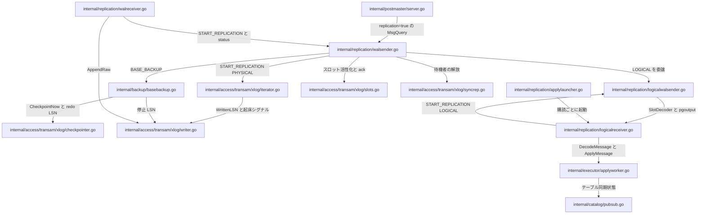
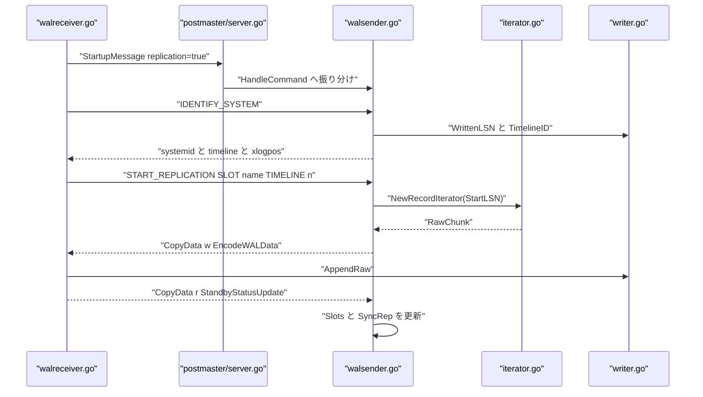

# レプリケーションとバックアップ

<details>
<summary>関連ソースファイル</summary>

- [`internal/backup/basebackup.go`](https://github.com/ryogrid/goopg/blob/19856410e8d497d59787e1ab35a2febb3f5953d6/internal/backup/basebackup.go)
- [`internal/replication/applylauncher.go`](https://github.com/ryogrid/goopg/blob/19856410e8d497d59787e1ab35a2febb3f5953d6/internal/replication/applylauncher.go)
- [`internal/replication/logicalreceiver.go`](https://github.com/ryogrid/goopg/blob/19856410e8d497d59787e1ab35a2febb3f5953d6/internal/replication/logicalreceiver.go)
- [`internal/replication/logicalwalsender.go`](https://github.com/ryogrid/goopg/blob/19856410e8d497d59787e1ab35a2febb3f5953d6/internal/replication/logicalwalsender.go)
- [`internal/replication/walreceiver.go`](https://github.com/ryogrid/goopg/blob/19856410e8d497d59787e1ab35a2febb3f5953d6/internal/replication/walreceiver.go)
- [`internal/replication/walsender.go`](https://github.com/ryogrid/goopg/blob/19856410e8d497d59787e1ab35a2febb3f5953d6/internal/replication/walsender.go)

</details>

レプリケーションとバックアップは、WAL を「書き込む側」と「読む側」に分け、データディレクトリを丸ごと複製する経路を加えたサブシステムです。中心にあるのは `internal/replication` パッケージで、プライマリ側の `Handler` が `replication=true` の接続で `IDENTIFY_SYSTEM` / `CREATE_REPLICATION_SLOT` / `START_REPLICATION` / `BASE_BACKUP` を処理し、スタンバイ側の `WalReceiver` と `LogicalReceiver` がその反対側を担います。WAL の実体とスロット・同期コミットは `internal/access/transam/xlog` が持ち、`internal/backup` は walsender から渡された `BASE_BACKUP` 要求だけを受けて tar と `pg_control` を返します。

データの入口は 2 つです。物理レプリケーションでは `xlog.Writer.AppendRaw` が出版側の WAL バイト列をそのまま受け取り、論理レプリケーションでは `ApplyWorker` が pgoutput の行イベントをローカルヒープへ適用します。出口も 2 つで、`RecordIterator` が読んだ生 WAL は `EncodeWALData` で `'w'` CopyData になり、`BASE_BACKUP` は tar を `'d'` CopyData としてストリームします。スロットの `ConfirmedFlushLSN` と `SyncRep` は、この受信側の ack を出版側の保持・コミット待機へ戻す制御経路です。

## コンポーネント

- **物理ストリーミング** — `Handler.replyStartReplication` がスロットを活性化し、`RecordIterator.NextRaw` の `RawChunk` を `'w'` フレームで送る。スタンバイは `WalReceiver.Run` で受信し `AppendRaw` する。詳細は [11.1 物理ストリーミングレプリケーション](11-Replication/11.1-Physical-Streaming.md)。
- **スタンバイと昇格** — `standby.signal` / `recovery.signal` を起点に受信と継続再生を起動し、`Promote` でタイムラインを進める。詳細は [11.2 スタンバイと昇格](11-Replication/11.2-Standby-and-Promotion.md)。
- **論理レプリケーション** — `runLogicalWalsender` が `SlotDecoder` + `PgOutput` を回し、`LogicalReceiver` が pgoutput を `DecodeMessage` して適用する。詳細は [11.3 論理レプリケーション](11-Replication/11.3-Logical-Replication.md)。
- **テーブル同期と適用ワーカー** — `ApplyLauncher` が購読ごとにワーカーを起動し、`RunTableSync` / `CopyFromExecutor` が初期 COPY を行う。詳細は [11.4 テーブル同期と適用ワーカー](11-Replication/11.4-Table-Sync.md)。
- **ベースバックアップ** — `backup.Handler.ReplyBaseBackup` が強制チェックポイント後に tar・WAL・manifest を CopyOut で返す。詳細は [11.5 ベースバックアップ](11-Replication/11.5-Base-Backup.md)。
- **WAL サマリ** — 変更ブロックを `pg_wal/summaries` に書き出す独立した WAL 消費者。詳細は [11.6 WAL サマリ](11-Replication/11.6-WAL-Summary.md)。

## サブシステム図



`postmaster` は接続の入口を 1 つだけ持ち、物理と論理の違いを `replication` パッケージの内側に閉じ込めています。`backup` は `replication` から呼ばれる葉パッケージで、逆向きの import を持ちません。

## データフロー

物理レプリケーションの要求/応答です。



主要な経路を順に示します。

1. **接続の振り分け** — `postmaster` は StartupMessage の `replication` を解釈し、`runPostStartupLoop` で `Handler.HandleCommand` に `MsgQuery` を渡す。未知の verb は通常の SQL 経路へフォールバックする（`internal/replication/walsender.go:HandleCommand`）。
2. **スロットと開始位置** — `CREATE_REPLICATION_SLOT` は `Slots.Create` に `WrittenLSN()+1` を渡し、`START_REPLICATION` は `Slots.SetActive` の後に `NewRecordIterator` を開く（`walsender.go:replyCreateReplicationSlot`、`replyStartReplication`）。
3. **物理ストリーム** — `RecordIterator.NextRaw` の `RawChunk` を `EncodeWALData` で `'w'` にし、10 秒ごとの `'k'` keepalive を挟む。受信側は `WalReceiver.handleCopyData` が `AppendRaw` し、`sendStatus` が `'r'` を返す（`internal/replication/walreceiver.go`）。
4. **ack の反映** — `handleStandbyCopyData` が `Slots.AdvanceConfirmedFlushLSN` と `SyncRep.UpdateStandbyProgress` を呼び、保持位置と同期コミット待機者を進める（`walsender.go:handleStandbyCopyData`、`internal/access/transam/xlog/syncrep.go`）。
5. **論理ストリーム** — `runLogicalWalsender` がスナップショット・出版物フィルタ・`PgOutput` を組み、`SlotDecoder.Run` がコミット境界でスロットを進める。受信側は `LogicalReceiver.handleCopyData` → `DecodeMessage` → `ApplyMessage`（`internal/replication/logicalwalsender.go`、`logicalreceiver.go`）。
6. **購読ワーカー** — `ApplyLauncher.reconcile` が有効な購読ごとに `DefaultLaunchApplyWorker` を起動し、`LogicalReceiver.Run` の再接続ループへ入る（`internal/replication/applylauncher.go`）。
7. **ベースバックアップ** — `ReplyBaseBackup` が `CheckpointNow` → `BackupControlImage` → tar → WAL → manifest → 停止 recptr の順に CopyOut で返す（`internal/backup/basebackup.go:ReplyBaseBackup`）。

## 共有データ型

サブシステムの境界を跨ぐのは、`postmaster` が組み立てて各コンポーネントへ渡す「狭い設定」です。いずれも構築後に不変で、nil は「その機能を無効にする」方向にだけ働きます。

```go
type Config struct {
	// Logger receives walsender lifecycle events. nil means slog.Default().
	Logger *slog.Logger
	// Catalog and PubSub scope the logical walsender's relation lookups and
	// publication membership. nil PubSub disables logical replication.
	Catalog catalog.Catalog
	PubSub  *catalog.PubSub
	// Slots is the replication-slot registry backing
	// CREATE/DROP/READ_REPLICATION_SLOT and slot-scoped retention.
	Slots *xlog.Slots
	// SyncRep resolves standby acknowledgements into synchronous-commit
	// releases; WalSenders tracks the live senders pg_stat_replication
	// reports.
	SyncRep    *xlog.SyncRep
	WalSenders *xlog.Senders
	// WAL supplies the LSNs IDENTIFY_SYSTEM reports and the segment stream
	// START_REPLICATION ships. WALDirPath / WALSegmentSize locate and size
	// those segments; Timeline and SystemID are the cluster identity.
	WAL            *xlog.Writer
	WALDirPath     string
	WALSegmentSize int64
	SystemID       string
	Timeline       uint32
}
```

`internal/replication/walsender.go:Config`（53 行目）

`WAL` は `IDENTIFY_SYSTEM` の `xlogpos` と `START_REPLICATION` の供給元です。`WALDirPath` が空なら物理ストリームは `feature_not_supported`、`Slots` が nil ならスロット系 verb が `feature_not_supported` になります。`SyncRep` が nil なら同期コミットは常に非同期で、`WalSenders` が nil なら `pg_stat_replication` 用の登録が no-op です。`Timeline` は起動時のスナップショットですが、実際の TLI は `Handler.currentTimeline` が `WAL.TimelineID()` を優先します。

```go
type Config struct {
	// DataDir is the cluster directory that gets tarred up. Empty means
	// BASE_BACKUP is unavailable (in-process protocol-only tests).
	DataDir string
	// WAL supplies the start/stop LSNs stamped into backup_label and the
	// two recptr result sets. nil leaves them zero.
	WAL *xlog.Writer
	// WALSegmentSize sizes the pg_wal segment names when INCLUDE_WAL is on.
	WALSegmentSize int64
	// Checkpointer forces the pre-backup checkpoint and supplies the REDO
	// location patched into the shipped pg_control. nil skips the
	// checkpoint, matching the v0 in-process default.
	Checkpointer executor.Checkpointer
}
```

`internal/backup/basebackup.go:Config`（89 行目）

`DataDir` が空なら BASE_BACKUP 自体が使えません。`Checkpointer` が nil なら強制チェックポイントを飛ばし、`WAL` が nil なら開始・停止 LSN が 0 になります。`BackupControlImage` はこの `DataDir` からライブの `pg_control` を読み、書き換えずにコピーを作ります。

```go
type ApplyLauncherConfig struct {
	PubSub  *catalog.PubSub
	Catalog catalog.Catalog
	Pool    *storage.Pool
	TxnMgr  *transam.Manager
	Slots   *xlog.Slots
	Logger  *slog.Logger

	// PollInterval is how often the launcher rescans the catalog when
	// no Wake arrives. Zero falls back to defaultLauncherPoll.
	PollInterval time.Duration

	// LaunchFn is invoked in a freshly-spawned goroutine for every
	// enabled subscription that doesn't currently have a worker.
	// It runs until the per-worker ctx is cancelled or the receiver
	// loop returns. Tests inject a fake; production uses
	// DefaultLaunchApplyWorker.
	LaunchFn LaunchApplyWorkerFunc

	// User overrides the role used when the launcher dials the
	// publisher. Empty falls back to "postgres" so the loopback /
	// trust auth path matches existing replication setups.
	User string
}
```

`internal/replication/applylauncher.go:ApplyLauncherConfig`（29 行目）

`PollInterval` の既定は 10 秒、`LaunchFn` の既定は `DefaultLaunchApplyWorker`、`User` の既定は `postgres` です。`Slots` は購読側のスロットレジストリで、存在すれば適用ワーカーの開始 LSN の初期値に使われます。受信側の詳細設定は `WalReceiverConfig`（`internal/replication/walreceiver.go:50`）と `LogicalReceiverConfig`（`internal/replication/logicalreceiver.go:55`）が持ち、接続先・スロット名・出版物・適用ワーカーを運びます。

## 主要な設計判断

- **依存方向は `postmaster → replication → backup`**。`backup` は `replication` を import せず、`replication` も `postmaster` を import しません。エラーライターや LSN 表記は各パッケージに複製されています。
- **物理はバイト列、論理はイベント**。物理ストリームは `RawChunk` の生 WAL をそのまま運び、スタンバイは `AppendRaw` で逐語的に保存します。論理は pgoutput メッセージを運び、`ApplyWorker` が行として適用します。両者は同じ `'w'` CopyData を使いますが、ペイロードの意味が異なります。
- **walsender は物理と論理で同じ Handler**。`START_REPLICATION ... LOGICAL` だけが `runLogicalWalsender` に分岐し、コマンド解析・スロット活性化・エラー処理は共通です。
- **スロットの前進境界は排他的**。論理の `ConfirmedFlushLSN` はコミットレコードの `EndLSN+1` を保存し、再開時にそのバイトから読み直します。物理はスタンバイの `FlushLSN` をそのまま前進に使います。
- **同期コミットは独立プリミティブ**。`SyncRep` は `executor` にも `postmaster` にも依存せず、`WaitForLSN` と `UpdateStandbyProgress` だけで COMMIT 側と walsender 側を結びます。
- **バックアップはライブの `pg_control` を書き換えない**。tar に同梱するイメージだけを `BackupControlImage` で作り、`minRecoveryPoint` と `backupEndPoint` をバックアップ用に調整します。
- **増分バックアップと WAL サマリは分離**。WAL サマリは `pg_wal/summaries` に独立して書かれ、BASE_BACKUP の tar には含まれません。`INCREMENTAL` は受理されますが無視されます。

## 関連ページ

- [11.1 物理ストリーミングレプリケーション](11-Replication/11.1-Physical-Streaming.md)
- [11.2 スタンバイと昇格](11-Replication/11.2-Standby-and-Promotion.md)
- [11.3 論理レプリケーション](11-Replication/11.3-Logical-Replication.md)
- [11.4 テーブル同期と適用ワーカー](11-Replication/11.4-Table-Sync.md)
- [11.5 ベースバックアップ](11-Replication/11.5-Base-Backup.md)
- [11.6 WAL サマリ](11-Replication/11.6-WAL-Summary.md)
- [10 WAL と耐久性](10-WAL.md)
- [2 システムアーキテクチャ](2-Architecture.md)

Sources:
- `internal/backup/basebackup.go`
- `internal/replication/applylauncher.go`
- `internal/replication/logicalreceiver.go`
- `internal/replication/logicalwalsender.go`
- `internal/replication/walreceiver.go`
- `internal/replication/walsender.go`

<sub>Generated by deepwiki-4myself from `goopg` @ `19856410e`</sub>
