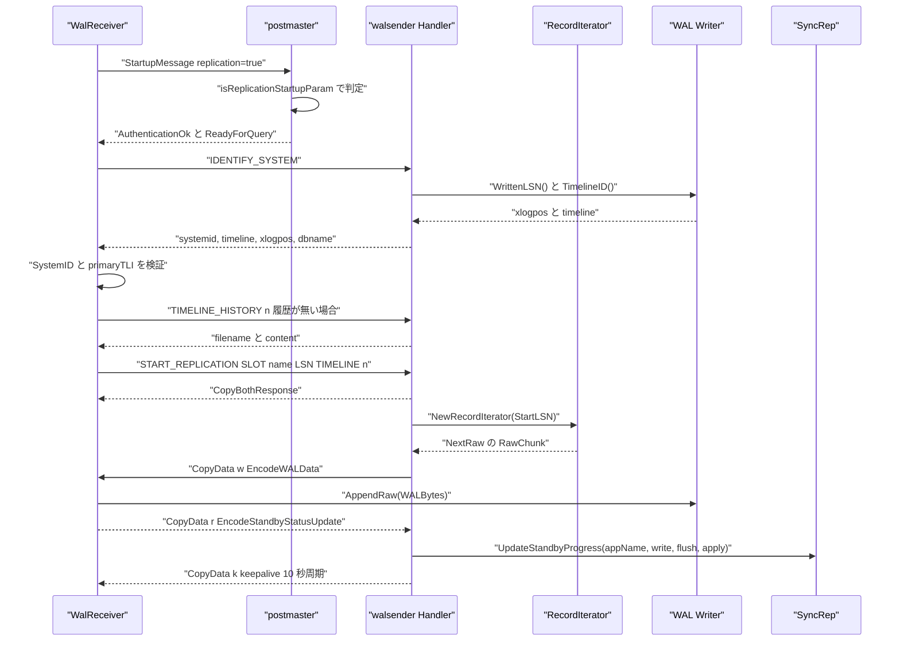
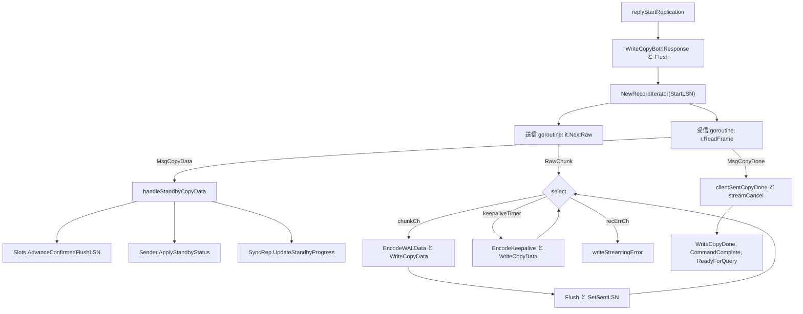

# 物理ストリーミングレプリケーション

<details>
<summary>関連ソースファイル</summary>

- [`internal/access/transam/xlog/iterator.go`](https://github.com/ryogrid/goopg/blob/19856410e8d497d59787e1ab35a2febb3f5953d6/internal/access/transam/xlog/iterator.go)
- [`internal/access/transam/xlog/reader.go`](https://github.com/ryogrid/goopg/blob/19856410e8d497d59787e1ab35a2febb3f5953d6/internal/access/transam/xlog/reader.go)
- [`internal/access/transam/xlog/syncrep.go`](https://github.com/ryogrid/goopg/blob/19856410e8d497d59787e1ab35a2febb3f5953d6/internal/access/transam/xlog/syncrep.go)
- [`internal/access/transam/xlog/writer.go`](https://github.com/ryogrid/goopg/blob/19856410e8d497d59787e1ab35a2febb3f5953d6/internal/access/transam/xlog/writer.go)
- [`internal/access/transam/xlog/xlog_page.go`](https://github.com/ryogrid/goopg/blob/19856410e8d497d59787e1ab35a2febb3f5953d6/internal/access/transam/xlog/xlog_page.go)
- [`internal/libpq/messages.go`](https://github.com/ryogrid/goopg/blob/19856410e8d497d59787e1ab35a2febb3f5953d6/internal/libpq/messages.go)
- [`internal/libpq/replication.go`](https://github.com/ryogrid/goopg/blob/19856410e8d497d59787e1ab35a2febb3f5953d6/internal/libpq/replication.go)
- [`internal/postmaster/server.go`](https://github.com/ryogrid/goopg/blob/19856410e8d497d59787e1ab35a2febb3f5953d6/internal/postmaster/server.go)
- [`internal/replication/replication_util.go`](https://github.com/ryogrid/goopg/blob/19856410e8d497d59787e1ab35a2febb3f5953d6/internal/replication/replication_util.go)
- [`internal/replication/walreceiver.go`](https://github.com/ryogrid/goopg/blob/19856410e8d497d59787e1ab35a2febb3f5953d6/internal/replication/walreceiver.go)
- [`internal/replication/walsender.go`](https://github.com/ryogrid/goopg/blob/19856410e8d497d59787e1ab35a2febb3f5953d6/internal/replication/walsender.go)

</details>

物理ストリーミングレプリケーションは、プライマリの WAL バイト列をそのままスタンバイへ転送し、スタンバイが受信したバイト列をローカル WAL に逐語的に追記する仕組みです。プライマリ側では `postmaster` が `replication=true` の StartupMessage を検出すると `replication.Handler` に `MsgQuery` を振り分け、`START_REPLICATION` を受けた `Handler.replyStartReplication` が `xlog.RecordIterator` から取り出した `RawChunk` を `libpq.EncodeWALData` で `CopyData` に包んで送ります。スタンバイ側では `WalReceiver` が同じ v3 プロトコルで接続し、受信した WAL を `xlog.Writer.AppendRaw` で保存したうえで、`StandbyStatusUpdate` を返してプライマリのスロット `ConfirmedFlushLSN` と `xlog.SyncRep` の待機者を進めます。WAL の記録形式そのものは [10.1 WAL フォーマット](../10-WAL/10.1-WAL-Format.md)、スロット永続化と同期コミットの詳細は [10.5 レプリケーションスロットと同期コミット](../10-WAL/10.5-Replication-Slots.md) を参照してください。

## 責務

- `replication=true` の接続を通常の SQL ディスパッチャから分離し、レプリケーションコマンドだけを `HandleCommand` で処理する。認識しないコマンドは `(false, nil)` を返して通常の SQL 経路へフォールバックさせる（`internal/replication/walsender.go:HandleCommand`、`internal/postmaster/server.go:runPostStartupLoop`）。
- `IDENTIFY_SYSTEM` に対して systemid・timeline・現在の書き込み LSN・データベース名の 4 列を返す（`internal/replication/walsender.go:replyIdentifySystem`）。
- `CREATE_REPLICATION_SLOT` / `DROP_REPLICATION_SLOT` / `READ_REPLICATION_SLOT` を `xlog.Slots` に接続し、PHYSICAL と LOGICAL(pgoutput) の文法を解析する（`replyCreateReplicationSlot`、`replyDropReplicationSlot`、`replyReadReplicationSlot`）。
- `START_REPLICATION` を `CopyBothResponse` へ遷移させ、`RecordIterator.NextRaw` が返す生の WAL バイト列を `'w'` CopyData として送信し続ける（`internal/replication/walsender.go:replyStartReplication`）。
- スタンバイからの `'r'` Standby Status Update を復号し、スロットの `ConfirmedFlushLSN` 前進・`pg_stat_replication` 用の送信状態更新・`SyncRep` の待機者解放に反映する（`handleStandbyCopyData`）。
- アイドル時もスタンバイの進捗報告を促すため、10 秒周期の `'k'` keepalive を送る（`replyStartReplication` 内の `keepaliveInterval`）。
- `TIMELINE_HISTORY <tli>` で `<tli>.history` の生バイトを返し、過去タイムラインの `START_REPLICATION` では分岐点まで送って `next_tli` / `next_tli_startpos` を返す（`replyTimelineHistory`、`historicTimeline`、`finishHistoricCopy`、`endHistoricStreaming`）。
- スタンバイ側で `replication=true` のハンドシェイク、`IDENTIFY_SYSTEM` の検証、履歴ファイルの取得、`START_REPLICATION` の発行を行う（`internal/replication/walreceiver.go:DialWalReceiver`）。
- 受信した WAL を `AppendRaw` でローカル WAL に追記し、`application_name` 付きの Standby Status Update を定期送信する（`WalReceiver.Run`、`handleCopyData`、`sendStatus`）。
- `primary_conninfo` を解析して再接続ループを回し、タイムライン終端では `OnEndOfTimeline` を呼んでから `wal_retrieve_retry_interval` 待つ（`StartWalReceiver`、`followEndOfTimeline`）。
- 同期コミットの待機と解放を、`application_name` をキーにした `SyncRep` で調停する（`internal/access/transam/xlog/syncrep.go:SyncRep.WaitForLSN`、`UpdateStandbyProgress`）。

## 処理フロー

スタンバイの接続から WAL 転送、ack の反映までの実経路です。`replication.DialWalReceiver` は `IDENTIFY_SYSTEM` と履歴取得を済ませてから `START_REPLICATION` を送り、`replyStartReplication` は `CopyBothResponse` を返したうえで送受信の 2 本の goroutine を起動します。



`IDENTIFY_SYSTEM` の応答は `systemid`(text)、`timeline`(int4)、`xlogpos`(text)、`dbname`(text) の 1 行で、物理レプリケーションでは `dbname` が NULL、`replication=database` のデータベース束縛 walsender でのみ接続先 DB 名が入ります（`replyIdentifySystem`）。スタンバイは 1 行・3 列以上を要求し、`SystemID` が非ゼロなら一致を、`primaryTLI` が `StartTLI` 以上であることを検証します（`walreceiver.go:identifySystem`）。

## 主要ファイル

| ファイル | 役割 |
| --- | --- |
| `internal/replication/walsender.go` | プライマリ側のコマンドディスパッチャと物理ストリーミングループ。`HandleCommand`、`replyStartReplication`、`handleStandbyCopyData`、`parseStartReplicationArgs` |
| `internal/replication/walreceiver.go` | スタンバイ側のクライアントと再接続ランチャー。`DialWalReceiver`、`WalReceiver.Run`、`handleCopyData`、`StartWalReceiver`、`streamingStartLSN` |
| `internal/replication/replication_util.go` | 両側で共有する LSN 表記変換とエラー要約。`parseLSN`、`formatLSN`、`summariseErrorResponse` |
| `internal/libpq/replication.go` | walprotocol の内側フレームのエンコード/デコード。`EncodeWALData`、`EncodeKeepalive`、`EncodeStandbyStatusUpdate`、`DecodeReplicationMessage`、`WriteCopyBothResponse` |
| `internal/libpq/messages.go` | v3 フレームの書き出しプリミティブ。`WriteStartupMessage`、`WriteQuery`、`WriteCopyData`、`WriteCopyDone`、`WriteRowDescription`、`WriteDataRow`、`WriteCommandComplete` |
| `internal/postmaster/server.go` | `replication` スタートアップパラメータの解釈と振り分け。`isReplicationStartupParam`、`parseStartupBool`、`runPostStartupLoop`、`New` での `replication.NewHandler` 構築 |
| `internal/access/transam/xlog/iterator.go` | ストリーミング用の WAL バイト供給。`NewRecordIterator`、`RecordIterator.NextRaw`、`RawChunk`、`parkUntilWake` |
| `internal/access/transam/xlog/writer.go` | LSN の公開と受信バイトの永続化。`Writer.WrittenLSN`、`FlushedLSN`、`DrainedLSN`、`AppendRaw`、`Subscribe` |
| `internal/access/transam/xlog/xlog_page.go` | PostgreSQL 互換ページヘッダの型と定数。`XLogPageHeader`、`XLogLongPageHeader`、`XLOGPageMagic`、`XLOGBlockSize` |
| `internal/access/transam/xlog/reader.go` | ページヘッダを跨いでレコードを走査する一括リーダー。`readAllUncached`、`readAllPageAware`、`readStreamFrom` |
| `internal/access/transam/xlog/syncrep.go` | 同期コミットの待機プリミティブ。`SyncRep.WaitForLSN`、`SyncRep.UpdateStandbyProgress`、`syncRepRule.satisfied` |

## 公開 API / エントリポイント

プライマリ側:

```go
func NewHandler(cfg Config, werr WriteQueryErrorFunc, bb *backup.Handler) *Handler
func (s *Handler) HandleCommand(ctx context.Context, r *libpq.FrameReader, w *libpq.FrameWriter, payload []byte, appName, dbName string, dbBound bool) (bool, error)
```

`HandleCommand` の戻り値 `(handled, err)` は、`handled=true` ならレプリケーション verb として処理済み、`(false, nil)` なら通常の SQL 経路に任せる、という契約です。コマンド失敗時は `ErrorResponse` と `ReadyForQuery` を書いたうえで、`postmaster` の `writeQueryError` が返す「報告済み」sentinel（`errQueryErrorSent`）が `err` に入ります。ディスパッチループは `errors.Is` でこれを見分け、重複した `ReadyForQuery` を送らずに接続を維持します。`err` がそれ以外なら実際のワイヤ書き込み失敗で、接続は終了します（`internal/replication/walsender.go:HandleCommand`、`internal/postmaster/server.go:runPostStartupLoop`）。

スタンバイ側:

```go
func DialWalReceiver(ctx context.Context, cfg WalReceiverConfig) (*WalReceiver, error)
func (r *WalReceiver) Run(ctx context.Context) error
func (r *WalReceiver) ApplyLSN() uint64
func (r *WalReceiver) Close() error
func StartWalReceiver(ctx context.Context, done chan struct{}, cfg WalReceiverLauncherConfig)
```

`DialWalReceiver` は TCP 接続・スタートアップ・`IDENTIFY_SYSTEM`・履歴取得・`START_REPLICATION` までを完了してから戻り、`Run` が受信ループに入ります。`StartWalReceiver` は `primary_conninfo` を読み、`done` を閉じる再接続 goroutine を起動するだけですぐ戻ります（`internal/replication/walreceiver.go`）。

WAL 供給と同期コミット:

```go
func NewRecordIterator(w *Writer, walDir string, segSize int64, startLSN uint64) (*RecordIterator, error)
func (it *RecordIterator) NextRaw(ctx context.Context, maxBytes int) (RawChunk, error)
func (it *RecordIterator) Next(ctx context.Context) (Record, error)
func (it *RecordIterator) Close() error

func NewSyncRep() *SyncRep
func (s *SyncRep) SetStandbyNames(value string) error
func (s *SyncRep) NeedsWait() bool
func (s *SyncRep) WaitForLSN(ctx context.Context, lsn uint64, mode SyncRepMode) error
func (s *SyncRep) UpdateStandbyProgress(appName string, write, flush, apply uint64)
func (s *SyncRep) ForgetStandby(appName string)

func (w *Writer) AppendRaw(stream []byte) (uint64, uint64, error)
```

ワイヤ表現:

```go
func EncodeWALData(startLSN, endLSN uint64, sendTime time.Time, walBytes []byte) []byte
func EncodeKeepalive(walEnd uint64, sendTime time.Time, replyRequested bool) []byte
func EncodeStandbyStatusUpdate(writeLSN, flushLSN, applyLSN uint64, sendTime time.Time, replyRequested bool) []byte
func DecodeReplicationMessage(payload []byte) (any, byte, error)
func (fw *FrameWriter) WriteCopyBothResponse(overallFormat byte, columnFormats []uint16) error
```

## 主要データ構造

### walsender の `Config` と `Handler`

`Config` は `postmaster.Config` のうちレプリケーションコマンドが必要とする項目だけを切り出した不変の設定です。`postmaster.New` が 1 プロセスに 1 つ構築します（`internal/postmaster/server.go`）。

```go
type Config struct {
	// Logger receives walsender lifecycle events. nil means slog.Default().
	Logger *slog.Logger
	// Catalog and PubSub scope the logical walsender's relation lookups and
	// publication membership. nil PubSub disables logical replication.
	Catalog catalog.Catalog
	PubSub  *catalog.PubSub
	// Slots is the replication-slot registry backing
	// CREATE/DROP/READ_REPLICATION_SLOT and slot-scoped retention.
	Slots *xlog.Slots
	// SyncRep resolves standby acknowledgements into synchronous-commit
	// releases; WalSenders tracks the live senders pg_stat_replication
	// reports.
	SyncRep    *xlog.SyncRep
	WalSenders *xlog.Senders
	// WAL supplies the LSNs IDENTIFY_SYSTEM reports and the segment stream
	// START_REPLICATION ships. WALDirPath / WALSegmentSize locate and size
	// those segments; Timeline and SystemID are the cluster identity.
	WAL            *xlog.Writer
	WALDirPath     string
	WALSegmentSize int64
	SystemID       string
	Timeline       uint32
}
```

`internal/replication/walsender.go:Config`（53 行目）

- `WAL` は `IDENTIFY_SYSTEM` の `xlogpos` と、送信ループの `walEnd`・keepalive の位置を供給します。nil のとき `START_REPLICATION` は `feature_not_supported` を返します。
- `WALDirPath` は `RecordIterator` がセグメントを開く場所です。空文字だと物理モードの `START_REPLICATION` と `TIMELINE_HISTORY` は `feature_not_supported` になります。
- `WALSegmentSize` が 0 以下なら `xlog.DefaultSegmentSize`（16 MiB）にフォールバックします（`replyStartReplication`）。
- `Slots` が nil ならスロット系 3 verb はすべて `feature_not_supported` になります。ただし `START_REPLICATION` 自体はスロットなしでも動きます（保持は効きません）。
- `SyncRep` が nil なら ack は記録されず、同期コミットは常に非同期扱いです。`WalSenders` が nil なら `pg_stat_replication` 用の登録は no-op です。
- `Timeline` は起動時のスナップショットにすぎません。実際のタイムラインは `Handler.currentTimeline` が `WAL.TimelineID()` を優先して読むため、プロセス内昇格後も新しい TLI を報告できます。

```go
type Handler struct {
	cfg  Config
	werr WriteQueryErrorFunc
	// bb serves the BASE_BACKUP verb. nil makes that one command report
	// feature_not_supported while every other verb keeps working.
	bb *backup.Handler
}
```

`internal/replication/walsender.go:Handler`（93 行目）

`werr` は `postmaster` の `(*Server).writeQueryError` をコールバックとして受け取ります。nil のまま呼ばれると `writeQueryError` は必ず非 nil のエラーを返します。これはディスパッチループが `nil` を「正常に処理済み」と解釈し、クライアントが応答を待ち続けるのを防ぐためです（`Handler.writeQueryError`）。`cfg` は構築後に変更されない前提で、`Handler` は接続ごとではなくプロセスごとに 1 つ作られます。

### スタンバイの `WalReceiverConfig` と `WalReceiver`

```go
type WalReceiverConfig struct {
	// PrimaryAddr is `host:port` of the upstream primary's listener.
	PrimaryAddr string

	// User identifies the role on the primary. Replication
	// connections still authenticate; v0 ships trust by default
	// so any non-empty user works.
	User string

	// SlotName, when non-empty, names the physical replication
	// slot to acquire on the primary. The slot must already
	// exist (a future loop adds CREATE_REPLICATION_SLOT-on-startup
	// for the convenience case).
	SlotName string

	// StartLSN is the starting position for the stream. 0 means
	// "from the beginning" (matches upstream's `0/0` shorthand).
	StartLSN uint64

	// WAL is the local WAL writer where received records land.
	WAL *xlog.Writer

	// StatusInterval throttles standby-status updates. Zero falls
	// back to 10s, matching upstream's default
	// `wal_receiver_status_interval`.
	StatusInterval time.Duration

	// DialTimeout caps how long Connect blocks on the TCP dial +
	// startup handshake. Zero falls back to 10s.
	DialTimeout time.Duration

	// Receivers, when set, is the process-wide observability
	// registry the receiver registers itself into so
	// pg_stat_wal_receiver renders a row. nil makes registration a
	// no-op (suitable for unit tests that don't care about
	// observability).
	Receivers *xlog.Receivers

	// Conninfo is the original conninfo string the start-up code
	// parsed before constructing PrimaryAddr. Stored verbatim in
	// pg_stat_wal_receiver.conninfo so operators can see what was
	// configured. Empty falls back to PrimaryAddr.
	Conninfo string

	// ApplicationName, when non-empty, is sent as the
	// `application_name` startup parameter so the primary can
	// identify this standby for `synchronous_standby_names`
	// matching (M0102-0005). Empty disables sync-replication
	// participation — the standby still streams, just async.
	ApplicationName string

	// ApplyLSNFunc, when non-nil, is consulted by sendStatus to
	// report the standby's apply LSN. Distinct from the
	// receive/append LSN: apply lags when a replay backlog exists.
	// nil falls back to reporting applyLSN (received-LSN) for all
	// three fields, matching the v0 (sync-replication-disabled)
	// behaviour.
	ApplyLSNFunc func() uint64

	// SSLMode is the libpq sslmode requested in primary_conninfo.
	// Empty is treated as libpq's "prefer" default. goopg has no TLS
	// implementation, so "disable"/"allow"/"prefer" all connect in
	// plaintext (matching what "prefer" would negotiate down to
	// against any server that doesn't speak SSL); "require",
	// "verify-ca", and "verify-full" are rejected by DialWalReceiver
	// instead of silently downgrading to plaintext, since that would
	// defeat the operator's explicit encryption requirement.
	SSLMode string

	// SystemID is the standby's own pg_control system identifier.
	// IDENTIFY_SYSTEM's systemid must equal it, as WalReceiverMain
	// requires ("database system identifier differs between the primary
	// and standby"). Zero skips the comparison, for callers without a
	// pg_control (in-process tests).
	SystemID uint64

	// StartTLI is the timeline streaming starts on — WalReceiverMain's
	// startpointTLI, sent as START_REPLICATION's TIMELINE and checked
	// against the primary's timeline. Zero means the local WAL writer's
	// timeline.
	StartTLI uint32

	// WALDir is the standby's pg_wal, where the history files of the
	// timelines between StartTLI and the primary's are written when
	// missing (WalRcvFetchTimeLineHistoryFiles). Empty skips the fetch.
	WALDir string
}
```

`internal/replication/walreceiver.go:WalReceiverConfig`（50 行目）

- `StartLSN` は `DialWalReceiver` がそのまま `START_REPLICATION` に載せます。ランチャーは `streamingStartLSN(WAL.WrittenLSN(), WAL.SegmentSize())` でセグメント境界に切り下げた値を渡します。
- `StartTLI` が 0 なら `cfg.WAL.TimelineID()` が使われます。`StartTLI` と `StartLSN` は同じタイムライン上の位置でなければなりません。
- `SystemID` が非ゼロのときだけ `IDENTIFY_SYSTEM` の systemid と比較されます。0 は比較スキップで、`pg_control` を持たない呼び出し元向けです。
- `WALDir` が空だと履歴ファイルの取得はスキップされます。空でない場合、`[StartTLI, primaryTLI]` の各タイムラインの履歴を `TIMELINE_HISTORY` で補います。
- `ApplicationName` はプライマリの `synchronous_standby_names` 照合に使われます。空だと `SyncRep` のクォーラムに参加できません。
- `ApplyLSNFunc` は `remote_apply` 用の apply 位置を供給します。nil のときは受信位置を apply として報告します。

```go
type WalReceiver struct {
	cfg    WalReceiverConfig
	conn   net.Conn
	r      *libpq.FrameReader
	w      *libpq.FrameWriter
	mu     sync.Mutex
	closed bool

	// applyLSN tracks the last record successfully Append'd to the
	// local writer. Re-read by the status-update goroutine via the
	// writer's own WrittenLSN(), but we cache for a tiny perf win
	// and to make the test surface predictable.
	applyLSN uint64

	// monHandle is the observability registry handle this receiver
	// publishes progress through. nil when cfg.Receivers was unset
	// (in which case all the SetReceivedLSN / MarkMessageReceived
	// calls become no-ops via the nil-check helpers below).
	monHandle *xlog.Receiver

	// primaryTLI is the primary's timeline IDENTIFY_SYSTEM reported.
	primaryTLI uint32
}
```

`internal/replication/walreceiver.go:WalReceiver`（142 行目）

`applyLSN` は `AppendRaw` が成功した後だけ前進します。`Run` 内の受信 goroutine と `sendStatus` は別 goroutine なので、`mu` が `applyLSN` と `closed` を保護します。`monHandle` が nil のとき `publishProgress` は何もしません。`primaryTLI` は `identifySystem` が `Run` より前に設定するため、受信ループ中は読み取り専用です。

### walprotocol のメッセージ型

```go
type WALDataMessage struct {
	StartLSN uint64
	EndLSN   uint64 // the sender's end of WAL (walEnd), not the data's end: that is StartLSN+len(WALBytes)
	SendTime time.Time
	WALBytes []byte
}
```

`internal/libpq/replication.go:WALDataMessage`（121 行目）

`StartLSN` は `WALBytes` の先頭バイトの LSN で、データの終端は `StartLSN + len(WALBytes)` です。`EndLSN` は送信時点のプライマリの WAL 終端（`XLogSendPhysical` の `SendRqstPtr`）であり、フレームのデータ終端とは一致しないことがあります。`WALBytes` は `DecodeReplicationMessage` に渡したペイロードのスライスを参照するため、次の `FrameReader.ReadFrame` までにコピーする必要があります。`WalReceiver.Run` の受信 goroutine が `payload := make([]byte, len(f.Payload))` でコピーしているのはこのためです。

```go
// StandbyStatusUpdate is the parsed shape of an 'r' (status update)
// payload. The primary uses ApplyLSN / FlushLSN to advance the
// confirmed-flush position on the corresponding replication slot.
type StandbyStatusUpdate struct {
	WriteLSN       uint64
	FlushLSN       uint64
	ApplyLSN       uint64
	SendTime       time.Time
	ReplyRequested bool
}
```

`internal/libpq/replication.go:StandbyStatusUpdate`（138 行目）

プライマリは `FlushLSN` を `Slots.AdvanceConfirmedFlushLSN` に渡し、3 つすべてを `Sender.ApplyStandbyStatus` と `SyncRep.UpdateStandbyProgress` に渡します。ワイヤ上は `'r' | write(8) | flush(8) | apply(8) | sendTime(8) | replyRequested(1)` の 34 バイト固定長で、`decodeStandbyStatus` は長さが 34 でないペイロードをエラーにします。

### コマンド引数の `startReplicationArgs`

```go
type startReplicationArgs struct {
	SlotName string
	StartLSN uint64
	Timeline int
	// Mode is "PHYSICAL" or "LOGICAL". Empty defaults to
	// "PHYSICAL" — older clients omit the keyword and assume
	// physical mode.
	Mode string
	// Options carries the parsed `(key 'value' [, ...])` block
	// after the LSN in LOGICAL mode. Keys are lower-cased.
	// pgoutput consumes `proto_version` and `publication_names`.
	Options map[string]string
}
```

`internal/replication/walsender.go:startReplicationArgs`（958 行目）

`parseStartReplicationArgs` は `START_REPLICATION [SLOT name] PHYSICAL X/X [TIMELINE n]` と `START_REPLICATION SLOT name LOGICAL X/X [(...)]` の両方を受けます。`PHYSICAL` キーワードは省略可能で、最初のトークンが LSN なら物理モードとみなします。`LOGICAL` は `SLOT name` を必須とし、`Options` には `proto_version` や `publication_names` が入ります。`Timeline` が 0 のときは現在のタイムラインを使い、非ゼロで現在より古ければ `historicTimeline` の対象になります。

### 同期コミットの `SyncRep`

```go
// SyncRep is the process-wide primitive that coordinates COMMIT-side waits
// with walsender-side standby acknowledgements. Construct one per server.
type SyncRep struct {
	mu       sync.Mutex
	standbys map[string]standbyProgress
	waiters  []*syncRepWaiter
	rule     syncRepRule
}
```

`internal/access/transam/xlog/syncrep.go:SyncRep`（96 行目）

`standbys` は `application_name` をキーに `standbyProgress{WriteLSN, FlushLSN, ApplyLSN}` を保持します。`waiters` は `WaitForLSN` の待機者で、`releaseCh` が close されると COMMIT が再開します。`rule` は `synchronous_standby_names` を解析した `syncRepRule`（`FIRST n` / `ANY n`）です。不変条件は次のとおりです。

- `rule` が空、または `mode == SyncRepOff` なら `WaitForLSN` は即座に nil を返す。`synchronous_standby_names` を設定していないのに `synchronous_commit=on` でも COMMIT はハングしない。
- `UpdateStandbyProgress` は報告値を前回値でクランプする。順序が入れ替わったフレームが来ても進捗は後退しない。
- `released` フラグと `close(releaseCh)` はロック下で 1 回だけ行われる。待機者が ctx で離脱した後に遅れて解放が来ても二重 close にならない。
- `ForgetStandby` は切断したスタンバイを `standbys` から削除し、その場で待機者を再評価する。walsender の defer から呼ばれる。

### ストリーミング用 `RecordIterator` と `RawChunk`

```go
type RecordIterator struct {
	writer  *Writer
	walDir  string
	segSize int64
	wake    chan struct{}
	pos     int64 // 0-based byte offset corresponding to the LSN cursor
	// closed is an atomic flag so Close (e.g. called by walsender
	// teardown) and Next (running in a separate goroutine) don't race.
	// M0098-0002 exposed this via LockOSThread scheduling change.
	closed atomic.Bool
	// pageHeaders mirrors Writer.PageHeadersEnabled() at iterator
	// construction time. When true, the cursor walks page-header
	// bytes transparently: at every page boundary the iterator
	// skips a 24- or 40-byte XLogPageHeader, and record-byte reads
	// can span page boundaries (the next page's header sits between
	// fragments). See M0014-0001 step 2.
	pageHeaders bool
	// segFile caches the segment file the last read opened, so a scan that
	// walks a segment does not open and close it once per read.
	// review/260831 XL-9: readSegmentSlice opened the file per call, and
	// readOneAt reads twice per record (header, then body), so replaying one
	// segment did two opens per record.
	segFile     *os.File
	segFileNo   uint64
	segFileTLI  uint32
	lastWaitPos int64
	lastWaitEnd uint64
	// parkedAtEnd is set while Next is blocked at the *end of the WAL
	// stream*: the cursor has either reached the tail, or points at a
	// record whose bytes run past WrittenLSN and therefore were never
	// received. It is deliberately NOT set when Next blocks on bytes
	// that exist but are not yet readable (see errWALBytesUndrained),
	// because those will arrive on their own. Read via AtEndOfWAL.
	// Written only by the single goroutine driving Next, read by
	// observers (the promotion drain), hence atomic.
	parkedAtEnd atomic.Bool
	// readLimit, when set, caps how far Next reads: no record ending past
	// readLimit() is returned. The WAL summarizer bounds itself by the
	// flush LSN this way (walsummarizer.c reads up to GetFlushRecPtr), so a
	// summary never covers WAL a crash could still rewrite.
	readLimit func() uint64
}
```

`internal/access/transam/xlog/iterator.go:RecordIterator`（37 行目）

```go
type RawChunk struct {
	StartLSN uint64
	EndLSN   uint64
	Payload  []byte
}
```

`internal/access/transam/xlog/iterator.go:RawChunk`（100 行目）

`pos` は LSN ではなく 0 始まりのバイトオフセットで、`LSN = pos + 1` の関係です。`NewRecordIterator` は `startLSN > 0` なら `pos = startLSN - 1` とし、`startLSN` がセグメントサイズの倍数のときだけ `startLSN++` して `pos` を新しいセグメントの先頭に合わせます（`NewRecordIterator` 内の境界特別扱い）。`wake` は `Writer.Subscribe` で登録され、`Append` のたびに非ブロッキング送信される起床信号です。`Close` は `closed` の CAS で二重解放を防ぎ、`Unsubscribe` とキャッシュ中のセグメントファイル close を行います。`NextRaw` は `maxBytes` を上限に `readBytesAt` で読み、`StartLSN=pos`、`EndLSN=pos+len(buf)` の `RawChunk` を返します。`Next` はレコード単位でページヘッダを読み飛ばし、`readLimit` を超えるレコードは返さず待機します。

### WAL ページヘッダ

```go
type XLogPageHeader struct {
	Magic    uint16 // xlp_magic
	Info     uint16 // xlp_info — flag bits (XLP_*)
	TLI      uint32 // xlp_tli — timeline of the first record on this page
	PageAddr uint64 // xlp_pageaddr — absolute byte LSN of this page
	RemLen   uint32 // xlp_rem_len — bytes left of a continued record (0 if not a contrecord page)
}

// XLogLongPageHeader is the long form: standard header followed by
// sysid/seg_size/xlog_blcksz cross-check. Set on the first page of
// every segment so a single-page-recovery scenario can self-identify.
type XLogLongPageHeader struct {
	Std        XLogPageHeader
	SysID      uint64 // xlp_sysid — matches pg_control's system_identifier
	SegSize    uint32 // xlp_seg_size — cross-check (must equal wal_segment_size)
	XLogBlcksz uint32 // xlp_xlog_blcksz — cross-check (must equal XLOGBlockSize)
}
```

`internal/access/transam/xlog/xlog_page.go:XLogPageHeader`（87 行目）、`XLogLongPageHeader`（98 行目）

ページサイズは `XLOGBlockSize = 8192`、マジックは `XLOGPageMagic = 0xD118` で、いずれもリトルエンディアンで書き込まれます。ショートヘッダは 24 バイト（`SizeOfXLogShortPHD`）、セグメント先頭のロングヘッダは 40 バイト（`SizeOfXLogLongPHD`）です。`DecodeXLogPageHeader` はマジック不一致と未定義の `xlp_info` ビットを `ErrInvalidPageHeader` として拒否します。`XLPFirstIsContRecord` が立つページは前ページから続くレコードの尾部を持つため、リーダーは `maxAlignXLog(RemLen)` バイトを読み飛ばしてから次のレコードを探します（`readAllPageAware`）。

## 内部構造

### LSN の規約と境界の扱い

`xlog.Writer` の LSN は 1 始まりのバイト位置で、0 は「未割り当て」を意味します（`internal/access/transam/xlog/writer.go:Writer` のコメント）。一方 `RecordIterator.pos` は 0 始まりなので、`NewRecordIterator` は `pos = startLSN - 1` で変換します。ここで `startLSN` がセグメント境界（例 `0x1000000`）だと `pos` が前セグメントの最終バイトを指してしまうため、境界に限り `startLSN` を 1 増やして `pos` を新セグメント先頭に合わせます。`pg_basebackup` は開始位置をセグメント境界に切り下げて送るので、この特別扱いが必要です。

スタンバイの `streamingStartLSN` も同じ境界規約に合わせ、`written - written%segSize` を返します。受信側 `handleCopyData` は、プライマリが再送してきた `written` 以前のバイトを `expectedStart - m.StartLSN` バイトだけ切り捨てます。逆に `m.StartLSN > expectedStart` は「生 WAL の隙間」としてエラーにし、暗黙に穴を埋めません。

スロット作成時の `RestartLSN` は `WrittenLSN() + 1` です。これは `RecordIterator` が `pos = startLSN - 1` で初期化するためで、+1 しないと最初の `readOneAt` が前レコードの最終バイトからデコードを始めてしまいます（`replyCreateReplicationSlot` のコメント）。

### 送信ループの並行構造

`replyStartReplication` は `CopyBothResponse` を返した後、受信 goroutine と送信 goroutine を起動し、本体は `select` で合流します。



送信側は `chunkCh`（容量 1）と `recErrCh`（容量 1）で本体と接続します。`walEnd` は `max(chunk.EndLSN, WAL.FlushedLSN())` で、フレームのデータ終端ではなく「このサーバーの WAL 終端」を表します。過去タイムラインを送る場合は `validUpto` で `Payload` を切り詰め、`chunk.EndLSN` を `validUpto` に丸めます。送信のたびに keepalive タイマーをリセットし、WAL が流れている間は keepalive を抑制します。

受信側で `MsgCopyDone` を受けると `clientSentCopyDone = true` にして `streamCancel()` を呼びます。本体は `streamCtx.Done()` または `receiveDone` の close で抜け、クライアントが正常終了した場合だけ `CopyDone` → `CommandComplete("START_STREAMING")` → `ReadyForQuery` を返します。継続ストリーミングのクライアントは CopyDone を送らないため、応答なしで接続が閉じます。

`recErrCh` にエラーが来たときは `<-receiveDone` で待ってはいけません。受信 goroutine は `r.ReadFrame()` のブロッキング読みで止まっており、コンテキストキャンセルでは中断できません。ここで待つと、クライアントはデータや keepalive を待ち、サーバーは select を抜けて送らないというライブロックになります。そのためエラー時は `writeStreamingError` を送って即座に戻り、接続 close による EOF で受信 goroutine を解放します（`replyStartReplication` のコメント）。

### タイムラインの歴史と終端

`START_REPLICATION ... TIMELINE n` で `n` が現在の TLI より小さい場合、`historicTimeline` が `xlog.ReadHistory(cfg.WALDirPath, curTLI)` を読み、要求タイムラインの `SwitchLSN` を `validUpto`、次のエントリの TLI を `nextTLI` として返します。`StartLSN >= validUpto` なら COPY モードに入らず、いきなり `endHistoricStreaming` で `next_tli`（int8）と `next_tli_startpos`（text）の 1 行を返します。`SwitchLSN < startLSN` の要求は `ObjectNotInPrerequisiteState` で拒否されます。

スタンバイ側は `CopyDone` 後の結果セットを `readStreamingResult` で集め、`finishEndOfStreaming` が `next_tli` を読んで `&EndOfTimeline{TLI, NextTLI, StartLSN}` を返します。`next_tli` が 0 なら「サーバーが停止した」とみなして nil を返します。結果セットがある場合は、`fetchTimelineHistoryFiles(StartTLI, nextTLI)` で不足する履歴を補ってから `EndOfTimeline` を返します。ランチャーは `followEndOfTimeline` で `OnEndOfTimeline`（起動プロセスの `rescanLatestTimeLine` 相当）を呼び、WAL ライターの TLI が変わらなければ `walRetrieveRetryInterval = 5 * time.Second` 待って再接続します。

### 再接続とバックオフ

`StartWalReceiver` は `misc.Registry` から `primary_conninfo`、`primary_slot_name`、`wal_receiver_status_interval` を読みます。`primary_conninfo` が空、または `host` を含まない場合は接続を試みずに `done` を閉じて戻ります。接続失敗時は 500 ms から倍々で最大 30 秒までバックオフし、成功すると 500 ms に戻します。`EndOfTimeline` はバックオフではなく `followEndOfTimeline` の経路で扱われます。

`parsePrimaryConninfoFull` は空白区切りの `key=value` を単純に走査し、`host` がなければ空アドレスを返します。`port` の既定は 5432、`application_name`・`user`・`sslmode` はそのまま取り出します。パスワードは解釈しません。TLS 未実装のため `require` / `verify-ca` / `verify-full` は `checkSSLMode` が拒否し、`disable` / `allow` / `prefer`（および未指定）だけが平文接続を許します。

### 一括リーダーとの関係

`RecordIterator` はストリーミング用に 1 レコード（または `NextRaw` なら 1 チャンク）ずつ返しますが、クラッシュ復旧や WAL サマリは `reader.go` の `readAllUncached` → `readAllPageAware` を使います。`readStreamFrom` は `firstSegNo` からセグメントを連結し、欠番または `segSize` 未満の末尾セグメントで止まります。`readAllPageAware` はページ境界で 24/40 バイトのヘッダを検証し、途中で切れたレコードの尾部（`XLPFirstIsContRecord`）を読み飛ばし、全ゼロのページヘッダを事前確保済みテールとして静かに終了します。ストリーミング側と一括リーダーは同じページヘッダ定数を共有しているため、`XLOGPageMagic` やヘッダ長の変更は両方に影響します。

## エッジケースと不変条件

- **エラーライターの nil 禁止**: `Handler.writeQueryError` は `werr == nil` のとき必ず非 nil エラーを返します。nil を返すと `runPostStartupLoop` が「処理済み」と誤認し、クライアントが応答を待ち続けます。
- **`HandleCommand` のフォールバック**: `extractCString` が NUL 終端を見つけられない場合や未知の verb は `(false, nil)` を返します。これにより `SHOW server_version` などの診断クエリがレプリケーション接続でも動きます。
- **タイムラインの上限**: `START_REPLICATION` の `TIMELINE n` が現在の TLI より未来なら `InternalError` で拒否されます（`requested starting point ... is ahead of the current timeline`）。過去の TLI は `ReadHistory` に存在しなければ `InternalError`、分岐点より後の開始要求は `ObjectNotInPrerequisiteState` です。
- **スロットなしストリーミング**: `SLOT` を省略した `START_REPLICATION` は WAL 保持が効きません。テスト用の単発ストリームには使えますが、本番ではスロット必須です（`replyStartReplication` のコメント）。
- **`DROP_REPLICATION_SLOT ... WAIT` の上限**: アクティブなスロットは `ErrSlotInUse` の間 20 ms 間隔で再試行しますが、5 分で打ち切って `ObjectInUse` を返します。クライアントの消滅を検知するコンテキストがないための上限です（`replyDropReplicationSlot`）。
- **`READ_REPLICATION_SLOT` の NULL 規則**: スロットが存在しないか invalidated なら 3 列すべて NULL、論理スロットなら `feature_not_supported`、物理スロットで `RestartLSN != 0` なら `restart_lsn` と現在の TLI を返します（`replyReadReplicationSlot`）。論理スロットの拒否は `RowDescription` を書いた後に行われるため、ワイヤ上は列定義に続いて `ErrorResponse` が流れます。
- **`TIMELINE_HISTORY` の欠損ファイル**: `pg_wal/<tli>.history` が存在しない場合（典型的には TLI=1）はエラーではなく空の `content` を返します（`replyTimelineHistory`）。
- **受信データの隙間と重複**: `m.StartLSN < expectedStart` は重複分を切り捨て、`m.StartLSN > expectedStart` は `walreceiver: raw WAL gap` エラーです。空の `WALBytes` は `applyLSN` の前進だけを行い、`AppendRaw` を呼びません。
- **`WALDataMessage` のバッファ寿命**: `DecodeReplicationMessage` が返す `WALBytes` はフレームリーダーのバッファを参照します。`Run` の受信 goroutine は必ずコピーしてからチャネルに渡します。
- **`RecordIterator` の終了条件**: `parkUntilWake` は `wake`、`ctx.Done()`、`writer.done` の 3 つで目覚めます。`writer.done` は `Writer.Close` で閉じられ、`ErrClosed` が返ります。`Close` 後の `Next` は `io.EOF` です。
- **`readLimit` の意味**: `SetReadLimit` に `Writer.FlushedLSN` を渡すと、フラッシュ済みの範囲だけを読むため、クラッシュで書き換わり得る WAL をサマリに含めません（`RecordIterator.SetReadLimit`）。
- **同期コミットの無効化**: `synchronous_standby_names` の解析に失敗すると `SetStandbyNames` は `syncRepRule{}` にフォールバックし、待機を無効化します。不正な値で COMMIT が詰まることはありません（`SyncRep.SetStandbyNames`）。
- **`application_name` なしのスタンバイ**: `UpdateStandbyProgress("")` は `standbys[""]` を作りますが、ルールの名前一覧に空文字は現れないためクォーラムには数えられません。切断時は `ForgetStandby(appName)` が defer で呼ばれます。
- **接続確立前の検証**: `identifySystem` は 1 行・3 列以上を要求し、systemid 不一致と「プライマリの TLI が `StartTLI` より古い」を拒否します。`startStreaming` は `CopyBothResponse` を受けるまで待ち、`ErrorResponse` はそのままエラーにします。
- **`runPostStartupLoop` のエラー sentinel**: レプリケーション verb の SQLSTATE エラーは `writeQueryError` が `errQueryErrorSent` を返し、ディスパッチループは重複した `ReadyForQuery` を送らずに接続を維持します。書き込みエラーだけが接続終了になります（`internal/postmaster/server.go:runPostStartupLoop`）。

## 関連ページ

- [11.2 スタンバイと昇格](11.2-Standby-and-Promotion.md)
- [11.3 論理レプリケーション](11.3-Logical-Replication.md)
- [11.4 テーブル同期と適用ワーカー](11.4-Table-Sync.md)
- [11.5 ベースバックアップ](11.5-Base-Backup.md)
- [11.6 WAL サマリ](11.6-WAL-Summary.md)
- [11 レプリケーションとバックアップ](../11-Replication.md)
- [10 WAL と耐久性](../10-WAL.md)

Sources:
- `internal/access/transam/xlog/iterator.go`
- `internal/access/transam/xlog/reader.go`
- `internal/access/transam/xlog/syncrep.go`
- `internal/access/transam/xlog/writer.go`
- `internal/access/transam/xlog/xlog_page.go`
- `internal/libpq/messages.go`
- `internal/libpq/replication.go`
- `internal/postmaster/server.go`
- `internal/replication/replication_util.go`
- `internal/replication/walreceiver.go`
- `internal/replication/walsender.go`

<sub>Generated by deepwiki-4myself from `goopg` @ `19856410e`</sub>
