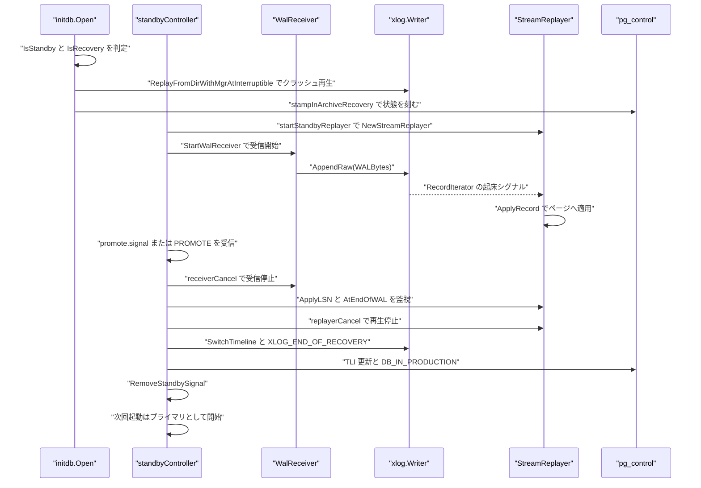
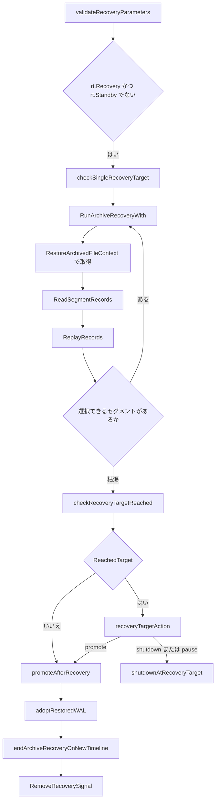

# スタンバイと昇格

<details>
<summary>関連ソースファイル</summary>

- [`cmd/goopg/standby.go`](https://github.com/ryogrid/goopg/blob/19856410e8d497d59787e1ab35a2febb3f5953d6/cmd/goopg/standby.go)
- [`internal/access/transam/control/pgcontrol.go`](https://github.com/ryogrid/goopg/blob/19856410e8d497d59787e1ab35a2febb3f5953d6/internal/access/transam/control/pgcontrol.go)
- [`internal/access/transam/xlog/archive_recovery.go`](https://github.com/ryogrid/goopg/blob/19856410e8d497d59787e1ab35a2febb3f5953d6/internal/access/transam/xlog/archive_recovery.go)
- [`internal/access/transam/xlog/archive_restore.go`](https://github.com/ryogrid/goopg/blob/19856410e8d497d59787e1ab35a2febb3f5953d6/internal/access/transam/xlog/archive_restore.go)
- [`internal/access/transam/xlog/recovery.go`](https://github.com/ryogrid/goopg/blob/19856410e8d497d59787e1ab35a2febb3f5953d6/internal/access/transam/xlog/recovery.go)
- [`internal/access/transam/xlog/stream_replayer.go`](https://github.com/ryogrid/goopg/blob/19856410e8d497d59787e1ab35a2febb3f5953d6/internal/access/transam/xlog/stream_replayer.go)
- [`internal/access/transam/xlog/timeline_history.go`](https://github.com/ryogrid/goopg/blob/19856410e8d497d59787e1ab35a2febb3f5953d6/internal/access/transam/xlog/timeline_history.go)
- [`internal/initdb/open.go`](https://github.com/ryogrid/goopg/blob/19856410e8d497d59787e1ab35a2febb3f5953d6/internal/initdb/open.go)
- [`internal/initdb/standby.go`](https://github.com/ryogrid/goopg/blob/19856410e8d497d59787e1ab35a2febb3f5953d6/internal/initdb/standby.go)
- [`internal/initdb/timeline.go`](https://github.com/ryogrid/goopg/blob/19856410e8d497d59787e1ab35a2febb3f5953d6/internal/initdb/timeline.go)
- [`internal/replication/walreceiver.go`](https://github.com/ryogrid/goopg/blob/19856410e8d497d59787e1ab35a2febb3f5953d6/internal/replication/walreceiver.go)

</details>

スタンバイと昇格は、データディレクトリ上の 3 つのシグナルファイル（`standby.signal`、`recovery.signal`、`promote.signal`）を起点に、goopg を「受信しながら適用し続ける読み取り専用ノード」から「自前のタイムラインで書き込むプライマリ」へ切り替える仕組みです。`initdb.Open` がシグナルの有無を読み、クラッシュ WAL を `xlog.ReplayFromDirWithMgrAtInterruptible` で適用してから `Runtime.Standby` / `Runtime.Recovery` を立てます。`cmd/goopg` 側では `standbyController` が `WalReceiver` と `StreamReplayer` を同時に走らせ、`Promote` が受信を止めて未適用 WAL を排出し、タイムラインを 1 つ進めて `standby.signal` を削除します。受信そのもののプロトコルは [11.1 物理ストリーミングレプリケーション](11.1-Physical-Streaming.md) を参照してください。

## 責務

- `standby.signal` の有無を `initdb.IsStandby` で判定し、`Runtime.Standby` に反映する（`internal/initdb/open.go:Open`、`internal/initdb/standby.go:IsStandby`）。
- `recovery.signal` の有無を `initdb.IsRecovery` で判定し、受信を伴わない一括アーカイブリカバリの対象にする（`internal/initdb/open.go`、`internal/initdb/standby.go:IsRecovery`）。
- 起動時に `pg_control` の `checkPointCopy.redo` からクラッシュ WAL を再生し、`DB_IN_ARCHIVE_RECOVERY` を刻む（`internal/initdb/open.go:Open`、`beginRecovery`、`stampInArchiveRecovery`）。
- スタンバイでは `startStandby` が `StreamReplayer` と `replication.StartWalReceiver` を起動し、受信 → `AppendRaw` → `RecordIterator` → `ApplyRecord` のパイプラインを作る（`cmd/goopg/standby.go:startStandby`）。
- `standbyController.Promote` で受信を停止し、`WrittenLSN` を目標に再生を排出してから `replayerCancel` する（`cmd/goopg/standby.go:Promote`、`runPromote`）。
- ストリーミングスタンバイの昇格時に新しい TLI を `FindNewestTimeline + 1` で決め、履歴ファイル・`global/timeline_id`・`pg_control` を更新し、WAL ライターを `SwitchTimeline` で切り替える（`cmd/goopg/standby.go:finalizePromotion`、`switchWriterToNewTimeline`）。
- 昇格時に `XLOG_END_OF_RECOVERY` を新タイムライン最初のレコードとして書き、`minRecoveryPoint` をその終端へ進める（`cmd/goopg/standby.go:appendEndOfRecoveryRecord`）。
- `recovery.signal` 経路では `RunArchiveRecoveryWith` が `restore_command` で不足セグメントを取得しながら再生し、枯渇時に `promoteAfterRecovery` で同じ昇格手順を実行する（`internal/access/transam/xlog/archive_recovery.go`、`cmd/goopg/standby.go:promoteAfterRecovery`）。
- 昇格後は `recovery_end_command` を実行し、`pg_control` を `DB_IN_PRODUCTION` にし、`standby.signal` / `recovery.signal` を削除する（`runRecoveryEndCommand`、`finalizePromotion`、`promoteAfterRecovery`）。
- `promote.signal` を 250 ms 周期で監視し、制御ソケットの PROMOTE と同じ `Promote` を起動する（`cmd/goopg/standby.go:promoteSignalWatcher`）。

## 処理フロー

スタンバイ起動、受信・再生、昇格要求の順序です。`startStandby` は先にリプレイヤを起動してから受信側を起動し、昇格は受信停止 → 排出 → リプレイヤ停止 → タイムライン更新の順に進みます。



`initdb.Open` は `standby.signal` / `recovery.signal` を読む前に `beginRecovery` で前回の終了状態を確認し、クリーンでなければ `DB_IN_CRASH_RECOVERY` を刻みます。クラッシュ再生の開始位置は `pg_control` の `checkPointCopy.redo` で、これが 0 のときだけ従来のストリーム走査にフォールバックします（`internal/initdb/open.go:Open`）。スタンバイではこの後の「受信 TLI による自動バンプ」をスキップし、TLI の更新は昇格時の `finalizePromotion` に一本化します。

`recovery.signal` だけがある場合（`standby.signal` なし）は、接続を待たずに起動時アーカイブリカバリを 1 回だけ実行します。



`RunArchiveRecoveryWith` はローカルの最大セグメント番号から始め、`res.Timelines` を新しいタイムライン側から走査して、そのセグメントを持つ最も新しい TLI を選びます。どのタイムラインにも無ければアーカイブ枯渇として正常終了します（`archive_recovery.go` の `chosen == 0` 分岐）。復旧対象が `recovery_target_lsn` / `recovery_target_xid` で指定されていれば、該当レコードの直前または直後で `records` を切り詰め、`ReachedTarget` と `StopPoint` を埋めて戻ります。

## 主要ファイル

| ファイル | 役割 |
| --- | --- |
| `cmd/goopg/standby.go` | スタンバイのライフサイクルと昇格。`standbyController`、`startStandby`、`Promote`、`runPromote`、`finalizePromotion`、`promoteAfterRecovery` |
| `internal/access/transam/control/pgcontrol.go` | `pg_control` の読み書き。`ControlFileData`、`UpdateControlFile`、`ReadControlFile`、`BuildUpdatedControlImage` |
| `internal/access/transam/xlog/archive_recovery.go` | アーカイブリカバリのループと結果。`RunArchiveRecoveryWith`、`ArchiveRecoveryResult`、`ReadSegmentRecords`、`RecoveryStop` |
| `internal/access/transam/xlog/archive_restore.go` | `restore_command` の実行と分類。`RestoreArchivedFileContext`、`RestoreArchivedFileTemp`、`ExecuteRecoveryCommand`、`ReplacePercentPlaceholders` |
| `internal/access/transam/xlog/recovery.go` | レコード単位の適用カーネル。`ApplyRecord`、`ReplayRecords`、`ReplayRecordsFrom`、`ReplayFromDirWithMgrAtInterruptible` |
| `internal/access/transam/xlog/stream_replayer.go` | 受信 WAL の継続再生。`StreamReplayer.Run`、`ApplyLSN`、`LastApplied`、`AtEndOfWAL` |
| `internal/access/transam/xlog/timeline_history.go` | `<TLI>.history` の読み書き。`TimelineHistoryEntry`、`ReadHistory`、`WriteHistory`、`FindNewestTimeline` |
| `internal/initdb/open.go` | 起動時のシグナル判定・クラッシュ再生・`Runtime` 構築。`Open`、`stampInArchiveRecovery`、`stampInProduction` |
| `internal/initdb/standby.go` | シグナルファイルの定数と生成・削除。`StandbySignalFile`、`PromoteSignalFile`、`CreateStandbySignal`、`RemoveStandbySignal` |
| `internal/initdb/timeline.go` | 永続 TLI の解決。`LoadOrCreateTimelineID`、`WriteTimelineID`、`BootstrapTimeLineID` |
| `internal/replication/walreceiver.go` | 受信側の `StartWalReceiver` と `ApplyLSNFunc`。タイムライン終端では `OnEndOfTimeline` を呼ぶ |

## 公開 API / エントリポイント

スタンバイ制御（`cmd/goopg` 内）:

```go
func startStandby(parent context.Context, rt *initdb.Runtime, registry *misc.Registry, logger *slog.Logger) *standbyController
func (sc *standbyController) Promote(ctx context.Context) error
func (sc *standbyController) Consistent() bool
func (sc *standbyController) Close()
```

`Promote` は成功後の再呼び出しでは nil を返し、実行中の並行呼び出しには `promotion already in progress` を返します。失敗時は `promoting` フラグを解放するため、制御ソケットからも `promote.signal` からも再試行できます（`cmd/goopg/standby.go:Promote`）。

シグナルとタイムライン:

```go
func IsStandby(dataDir string) (bool, error)
func IsRecovery(dataDir string) (bool, error)
func CreateStandbySignal(dataDir string) error
func RemoveStandbySignal(dataDir string) error
func RemoveRecoverySignal(dataDir string) error

func LoadOrCreateTimelineID(dataDir string) (uint32, error)
func WriteTimelineID(dataDir string, tli uint32) error
```

アーカイブリカバリと再生:

```go
func RunArchiveRecovery(mgr *storage.Manager, dataDir, restoreCommand string, segmentSize int64) (ArchiveRecoveryResult, error)
func RunArchiveRecoveryWith(ctx context.Context, mgr *storage.Manager, dataDir string, restoreCommand func() string, segmentSize int64, target TargetTimeline, stop RecoveryStop) (ArchiveRecoveryResult, error)
func ReadSegmentRecords(walDir string, segNo uint64, segmentSize int64) ([]Record, error)
func ReplayRecords(mgr *storage.Manager, records []Record) (ReplayStats, error)
func ApplyRecord(mgr *storage.Manager, r Record) (bool, error)

func NewStreamReplayer(mgr *storage.Manager, baselineLSN uint64) *StreamReplayer
func (sr *StreamReplayer) Run(ctx context.Context, iter *RecordIterator) error
func (sr *StreamReplayer) ApplyLSN() uint64
func (sr *StreamReplayer) LastApplied() (start, end uint64, ok bool)
func (sr *StreamReplayer) AtEndOfWAL() bool
```

`RunArchiveRecoveryWith` の `restoreCommand` が関数なのは、`restore_command` が `PGC_SIGHUP` で、取得のたびに最新値を読むためです（`archive_recovery.go` のコメント）。`Run` は `ApplyRecord` が `pd_lsn` で冪等なことを前提に、再起動後も同じ範囲を安全に読み直せます。

`pg_control`:

```go
func ReadControlFile(dataDir string) (*ControlFileData, error)
func UpdateControlFile(dataDir string, fn func(*ControlFileData)) error
func BuildUpdatedControlImage(dataDir string, fn func(*ControlFileData)) ([]byte, error)
```

## 主要データ構造

### スタンバイ制御の `standbyController`

```go
type standbyController struct {
	rt     *initdb.Runtime
	logger *slog.Logger
	// recoveryEndCommand reads recovery_end_command (PGC_SIGHUP) at
	// promotion time; nil reads as empty (M0122-0013).
	recoveryEndCommand func() string

	receiverCancel context.CancelFunc
	receiverDone   chan struct{}
	replayerCancel context.CancelFunc
	replayerDone   chan struct{}
	replayer       *xlog.StreamReplayer

	// consistentAt is the replay position at which recovery becomes
	// consistent (CheckRecoveryConsistency: minRecoveryPoint, raised to the
	// checkpoint's redo as InitWalRecovery does, and backupEndPoint), as a
	// PG position; consistent latches once replay has passed it.
	// neverConsistent is set when pg_control says backupEndRequired — the
	// XLOG_BACKUP_END goopg never emits would be needed first.
	consistentAt    uint64
	neverConsistent bool
	consistent      atomic.Bool

	// signalCancel cancels the promote.signal poller goroutine.
	// Close cancels it explicitly; a successful Promote also
	// returns from the watcher loop on its own.
	signalCancel context.CancelFunc
	signalDone   chan struct{}

	// promoting guards against concurrent or repeated PROMOTE
	// commands. A second invocation after a successful promote is
	// a no-op that returns nil; one already in flight returns an
	// "already promoting" error so the operator notices. A promote
	// that FAILED clears the flag again — promotion is retryable,
	// which is what promoteSignalWatcher's "re-create the file to
	// retry" contract assumes (review/260831-2 CM-1).
	promoting  atomic.Bool
	promoteErr atomic.Pointer[error]
	promoted   atomic.Bool

	// lastReceived is the highest WAL position a walreceiver reported. PG's
	// pg_last_wal_receive_lsn keeps answering WalRcv->flushedUpto after the
	// walreceiver exits (promotion, a reconnect); goopg's receiver registry
	// forgets a stopped receiver, so recoveryLSNs remembers it here.
	lastReceived atomic.Uint64

	// walLevel is the wal_level enum (minimal 0, replica 1, logical 2)
	// XLOG_END_OF_RECOVERY records.
	walLevel int32
}
```

`cmd/goopg/standby.go:standbyController`（60 行目）

- `receiverCancel` / `receiverDone` と `replayerCancel` / `replayerDone` は対で使います。`Promote` は受信側の `Done` が閉じるまで待ってから `WrittenLSN` を読むため、排出目標のスナップショット後に新しいレコードが入る競合がありません。
- `consistentAt` は `max(MinRecoveryPoint, CheckPointCopyRedo, BackupEndPoint)` で、`consistent` はこの位置を再生が越えたときに一度だけ立つラッチです。`neverConsistent` は `BackupEndRequired` が立っている場合に true となり、goopg が発行しない `XLOG_BACKUP_END` を待つ必要があるため、`Consistent` は永久に false を返します（`recoveryConsistencyPoint`、`Consistent`）。
- `promoting` は CAS で 1 つだけ通し、`promoted` は成功の永続フラグです。`promoteErr` は最後の失敗を保持しますが、`promoting` は失敗時に必ず false へ戻します。
- `lastReceived` は受信レジストリが停止後にエントリを消すため、`recoveryLSNs` が CAS ループで単調に持ち上げるローカル記憶です。

### 継続再生の `StreamReplayer`

```go
type StreamReplayer struct {
	mgr *storage.Manager

	// onXactReplay is an optional hook called for every commit/abort
	// record the replayer processes. The first argument is the
	// transaction's XID; the second is true for commit, false for
	// abort. Used by the standby to advance the local MVCC manager's
	// nextXID so replayed tuples become visible to queries.
	onXactReplay func(xid storage.TransactionID, committed bool)

	mu       sync.Mutex
	applyLSN uint64
	// lastStart is the StartLSN of the record that set applyLSN (0 before
	// any): promotion resumes WAL after it with xl_prev naming it.
	lastStart uint64
	records   uint64
	applied   uint64
	// iter is the iterator the current Run call is draining. Held so
	// observers outside the replay goroutine (the promotion drain)
	// can ask whether replay has reached end-of-WAL. nil before the
	// first Run.
	iter *RecordIterator
	// lastCheckpoint is the last checkpoint record replay applied, the
	// restartpoint candidate (see ReplayedCheckpoint); hasCheckpoint is
	// false before the first.
	lastCheckpoint ReplayedCheckpoint
	hasCheckpoint  bool
}
```

`internal/access/transam/xlog/stream_replayer.go:StreamReplayer`（40 行目）

`applyLSN` は最後に適用したレコードの `EndLSN` で、`lastStart` はそのレコードの `StartLSN` です。`LastApplied` は `(lastStart, applyLSN)` を返し、昇格時の `xl_prev` は `lastStart - 1`（0 始まり）になります。`mu` はこれらと `iter` を保護しますが、`onXactReplay` はロック外で呼ばれます。MVCC マネージャのロックと二重取得するとスナップショット取得側とデッドロックし得るためです。`iter` を保持するのは、`AtEndOfWAL` が再生 goroutine の外（昇格の排出待ち）から「もう読む完全なレコードが無い」を判定できるようにするためです。

### 昇格結果の `ArchiveRecoveryResult`

```go
type ArchiveRecoveryResult struct {
	// EndOfLog is the end of the last record replayed — PG's EndOfLog, the
	// timeline switch point the promotion writes into the new timeline's
	// history file (xlog.c StartupXLOG → writeTimeLineHistory) and where the
	// new timeline's WAL begins. LastStart is that record's StartLSN; the
	// first record on the new timeline names LastStart-1 as its xl_prev
	// (0-based), as the streaming promotion does (StreamReplayer.LastApplied).
	// Both are 0 when nothing was replayed.
	EndOfLog, LastStart uint64
	// EndTLI is the timeline of the last segment replayed (PG's
	// EndOfLogTLI); 0 when nothing was replayed.
	EndTLI uint32
	// NewestTLI is the newest timeline whose history file exists locally or
	// in the archive, probing from the target (findNewestTimeLine). The
	// promotion's new timeline is NewestTLI+1, so it cannot collide with one
	// already in the archive.
	NewestTLI uint32
	// TargetTLI is the recovery target timeline (recoveryTargetTLI): the
	// timeline whose history recovery follows.
	TargetTLI uint32
	// ReachedTarget reports that the LSN target stopped recovery at StopLSN
	// (the ReadRecPtr of the record it stopped at), after applying that
	// record when StopAfter (recoveryStopLSN / recoveryStopAfter).
	ReachedTarget bool
	StopKind      StopKind
	StopLSN       uint64
	StopAfter     bool
	// StopXid, StopIsCommit and StopXactTime describe the transaction end
	// record an xid target stopped at (recoveryStopXid, recoveryStopTime:
	// xact_time, microseconds since 2000-01-01).
	StopXid      uint32
	StopIsCommit bool
	StopXactTime int64
	// StopPoint is where the recovered WAL ends at the target, as a PG
	// position: the stop record's start, or its end when StopAfter.
	StopPoint uint64
	// TargetHistory is TargetTLI's history file as read (nil for timeline 1
	// or when it has none). The history file is read through RECOVERYHISTORY
	// and not kept in pg_wal, so the promotion builds the new timeline's
	// history from these entries.
	TargetHistory []TimelineHistoryEntry
	// Timelines is the expected history, oldest first (expectedTLEs).
	Timelines []TimelineSpan
}
```

`internal/access/transam/xlog/archive_recovery.go:ArchiveRecoveryResult`（38 行目）

`EndOfLog` と `LastStart` は「何も再生しなかった場合 0」という契約です。`promoteAfterRecovery` は `EndOfLog` がライターの `WrittenLSN` より大きいときだけ `adoptRestoredWAL` を呼び、`LastStart - 1` を新しいレコードの `xl_prev` にします。`TargetHistory` は `RECOVERYHISTORY` 経由で読んだ履歴をそのまま保持し、`promoteAfterRecovery` が新タイムラインの履歴ファイルを組み立てるときの親エントリになります。`Timelines` は古い順で、`adoptRestoredWAL` がタイムライン切り替えを順に追うのに使います。

```go
// TimelineSpan is one timeline on the expected history of archive recovery:
// its ID and the WAL position it began at (0 for the oldest).
type TimelineSpan struct {
	TLI   uint32
	Begin uint64
}
```

`internal/access/transam/xlog/archive_recovery.go:TimelineSpan`（29 行目）

### タイムライン履歴の `TimelineHistoryEntry`

```go
type TimelineHistoryEntry struct {
	// TLI is the parent timeline this line refers to.
	TLI uint32
	// SwitchLSN is the byte position at which TLI ended (the
	// new timeline's first record starts at SwitchLSN).
	SwitchLSN uint64
	// Reason is the free-text reason for the switch — usually
	// "no recovery target specified" for a plain promote.
	Reason string
}
```

`internal/access/transam/xlog/timeline_history.go:TimelineHistoryEntry`（36 行目）

履歴ファイルは `<新 TLI を 8 桁大文字 16 進>.history` という名前で、行は `<親TLI>\t<X/X>\t理由` のタブ区切りです。エントリは古い順に並び、最後の行が直前のタイムラインの終端を表します。`ReadHistory` は TLI=1 などファイルが無い場合 `(nil, nil)` を返し、エラーにしません。`WriteHistory` は新しく作る TLI を第 2 引数に取る点に注意が必要です（TLI 1 から 2 へ昇格するときは `WriteHistory(walDir, 2, [{TLI:1,...}])`）。

### `pg_control` の `ControlFileData`

```go
type ControlFileData struct {
	// offset 0: system_identifier (uint64) — the cluster identity assigned
	// once at bootstrap (xlog.c:5099-5101 via InitControlFile) and never
	// mutated afterwards. DECODE-ONLY: encodeControlFileData deliberately
	// does not write it back, so UpdateControlFile's read-mutate-write cycle
	// preserves the original bytes and a caller that leaves this field zero
	// cannot clobber the cluster identity. M0131-S2.
	SystemIdentifier uint64
	// offset 16: DBState enum (uint32)
	State uint32
	// offset 24: pg_time_t / int64 — seconds since Unix epoch
	Time int64
	// offset 32: XLogRecPtr — location of most recent checkpoint record
	CheckPoint uint64
	// checkPointCopy substructure (CheckPoint struct, offset 40..128)
	// offset 40: checkPointCopy.redo (XLogRecPtr)
	CheckPointCopyRedo uint64
	// offset 48: checkPointCopy.ThisTimeLineID (uint32)
	CheckPointCopyThisTLI uint32
	// offset 52: checkPointCopy.PrevTimeLineID (uint32)
	CheckPointCopyPrevTLI uint32
	// offset 56: checkPointCopy.fullPageWrites (bool)
	CheckPointCopyFullPageWrites bool
	// offset 60: checkPointCopy.wal_level (int → uint32)
	CheckPointCopyWalLevel uint32
	// offset 64: checkPointCopy.nextXid (FullTransactionId = uint64).
	// PG18 stores epoch in the high 32 bits and the raw XID in the low
	// 32 bits; bootstrap value is FirstNormalTransactionId (3) with
	// epoch 0. M0106-0010 batched-45 wires the checkpointer to refresh
	// this from mvcc.Manager.NextXID() at every checkpoint so a
	// basebackup taken after user DDL carries the right starting XID.
	CheckPointCopyNextXid uint64
	// offset 72: checkPointCopy.nextOid (Oid = uint32).
	// Refreshed at every checkpoint from catalog.InMemory.NextOID()
	// so a crashed cluster can recover the OID counter from pg_control
	// without relying on pg_catalog.json. M0106-0013.
	CheckPointCopyNextOid uint32
	// M0131-S18.2: the remaining checkPointCopy members. Until this slice
	// they were never decoded, so they survived only by accident of
	// UpdateControlFile's read-modify-write cycle — any caller that wanted
	// to *set* one had no way to, and any future writer that assembled a
	// fresh buffer would have silently zeroed them. PG reads every one of
	// them at startup (InitWalRecovery / StartupMultiXact /
	// StartupCommitTs), so a zero here is not benign: oldestXid = 0 makes
	// SetTransactionIdLimit compute a bogus wrap-around horizon, and
	// oldestMulti = 0 trips "MultiXactId 0 does not exist".
	//
	// offset 76: checkPointCopy.nextMulti (MultiXactId = uint32)
	CheckPointCopyNextMulti uint32
	// offset 80: checkPointCopy.nextMultiOffset (MultiXactOffset = uint32)
	CheckPointCopyNextMultiOffset uint32
	// offset 84: checkPointCopy.oldestXid (TransactionId = uint32) —
	// cluster-wide minimum datfrozenxid
	CheckPointCopyOldestXid uint32
	// offset 88: checkPointCopy.oldestXidDB (Oid = uint32)
	CheckPointCopyOldestXidDB uint32
	// offset 92: checkPointCopy.oldestMulti (MultiXactId = uint32) —
	// cluster-wide minimum datminmxid
	CheckPointCopyOldestMulti uint32
	// offset 96: checkPointCopy.oldestMultiDB (Oid = uint32)
	CheckPointCopyOldestMultiDB uint32
	// offset 104: checkPointCopy.time (pg_time_t / int64)
	CheckPointCopyTime int64
	// offset 112: checkPointCopy.oldestCommitTsXid (TransactionId = uint32)
	CheckPointCopyOldestCommitTsXid uint32
	// offset 116: checkPointCopy.newestCommitTsXid (TransactionId = uint32)
	CheckPointCopyNewestCommitTsXid uint32
	// offset 120: checkPointCopy.oldestActiveXid (TransactionId = uint32).
	// Only meaningful for an ONLINE checkpoint under wal_level >= replica;
	// upstream stores InvalidTransactionId (0) otherwise (xlog.c:7050).
	CheckPointCopyOldestActiveXid uint32
	// offset 128: XLogRecPtr — fake LSN counter for unlogged relations
	UnloggedLSN uint64
	// offset 136: XLogRecPtr — minimum recovery point
	MinRecoveryPoint uint64
	// offset 144: TimeLineID (uint32)
	MinRecoveryPointTLI uint32
	// offset 152: XLogRecPtr — start of last base backup
	BackupStartPoint uint64
	// offset 160: XLogRecPtr — end of last base backup
	BackupEndPoint uint64
	// offset 168: bool — backup must end before recovery is consistent
	BackupEndRequired bool
	// GUC echo fields (offsets 172-200) — replicated from primary via
	// XLOG_PARAMETER_CHANGE; used by standby CheckRequiredParameterValues.
	// offset 172: wal_level (int → uint32)
	WalLevel uint32
	// offset 176: wal_log_hints (bool)
	WalLogHints bool
	// offset 180: MaxConnections (int → uint32)
	MaxConnections uint32
	// offset 184: max_worker_processes (int → uint32)
	MaxWorkerProcesses uint32
	// offset 188: max_wal_senders (int → uint32)
	MaxWalSenders uint32
	// offset 192: max_prepared_xacts (int → uint32)
	MaxPreparedXacts uint32
	// offset 196: max_locks_per_xact (int → uint32)
	MaxLocksPerXact uint32
	// offset 200: track_commit_timestamp (bool)
	TrackCommitTimestamp bool
	// offset 252: data_checksum_version (uint32). 0 ⇒ data-page checksums
	// disabled, 1 ⇒ enabled (PG_DATA_CHECKSUM_VERSION). Set by initdb
	// (--data-checksums) and never changed at runtime by goopg; the
	// storage Manager reads it to decide whether to checksum/verify every
	// block. See docs/design/0102-0019-initdb-data-checksums.md.
	DataChecksumVersion uint32
}
```

`internal/access/transam/control/pgcontrol.go:ControlFileData`（67 行目）

昇格が触るのは主に `CheckPointCopyThisTLI` / `CheckPointCopyPrevTLI`（新しいタイムラインと親）、`State`（`DB_IN_ARCHIVE_RECOVERY` → `DB_IN_PRODUCTION`）、`MinRecoveryPoint` / `MinRecoveryPointTLI`（`XLOG_END_OF_RECOVERY` の終端）です。`UpdateControlFile` はファイル全体を読み、可変フィールドだけをデコード・変更・再エンコードし、先頭 292 バイトの CRC32C を計算し直して 8192 バイトを `O_RDWR` で上書きし `fsync` します。`O_TRUNC` を使わないのは、途中でクラッシュしても「0 バイトの `pg_control`」ではなく「CRC 不一致」という回復可能な状態に留めるためです。

### リカバリ停止条件の `RecoveryStop`

```go
type RecoveryStop struct {
	Set       bool
	LSN       uint64 // PG LSN (0-based)
	XidSet    bool
	Xid       uint32
	Inclusive bool
}
```

`internal/access/transam/xlog/archive_recovery.go:RecoveryStop`（435 行目）

`Set` と `XidSet` は同時に真になってはいけません。`checkSingleRecoveryTarget` が `recovery_target_lsn` と `recovery_target_xid` の同時指定を `multiple recovery targets specified` で拒否します。`Inclusive` はそのレコードを適用してから止めるか（true）、適用せずに止めるか（false）を決め、`StopPoint` が `readRecPtr` か `EndLSN` かに対応します。

## 内部構造

### シグナルファイルとトリガの状態機械

| ファイル | 定数 | 意味 |
| --- | --- | --- |
| `standby.signal` | `initdb.StandbySignalFile` | 起動時に存在すれば `Runtime.Standby = true`。受信 + 継続再生を開始する |
| `recovery.signal` | `initdb.RecoverySignalFile` | 起動時に存在すれば `Runtime.Recovery = true`。`restore_command` による一括リカバリを行う |
| `promote.signal` | `initdb.PromoteSignalFile` | 稼働中に現れると `promoteSignalWatcher` が `Promote` を起動する |

`startStandby` は監視 goroutine を起動する前に、データディレクトリに残った `promote.signal` を削除します。前回の実行で残ったファイルが次回起動時に即座の昇格を引き起こすのを防ぐためで、削除できた場合は `removed stale promote.signal at standby startup` を WARN で記録します。監視側は 250 ms ごとに `os.Stat` し、見つけたらまずファイルを削除してから `Promote` を呼びます。削除を先に行うことで、`Promote` が失敗した場合にファイルを再作成すれば再試行できます。

### 昇格の排出（drain）と部分レコード

`runPromote` の順序は固定です。

1. `receiverCancel()` を呼び、`receiverDone` が閉じるまで待つ。
2. `rt.WAL.WrittenLSN()` を排出目標としてスナップショットする。
3. `replayer.ApplyLSN()` が目標以上になるか、`replayer.AtEndOfWAL()` が真になるまで 10 ms 間隔で見る。
4. `replayerCancel()` を呼び、`replayerDone` を待つ。
5. `finalizePromotion()` でタイムラインを進める。

受信を先に止めるのは、目標を読んだ後に `Append` が走ると「数えたが待たない」レコードが生まれるためです。`target` はバイト位置、`applied` はレコード境界なので、プライマリの walsender がレコードの途中で切った場合、両者は永久に一致しません。そこで `AtEndOfWAL()` を第 2 の終了条件にしています。これは「受信側が停止済みで、これ以上バイトが増えない」ことが前提で、停止前に評価すると早すぎる昇格になります。排出は 5 秒（`drainTimeout`）で打ち切り、`promote: drain timed out` を返します。

### タイムラインの決定と `pg_control` の更新順

`finalizePromotion` は次の順で進みます。

1. `LoadOrCreateTimelineID` で現在の TLI を読む（`pg_control` が authoritative、無ければ `global/timeline_id`）。
2. `xlog.FindNewestTimeline(walDir, oldTLI) + 1` で新しい TLI を決める。受信側がプライマリの履歴ファイルを取得済みなので、既に使われた TLI を再利用しない。
3. `endOfLog()` で切り替え位置と `xl_prev` を求める。最後に適用したレコードがあればその終端、無ければライターの `InsertPosition` と `ApplyLSN`/`WrittenLSN` を使う。
4. `xlog.WriteHistory(walDir, newTLI, entries)` で `pg_wal/<newTLI>.history` を書く。
5. `initdb.WriteTimelineID` で `global/timeline_id` を更新する。
6. `control.UpdateControlFile` で `CheckPointCopyThisTLI = newTLI`、`CheckPointCopyPrevTLI = oldTLI` にする。
7. `switchWriterToNewTimeline` で WAL ライターを `SwitchTimeline(newTLI, endLSN, prevRecPtr)` し、`XLOG_END_OF_RECOVERY` を追記する。
8. `RemoveStandbySignal`、`rt.Standby = false`、チェックポインタを非リカバリモードへ。
9. `recovery_end_command`、`DB_IN_PRODUCTION`、`promotionCheckpoint`。

5 と 6 の順序は意図的です。`WriteTimelineID` の後に `pg_control` を更新するため、その間でクラッシュしてもフラットファイルには正しい TLI が残り、再起動時の `LoadOrCreateTimelineID` は `pg_control` を優先しつつフラットファイルを修復できます。逆に `pg_control` だけ先に進めると、フラットファイルが古いまま残ります。

`switchWriterToNewTimeline` は `endLSN == 0` のとき何もしません。適用済みレコードが 1 つも無いスタンバイでは切り替え点が決まらないためで、この場合 `promotionCheckpoint` も「ライターの TLI が `pg_control` より古い」ことを検出して end-of-recovery チェックポイントをスキップします。新タイムラインは次回起動時にライターが開いた時点で確定します。

### 一括アーカイブリカバリとの違い

`recovery.signal` 経路は `standby.signal` 経路と異なり、`standbyController` を作りません。`RunArchiveRecoveryWith` が同期的に全セグメントを再生し終えてから `promoteAfterRecovery` を呼びます。このとき WAL ライターはまだアーカイブから復元したセグメントの終端まで到達していないことがあるため、`promoteAfterRecovery` はまず `WAL.ReopenSegmentFiles()` を呼び、その後に `adoptRestoredWAL(rt, rec.EndOfLog, rec.Timelines)` で復元済みバイト列を `AppendRaw` でライターへ取り込みます。

`adoptRestoredWAL` は復元 WAL をセグメント単位で読み、`TimelineSpan.Begin` を跨ぐたびに `WAL.SwitchTimeline` を呼びます。切り替えセグメントのうち `Begin` からそのセグメント末までのバイトは、`SwitchTimeline` が新しい TLI 側のコピーをゼロ埋めする前に `hold` として保持し、切り替え後に追記します。これにより、復元 WAL の内容と新しいタイムラインの履歴が一致します。

### `restore_command` の実行と失敗分類

`RestoreArchivedFileContext` は `sh -c` でコマンドを実行し、子プロセスを独立したプロセスグループに入れます。キャンセル時は `syscall.Kill(-pid, SIGTERM)` でグループ全体に SIGTERM を送り、`WaitDelay` は 5 秒です。プレースホルダは `%f`（セグメント名）、`%p`（復元先パス）、`%r`（最古の restartpoint の redo を含む WAL ファイル名）、`%%`（リテラル `%`）に対応し、未知の `%x` は `RestoreFatalError` になります。

復元先は `walDir/RECOVERYXLOG`（履歴なら `RECOVERYHISTORY`）で、成功してから `walDir/<本来の名前>` へ rename します。したがって失敗した復元が既存のローカルコピーを壊すことはありません。サイズ検査は `expectedSize > 0` のときだけ行われ、不一致は `archive file ... has wrong size` の FATAL です。終了コードの分類は次のとおりです。

- コンテキストキャンセル、SIGTERM、終了コード 128+SIGTERM → `ErrRecoveryShutdown`（リカバリ未完了のまま終了）。
- その他のシグナル、終了コード 126/127、125 超 → `*RestoreFatalError`（リカバリを中止）。
- それ以外の非ゼロ終了 → 通常のエラー。呼び出し元は `pg_wal` のローカルコピーへフォールバックするか、アーカイブ枯渇として扱います。

### ホットスタンバイの一貫性判定

`recoveryConsistencyPoint` は `pg_control` から `max(MinRecoveryPoint, CheckPointCopyRedo, BackupEndPoint)` を計算し、`BackupEndRequired` を `neverConsistent` として返します。`Consistent` は `replayer.ApplyLSN()` がこの位置以上になったとき `consistent` を CAS で立て、最初の一度だけ `consistent recovery state reached at X/X` をログします。`pg_control` が無い場合は位置 0・`never=false` を返すため、即座に一貫状態とみなされます。

`recoveryLSNs` は `rt.WalReceivers.Snapshot()` の `ReceivedLSN` を `lastReceived` へ CAS で単調に反映し、`replayer.ApplyLSN()` と組にして返します。受信レジストリは停止した受信者を忘れるため、昇格や再接続の後でも `pg_last_wal_receive_lsn` 相当の値が後退しないようにしています。

## エッジケースと不変条件

- **昇格の直列化**: `Promote` は `promoted` が立っていれば nil、`promoting` の CAS に失敗すれば `promotion already in progress` を返します。失敗時は `defer sc.promoting.Store(false)` で必ず解放され、再試行できます（`cmd/goopg/standby.go:Promote`）。
- **排出の上限**: `drainPollInterval = 10ms`、`drainTimeout = 5s`。5 秒を超えると `promote: drain timed out after 5s (apply_lsn=..., target=...)` で失敗し、ノードはスタンバイのまま残ります。
- **部分レコードでの終了**: `ApplyLSN < WrittenLSN` でも `AtEndOfWAL()` が真なら排出完了とみなします。受信停止後にしか評価してはいけません。受信中に評価すると、まだ到着していない末尾を「完了」と誤判定します。
- **古い `promote.signal`**: スタンバイ起動時に削除されます。削除に失敗しても起動は続行し、監視 goroutine が次に検出した時点で昇格します。
- **昇格失敗時のシグナル**: `promoteSignalWatcher` は `Promote` の前にファイルを消すため、失敗してもファイルを再作成すれば再試行できます。監視 goroutine 自体は 1 回の検出で終了します。
- **`endLSN == 0`**: 何も再生していないスタンバイでは `switchWriterToNewTimeline` が no-op になり、`XLOG_END_OF_RECOVERY` も書きません。`promotionCheckpoint` はライターの TLI が `pg_control` より古ければスキップします。
- **`recovery_end_command` の失敗**: シグナル死または終了コード 125 超は FATAL として昇格を失敗させます。それ以外の非ゼロ終了は WARN のみで、リカバリは完了します（`runRecoveryEndCommand`、`ExecuteRecoveryCommand`）。
- **パラメータ検証**: スタンバイで `primary_conninfo` も `restore_command` も無い場合は WARN のみ（`pg_wal` を定期的にポーリングする）。`standby.signal` なしのアーカイブリカバリで `restore_command` が無い場合は FATAL で、`recovery.signal` は残ります（`validateRecoveryParameters`）。
- **複数のリカバリターゲット**: `recovery_target_lsn` と `recovery_target_xid` の同時指定は `multiple recovery targets specified` の FATAL です（`checkSingleRecoveryTarget`）。
- **ターゲット未到達**: `ReachedTarget` が false なのにターゲットが設定されていれば `recovery ended before configured recovery target was reached`、`StopPoint < localEnd` なら `requested recovery stop point is before consistent recovery point` で失敗します（`checkRecoveryTargetReached`）。
- **`recovery_target_action = 'pause'`**: 起動時アーカイブリカバリでは接続を受け付ける前なので停止できず、WARN を出して `shutdownAtRecoveryTarget` にフォールバックします。`hot_standby=off` のときは `pause` が `shutdown` に読み替えられます（`recoveryTargetAction`）。
- **中断時の終了コード**: `endInterruptedArchiveRecovery` は即時シャットダウン（SIGQUIT）かつ `ErrRecoveryShutdown` なら 0、通常のファストシャットダウンなら `DB_SHUTDOWNED_IN_RECOVERY` を刻んで 0、それ以外（FATAL な復元失敗・再生エラー）は 1 を返します。いずれも `recovery.signal` は残ります。
- **タイムライン履歴の不在**: `ReadHistory` はファイルが無ければ `(nil, nil)` を返します。TLI=1 は履歴を持たないのが正常です。`FindNewestTimeline` は `start+1` から連番で `os.Stat` し、最初に欠けた番号の手前を返します。
- **`pg_control` の CRC**: `ReadControlFile` は先頭 292 バイトの CRC32C を検証し、不一致はエラーです。`UpdateControlFile` は 8192 バイト固定で書き、`BuildUpdatedControlImage` は書き込まずにイメージだけを返します（BASE_BACKUP 用）。
- **`StreamReplayer` の nil**: `NewStreamReplayer(nil, ...)` は panic します。`startStandbyReplayer` は `rt.StorageMgr` が非 nil である前提で呼びます。
- **再生開始位置**: `startStandbyReplayer` はイテレータを `WrittenLSN + 1` から開始します。`WrittenLSN` 自体から始めると、最後に書かれたバイトをレコードヘッダとして読んで `bad xlog total length 0` になります。
- **適用の冪等性**: `ApplyRecord` はページの `pd_lsn` を見て適用済みレコードを飛ばします。再起動時に同じ範囲を再読しても二重適用になりません。
- **`followUpstreamTimeline` の判定**: `recovery_target_timeline = 'current'` は常に何もしません。`latest` は `FindNewestTimeline`、数値指定はその TLI を使います。現在の TLI が対象の履歴に無ければ `new timeline %d is not a child of database system timeline %d` をログして移動しません。`WrittenLSN` が分岐点より小さい場合は「まだ届いていない」として次回接続に任せ、大きい場合は分岐点を越えているため移動しません。
- **アーカイブの枯渇判定**: `RunArchiveRecoveryWith` はどのタイムラインも持たないセグメントに到達した時点で正常終了します。`highestLocalSegment` は 24 桁のセグメント名だけを対象にし、1 本も無ければ -1 を返します。

## 関連ページ

- [11.1 物理ストリーミングレプリケーション](11.1-Physical-Streaming.md)
- [11.3 論理レプリケーション](11.3-Logical-Replication.md)
- [11.4 テーブル同期と適用ワーカー](11.4-Table-Sync.md)
- [11.5 ベースバックアップ](11.5-Base-Backup.md)
- [11.6 WAL サマリ](11.6-WAL-Summary.md)
- [11 レプリケーションとバックアップ](../11-Replication.md)
- [10 WAL と耐久性](../10-WAL.md)

Sources:
- `cmd/goopg/standby.go`
- `internal/access/transam/control/pgcontrol.go`
- `internal/access/transam/xlog/archive_recovery.go`
- `internal/access/transam/xlog/archive_restore.go`
- `internal/access/transam/xlog/recovery.go`
- `internal/access/transam/xlog/stream_replayer.go`
- `internal/access/transam/xlog/timeline_history.go`
- `internal/initdb/open.go`
- `internal/initdb/standby.go`
- `internal/initdb/timeline.go`
- `internal/replication/walreceiver.go`

<sub>Generated by deepwiki-4myself from `goopg` @ `19856410e`</sub>
