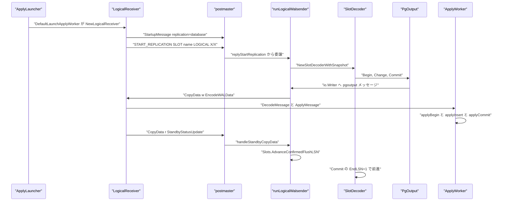
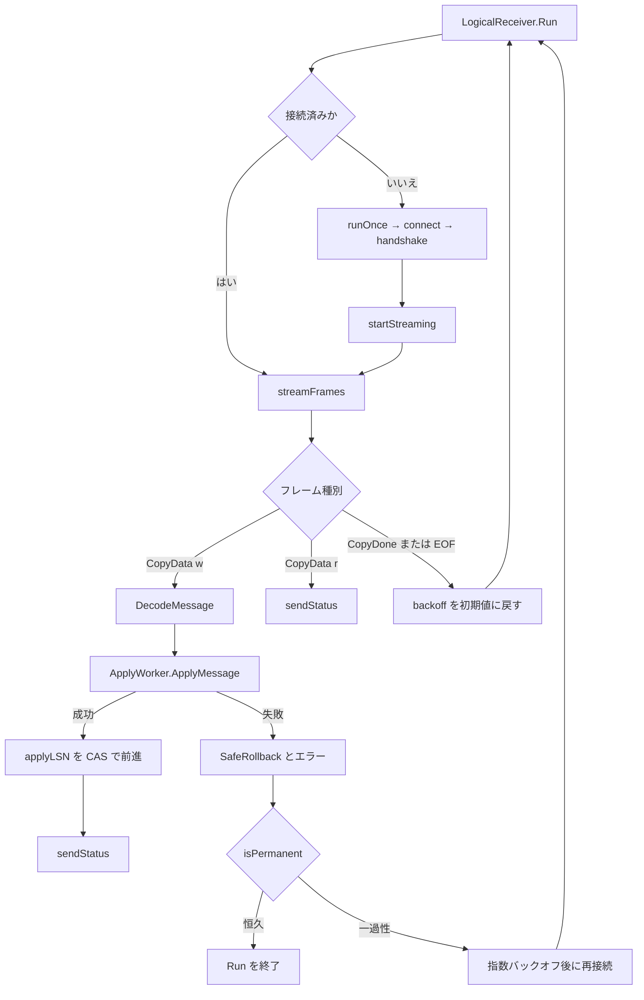

# 論理レプリケーション

<details>
<summary>関連ソースファイル</summary>

- [`internal/access/transam/xlog/pgoutput.go`](https://github.com/ryogrid/goopg/blob/19856410e8d497d59787e1ab35a2febb3f5953d6/internal/access/transam/xlog/pgoutput.go)
- [`internal/access/transam/xlog/pgoutput_decoder.go`](https://github.com/ryogrid/goopg/blob/19856410e8d497d59787e1ab35a2febb3f5953d6/internal/access/transam/xlog/pgoutput_decoder.go)
- [`internal/access/transam/xlog/slot_decoder.go`](https://github.com/ryogrid/goopg/blob/19856410e8d497d59787e1ab35a2febb3f5953d6/internal/access/transam/xlog/slot_decoder.go)
- [`internal/catalog/pubsub.go`](https://github.com/ryogrid/goopg/blob/19856410e8d497d59787e1ab35a2febb3f5953d6/internal/catalog/pubsub.go)
- [`internal/executor/applyworker.go`](https://github.com/ryogrid/goopg/blob/19856410e8d497d59787e1ab35a2febb3f5953d6/internal/executor/applyworker.go)
- [`internal/executor/subscription_options.go`](https://github.com/ryogrid/goopg/blob/19856410e8d497d59787e1ab35a2febb3f5953d6/internal/executor/subscription_options.go)
- [`internal/executor/sys_pg_publication.go`](https://github.com/ryogrid/goopg/blob/19856410e8d497d59787e1ab35a2febb3f5953d6/internal/executor/sys_pg_publication.go)
- [`internal/executor/sys_pg_subscription.go`](https://github.com/ryogrid/goopg/blob/19856410e8d497d59787e1ab35a2febb3f5953d6/internal/executor/sys_pg_subscription.go)
- [`internal/postmaster/subscription_refresh.go`](https://github.com/ryogrid/goopg/blob/19856410e8d497d59787e1ab35a2febb3f5953d6/internal/postmaster/subscription_refresh.go)
- [`internal/replication/applylauncher.go`](https://github.com/ryogrid/goopg/blob/19856410e8d497d59787e1ab35a2febb3f5953d6/internal/replication/applylauncher.go)
- [`internal/replication/logicalreceiver.go`](https://github.com/ryogrid/goopg/blob/19856410e8d497d59787e1ab35a2febb3f5953d6/internal/replication/logicalreceiver.go)
- [`internal/replication/logicalwalsender.go`](https://github.com/ryogrid/goopg/blob/19856410e8d497d59787e1ab35a2febb3f5953d6/internal/replication/logicalwalsender.go)

</details>

論理レプリケーションは、WAL のページイメージではなく「どのテーブルのどの行がどう変わったか」を pgoutput メッセージとして出版側から購読側へ流し、購読側が通常のヒープ書き込みとして適用する仕組みです。出版側では `runLogicalWalsender` が `xlog.SlotDecoder` に `xlog.PgOutput` を接続し、`walsenderPgoutputAdapter` がメッセージごとに `'w'` CopyData フレームへ包んで送ります。購読側では `ApplyLauncher` が `pg_subscription` の有効な行ごとに `LogicalReceiver` を起動し、受信した pgoutput バイト列を `xlog.DecodeMessage` で復号して `executor.ApplyWorker.ApplyMessage` に渡します。カタログ上の `pg_publication` / `pg_subscription` / `pg_subscription_rel` の永続化とテーブル同期は [11.4 テーブル同期と適用ワーカー](11.4-Table-Sync.md)、物理側のストリーミングは [11.1 物理ストリーミングレプリケーション](11.1-Physical-Streaming.md) を参照してください。

## 責務

- 出版側で `START_REPLICATION ... LOGICAL` を受け、スロットの `RestartLSN` から `SlotDecoder` を回して pgoutput を生成する（`internal/replication/logicalwalsender.go:runLogicalWalsender`、`internal/access/transam/xlog/slot_decoder.go:NewSlotDecoderWithSnapshot`）。
- スロット作成時のカタログスナップショットを固定し、`RelationDef` の列型・列名を安定させる（`runLogicalWalsender` の `BuildCatalogSnapshot`、`xlog.BuildCatalogSnapshot`）。
- `publication_names` オプションを解析し、`FOR TABLE` / `FOR ALL TABLES` と `publish` フラグの積集合で変更をフィルタする（`splitPublicationNames`、`buildPublicationFilter`、`publicationFilter.Allows`）。
- `messages` オプションを解釈して論理メッセージを要求時だけ `M` フレームで送り、`proto_version` は `Options` に保持したまま v1 の pgoutput として扱う（`parsePgoutputBool`、`PgOutput.SetMessages`、`PgOutput.LogicalMessage`）。
- コミット境界でスロットの `ConfirmedFlushLSN` を排他的境界（`EndLSN + 1`）へ進める（`SlotDecoder.Run`、`recordIsXactCommit`）。
- 購読側で `pg_subscription` の `Enabled` 行を走査し、購読ごとに 1 つの適用ワーカーを起動・停止する（`internal/replication/applylauncher.go:ApplyLauncher.Run`、`reconcile`）。
- `primary_conninfo` から出版側へ `replication=database` で接続し、`START_REPLICATION SLOT ... LOGICAL` を発行して pgoutput を購読する（`LogicalReceiver.connect`、`handshake`、`startStreaming`）。
- 受信メッセージを `ApplyWorker` でローカルに適用し、コミット LSN を単調に `applyLSN` へ反映して ack を返す（`LogicalReceiver.handleCopyData`、`sendStatus`）。
- 接続断では恒久エラーと一過性エラーを分類し、後者だけを指数バックオフで再接続する（`Run`、`isPermanent`、`nextBackoff`）。
- `CREATE SUBSCRIPTION` / `ALTER SUBSCRIPTION` のオプションを PG 互換の順序とエラーコードで検証する（`internal/executor/subscription_options.go:parseSubscriptionOptions`、`parseAlterSubscriptionSetOptions`、`checkConninfoSyntax`）。
- `pg_publication` / `pg_publication_rel` / `pg_subscription` を PostgreSQL 互換のヒープ行として書き出す（`upsertPublicationCatalogRow`、`writePublicationMemberRows`、`syncSubscriptionRow`）。

## 処理フロー

出版側スロットから購読側の適用までの実経路です。`LogicalReceiver` は最初の 1 回だけ前もって張った接続を使い、以降は自前で再接続します。



`runLogicalWalsender` は `s.cfg.WAL`・`s.cfg.Catalog`・`s.cfg.WALDirPath` を必須とし、`Catalog` が `*catalog.InMemory` でなければ `feature_not_supported` を返します。接続先データベースは `walsenderCatalogDBOidVar` が `catalog.NamespaceDBOid(resolveConnDBOid(...))` で名前空間 dbOid に変換し、スナップショット・出版フィルタ・`SetDatabase` のすべてが同じ dbOid を使います。`SetDatabase` は別データベース由来の論理メッセージを捨てるための `Decoder.SetDatabase` 呼び出しです。

購読側の受信ループと再接続の分岐です。



`Run` は各イテレーションの終わりに必ず `closeConn()` と `cfg.Apply.SafeRollback()` を呼び、半適用のトランザクションを捨てます。`ApplyWorker` 自体はイテレーションを跨いで生き続け、`applyLSN` が次の `START_REPLICATION` の再開位置になります。`io.EOF` は「出版側が CopyDone を送った」または「ソケットが正常に閉じた」を意味するので、バックオフを初期値に戻して即座に再接続します。

## 主要ファイル

| ファイル | 役割 |
| --- | --- |
| `internal/access/transam/xlog/pgoutput.go` | pgoutput エンコーダ。`PgOutput`、`RelationFilter`、`Begin`、`Change`、`writeRelation`、`writeInsert`、`writeUpdate` |
| `internal/access/transam/xlog/pgoutput_decoder.go` | pgoutput デコーダ。`DecodedMessage`、`DecodeMessage`、`decodeRelation`、`decodeTupleBody` |
| `internal/access/transam/xlog/slot_decoder.go` | スロット単位のデコードループ。`SlotDecoder`、`NewSlotDecoder`、`Run`、`recordIsXactCommit` |
| `internal/catalog/pubsub.go` | 出版・購読・テーブル同期状態のレジストリ。`Publication`、`Subscription`、`SubscriptionRel`、`PubSub` |
| `internal/executor/applyworker.go` | 購読側の適用。`ApplyWorker`、`ApplyMessage`、`applyInsert`、`applyUpdate`、`applyCommit` |
| `internal/executor/subscription_options.go` | `CREATE/ALTER SUBSCRIPTION` の WITH オプション検証。`subOpts`、`parseSubscriptionOptions`、`checkConninfoSyntax` |
| `internal/executor/sys_pg_publication.go` | `pg_publication` / `pg_publication_rel` の行生成とインデックス更新。`buildPGPublicationRow`、`upsertPublicationCatalogRow` |
| `internal/executor/sys_pg_subscription.go` | `pg_subscription`（OID 6100、共有カタログ）の行生成。`PGSubscriptionColumnsPG18`、`syncSubscriptionRow` |
| `internal/postmaster/subscription_refresh.go` | `ALTER SUBSCRIPTION ... REFRESH` のデータ半分。`RefreshSubscriptionOnPublisher`、`refreshOpenWriter` |
| `internal/replication/applylauncher.go` | 購読ごとのワーカー管理。`ApplyLauncher`、`Run`、`reconcile`、`DefaultLaunchApplyWorker` |
| `internal/replication/logicalreceiver.go` | 購読側のワイヤクライアント。`LogicalReceiver`、`Run`、`handleCopyData`、`sendStatus` |
| `internal/replication/logicalwalsender.go` | 出版側の LOGICAL 分岐。`runLogicalWalsender`、`walsenderPgoutputAdapter`、`publicationFilter` |

## 公開 API / エントリポイント

出版側:

```go
func (s *Handler) runLogicalWalsender(ctx context.Context, r *libpq.FrameReader, w *libpq.FrameWriter, args startReplicationArgs, appName, dbName string) error
func NewPgOutput(snap *CatalogSnapshot, w io.Writer) *PgOutput
func (p *PgOutput) SetFilter(f RelationFilter)
func (p *PgOutput) SetMessages(on bool)
func NewSlotDecoderWithSnapshot(slots *Slots, slotName string, w *Writer, walDir string, segSize int64, plugin OutputPlugin, snap SlotSnapshot) (*SlotDecoder, error)
func (s *SlotDecoder) Run(ctx context.Context) error
```

購読側:

```go
func NewApplyLauncher(cfg ApplyLauncherConfig) *ApplyLauncher
func (l *ApplyLauncher) Run(ctx context.Context)
func (l *ApplyLauncher) Wake()
func (l *ApplyLauncher) StopWorker(name string)
func DefaultLaunchApplyWorker(ctx context.Context, cfg ApplyLauncherConfig, sub catalog.Subscription) error

func NewLogicalReceiver(cfg LogicalReceiverConfig) *LogicalReceiver
func DialLogicalReceiver(ctx context.Context, cfg LogicalReceiverConfig) (*LogicalReceiver, error)
func (r *LogicalReceiver) Run(ctx context.Context) error
func (r *LogicalReceiver) ApplyLSN() uint64
func (r *LogicalReceiver) Close() error

func NewApplyWorker(cat catalog.Catalog, pool *storage.Pool, txnMgr *transam.Manager) *ApplyWorker
func (w *ApplyWorker) ApplyMessage(m *xlog.DecodedMessage) (uint64, error)
func (w *ApplyWorker) SetSubscriptionContext(ps *catalog.PubSub, subName string)
func (w *ApplyWorker) SafeRollback()
```

出版側のリモート操作（購読側から出版側のスロット・出版物を操作する）:

```go
func CreateRemoteLogicalSlot(ctx context.Context, cfg LogicalReceiverConfig) error
func DropRemoteSlot(ctx context.Context, cfg LogicalReceiverConfig) error
func CheckRemotePublications(ctx context.Context, cfg LogicalReceiverConfig, pubs []string) ([]string, error)
func FetchPublicationTables(ctx context.Context, cfg LogicalReceiverConfig, pubs []string) ([]PubTable, error)
func OpenPublisherConn(ctx context.Context, cfg LogicalReceiverConfig) (*PublisherConn, error)
```

`CreateRemoteLogicalSlot` は `CREATE_REPLICATION_SLOT "name" LOGICAL pgoutput (SNAPSHOT 'nothing')`、`DropRemoteSlot` は `DROP_REPLICATION_SLOT "name" WAIT` を発行します。`CheckRemotePublications` は `pg_publication` を引き、要求した出版物のうち出版側に無いものを返します。エラーは「出版側に到達できない」を `ErrPublisherConnect`、「出版側がコマンドを拒否した」を `*RemoteCommandError` として区別します。

## 主要データ構造

### 出版・購読カタログの `Publication` / `Subscription`

```go
type Publication struct {
	Name string
	OID  uint32
	// Owner is the owning role's OID (pg_publication.pubowner). Real
	// pg_dump's getPublications() (pg_dump.c) always selects this column
	// and calls getRoleName() on it, which pg_fatal()s with "role with
	// OID %u does not exist" if the OID doesn't resolve — so an unset
	// (zero) Owner isn't a cosmetic gap, it makes pg_dump abort outright
	// on any database containing a publication. CreatePublication defaults
	// this to the bootstrap superuser OID (10); CreatePublicationAsOwner
	// (called from the executor with the connection's currently-effective
	// role, DU-002 slice 424) lets a session running under `SET ROLE`/`SET
	// SESSION AUTHORIZATION` own the publication it creates, mirroring
	// PostgreSQL's `GetUserId()`-as-owner convention (`CreatePublication`,
	// publicationcmds.c). DU-002 slice 422.
	Owner         uint32
	AllTables     bool
	PublishInsert bool
	PublishUpdate bool
	PublishDelete bool
	// Tables are qualified table names ("schema.name") the
	// publication is restricted to. Ignored when AllTables is
	// true. Insertion order is preserved so views render rows
	// in the order an operator added them.
	Tables []string
	// DBOid is the real physical database oid this publication was CREATE
	// PUBLICATION'd under (mirrors Subscription.DBOid + UserTSConfig.DBOid).
	// Two distinct databases may each create a same-named publication without
	// colliding (the DU-002 pg_dump round-trip restores a dump's publications
	// into a fresh database whose registry must not clash with the source
	// database's). Defaults to DefaultDBOid for every call site that does not
	// pass an explicit dbOid (resolveDBOid's convention), keeping the pre-DU-002
	// single-DB behaviour. M0119-0004 (DU-002 per-DB publication scoping).
	DBOid uint32
}
```

`internal/catalog/pubsub.go:Publication`（16 行目）

`Tables` は `schema.name` 形式で、`AllTables` が true のときは無視されます。`PublishInsert` / `PublishUpdate` / `PublishDelete` は変更種別ごとの許可ビットで、複数の出版物が同じテーブルを覆う場合は「いずれか 1 つが許可すれば通す」という和集合規則になります。`DBOid` は物理データベース OID で、同じ名前の出版物を別データベースに共存させるためのキーです。

```go
type Subscription struct {
	Name     string
	OID      uint32
	Conninfo string
	// Owner is the owning role's OID (pg_subscription.subowner). Real
	// pg_dump's getSubscriptions() (pg_dump.c) always selects this column
	// and calls getRoleName() on it — same pg_fatal()-on-unresolved-OID
	// hazard pg_publication.pubowner had (DU-002 slice 422). CreateSubscription
	// defaults this to the bootstrap superuser OID (10);
	// CreateSubscriptionAsOwner (called from the executor with the
	// connection's currently-effective role, DU-002 slice 424) mirrors
	// Publication.Owner's same real-ownership convention.
	Owner        uint32
	Publications []string
	Enabled      bool
	// SlotName is pg_subscription.subslotname: "" is NULL, i.e.
	// slot_name = NONE (no publisher-side slot — DROP SUBSCRIPTION then
	// skips ReplicationSlotDropAtPubNode). The subscription-name default
	// for an unspecified slot_name is applied by the executor
	// (DefineSubscription), not stored here.
	SlotName string
	// DBOid is the database this subscription's apply worker resolves
	// local relations against — the connection's real dbOid at CREATE
	// SUBSCRIPTION time (catalog.NamespaceDBOid(ctx.CurrentDatabaseOid)),
	// same convention as catalog.Table.DBOid/catalog.Index.DBOid
	// (M0122-0007 4d-ii-part-2b item 2). Zero (the pre-item-1 default)
	// resolves to DefaultDBOid via NamespaceDBOid, matching legacy
	// single-database behavior. The apply launcher reads it to seed a
	// catalog.SearchPathCatalog for ApplyWorker.cat so its un-dbOid-
	// threaded LookupTable/IndexesOnTable calls resolve the subscribing
	// database's own tables instead of always DefaultDBOid's.
	DBOid uint32
}
```

`internal/catalog/pubsub.go:Subscription`（53 行目）

`Enabled` がランチャーの起動条件です。`SlotName` の空文字は `slot_name = NONE`（出版側スロットなし）を意味し、未指定時の「購読名をスロット名にする」補完は executor 側で行われます。`DBOid` は適用ワーカーのカタログ探索を購読データベースに限定するために使われます。

### `SubscriptionRel` とテーブル同期の状態機械

```go
type SubscriptionRel struct {
	SubID  uint32
	RelOID uint32
	State  string
	LSN    uint64
}
```

`internal/catalog/pubsub.go:SubscriptionRel`（100 行目）

`State` は `i`（初期）→ `d`（データコピー中）→ `s`（同期完了、ストリーム追従中）→ `r`（ストリーミング適用に参加）の 4 状態です。`validSubRelTransitions` は `i→d`、`i→s`、`d→s`、`s→r` と同一状態への遷移だけを許し、後戻りを API 境界で拒否します。`LSN` は `AdvanceSubscriptionRel` で単調にだけ更新され、小さい値は無視されます。

### レジストリの `PubSub`

```go
// PubSub is the in-memory registry for publications and
// subscriptions. Single-process; mutations and reads are
// serialised by an internal RWMutex. Construct one per goopg
// runtime via NewPubSub.
type PubSub struct {
	mu            sync.RWMutex
	publications  map[string]*Publication
	subscriptions map[string]*Subscription
	// subRels is the tablesync state-machine store. Keyed by
	// subscription name → RelOID → SubscriptionRel. The
	// per-subscription map keeps lookups + iteration cheap and
	// matches the way pg_subscription_rel is queried in
	// practice (always filtered by srsubid).
	subRels map[string]map[uint32]*SubscriptionRel
	// nextOID is local to the registry. PubSub OIDs share the
	// same numeric space upstream uses (anything ≥ FirstUserOID),
	// but they don't collide with user-table OIDs because the
	// catalog and the registry allocate independently — no
	// goopg surface joins their OID columns yet, and the M0008
	// DoD cares about names, not exact OIDs.
	nextOID uint32
}
```

`internal/catalog/pubsub.go:PubSub`（136 行目）

`publications` と `subscriptions` のキーは `pubMapKey` / `subMapKey` が作る `"<dbOid>.<小文字名>"` の複合キーです。したがって別データベースの同名オブジェクトは衝突しません。`subRels` だけは購読名だけをキーにしており、購読名はデータベースを跨いで一意という前提です。返り値はすべて deep copy で、呼び出し元がレジストリの内部ポインタを書き換えられないようになっています。

### 出版側エンコーダの `PgOutput`

```go
type RelationFilter interface {
	Allows(rel *RelationDef, kind ChangeKind) bool
}

// PgOutput emits logical-replication messages to an io.Writer in
// upstream pgoutput's wire format. One PgOutput per active
// logical slot; not goroutine-safe (the `SlotDecoder` loop is
// sequential by design).
type PgOutput struct {
	snap *CatalogSnapshot
	w    io.Writer

	// emittedRel tracks which relation OIDs have already had
	// their `R` message sent in this session. The first Change
	// touching a relation emits `R` ahead of the per-row
	// message; subsequent changes skip it. Mirrors upstream's
	// `relsynced` set.
	emittedRel map[uint32]struct{}

	// filter, when non-nil, gates every Change emission against
	// publication-membership rules. SetFilter installs it; nil
	// (the default) means "ship every change for every relation
	// in the snapshot" — useful for tests and for the
	// catalog-only initial scaffolding before publications
	// existed.
	filter RelationFilter

	// messages is pgoutput's "messages" option: logical decoding
	// messages are written only when the subscriber asked for them
	// (pgoutput_message returns early otherwise).
	messages bool
}
```

`internal/access/transam/xlog/pgoutput.go:PgOutput`（89 行目）

`emittedRel` はセッション内で `R` を送ったリレーション OID の集合で、同じリレーションの 2 回目以降の変更では `R` を省略します。`filter` が nil なら全変更を送るため、出版物が未設定のテスト経路でも動きます。`snap` はスロット作成時のスナップショットで、`Change` はここに無いリレーションを黙ってスキップします（スロット作成後に作られたテーブルは v0 の対象外）。`PgOutput` は goroutine-safe ではなく、`SlotDecoder` の逐次ループからのみ呼ばれます。

### 購読側デコーダの `DecodedMessage`

```go
// DecodedMessage is one parsed pgoutput v1 wire message. Kind
// discriminates which fields are populated.
type DecodedMessage struct {
	Kind byte

	// Begin / Commit fields.
	XID        storage.TransactionID
	CommitLSN  uint64
	EndLSN     uint64
	CommitTime uint64

	// Relation field — populated for kind == 'R'.
	Relation *DecodedRelation

	// Insert / Delete fields.
	RelOID   uint32
	NewTuple []DecodedColumn // populated for 'I'
	OldTuple []DecodedColumn // populated for 'D' / 'U'

	// Truncate fields — populated for kind == 'T'. TruncateRels
	// holds the publisher OIDs of every relation in the TRUNCATE
	// statement (a single TRUNCATE may target many tables);
	// TruncateOption is the upstream option-bit byte (bit 0
	// CASCADE, bit 1 RESTART IDENTITY) — the apply worker uses
	// this to mirror upstream's `apply_handle_truncate` policy.
	TruncateRels   []uint32
	TruncateOption byte

	// Message fields — populated for kind == 'M'. MessageTransactional is
	// bit zero of the protocol flags byte. MessageLSN is independent of a
	// transaction's commit LSN: non-transactional messages are delivered at
	// their own WAL position.
	MessageTransactional bool
	MessageLSN           uint64
	MessagePrefix        string
	MessagePayload       []byte
}

// DecodedRelation is the parsed `R` message body.
type DecodedRelation struct {
	OID       uint32
	Schema    string
	Name      string
	Replident byte
	Columns   []DecodedAttr
}

// DecodedAttr is one per-column entry in a Relation message.
type DecodedAttr struct {
	Flags   byte
	Name    string
	TypeOID uint32
	TypeMod int32
}

// DecodedColumn is one tuple-body column entry. Status is one
// of pgoColNull ('n'), pgoColText ('t'), or upstream's
// "unchanged TOAST" ('u'). Bytes is empty for 'n' / 'u'.
type DecodedColumn struct {
	Status byte
	Bytes  []byte
}
```

`internal/access/transam/xlog/pgoutput_decoder.go:DecodedMessage`（27 行目）、`DecodedRelation`（64 行目）、`DecodedAttr`（73 行目）、`DecodedColumn`（83 行目）

`Kind` が `B` / `C` / `R` / `I` / `D` / `U` / `T` / `M` のどれかで、どのフィールドが有効かが決まります。`OldTuple` は `D` と `U` で使われ、`U` では省略可能です（REPLICA IDENTITY DEFAULT でキー列が変わっていない場合、`N` の直前に `K`/`O` ブロックがありません）。`DecodedColumn.Status` の `n` は NULL、`t` はテキスト、`u` は「変更なしの TOAST」で、適用側は `u` を「値不明のワイルドカード」として扱います。

### スロットデコードループの `SlotDecoder`

```go
type SlotDecoder struct {
	slotName string
	slots    *Slots
	iter     *RecordIterator
	decoder  *Decoder

	// Snapshot is the slot-creation-time HISTORIC view a
	// plugin uses to resolve relations and decide tuple
	// visibility. Set by NewSlotDecoderWithSnapshot;
	// NewSlotDecoder leaves it zero-valued so existing tests
	// stay green.
	Snapshot SlotSnapshot
}
```

`internal/access/transam/xlog/slot_decoder.go:SlotDecoder`（37 行目）

`NewSlotDecoder` はスロットが存在し `Kind == SlotLogical` であることを検証し、イテレータを `slot.RestartLSN` に固定します。`Run` は `iter.Next` → `Classify` を繰り返し、コミットレコードを見つけるたびに `slots.AdvanceConfirmedFlushLSN(slotName, rec.EndLSN+1)` を呼びます。`ConfirmedFlushLSN` は「次に再開する位置」という排他的境界なので、レコード末尾の `EndLSN` そのものではなく `+1` を保存します。`recordIsXactCommit` はネイティブペイロードと PG 形式 XLog ヘッダの両方を見るため、どちらの形式で書かれたコミットでも同じように前進します。

### 適用ワーカーの `ApplyWorker`

```go
type ApplyWorker struct {
	cat    catalog.Catalog
	pool   *storage.Pool
	txnMgr *transam.Manager

	// relations caches `R` messages keyed by remote rel OID,
	// resolved to the local catalog.Table once on first
	// reference. UPDATE / DELETE find their target table here.
	relations map[uint32]*applyRel

	// currentTx is the in-progress local transaction opened on
	// `B` and closed on `C` / abort. Apply work happens inside
	// it. When inXact is false, change events outside an open
	// xact are an apply error.
	currentTx transam.Transaction
	inXact    bool

	// Tablesync gating. When pubsub and subName are both set,
	// applyInsert skips changes for relations that aren't at
	// state 'r' yet (tablesync still in progress), and
	// applyCommit promotes 's' → 'r' for relations whose
	// recorded sync-end LSN has been crossed by this commit.
	// Mirrors upstream worker.c's process_syncing_tables_for_apply.
	// Both nil/empty preserves the legacy "apply everything"
	// path that existing tests depend on.
	pubsub  *catalog.PubSub
	subName string

	// stat is the pg_stat_subscription handle for this worker.
	// When non-nil, every ApplyMessage records the receipt
	// timestamp + the message's reported end LSN, and every
	// commit advances the worker's received_lsn to the commit
	// LSN. Nil disables observability — the legacy path used by
	// existing tests.
	stat *xlog.Subscriber

	// logger receives structured replication-event lines (apply
	// commits, apply errors, tablesync state promotions). nil
	// falls back to slog.Default(); tests pass a discard logger
	// to silence output. See repllog.go for the event vocabulary.
	logger *slog.Logger
}

// applyRel pairs a remote Relation message with its resolved
// local table. Local Table is nil when the remote rel has no
// matching local table — the apply worker rejects subsequent
// changes on it instead of silently dropping data.
type applyRel struct {
	remote *xlog.DecodedRelation
	local  *catalog.Table
	// localIdx maps each REMOTE attribute to its position in the local
	// table's column list, and claimed marks the local columns some remote
	// attribute names. review/260831 EC-3: both used to be rebuilt from the
	// column NAMES for every replicated row; they depend only on the pair of
	// column lists, which is fixed until the next Relation message replaces
	// this entry.
	localIdx []int
	claimed  []bool
}
```

`internal/executor/applyworker.go:ApplyWorker`（45 行目）、`applyRel`（92 行目）

`inXact` は `B` で true、`C` で false になります。`I` / `D` / `U` / `T` は `inXact` でなければエラーです。`relations` は `R` メッセージで 1 度だけ `(schema, name)` からローカルテーブルを解決し、以後の変更はそのキャッシュを使います。`applyRel.local` が nil のリレーションへの変更は「ローカルに対応表が無い」としてエラーになります。`localIdx` / `claimed` は列リストの対応を 1 度だけ計算するためのキャッシュで、次の `R` が来るまで不変です。

### 購読クライアントの `LogicalReceiverConfig` と `LogicalReceiver`

```go
// LogicalReceiverConfig parameterises a single subscriber session.
type LogicalReceiverConfig struct {
	// PrimaryAddr is `host:port` of the publisher's listener.
	PrimaryAddr string

	// User identifies the role on the publisher. Replication
	// connections still authenticate; v0 ships trust by default.
	User string

	// ApplicationName, when non-empty, is sent as the
	// `application_name` startup parameter so the publisher's
	// pg_stat_replication row and any matching
	// synchronous_standby_names rule see this apply worker under
	// its subscription-configured name. Empty means "no
	// application_name parameter", matching pre-M0103-0005 behaviour.
	ApplicationName string

	// SlotName names the logical replication slot to acquire.
	// The slot must already exist on the publisher (M0008 /
	// 0008-0001 loop 1's `Slots.CreateLogical`).
	SlotName string

	// Publications is the list of publication names the
	// subscriber is interested in. Empty means "all visible
	// publications" — matches upstream's
	// `publication_names`-as-empty fallback.
	Publications []string

	// StartLSN is the resume position. 0 maps to the slot's
	// current `confirmed_flush_lsn`.
	StartLSN uint64

	// ProtoVersion is the pgoutput protocol version. v0 only
	// implements v1; setting anything else is reserved for a
	// future loop.
	ProtoVersion int

	// Apply is the local apply worker that consumes decoded
	// pgoutput messages. Required.
	Apply *executor.ApplyWorker

	// StatusInterval throttles standby-status updates. Zero
	// falls back to 10s.
	StatusInterval time.Duration

	// DialTimeout caps the TCP dial + startup handshake. Zero
	// falls back to 10s.
	DialTimeout time.Duration

	// InitialBackoff is the wait after the first reconnect-eligible
	// failure; each subsequent transient failure doubles it up to
	// MaxBackoff. Zero falls back to 1s.
	InitialBackoff time.Duration

	// MaxBackoff caps the per-retry sleep regardless of how many
	// consecutive failures occur. Zero falls back to 30s.
	MaxBackoff time.Duration

	// Dialer is an injectable hook used by the reconnect loop on
	// every (re)connect. Defaults to a net.Dialer bound by
	// DialTimeout. Test code overrides this to avoid binding real
	// TCP ports.
	Dialer func(ctx context.Context) (net.Conn, error)
}
```

`internal/replication/logicalreceiver.go:LogicalReceiverConfig`（55 行目）

`NewLogicalReceiver` がゼロ値を補完します。`ProtoVersion=1`、`StatusInterval=10s`、`DialTimeout=10s`、`InitialBackoff=1s`、`MaxBackoff=30s` です。`Apply` は必須で、nil のまま `DialLogicalReceiver` を呼ぶとエラーになります。`StartLSN` が 0 のときは出版側スロットの位置から始まり、`NewSlotDecoder` は `slot.RestartLSN` を起点にします。

```go
type LogicalReceiver struct {
	cfg LogicalReceiverConfig

	// applyLSN is updated atomically by the apply pipeline on
	// every Commit and read by the reconnect loop to set the
	// next START_REPLICATION resume point and by the standby-
	// status frame to advance the publisher slot's
	// confirmed_flush_lsn.
	applyLSN atomic.Uint64

	// mu guards the per-iteration connection state and the
	// terminal-close flag.
	mu     sync.Mutex
	conn   net.Conn
	r      *libpq.FrameReader
	w      *libpq.FrameWriter
	closed bool // permanent close via Close()
}
```

`internal/replication/logicalreceiver.go:LogicalReceiver`（130 行目）

`applyLSN` は適用済みコミットの LSN で、`handleCopyData` が CAS ループで単調にだけ前進させます。`mu` は `conn` / `r` / `w` / `closed` を保護し、受信 goroutine と `Close` / `closeConn` の競合を防ぎます。`closed` は `Close` による終端的な停止だけを表し、イテレーションごとの `closeConn` はこれを立てません。そのため再接続ループは「終端」と「一過性の切断」を区別できます。

### ランチャーの `ApplyLauncherConfig` と `ApplyLauncher`

```go
type ApplyLauncherConfig struct {
	PubSub  *catalog.PubSub
	Catalog catalog.Catalog
	Pool    *storage.Pool
	TxnMgr  *transam.Manager
	Slots   *xlog.Slots
	Logger  *slog.Logger

	// PollInterval is how often the launcher rescans the catalog when
	// no Wake arrives. Zero falls back to defaultLauncherPoll.
	PollInterval time.Duration

	// LaunchFn is invoked in a freshly-spawned goroutine for every
	// enabled subscription that doesn't currently have a worker.
	// It runs until the per-worker ctx is cancelled or the receiver
	// loop returns. Tests inject a fake; production uses
	// DefaultLaunchApplyWorker.
	LaunchFn LaunchApplyWorkerFunc

	// User overrides the role used when the launcher dials the
	// publisher. Empty falls back to "postgres" so the loopback /
	// trust auth path matches existing replication setups.
	User string
}
```

`internal/replication/applylauncher.go:ApplyLauncherConfig`（29 行目）

```go
type ApplyLauncher struct {
	cfg ApplyLauncherConfig

	mu      sync.Mutex
	workers map[string]*launchedWorker // keyed by Subscription.Name

	wake chan struct{}
}
```

`internal/replication/applylauncher.go:ApplyLauncher`（65 行目）

`workers` のキーは購読名です。`reconcile` は有効な購読の集合と `workers` を比較し、消えた購読のワーカーを停止し、新しい購読のワーカーを `go l.runWorker(...)` で起動します。`wake` は容量 1 のチャネルで、複数の `Wake()` は 1 回の再スキャンに合流します。`PollInterval` の既定は `defaultLauncherPoll = 10 * time.Second` です。

### `CREATE SUBSCRIPTION` の `subOpts`

```go
type subOpts struct {
	connect          bool
	enabled          bool
	createSlot       bool
	copyData         bool
	slotName         string // "" once slot_name = NONE has been resolved
	binary           bool
	streaming        string
	twoPhase         bool
	disableOnErr     bool
	passwordRequired bool
	runAsOwner       bool
	failover         bool
	origin           string
	specified        map[string]bool
}
```

`internal/executor/subscription_options.go:subOpts`（58 行目）

既定値は `connect=true`、`enabled=true`、`createSlot=true`、`copyData=true`、`binary=false`、`streaming="p"`（parallel）、`twoPhase=false`、`disableOnErr=false`、`passwordRequired=true`、`runAsOwner=false`、`failover=false`、`origin="any"` です。`specified` は「利用者が明示したか」を保持し、`connect=false` と `enabled=true` のような組み合わせで「明示同士の衝突」と「既定値との衝突」を別メッセージに分けるために使われます。

## 内部構造

### pgoutput のワイヤ形状

`PgOutput` は 1 メッセージにつき `w.Write` を 1 回だけ呼びます。これが `walsenderPgoutputAdapter` の「1 Write = 1 CopyData」という前提を成立させています。

| 種別 | バイト列 |
| --- | --- |
| `B` Begin | `'B' | final_lsn(8) | commit_time(8) | xid(4)` |
| `C` Commit | `'C' | flags(1) | commit_lsn(8) | end_lsn(8) | commit_time(8)` |
| `R` Relation | `'R' | rel_oid(4) | namespace(NUL) | relname(NUL) | replident(1) | natts(2) | 列...` |
| `I` Insert | `'I' | rel_oid(4) | 'N' | NewTupleData` |
| `D` Delete | `'D' | rel_oid(4) | 'O' or 'K' | OldTupleData` |
| `U` Update | `'U' | rel_oid(4) | ['K'/'O' + OldTupleData]? | 'N' | NewTupleData` |
| `T` Truncate | `'T' | nrelids(4) | option_bits(1) | relid(4) × n` |
| `M` Message | `'M' | flags(1) | lsn(8) | prefix(NUL) | size(4) | payload` |

時刻は PostgreSQL の `TimestampTz`（2000-01-01 UTC からのマイクロ秒）です。`relationNamespace` は goopg の「`public` を空スキーマで保持する」規約を出版側で `public` に戻し、`pg_catalog` は空文字に落とします。これは PG の購読側が空名前空間を `pg_catalog` と解釈するためです。

`writeDelete` は旧タプルが無いとき `'K'` + `natts=0` を書きます。`writeUpdate` は旧タプルが無いとき `K`/`O` ブロック自体を省略します。この非対称は上流の `logicalrep_write_delete` / `logicalrep_write_update` に合わせたもので、UPDATE で `natts=0` の `K` を付けると libpq 購読側が「宣言された列数と合わない」として拒否します。

### 出版フィルタとスナップショット

`publicationFilter` は `allTablesAllowed` と `byTable` の 2 つで構成されます。`buildPublicationFilter` は購読した出版物を順に見て、`AllTables` なら全体フラグに、そうでなければ `Tables` の各 `schema.name` に `publish_*` ビットを OR で足します。したがって「出版物 A が INSERT を許可し、B が DELETE を許可する」場合、そのテーブルには両方が通ります。`Allows` はまず全体フラグ、次に完全修飾名のフラグを見ます。出版物名が見つからない場合は黙ってスキップされ、フィルタは空のまま（= 全変更許可ではなく、`allTablesAllowed` も `byTable` も空なので全拒否）になります。ただし `SetFilter` 自体が呼ばれないケース（`publication_names` が空）は nil フィルタで全許可です。

スナップショットは `BuildCatalogSnapshot(im, executor.RegOutRendererVisible(...), dbOidVar...)` で作られます。`RegOutRendererVisible` は regclass/regproc 系の列を TEXT モードで「名前」として出すためのレンダラで、`public` と `pg_catalog` は非修飾、それ以外はスキーマ修飾します。

### アダプタの合成 LSN

```go
type walsenderPgoutputAdapter struct {
	w       *libpq.FrameWriter
	mu      sync.Mutex
	nextLSN uint64
}
```

`internal/replication/logicalwalsender.go:walsenderPgoutputAdapter`（267 行目）

論理ストリームの LSN は実際の WAL バイト位置ではなく、メッセージ列に付ける単調増加の合成値です。`Write` は `startLSN = nextLSN`、`endLSN = nextLSN + len(p) - 1` とし、次回のために `nextLSN = endLSN + 1` を保存します。空の `Write` はアンダーフロー（`nextLSN + 0 - 1` が 2^64 付近になる）を避けるため、フレームを出さずに `0, nil` を返します。`WriteKeepalive` は `nextLSN - 1` を `walEnd` として広告します。購読側はこの値を ack の基準には使わず、自分が受信・適用した LSN だけを返します。

### スロットの前進と ack

出版側では 2 つの経路が `ConfirmedFlushLSN` を進めます。

1. `SlotDecoder.Run` がコミットレコードを適用した直後に `AdvanceConfirmedFlushLSN(EndLSN+1)` を呼ぶ。
2. 購読側の `sendStatus` が `'r'` を送り、`runLogicalWalsender` の受信 goroutine が `handleStandbyCopyData` 経由で `AdvanceConfirmedFlushLSN(slot, st.FlushLSN)` を呼ぶ。

購読側の `sendStatus` は `write_lsn` / `flush_lsn` / `apply_lsn` の 3 つすべてに `applyLSN` を入れます。中間の write/flush ステージを持たない v0 の設計で、`applyLSN` は「ローカルにコミット済みの最後の LSN」だからです。コミットで `applyLSN` が進んだ直後は、次の 10 秒ティックを待たずに `sendStatus` を 1 回送ります。

### 再接続とエラー分類

`isPermanent` はエラー文字列で分類します。恒久扱いになるのは、`START_REPLICATION rejected`、`server rejected startup`、`pgoutput decode`、`apply pgoutput`、`decode replication message`、`context.Canceled` / `DeadlineExceeded`、`errLogicalReceiverClosed` です。一方 `replication slot is active`（SQLSTATE 55006）は一過性で、直前に死んだ walsender がスロットをまだ掴んでいるだけなので、バックオフ再試行の対象になります。バックオフは初期 1 秒、最大 30 秒で、`nextBackoff` が倍々にし、スリープには ±20% のジッタが乗ります。正常な EOF ではバックオフを初期値に戻します。

### 適用の意味論

- `applyBegin` は既に `inXact` なら前のトランザクションを `Rollback` してから `transam.IsolationReadCommitted` で開き直します。`B` の重複は防御的に処理されます。
- `applyInsert` はまず `LookupSubscriptionRel` でテーブル同期状態を見て、`r` 以外なら黙ってスキップします。これにより COPY 中の行とストリームの行が二重適用されません。次に `decodeTuple` で `u`（変更なし TOAST）を拒否し、購読側にしかない列には `applyDefaultsForMissing` で DEFAULT を評価してから `writeHeapRowReturning` で書き、`maintainUniqueIndexesForInsert` で一意インデックスを維持します。
- `applyDelete` は旧タプルが空なら何もせず nil を返します。キーが無い削除は適用できないためです。
- `applyUpdate` は旧タプルがあればそれをキーにし、無ければ `replicaIdentityKeyRow`（`DecodedAttr.Flags` のビット 0）→ `primaryKeyOnlyRow` の順でキーを合成します。どちらも作れなければ nil（適用スキップ）です。`applyUpdateByKey` は旧行を探して新しい行で置き換え、`u` の列と購読側だけに存在する列は一致した旧行の値で埋めます。
- `applyTruncate` は `T` の relid ごとに `truncateRelation` を呼び、TRUNCATE を一括 DELETE として実装します。CASCADE は出版側で展開済み、RESTART IDENTITY は goopg にシーケンス状態のリセット対象がないため記録だけです。
- `M` はテーブル変更ではないので `err = nil` で通過します。
- `applyCommit` は開いているトランザクションをコミットし、`promoteSyncedRels` で `s` のままのリレーションを `r` へ進め、`pg_stat_subscription` の `received_lsn` を進めます。

`promoteSyncedRels` は `commitLSN >= sr.LSN` の `s` 行だけを `r` にします。v0 のテーブル同期は `LSN=0` を記録するため、最初のコミットで昇格します。これは「COPY が同じ出版側スロットのタイムライン上で行われた」という前提に立つ保守的な動作です。

### DDL と永続化

`parseSubscriptionOptions` は WITH 句のキーをソートして走査します。上流は文のソース順で最初のエラーを返しますが、goopg の WITH は map なので、決定的なエラーにするために辞書順の先頭を報告します（記録済みの差分）。既定値と `specified` の組み合わせで、`connect=false` と `enabled=true` のような衝突を `mutuallyExclusiveSubOpts` で拒否し、`connect=false` だけなら `enabled` / `create_slot` / `copy_data` をすべて false に落とします。`slot_name = NONE` も同様に `enabled=false` と `create_slot=false` を要求します。

`checkConninfoSyntax` は `postgresql://` / `postgres://` を無検証で通し、キーワード形式は `conninfo_parse` を模して名前・`=`・値（引用符付きまたはバックスラッシュ付き）を走査します。未知のキーは `invalid connection option` で 42601 です。`parseSubscriptionConninfo` はそのうち `host` / `port` / `application_name` だけを取り出し、port の既定は 5432 です。

`sys_pg_publication.go` は `pg_publication` を 9 列、`pg_publication_rel` を 5 列で書き、`pubtruncate` / `pubviaroot` / `prqual` / `prattrs` は goopg がモデルしないため false / NULL に固定します。`sys_pg_subscription.go` は `pg_subscription`（OID 6100、`global/` の共有カタログ）を 18 列で書き、モデルしない列は `subbinary=false`、`substream='f'`、`subtwophasestate='d'`、`subpasswordrequired=true`、`subsynccommit='off'`、`suborigin='any'` で埋めます。CREATE/ALTER は同じ OID の既存行を xmax で消してから現在値を書き直す `syncSubscriptionRow` 方式です。

`RefreshSubscriptionOnPublisher` は `fetch_table_list` の結果をローカルカタログに解決し、消えたテーブルの `pg_subscription_rel` 行を削除、入ったテーブルに `i` 行を追加します。`copy_data=false` なら `i→s→r` と 2 段階で進めます（状態機械が `s` 経由を要求するため）。`copy_data=true` なら `RunTableSyncManager` がテーブルごとに出版側の COPY をローカル `CopyFromExecutor` に流し、成功した行を `s` にします。その直後、成功行は LSN 1 で `r` へ進められます（v0 の COPY が LSN 0 を記録するため、最初のコミットが同期ゲートに吸われないようにするため）。最後に `StopWorker(subName)` で古い出版物リストを持つワーカーを止め、後続の DDL コミットでランチャーが新しいリストで再起動します。同期失敗時もワーカーは停止され、行は `i`/`d` のまま次回の refresh に引き継がれます。

## エッジケースと不変条件

- **空の pgoutput 書き込み**: `walsenderPgoutputAdapter.Write` は空スライスをフレームにせず `0, nil` を返します。`endLSN = nextLSN + len - 1` のアンダーフローを防ぐためです。
- **合成 LSN の単調性**: 論理ストリームの `'w'` ヘッダに載る LSN は実 WAL 位置ではなく、メッセージ長で進む合成値です。購読側の再開位置はこの値ではなく `C` メッセージの `commit_lsn`（出版側の実 WAL 位置）であり、ack もその値で返します。
- **keepalive の周期**: `runLogicalWalsender` は 10 秒ごとに `'k'` を送ります。上流の `wal_receiver_timeout`（既定 60 秒）より短くしないと、静かなワークロードで購読側が切断されます。
- **reader を待たない終了**: `streamCtx.Done()` とデコードエラーの経路では `receiveDone` を待ちません。購読側はワーカー再起動の間もソケットを保持するため、reader は `ReadFrame` で止まったままになり、待つとスロットが ACTIVE のまま STOP がハングします。
- **`replication slot is active` は一過性**: 55006 は再接続で解消し得るので `isPermanent` は false を返します。`START_REPLICATION rejected` などは恒久です。
- **再接続時の再開位置**: `startStreaming` は `applyLSN` が非ゼロならそれを、ゼロなら `cfg.StartLSN` を使います。`applyLSN` はコミット境界（`C` の `commit_lsn`）でだけ進むため、未コミットの `I`/`U`/`D` は再送され、再開時に `SafeRollback` で捨てられます。
- **コミット前の `applyLSN`**: `applyLSN` は `C` を適用して `commitLSN > 0` を返したときだけ進みます。`B` や `R` では進みません。
- **`u`（unchanged TOAST）**: INSERT の new-tuple に現れたらエラー、UPDATE の new-tuple では旧行の値で埋める、旧タプルのキー照合では NULL ワイルドカードとして扱う、という 3 つの異なる扱いになります。
- **旧タプルなし UPDATE**: REPLICA IDENTITY DEFAULT でキー列が変わっていない場合、出版側は `K`/`O` を省略します。購読側は `DecodedAttr.Flags` のビット 0 で識別子列を探し、無ければ購読側の主キーで代用します。どちらも無ければ適用をスキップします（誤った行を更新するより安全）。
- **旧タプルなし DELETE**: `len(m.OldTuple) == 0` なら nil を返してスキップします。
- **テーブル同期ゲート**: `ApplyWorker` に `PubSub` と購読名が設定されている場合、`r` 以外のリレーションへの INSERT は黙って捨てられます。設定されていなければ全適用です（テスト用のレガシー経路）。
- **`s` → `r` の昇格**: `commitLSN >= sr.LSN` が条件です。`LSN=0` の同期行は最初のコミットで昇格しますが、`s` のまま放置すると最初のストリームコミットが同期ゲートに吸われて失われます。`RefreshSubscriptionOnPublisher` は COPY 成功後に LSN 1 で `r` へ進めることで、この消失を避けます。
- **状態遷移の単調性**: `AdvanceSubscriptionRel` は `i→d`、`i→s`、`d→s`、`s→r` と同一状態のみ許可します。`r` から `s` へ戻すことはできません。
- **レジストリのキー**: 出版物・購読は `dbOid` を含む複合キー、`pg_subscription_rel` は購読名のみです。同じ購読名を別データベースで使うと `subRels` が衝突するため、購読名はデータベースを跨いで一意である必要があります。
- **出版物が見つからない場合**: `buildPublicationFilter` は未知の出版物名を黙ってスキップします。上流は `CREATE SUBSCRIPTION` 時に拒否しますが、goopg は起動時のスロット開始を失敗させない緩い経路を取ります。
- **`publication_names` の解析**: 二重引用符付き識別子は `""` を 1 個の `"` に畳み、非引用識別子は小文字化します。閉じ引用符が無い場合は nil（構文エラー）を返し、呼び出し元は `SetFilter` を呼ばずに（= フィルタなしで全変更を流して）続行します。
- **スロット名の制約**: `validateReplicationSlotName` は長さ 0 を 42602、64 バイト以上を 42622、`[a-z0-9_]` 以外を 42602 で拒否します（`NAMEDATALEN` が 64 のため）。
- **`origin` の値**: `none` / `any` 以外は 42601 ではなく 22023 で拒否されます。他のオプション検証とエラーコードが異なる点に注意が必要です。
- **`connect = false`**: `enabled` / `create_slot` / `copy_data` が明示的に true なら相互排他のエラー、そうでなければすべて false に落とされます。
- **`slot_name = NONE`**: `enabled` と `create_slot` は false でなければならず、true なら相互排他、未指定なら「`enabled = false` も指定してください」という別のエラーになります。
- **`pg_subscription` の NULL**: `SlotName` が空のとき `subslotname` は NULL です。`slot_name = NONE` はこの NULL として表現され、DROP 時に出版側スロットを触らない判断に使われます。
- **適用エラーの恒久性**: pgoutput のデコード失敗やスキーマ不整合は再接続しても直らないため `isPermanent` が true を返し、`Run` は諦めます。ランチャーは購読が有効な限り次の `reconcile` で再度起動を試みます。
- **ワーカー停止の順序**: `DropSubscription` は購読行を削除した後に `StopWorker` でワーカーを止め（次の `reconcile` が再起動しないようにする）、その後に出版側スロットを落とします。逆順だとワーカーがスロットを ACTIVE のまま保持し、DROP が 55006 で失敗します。
- **`Wake` の合流**: `wake` は容量 1 で非ブロッキング送信するため、連続する DDL の `Wake` は 1 回の再スキャンにまとまります。取りこぼしは最大 `PollInterval`（10 秒）で回収されます。

## 関連ページ

- [11.1 物理ストリーミングレプリケーション](11.1-Physical-Streaming.md)
- [11.2 スタンバイと昇格](11.2-Standby-and-Promotion.md)
- [11.4 テーブル同期と適用ワーカー](11.4-Table-Sync.md)
- [11.5 ベースバックアップ](11.5-Base-Backup.md)
- [11.6 WAL サマリ](11.6-WAL-Summary.md)
- [11 レプリケーションとバックアップ](../11-Replication.md)
- [9 トランザクションと MVCC](../9-Transactions.md)
- [12 カタログとシステムビュー](../12-Catalog.md)

Sources:
- `internal/access/transam/xlog/pgoutput.go`
- `internal/access/transam/xlog/pgoutput_decoder.go`
- `internal/access/transam/xlog/slot_decoder.go`
- `internal/catalog/pubsub.go`
- `internal/executor/applyworker.go`
- `internal/executor/subscription_options.go`
- `internal/executor/sys_pg_publication.go`
- `internal/executor/sys_pg_subscription.go`
- `internal/postmaster/subscription_refresh.go`
- `internal/replication/applylauncher.go`
- `internal/replication/logicalreceiver.go`
- `internal/replication/logicalwalsender.go`

<sub>Generated by deepwiki-4myself from `goopg` @ `19856410e`</sub>
