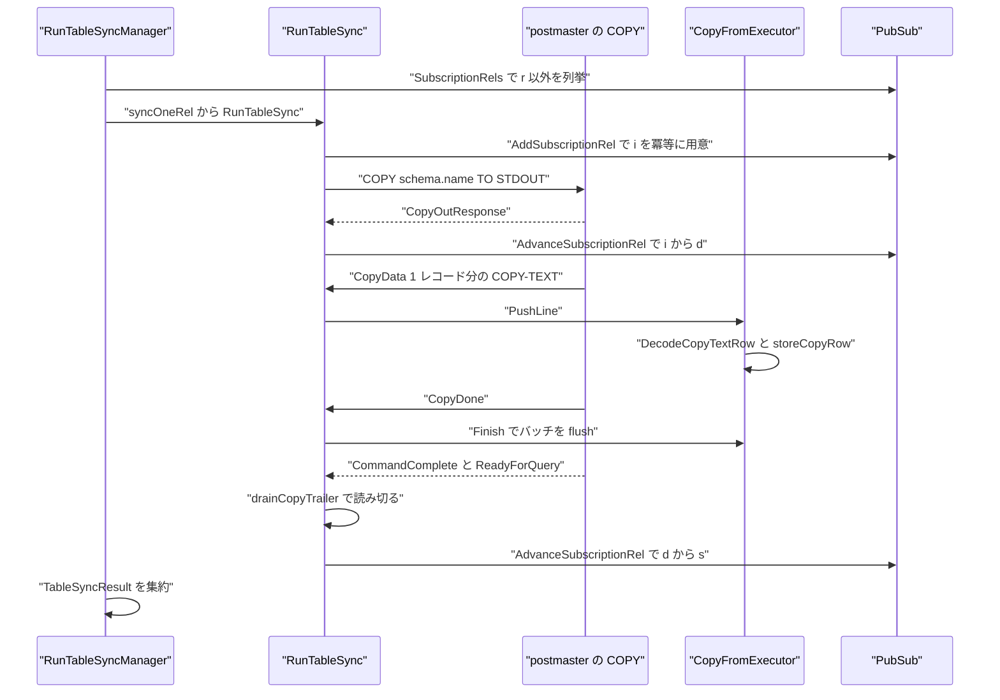
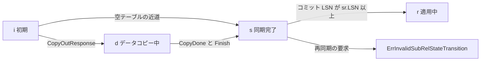

# テーブル同期と適用ワーカー

<details>
<summary>関連ソースファイル</summary>

- [`internal/catalog/pubsub.go`](https://github.com/ryogrid/goopg/blob/19856410e8d497d59787e1ab35a2febb3f5953d6/internal/catalog/pubsub.go)
- [`internal/executor/applyworker.go`](https://github.com/ryogrid/goopg/blob/19856410e8d497d59787e1ab35a2febb3f5953d6/internal/executor/applyworker.go)
- [`internal/executor/copy.go`](https://github.com/ryogrid/goopg/blob/19856410e8d497d59787e1ab35a2febb3f5953d6/internal/executor/copy.go)
- [`internal/executor/copy_csv.go`](https://github.com/ryogrid/goopg/blob/19856410e8d497d59787e1ab35a2febb3f5953d6/internal/executor/copy_csv.go)
- [`internal/executor/copy_text.go`](https://github.com/ryogrid/goopg/blob/19856410e8d497d59787e1ab35a2febb3f5953d6/internal/executor/copy_text.go)
- [`internal/executor/sys_pg_subscription.go`](https://github.com/ryogrid/goopg/blob/19856410e8d497d59787e1ab35a2febb3f5953d6/internal/executor/sys_pg_subscription.go)
- [`internal/postmaster/copy.go`](https://github.com/ryogrid/goopg/blob/19856410e8d497d59787e1ab35a2febb3f5953d6/internal/postmaster/copy.go)
- [`internal/replication/logicalreceiver.go`](https://github.com/ryogrid/goopg/blob/19856410e8d497d59787e1ab35a2febb3f5953d6/internal/replication/logicalreceiver.go)
- [`internal/replication/tablesync.go`](https://github.com/ryogrid/goopg/blob/19856410e8d497d59787e1ab35a2febb3f5953d6/internal/replication/tablesync.go)
- [`internal/replication/tablesync_manager.go`](https://github.com/ryogrid/goopg/blob/19856410e8d497d59787e1ab35a2febb3f5953d6/internal/replication/tablesync_manager.go)

</details>

テーブル同期は、論理レプリケーションを開始する前に「既存の行」を出版側から購読側へ一括コピーし、その進捗を `pg_subscription_rel` の状態機械（`i` → `d` → `s` → `r`）で管理する仕組みです。購読側では `RunTableSyncManager` が未同期のリレーションごとに `RunTableSync` を呼び、出版側へ `COPY <rel> TO STDOUT` を発行して返ってくる COPY-TEXT 行を `executor.CopyFromExecutor.PushLine` で書き込みます。コピー完了後はストリーミング適用（`ApplyWorker`）が `r` のリレーションだけを適用し、コミットが同期終端 LSN を越えた時点で `s` を `r` へ進めます。論理ストリーム自体のプロトコルは [11.3 論理レプリケーション](11.3-Logical-Replication.md)、COPY の SQL としての意味論は [6 実行エンジン](../6-Executor.md) を参照してください。

## 責務

- `pg_subscription_rel` の `(subscription, relation)` 行を `i` で冪等に用意し、COPY 開始で `d`、完了で `s` へ進める（`internal/catalog/pubsub.go:AddSubscriptionRel`、`AdvanceSubscriptionRel`）。
- 購読の未同期リレーションを列挙し、リレーションごとに接続・適用先・監視ハンドルを用意して 1 回の COPY 交換を実行する（`internal/replication/tablesync_manager.go:RunTableSyncManager`、`syncOneRel`）。
- 出版側へ `COPY <qualified name> TO STDOUT` を送り、`CopyOutResponse` → `CopyData*` → `CopyDone` → `CommandComplete` → `ReadyForQuery` の順に読む（`internal/replication/tablesync.go:RunTableSync`）。
- `CopyData` ペイロードを行単位に分割し、`LineWriter.PushLine` に渡す。改行で終わらない断片はワイヤエラーにする（`pushCopyDataLines`）。
- 出版側で `COPY ... TO STDOUT` を実行し、1 レコード（末尾 `\n` 付き）を 1 つの `CopyData` として送る（`internal/postmaster/copy.go:dispatchCopyViaExecutor`、`runCopyToStream`）。
- 受信した COPY-TEXT / COPY-CSV 行を型変換し、DEFAULT・制約・トリガ・一意インデックスを適用してヒープへ書き込む（`internal/executor/copy.go:CopyFromExecutor.PushLine`、`insertSourceRow`、`storeCopyRow`）。
- ストリーミング適用側で、`r` 以外のリレーションへの INSERT をスキップして二重適用を防ぐ（`internal/executor/applyworker.go:applyInsert`）。
- コミット時に `s` のリレーションを `r` へ昇格させる（`applyCommit`、`promoteSyncedRels`）。
- `pg_subscription` の共有カタログ行を PostgreSQL 互換の 18 列で維持する（`internal/executor/sys_pg_subscription.go:PGSubscriptionColumnsPG18`、`syncSubscriptionRow`）。
- 購読側の適用ワーカーとテーブル同期ワーカーが使う出版側クエリ接続を提供する（`internal/replication/logicalreceiver.go:OpenPublisherConn`）。

## 処理フロー

初回 COPY の実経路です。マネージャはリレーションごとに独立した接続と適用先を開き、成功・失敗にかかわらず必ず閉じます。



出版側の `runCopyToStream` は `WriteCopyOutResponse` を先に送り、`RunCopyTo` の `emit` コールバックで 1 レコードずつ `WriteCopyData` します。`EncodeCopyTextRow` / `EncodeCopyCsvRow` が末尾に `\n` を付けるため、1 つの `CopyData` が 1 レコードに対応します（CSV の引用符内改行はレコード内に埋め込まれます）。`CopyDone` を送った後、呼び出し元が COPY のトランザクションをコミットしてから `CommandComplete` と `ReadyForQuery` を書きます。

状態機械と、同期完了後にストリーミングへ引き継ぐ地点です。



`RunTableSync` は開始時に `AddSubscriptionRel` を呼びますが、既に `i` や `d` の行があれば `ErrSubscriptionRelExists` を無視してその状態を維持します。これは前回の COPY が途中で落ちた場合の再開点を壊さないためです。エラー時は状態を進めないので、次回のスイープが同じ行を再訪します。

## 主要ファイル

| ファイル | 役割 |
| --- | --- |
| `internal/catalog/pubsub.go` | `pg_subscription_rel` の状態機械。`SubscriptionRel`、`SubRelState*`、`AddSubscriptionRel`、`AdvanceSubscriptionRel`、`LookupSubscriptionRel`、`SubscriptionRels` |
| `internal/executor/applyworker.go` | ストリーミング適用。`ApplyWorker`、`ApplyMessage`、`applyInsert`、`applyCommit`、`promoteSyncedRels` |
| `internal/executor/copy.go` | COPY FROM の実行器。`CopyFromExecutor`、`PushLine`、`Finish`、`insertSourceRow`、`storeCopyRow`、`RunCopyTo` |
| `internal/executor/copy_csv.go` | CSV の行エンコード/デコード。`copyToFormat`、`DecodeCopyCsvRow`、`errCsvIncompleteRecord` |
| `internal/executor/copy_text.go` | COPY-TEXT の行エンコード/デコード。`DecodeCopyTextRow`、`splitCopyTextFields`、`unescapeCopyTextField` |
| `internal/executor/sys_pg_subscription.go` | `pg_subscription`（OID 6100、共有カタログ）の行生成と更新。`PGSubscriptionColumnsPG18`、`buildPGSubscriptionRow`、`syncSubscriptionRow` |
| `internal/postmaster/copy.go` | 出版側の COPY ディスパッチ。`handleQueryOrCopy`、`dispatchCopyViaExecutor`、`runCopyToStream`、`handleCopyInFrame` |
| `internal/replication/logicalreceiver.go` | 出版側クエリ接続。`OpenPublisherConn`、`PublisherConn`、`FetchPublicationTables` |
| `internal/replication/tablesync.go` | 1 リレーション分の COPY トランスポート。`RunTableSync`、`pushCopyDataLines`、`drainCopyTrailer`、`errFromErrorResponse` |
| `internal/replication/tablesync_manager.go` | 購読単位のスイープ。`RunTableSyncManager`、`syncOneRel`、`ConnPair`、`WriterPair`、`StatPair`、`TableSyncResult` |

## 公開 API / エントリポイント

テーブル同期:

```go
func RunTableSyncManager(ctx context.Context, cfg TableSyncManagerConfig) ([]TableSyncResult, error)
func RunTableSync(cfg TableSyncConfig) (int64, error)
```

`RunTableSyncManager` の関数レベルエラーは「設定不足」「購読が無い」「ctx キャンセル」のような全体障害だけで、個々のリレーションの失敗は `TableSyncResult.Err` に入ります。1 つのテーブルが失敗しても残りは続行されます。

状態機械:

```go
func (p *PubSub) AddSubscriptionRel(subName string, relOID uint32) (*SubscriptionRel, error)
func (p *PubSub) DropSubscriptionRel(subName string, relOID uint32) error
func (p *PubSub) AdvanceSubscriptionRel(subName string, relOID uint32, newState string, newLSN uint64) (*SubscriptionRel, error)
func (p *PubSub) LookupSubscriptionRel(subName string, relOID uint32) (*SubscriptionRel, bool)
func (p *PubSub) SubscriptionRels(subName string) []*SubscriptionRel
```

COPY の適用先:

```go
func NewCopyFromExecutor(ctx *Context, plan *optimizer.Copy) (*CopyFromExecutor, error)
func (c *CopyFromExecutor) PushLine(line []byte) error
func (c *CopyFromExecutor) PushBinaryData(chunk []byte) (done bool, err error)
func (c *CopyFromExecutor) Finish() error
func (c *CopyFromExecutor) RowsInserted() int64
func (c *CopyFromExecutor) InCsvQuotedField() bool
```

ストリーミング適用:

```go
func NewApplyWorker(cat catalog.Catalog, pool *storage.Pool, txnMgr *transam.Manager) *ApplyWorker
func (w *ApplyWorker) ApplyMessage(m *xlog.DecodedMessage) (uint64, error)
func (w *ApplyWorker) SetSubscriptionContext(ps *catalog.PubSub, subName string)
func (w *ApplyWorker) SetStatHandle(sub *xlog.Subscriber)
func (w *ApplyWorker) SafeRollback()
```

## 主要データ構造

### `pg_subscription_rel` の `SubscriptionRel`

```go
type SubscriptionRel struct {
	SubID  uint32
	RelOID uint32
	State  string
	LSN    uint64
}
```

`internal/catalog/pubsub.go:SubscriptionRel`（100 行目）

`State` は次の 4 文字のいずれかです。

```go
const (
	SubRelStateInit     = "i"
	SubRelStateDataCopy = "d"
	SubRelStateSyncDone = "s"
	SubRelStateReady    = "r"
)
```

`internal/catalog/pubsub.go`（109 行目）

不変条件は次のとおりです。

- `i` は「同期開始待ち」、`d` は「COPY 中」、`s` は「COPY 完了・ストリーム追従待ち」、`r` は「ストリーミング適用に参加」。
- 遷移は `i→d`、`i→s`、`d→s`、`s→r` と同一状態への遷移だけで、後戻りは `ErrInvalidSubRelStateTransition` になります。`i→s` は空テーブルなどデータコピーを省略できる場合の近道です。
- `LSN` は `AdvanceSubscriptionRel` で単調にだけ更新され、小さい値は捨てられます。
- `SubID` は購読 OID、`RelOID` はローカル（購読側）のリレーション OID です。出版側の OID は `R` メッセージのキャッシュで別に扱います。

### `LineWriter` と `TableSyncConfig`

```go
// LineWriter is the subset of executor.CopyFromExecutor that
// RunTableSync needs. Keeping this as an interface here means the
// server package doesn't need to import executor purely for the
// type, and tests can substitute a recording fake.
type LineWriter interface {
	PushLine(line []byte) error
	RowsInserted() int64
}
```

`internal/replication/tablesync.go:LineWriter`（59 行目）

```go
// TableSyncConfig bundles the inputs to RunTableSync. The caller
// owns the connection (Reader/Writer); RunTableSync neither dials
// nor closes it. PubSub and SubName/RelOID drive the catalog state
// machine; Relname is the qualified name interpolated into the
// COPY query.
type TableSyncConfig struct {
	PubSub  *catalog.PubSub
	SubName string
	RelOID  uint32
	Relname string
	From    LineWriter
	Reader  *libpq.FrameReader
	Writer  *libpq.FrameWriter

	// Stat is the optional pg_stat_subscription handle for this
	// tablesync worker. When non-nil, RunTableSync stamps every
	// CopyData frame's receipt time via MarkMessage and bumps
	// the worker's received_lsn to the row count once the
	// stream completes (LSN handoff isn't on the wire in v0, so
	// the row count stands in as a "progress observed" signal).
	// Caller owns Register / Unregister around RunTableSync.
	Stat *xlog.Subscriber

	// Logger receives structured replication-event lines
	// (started, state-change, completed). nil falls back to
	// slog.Default(). See internal/wal/repllog.go for the
	// event vocabulary.
	Logger *slog.Logger
}
```

`internal/replication/tablesync.go:TableSyncConfig`（69 行目）

`Reader` / `Writer` の所有権は呼び出し元にあり、`RunTableSync` は接続を閉じません。`Relname` は `COPY <Relname> TO STDOUT` にそのまま埋め込まれるため、呼び出し元がスキーマ修飾済みの安全な識別子を渡す契約です。`From` は `PushLine` と `RowsInserted` だけを要求するので、テーブル同期のテストでは記録用の偽ライターに差し替えられます。

### マネージャのペア型

```go
type ConnPair struct {
	Reader *libpq.FrameReader
	Writer *libpq.FrameWriter
	Close  func() error
}

// WriterPair bundles a per-rel LineWriter plus a closer. The
// closer is called even if RunTableSync errors so the underlying
// transaction is rolled back / committed appropriately.
type WriterPair struct {
	Writer LineWriter
	Close  func() error
}

// StatPair bundles a per-rel pg_stat_subscription handle plus a
// closer. The manager calls Close (typically `subs.Unregister`)
// after each rel's RunTableSync completes — even on error — so
// the registry never accrues stale tablesync rows.
type StatPair struct {
	Stat  *xlog.Subscriber
	Close func() error
}
```

`internal/replication/tablesync_manager.go:ConnPair`（45 行目）、`WriterPair`（54 行目）、`StatPair`（63 行目）

3 つとも「資源 + 閉じる関数」の組です。`syncOneRel` は `defer` でこの順に閉じるため、`StatPair.Close`（監視行の削除）→ `WriterPair.Close`（トランザクションのコミット/ロールバック）→ `ConnPair.Close`（ソケット）の順になります。ライターのクローズが接続より先なのは、コミットを成功させてからソケットを手放すためです。

### `TableSyncManagerConfig`

```go
// TableSyncManagerConfig parameterises one manager run.
type TableSyncManagerConfig struct {
	// PubSub is the catalog registry holding the subscription's
	// tablesync rows.
	PubSub *catalog.PubSub

	// SubName picks which subscription's rels to walk.
	SubName string

	// ResolveRel turns a relOID into the qualified "schema.name"
	// the publisher will see on its `COPY <name> TO STDOUT`
	// query. Returning ok=false for a known rel causes the
	// manager to record a per-rel error and skip the rel; the
	// state machine is left wherever it was.
	ResolveRel func(relOID uint32) (qualifiedName string, ok bool)

	// OpenConn establishes one fresh publisher query connection
	// (already authenticated and at ReadyForQuery). Called once
	// per non-`r` rel. The manager guarantees Close is called
	// before moving on.
	OpenConn func(ctx context.Context, relOID uint32) (*ConnPair, error)

	// OpenWriter builds a per-rel apply target. Typically wraps
	// a *executor.CopyFromExecutor opened against the local
	// table identified by relOID. The manager guarantees Close
	// is called before moving on.
	OpenWriter func(ctx context.Context, relOID uint32) (*WriterPair, error)

	// Logger receives structured replication-event lines and is
	// forwarded into every per-rel RunTableSync invocation. nil
	// falls back to slog.Default(). See repllog.go for the event
	// vocabulary.
	Logger *slog.Logger

	// OpenStat is the optional pg_stat_subscription factory.
	// When set, the manager calls it once per visited rel to
	// register a tablesync worker into the *wal.Subscribers
	// registry; the returned handle flows into RunTableSync's
	// Stat field so the per-frame MarkMessage updates land. The
	// manager always calls Close on the returned StatPair (even
	// when sync errors) so the registry never accrues stale
	// rows. Nil disables observability — useful for tests.
	OpenStat func(ctx context.Context, relOID uint32) (*StatPair, error)
}
```

`internal/replication/tablesync_manager.go:TableSyncManagerConfig`（69 行目）

`ResolveRel` / `OpenConn` / `OpenWriter` は必須です。`OpenStat` だけが任意で、nil なら監視なしで同期します。`OpenConn` は「リレーションごとに新しい出版側クエリ接続」を返す契約で、マネージャは 1 リレーション終わるたびに必ず `Close` を呼びます。したがって 1 本の接続を使い回す実装を渡してはいけません。

### `TableSyncResult`

```go
type TableSyncResult struct {
	RelOID       uint32
	Relname      string
	InitialState string
	FinalState   string
	Rows         int64
	Err          error
}
```

`internal/replication/tablesync_manager.go:TableSyncResult`（120 行目）

`InitialState` は訪問前、`FinalState` は `RunTableSync` の後に `LookupSubscriptionRel` で読み直した値です。`Err` が非 nil でもマネージャは次のリレーションへ進みます。`Rows` は成功時だけでなく、途中まで書き込んだ行数も返ります。

### COPY の適用先 `CopyFromExecutor`

```go
// CopyFromExecutor receives COPY TEXT or COPY BINARY data from the wire
// and writes it through the heap-write path.
//
// Text path: the wire layer splits CopyData payloads on '\n' and calls PushLine.
// Binary path: the wire layer accumulates CopyData payloads and calls PushBinaryData.
type CopyFromExecutor struct {
	ctx    *Context
	plan   *optimizer.Copy
	cols   []catalog.Column // table's full column list, in declared order
	rowsIn int64
	// defaults holds, per column, the resolved DEFAULT expression of a
	// column the COPY column list omits (nil otherwise). Resolved once per
	// statement and evaluated per row through the full evaluator, as PG's
	// BeginCopyFrom prepares defexprs — so a volatile default such as
	// random() or clock_timestamp() gets a fresh value per row (M0146-0054).
	defaults []optimizer.Expr
	// Trigger state (M0146-0055). PG's CopyFrom fires BEFORE STATEMENT
	// before the first row, BEFORE ROW per row (ExecBRInsertTriggers,
	// which may suppress the row), queues AFTER ROW events and fires them,
	// then AFTER STATEMENT, when the statement ends (AfterTriggerEndQuery).
	// hasRowBefore / hasRowAfter / hasStmtTriggers are computed once;
	// stmtBegun / stmtEnded make the statement-level hooks fire exactly
	// once whichever entry point (text, binary trailer, Finish) reaches
	// them; afterRows holds the stored rows awaiting their AFTER ROW
	// triggers.
	hasRowBefore    bool
	hasRowAfter     bool
	hasStmtTriggers bool
	stmtBegun       bool
	stmtEnded       bool
	afterRows       []Row
	// lineNo is the 1-based physical line counter PG's CONTEXT message
	// reports ("COPY tbl, line N", copyfromparse.c CopyFromErrorCallback).
	// Incremented once per PushLine call, matching cur_lineno's per-line
	// bump — HEADER's discarded first line counts too, same as upstream.
	lineNo int64
	// format carries the text/CSV knobs (delimiter, quote, escape, NULL
	// string, header) parsed from the option list. The same struct drives
	// COPY TO; input and output MUST read the option list identically or a
	// session cannot COPY back in what it just COPYed out.
	format copyToFormat

	// headerPending is set while the first line of the stream is still the
	// column-name header that HEADER asked us to discard.
	headerPending bool
	// csvPartial holds a CSV record whose quoted field was cut in half by
	// the wire layer's split on '\n'.
	csvPartial []byte

	// binary path state
	binaryBuf        []byte
	binaryHeaderSeen bool

	// srcEnc is the resolved PG encoding ID that incoming raw lines must be
	// converted FROM (into the UTF8 server encoding) before decoding, or -1
	// when no conversion is needed (UTF8 source, or the encoding could not
	// be resolved — matching PG's "no proc needed" fast paths in
	// pg_do_encoding_conversion). Resolved once per statement in
	// newCopyFromExecutor from the COPY ENCODING option, falling back to
	// the session's client_encoding GUC — mirrors PG's ProcessCopyOptions /
	// BeginCopyFrom precedence (options.c: an explicit ENCODING option wins
	// over client_encoding for that one COPY). M0134-0107.
	srcEnc int32

	// missing[i]=true when column i is absent from the COPY column list
	// (PG copyfrom.c defmap: only columns NOT in the list get a default —
	// a column present in the list but holding an explicit NULL input is
	// not "missing"). Computed once per statement since plan.ColumnIndex
	// is immutable across rows. M0134-0005l.
	missing []bool
	// needsConstraints is the fast-path guard: true only when the target
	// table actually has DEFAULTs, NOT NULL columns, CHECK constraints, or
	// domain-typed columns to enforce. COPY is the bulk-load path, so a
	// constraint-free table (the common case for staging loads) skips the
	// whole default/constraint sequence below rather than paying a
	// per-row cost for work that can never fire. M0134-0005l.
	needsConstraints bool

	// PG's CopyMultiInsertBuffer and BulkInsertState (copyfrom.c,
	// M0146-0009h). multiInsert is CopyFrom's CIM_MULTI: rows are buffered
	// and flushed in batches of MAX_BUFFERED_TUPLES rows or MAX_BUFFERED_BYTES
	// of input lines, each batch prepared before any of it is placed. bulk
	// lives for the whole COPY and drives page choice and relation extension
	// for every heap write it makes, batched or not.
	multiInsert bool
	batch       []Row
	batchBytes  int
	// lineLen is the current input record's length without its line end —
	// the size CopyMultiInsertInfoStore counts (cstate->line_buf.len); 0 for
	// binary input.
	lineLen int
	bulk    *bulkInsertState
}
```

`internal/executor/copy.go:CopyFromExecutor`（214 行目）

`PushLine` は 1 行ごとに `lineNo` を増やし、`HEADER` 指定時は最初の行を捨てます。`srcEnc` が非負なら UTF-8 へ変換し、テキストは `DecodeCopyTextRow`、CSV は `pushCsvLine` に分岐します。`missing` は COPY の列リストに無い列（DEFAULT を評価する列）を示し、`needsConstraints` が false なら DEFAULT・NOT NULL・CHECK の評価を丸ごと省略します。`batch` / `batchBytes` はマルチインサートのバッファで、`copyMaxBufferedTuples = 1000` 行または `copyMaxBufferedBytes = 65535` バイトで flush されます。

```go
type copyToFormat struct {
	csv     bool
	header  bool
	delim   byte
	quote   byte
	escape  byte
	nullStr string
	// forceQuote selects the columns (by name) that are always quoted in
	// CSV output. forceQuoteAll is the `FORCE QUOTE *` form.
	forceQuote    map[string]bool
	forceQuoteAll bool
}
```

`internal/executor/copy_csv.go:copyToFormat`（16 行目）

`CopyFromExecutor` と `runCopyToStream` の両方が同じ `copyToFormatFromOptions` を使います。入力と出力で option の解釈がずれると、自クラスタで COPY TO したものを COPY FROM で戻せなくなるため、この共有が不変条件です。

### ストリーミング側の `ApplyWorker`

```go
type ApplyWorker struct {
	cat    catalog.Catalog
	pool   *storage.Pool
	txnMgr *transam.Manager

	// relations caches `R` messages keyed by remote rel OID,
	// resolved to the local catalog.Table once on first
	// reference. UPDATE / DELETE find their target table here.
	relations map[uint32]*applyRel

	// currentTx is the in-progress local transaction opened on
	// `B` and closed on `C` / abort. Apply work happens inside
	// it. When inXact is false, change events outside an open
	// xact are an apply error.
	currentTx transam.Transaction
	inXact    bool

	// Tablesync gating. When pubsub and subName are both set,
	// applyInsert skips changes for relations that aren't at
	// state 'r' yet (tablesync still in progress), and
	// applyCommit promotes 's' → 'r' for relations whose
	// recorded sync-end LSN has been crossed by this commit.
	// Mirrors upstream worker.c's process_syncing_tables_for_apply.
	// Both nil/empty preserves the legacy "apply everything"
	// path that existing tests depend on.
	pubsub  *catalog.PubSub
	subName string

	// stat is the pg_stat_subscription handle for this worker.
	// When non-nil, every ApplyMessage records the receipt
	// timestamp + the message's reported end LSN, and every
	// commit advances the worker's received_lsn to the commit
	// LSN. Nil disables observability — the legacy path used by
	// existing tests.
	stat *xlog.Subscriber

	// logger receives structured replication-event lines (apply
	// commits, apply errors, tablesync state promotions). nil
	// falls back to slog.Default(); tests pass a discard logger
	// to silence output. See repllog.go for the event vocabulary.
	logger *slog.Logger
}
```

`internal/executor/applyworker.go:ApplyWorker`（45 行目）

```go
// applyRel pairs a remote Relation message with its resolved
// local table. Local Table is nil when the remote rel has no
// matching local table — the apply worker rejects subsequent
// changes on it instead of silently dropping data.
type applyRel struct {
	remote *xlog.DecodedRelation
	local  *catalog.Table
	// localIdx maps each REMOTE attribute to its position in the local
	// table's column list, and claimed marks the local columns some remote
	// attribute names. review/260831 EC-3: both used to be rebuilt from the
	// column NAMES for every replicated row; they depend only on the pair of
	// column lists, which is fixed until the next Relation message replaces
	// this entry.
	localIdx []int
	claimed  []bool
}
```

`internal/executor/applyworker.go:applyRel`（92 行目）

`pubsub` と `subName` が両方設定されているときだけテーブル同期ゲートが有効になります。`applyInsert` は `LookupSubscriptionRel` の結果が `r` 以外なら行を捨て、`applyCommit` は `s` の行を `r` へ進めます。`relations` は `R` メッセージで作られるキャッシュで、`localIdx` / `claimed` はリモート列名からローカル列位置への対応を 1 度だけ計算したものです。

## 内部構造

### 出版側 COPY のフレーミング

`runCopyToStream` は `executor.RunCopyTo(ctx, plan, func(line []byte) error { return w.WriteCopyData(line) })` を呼びます。`runCopyToCore` は行ごとに `EncodeCopyTextRow` / `EncodeCopyCsvRow` の出力（末尾 `\n` 付き）を `emit` するので、1 `CopyData` = 1 行です。ヘッダ付き COPY では最初の `emit` がヘッダ行になります。

`runCopyToStream` は `CommandComplete` / `ReadyForQuery` を自分では書かず、呼び出し元に返します。呼び出し元は COPY のトランザクションをコミットしてから完了応答を書くため、クライアント（テーブル同期）が `ReadyForQuery` を見た時点で行は永続化済みです。テーブル同期側はこの順序に依存して、`CopyDone` の後に `Finish()` でローカルのバッチを flush してから `d`→`s` に進みます。

### 行の分割と CSV の継続行

`pushCopyDataLines` は `CopyData` を `\n` で分割し、最後に改行の無い端数があれば `CopyData payload has N trailing bytes with no newline` で失敗します。出版側は 1 レコードを 1 フレームで送りますが、CSV の引用符内改行はそのフレーム内に複数の物理行として現れます。受信側の `CopyFromExecutor` は `csvPartial` を持ち、`DecodeCopyCsvRow` が `errCsvIncompleteRecord` を返す限り次の物理行を連結して 1 レコードに戻します。`Finish` 時に `csvPartial` が残っていれば `unterminated CSV quoted field`（22P04）です。

### 状態遷移と再訪

`RunTableSyncManager` は `SubscriptionRels(subName)` を OID 順に走査し、`r` の行だけを飛ばします。したがって `i` と `d` に加えて `s` の行も訪問対象です。`RunTableSync` は `CopyOutResponse` を受けた時点で `i→d` を要求するため、`s` の行を再同期しようとすると `ErrInvalidSubRelStateTransition` になります。通常はストリーミング適用の `promoteSyncedRels` が `s` を `r` へ進めるので表面化しませんが、適用ワーカーが停止している間にスイープが走るとこの経路に入ります。

`RunTableSync` の `AddSubscriptionRel` は既存行を許容するので、`i` / `d` の再訪は安全です。`d` からの再開は `d→d` の同一状態遷移が許可されており、`CopyOutResponse` の到着でそのまま COPY をやり直します。

### COPY 行の書き込み経路

`PushLine` のテキスト経路は `DecodeCopyTextRow` で `Row` を作り、`insertSourceRow` に渡します。CSV 経路も `pushCsvLine` から同じ `insertSourceRow` に入ります。`insertSourceRow` は列の scatter、DEFAULT の評価、制約の適用、トリガの発火、マルチインサートのバッファリングを行います。

- `HEADER` は `PushLine` の先頭で最初の 1 行を捨てます。`lineNo` はその行も 1 として数えるため、エラーの `CONTEXT` は上流と同じ行番号になります。
- `srcEnc` は `COPY ... ENCODING` を優先し、無ければセッションの `client_encoding` を使います。変換失敗は 22021 です。
- テキストのデコード失敗は 22P04、CSV の不完全レコードは保留、引用符が閉じないまま終端なら 22P04 です。
- `missing[i]` は COPY の列リストに無い列だけを true にします。列リストに在るが入力が NULL の列は missing ではありません（PG の `defmap` と同じ）。
- `needsConstraints` が false のときは DEFAULT / NOT NULL / CHECK / ドメインの評価を省略します。制約の無いステージング表の一括ロードを速くするためのガードです。
- マルチインサートは 1000 行または 65535 バイトで flush します。最後のバッチは `CopyDone` で呼ばれる `Finish` が `flushBatch` で書き切ります。
- トリガは `BEFORE STATEMENT` → 各行の `BEFORE ROW` / `AFTER ROW` キュー → `AFTER STATEMENT` の順です。行が 0 件でもステートメントトリガは発火します。

### 接続とトランザクションの所有権

`syncOneRel` は `OpenConn` → `OpenWriter` → `OpenStat` の順に資源を取得し、`defer` で逆順に閉じます。`WriterPair.Close` は適用先の後始末（トランザクションのコミット/ロールバック）を担い、`ConnPair.Close` はソケットを閉じ、`StatPair.Close` は `pg_stat_subscription` の行を消します。マネージャ自身は接続もトランザクションも持ちません。

### ストリーミングゲートと `s` → `r`

`applyInsert` は `w.pubsub != nil && w.subName != ""` のときだけゲートします。`LookupSubscriptionRel` が行を返し、かつ `State != "r"` なら nil（スキップ）です。行が存在しないリレーションは「同期対象外」としてそのまま適用されます。これはテーブル同期を使わないレガシー経路や、購読開始前から存在するリレーションの扱いを壊さないためです。

`applyCommit` はローカルのトランザクションをコミットした後、`promoteSyncedRels(m.CommitLSN)` を呼びます。`promoteSyncedRels` は `s` の行のうち `commitLSN >= sr.LSN` のものだけを `r` に進めます。v0 の COPY はスナップショット LSN をワイヤに載せないため `LSN=0` で `s` になり、最初のコミットで `r` に上がります。`AdvanceSubscriptionRel` がエラーを返した行はログを出さずに放置され、次のコミットで再試行されます。

### `pg_subscription` の永続化

`sys_pg_subscription.go` は `pg_subscription` を OID 6100 の共有カタログ（`global/`）として扱います。行は 18 列で、goopg がモデルしない列は PG の既定値で埋めます。

| 列 | 値 |
| --- | --- |
| `oid` / `subdbid` / `subname` / `subowner` | `Subscription.OID` / `DBOid` / `Name` / `Owner`（0 なら 10） |
| `subenabled` | `Subscription.Enabled` |
| `subconninfo` | `Subscription.Conninfo` |
| `subslotname` | `SlotName`（空なら NULL） |
| `subpublications` | `Publications` の text[] |
| `subbinary` / `subdisableonerr` / `subrunasowner` / `subfailover` | false 固定 |
| `substream` / `subtwophasestate` | `'f'` / `'d'` 固定 |
| `subpasswordrequired` | true 固定 |
| `subsynccommit` / `suborigin` | `'off'` / `'any'` 固定 |
| `subskiplsn` | 0（`0/0`） |

`syncSubscriptionRow` は同じ OID の既存行を xmax で消してから現在値を書き直します。CREATE / ALTER OWNER / DROP のいずれもこの 1 行同期を通ります。`pg_subscription_rel` はレジストリ（`PubSub.subRels`）が真実で、このページの状態機械はそのメモリ上の行を操作します。

### 出版側クエリ接続

テーブル同期は `OpenPublisherConn` で `replication=database` の接続をリレーションごとに 1 本開き、その上で `COPY <rel> TO STDOUT` を通常の SQL として実行します。walsender は未知の verb を通常の SQL ハンドラへフォールバックさせるため、`COPY` はこの接続でそのまま動きます。接続は `PublisherConn{Reader, Writer, Close}` として返り、テーブル同期マネージャはリレーションごとに新しい 1 本を要求します。

## エッジケースと不変条件

- **必須入力**: `RunTableSync` は `PubSub` / `From` / `Reader` / `Writer` / `Relname` のいずれかが欠けるとエラーです。`RunTableSyncManager` は `PubSub` / `SubName` / `ResolveRel` / `OpenConn` / `OpenWriter` を必須とします。
- **冪等なシード**: `AddSubscriptionRel` が `ErrSubscriptionRelExists` を返しても成功扱いです。前回の `i` / `d` を保持したまま再開できます。
- **遷移の単調性**: `i→d`、`i→s`、`d→s`、`s→r` と同一状態のみ許可されます。`s` の行に `i→d` を適用しようとすると `ErrInvalidSubRelStateTransition` です。
- **改行の無い `CopyData`**: `pushCopyDataLines` は端数があるとエラーにします。v0 はフレームを跨ぐ行のバッファリングをしません。CSV の引用符内改行だけは `CopyFromExecutor.csvPartial` が吸収します。
- **`CopyDone` 後の切断**: `drainCopyTrailer` は `CommandComplete` / `ReadyForQuery` を待ちますが、`CopyDone` 直後に出版側が切れて `io.EOF` / `io.ErrUnexpectedEOF` になった場合は正常終了として扱います。
- **出版側のエラー**: `ErrorResponse` は `errFromErrorResponse` が `[SQLSTATE] message` に整形します。SQLSTATE が読めなければ `XX000`、メッセージが無ければ `publisher returned ErrorResponse` です。
- **失敗時の状態**: `RunTableSync` はエラー時に状態を進めません。行は `i` または `d` のまま残り、次回のスイープが再訪します。`finalize` の `d→s` は `CommandComplete` / `ReadyForQuery` を読み終えてからです。
- **1 リレーションの失敗は全体を止めない**: `syncOneRel` はエラーを `TableSyncResult.Err` に閉じ込め、マネージャは次のリレーションへ進みます。関数レベルのエラーは設定不備と ctx キャンセルだけです。
- **リレーション間のキャンセル**: `RunTableSyncManager` は各リレーションの直前で `ctx.Err()` を見て、キャンセル済みなら既に集めた結果と一緒に ctx エラーを返します。
- **資源のクローズ順**: `StatPair` → `WriterPair` → `ConnPair` の逆順で閉じます。ライターのコミットがソケットのクローズより先に走ります。
- **`r` 以外の INSERT は捨てる**: `ApplyWorker` に `PubSub` と購読名が設定されている場合、`r` でないリレーションの INSERT はエラーにせずスキップします。行はテーブル同期が運ぶため、二重適用を避けるための仕様です。
- **未登録リレーションは適用する**: `LookupSubscriptionRel` が false を返すリレーションはゲートを通ります。テーブル同期を使わない経路の後方互換です。
- **`u`（unchanged TOAST）**: INSERT の new-tuple に現れたらエラーです。INSERT には継承元の旧行が無いためです。UPDATE では旧行の値で埋めます。
- **旧タプル無し UPDATE**: 出版側が `K`/`O` を省略した場合、`DecodedAttr.Flags` のビット 0 から REPLICA IDENTITY 列を探し、無ければ購読側の主キーでキーを作ります。どちらも作れなければ適用しません。
- **旧タプル無し DELETE**: `len(OldTuple) == 0` なら nil を返し、何も削除しません。
- **空テーブルの近道**: `i→s` は許されていますが、`RunTableSync` 自身はこの近道を使いません。`i→s` を通すのは空テーブルを COPY せずに同期済みにする別経路です。
- **`s` のまま残るケース**: 適用ワーカーが停止していると `s` は `r` にならず、次のマネージャスイープが `i→d` を試みて失敗します。ワーカーの再起動後、次のコミットで `promoteSyncedRels` が `r` へ進めます。
- **列リストと DEFAULT**: COPY の列リストに無い列だけが `missing` になり、`DEFAULT` が評価されます。列リストに在って明示 NULL の列は DEFAULT の対象外です。
- **エンコーディング**: `COPY ... ENCODING` がセッションの `client_encoding` より優先されます。変換失敗は 22021、テキスト/CSV のデコード失敗は 22P04 です。
- **バッチ境界**: マルチインサートは 1000 行または 65535 バイトで flush されます。`CopyDone` で `Finish` を呼ばないと最後のバッチが残ります。`RunTableSync` は `Finish` を持つライター（`CopyFromExecutor`）だけを呼びます。
- **トリガの順序**: `BEFORE STATEMENT` → 行ごとの `BEFORE ROW` / `AFTER ROW` キュー → `AFTER STATEMENT`。0 行の COPY でもステートメントトリガは発火します。
- **`pg_subscription` の NULL**: `SlotName` が空のとき `subslotname` は NULL です。`slot_name = NONE` の表現で、DROP 時に出版側スロットを触らない判断に使われます。

## 関連ページ

- [11.1 物理ストリーミングレプリケーション](11.1-Physical-Streaming.md)
- [11.2 スタンバイと昇格](11.2-Standby-and-Promotion.md)
- [11.3 論理レプリケーション](11.3-Logical-Replication.md)
- [11.5 ベースバックアップ](11.5-Base-Backup.md)
- [11.6 WAL サマリ](11.6-WAL-Summary.md)
- [11 レプリケーションとバックアップ](../11-Replication.md)
- [6 実行エンジン](../6-Executor.md)
- [12 カタログとシステムビュー](../12-Catalog.md)

Sources:
- `internal/catalog/pubsub.go`
- `internal/executor/applyworker.go`
- `internal/executor/copy.go`
- `internal/executor/copy_csv.go`
- `internal/executor/copy_text.go`
- `internal/executor/sys_pg_subscription.go`
- `internal/postmaster/copy.go`
- `internal/replication/logicalreceiver.go`
- `internal/replication/tablesync.go`
- `internal/replication/tablesync_manager.go`

<sub>Generated by deepwiki-4myself from `goopg` @ `19856410e`</sub>
