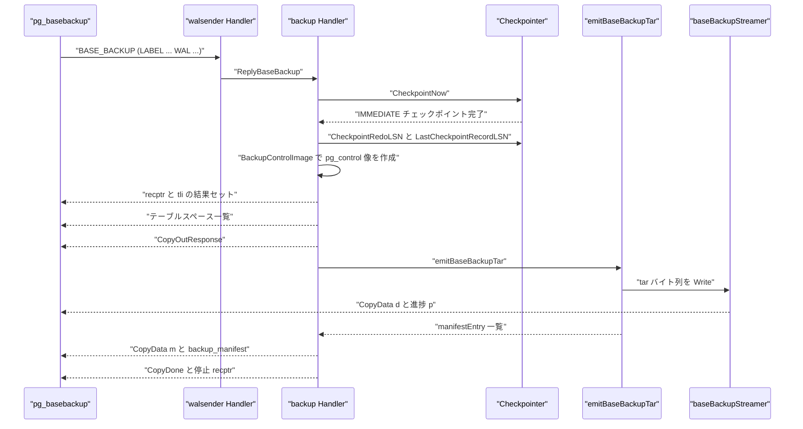
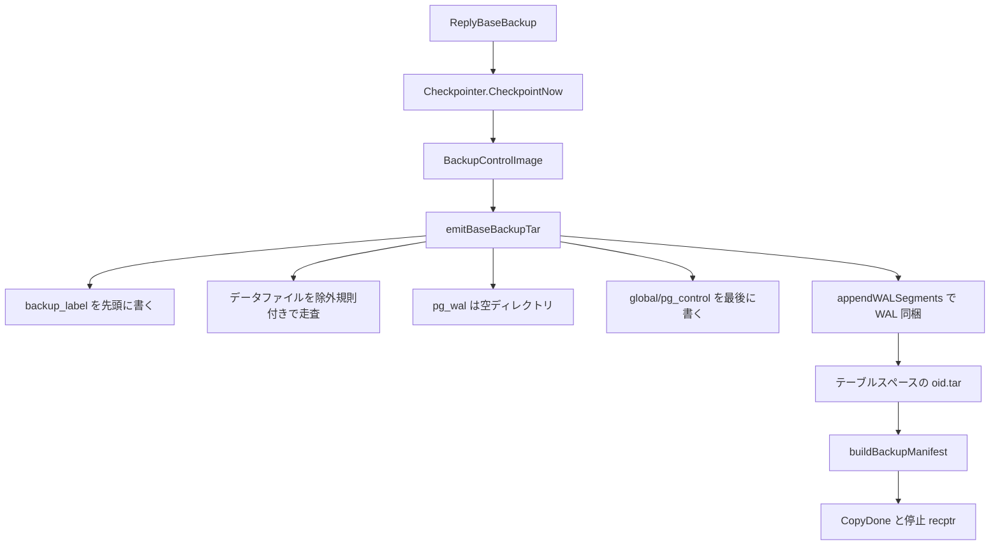

# ベースバックアップ

<details>
<summary>関連ソースファイル</summary>

- [`internal/access/common/blkreftable/blkreftable.go`](https://github.com/ryogrid/goopg/blob/19856410e8d497d59787e1ab35a2febb3f5953d6/internal/access/common/blkreftable/blkreftable.go)
- [`internal/access/transam/xlog/checkpointer.go`](https://github.com/ryogrid/goopg/blob/19856410e8d497d59787e1ab35a2febb3f5953d6/internal/access/transam/xlog/checkpointer.go)
- [`internal/access/transam/xlog/recovery.go`](https://github.com/ryogrid/goopg/blob/19856410e8d497d59787e1ab35a2febb3f5953d6/internal/access/transam/xlog/recovery.go)
- [`internal/access/transam/xlog/writer.go`](https://github.com/ryogrid/goopg/blob/19856410e8d497d59787e1ab35a2febb3f5953d6/internal/access/transam/xlog/writer.go)
- [`internal/backup/basebackup.go`](https://github.com/ryogrid/goopg/blob/19856410e8d497d59787e1ab35a2febb3f5953d6/internal/backup/basebackup.go)
- [`internal/backup/walsummary/walsummary.go`](https://github.com/ryogrid/goopg/blob/19856410e8d497d59787e1ab35a2febb3f5953d6/internal/backup/walsummary/walsummary.go)
- [`internal/executor/operators_checkpoint.go`](https://github.com/ryogrid/goopg/blob/19856410e8d497d59787e1ab35a2febb3f5953d6/internal/executor/operators_checkpoint.go)
- [`internal/initdb/pgcontrol.go`](https://github.com/ryogrid/goopg/blob/19856410e8d497d59787e1ab35a2febb3f5953d6/internal/initdb/pgcontrol.go)
- [`internal/libpq/messages.go`](https://github.com/ryogrid/goopg/blob/19856410e8d497d59787e1ab35a2febb3f5953d6/internal/libpq/messages.go)
- [`internal/replication/replication_util.go`](https://github.com/ryogrid/goopg/blob/19856410e8d497d59787e1ab35a2febb3f5953d6/internal/replication/replication_util.go)
- [`internal/replication/walsender.go`](https://github.com/ryogrid/goopg/blob/19856410e8d497d59787e1ab35a2febb3f5953d6/internal/replication/walsender.go)

</details>

ベースバックアップは、プライマリのデータディレクトリ全体を `tar` として複製し、そのバックアップを一貫した時点から再生できる WAL の開始位置を `backup_label` と `pg_control` に記録する仕組みです。`BASE_BACKUP` はレプリケーション接続上のコマンドとして `replication.Handler.HandleCommand` から `backup.Handler.ReplyBaseBackup` に振り分けられ、強制チェックポイント → `pg_control` のバックアップ用イメージ生成 → tar ストリーム → WAL 同梱 → manifest → 停止位置の結果セット、の順に進みます。クライアントは PostgreSQL の `pg_basebackup` をそのまま使え、受け取った tar と WAL を展開したスタンバイは [11.2 スタンバイと昇格](11.2-Standby-and-Promotion.md) の手順で起動できます。WAL そのものの形式は [10.1 WAL フォーマット](../10-WAL/10.1-WAL-Format.md)、WAL サマリの詳細は [11.6 WAL サマリ](11.6-WAL-Summary.md) を参照してください。

## 責務

- `BASE_BACKUP` を `ReplyBaseBackup` に振り分け、未設定時は `feature_not_supported` を返す（`internal/replication/walsender.go:HandleCommand`、`internal/backup/basebackup.go:ReplyBaseBackup`）。
- バックアップ開始前に `Checkpointer.CheckpointNow` で同期 IMMEDIATE チェックポイントを実行し、すべての dirty ページをディスクへ落とす（`basebackup.go`、`internal/access/transam/xlog/checkpointer.go:CheckpointNow`）。
- チェックポイントの REDO LSN と、チェックポイントレコード自身の開始 LSN を取得する。両者は A9 以降区別される（`Checkpointer.CheckpointRedoLSN`、`LastCheckpointRecordLSN`）。
- `backup_label`、`pg_control`、manifest に載せる LSN を goopg の 1 始まりから PostgreSQL の 0 始まりへ変換する（`baseLSN0 = redoLSN - 1`、`ckptLSN0 = ckptRecLSN - 1`）。
- ライブの `pg_control` を書き換えず、バックアップに同梱するためだけの `pg_control` イメージを `BackupControlImage` で生成する（`internal/initdb/pgcontrol.go:BackupControlImage`）。
- `recptr` / `tli` の開始結果セット、テーブルスペース一覧、`CopyOutResponse` を順に送る（`writeRecPtrResult`、`writeTablespaceList`）。
- `backup_label` を先頭、`global/pg_control` を最後にして POSIX ustar をストリームし、`pg_wal` は空ディレクトリとして送る（`emitBaseBackupTar`）。
- `pg_wal` のプロセス固有ファイルと再構築可能なディレクトリ内容を除外する（`excludeFiles`、`excludeDirContents`、`isExcludedFile`）。
- `WAL` オプション（`pg_basebackup -X fetch`）では、redo から現在までのセグメントを連続性検査付きで tar に同梱し、`<tli>.history` も加える（`appendWALSegments`）。
- イン・プレース・テーブルスペースを `<oid>.tar` として追加でストリームする（`collectInPlaceTablespaces`、`emitTablespaceTar`）。
- 1 MiB ごとの `'p'` 進捗フレームと、要求時の `'m'` manifest フレームを送る（`baseBackupStreamer.Write`、`writeProgressFrame`、`streamBackupManifest`）。
- バックアップ manifest（`Files[]`、`WAL-Ranges`、`Manifest-Checksum`）を PostgreSQL 互換のバイト列で組み立てる（`buildBackupManifest`）。
- 停止位置を再度 `recptr` / `tli` の結果セットで返し、`CommandComplete("BASE_BACKUP")` と `ReadyForQuery` で終える（`ReplyBaseBackup`）。

## 処理フロー

`pg_basebackup` から見た 1 回の BASE_BACKUP の実経路です。



`ReplyBaseBackup` は `DataDir` が空なら `feature_not_supported`、オプションの `MANIFEST_CHECKSUMS` が未知なら同じく `feature_not_supported` を返します。チェックポイントが失敗すれば `internal_error` で終了し、tar の読み出し中に失敗した場合は `writeStreamingError`（`ErrorResponse`）でストリームを打ち切ります。

tar の組み立て順と、WAL・テーブルスペース・manifest の関係です。



## 主要ファイル

| ファイル | 役割 |
| --- | --- |
| `internal/backup/basebackup.go` | BASE_BACKUP 本体。`ReplyBaseBackup`、`emitBaseBackupTar`、`appendWALSegments`、`buildBackupManifest`、`parseBaseBackupOptions` |
| `internal/access/common/blkreftable/blkreftable.go` | WAL サマリが使うブロック参照テーブル。`Table`、`Entry`、`MarkBlockModified`、`SetLimitBlock` |
| `internal/access/transam/xlog/checkpointer.go` | バックアップ前チェックポイントと LSN の供給。`CheckpointNow`、`CheckpointRedoLSN`、`LastCheckpointRecordLSN` |
| `internal/access/transam/xlog/recovery.go` | バックアップからの復旧を支える再生。`applyTblspcCreate`、`applyDbaseCreate`、`requireFullPageImages` |
| `internal/access/transam/xlog/writer.go` | 停止 LSN とタイムラインの供給。`Writer.WrittenLSN`、`TimelineID` |
| `internal/backup/walsummary/walsummary.go` | WAL サマリファイルの命名・列挙・読み書き。`File`、`List`、`Filter`、`AreComplete`、`Read` |
| `internal/executor/operators_checkpoint.go` | SQL `CHECKPOINT` と共通のチェックポイント実行。`checkpointOp.Open`、`Checkpointer.CheckpointNow` |
| `internal/initdb/pgcontrol.go` | バックアップ用 `pg_control` イメージ。`BackupControlImage` |
| `internal/libpq/messages.go` | 結果セット・CopyData・CopyDone の書き出し。`WriteCopyOutResponse`、`WriteCopyData`、`WriteCopyDone`、`WriteRowDescription` |
| `internal/replication/replication_util.go` | LSN の解析・表記。`parseLSN`、`formatLSN`、`summariseErrorResponse` |
| `internal/replication/walsender.go` | `BASE_BACKUP` の振り分け。`HandleCommand`、`Config.WALDirPath` など |

## 公開 API / エントリポイント

バックアップハンドラ:

```go
func NewHandler(cfg Config, werr WriteQueryErrorFunc) *Handler
func (s *Handler) ReplyBaseBackup(ctx context.Context, w *libpq.FrameWriter, args string) error
```

`Config.DataDir` が空のとき `ReplyBaseBackup` は `feature_not_supported` を返します。`Config.Checkpointer` が nil なら強制チェックポイントをスキップし、`Config.WAL` が nil なら LSN は 0 のままです。`werr` が nil のとき `writeQueryError` は必ず非 nil のエラーを返し、ディスパッチループが「正常処理」と誤認しないようにしています。

`pg_control` イメージ:

```go
func BackupControlImage(dataDir string, redoLSN, ckptRecordLSN uint64, tli uint32) ([]byte, error)
```

バックアップ manifest / ラベル（`internal/backup` 内）:

```go
func buildBackupLabel(label string, startLSN, ckptLSN uint64, tli uint32, segSize int64) []byte
func buildBackupManifest(entries []manifestEntry, sysID uint64, tli uint32, startLSN, endLSN uint64, forceEncode bool) []byte
func streamBackupManifest(w *libpq.FrameWriter, manifest []byte) error
```

WAL サマリ（増分バックアップ用の部品）:

```go
func List(dataDir string, tli uint32, start, end uint64) ([]File, error)
func Filter(list []File, tli uint32, start, end uint64) []File
func AreComplete(list []File, start, end uint64) (complete bool, missing uint64)
func Read(dataDir string, f File) (*blkreftable.Reader, *os.File, error)
```

## 主要データ構造

### バックアップハンドラの `Config` と `Handler`

```go
// Config is the narrow slice of the postmaster's Config that BASE_BACKUP
// needs. postmaster builds one in New (server.go) and it is immutable for the
// life of the process, so the Handler is constructed once rather than per
// connection.
type Config struct {
	// DataDir is the cluster directory that gets tarred up. Empty means
	// BASE_BACKUP is unavailable (in-process protocol-only tests).
	DataDir string
	// WAL supplies the start/stop LSNs stamped into backup_label and the
	// two recptr result sets. nil leaves them zero.
	WAL *xlog.Writer
	// WALSegmentSize sizes the pg_wal segment names when INCLUDE_WAL is on.
	WALSegmentSize int64
	// Checkpointer forces the pre-backup checkpoint and supplies the REDO
	// location patched into the shipped pg_control. nil skips the
	// checkpoint, matching the v0 in-process default.
	Checkpointer executor.Checkpointer
}
```

`internal/backup/basebackup.go:Config`（89 行目）

```go
// Handler serves the BASE_BACKUP replication command. It replaces the
// *postmaster.Server receiver these methods used to hang off; the receiver is
// still named s and the config field is still named cfg so the handler bodies
// read exactly as they did inside postmaster.
type Handler struct {
	cfg  Config
	werr WriteQueryErrorFunc
}
```

`internal/backup/basebackup.go:Handler`（118 行目）

`cfg` はプロセス起動時に 1 度だけ構築され、以後不変です。`werr` は `postmaster` の `(*Server).writeQueryError` をコールバックとして受け取り、`errQueryErrorSent` を返します。`DataDir` / `WAL` / `Checkpointer` のどれが欠けても動作が変わるため、nil 許容は「機能を落とす」方向にだけ働きます。

### オプションの `baseBackupOptions`

```go
// baseBackupOptions is the parsed form of the optional `(...)` block.
type baseBackupOptions struct {
	Label    string
	Progress bool
	Manifest string // "yes" | "no" | "force-encode" | ""
	// ManifestChecksums names the per-file checksum algorithm the
	// client requested for the manifest (PG's MANIFEST_CHECKSUMS
	// option). Empty means the client did not send it; pg_basebackup
	// defaults to CRC32C. Recognised: "NONE", "CRC32C", "SHA224",
	// "SHA256", "SHA384", "SHA512" (case-insensitive).
	ManifestChecksums string
	Target            string // "client" by default; goopg ignores non-client targets
	Wait              int    // 0 means "don't wait for WAL"; goopg treats both the same
	// IncludeWAL is the upstream BASE_BACKUP `WAL` boolean. pg_basebackup
	// sets it for `-X fetch` (FETCH_WAL) — see pg_basebackup.c:1905-1906
	// (`AppendPlainCommandOption(&buf, ..., "WAL")`). When set the server
	// appends the in-range pg_wal segments to the backup tar instead of
	// relying on a concurrent `-X stream` walsender connection.
	IncludeWAL bool
}
```

`internal/backup/basebackup.go:baseBackupOptions`（1240 行目）

`parseBaseBackupOptions` は PG17+ の `LABEL 'x', PROGRESS, MANIFEST 'yes', TARGET 'client', WAIT 0, MANIFEST_CHECKSUMS 'CRC32C', WAL` 形式と、旧来の空白区切りキーワード形式の両方を受けます。`Progress` / `Target` / `Wait` は解析されますが処理には使われません（進捗フレームは要求に関係なく 1 MiB ごとに送られます）。`CHECKPOINT` / `TABLESPACE_MAP` / `VERIFY_CHECKSUMS` / `MAX_RATE` / `COMPRESSION` / `INCREMENTAL` などは受理して無視します。

### manifest の `manifestEntry` と `manifestChecksumKind`

```go
// manifestEntry is one Files[] record in the backup manifest: a file
// shipped in the base tar, with the metadata pg_verifybackup needs to
// cross-check it against the extracted backup.
type manifestEntry struct {
	path  string    // slash path relative to the data directory
	size  int64     // byte length as shipped
	mtime time.Time // tar-header mtime (reported as GMT in the manifest)
	algo  string    // "Checksum-Algorithm" value; "" if mckNone
	cksum string    // lowercase-hex digest; "" if mckNone
}
```

`internal/backup/basebackup.go:manifestEntry`（699 行目）

```go
// manifestChecksumKind enumerates the per-file checksum algorithms the
// backup manifest can carry. Mirrors PG's pg_checksum_type.
type manifestChecksumKind int

const (
	mckCRC32C manifestChecksumKind = iota // PG default
	mckNone
	mckSHA224
	mckSHA256
	mckSHA384
	mckSHA512
)
```

`internal/backup/basebackup.go:manifestChecksumKind`（615 行目）

`manifestEntry` の `algo` と `cksum` は `mckNone` のとき空文字になり、manifest から `Checksum-Algorithm` / `Checksum` フィールド自体が省略されます。CRC32C は 4 バイトの値をリトルエンディアンで並べたものを hex 化します。SHA 系はそれぞれのハッシュをそのまま hex 化します。`path` は常にスラッシュ区切りのデータディレクトリ相対パスで、`pg_wal/` 配下のファイルは `Files[]` には入りません。

### ストリーム送出の `baseBackupStreamer`

```go
// baseBackupStreamer adapts CopyData 'd' frame writing to an
// io.Writer interface so `archive/tar` can stream directly. It
// chunks writes to baseBackupChunkBytes and emits periodic 'p'
// progress reports — mirroring `bbsink_copystream_archive_contents`.
type baseBackupStreamer struct {
	w                *libpq.FrameWriter
	bytesDone        uint64
	nextProgressMark uint64
	ctx              context.Context
	// chunkBuf backs the CopyData payload. review/260831 NB-19: a fresh
	// baseBackupChunkBytes buffer was allocated per chunk — one per 64 KiB of
	// backup — even though WriteCopyData writes the bytes out synchronously
	// and keeps nothing.
	chunkBuf []byte
}
```

`internal/backup/basebackup.go:baseBackupStreamer`（560 行目）

`Write` は `baseBackupChunkBytes = 64 * 1024` バイトずつ `'d'` CopyData に包み、`bytesDone` が `nextProgressMark`（初期値 `baseBackupProgressInterval = 1 << 20`）を超えるたびに `'p'` フレームを挟みます。`ctx` は各チャンクの先頭で確認されるため、キャンセルは次の 64 KiB 境界で効きます。チャンクバッファは使い回され、呼び出しごとに確保しません。

### テーブルスペースの `inPlaceTablespace`

```go
// inPlaceTablespace describes an in-place tablespace discovered under
// $DataDir/pg_tblspc/<oid>. goopg only supports in-place tablespaces
// (CREATE TABLESPACE ... LOCATION ” with allow_in_place_tablespaces), so
// every numeric directory entry under pg_tblspc is one. relPath is the
// PGDATA-relative location reported to pg_basebackup ("pg_tblspc/<oid>"),
// matching ti->path/ti->rpath in xlog.c's in-place branch.
type inPlaceTablespace struct {
	oid     uint32
	dir     string // absolute path: $DataDir/pg_tblspc/<oid>
	relPath string // PGDATA-relative: "pg_tblspc/<oid>"
}
```

`internal/backup/basebackup.go:inPlaceTablespace`（965 行目）

`collectInPlaceTablespaces` は `pg_tblspc` 直下の数値ディレクトリだけをテーブルスペースとして拾い、OID 順に並べます。この順序がテーブルスペース一覧の結果セットと `<oid>.tar` のストリーム順の両方を決めます。

### WAL サマリの `File` とブロック参照テーブル

```go
// File identifies one summary file (WalSummaryFile): the WAL on timeline TLI
// from Start up to End.
type File struct {
	TLI   uint32
	Start uint64
	End   uint64
}
```

`internal/backup/walsummary/walsummary.go:File`（38 行目）

```go
// RelFileLocator identifies a relation's storage (storage/relfilelocator.h).
type RelFileLocator struct {
	SpcOid    uint32
	DbOid     uint32
	RelNumber uint32
}

// Key names one relation fork.
type Key struct {
	Locator RelFileLocator
	Fork    ForkNumber
}

// Entry is the state of one relation fork (BlockRefTableEntry).
//
// chunkUsage[i] is the number of offsets in array chunk i, or
// maxEntriesPerChunk when chunk i is a bitmap; chunkData[i] holds the offsets
// (array) or the bitmap words. A chunk whose usage is 0 contributes nothing,
// and SetLimitBlock drops chunks above the limit by zeroing their usage.
type Entry struct {
	key        Key
	limitBlock BlockNumber
	chunkUsage []uint16
	chunkData  [][]uint16
}

// Table is a block reference table: one Entry per relation fork.
type Table struct {
	entries map[Key]*Entry
}
```

`internal/access/common/blkreftable/blkreftable.go:RelFileLocator`（35 行目）、`Key`（52 行目）、`Entry`（63 行目）、`Table`（212 行目）

`Entry` は 1 つのリレーションフォークについて「変更されたブロック」と「リレーションの最短長（limit block）」を持ちます。`chunkUsage` が `maxEntriesPerChunk`（= 4096）のチャンクはビットマップ表現、それ未満はオフセット配列です。`SetLimitBlock` は limit 以上の変更を捨て、それより後ろのチャンクをゼロにします。`Table` は `Key`（テーブルスペース・データベース・リレーション・フォーク）から `Entry` へのマップで、`SortedEntries` が `SpcOid → DbOid → RelNumber → Fork` の順に並べます。

これらは PG18 の増分バックアップ（`pg_wal/summaries` の WAL サマリ）が使う形式です。goopg の BASE_BACKUP は `pg_wal/summaries` を空ディレクトリとして送るだけで、サマリファイル自体は tar に含めません。`INCREMENTAL` オプションも受理して無視するため、goopg は増分バックアップを提供していません（WAL サマリの生成・照会は [11.6 WAL サマリ](11.6-WAL-Summary.md)）。

## 内部構造

### ワイヤ上のシーケンス

`ReplyBaseBackup` は次の順でフレームを書きます。

1. `RowDescription("recptr","tli")` + `DataRow(startLSN, startTLI)` + `CommandComplete("SELECT")`。
2. `RowDescription("spcoid","spclocation","size")` + テーブルスペースごとの `DataRow` + 既定テーブルスペースの `NULL/NULL/NULL` 行 + `CommandComplete("SELECT")`。
3. `CopyOutResponse(format=0, natts=0)`。
4. `CopyData('n' "base.tar"\0 ""\0)`。
5. `CopyData('d' tar bytes)` の連続。1 MiB ごとに `CopyData('p' int8be bytes-done)`。
6. テーブルスペースごとに `'n' "<oid>.tar"` と `'d'` の連続。
7. manifest 要求時は `CopyData('m')` の後に manifest 本体を `'d'` で分割送出。
8. `CopyDone`。
9. `RowDescription("recptr","tli")` + `DataRow(stopLSN, stopTLI)` + `CommandComplete("SELECT")`。
10. `CommandComplete("BASE_BACKUP")` + `ReadyForQuery`。

`'d'` の先頭 1 バイトが種別、残りがデータです。`'n'` は `name\0path\0`、`'p'` は `p` + 8 バイト big-endian、`'m'` は manifest 開始の合図だけです。

### LSN の基準と `pg_control` のパッチ

goopg 内部の LSN は 1 始まりですが、PostgreSQL の `backup_label` と `pg_control` は 0 始まりを期待します。`ReplyBaseBackup` は `redoLSN` から `baseLSN0 = redoLSN - 1`、チェックポイントレコードの開始 LSN から `ckptLSN0 = ckptRecLSN - 1` を作ります。`startLSN` は **redo** であり、`WrittenLSN` ではありません。redo から WAL を流せば、チェックポイントからバックアップ終了までの全変更を再生できます。

A9 以降、ONLINE チェックポイントのレコードは redo の位置そのものにはありません（直前に `XLOG_RUNNING_XACTS` が入り得ます）。そのため `backup_label` の `CHECKPOINT LOCATION` と `pg_control.CheckPoint` には `LastCheckpointRecordLSN` を使います。`redo` の位置をそのまま書くと、PG のスタンバイは「checkpoint レコードではない」として拒否します。

`BackupControlImage` はライブの `pg_control` を変更せず、次のフィールドを書き換えたイメージを返します。

- `State = DBStateInProduction`、`Time = now`。
- `CheckPoint = ckptRecordLSN - 1`、`CheckPointCopyRedo = redoLSN - 1`。
- `CheckPointCopyThisTLI = CheckPointCopyPrevTLI = tli`。
- `CheckPointCopyFullPageWrites = true`。
- `MinRecoveryPoint = 1`、`MinRecoveryPointTLI = tli`。
- `BackupEndPoint = redoLSN - 1`。

`MinRecoveryPoint` を 1 にするのは、0 だと `XLogRecPtrIsInvalid(0)` が真になり `CheckRecoveryConsistency` が即座に諦めるためです。TLI を揃えるのは、昇格済みクラスタで「要求タイムラインに最小リカバリ点が無い」FATAL を避けるためです。このイメージは tar の `global/pg_control` にだけ使われ、ライブのファイルは書き換えません。

### tar の構成と除外規則

`emitBaseBackupTar` は `backup_label` を最初に書き、続いて `dataDir` を `filepath.Walk` で走査します。`pg_wal` は walk せず、`pg_wal/`・`pg_wal/archive_status/`・`pg_wal/summaries/` の 3 つの空ディレクトリだけを登録します。`global/pg_control` は walk 中に記録だけして保留し、最後に書きます。これは復旧側が「制御ファイルが最後に現れる」ことを前提にできるようにするためです。

除外は 2 種類あります。

- `excludeFiles`: `postmaster.pid`、`postmaster.opts`、`.goopg.ctl.sock`、`postgresql.auto.conf.tmp`、`current_logfiles.tmp`、`backup_label`、`tablespace_map`、`backup_manifest`、`pg_internal.init*`、`global/pg_xact`。
- `excludeDirContents`: `pg_replslot`、`pg_stat_tmp`、`pg_dynshmem`、`pg_notify`、`pg_serial`、`pg_snapshots`、`pg_subtrans`。ディレクトリ自体は空の tar エントリとして送り、中身だけを落とします。

`pg_tblspc/<oid>` は base.tar にはディレクトリエントリだけを入れ、中身は `<oid>.tar` に分けます。テーブルスペース tar は `misc.TablespaceVersionDirectory` のディレクトリとその配下だけを、テーブルスペース根からの相対パスで格納します。バージョンディレクトリが無い場合は空の tar として扱います。

### WAL の同梱

`WAL` オプションがあると、`walStartSeg = baseLSN0 / segSize`、`walEndSeg = (WrittenLSN - 1 - 1) / segSize`（`WrittenLSN` が 0 なら開始セグメント）を計算し、`appendWALSegments` が `pg_wal` を走査します。`xlog.ParseXLogFileName` でセグメント名を解析し、`[startSeg, endSeg]` の範囲を古い順に tar へ追加します。範囲に欠番があれば `could not find WAL file` で失敗します。バックアップが WAL を要求しながら一貫性区間を供給できないと使えないためです。`.history` ファイルはすべて（範囲に関係なく）追加されます。

同梱した WAL は manifest の `Files[]` には入れません。PG は WAL を `WAL-Ranges` で追跡するためです。

### manifest の組み立て

`buildBackupManifest` は PG の version 2 manifest をバイト単位で模倣します。

```
{ "PostgreSQL-Backup-Manifest-Version": 2,
"System-Identifier": <sysid>,
"Files": [ { "Path": ..., "Size": ..., "Last-Modified": ...,
             "Checksum-Algorithm": ..., "Checksum": ... }, ... ],
"WAL-Ranges": [ { "Timeline": <tli>, "Start-LSN": "X/X", "End-LSN": "X/X" } ],
"Manifest-Checksum": "<sha256hex>"}
```

`Files[]` の各エントリは tar に書いた順で、`pg_wal/` 配下は除外されます。`force-encode` またはパスが不正 UTF-8 のときは `Encoded-Path` に hex を書きます。`Manifest-Checksum` はそれまでの全バイトに対する SHA-256 で、per-file の checksum アルゴリズムとは独立です。`streamBackupManifest` は `'m'` の後に manifest を 64 KiB ずつ `'d'` で送ります。終端は `CopyDone` です。

### チェックポイントとの排他

`CheckpointNow` は `runMu` でチェックポイントを直列化し、IMMEDIATE 要求を登録してから実行します。したがって BASE_BACKUP の強制チェックポイントは、同時に走っている時間トリガや SQL `CHECKPOINT` と競合せず、完了時に `lastCheckpointRedoLSN` / `lastCheckpointStartLSN` が確定しています。`ReplyBaseBackup` はその確定値を読むため、tar の開始前に redo が動くことはありません（次のチェックポイントは tar 中に走り得ますが、バックアップの開始点は既に固定済みです）。

### バックアップからの復旧を支える側

バックアップ tar には `base/<dbid>` や `pg_tblspc/<oid>` のディレクトリが含まれない場合があります。WAL 再生側の `applyDbaseCreate` と `applyTblspcCreate` は、そのようなバックアップに対して `MkdirAll` でディレクトリを再作成し、続く full-page-image レコードが関係ファイルを埋めます。goopg がネイティブ redo を持たない opcode は `requireFullPageImages` が「全ブロックに適用可能な FPI があるか」を検査し、無ければ `ErrUnsupportedRecord` で開始を拒否します。バックアップの `pg_control` が `FullPageWrites = true` を主張するのは、この再生経路と整合させるためです。

## エッジケースと不変条件

- **`DataDir` 未設定**: `ReplyBaseBackup` は `feature_not_supported` を返します。プロトコルだけのテスト用サーバーで BASE_BACKUP を呼んだ場合の経路です。
- **未知の `MANIFEST_CHECKSUMS`**: オプション解析後に `parseManifestChecksumKind` で検証し、未知なら `feature_not_supported` です。`""` と `CRC32C` は同じ既定値、`NONE` は checksum フィールドを省略します。
- **チェックポイント失敗**: `internal_error` で即座に終了し、tar は 1 バイトも送りません。
- **`redo` とチェックポイントレコードの違い**: `startLSN` は redo、`backup_label` の `CHECKPOINT LOCATION` と `pg_control.CheckPoint` はチェックポイントレコードの開始 LSN です。両者を混同すると PG スタンバイが checkpoint レコードを認識できません。
- **`WrittenLSN` へのフォールバック**: チェックポインタが nil、または redo が 0 のときは `WAL.WrittenLSN()` を redo として使います。この場合 `ckptRecLSN` も redo に一致します。
- **LSN の 0 始まり変換**: 内部 LSN から 1 を引くのは `backup_label`、`pg_control`、manifest の `WAL-Ranges` だけです。ワイヤの `formatLSN` は受け取った値をそのまま `X/X` にします。`startLSN` 自体は 1 始まりのまま結果セットに載ります。
- **ライブ `pg_control` の不変**: `BackupControlImage` は `control.BuildUpdatedControlImage` でイメージを作るだけで、`UpdateControlFile` を呼びません。ライブ側を書き換えると、次回チェックポイントまでのクラッシュで `minRecoveryPoint=1` が残り、昇格済みクラスタが FATAL になります。
- **`MinRecoveryPoint = 1`**: 0 は「無効」を意味するため、必ず 1 以上にします。TLI も live の TLI に合わせます。
- **`pg_control` は tar の最後**: walk 中に保留し、全データファイルの後に書きます。復旧側が制御ファイルを読めた時点で tar が完全であることを保証するためです。
- **`pg_wal` の扱い**: 常に空ディレクトリ 3 つ（`pg_wal`、`archive_status`、`summaries`）だけを送り、実セグメントは `WAL` オプションがあるときだけ `appendWALSegments` で追加します。`pg_replslot` なども空ディレクトリとして送ります。
- **WAL 同梱の連続性**: `[startSeg, endSeg]` に欠番があると `could not find WAL file` で失敗します。`endLSN0 == 0` の場合は終了セグメントを開始セグメントに丸めます。
- **WAL は manifest の `Files[]` に入らない**: `record` は `pg_wal` と `pg_wal/` 配下を無条件に除外します。WAL は `WAL-Ranges` で表現されます。
- **manifest のチェックサム**: per-file の `Checksum` は選択アルゴリズム、末尾の `Manifest-Checksum` は常に SHA-256 です。CRC32C は 4 バイトをリトルエンディアンで hex 化します。
- **manifest は `CopyDone` の前**: `'m'` → manifest の `'d'` → `CopyDone` の順です。`'m'` に終端マーカーはなく、`CopyDone` がストリーム全体の終端になります。
- **テーブルスペース tar のパス**: tar 内はバージョンディレクトリ相対、manifest の `path` は `pg_tblspc/<oid>/<version>/<file>` です。バージョンディレクトリが無い場合は空の tar を返します。
- **`PROGRESS` / `TARGET` / `WAIT` は無視**: 進捗フレームは常に 1 MiB 間隔で送られ、`TARGET` は `client` 以外も受理し、`WAIT` は待ち合わせに使われません。
- **`INCREMENTAL` は未実装**: オプションは受理されますが無視され、`pg_wal/summaries` も空ディレクトリとして送られます。増分バックアップは提供されません。
- **チャンク境界**: `'d'` のペイロードは最大 64 KiB（種別バイトを含めて 65537 バイト）です。`archive/tar` の大きな Write はこの境界で分割されます。
- **キャンセル**: `baseBackupStreamer.Write` は各チャンクの先頭で `ctx.Err()` を見ます。tar 読み出し中のキャンセルは最大 64 KiB 遅れて反映されます。
- **エラー時のストリーム**: tar 生成中の失敗は `ErrorResponse` を送って終了します。`CopyOutResponse` を送った後に通常の `CommandComplete` を送らないため、クライアントはバックアップ失敗として扱います。
- **テーブルスペース一覧の順序**: OID 昇順の非既定テーブルスペース行の後に、既定テーブルスペースの `NULL/NULL/NULL` 行を送ります。アーカイブの送出順（base.tar → `<oid>.tar`）とは独立です。
- **`\0` 区切りの `'n'` フレーム**: `name` と `path` は NUL 終端です。既定テーブルスペースの `path` は空文字で、`NULL` ではありません。

## 関連ページ

- [11.1 物理ストリーミングレプリケーション](11.1-Physical-Streaming.md)
- [11.2 スタンバイと昇格](11.2-Standby-and-Promotion.md)
- [11.3 論理レプリケーション](11.3-Logical-Replication.md)
- [11.4 テーブル同期と適用ワーカー](11.4-Table-Sync.md)
- [11.6 WAL サマリ](11.6-WAL-Summary.md)
- [11 レプリケーションとバックアップ](../11-Replication.md)
- [10 WAL と耐久性](../10-WAL.md)

Sources:
- `internal/access/common/blkreftable/blkreftable.go`
- `internal/access/transam/xlog/checkpointer.go`
- `internal/access/transam/xlog/recovery.go`
- `internal/access/transam/xlog/writer.go`
- `internal/backup/basebackup.go`
- `internal/backup/walsummary/walsummary.go`
- `internal/executor/operators_checkpoint.go`
- `internal/initdb/pgcontrol.go`
- `internal/libpq/messages.go`
- `internal/replication/replication_util.go`
- `internal/replication/walsender.go`

<sub>Generated by deepwiki-4myself from `goopg` @ `19856410e`</sub>
