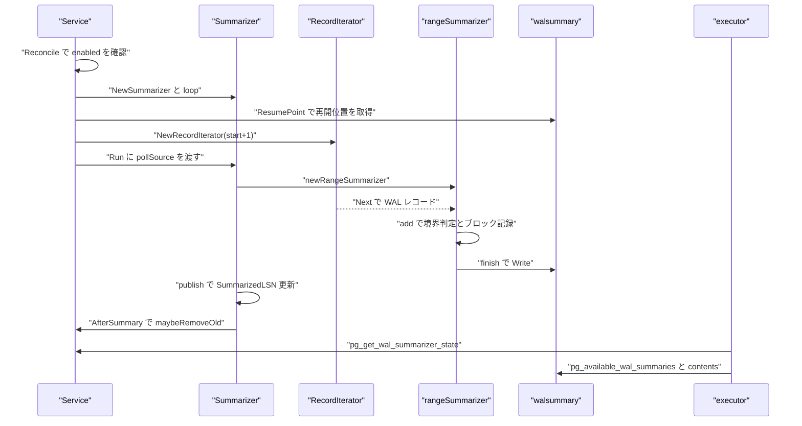
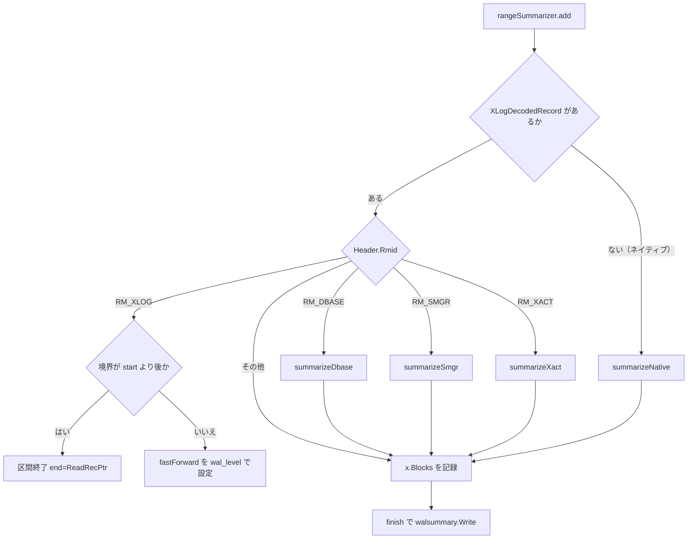

# WAL サマリ

<details>
<summary>関連ソースファイル</summary>

- [`internal/access/common/blkreftable/blkreftable.go`](https://github.com/ryogrid/goopg/blob/19856410e8d497d59787e1ab35a2febb3f5953d6/internal/access/common/blkreftable/blkreftable.go)
- [`internal/access/common/blkreftable/serialize.go`](https://github.com/ryogrid/goopg/blob/19856410e8d497d59787e1ab35a2febb3f5953d6/internal/access/common/blkreftable/serialize.go)
- [`internal/access/transam/xlog/classifier.go`](https://github.com/ryogrid/goopg/blob/19856410e8d497d59787e1ab35a2febb3f5953d6/internal/access/transam/xlog/classifier.go)
- [`internal/backup/basebackup.go`](https://github.com/ryogrid/goopg/blob/19856410e8d497d59787e1ab35a2febb3f5953d6/internal/backup/basebackup.go)
- [`internal/backup/walsummary/walsummary.go`](https://github.com/ryogrid/goopg/blob/19856410e8d497d59787e1ab35a2febb3f5953d6/internal/backup/walsummary/walsummary.go)
- [`internal/executor/expr_walfuncs.go`](https://github.com/ryogrid/goopg/blob/19856410e8d497d59787e1ab35a2febb3f5953d6/internal/executor/expr_walfuncs.go)
- [`internal/executor/operators_pg_available_wal_summaries.go`](https://github.com/ryogrid/goopg/blob/19856410e8d497d59787e1ab35a2febb3f5953d6/internal/executor/operators_pg_available_wal_summaries.go)
- [`internal/postmaster/walsummarizer/live.go`](https://github.com/ryogrid/goopg/blob/19856410e8d497d59787e1ab35a2febb3f5953d6/internal/postmaster/walsummarizer/live.go)
- [`internal/postmaster/walsummarizer/service.go`](https://github.com/ryogrid/goopg/blob/19856410e8d497d59787e1ab35a2febb3f5953d6/internal/postmaster/walsummarizer/service.go)
- [`internal/postmaster/walsummarizer/summarize.go`](https://github.com/ryogrid/goopg/blob/19856410e8d497d59787e1ab35a2febb3f5953d6/internal/postmaster/walsummarizer/summarize.go)

</details>

WAL サマリは、WAL を「redo 点と次の redo 点の間」の区間に区切り、その区間で変更されたリレーションのブロック番号を `pg_wal/summaries/<TLI><start><end>.summary` に書き出す仕組みです。`postmaster/walsummarizer.Service` が `summarize_wal` の有効化に合わせて goroutine を起動し、`Summarizer.Run` が `RecordIterator` から WAL レコードを読み、`rangeSummarizer.add` がリソースマネージャごとに変更ブロックを `blkreftable.Table` へ記録します。書き出したサマリは `pg_available_wal_summaries()` / `pg_wal_summary_contents()` で照会でき、PG18 の増分バックアップが「前回のバックアップ以降に変わったブロック」を求める材料になります。WAL の形式は [10.1 WAL フォーマット](../10-WAL/10.1-WAL-Format.md)、ベースバックアップとの関係は [11.5 ベースバックアップ](11.5-Base-Backup.md) を参照してください。

## 責務

- `summarize_wal` の on/off に合わせて要約 goroutine を起動・停止する（`internal/postmaster/walsummarizer/service.go:Service.Reconcile`、`Stop`）。
- 既存サマリの最大 `End` から再開位置を求め、無ければ最も古い WAL セグメントの最初のレコード、さらに無ければ最新の redo 点へフォールバックする（`ResumePoint`、`oldestSegmentLSN`、`runOnce`）。
- WAL を `FlushedLSN` までに制限して読み、クラッシュで書き換わり得る範囲を要約しない（`Service.runOnce` の `it.SetReadLimit(s.cfg.WAL.FlushedLSN)`、`Source`）。
- redo 点・シャットダウンチェックポイント・パラメータ変更・リカバリ終了を区間境界として扱い、`wal_level=minimal` の区間はファイルを書かずに読み飛ばす（`boundary`、`rangeSummarizer.add`、`finish`）。
- データベース作成/削除、`smgr` の作成/切り詰め、トランザクションでのリレーション削除、goopg ネイティブの `HeapLock` / `HeapVacuum` / `HeapVisible` をブロック参照テーブルへ反映する（`summarizeDbase`、`summarizeSmgr`、`summarizeXact`、`summarizeNative`）。
- 区間ごとの `blkreftable.Table` を PostgreSQL 互換のバイナリ形式に直し、`temp.summary` → rename で原子的に書く（`walsummary.Write`、`blkreftable.Table.Write`）。
- 書き出し後に `State` を更新し、待機者へ `changed` チャネルの close で通知する（`Summarizer.publish`、`Changed`）。
- チェックポイントの redo が動いたときに、WAL が消えていて保持期限を過ぎたサマリを削除する（`Service.maybeRemoveOld`、`walsummary.RemoveOld`）。
- WAL 保持の下限として「まだ要約していない LSN」を公開する（`Service.KeepLSN`）。
- `pg_available_wal_summaries()` / `pg_wal_summary_contents()` / `pg_get_wal_summarizer_state()` にサマリの一覧・内容・状態を返す（`internal/executor/operators_pg_available_wal_summaries.go`）。
- サマリ形式のブロック参照テーブルを読み書きする（`internal/access/common/blkreftable/serialize.go:Reader`、`Writer`）。

## 処理フロー

`Service` の起動からサマリファイルの公開、SQL からの照会までの実経路です。



`Service.loop` は `runOnce` がエラーを返すと `RetryDelay`（既定 10 秒）待って再開します。`runOnce` は `ResumePoint` で既存サマリの最大 `End` を取り、無ければ最も古い WAL セグメントの先頭から `xlog.FindNextRecord` で最初のレコードを探し、それも無ければ `RedoLSN()` を待ちます。イテレータは goopg の 1 始まり LSN に合わせて `start+1` で開き、`FlushedLSN` を読み取り上限にします。

1 つの区間の判定と記録の流れです。



`add` は境界レコードを見つけると、その `ReadRecPtr` を区間の終端にして `done=true` を返します。境界レコード自身は消費されず、呼び出し元が新しい区間へ同じレコードを渡し直します（`Summarizer.Run` と `Summarize` の両方がこの契約に従います）。

## 主要ファイル

| ファイル | 役割 |
| --- | --- |
| `internal/access/common/blkreftable/blkreftable.go` | ブロック参照テーブルのデータ構造。`Table`、`Entry`、`Key`、`MarkBlockModified`、`SetLimitBlock` |
| `internal/access/common/blkreftable/serialize.go` | PostgreSQL 互換の直列化。`Magic`、`Writer`、`Reader`、`NextRelation`、`Blocks`、`ErrCorrupt` |
| `internal/access/transam/xlog/classifier.go` | 論理デコーディング用の WAL 分類。`Classify`、`classifyDecodedXLog`（要約は別経路） |
| `internal/backup/basebackup.go` | ベースバックアップ。`emitBaseBackupTar` が `pg_wal/summaries` を空ディレクトリとして送り、`INCREMENTAL` を無視する |
| `internal/backup/walsummary/walsummary.go` | サマリファイルの命名・列挙・読み書き・削除。`File`、`List`、`Filter`、`AreComplete`、`Read`、`Write`、`RemoveOld` |
| `internal/executor/expr_walfuncs.go` | WAL 位置関数。`evalPgCurrentWALLSN` が flush/write/insert の順序を保証する |
| `internal/executor/operators_pg_available_wal_summaries.go` | サマリ照会 SRF。`pgAvailableWalSummariesOp`、`pgWalSummaryContentsOp`、`walSummarizerStateRow` |
| `internal/postmaster/walsummarizer/live.go` | ライブ要約ループと状態公開。`Source`、`State`、`Summarizer`、`Run`、`publish`、`ResumePoint` |
| `internal/postmaster/walsummarizer/service.go` | 有効化・停止・再試行・削除・保持 LSN。`Service`、`ServiceConfig`、`Reconcile`、`runOnce`、`maybeRemoveOld` |
| `internal/postmaster/walsummarizer/summarize.go` | レコード分類と区間要約。`boundary`、`summarizeDbase`、`summarizeSmgr`、`summarizeXact`、`summarizeNative`、`rangeSummarizer`、`Summarize` |

## 公開 API / エントリポイント

サービスとライブ要約:

```go
func NewService(cfg ServiceConfig) *Service
func (s *Service) Reconcile(parent context.Context, enabled bool)
func (s *Service) Stop()
func (s *Service) State() State
func (s *Service) WALReads() (reads, bytes int64)
func (s *Service) KeepLSN() uint64

func NewSummarizer(dataDir string, tli uint32) *Summarizer
func (s *Summarizer) Run(ctx context.Context, src Source, start uint64, exact bool) error
func (s *Summarizer) State() State
func (s *Summarizer) Changed() <-chan struct{}
func ResumePoint(dataDir string, tli uint32) (lsn uint64, ok bool, err error)
```

オフライン要約とサマリファイル:

```go
func Summarize(dataDir string, tli uint32, recs []xlog.Record, start uint64) ([]walsummary.File, uint64, error)

func List(dataDir string, tli uint32, start, end uint64) ([]File, error)
func Filter(list []File, tli uint32, start, end uint64) []File
func AreComplete(list []File, start, end uint64) (complete bool, missing uint64)
func Read(dataDir string, f File) (*blkreftable.Reader, *os.File, error)
func Write(dataDir string, f File, table *blkreftable.Table) error
func RemoveOld(dataDir string, keep time.Duration, now time.Time, oldestLSN func(tli uint32) (lsn uint64, ok bool)) ([]File, error)
```

ブロック参照テーブル:

```go
func NewTable() *Table
func (t *Table) SetLimitBlock(loc RelFileLocator, fork ForkNumber, limit BlockNumber)
func (t *Table) MarkBlockModified(loc RelFileLocator, fork ForkNumber, blk BlockNumber)
func (t *Table) SortedEntries() []*Entry
func (t *Table) Write(w io.Writer) error

func NewReader(r io.Reader, filename string) (*Reader, error)
func (rd *Reader) NextRelation() (key Key, limit BlockNumber, ok bool, err error)
func (rd *Reader) Blocks(dst []BlockNumber, max int) ([]BlockNumber, error)
```

## 主要データ構造

### ライブ要約の `Source` と `State`

```go
// Source yields decoded WAL records in order, blocking while none is
// available. *xlog.RecordIterator satisfies it; with SetReadLimit(
// Writer.FlushedLSN) it never yields WAL a crash could still rewrite.
type Source interface {
	Next(ctx context.Context) (xlog.Record, error)
}

// State is what the summarizer publishes (WalSummarizerData in
// walsummarizer.c, read by pg_get_wal_summarizer_state):
// SummarizedLSN is the end of the last summary written, PendingLSN the end
// of the last record read, LSNIsExact whether SummarizedLSN is a record
// boundary the next summary can start from exactly.
type State struct {
	Initialized   bool
	SummarizedTLI uint32
	SummarizedLSN uint64
	LSNIsExact    bool
	PendingLSN    uint64
	Running       bool
}

// IOCounters counts the WAL pages the summarizer reads, for pg_stat_io's
// (walsummarizer, wal, normal) reads / read_bytes cells. PG counts each
// XLOG_BLCKSZ page WALRead fetches; the summarizer counts each page its
// record stream enters. Cumulative across summarizer restarts.
type IOCounters struct {
	Reads     atomic.Int64
	ReadBytes atomic.Int64
}
```

`internal/postmaster/walsummarizer/live.go:Source`（17 行目）、`State`（26 行目）、`IOCounters`（39 行目）

`SummarizedLSN` は「書き出した最後のサマリの終端」、`PendingLSN` は「最後に読んだレコードの終端」です。`LSNIsExact` は再開位置がレコード境界として正確かどうかを示し、最初の区間を書き終えるまで false になり得ます。`Running` は `Run` の実行中だけ true です。`IOCounters` は `walPageSize = 8192` ページ単位で読み取り量を数え、`countPages` が同じページを二重に数えないよう `last` を進めます。

### `Summarizer`

```go
// Summarizer is the live WAL summarizer: it consumes a Source and writes a
// summary file at every redo point, as WalSummarizerMain / SummarizeWAL do.
// It is safe to read its State from other goroutines while Run executes.
type Summarizer struct {
	DataDir string
	TLI     uint32

	mu    sync.Mutex
	state State
	// changed is closed and replaced on every published summary, so
	// waiters (WaitForWalSummarization) can block on it.
	changed chan struct{}

	// AfterSummary, when set, runs after each summarized range, where
	// WalSummarizerMain calls MaybeRemoveOldWalSummaries.
	AfterSummary func()

	// IO, when set, counts the WAL pages read.
	IO *IOCounters
}
```

`internal/postmaster/walsummarizer/live.go:Summarizer`（68 行目）

`mu` は `state` と `changed` を保護します。`publish` は `SummarizedLSN` を進め、`changed` を close して新しいチャネルに差し替えるため、`Changed()` で待っていた goroutine は一度だけ起床します。`AfterSummary` はサマリ 1 本を書き終えるたびに呼ばれ、`Service` が `maybeRemoveOld` を刺しています。

### サービスの `ServiceConfig` と `Service`

```go
// ServiceConfig wires the summarizer into a running server. The package
// stays free of executor/initdb/postmaster imports; the server passes these
// hooks in (design §4.1).
type ServiceConfig struct {
	DataDir string
	WALDir  string
	SegSize int64
	WAL     *xlog.Writer
	// RedoLSN returns the PG LSN of the latest checkpoint's redo point, or 0
	// when none is known yet. It is the start position when no summary
	// exists.
	RedoLSN func() uint64
	Logger  *slog.Logger
	// PollInterval bounds how long the reader waits before re-checking the
	// flush pointer: the WAL writer wakes readers on append, not on flush.
	// 0 means 200ms, PG's sleep quantum.
	PollInterval time.Duration
	// RetryDelay is the pause after an error before summarization resumes.
	// 0 means 10s, as WalSummarizerMain waits.
	RetryDelay time.Duration
	// KeepTime returns wal_summary_keep_time; nil or <= 0 disables summary
	// file removal.
	KeepTime func() time.Duration
	// OnStart and OnStop bracket each run of the summarizer goroutine, so
	// the server can hold a pg_stat_activity slot for it (backend_type
	// walsummarizer) while it runs.
	OnStart, OnStop func()
	// FullPageWrites reports full_page_writes. Pages goopg dirties without a
	// block reference (MultiXact lock stamps, in-place pg_database writes)
	// reach a summary only through their first-touch FPI, so the summarizer
	// warns when it starts with full_page_writes off (design §4.4 guard).
	FullPageWrites func() bool
}

// Service runs the WAL summarizer when summarize_wal is on: the
// WalSummarizerMain process, which the postmaster starts while the
// setting is on and which exits when it is turned off.
type Service struct {
	cfg ServiceConfig

	// lastRemovalRedo is redo_pointer_at_last_summary_removal: removal runs
	// once per checkpoint cycle. Touched only by the summarizer goroutine.
	lastRemovalRedo uint64

	io IOCounters

	mu     sync.Mutex
	parent context.Context
	cancel context.CancelFunc
	done   chan struct{}
	sum    *Summarizer
}
```

`internal/postmaster/walsummarizer/service.go:ServiceConfig`（18 行目）、`Service`（52 行目）

`NewService` がゼロ値を補完します。`PollInterval` は 200 ms、`RetryDelay` は 10 秒、`Logger` は `slog.Default()` です。`Reconcile` は `enabled == running` なら何もせず、`parent` が nil なら前回の値を使います。`Stop` は cancel して `done` を待つため、停止は goroutine の終了までブロックします。`lastRemovalRedo` は要約 goroutine だけが触り、redo が動いた最初の `AfterSummary` で 1 回だけ削除を走らせるための番兵です。

### 区間の `rangeSummarizer`

```go
// rangeSummarizer is one SummarizeWAL call, fed a record at a time: it
// accumulates the BlockRefTable for the WAL from start until the next
// boundary record. Both the offline Summarize and the live Summarizer drive
// it, so the two cannot drift apart.
type rangeSummarizer struct {
	tli         uint32
	start, end  uint64
	fastForward bool
	tab         *blkreftable.Table
}
```

`internal/postmaster/walsummarizer/summarize.go:rangeSummarizer`（262 行目）

`newRangeSummarizer` は `fastForward=true` で始まります。最初の境界レコードが `start` 以前にあれば、そのレコードの `wal_level` に応じて `fastForward` を設定し直します。`fastForward` の間は `summarizeDbase` / `summarizeSmgr` / `summarizeXact` / `summarizeNative` を呼ばず、ブロック参照も記録しません。`finish` は `end <= start` または `fastForward` のときファイルを書かず、`(walsummary.File, wrote, err)` を返します。

### サマリファイルの `File`

```go
// File identifies one summary file (WalSummaryFile): the WAL on timeline TLI
// from Start up to End.
type File struct {
	TLI   uint32
	Start uint64
	End   uint64
}
```

`internal/backup/walsummary/walsummary.go:File`（38 行目）

ファイル名は `TLI`、`Start` の上位・下位、`End` の上位・下位をそれぞれ 8 桁の大文字 16 進で並べた 40 文字に `.summary` を付けます。`IsFilename` は 40 桁の大文字 hex だけを受理し、`temp.summary` や小文字 hex は無視します。`List` の LSN 境界は排他的（`start >= f.End` を除外、`end <= f.Start` を除外）、`Filter` の境界は包含的です。

### ブロック参照テーブルの `Entry` と `Table`

```go
// Entry is the state of one relation fork (BlockRefTableEntry).
//
// chunkUsage[i] is the number of offsets in array chunk i, or
// maxEntriesPerChunk when chunk i is a bitmap; chunkData[i] holds the offsets
// (array) or the bitmap words. A chunk whose usage is 0 contributes nothing,
// and SetLimitBlock drops chunks above the limit by zeroing their usage.
type Entry struct {
	key        Key
	limitBlock BlockNumber
	chunkUsage []uint16
	chunkData  [][]uint16
}

// Table is a block reference table: one Entry per relation fork.
type Table struct {
	entries map[Key]*Entry
}
```

`internal/access/common/blkreftable/blkreftable.go:Entry`（63 行目）、`Table`（212 行目）

1 チャンクは `blocksPerChunk = 1 << 16` ブロック、1 ワードは `blocksPerEntry = 16` ブロックです。`chunkUsage` が `maxEntriesPerChunk = 4096` のチャンクはビットマップ、それ未満はオフセット配列で、`MarkBlockModified` は配列が閾値に達するとビットマップへ切り替えます。`SetLimitBlock` は「これまでで最短の長さ」だけを保持し、limit 以上の変更を捨てます。`SortedEntries` は `SpcOid → DbOid → RelNumber → Fork` の順で、直列化順と一致します。

### 直列化の `Writer` と `Reader`

```go
// Writer serializes a table one entry at a time, for callers that build an
// entry, write it and drop it (CreateBlockRefTableWriter /
// BlockRefTableWriteEntry / DestroyBlockRefTableWriter). The caller must
// supply entries in SortedEntries order; the format does not record it, but
// readers merge files assuming it.
type Writer struct {
	c *crcWriter
}

// Reader reads a serialized table entry by entry
// (CreateBlockRefTableReader and friends). Errors carry PG's messages.
type Reader struct {
	r        *bufio.Reader
	crc      hash.Hash32
	filename string

	chunkSizes []uint16
	consumed   int
	chunkData  []uint16
	position   int
}
```

`internal/access/common/blkreftable/serialize.go:Writer`（114 行目）、`Reader`（139 行目）

ファイルは `Magic = 0x652b137b` で始まり、24 バイトのエントリ（`spcOid`、`dbOid`、`relNumber`、`forknum`、`limit_block`、`nchunks`）が続きます。全ゼロのエントリが終端で、その直後に CRC32C が 4 バイトで置かれます。整数はすべてリトルエンディアンです。`Reader.NextRelation` は前のリレーションのブロックを読み切っていないとエラーにし、`Reader.Blocks` は `max` 個ずつ返します。壊れたファイルは `ErrCorrupt` に包まれます。

## 内部構造

### 区間境界と `wal_level=minimal`

`boundary` は `RM_XLOG` の次の 4 種を境界として扱います。

| `Info` | レコード | `wal_level` の位置 |
| --- | --- | --- |
| `xlogCheckpointRedo` (`0xE0`) | `CHECKPOINT_REDO` | main data の先頭 4 バイト |
| `xlogCheckpointShutdown` (`0x00`) | シャットダウンチェックポイント | `CheckPoint.wal_level`（offset 20） |
| `xlogParameterChange` (`0x60`) | パラメータ変更 | `xl_parameter_change.wal_level`（offset 20） |
| `xlogEndOfRecovery` (`0x90`) | リカバリ終了 | `xl_end_of_recovery.wal_level`（offset 16） |

`wal_level == 0`（minimal）なら、その境界より後の WAL は「ブロック参照を持たない」ため、次の境界まで `fastForward` で読み飛ばします。これは PG の `SummarizeXlogRecord` と同じ判断です。境界レコードが現在の `start` 以前にある場合は区間を終了せず、`fastForward` の更新だけを行います。

### リソースマネージャごとの記録

- `RM_DBASE`: データベース作成（`xlogDbaseCreateFileCopy` / `xlogDbaseCreateWalLog`）は `{spc, db, relNumber 0}` の limit block を 0 にします。データベース削除は対象テーブルスペースごとに同じ limit を 0 にします。`relNumber 0` は「データベース全体」を表す sentinel です。
- `RM_SMGR`: `SMGR_CREATE` は FSM 以外のフォークの limit を 0 にします。`SMGR_TRUNCATE` は main フォークに `blkno` を、VM フォークにも **heap の blkno** を limit として設定します（PG と同じ）。
- `RM_XACT`: コミット/アボート（prepared を含む）の `DroppedRels` について、FSM を除く全フォークの limit を 0 にします。
- その他: `x.Blocks` の各ブロック参照を `MarkBlockModified` で記録します。FSM フォークは常に除外されます。
- ネイティブ: `HeapLock` と `HeapVacuum` は main フォークの対象ブロックを記録し、`HeapVisible` は all-visible/all-frozen の設定時に VM ブロックと heap ブロックの両方を記録します。VM ビットのクリアは何も記録せず、リレーション削除フラグは VM フォークの limit を 0 にします。

`RelFileLocator` のテーブルスペース OID は、デコード済みの `TblOid` が 0 のとき `pg_default`（1663）、`DbOid` も 0 なら `pg_global`（1664）に解決されます。

### 直列化の詳細

`serializedEntrySize = 24` バイトのエントリは、6 つの `uint32` をリトルエンディアンで並べたものです。エントリの後には `nchunks` 個の `uint16` チャンク使用量が続き、使用量が 0 でないチャンクのデータ（オフセット配列またはビットマップワード）が順に置かれます。`crcWriter` は書き込みながら CRC32C を更新し、`terminate` が全ゼロエントリを書いてから CRC を 4 バイトで書き、flush します。

`Reader` は `Magic` を検証してから `NextRelation` を繰り返します。`NextRelation` はエントリヘッダとチャンク使用量を読み、全ゼロなら CRC を検証して終端を返します。`Blocks` はチャンクを 1 つずつ読み、`max` 個に達するかリレーションが尽きるまで返します。チャンク使用量が `maxEntriesPerChunk` を超えると `ErrCorrupt` です。

### 再開位置と `LSNIsExact`

`ResumePoint` はディスク上のサマリの最大 `End` を返します。見つかれば `exact=true` で、その終端から次の区間を始められます。見つからない場合、`runOnce` は次の順で開始点を探します。

1. 最も古い WAL セグメントの先頭 `seg * segSize` から `xlog.FindNextRecord` で最初のレコードを探す。見つかれば `exact=false`。
2. それも無ければ `RedoLSN()`（最新チェックポイントの redo）。`exact` は false のまま。
3. どれも無ければ `PollInterval`（200 ms）ごとに再試行。

`Summarizer.Run` は `State` を `{Initialized:true, SummarizedLSN:start, LSNIsExact:exact, PendingLSN:start, Running:true}` で初期化し、最後に `Running=false` にします。`publish` は `SummarizedLSN` を新区間の終端へ進め、`LSNIsExact=true` にし、`PendingLSN` が古ければ引き上げ、`changed` を close します。fast-forward された区間はファイルを書きませんが、`SummarizedLSN` は進みます。

### 読み取りのポーリング

`runOnce` は `xlog.NewRecordIterator(s.cfg.WAL, s.cfg.WALDir, s.cfg.SegSize, start+1)` を作り、`SetReadLimit(s.cfg.WAL.FlushedLSN)` を設定します。`pollSource.Next` は `PollInterval` ごとにイテレータの `Next` をタイムアウト付きで呼び直します。WAL ライターは append 時に購読者を起こしますが flush 時には起こさないため、flush だけが進んだ場合にこのポーリングが読み取りを解放します。`context.DeadlineExceeded` は「まだ何も無い」として継続し、親 ctx のキャンセルだけが終了になります。

### 削除と WAL 保持

`maybeRemoveOld` は `KeepTime()` が正で、`RedoLSN()` が前回の削除時から動いたときだけ `walsummary.RemoveOld` を呼びます。`RemoveOld` は各サマリについて、そのタイムラインの最も古い WAL セグメント開始 LSN を求め、`f.End > oldest` ならまだ WAL が残っているので残します。WAL が無い（`ok=false`）か `f.End <= oldest` で、mtime が `now - keep` より古いものだけを削除します。`KeepLSN` は実行中かつ初期化済みのときだけ `SummarizedLSN` を返し、WAL 保持側が「まだ要約していない WAL」を消さないための下限になります。停止中や未実行時は 0（制約なし）です。

### SQL からの照会

`pg_available_wal_summaries()` は `walsummary.List(ctx.DataDir, 0, 0, 0)` の結果を `(tli, start_lsn, end_lsn)` の行にします。ディレクトリが無い場合は 0 行です。

`pg_wal_summary_contents(tli, start_lsn, end_lsn)` は 3 引数すべてが非 NULL のときだけ動作する strict な SRF です。TLI は 1〜`0x7fffffff`、LSN は `parsePgLSN` で検証します。`walsummary.Read` の失敗は、ファイル不在なら `58P01`、`ErrCorrupt` なら `XX001`、それ以外は `58030` に写像されます。1 リレーションにつき、limit block が有効なら `is_limit_block=true` の行を 1 つ出し、その後 `Blocks(..., 256)`（`MAX_BLOCKS_PER_CALL`）で 256 個ずつ変更ブロックを出します。

`pg_get_wal_summarizer_state()` は `Context.WalSummarizerState` のフックから `State` を取り、未初期化なら `0, 0/0, 0/0, NULL` を返します。実行中でなければ `pending_lsn` を `summarized_lsn` に落とし、pid を NULL にします。実行中なら `pending_lsn` は最後に読んだ位置、pid は監視スロットの PID です。

### 他の WAL 消費経路との違い

論理デコーディングは `internal/access/transam/xlog/classifier.go:Classify` でレコードを `Decoder` へ振り分け、`Begin` / `Change` / `Commit` のイベントに変換します。WAL サマリはその経路を使わず、`rangeSummarizer.add` が `xlog.XLogDecodedRecord` の `Header.Rmid` と `Blocks` を直接見ます。同じ WAL を読む 2 つの消費者ですが、目的が「行の変更」と「ブロックの変更」で異なるため、分類ロジックは共有していません。

ベースバックアップ側は `emitBaseBackupTar` で `pg_wal` を空ディレクトリとして送り、`pg_wal/summaries` の中身は含めません。`INCREMENTAL` オプションは `parseBaseBackupOptionList` が受理して無視するため、goopg の BASE_BACKUP は増分バックアップを提供しません。サマリは SQL 関数と将来の増分バックアップのためのデータであり、現時点のバックアップ tar には入りません。

## エッジケースと不変条件

- **`summarize_wal` の切り替え**: `Reconcile` は `enabled` と実行状態が一致すれば何もしません。停止は `Stop` が cancel して `done` を待つため、再起動時に前の goroutine が残りません。
- **`parent` が nil**: 最初の `Reconcile` で渡された ctx を保持し、以降の reload 呼び出しはそれを使います。一度も parent が無ければ起動しません。
- **再開位置の優先順**: 既存サマリの最大 `End` → 最古 WAL の最初のレコード → 最新 redo → 200 ms 待ち、の順です。既存サマリがある場合だけ `LSNIsExact=true` です。
- **読み取り上限**: イテレータは `FlushedLSN` を上限にするため、クラッシュで書き換わり得る WAL は要約に含まれません。`Source` の実装はこの上限を前提にしています。
- **境界の所有権**: 境界レコードは現在の区間を終了させますが、消費はされません。呼び出し元が新しい区間へ渡し直すため、境界レコード自体は次の区間の先頭になります。
- **`start` 以前の境界**: 境界が `start` 以前なら区間を終了せず、`fastForward` だけを更新します。最初の区間を redo 点まで早送りするための経路です。
- **`wal_level=minimal`**: 境界以降は次の境界までファイルを書きません。fast-forward 中は dbase/smgr/xact/native の記録も行いません。
- **空区間**: `end <= start` の区間はファイルを書きません。`finish` の `wrote=false` で、`Summarize` の戻り値にも含まれません。
- **FSM の除外**: `smgr` の create/truncate、ブロック参照、xact の削除、ネイティブ記録のすべてで FSM フォークは無視されます（FSM は完全には WAL ログされないため）。
- **VM truncate の blkno**: `SMGR_TRUNCATE` の VM フォーク limit には heap の `blkno` をそのまま使います。PG の `SummarizeSmgrRecord` と同じ扱いです。
- **`HeapVisible` のクリア**: all-visible/all-frozen のセットだけが VM と heap を記録します。ビットのクリアは何も記録せず、リレーション削除は VM の limit 0 になります。
- **ネイティブレコードの誤認防止**: `xlog.IsGoopgNativeRecord(r)` かつ `len(x.Blocks) == 0` のときだけ `summarizeNative` を呼びます。PG の同種レコードは必ずブロック参照を持つため、両者は衝突しません。
- **不正なレコード**: main data が短い dbase/smgr/xact レコードはエラーになり、`record at X/X` の形で LSN が付きます。`summarizeNative` のデコード失敗も同じです。
- **ファイルの原子性**: `walsummary.Write` は `pg_wal/summaries/temp.summary` に書き、fsync してから最終名へ rename し、ファイルとディレクトリを fsync します。クラッシュ時は「無い」か「完全」のどちらかです。
- **ファイル名の検証**: `IsFilename` は 40 桁の大文字 hex + `.summary` だけを受理します。`temp.summary` や小文字 hex は `List` から見えません。
- **`List` と `Filter` の境界差**: `List` は排他的（`start >= End`、`end <= Start` を除外）、`Filter` は包含的（`start > End`、`end < Start` を除外）です。同じ LSN 境界でも結果が変わり得ます。
- **CSV 的な CRC 終端**: 直列化の終端は全ゼロ 24 バイトの後に CRC32C が続きます。CRC 不一致は `ErrCorrupt` で、SQL 側では `XX001` です。
- **チャンクサイズ**: `Blocks` は使用量が `maxEntriesPerChunk` を超えると `ErrCorrupt` にします。ビットマップ表現は使用量が正確に 4096 のときだけです。
- **`NextRelation` の順序**: 前のリレーションのブロックを読み切る前に次を呼ぶとエラーです。`Blocks` を 0 個返すまで読み切る必要があります。
- **削除の条件**: WAL がまだ残っているサマリ（`f.End > oldest`）は mtime が古くても消しません。WAL が無いタイムラインのサマリだけが `keep` 経過後に消えます。
- **削除の頻度**: `maybeRemoveOld` は redo が前回と同じなら何もしません。チェックポイント 1 回につき最大 1 回です。
- **`KeepLSN` の 0**: サービス停止中・未初期化・`summarize_wal` 無効時は 0 を返し、WAL 保持に制約をかけません。
- **SQL の引数検証**: `pg_wal_summary_contents` は NULL 引数で 0 行、TLI が範囲外なら `22023`、LSN が不正なら `22P02` を返します。
- **SQL のブロック取得単位**: 1 回の `Blocks` 呼び出しで最大 256 ブロック（`MAX_BLOCKS_PER_CALL`）を読み、尽きるまで繰り返します。
- **状態行の停止時**: `pg_get_wal_summarizer_state` は停止中に `pending_lsn` を `summarized_lsn` にし、pid を NULL にします。未初期化なら TLI 0、LSN 0/0、pid NULL です。
- **`full_page_writes=off`**: 起動時に WARN を出します。goopg がブロック参照なしで dirty にするページ（MultiXact のロックスタンプや in-place な `pg_database` 書き込み）は、最初の FPI でしかサマリに現れないためです。
- **WAL 位置関数との関係**: `pg_current_wal_flush_lsn` は `Writer.FlushedLSN()` を返し、`evalPgCurrentWALLSN` が `flush <= write <= insert` を保証します。要約の読み取り上限も同じ `FlushedLSN` です。

## 関連ページ

- [11.1 物理ストリーミングレプリケーション](11.1-Physical-Streaming.md)
- [11.2 スタンバイと昇格](11.2-Standby-and-Promotion.md)
- [11.3 論理レプリケーション](11.3-Logical-Replication.md)
- [11.4 テーブル同期と適用ワーカー](11.4-Table-Sync.md)
- [11.5 ベースバックアップ](11.5-Base-Backup.md)
- [11 レプリケーションとバックアップ](../11-Replication.md)
- [10 WAL と耐久性](../10-WAL.md)

Sources:
- `internal/access/common/blkreftable/blkreftable.go`
- `internal/access/common/blkreftable/serialize.go`
- `internal/access/transam/xlog/classifier.go`
- `internal/backup/basebackup.go`
- `internal/backup/walsummary/walsummary.go`
- `internal/executor/expr_walfuncs.go`
- `internal/executor/operators_pg_available_wal_summaries.go`
- `internal/postmaster/walsummarizer/live.go`
- `internal/postmaster/walsummarizer/service.go`
- `internal/postmaster/walsummarizer/summarize.go`

<sub>Generated by deepwiki-4myself from `goopg` @ `19856410e`</sub>
