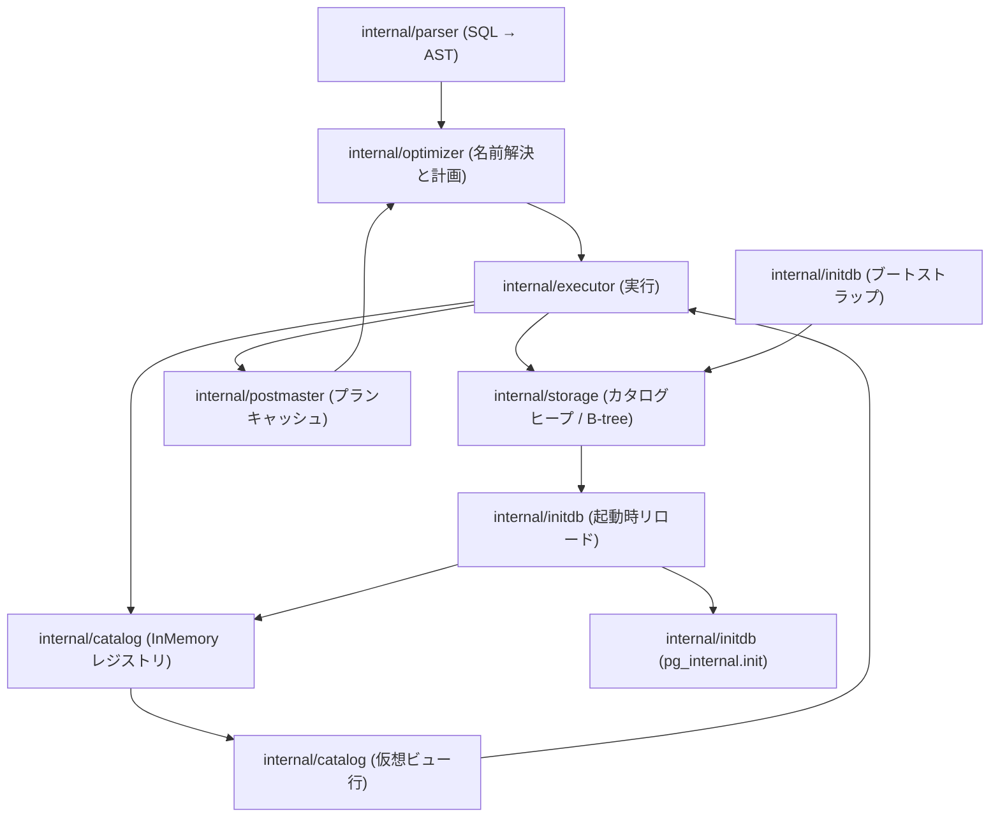
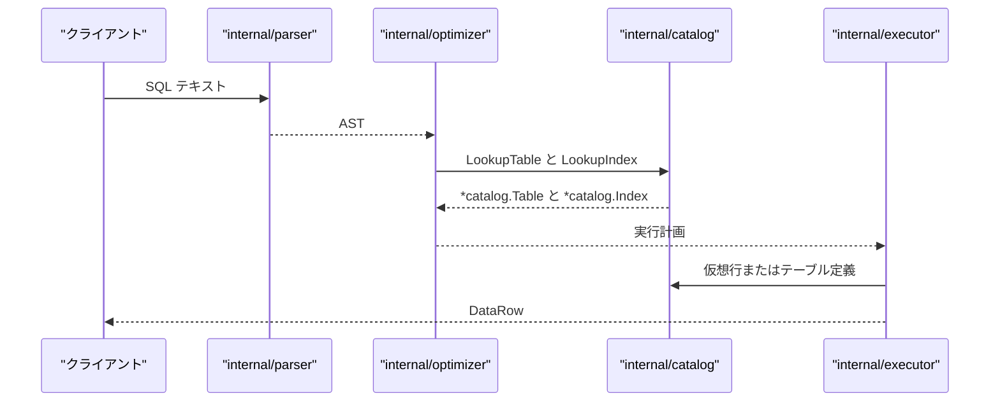

# カタログとシステムビュー

<details>
<summary>関連ソースファイル</summary>

- [`internal/catalog/catalog.go`](https://github.com/ryogrid/goopg/blob/19856410e8d497d59787e1ab35a2febb3f5953d6/internal/catalog/catalog.go)
- [`internal/catalog/codec.go`](https://github.com/ryogrid/goopg/blob/19856410e8d497d59787e1ab35a2febb3f5953d6/internal/catalog/codec.go)
- [`internal/catalog/pubsub.go`](https://github.com/ryogrid/goopg/blob/19856410e8d497d59787e1ab35a2febb3f5953d6/internal/catalog/pubsub.go)
- [`internal/catalog/routines.go`](https://github.com/ryogrid/goopg/blob/19856410e8d497d59787e1ab35a2febb3f5953d6/internal/catalog/routines.go)
- [`internal/initdb/catalog_seed.go`](https://github.com/ryogrid/goopg/blob/19856410e8d497d59787e1ab35a2febb3f5953d6/internal/initdb/catalog_seed.go)
- [`internal/initdb/pg_proc_seed_data.go`](https://github.com/ryogrid/goopg/blob/19856410e8d497d59787e1ab35a2febb3f5953d6/internal/initdb/pg_proc_seed_data.go)

</details>

カタログとシステムビューは、goopg が「データベース内に何が存在するか」を保持し、SQL から `pg_catalog` として見せる層です。中心にあるのは `internal/catalog` パッケージのインメモリカタログ `InMemory` で、テーブル・インデックス・スキーマ・型・ルーチン・ロール・ACL・統計・パブリケーションを `sync.RWMutex` で守られた map 群に置きます（`internal/catalog/catalog.go:InMemory`）。DDL はこのレジストリを更新すると同時に、PostgreSQL 18 がそのまま読める `pg_class` / `pg_attribute` / `pg_proc` / `pg_type` などのヒープ行を `internal/executor` 経由で書き出します。起動時は逆に、`internal/initdb` がヒープを走査してレジストリを再構築し、固定のシステムビューについては `pg_internal.init` を生成します。

データは 3 方向に流れます。書き込みは SQL の DDL → `internal/executor` → `InMemory` の更新 → カタログヒープへの追記。読み取りは SQL → `internal/parser` → `internal/optimizer` の名前解決（`Catalog.LookupTable` / `LookupIndex`）→ `internal/executor` の実行。再起動は `internal/initdb` のヒープ再読込 → `InMemory` の再構築、そして `pg_internal.init` の削除・再生成です。このセクションの各ページは、この 3 つの流れをそれぞれの層で説明します。

## コンポーネント

- **インメモリカタログ** — `InMemory`、`tableNamespace`、OID 採番、名前解決、レジストリ間の索引。goopg のクエリが参照する「現在のカタログ」そのものです。[12.1 インメモリカタログ](12-Catalog/12.1-In-Memory-Catalog.md)
- **カタログヒープとコーデック** — `PGClassRow` / `PGAttributeRow` / `PGTypeRow` のバイト列化、PG18 物理タプルのデコード、システム B-tree への実行時挿入。[12.2 カタログヒープとコーデック](12-Catalog/12.2-Catalog-Heaps.md)
- **システムビューと information_schema** — `pg_proc`・`pg_aggregate`・`pg_stat_*` などの仮想ビュー、PG 18.3 に固定したビュー OID、information_schema の 65 ビューと 4 データ表。[12.3 システムビューと information_schema](12-Catalog/12.3-System-Views.md)
- **ルーチンとパブリケーション** — `Routines` レジストリと `pg_proc` ヒープ、`PubSub` レジストリと `pg_publication` / `pg_subscription`、apply worker の起動。[12.4 ルーチンとパブリケーション](12-Catalog/12.4-Routines-and-PubSub.md)
- **リレキャッシュとプランキャッシュ** — `pg_internal.init` の生成・無効化、セッション横断の正規化 SQL プランキャッシュ。[12.5 リレキャッシュとプランキャッシュ](12-Catalog/12.5-Relcache.md)
- **組み込みカタログのブートストラップ** — PG18 の `.dat` 由来シードから `pg_type` / `pg_proc` / `pg_operator` / `pg_rewrite` などのヒープと索引を作る initdb 処理。[12.6 組み込みカタログのブートストラップ](12-Catalog/12.6-Catalog-Bootstrap.md)

## サブシステム図



`internal/catalog` はストレージにもネットワークにも依存しない純粋な Go の状態です。ヒープの読み書きは `internal/executor`（実行時）と `internal/initdb`（起動時・初期化時）が担当し、`internal/optimizer` は `Catalog` インターフェース越しに名前を解決します。プランキャッシュは `internal/postmaster` が保持し、DDL のたびに `internal/catalog` の状態と突き合わせて全消しされます。

## データフロー

1. **初期化**: `internal/initdb/catalog_seed.go:pgTypeBootstrapRows` / `pgClassBootstrapRows` / `pgAttributeBootstrapRows` が最小の `pg_type`（10 型）、`pg_class`（`pg_type` / `pg_attribute` / `pg_class` の 3 関係）、`pg_attribute` の行を作ります。完全な PG18 の行群は 12.6 のブートストラッパが `.dat` から生成します（`internal/initdb/pg_proc_seed_data.go:pgProcAllEntries`）。
2. **DDL の登録**: `CREATE TABLE` は `internal/catalog/catalog.go:InMemory.CreateTable` を呼び、`getOrCreateNS(resolveDBOid(dbOid))` でデータベース別の `tableNamespace` を取り、`c.nextOID` から OID を割り当てて `ns.tables[key(name)]` に登録します。列の `Ordinal` は 0 起点で振り直されます。
3. **ヒープへの同期**: `internal/executor` が `buildUserPGClassRow` / `buildUserPGAttributeRow` で PG18 正規形の行を作り、`writeHeapRowCanonical` で `base/<dbOid>/1259` などへ書きます。索引エントリは `insertPgClassOidIndexEntry` などがシステム B-tree に追加します（12.2）。
4. **問い合わせ時の解決**: `internal/parser` が SQL を AST にし、`internal/optimizer` が `SearchPathCatalog.LookupTable` → `InMemory.LookupTable` で `*catalog.Table` を取得します。仮想ビューなら `VirtualRowsForDB` / `VirtualRows` のクロージャが行を返し、`VirtualNull` が SQL NULL に変換されます。
5. **再起動時の復元**: `internal/initdb` が `pg_class` / `pg_attribute` などのヒープを走査し、可視性フィルタを通した行だけを `InMemory` に登録し直します。あわせて `pg_internal.init` を再生成します（12.5）。
6. **プランキャッシュの無効化**: DDL を実行したセッションは `internal/postmaster` の `planCache.Invalidate` を呼び、`*catalog.Table` ポインタを含む古いプランを破棄します。キーには `catalog.NamespaceDBOid` が含まれるため、別データベースのプランとは混ざりません。



## 共有データ型

このサブシステムの語彙は `internal/catalog` の 3 型に集約されます。どのコンポーネントも、テーブルを `Table`、列を `Column`、型を `Type` として受け渡します。

### `Type` — 型参照

```go
type Type struct {
	Name string
	Args []int64
	// IsArray is true for a column declared with the SQL `[]` array suffix
	// (e.g. `tags text[]`). Name still holds the element type ("text"); the
	// array-ness is tracked separately so the runtime evaluator keeps using
	// the element type while catalog builders (pg_attribute.atttypid →
	// _text/_int4/…) and pg_dump's format_type render the array type.
	// DU-002 slice 62.
	IsArray bool
}
```

（`catalog.go:Type`）

`Name` は要素型名、`Args` は `char(10)` や `numeric(10,2)` の型修飾子、`IsArray` は SQL の `[]` 接尾辞を表します。`Args` は長さ・精度の両方を運ぶため、`PadBpchar` や `pgAttTypmod` はここから値を取り出します。

### `Column` — テーブル 1 列

```go
// Column is one column of a table.
type Column struct {
	Name    string
	Type    Type
	NotNull bool
	Ordinal int // 0-based heap-tuple position
	// GeneratedExpr holds the raw SQL expression for a GENERATED ALWAYS AS … STORED
	// column. Empty for ordinary columns. M0096-0008.
	GeneratedExpr string
	// GeneratedAlways is true when the column uses GENERATED ALWAYS AS semantics.
	GeneratedAlways bool
	// GeneratedVirtual records the declared storage strategy of a generated
	// column: true for `GENERATED ALWAYS AS (expr) VIRTUAL` (and the bare
	// `GENERATED ALWAYS AS (expr)` form, whose PG18 default is VIRTUAL), false
	// for an explicit STORED. goopg materializes every generated column on write
	// (STORED storage semantics) regardless of this flag — it exists only so
	// pg_attribute.attgenerated reports the PG-faithful discriminator ('v' vs
	// 's') and pg_dump re-emits the original keyword. DU-002 slice 194.
	GeneratedVirtual bool
	// DefaultExpr holds the parsed AST of the column's DEFAULT clause when
	// CREATE TABLE provided one. nil for columns without a DEFAULT. The
	// apply worker evaluates this when filling subscriber-extra columns at
	// INSERT time so logical replication preserves DEFAULT semantics across
	// schema-extended subscribers (M0103-0007 rung 13).
	DefaultExpr parser.Expr
	// MissingValue is the precomputed default value used by the heap
	// decoder for rows that pre-date this column (storedNatts < ordinal+1).
	// Populated by `ALTER TABLE ADD COLUMN <name> <type> DEFAULT <const>`
	// to avoid the table rewrite — mirrors PostgreSQL's `attmissingval`.
	// Type is `executor.Datum`, stored as `any` to avoid the catalog →
	// executor import cycle. nil means trailing missing columns decode as
	// NULL (the prior default). M0097-0077.
	MissingValue any
	// IdentityColumn is true for GENERATED [ALWAYS|BY DEFAULT] AS IDENTITY columns.
	// When true, INSERT without an explicit value calls nextval(tablename_colname_seq).
	IdentityColumn bool
	// IdentityAlways distinguishes the identity KIND: true for GENERATED ALWAYS
	// (pg_attribute.attidentity='a'), false for GENERATED BY DEFAULT (='d').
	// Only meaningful when IdentityColumn is true. pg_dump reads attidentity to
	// emit `ADD GENERATED ALWAYS|BY DEFAULT AS IDENTITY`. M0110-0001 (DU-002 slice 120).
	IdentityAlways bool
	// IdentityStart is the START WITH value from the sequence options (0 = use default=1).
	IdentityStart int64
	// IdentityIncrement/Min/Max/Cache hold the remaining identity sequence options
	// (nil = type/PG default); IdentityCycle records CYCLE. Threaded to the backing
	// sequence so pg_dump's ADD GENERATED ... AS IDENTITY (...) round-trips the
	// non-default INCREMENT BY / MINVALUE / MAXVALUE / CACHE / CYCLE. DU-002.
	IdentityIncrement *int64
	IdentityMin       *int64
	IdentityMax       *int64
	IdentityCache     *int64
	IdentityCycle     bool
	// Dropped is true for columns removed via ALTER TABLE DROP COLUMN.
	// The column's heap slot (Ordinal) is retained for tuple compatibility;
	// dropped columns are invisible in SELECT *, RETURNING *, and column lookups.
	// M0097-0028.
	Dropped bool
	// Inherited is true for columns that were copied from a parent partitioned
	// table when this table was created as a partition child. Sets attislocal=false
	// and attinhcount=1 in pg_attribute. M0097-0023.
	Inherited bool
	// DeclaredTypeName is the original type name as written in DDL before domain
	// resolution (e.g. "intdom1" when Type.Name has been resolved to "int").
	// Used for DROP DOMAIN dependency tracking. Empty when the type was not a domain.
	// M0097-0023.
	DeclaredTypeName string
	// Storage is the column storage type: "plain", "main", "external", "extended".
	// Empty means the default for the column's type.
	Storage string
	// Compression is the column's per-column TOAST compression method as written
	// in `COMPRESSION <method>` (CREATE TABLE) or `ALTER COLUMN ... SET COMPRESSION
	// <method>` — "pglz" or "lz4". Empty means no explicit method (PG stores
	// attcompression='\0', meaning the default_toast_compression GUC applies, and
	// pg_dump emits no SET COMPRESSION clause). goopg does not actually TOAST or
	// compress; this is recorded purely so the column round-trips through pg_dump.
	// DU-002 slice 183.
	Compression string
	// StatTarget is the per-column statistics target set via `ALTER COLUMN ...
	// SET STATISTICS <n>`. nil means unset — PG stores attstattarget=NULL (the
	// default, encoded as -1 to clients) and pg_dump emits no SET STATISTICS
	// clause. A non-nil value >= 0 makes pg_dump re-emit `ALTER TABLE ONLY ...
	// SET STATISTICS <n>`. goopg does not sample at a per-column granularity;
	// this is recorded purely so the column round-trips through pg_dump.
	// DU-002 slice 184.
	StatTarget *int
	// Options holds per-column attribute options set via `ALTER COLUMN ...
	// SET (opt=value, …)` (e.g. "n_distinct=0.5"), each normalized to PG's
	// stored `name=value` form. nil/empty means none — PG stores
	// pg_attribute.attoptions=NULL and pg_dump emits no SET (...) clause. A
	// non-empty list is rendered into the attoptions text-array literal so
	// pg_dump re-emits `ALTER TABLE ONLY ... ALTER COLUMN ... SET (...)`. goopg
	// does not act on these planner statistics hints; recorded purely so the
	// column round-trips through pg_dump. DU-002 slice 185.
	Options []string
	// Collation is the explicit collation name from a column-level `COLLATE
	// <name>` clause — e.g. "C", "POSIX", "ucs_basic" (bare collname, matching
	// pg_collation.collname). Empty means none, in which case pg_attribute.
	// attcollation echoes the column type's typcollation and pg_dump emits no
	// COLLATE clause. When set (and the type is collatable), the synthesized
	// pg_attribute row reports the resolved collation OID so pg_dump's
	// `CASE WHEN a.attcollation <> t.typcollation` test fires and it re-emits
	// `COLLATE <schema>.<name>` inline in the CREATE TABLE column list. goopg
	// does not actually collate; recorded purely for pg_dump round-trip
	// fidelity. DU-002 slice 188.
	Collation string
	// FDWOptions holds per-column foreign-table options set via a
	// `CREATE FOREIGN TABLE (col type OPTIONS (name 'value', …))` clause,
	// each normalized to PG's stored `name=value` form (matching Options'
	// attoptions convention). nil/empty means none — PG stores
	// pg_attribute.attfdwoptions=NULL and pg_dump emits no per-column OPTIONS
	// clause. A non-empty list is rendered into the attfdwoptions text-array
	// literal so pg_dump re-emits `ALTER FOREIGN TABLE ONLY ... ALTER COLUMN
	// ... OPTIONS (...)`. Only meaningful on a foreign table's columns.
	// DU-002 slice 418.
	FDWOptions []string
}
```

（`catalog.go:Column`）

`Ordinal` はヒープタプル内の 0 起点位置で、`pg_attribute.attnum` はこれに 1 を足した値です。`Dropped` の列も `Ordinal` を保持し、タプル互換性を守ります。`Type` と `Ordinal` が物理配置を決め、`Type.Args` が `atttypmod` に、`Type.IsArray` が配列 OID に、`Collation` が `attcollation` に写されます。`DefaultExpr` と `MissingValue` は実行時の値補完に使い、残りのフィールドは pg_dump の往復のために保持されます。

### `PGClassRow` — カタログ行の受け渡し単位

```go
// PGClassRow is the v0 on-disk shape of one pg_class tuple.
// Only the subset of columns needed to reconstruct the in-memory
// catalog state is stored; the full upstream shape is deferred.
type PGClassRow struct {
	OID          uint32 // oid
	RelName      string // relname
	RelNamespace uint32 // relnamespace (schema OID)
	RelKind      string // relkind: 'r'=table,'i'=index,'v'=view,'S'=seq
	RelNAtts     int32  // relnatts
	RelFileNode  uint32 // relfilenode (0 for virtual / view)
	// RelTablespace holds pg_class.reltablespace (0 = database default).
	// Only DecodePGClassPhysicalRow populates this (the fixed-offset
	// PG18-canonical layout); the legacy simple encoding decoded by
	// DecodePGClassRow predates tablespaces and always leaves it 0.
	// M0122-0007 tablespace-restart-durability follow-up.
	RelTablespace  uint32
	RelPersistence string // relpersistence: 'p'=permanent
	RelIsShared    bool   // relisshared
	// RelIsPopulated holds pg_class.relispopulated (matview populated state; true
	// for every non-matview relation). Only DecodePGClassPhysicalRow populates it
	// (byte 129 of the fixed part); the legacy DecodePGClassRow leaves it false,
	// so callers must guard reload use on the physical path. 02e item A.
	RelIsPopulated bool
	// RelOptions holds the pg_class.reloptions text[] external literal (e.g.
	// "{fillfactor=70}"), or "" when absent/NULL. Neither DecodePGClassRow
	// nor DecodePGClassPhysicalRow populate this (reloptions is a varlena
	// column past the fixed-offset prefix they decode); initdb's
	// loadUserTablesFromHeap fills it in via executor.DecodeRowIntoMctxPGTuple
	// (the general PG-tuple decoder) and feeds it to ApplyTableReloptions.
	// M0119-0004.
	RelOptions string
}
```

（`codec.go:PGClassRow`）

`OID` と `RelName` が論理キーで、`RelNamespace` がスキーマ、`RelKind` が種別です。`RelFileNode` が 0 の行は仮想リレーションかビューで、物理ファイルを持ちません。`RelIsPopulated` は物理デコーダだけが埋めるため、再読込で使うときは物理経路であることが前提です。`RelOptions` はどちらのデコーダも埋めず、`loadUserTablesFromHeap` が汎用 PG タプルデコーダで補います。

## 主要な設計判断

- **メモリがクエリの真実、ヒープは PostgreSQL 互換の写し**。`InMemory` の map が直接の参照先で、ヒープは再起動・PG スタンバイ・pg_dump のために同期されます。両者がずれると、goopg では見えるが再起動で消える／PG からは見えない、という事故になります。
- **PG18 正規形で書く**。`pg_class` 34 列、`pg_attribute` 25 列、`pg_proc` 30 列、`pg_type` 32 列のように、物理行は PostgreSQL 18 の `FormData_*` と一致させます。goopg 内部の簡易形式（8 列 `PGClassRow` など）は互換用に残っていますが、新規のヒープ書き込みは正規形を使います。
- **OID は 1 本のカウンタ**。`FirstUserOID = 16384` から昇順に採番し、システムカタログ域（< 16384）とユーザー域を分けます。例外はルーチンで、`FirstRoutineOID = 1 << 17` の別空間です。
- **データベースごとの名前空間**。テーブルとインデックスは `tableNamespace` に分かれ、`NamespaceDBOid` が接続 DB の OID（0 と postgres の 5 → DefaultDBOid 1）を畳み込みます。システムカタログだけは `DefaultDBOid` から救済されます。
- **仮想ビューは `[]string` + `VirtualNull`**。プロバイダは `VirtualRows` / `VirtualRowsForDB` のクロージャで、NULL は `"\x00\x00NULL\x00\x00"` の番兵で表します。空文字列を NULL と混同しないための規約です。
- **システムビューの OID は PG 18.3 に固定**。ビュー間参照が `ev_action` に相手の OID を埋め込むため、上流の initdb と同じ OID を使います。世代が変わったときはガードで検出します。
- **プランキャッシュは DDL で全消し**。プランが `*catalog.Table` / `*catalog.Index` のポインタを含むため、部分的な無効化では足りません。キーには名前空間 OID・プランナフィンガープリント・正規化 SQL を含めます。
- **ブートストラップは「生成＋手書きオーバーレイ」**。PG18 の `.dat` から生成した表を基礎に、情報スキーマの OID や `typelem/typarray` のような `.dat` に無い関係だけを手書きで補います。

隣接するサブシステムは、SQL の入口が [4 SQL パーサー](4-SQL-Parser.md)、名前解決と計画が [5 クエリプランナー](5-Query-Planner.md)、実行が [6 実行エンジン](6-Executor.md)、カタログヒープの物理配置が [7 ストレージ](7-Storage.md) と [8 B-tree インデックス](8-Btree.md)、変更の永続化が [10 WAL と耐久性](10-WAL.md) です。

Sources:
- `internal/catalog/catalog.go`
- `internal/catalog/codec.go`
- `internal/catalog/pubsub.go`
- `internal/catalog/routines.go`
- `internal/initdb/catalog_seed.go`
- `internal/initdb/pg_proc_seed_data.go`

<sub>Generated by deepwiki-4myself from `goopg` @ `19856410e`</sub>
