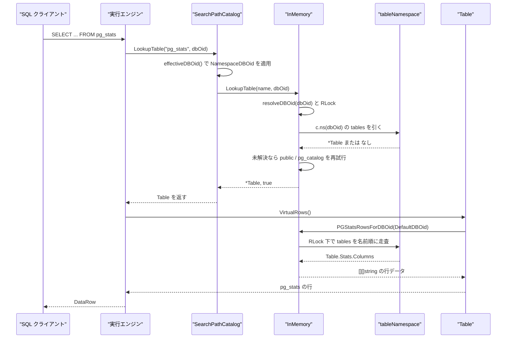
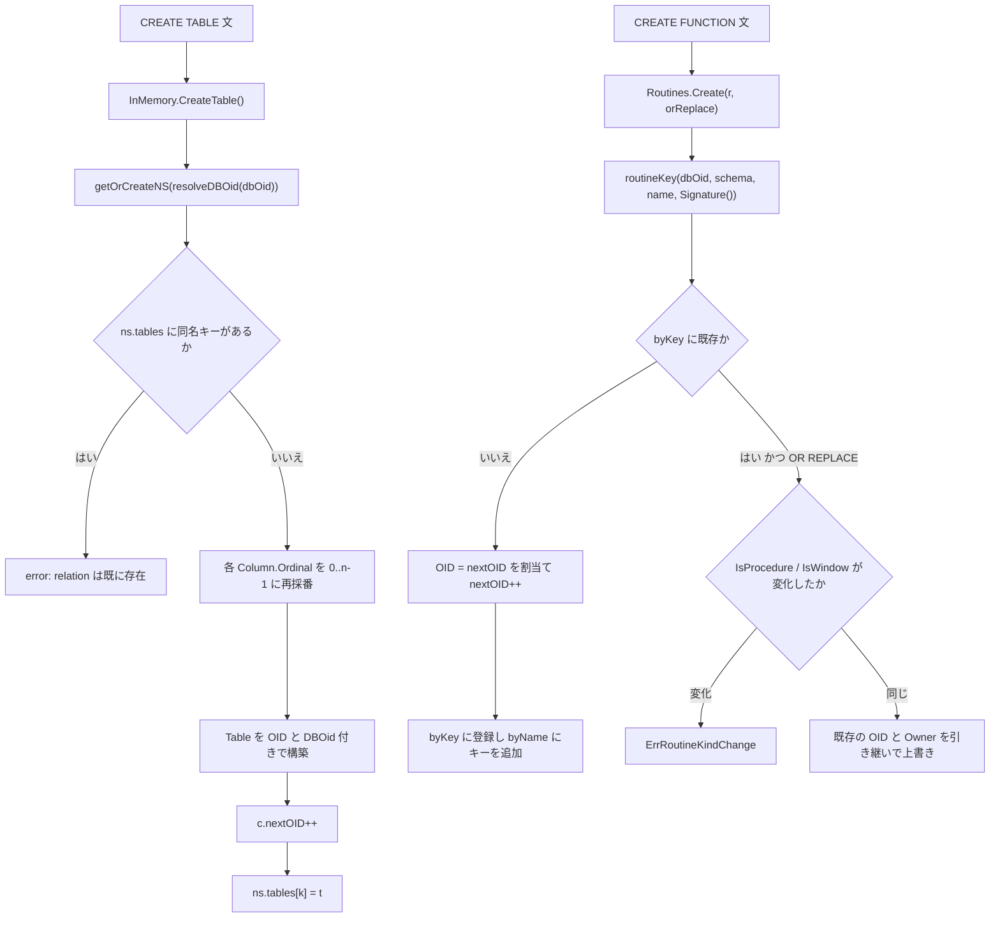

# インメモリカタログ

<details>
<summary>関連ソースファイル</summary>

- [`internal/catalog/bpchar.go`](https://github.com/ryogrid/goopg/blob/19856410e8d497d59787e1ab35a2febb3f5953d6/internal/catalog/bpchar.go)
- [`internal/catalog/catalog.go`](https://github.com/ryogrid/goopg/blob/19856410e8d497d59787e1ab35a2febb3f5953d6/internal/catalog/catalog.go)
- [`internal/catalog/default_acl.go`](https://github.com/ryogrid/goopg/blob/19856410e8d497d59787e1ab35a2febb3f5953d6/internal/catalog/default_acl.go)
- [`internal/catalog/encoding.go`](https://github.com/ryogrid/goopg/blob/19856410e8d497d59787e1ab35a2febb3f5953d6/internal/catalog/encoding.go)
- [`internal/catalog/pg_database_schema.go`](https://github.com/ryogrid/goopg/blob/19856410e8d497d59787e1ab35a2febb3f5953d6/internal/catalog/pg_database_schema.go)
- [`internal/catalog/pg_node_oid_lookup.go`](https://github.com/ryogrid/goopg/blob/19856410e8d497d59787e1ab35a2febb3f5953d6/internal/catalog/pg_node_oid_lookup.go)
- [`internal/catalog/pg_operator_data.go`](https://github.com/ryogrid/goopg/blob/19856410e8d497d59787e1ab35a2febb3f5953d6/internal/catalog/pg_operator_data.go)
- [`internal/catalog/pgstats.go`](https://github.com/ryogrid/goopg/blob/19856410e8d497d59787e1ab35a2febb3f5953d6/internal/catalog/pgstats.go)
- [`internal/catalog/relcache_inval.go`](https://github.com/ryogrid/goopg/blob/19856410e8d497d59787e1ab35a2febb3f5953d6/internal/catalog/relcache_inval.go)
- [`internal/catalog/routines.go`](https://github.com/ryogrid/goopg/blob/19856410e8d497d59787e1ab35a2febb3f5953d6/internal/catalog/routines.go)

</details>

インメモリカタログは、goopg の `internal/catalog` パッケージが保持するプロセス内のカタログ状態です。テーブル・インデックス・スキーマ・型・ルーチン・ロール・ACL・統計などを `sync.RWMutex` で保護した Go の map 群に置き、SQL からは `pg_catalog` の仮想テーブル（`pg_class`、`pg_proc`、`pg_stats`、`pg_default_acl` など）として見えるように `VirtualRows` クロージャを登録します。ディスク上のヒープやコーデックは [12.2 カタログヒープとコーデック](12.2-Catalog-Heaps.md)、仮想ビューの投影は [12.3 システムビューと information_schema](12.3-System-Views.md) が扱います。このページは、その手前にある「メモリ上の地図そのもの」— OID 採番、名前解決、レジストリの索引、そしてメモリ状態から仮想行を組み立てる関数 — を説明します。

## 責務

- テーブルとインデックスの登録・名前解決を担う。`(*InMemory).LookupTable` / `LookupIndex` / `CreateTable` / `CreateIndex` が `internal/catalog/catalog.go` の中心で、データはデータベースごとの `tableNamespace` に分かれる（`catalog.go:tableNamespace`、`catalog.go:InMemory.ns`）。
- 単一の OID カウンタから全オブジェクトの OID を採番する。初期値は `FirstUserOID = 16384`（`catalog.go:FirstUserOID`）で、`AllocOID` / `allocOIDLocked` / `advanceNextOIDLocked` / `NextOID` / `AdvanceNextOIDPast` がこれを操作する（`catalog.go:AllocOID`）。
- `pg_stats` の行を `Table.Stats` と `ColumnStats` から組み立てる（`internal/catalog/pgstats.go:PGStatsRowsForDBOid`）。これは SQL の `pg_stats` ビュー相当を Go 側で投影するもので、`pg_statistic` ヒープへの書き込みと対になる。
- ユーザー定義ルーチンのレジストリを提供する。`Routines`（`internal/catalog/routines.go:Routines`）は `byKey`（シグネチャ付き）と `byName`（オーバーロード一覧）の二重索引を持ち、`Create` / `Lookup` / `Drop` / `DropByName` / `RenameRoutine` / `SetSchema` を提供する。
- `ALTER DEFAULT PRIVILEGES` の `pg_default_acl` 行を遅延生成し、`aclitem[]` テキストに描画する（`internal/catalog/default_acl.go:DefaultACLOID`、`DefaultACLText`）。
- `pg_enc` の整数 ID とエンコーディング名の相互変換、サーバー側エンコーディングとしての妥当性判定を行う（`internal/catalog/encoding.go:EncodingNameToID`、`ValidServerEncodingName`）。
- `pg_node_tree` の解決に必要な「名前＋オペランド型 OID → 演算子行」「関数名＋引数型 OID → funcid」の前向き索引を遅延構築する（`internal/catalog/pg_node_oid_lookup.go:LookupOperatorForNode`、`LookupProcForNode`、`ProcResultType`）。
- `char(n)` / `bpchar(n)` の空白パディングを、executor と WAL の双方が同じ規則で適用できるよう提供する（`internal/catalog/bpchar.go:PadBpchar`）。
- `pg_internal.init`（リレキャッシュ初期化ファイル）の無効化・全削除を排他ロック付きで行う（`internal/catalog/relcache_inval.go:RelcacheInitFileUnlink`、`RelcacheInitFileRemoveAll`、`WithRelCacheInitLock`）。
- `pg_database` の列定義と、共有カタログのストレージ識別子（`DBOid=0`）を一箇所に固定する（`internal/catalog/pg_database_schema.go:PgDatabaseColumnsPG18`、`SharedCatalogRelFileNode`）。

## 処理フロー

もっとも頻繁に通る経路は「SQL がカタログ名を引き、仮想行が返る」流れです。`SearchPathCatalog.LookupTable` が接続データベースの OID を確定し、`InMemory.LookupTable` が `RLock` の下で `tableNamespace` を引き、返ってきた `*Table` の `VirtualRows` クロージャが行を生成します。`pg_stats` の場合、クロージャは `PGStatsRowsForDBOid` を呼びます（`catalog.go:registerSystemTables` 内の `pgStats.VirtualRows`）。



この経路の要点は次のとおりです。

- `DBOid` が 0 または `PostgresDBOid`（5）のとき、`NamespaceDBOid` は `DefaultDBOid`（1）に畳み込みます（`catalog.go:NamespaceDBOid`）。したがって接続が `postgres` でも、実体は `namespaces[1]` を読みます。
- `key(name)` はスキーマが空なら裸の名前、そうでなければ `"schema.name"` を返します（`catalog.go:key`）。`LookupTable` はまずこのキーを引き、見つからなければ非修飾名のとき `public.<name>` → `pg_catalog.<name>` の順に再試行します（`catalog.go:13342-13348`）。
- スキーマ修飾付きで引いた場合は、裸キーのエントリも照合します。再起動後の `pg_class` リロードが `public` を明示したキーを作る一方、稼働中に作ったエントリは裸キーのままになり得るためです（`catalog.go:13349-13363`）。インデックス側にも同じ二方向フォールバックがあります（`catalog.go:lookupIndexLocked`）。
- 参照先が `DefaultDBOid` でない場合に限り、`lookupSystemCatalogTableLocked` が `DefaultDBOid` の名前空間から `pg_catalog` / `information_schema` のオブジェクトだけを救済します（`catalog.go:13376-13380`）。ユーザーテーブルは救済されず、データベースごとに隔離されたままです。
- `pg_stats` の静的クロージャは `DefaultDBOid` 固定です。executor は接続ごとに `ctx.CurrentDatabaseOid` を見て別の twin（`fetchStatsRows`）に差し替える、と `catalog.go:10346-10351` のコメントが述べています。

書き込み側（DDL 登録）は `getOrCreateNS` と OID 採番を通ります。以下は `CREATE TABLE` と `CREATE FUNCTION` の 2 系統を並べた実際の分岐です。



`CreateTable` は列スライスを `append([]Column(nil), cols...)` で複製し、呼び出し側のスライスとエイリアスしません（`catalog.go:13476-13482`）。`CreateIndex` は同じく `ns.byTable[table.OID]` にも登録し、テーブル OID から索引を引けるようにします（`catalog.go:13548-13551`）。ルーチン側の `Create` は値のコピー（`clone := *r`）を保存するため、呼び出し元が受け取ったポインタに依存情報を書き込んでもレジストリには反映されません。依存情報を載せるには戻り値の `*Routine` を使う必要があります（`routines.go:CreateDuringRecovery` のコメントが同じ契約を明示しています）。

## 主要ファイル

| ファイル | 役割 |
| --- | --- |
| `internal/catalog/catalog.go` | `InMemory`、`tableNamespace`、`Type`/`Column`/`Table`/`Index`、`LookupTable`/`CreateTable`/`LookupIndex`/`CreateIndex`、OID 採番、`SearchPathCatalog`。`catalog.go:InMemory`、`catalog.go:LookupTable` |
| `internal/catalog/routines.go` | `Routine` と `Routines` レジストリ。`routines.go:Create`、`routines.go:LookupWithArgModes`、`routines.go:DropByName` |
| `internal/catalog/default_acl.go` | `pg_default_acl` の遅延 OID 採番・付与・失効・描画。`default_acl.go:DefaultACLOID`、`default_acl.go:DefaultACLText` |
| `internal/catalog/encoding.go` | `pg_enc` 名と ID の対応表、別名解決、サーバー側妥当性判定。`encoding.go:EncodingNameToID` |
| `internal/catalog/pgstats.go` | `pg_stats` の行ビルダ。`pgstats.go:PGStatsRowsForDBOid` |
| `internal/catalog/pg_node_oid_lookup.go` | 演算子・関数の前向き OID 索引（`sync.Once` で遅延構築）。`pg_node_oid_lookup.go:buildNodeOperatorIndex` |
| `internal/catalog/pg_operator_data.go` | `pg_operator` 1 行分の `OperatorEntry` 型。`pg_operator_data.go:OperatorEntry` |
| `internal/catalog/pg_database_schema.go` | PG18 の `pg_database` 18 列定義と共有カタログの `RelFileNode`。`pg_database_schema.go:PgDatabaseColumnsPG18` |
| `internal/catalog/bpchar.go` | `char(n)` の空白パディング。`bpchar.go:PadBpchar` |
| `internal/catalog/relcache_inval.go` | `pg_internal.init` の削除とプロセス内ロック。`relcache_inval.go:RelcacheInitFileRemoveAll` |

## 公開 API / エントリポイント

```go
// 構築
func NewInMemory() *InMemory

// テーブル・インデックスの解決と登録
func (c *InMemory) LookupTable(name parser.ObjectName, dbOid ...uint32) (*Table, bool)
func (c *InMemory) LookupColumn(table *Table, name string) (*Column, bool)
func (c *InMemory) LookupIndex(name parser.ObjectName, dbOid ...uint32) (*Index, bool)
func (c *InMemory) CreateTable(name parser.ObjectName, cols []Column, dbOid ...uint32) (*Table, error)
func (c *InMemory) CreateIndex(name parser.ObjectName, table *Table, cols []string, unique bool, method string, primary bool, dbOid ...uint32) (*Index, error)
func (c *InMemory) AddColumn(table *Table, col Column, dbOid ...uint32) (*Column, error)

// OID
func (c *InMemory) AllocOID() uint32
func (c *InMemory) NextOID() uint32
func (c *InMemory) AdvanceNextOIDPast(oid uint32)

// ルーチン
func (c *InMemory) Routines() *Routines
func (rs *Routines) Create(r *Routine, orReplace bool) (*Routine, error)
func (rs *Routines) Lookup(name parser.ObjectName, argTypes []Type, dbOid ...uint32) (*Routine, bool)
func (rs *Routines) Drop(name parser.ObjectName, argTypes []Type, dbOid ...uint32) error
func (rs *Routines) DropByName(name parser.ObjectName, dbOid ...uint32) error

// 既定権限
func (c *InMemory) DefaultACLOID(roleOID, schemaOID uint32, objType byte) uint32
func (c *InMemory) HasDefaultACL(roleOID, schemaOID uint32, objType byte) bool
func (c *InMemory) DefaultACLText(aclOID uint32, objType byte) string

// エンコーディングと bpchar
func EncodingIDToName(id int32) string
func EncodingNameToID(name string) int32
func ValidServerEncodingName(name string) int32
func PadBpchar(t Type, s string) string

// pg_node_tree の前向き解決
func LookupOperatorForNode(name string, leftOID, rightOID uint32) (OperatorEntry, bool)
func LookupProcForNode(name string, argOIDs []uint32) (uint32, bool)
func ProcResultType(funcid uint32) (uint32, bool)

// 統計と relcache ファイル
func (c *InMemory) PGStatsRowsForDBOid(dbOid uint32) [][]string
func RelcacheInitFileUnlink(dataDir string, dboid uint32) error
func RelcacheInitFileRemoveAll(dataDir string) error
func WithRelCacheInitLock(fn func() error) error
```

`LookupTable` / `LookupIndex` は `Catalog` インターフェース（`catalog.go:Catalog`）の一部で、`SearchPathCatalog` が `effectiveDBOid` を適用してから埋め込みの実装へ委譲します（`catalog.go:SearchPathCatalog.LookupTable`）。`SearchPathCatalog.Unwrap` で下位の `Catalog` を取り出せます。

## 主要データ構造

### `InMemory` — カタログ全体の器

`InMemory` は定義だけで約 650 行に及ぶ巨大な struct で、ここでは宣言の先頭（`catalog.go:2850-2877`）をそのまま引用し、残りのフィールド群は下表でまとめます。

```go
type InMemory struct {
	mu sync.RWMutex
	// relSizer, when installed, returns a relation's LIVE size in blocks —
	// the O(1) in-memory counter read that answers PostgreSQL's
	// RelationGetNumberOfBlocks(), not a statistics lookup and not a scan.
	// It is installed once by the server that owns the buffer pool (see
	// initdb.Open) and read by RelationBlocks; nil in embedded/test catalogs
	// with no storage behind them, where RelationBlocks reports "unknown".
	//
	// Held as an atomic pointer rather than under c.mu because the planner
	// reads it once per FROM item and must not contend on the catalog lock.
	// M0125-0003.
	relSizer atomic.Pointer[func(storage.RelFileNode) (int64, bool)]
	// namespaces holds the per-database table/index catalog (see
	// tableNamespace), keyed by real physical dbOid. Access it via
	// ns(dbOid), never directly — see ns()'s own comment for the locking
	// contract. M0122-0007 slice 4b (design 0122-0018): pre-seeded with
	// only the DefaultDBOid entry today; every caller still resolves
	// through ns(DefaultDBOid), so this sub-slice changes no observable
	// behavior. 4c/4d thread a real per-connection dbOid through.
	namespaces map[uint32]*tableNamespace
	nextOID    uint32
	dbOid      uint32
	// routines holds user-defined routines (M0015 Stage A step 2).
	// Separate registry — not part of the table/index map space —
	// so existing CRUD on those types stays untouched. Accessed
	// via `(*InMemory).Routines()`.
	routines *Routines
	// （以降もフィールドが続く。catalog.go:2878-3498）
```

`mu` がすべての可変状態を保護する唯一のロックです。`relSizer` は例外的に `atomic.Pointer` で、planner が FROM 項目ごとに読むたびに `c.mu` を取らないようにしています。`namespaces` は物理 dbOid → `tableNamespace` の対応で、`NewInMemory` では `DefaultDBOid` の 1 エントリだけを事前生成します（`catalog.go:4502`）。

主要なフィールド群は次のとおりです。

| フィールド群（行範囲） | 保持するもの |
| --- | --- |
| `namespaces`, `nextOID`, `dbOid`（2870-2872） | データベース別のテーブル/インデックス名前空間と、共有 OID カウンタ |
| `routines`（2873-2877） | ユーザールーチンの `*Routines` レジストリ |
| `databases`, `databaseConnLimit`, `databaseEncoding`, `databaseOwner`, `databaseOid`（2878-2923） | `pg_database` の名前・接続上限・エンコーディング・所有者・実 OID |
| `dbRoleSettings`, `roleSettings`, `roleMembers`（2924-2958） | `pg_db_role_setting` と `pg_auth_members` 相当 |
| `partitionChildren`, `pendingAttachXID`, `indexPartitionChildren`（2960-2974） | パーティション親子関係と ATTACH 中の XID |
| `inheritanceChildren`, `pendingInheritanceChangeCount`, `pendingPartitionDetachCount`（2990-3011） | 継承・DETACH の保留状態 |
| `enumTypes`, `domains`, `compositeTypes`, `rangeTypes`（3013-3036） | ユーザー定義型レジストリ（キーに dbOid を畳み込む） |
| `schemas`, `tempNamespaces`（3082-3134） | ブートストラップ名前空間とセッション別 `pg_temp_N` |
| `roles`, `predefinedRoles`, `roleAttrs`（3136-3172） | ロール名→OID、PG18 定義済みロール、資格情報 |
| `tableACLs`, `tableACLGrantor`, `tableACLOrder`, `attrACLs`（3174-3275） | リレーション/列 ACL と付与順・付与者 |
| `parameterACLOIDs`, `defaultACLOIDs`, `defaultACLKeys`, `defaultACLGlobal`（3277-3316） | `pg_parameter_acl` / `pg_default_acl` の合成 OID と逆引き |
| `fdws`, `foreignServers`, `userMappings`, `casts`, `transforms`, `userOperators`（3318-3404） | pg_dump 往復のためのメタデータ専用レジストリ |
| `pgClassRowMarks`, `tableACLChangeXID`, `tablePendingDropXID`（3448-3497） | PostgreSQL のタプル xmax を模した待機用 XID 記録 |

### `tableNamespace` — 1 データベース分の地図

```go
type tableNamespace struct {
	tables  map[string]*Table
	indexes map[string]*Index
	byTable map[uint32]map[string]*Index
	// schemas holds this database's user schemas (CREATE SCHEMA), lowercase
	// name → OID; pg_namespace is per-database in PostgreSQL. The bootstrap
	// schemas every database starts with stay in InMemory.schemas (shared).
	// schemaOwners / schemaHeapTIDs are this database's pg_namespace row
	// owners and heap TIDs, for user and bootstrap schemas alike — each
	// database has its own pg_namespace heap. M0119-0006.
	schemas        map[string]uint32
	schemaOwners   map[string]uint32
	schemaHeapTIDs map[string]SchemaHeapTID
}
```

（`catalog.go:tableNamespace`）

`tables` と `indexes` のキーは `key(parser.ObjectName)` が作る文字列で、`byTable` はテーブル OID → （同じキー → 索引）の逆引きです。1 つの索引は `indexes` と `byTable` の 2 か所に現れるため、`CreateIndex` は両方を同時に更新しなければ不変条件が崩れます。`schemas` はこのデータベースのユーザースキーマだけを保持し、`pg_catalog` / `public` / `pg_toast` / `information_schema` は `InMemory.schemas` 側の共有マップに残ります。

### `Type` — 型参照の最小表現

```go
type Type struct {
	Name string
	Args []int64
	// IsArray is true for a column declared with the SQL `[]` array suffix
	// (e.g. `tags text[]`). Name still holds the element type ("text"); the
	// array-ness is tracked separately so the runtime evaluator keeps using
	// the element type while catalog builders (pg_attribute.atttypid →
	// _text/_int4/…) and pg_dump's format_type render the array type.
	// DU-002 slice 62.
	IsArray bool
}
```

（`catalog.go:Type`）

`Args` は長さ修飾子（`char(10)` の 10 など）を保持し、`PadBpchar` はここから幅を取り出します。`IsArray` は要素型と配列性を分離するフラグで、`Name` を `_text` に書き換えずに配列を表現します。この 2 フィールドの組み合わせが `Routine.ArgTypes` や `Column.Type` の共通語彙になります。

### `routineStore` — ルーチンの二重索引

```go
// routineStore is the registry state every database's handle shares.
type routineStore struct {
	mu      sync.RWMutex
	byKey   map[string]*Routine // schema.name(argtypes) → routine
	byName  map[string][]string // schema.name → list of overload keys
	nextOID uint32

	// heapTIDs maps routine OID → the routine's LIVE pg_proc heap-row TID
	// (B1.2 TID-carrying cache, doc 02a §3.3): seeded by CREATE's heap
	// INSERT and by the startup reload, refreshed by every ALTER's heap
	// UPDATE, deleted with the routine.
	heapTIDs map[uint32]SchemaHeapTID
}
```

（`routines.go:routineStore`）

`byKey` のキーは `<dbOid>\x00<schema>.<name><signature>`（`routineDBPrefix` + `routineKey`）で、`byName` は同じ前置きにシグネチャを付けないキーから `byKey` のキー一覧を引きます。オーバーロード削除時に `byName` の空エントリを消すのは、この 2 索引の整合性を保つためです。`heapTIDs` は OID → `pg_proc` ヒープ行の TID キャッシュで、ALTER 時に同じ行を UPDATE するために使われます（`routines.go:SetHeapTID`、`DeleteHeapTID`）。

### `Routine` — 1 本のユーザー定義ルーチン

```go
type Routine struct {
	OID             uint32
	Schema          string
	Name            string
	ArgNames        []string // parallel to ArgTypes; empty string for positional-only args
	ArgTypes        []Type
	// ArgTypeSchemas is parallel to ArgTypes: the namespace each argument type
	// was declared in at CREATE FUNCTION/PROCEDURE ("" when unknown — a BARE
	// type name, whose owner schema goopg's user-type store cannot resolve, or a
	// pre-73rd reloaded routine that predates this field). Consulted ONLY by the
	// regprocedure output path (format_type_be arg-type qualification, deferral
	// row 1342): Signature() compares ArgTypes[i].Name only, so overload
	// resolution / ALTER/DROP lookups are unaffected.
	ArgTypeSchemas   []string
	// ArgTypeOIDs is parallel to ArgTypes: the resolved pg_type OID for each
	// argument type, NON-ZERO only for the one ambiguous spelling `char` AND its
	// array forms (a bare `char` → OIDBpChar 1042, a quoted `"char"` → OIDChar
	// 18 — deferral row 1351; bare `char[]` → OIDArrayBpChar 1014, quoted
	// `"char"[]` → OIDArrayChar 1002 — deferral row 1364). Every other spelling
	// (including non-char arrays like int4[]) is 0: its name-based
	// ArgTypeDisplayAlias is already a faithful format_type_be port, and
	// buildPGProcRow's TypeNameToOID fallback resolves a baked `[]` name to the
	// ARRAY OID, so carrying a name-derived OID would add nothing. Consulted by
	// the regprocedure/pg_get_function_* output paths and the proargtypes/
	// prorettype emission; Signature() and overload resolution are unaffected.
	ArgTypeOIDs      []uint32 `json:",omitempty"`
	ArgModes        []string // parallel to ArgTypes; "i"=IN, "o"=OUT, "b"=INOUT, "v"=VARIADIC; nil=all IN
	ArgDefaults     []string // parallel to ArgTypes; raw SQL expression for DEFAULT, "" = no default
	ReturnType      Type
	// ReturnTypeOID is the resolved pg_type OID for the RETURN type, NON-ZERO
	// only for the one ambiguous spelling `char` AND its array forms (a bare
	// `char` → OIDBpChar 1042, a quoted `"char"` → OIDChar 18 — deferral row
	// 1361, sibling of ArgTypeOIDs/row 1351; bare `char[]` → OIDArrayBpChar
	// 1014, quoted `"char"[]` → OIDArrayChar 1002 — deferral row 1364). Every
	// other spelling (including non-char arrays like int4[]) is 0: TypeNameToOID's
	// name-based map (now array-correct) is already a faithful fallback, so a
	// name-derived OID would add nothing. Consulted ONLY by the
	// pg_get_function_result / pg_get_functiondef renderers and the pg_proc
	// prorettype column; signature/overload semantics are unaffected.
	ReturnTypeOID   uint32
	ReturnsSet      bool   // RETURNS SETOF ... M0097-0020
	ReturnsTable    bool   // RETURNS TABLE (...) — table cols stored as trailing OUT args
	Language        string // lower-cased
	Body            string // raw routine source between the dollar-quote delimiters
	Strict          bool   // STRICT / CALLED ON NULL INPUT
	Volatile        string // "v"=volatile (default), "s"=stable, "i"=immutable
	Parallel        string // proparallel: "u"=unsafe (default), "s"=safe, "r"=restricted
	Cost            string // procost: COST n override; "" = language default (1 internal/C, else 100)
	Rows            string // prorows: ROWS n override for SRFs; "" = default (1000 for SRF, 0 otherwise)
	SecurityDefiner bool   // SECURITY DEFINER
	Leakproof       bool   // LEAKPROOF
	IsProcedure     bool   // true when created via CREATE PROCEDURE
	IsWindow        bool   // true when created with WINDOW attribute
	BeginAtomic     bool   // PG14 BEGIN ATOMIC ... END body (no AS keyword)
	IsReturnForm    bool   // PG14 RETURN expr body (stored as "SELECT expr" internally)
	KindChar        string // prokind: 'f'=function, 'p'=procedure, 'w'=window, 'a'=aggregate
	// Aggregate carries the full UserAggregate definition on the
	// synthesized prokind='a' pg_proc row (B2.2 slice 2). It rides the
	// proargdefaults JSON meta only (never the registry — aggregates live
	// in userAggregates): the physical pg_aggregate columns store proc
	// OIDs, which are 0 for builtin transition functions outside the
	// hand-curated BuiltinProc set, so the startup reload rebuilds the
	// registry from these names instead of a lossy OID reversal.
	Aggregate *UserAggregate `json:",omitempty"`
	// Owner is pg_proc.proowner (role OID), settable via ALTER FUNCTION/
	// PROCEDURE/ROUTINE ... OWNER TO. 0 means "unset, defaults to the
	// bootstrap superuser" — see OwnerOrDefault. M0097-0150.
	Owner uint32

	// Config is pg_proc.proconfig: a list of "name=value" per-function GUC
	// overrides set via CREATE FUNCTION's SET clause or ALTER FUNCTION/
	// PROCEDURE/ROUTINE ... SET/RESET, in insertion order (mirrors
	// InMemory's role/database-level roleSettings shape). nil renders as SQL
	// NULL (matches upstream: a routine that never had a SET clause has no
	// proconfig row at all). Applied around each call by the executor's
	// enterRoutineConfig (M0146-0155); see
	// docs/design/0100-0149/m0146-0155-function-set-clauses.md.
	Config []string

	// Dependency tracking populated at CREATE FUNCTION time for information_schema views.
	SequenceDeps    []RoutineSeqDep   // sequences referenced via nextval/currval
	RoutineCallOIDs []uint32          // OIDs of routines called in body/defaults
	TableDeps       []RoutineTableRef // tables referenced in FROM clauses
	ColumnDeps      []RoutineColRef   // columns referenced in SELECT/WHERE clauses

	// DBOid is the database this routine was CREATE FUNCTION/PROCEDURE'd
	// under (mirrors catalog.Domain.DBOid/EnumType.DBOid). The registry key
	// folds this in (routineKey/nameKey) so two distinct databases may each
	// register a same-named routine without colliding. Zero is normalized to
	// DefaultDBOid by Create/CreateDuringRecovery, matching every other
	// dbOid-scoped registry's convention. M0119-0004 DU-002 follow-up
	// (M0122-0007 4e-shaped fix, mirrors follow-up 36/37's ForeignServer/
	// UserMapping DBOid fields).
	DBOid uint32
}
```

（`routines.go:Routine`）

オーバーロードの同一性を決めるのは `Signature()` です。`ArgTypes` の各型名を小文字化して `(int4,text)` の形にし、`ArgModes[i] == "o"` の OUT 引数は除外します（`routines.go:Signature`）。`ArgModes` が `nil` なら全引数が IN とみなされます。`NumInputArgs()` も同じ規則で OUT を数えません（`routines.go:NumInputArgs`）。`Owner` が 0 のときは `OwnerOrDefault()` が 10（ブートストラップ・スーパーユーザー）を返します（`routines.go:OwnerOrDefault`）。

### `OperatorEntry` — `pg_operator` の 1 行

```go
type OperatorEntry struct {
	OID        uint32
	Name       string // oprname
	Namespace  uint32 // oprnamespace
	Owner      uint32 // oprowner
	Kind       byte   // oprkind: 'b'=binary, 'l'=left-unary
	CanMerge   bool   // oprcanmerge
	CanHash    bool   // oprcanhash
	LeftType   uint32 // oprleft
	RightType  uint32 // oprright
	ResultType uint32 // oprresult
	Commutator uint32 // oprcom
	Negator    uint32 // oprnegate
	Code       uint32 // oprcode (pg_proc OID)
	Restrict   uint32 // oprrest (pg_proc OID)
	Join       uint32 // oprjoin (pg_proc OID)
}
```

（`pg_operator_data.go:OperatorEntry`）

`Kind`、`LeftType`、`RightType` の 3 つが前向き索引のキーを構成します。`LookupOperatorForNode(name, leftOID, rightOID)` は `builtinOperatorKey(name, left, right)` で引き、`Kind != 'b'` の行は索引に載せません（`pg_node_oid_lookup.go:buildNodeOperatorIndex`）。`Code`（`pg_proc` の OID）が演算子の実装関数を、`ResultType` が結果型 OID を与えます。

### `defaultACLKey` と `DefaultACLEntry` — `pg_default_acl` の同一性

```go
type defaultACLKey struct {
	RoleOID   uint32
	SchemaOID uint32
	ObjType   byte
}
```

（`default_acl.go:defaultACLKey`）

```go
type DefaultACLEntry struct {
	OID       uint32
	RoleOID   uint32
	SchemaOID uint32 // 0 = global
	ObjType   byte
}
```

（`default_acl.go:DefaultACLEntry`）

`(RoleOID, SchemaOID, ObjType)` の三つ組が PostgreSQL の `pg_default_acl` の一意性（`defaclrole`、`defaclnamespace`、`defaclobjtype`）に対応します。`SchemaOID == 0` は `IN SCHEMA` のないグローバル既定を意味し、`defaultACLGlobal[oid]` に記録されます。`ObjType` は `DefaultACLObjTypeRelation='r'`、`Sequence='S'`、`Function='f'`、`Type='T'`、`Namespace='n'`、`LargeObject='L'` の 6 種ですが、実際に ACL を保存・描画するのはラージオブジェクトを除く 5 種です（`default_acl.go:defaultACLPrivInfo` が `ok=false` を返す）。

## 内部構造

### ロック契約

`InMemory.mu` は再入不可の `sync.RWMutex` です。`(*InMemory).ns(dbOid)` は**自分ではロックを取らず**、呼び出し側がすでに `RLock` か `Lock` を持っている前提で動きます（`catalog.go:ns`）。しかも `ns` は `c.namespaces` を書き換えてはいけません。存在しない dbOid に対しては、パッケージ共有の `emptyTableNamespace` を返します（`catalog.go:emptyTableNamespace`）。この共有インスタンスが安全なのは、`ns` 経由の読み取りしかしないからです。書き込み側で新しい名前空間が必要な場合は `getOrCreateNS` を使い、こちらは必ず `c.mu.Lock()` の下で呼びます（`catalog.go:getOrCreateNS`）。新しい名前空間を作り得る入口は `CreateTable` / `CreateIndex` / `RegisterRealTable` / `TryRegisterUserTable` の 4 つに限られ、rename/drop は既存エントリを書き換えるだけなので `ns` のままで「存在しない」エラーを返せます。

### 名前キーの二重性

同じ論理オブジェクトが、稼働中の DDL では裸キー（`foo`）、再起動後のヒープ・リロードでは `public.foo` という別の文字列キーで登録され得ます。`LookupTable` と `lookupIndexLocked` の両方向フォールバックはこの差を吸収するためのもので、片方だけを直すと「再起動すると見えなくなる」バグになります。`RenameTable` は `lookupTableKeyLocked` で実際のキーを特定してから付け替えます（`catalog.go:RenameTable`）。

### OID 空間の共有

`nextOID` はテーブル、インデックス、データベース、スキーマ、合成 ACL 行、統計オブジェクトなど、あらゆるオブジェクトで共有される単一カウンタです。`FirstUserOID = 16384` 未満はシステムカタログ用に予約され、`IsSystemRelation(oid)` がその境界判定です（`catalog.go:IsSystemRelation`）。ルーチンだけは別空間で、`FirstRoutineOID = 1 << 17`（131072）から採番します（`routines.go:FirstRoutineOID`）。テーブル OID と衝突しないよう、意図的に `FirstUserOID` より上に置かれています。WAL リプレイやヒープからの再読込では `AdvanceNextOIDPast` / `advanceNextOIDLocked` がカウンタを既存 OID の先へ進めます。

### 遅延構築される前向き索引

`pg_node_oid_lookup.go` の 2 つの索引は `sync.Once` で初回呼び出し時にだけ構築されます（`nodeOperatorIndexOnce`、`nodeProcIndexOnce`）。関数索引では `TypeNameToOID` の「未知の型名は text(25) にフォールバックする」挙動が誤衝突を生むため、`OIDToTypeName(oid) != typeName` ならその関数を索引から外します（`pg_node_oid_lookup.go:buildNodeProcIndex`）。つまり疑似型（`anyrange`、`anyelement`、`internal`）を取る組み込み関数は前向き解決できず、呼び出し側は SQL テキストへ退避します。重複キーは `pg_catalog` 名前空間内での最初の行を残します。

### エンコーディング表の重複

`pgConvEncNames`（ID→名前）と `pgConvEncAliases`（別名→正規名）は `internal/initdb` にも同じ内容があり、意図的に重複保持されています。`initdb` を `catalog` から import すると循環になるためで、値自体は不変の PostgreSQL 定数です（`encoding.go:pgConvEncNames` のコメント）。`EncodingNameToID` はまず正規名の完全一致を試し、次に別名表を引きます。`ValidServerEncodingName` は `pgEncodingBELast = 34`（`PG_KOI8U`）を上限とし、SJIS / BIG5 / GBK / UHC / GB18030 / JOHAB / SHIFT_JIS_2004 のようなクライアント専用 ID をサーバー側エンコーディングとして拒否します（`encoding.go:pgEncodingBELast`）。

### relcache 初期化ファイルの無効化

`pg_internal.init` は PostgreSQL のリレキャッシュ初期化ファイルで、goopg がカタログを書き換えると内容が現実と食い違います。`RelcacheInitFileUnlink` は `global/pg_internal.init` と `base/<dboid>/pg_internal.init` の 2 つを消し、ENOENT は無視します（`relcache_inval.go:RelcacheInitFileUnlink`）。起動時の `RelcacheInitFileRemoveAll` はさらに `pg_tblspc/<oid>/<version>/<dboid>/pg_internal.init` まで走査します。ディレクトリ名がすべて ASCII 数字のものだけを DB OID とみなす `allDigits` が、`pgsql_tmp` のような名前へ降りないための防波堤です（`relcache_inval.go:allDigits`）。個々の削除エラーは最初の 1 件だけ保持して処理を続けます。1 個の削除失敗で起動を止めるより、残りを消す方を優先する設計です。

## エッジケースと不変条件

- **重複 CREATE はエラー**。`CreateTable` / `CreateIndex` は同じキーが既にあれば `relation %q already exists` を返します（`catalog.go:13470-13472`、`13532-13534`）。例外は `CreateTableReplacingPendingDrop` で、同一トランザクション内の DROP→CREATE に限りスロットを上書きします。呼び出し側が「保留中の DROP である」ことを確認済みでなければ使ってはいけません（`catalog.go:13488-13501`）。
- **`LookupColumn` は `Dropped` を見ない**。名前の `EqualFold` 一致だけを返すため、`ALTER TABLE DROP COLUMN` 後の列もカタログ上は名前で引けます（`catalog.go:LookupColumn`）。一方 `AddColumn` は同名（大小無視）の既存列があれば `column %q already exists` で拒否し、新しい列の `Ordinal` を `len(t.Columns)` に設定します（`catalog.go:AddColumn`）。
- **非修飾名の解決順**は完全一致 → `public.<name>` → `pg_catalog.<name>` です。`pg_catalog` が最後なので、ユーザーが `public` に同名テーブルを作るとそちらが勝ちます。これは PostgreSQL の search_path を単純化した挙動です。
- **別データベースの可視性**。`resolved != DefaultDBOid` のときだけシステムカタログのフォールバックが働きます。逆に言えば、`DefaultDBOid` 以外の接続からユーザーテーブルが見えることはありません（`catalog.go:13376-13380`）。
- **`Routines.Create` のエラー**。`nil` ルーチン、空の名前は即エラー。既存シグネチャがあって `orReplace=false` なら `ErrRoutineExists`、`IsProcedure` または `IsWindow` が変われば `ErrRoutineKindChange` です（`routines.go:Create`）。OR REPLACE は OID と Owner を保存し、`Language` は小文字化して格納します。
- **スキーマ省略時のルーチン解決**。`Lookup` はまず `public` を試し、次に同じ DB 内の全スキーマを線形走査します（`routines.go:LookupWithArgModes`）。`DropByName` / `ResolveByName` は裸名の候補が 0 件なら `ErrRoutineNotFound`、1 件なら削除/解決、2 件以上なら `ErrRoutineAmbiguous`（SQLSTATE 42725 相当）です（`routines.go:DropByName`）。
- **`Signature()` は OUT を無視する**ため、OUT だけが異なる 2 つの定義は同一ルーチンとみなされます。`DROP FUNCTION` で OUT を含む引数リストが渡される場合に備え、`LookupWithArgModes` / `ResolveBySigWithArgModes` が `ArgModes` を受ける入口を別に持っています（`routines.go:LookupWithArgModes`）。
- **`Routines.Create` は clone-on-write**。登録されるのは `clone := *r` のコピーで、`ArgNames` / `ArgTypes` などのスライスは浅く共有されます。呼び出し元が元の `*Routine` を後から書き換えてもレジストリの状態には反映されないため、依存情報を登録するには戻り値の `*Routine` を使う必要があります。
- **`DefaultACLOID` は遅延生成**。初回呼び出しで `allocOIDLocked` から OID を採り、`defaultACLOIDs` / `defaultACLKeys` / `defaultACLGlobal` の 3 つを同時に更新します（`default_acl.go:DefaultACLOID`）。`HasDefaultACL` は OID を採らずに `len(c.tableACLs[oid]) > 0` だけを見るため、GRANT 履歴のない三つ組への REVOKE は空行を作りません。
- **既定 ACL の暗黙ベースライン**。グローバル既定（`IN SCHEMA` なし）は所有者の全権限を暗黙に持ち（所有者は常に `postgres` と仮定）、`FUNCTION`（EXECUTE）と `TYPE`（USAGE）だけは PUBLIC にも既定権限があります（`DefaultACLText` の `world = aclHasWorldDefault`）。スキーマ限定の既定は暗黙ベースラインを持たず、明示 GRANT だけが並びます（`defaultACLTextNoOwnerLocked`）。ACL が空に戻った行は `DefaultACLEntries` から消え、OID 順に並びます（`default_acl.go:DefaultACLEntries`）。
- **`PGStatsRowsForDBOid` の取りこぼし規則**。`Table.Stats == nil` または列統計が空のテーブルは行を出さず、`i >= len(t.Columns)` に達したらそのテーブルの列走査を打ち切ります（`pgstats.go:54-65`）。`SET STATISTICS 0` の列はスキップされます。`avg_width` は `int64(cs.AvgWidth+0.5)` で整数化し、`correlation` は 0 のとき `VirtualNull` を返します（`pgstats.go:108-117`）。
- **`VirtualNull` は実データと衝突しない**。`"\x00\x00NULL\x00\x00"` という NUL 区切りの番兵で、`text` の空文字列を正当な非 NULL 値として扱えるようにします（`catalog.go:VirtualNull`）。仮想行のセルにこの値が入ると、後段の `TypedVirtualCell` が NULL 定数へ変換します。
- **`PadBpchar` は新しい書き込みには no-op**。goopg は幅付き bpchar を書き込み時点でパディング済みで保存するため、この関数は「その変更前に書かれた詰め物なしの行」を描画境界で救うために残されています（`bpchar.go` のコメント）。幅はバイトではなくルーン数で数え、`t.IsArray` または `len(t.Args) == 0` なら何もしません。`length()` は末尾空白を落とし、`octet_length()` はパディング後のサイズを返す、という上流の非対称もそのまま維持されます。
- **エンコーディング名の正規化**。`EncodingNameToID` は英数字以外を除去して小文字化するため、`UTF-8` / `utf_8` / `UTF8` は同じキーになります。未知の名前は `-1`、`EncodingIDToName` の範囲外 ID は `""` を返します（`encoding.go:EncodingNameToID`、`EncodingIDToName`）。
- **`pg_database` の列位置は固定**。`datconnlimit` が ordinal 8、`datfrozenxid` が ordinal 9 で、`PgDatabaseColumnsPG18` の 18 列が initdb のブートストラップと `datfrozenxid` 永続化の両方で共有されます（`pg_database_schema.go:PgDatabaseColumnsPG18`）。共有カタログの `RelFileNode` は `DBOid: 0` を使い、`global/<oid>` を指します（`SharedCatalogRelFileNode`）。OID 0 の実データベースは存在せず、`DefaultDBOid` は 1、`postgres` は 5 です。

ディスク側の表現は [12.2 カタログヒープとコーデック](12.2-Catalog-Heaps.md)、`pg_class` / `pg_attribute` の仮想行の組み立ては [12.3 システムビューと information_schema](12.3-System-Views.md)、組み込みカタログの初期投入は [12.6 組み込みカタログのブートストラップ](12.6-Catalog-Bootstrap.md)、ルーチンとパブリケーションの SQL 面は [12.4 ルーチンとパブリケーション](12.4-Routines-and-PubSub.md)、リレキャッシュそのものは [12.5 リレキャッシュとプランキャッシュ](12.5-Relcache.md) を参照してください。

Sources:
- `internal/catalog/bpchar.go`
- `internal/catalog/catalog.go`
- `internal/catalog/default_acl.go`
- `internal/catalog/encoding.go`
- `internal/catalog/pg_database_schema.go`
- `internal/catalog/pg_node_oid_lookup.go`
- `internal/catalog/pg_operator_data.go`
- `internal/catalog/pgstats.go`
- `internal/catalog/relcache_inval.go`
- `internal/catalog/routines.go`

<sub>Generated by deepwiki-4myself from `goopg` @ `19856410e`</sub>
