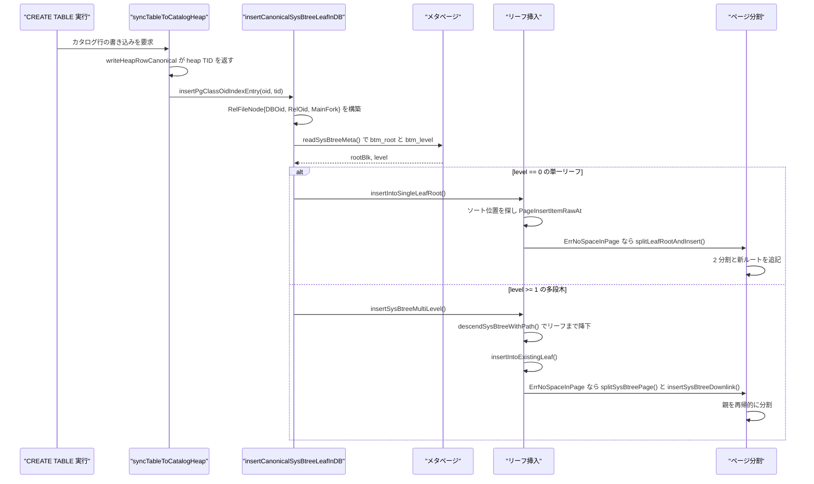
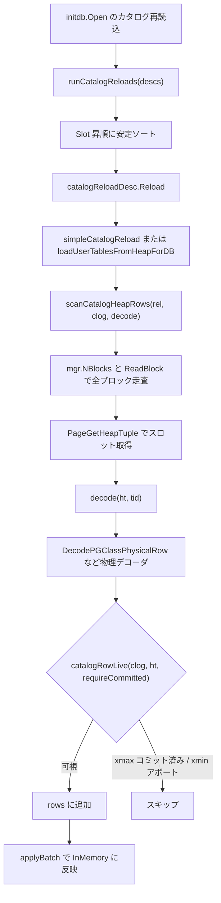

# カタログヒープとコーデック

<details>
<summary>関連ソースファイル</summary>

- [`internal/access/nbtree/btree.go`](https://github.com/ryogrid/goopg/blob/19856410e8d497d59787e1ab35a2febb3f5953d6/internal/access/nbtree/btree.go)
- [`internal/access/nbtree/bulkload.go`](https://github.com/ryogrid/goopg/blob/19856410e8d497d59787e1ab35a2febb3f5953d6/internal/access/nbtree/bulkload.go)
- [`internal/catalog/codec.go`](https://github.com/ryogrid/goopg/blob/19856410e8d497d59787e1ab35a2febb3f5953d6/internal/catalog/codec.go)
- [`internal/catalog/null_keyed_index_entries.go`](https://github.com/ryogrid/goopg/blob/19856410e8d497d59787e1ab35a2febb3f5953d6/internal/catalog/null_keyed_index_entries.go)
- [`internal/catalog/physical_align.go`](https://github.com/ryogrid/goopg/blob/19856410e8d497d59787e1ab35a2febb3f5953d6/internal/catalog/physical_align.go)
- [`internal/executor/sys_catalog_btree_insert_split.go`](https://github.com/ryogrid/goopg/blob/19856410e8d497d59787e1ab35a2febb3f5953d6/internal/executor/sys_catalog_btree_insert_split.go)
- [`internal/executor/sys_catalog_btree_levels.go`](https://github.com/ryogrid/goopg/blob/19856410e8d497d59787e1ab35a2febb3f5953d6/internal/executor/sys_catalog_btree_levels.go)
- [`internal/executor/sys_catalog_btree_multilevel.go`](https://github.com/ryogrid/goopg/blob/19856410e8d497d59787e1ab35a2febb3f5953d6/internal/executor/sys_catalog_btree_multilevel.go)
- [`internal/executor/sys_catalog_btree_split.go`](https://github.com/ryogrid/goopg/blob/19856410e8d497d59787e1ab35a2febb3f5953d6/internal/executor/sys_catalog_btree_split.go)
- [`internal/executor/sys_catalog_index_insert.go`](https://github.com/ryogrid/goopg/blob/19856410e8d497d59787e1ab35a2febb3f5953d6/internal/executor/sys_catalog_index_insert.go)
- [`internal/initdb/catalog_heap_reload.go`](https://github.com/ryogrid/goopg/blob/19856410e8d497d59787e1ab35a2febb3f5953d6/internal/initdb/catalog_heap_reload.go)

</details>

このページが扱うのは、`pg_catalog` の行を「PostgreSQL 18 がそのまま読めるバイト列」としてヒープに書き出し、同じバイト列を読み戻す層です。`internal/catalog/codec.go` が `pg_class` / `pg_attribute` / `pg_type` / `pg_index` / `pg_statistic` の行型とエンコーダ・デコーダを提供し、`internal/catalog/physical_align.go` が列の物理アラインメント規則を一手に引き受けます。書き込まれたヒープ行は、`internal/executor/sys_catalog_*` のコードが `pg_class_oid_index`（2662）などのシステム B-tree に IndexTuple を差し込むことで検索可能になり、起動時には `internal/initdb/catalog_heap_reload.go` がヒープを走査してインメモリカタログ（[12.1 インメモリカタログ](12.1-In-Memory-Catalog.md)）を再構築します。B-tree のページ形式そのものは [8 B-tree インデックス](../8-Btree.md) と共通で、ここではカタログ用途に必要な範囲（ページ分割と実行時挿入）を扱います。

## 責務

- 3 つのカタログ行型 `PGClassRow` / `PGAttributeRow` / `PGTypeRow` を、executor の `DecodeRowInto` が読める「簡易形式」と、PG18 の物理タプルを直接読む「物理形式」の 2 通りで符号化・復号する（`internal/catalog/codec.go:EncodePGClassRow`、`internal/catalog/codec.go:DecodePGClassPhysicalRow`）。
- `pg_class` の簡易形式 8 列スキーマと、`pg_attribute`（PG18 の 25 列）・`pg_type`（32 列）の物理タプル列定義を公開し、executor のデコーダとバイト位置が一致するように保つ（`internal/catalog/codec.go:PGClassColumns`、`PGAttributeColumns`、`PGTypeColumns`）。
- 物理タプル内の列アラインメントを単一の関数に集約し、executor のヒープコーデックと pgoutput の走査が同じ規則を使うようにする（`internal/catalog/physical_align.go:PhysicalTypeAlign`、`PhysicalTypeIsVarlena`、`AttAlignPointer`）。
- `pg_index` の `indkey`（int2vector）・`indcollation` / `indclass`（oidvector）・`indoption` と、末尾の可変長 `indexprs` / `indpred` を null ビットマップと varlena ヘッダから復号する（`internal/catalog/codec.go:DecodePGIndexPhysicalRow`）。
- `pg_statistic` の固定部 72 バイトと、`stanumbers1..5` / `stavalues1..5` の可変長部を、列ごとの typalign（float4[] は 4、anyarray は 8）で走査する（`internal/catalog/codec.go:DecodePGStatisticPhysicalRow`）。
- 型名と `pg_type` OID の相互変換、基底型→配列型 OID の対応、PostgreSQL の `float4out` / `float8out` 互換の浮動小数点文字列化を提供する（`internal/catalog/codec.go:TypeNameToOID`、`ArrayOIDForBase`、`PGFloatOut`）。
- ユーザーの `CREATE TABLE` に伴うシステム B-tree への実行時 IndexTuple 挿入を、単一リーフ・リーフ分割・多段木の 3 経路で行う（`internal/executor/sys_catalog_index_insert.go:insertCanonicalSysBtreeLeafInDB`）。
- 満杯ページを PostgreSQL の `_bt_split` / `_bt_insert_parent` と同じ形（右ページ先行書き込み、親への downlink 伝播、必要なら新ルート）で分割する（`internal/executor/sys_catalog_btree_insert_split.go:insertSysBtreeMultiLevel`、`splitSysBtreePage`）。
- 起動時にカタログヒープを走査し、MVCC の可視性（xmin/xmax と CLOG）で生きた行だけを選んでインメモリ状態へ適用する（`internal/initdb/catalog_heap_reload.go:scanCatalogHeapRows`、`catalogRowLive`、`runCatalogReloads`）。
- クラスタが「NULL キーのインデックスエントリを格納する」能力を持つかを `global/pg_goopg_features` の印から判定し、プランナの NULL キーガードに伝える（`internal/catalog/null_keyed_index_entries.go:NullKeyedIndexEntries`、`IndexHasNullKeyedEntries`）。
- B-tree のページ／タプル表現の基準実装（`IndexTupleData` 8 バイトヘッダ、16 バイトの BTPageOpaque、pivot tuple）と、ソート済み一括構築 `BulkCreate` を提供する（`internal/access/nbtree/btree.go:PGBTItemRaw`、`internal/access/nbtree/bulkload.go:BulkCreate`）。

## 処理フロー

### 書き込み: CREATE TABLE からシステム B-tree まで

`syncTableToCatalogHeap` が `writeHeapRowCanonical` で `pg_class` のヒープ行を書き、返ってきたヒープ TID を `insertPgClassOidIndexEntry` に渡します。インデックス側は dbOid ごとの RelFileNode を組み、メタページの `btm_level` を見て「単一リーフ」か「多段木」かを決めます。単一リーフでページがあふれた場合だけ `splitLeafRootAndInsert` が走り、多段木では `insertSysBtreeMultiLevel` がリーフを分割して親へ downlink を伝播します。



経路ごとの実装上の違いは次のとおりです。

- `insertCanonicalSysBtreeLeafInDB` は `ctx.Pool == nil` なら何もせず `nil` を返します（インメモリのテスト用カタログ）。`NBlocks` が 0 のときも「bootstrap が走っていない」とみなして黙って成功します（`sys_catalog_index_insert.go:445-455`）。
- `NBlocks == 1` は「メタページだけの空プレースホルダ」です。`allocateEmptySysBtreeLeafRoot` がブロック 1 に空の `BTP_LEAF|BTP_ROOT` ページを作り、メタページの `btm_root=1, btm_level=0` を書き込みます。既に `btm_root != 0` なのにブロックが無い場合は不整合としてエラーにします（`sys_catalog_index_insert.go:495-544`）。
- 単一リーフでは `PageLinePointerCount` でスロット数を得て、キー比較 `cmp` が最初に負になる位置を挿入点にします。比較対象は `indexTuple[sysIndexTupleHoff:]`、つまり 8 バイトの `IndexTupleData` ヘッダを除いたキー本体です（`sys_catalog_index_insert.go:565-582`）。
- `ErrNoSpaceInPage` は単一リーフでは `splitLeafRootAndInsert` へ、多段木では `splitSysBtreePage` へ分岐します。前者はブロック 1 を左リーフに書き換え、右リーフと新ルートを追記し、メタページを `level=1` に更新します（`sys_catalog_btree_split.go:421-562`）。
- 多段木の分割は、右ページを先に書き、次に左ページ、旧右兄弟の `btpo_prev`、親ページ、最後にメタページという順序です。これは nbtree の「指す側より先に指される側を書く」規則を守るためで、途中で失敗しても参照先がファイル末尾を超えないようにしています（`sys_catalog_btree_insert_split.go:22-43`、`splitSysBtreePage`）。

### 読み込み: 起動時のカタログ再読込

起動時は `runCatalogReloads` が `catalogReloadDesc` を `Slot` の昇順に並べ、各カタログの `Reload` を呼びます。単一ヒープのカタログは `simpleCatalogReload` が `scanCatalogHeapRows` を回し、`decode` コールバックが物理デコーダを呼びます。可視性判定は 1 箇所（`catalogRowLive`）に集約されています。



- `catalogRowLive` の規則は 4 つです。xmin が `InvalidTransactionID` なら偽、xmax が非ゼロなら CLOG で abort のときだけ生（committed / sub-committed / unknown は死）、xmin が abort なら死、`requireCommittedXmin` が立っていれば xmin が committed でなければ死（`catalog_heap_reload.go:27-81`）。
- CLOG が nil のときは保守的に「xmax 非ゼロ＝死」「xmin は問わない」という pre-B0.2 の挙動に戻ります（`catalog_heap_reload.go:61-73`）。basebackup 由来の xmin はローカル CLOG の範囲外で `Unknown` になるため、xmin 側では committed を要求しません。
- `scanCatalogHeapRows` は `NBlocks == 0` をエラーではなく「カタログ無し」として `(nil, nil)` で返します。ブロック読み取り失敗は fatal、行ポインタ数が壊れたブロックはスキップ、デコード失敗もスキップです（`catalog_heap_reload.go:97-164`）。
- 共有カタログ（`rel.DBOid == 0`）で行が捨てられた場合は、`slog.Warn` にカタログ名・ブロック・スロット・xmin・CLOG 状態を出します。データベースやロールの消失を後から追跡するためのログです（`catalog_heap_reload.go:129-157`）。
- `runCatalogReloads` は `Fatal` の記述子だけ即エラーにし、それ以外は `warn` コールバックへ渡して続行します（`catalog_heap_reload.go:2024-2046`）。

## 主要ファイル

| ファイル | 役割 |
| --- | --- |
| `internal/catalog/codec.go` | 行型と列定義、簡易／物理のエンコード・デコード、型 OID 表、`PGFloatOut`。`codec.go:EncodePGClassRow`、`codec.go:DecodePGIndexPhysicalRow` |
| `internal/catalog/physical_align.go` | 物理アラインメントと varlena 判定の単一情報源。`physical_align.go:PhysicalTypeAlign`、`physical_align.go:AttAlignPointer` |
| `internal/catalog/null_keyed_index_entries.go` | NULL キー格納能力のクラスタフラグとタプル形式判定。`null_keyed_index_entries.go:IndexHasNullKeyedEntries` |
| `internal/executor/sys_catalog_index_insert.go` | IndexTuple ビルダ（oid / name+oid / oid+int2 など）と挿入ディスパッチ。`sys_catalog_index_insert.go:buildIndexTupleOidKey`、`insertCanonicalSysBtreeLeafInDB` |
| `internal/executor/sys_catalog_btree_split.go` | 単一リーフの分割とページ／ダウンリンクのバイト構築。`sys_catalog_btree_split.go:splitLeafRootAndInsert`、`buildSysBtreeLeafPage` |
| `internal/executor/sys_catalog_btree_insert_split.go` | 多段木の降下・リーフ分割・親への伝播。`sys_catalog_btree_insert_split.go:insertSysBtreeMultiLevel`、`splitSysBtreePage` |
| `internal/executor/sys_catalog_btree_multilevel.go` | メタページ読み出し、リーフ列挙、一括レイアウト再構築。`sys_catalog_btree_multilevel.go:readSysBtreeMeta`、`rebuildSysBtreeWithNewEntry` |
| `internal/executor/sys_catalog_btree_levels.go` | 任意高さの内部レベル構築。`sys_catalog_btree_levels.go:layoutSysBtreeInternalLevels` |
| `internal/initdb/catalog_heap_reload.go` | 起動時ヒープ走査と可視性フィルタ、カタログ別リロード記述子。`catalog_heap_reload.go:scanCatalogHeapRows`、`catalogRowLive` |
| `internal/access/nbtree/btree.go` | B-tree のページ／タプル表現、`IndexTupleData` エンコーダ、キー比較。`btree.go:PGBTItemRaw`、`btree.go:CompareKeys` |
| `internal/access/nbtree/bulkload.go` | ソート済みエントリからの一括構築。`bulkload.go:BulkCreate`、`bulkload.go:BulkEntry` |

## 公開 API / エントリポイント

```go
// 行の符号化・復号（簡易形式）
func EncodePGClassRow(r PGClassRow) []byte
func EncodePGAttributeRow(r PGAttributeRow) []byte
func EncodePGTypeRow(r PGTypeRow) []byte
func DecodePGClassRow(data []byte) (PGClassRow, error)
func DecodePGAttributeRow(data []byte) (PGAttributeRow, error)
func DecodePGTypeRow(data []byte) (PGTypeRow, error)

// 行の復号（PG18 物理形式）
func DecodePGClassPhysicalRow(data []byte) (PGClassRow, error)
func DecodePGAttributePhysicalRow(data []byte) (PGAttributeRow, error)
func DecodePGTypePhysicalRow(data []byte) (PGTypeRow, error)
func DecodePGIndexPhysicalRow(data, bitmap []byte) (PGIndexRow, error)
func DecodePGStatisticPhysicalRow(data, bitmap []byte) (PGStatisticRow, error)

// 列定義
func PGClassColumns() []Column
func PGAttributeColumns() []Column
func PGTypeColumns() []Column

// アラインメント
func PhysicalTypeAlign(t Type, tname string) int
func PhysicalTypeAlignName(t Type) int
func PhysicalTypeIsVarlena(t Type) bool
func AttAlignPointer(data []byte, off, align int, isVarlena bool) int

// 型と数値の表現
func TypeNameToOID(typName string) uint32
func OIDToTypeName(oid uint32) string
func ArrayOIDForBase(baseOID uint32) uint32
func BaseOIDForArray(oid uint32) (uint32, bool)
func PGFloatOut(f float64, bitSize int) string

// NULL キー格納能力
func NullKeyedIndexEntries() bool
func SetNullKeyedIndexEntries(on bool)
func IndexHasNullKeyedEntries(idx *Index) bool

// カタログ B-tree への挿入（executor 内の DDL 同期から呼ばれる）
func insertCanonicalSysBtreeLeaf(ctx *Context, indexOID uint32, indexTuple []byte, cmp keyCompareFn) error
func insertCanonicalSysBtreeLeafInDB(ctx *Context, dbOid, indexOID uint32, indexTuple []byte, cmp keyCompareFn) error
func insertPgClassOidIndexEntry(ctx *Context, oid uint32, tid storage.ItemPointer) error
func insertPgAttributeRelidAttnumIndexEntry(ctx *Context, attrelid uint32, attnum int16, tid storage.ItemPointer) error

// 起動時リロード
func scanCatalogHeapRows(mgr *storage.Manager, rel storage.RelFileNode, clog *transam.CLog,
	name string, decode func(ht storage.HeapTuple, tid storage.ItemPointer) (any, bool, error)) ([]any, error)
func runCatalogReloads(mgr *storage.Manager, cat *catalog.InMemory, clog *transam.CLog,
	heapDBOid, nsDBOid uint32, descs []catalogReloadDesc, warn func(name string, err error)) error

// B-tree の一括構築
func BulkCreate(pool *storage.Pool, rel storage.RelFileNode, entries []BulkEntry) (*BTree, error)
func (bt *BTree) Insert(key []byte, ptr storage.ItemPointer) error
```

`insertCanonicalSysBtreeLeaf` は `tableCatalogHeapDBOid(ctx)`（接続 DB を `NamespaceDBOid` で正規化した値）を DB OID に使い、共有カタログ（`pg_tablespace` など）は `insertCanonicalSysBtreeLeafInDB(ctx, 0, ...)` を直接呼んで `global/<oid>` に書きます（`sys_catalog_index_insert.go:423-440`）。

## 主要データ構造

### `PGClassRow` / `PGAttributeRow` / `PGTypeRow` — カタログ行のメモリ表現

```go
// PGClassRow is the v0 on-disk shape of one pg_class tuple.
// Only the subset of columns needed to reconstruct the in-memory
// catalog state is stored; the full upstream shape is deferred.
type PGClassRow struct {
	OID          uint32 // oid
	RelName      string // relname
	RelNamespace uint32 // relnamespace (schema OID)
	RelKind      string // relkind: 'r'=table,'i'=index,'v'=view,'S'=seq
	RelNAtts     int32  // relnatts
	RelFileNode  uint32 // relfilenode (0 for virtual / view)
	// RelTablespace holds pg_class.reltablespace (0 = database default).
	// Only DecodePGClassPhysicalRow populates this (the fixed-offset
	// PG18-canonical layout); the legacy simple encoding decoded by
	// DecodePGClassRow predates tablespaces and always leaves it 0.
	// M0122-0007 tablespace-restart-durability follow-up.
	RelTablespace  uint32
	RelPersistence string // relpersistence: 'p'=permanent
	RelIsShared    bool   // relisshared
	// RelIsPopulated holds pg_class.relispopulated (matview populated state; true
	// for every non-matview relation). Only DecodePGClassPhysicalRow populates it
	// (byte 129 of the fixed part); the legacy DecodePGClassRow leaves it false,
	// so callers must guard reload use on the physical path. 02e item A.
	RelIsPopulated bool
	// RelOptions holds the pg_class.reloptions text[] external literal (e.g.
	// "{fillfactor=70}"), or "" when absent/NULL. Neither DecodePGClassRow
	// nor DecodePGClassPhysicalRow populate this (reloptions is a varlena
	// column past the fixed-offset prefix they decode); initdb's
	// loadUserTablesFromHeap fills it in via executor.DecodeRowIntoMctxPGTuple
	// (the general PG-tuple decoder) and feeds it to ApplyTableReloptions.
	// M0119-0004.
	RelOptions string
}
```

（`codec.go:PGClassRow`）

```go
// PGAttributeRow is the v0 on-disk shape of one pg_attribute tuple.
type PGAttributeRow struct {
	AttRelID     uint32 // attrelid (owning relation OID)
	AttName      string // attname
	AttTypID     uint32 // atttypid (pg_type OID)
	AttNum       int32  // attnum (1-based)
	AttNotNull   bool   // attnotnull
	AttIsDropped bool   // attisdropped
	// AttIdentity is attidentity (0, 'a' ALWAYS, 'd' BY DEFAULT). Decoded
	// only by the PG-physical DecodePGAttributeRow (B1.3b — the sequence
	// reload restores IdentityColumn/IdentityAlways from it, replacing the
	// retired kind-65 IdentityKind marker).
	AttIdentity byte
	// AttTypMod is atttypmod — the type modifier (e.g. 29 for varchar(25),
	// encoding the declared length + VARHDRSZ). Decoded only by the
	// PG-physical decoder; the legacy encoder/decoder does not carry it.
	// M0119-0010.
	AttTypMod int32
}
```

（`codec.go:PGAttributeRow`）

```go
// PGTypeRow is the v0 on-disk shape of one pg_type tuple.
type PGTypeRow struct {
	OID          uint32 // oid
	TypName      string // typname
	TypNamespace uint32 // typnamespace
	TypLen       int32  // typlen (-1 = variable)
	TypByVal     bool   // typbyval (passed by value)
	TypType      string // typtype: 'b'=base, 'c'=composite, etc.
	TypCategory  string // typcategory
}
```

（`codec.go:PGTypeRow`）

`PGClassRow` は「メモリ上の `catalog.Table` を再構築するのに必要な最小集合」です。`RelFileNode` が 0 の行は仮想リレーションかビューであり、物理ファイルを持ちません。`RelIsPopulated` は物理デコーダでしか埋まらないため、再読込でこのフィールドを使うときは必ず物理経路であることを前提にします。`RelOptions` はどちらのデコーダも埋めず、`loadUserTablesFromHeap` が汎用の PG タプルデコーダで補完します。`PGAttributeRow` の `AttNum` は 1 始まりで、`catalog.Column.Ordinal`（0 始まり）とは 1 だけずれます。`PGTypeRow.TypLen == -1` が可変長（varlena）の目印です。

### `PGIndexRow` — `pg_index` の復元用

```go
// PGIndexRow holds the fields from pg_index needed for catalog recovery.
type PGIndexRow struct {
	IndexRelid          uint32   // indexrelid
	IndRelid            uint32   // indrelid (owning table OID)
	IndNAtts            int16    // indnatts (key columns + INCLUDE columns)
	IndNKeyAtts         int16    // indnkeyatts (key columns only; the rest of IndKey is INCLUDE columns)
	IndKey              []int16  // attnum values: key columns first, then INCLUDE columns
	IndIsUnique         bool     // indisunique
	IndNullsNotDistinct bool     // indnullsnotdistinct
	IndIsPrimary        bool     // indisprimary
	IndCollation        []uint32 // per-key-column indcollation OIDs (M0122-0006 follow-up 3)
	IndClass            []uint32 // per-key-column indclass (opclass) OIDs (M0122-0006 follow-up 3)
	IndOption           []int16  // per-key ASC/DESC + NULLS FIRST/LAST bitmask (INDOPTION_DESC=0x1, INDOPTION_NULLS_FIRST=0x2)
	IndHasExprs         bool     // true if indexprs is non-NULL (expression index)
	IndExprs            string   // indexprs's deparsed expression SQL text (goopg stores pg_node_tree columns as SQL text; see IndexExprsText)
	IndHasPred          bool     // true if indpred is non-NULL (partial index)
	IndPred             string   // indpred's WHERE-clause SQL text (goopg stores pg_node_tree columns as SQL text; see column_defaults_recovery.go)
}
```

（`codec.go:PGIndexRow`）

`IndKey` の先頭 `IndNKeyAtts` 個がキー列、残りが INCLUDE 列です。`IndCollation` / `IndClass` / `IndOption` はキー列と同数で、`IndOption` のビット 0 が DESC、ビット 1 が NULLS FIRST を表します。`IndHasExprs` / `IndHasPred` は null ビットマップから復元されるため、ビットマップが渡されない呼び出しでは「両方可視」とみなされます（`pgIndexBitNotNull` は空ビットマップに `true` を返す）。

### `PGStatisticRow` — ANALYZE 結果の復元用

```go
// PGStatisticRow holds the fields from pg_statistic needed for in-memory
// planner statistics reconstruction.
type PGStatisticRow struct {
	StaRelid    uint32    // starelid — owning relation OID
	StaAttNum   int16     // staattnum — column number (1-based)
	StaNullFrac float32   // stanullfrac
	StaWidth    int32     // stawidth (avg column width in bytes)
	StaDistinct float32   // stadistinct (<0 → fraction; >0 → count)
	StaKind1    int16     // stakind1 (1=MCV, 2=histogram, 3=correlation, 0=empty)
	StaKind2    int16     // stakind2
	StaKind3    int16     // stakind3
	MCVFreqs    []float32 // stanumbers1 when stakind1==STATISTIC_KIND_MCV
	MCVValues   []string  // stavalues1 decoded as text
	HistBounds  []string  // stavalues2 decoded as text when stakind2==STATISTIC_KIND_HISTOGRAM
	// Correlation is stanumbers3's single element when
	// stakind3==STATISTIC_KIND_CORRELATION. It carries no stavalues, which is
	// why it rides a stanumbers slot alone.
	Correlation float32
}
```

（`codec.go:PGStatisticRow`）

`StaDistinct` は PostgreSQL の符号規約そのままで、負値が行数に対する割合、正値が絶対個数、0 が不明です。`StaKind1..3` はスロットの種類（1=MCV、2=ヒストグラム、3=相関）で、`MCVFreqs` / `MCVValues` / `HistBounds` / `Correlation` はそのスロットが存在するときだけ埋まります。

### `btreeIndexKeyMeta` — 実行時挿入できるインデックスの登録表

```go
// btreeIndexKeyMeta describes the on-disk key layout of a system btree
// covered by the runtime split path.
type btreeIndexKeyMeta struct {
	tupleSize int    // total IndexTuple size in bytes (e.g. 16 or 80); 0 when variable
	nkeyatts  uint16 // number of key attributes (1 for oid, 2 for name+oid or oid+int2)
	variable  bool   // true when tuples are variable-length (varlena key column,
	// e.g. pg_proc_proname_args_nsp_index's oidvector) — the rebuild
	// fallback then uses the variable-size bulk layout instead of the
	// fixed-tupleSize one
}
```

（`sys_catalog_btree_split.go:btreeIndexKeyMeta`）

`keyMetaForSysBtree(indexOID)` がこの構造体を返す唯一の場所で、未登録の OID は `ok=false` となり、`splitLeafRootAndInsert` も `insertSysBtreeMultiLevel` も `unsupported system btree OID` で失敗します。固定長なら `tupleSize` と実際のタプル長が一致しなければならず、可変長なら `len(tuple) > 8` かつ 8 バイト境界であることが要求されます（`sys_catalog_btree_split.go:446-454`）。

### `sysBtreePageImage` — 読み書きする 1 ページの表現

```go
// sysBtreePageImage is one parsed btree page: its high key (nil on the
// rightmost page of a level), its items in slot order, and its special
// area. On an internal page items[0] is the minus-infinity downlink.
type sysBtreePageImage struct {
	highKey []byte
	items   [][]byte
	prev    uint32
	next    uint32
	level   uint32
	flags   uint16
}
```

（`sys_catalog_btree_insert_split.go:sysBtreePageImage`）

`readSysBtreePageImage` はページ末尾 16 バイトの `BTPageOpaque` から `prev` / `next` / `level` / `flags` を読み、`i == 1 && next != P_NONE` のスロットを high key として分離します。内部ページでは先頭項目がマイナス無限大のダウンリンクです。`buildSysBtreePage` は `flags & BTP_LEAF` を見てリーフ用／内部用のビルダに振り分けます。

### `catalogReloadDesc` — 起動時リロードの登録単位

```go
// catalogReloadDesc describes one catalog's startup reload. Converted
// catalogs (B1+) register a descriptor here instead of keeping a bespoke
// scanner; Slot values are DERIVED from the historical recovery-pass call
// sequence in Open (doc 02a §2.4) so relative order never changes as
// catalogs migrate.
type catalogReloadDesc struct {
	Name string // "pg_namespace" — log/error labels only
	Slot int    // recovery-pass slot (02a §2.4); lower runs first
	// Fatal: a reload error aborts startup (schema/table precedent) instead
	// of warn-and-continue (statistics/index precedent, Open).
	Fatal bool
	// Reload performs the catalog's scan+apply. Simple single-heap catalogs
	// build this with simpleCatalogReload; multi-heap joins (the pg_class +
	// pg_attribute exemplar) implement it directly.
	Reload func(mgr *storage.Manager, cat *catalog.InMemory, clog *transam.CLog, heapDBOid, nsDBOid uint32) error
}
```

（`catalog_heap_reload.go:catalogReloadDesc`）

`Slot` は「歴史的な復旧パスの呼び出し順」から導かれる固定値で、カタログをこの形へ移行しても相対順序が変わらないようにしています。`Fatal` の真偽が、失敗時に起動を止めるか警告で続行するかを決めます。

### `BulkEntry` — 一括構築の入力

```go
type BulkEntry struct {
	Key []byte
	Ptr storage.ItemPointer
	// KeyDesc is the rendered "Key (cols)=(vals)" description for this
	// entry's key values, captured at entry-construction time so the
	// executor's post-sort duplicate walk can build PG's
	// `Key (…)=(…) is duplicated.` DETAIL (BuildIndexValueDescription,
	// postgres/src/backend/access/index/genam.c:178-276) without the
	// source heap row. Empty for non-unique builds (never read).
	KeyDesc string
}
```

（`bulkload.go:BulkEntry`）

`Key` は不透明なバイト列で、順序はツリーの `indexFormat` が決めます（キー記述子を持たないインデックスではバイト辞書順）。`Ptr` はリーフページに書かれるヒープ TID です。`BulkCreate` はこのスライスを内部でソートするため、呼び出し側が事前ソートする必要はありません。

## 内部構造

### 2 つのエンコード形式

`codec.go` には互換性の異なる 2 系統があります。簡易形式（`EncodePGClassRow` など）は列ごとに「1 バイトの NULL フラグ + 値」を並べ、int4 と varlen 長はビッグエンディアンです（`appendInt4Col`、`appendVarlenCol`）。物理形式（`DecodePGClassPhysicalRow` など）は PostgreSQL のタプルをそのまま読み、すべてリトルエンディアンで固定オフセットを使います（`pgClassOffRelName=4`、`pgClassOffRelNamespace=68`、`pgClassOffRelKind=119`、`pgClassOffRelNAtts=120`、`pgClassOffRelIsPopulated=129`）。

物理形式の固定部サイズは `pgClassFixedPartSize=144`、`pgAttributeFixedPartSize=100` です。短いデータは即エラーにし、`relname` / `attname` が空、`relpersistence` が `p`/`u`/`t` 以外、`relkind` が既知の集合外、`relnatts` が負、`attnum` が 0、`attisdropped` でないのに `atttypid` が 0、といった値は不正として弾きます（`codec.go:878-923`、`970-1005`）。

### NULL ビットマップと varlena の歩き方

PG のヒープタプルでは `bit i == 1` が「列 i は NOT NULL」です。`pgIndexBitNotNull` はこれをそのまま実装し、ビットマップが nil なら全列可視とみなします（`codec.go:1347-1361`）。`pg_index` の `indexprs`（列 19）と `indpred`（列 20）はどちらも NULL 可変長で、NULL はバイトを消費しないため、2 つを区別できるのはビットマップだけです。両方が非 NULL の式インデックス＋部分インデックスではビットマップが存在しない、というのがこの判定の前提です。

varlena には 1 バイト短縮ヘッダと 4 バイトヘッダの 2 形式があり、`decodePGIndexVarlenaText` は両方を受け付けます。1 バイトヘッダの `0x01` は external（TOAST ポインタ）として `ok=false`、4 バイトヘッダで下位 2 ビットが `0x02` なら圧縮として `ok=false` を返します（`codec.go:1388-1421`）。`pgIndexVarlenaLen` は同じ規則で長さだけを返し、`indexprs` の次に `indpred` を読むためのオフセット計算に使います。

`pg_statistic` ではさらに列ごとのアラインメントが絡みます。`stanumbers1..5` は `float4[]` で 4 バイト、`stavalues1..5` は `anyarray` で 8 バイトです（`codec.go:1537-1550`）。短縮ヘッダの値は `reframeShortVarlena` で 4 バイトヘッダ形に作り直してから配列デコーダへ渡します。13 バイトの TOAST ポインタは読み飛ばして `nil` を返します。

### アラインメント規則の一元化

`PhysicalTypeAlign` は `Type.IsArray` を最優先で 4 にし、次に型名で分岐します。`char` は長さ修飾子が無ければ 1（内部 1 バイト型）、あれば 4（bpchar は varlena）、`int8` / `interval` / `xid8` / `anyarray` は 8、`name` / `uuid` は 1 です（`physical_align.go:18-66`）。`PhysicalTypeIsVarlena` は同じ表を逆向きに使い、`tid` や `money` など一部の固定長型を varlena と誤判定し得ることをコメントで明示しています（`physical_align.go:68-118`）。

`AttAlignPointer` は D-09 の「覗き見」規則です。非 varlena なら常にアラインし、varlena なら先頭バイトが 0 のときだけアラインします。0 以外は 1 バイトヘッダか既に整列済みの 4 バイトヘッダなので、動かす必要がありません（`physical_align.go:120-141`）。この関数を executor のヒープコーデックと pgoutput の走査が共有することで、「片方だけ 1 ワードずれる」という不具合を防いでいます。

### システム B-tree の分割戦略

分割位置は `sysBtreeFindSplitLoc` が `_bt_findsplitloc` の既定戦略で決めます。各候補 `k` について左ページ（新しい high key を含む）と右ページの空きを計算し、`|mult*leftfree - (1-mult)*rightfree|` を最小化します。右端ページでは `mult` がリーフ 90%（`sysBtreeLeafFillfactor`）、内部 70%（`sysBtreeNonLeafFillfactor`）になります（`sys_catalog_btree_insert_split.go:333-389`）。昇順挿入が続くときに左ページを詰めて書けるので、分割のたびに半空きページを残しません。

内部ページの分割では、右ページの先頭項目を「キーを捨てたマイナス無限大ダウンリンク」に置き換え、捨てたキーを親への separator として返します（`splitSysBtreePage` の `right.items[0] = buildSysBtreeMinusInfDownlink(...)`）。親への伝播は `insertSysBtreeDownlink` が担当し、親が満杯なら同じ分割を再帰します。ルートが分割されたときは新しいルートページを作り、メタページの `btm_root` / `btm_level` を更新します。

### 書き込み順序と単一書き手の前提

`rebuildSysBtreeWithNewEntry` は「子を書いてから親を書く」順序を守ります。新しく伸ばす末尾ブロックを先に書き、既存ブロックを昇順（リーフ→内部の順）で書き換え、メタページを最後に書きます（`sys_catalog_btree_multilevel.go:478-531`）。逆順にすると、メタページが指す downlink がまだ存在しないブロックを指し、次の降下で `short read` になります。

カタログインデックスの書き込みは「この層では単一書き手」という前提で、nbtree の lock coupling や `BTP_INCOMPLETE_SPLIT` フラグはモデル化していません（`sys_catalog_btree_insert_split.go:41-43`）。ユーザーインデックスの `nbtree.BTree` は別物で、そちらはページ単位ラッチと Lehman-Yao の右リンク回復、`BTIncompleteSplit` / `BTHalfDead` を持ちます（`btree.go:BTree` のコメント）。

### ページとタプルのバイト形式

nbtree の `PGBTItemRaw` は `IndexTupleData` を「t_tid[6] + t_info[2] + key」で組み立てます。`t_info` にはタプル全体の長さが入り、NULL / varlena / ALT-TID の各マスクはクリアです（`btree.go:387-441`）。カタログ側の `buildIndexTupleOidKey` なども同じ 8 バイトヘッダを自前で書き、`sysIndexSizeMask = 0x1FFF` でサイズをマスクします。ページ末尾の `BTPageOpaque` は 16 バイト（`sizeOfBTPageOpaque`、nbtree では `SizeOfBTPageOpaque`）で、`btpo_prev` / `btpo_next` / `btpo_level` / `btpo_flags` がリトルエンディアンで並びます。

### NULL キー格納能力

`nullKeyedIndexEntries` はクラスタ単位の `atomic.Bool` です。goopg の古いライタは NULL キーの行をインデックスに載せていなかったため、その能力を持つかどうかは「どのインデックスが完全か」ではなく「クラスタがその形式で作られたか」で決まります。`initdb` が `global/pg_goopg_features` に `null_keyed_index_entries` を書いた場合だけ open 時にフラグが立ち、`IndexHasNullKeyedEntries` は「フラグが立っている」かつ「そのインデックスがタプル形式である」ときだけ真を返します（`null_keyed_index_entries.go:5-48`）。

## エッジケースと不変条件

- **物理列順は固定**。`PGAttributeColumns` は PG18 の `FormData_pg_attribute` とバイト単位で一致している必要があり、`attstattarget` は 21 番目（`attcollation` と `attacl` の間）です。ここを PG16 以前の位置に戻すと、NULL でない `attstattarget` を PostgreSQL が `attacl` として読んでしまいます（`codec.go:668-734`）。
- **`PGClassColumns` とエンコーダの同期**。簡易形式の列定義は `EncodePGClassRow` / `DecodePGClassRow` と一致していなければ executor の `DecodeRowInto` が誤読します（`codec.go:652-666`）。
- **タプル長の検証**。分割・再構築は、固定長インデックスで `len(tuple) != tupleSize`、可変長で `len(tuple) <= 8` または 8 の倍数でない場合にエラーにします。既存項目の長さも同じ規則で検査されます（`sys_catalog_btree_split.go:446-480`）。
- **分割不能の扱い**。`sysBtreeFindSplitLoc` は項目が 2 未満、またはどの候補でも左右が負になる場合にエラーを返します。`splitLeafRootAndInsert` もマージ結果が 2 未満なら分割を拒否します（`sys_catalog_btree_insert_split.go:338-343`、`sys_catalog_btree_split.go:483-489`）。
- **インデックスファイルが無い場合**。`insertCanonicalSysBtreeLeafInDB` は `NBlocks == 0` を「bootstrap 未実行」として黙って成功させます。本番では起こらない状態ですが、テスト用のインメモリカタログで `CREATE TABLE` が失敗しないための分岐です（`sys_catalog_index_insert.go:452-455`）。
- **メタページだけのインデックス**。`NBlocks == 1` は遅延ルート割り当ての対象です。`btm_root` が既に非ゼロなのにブロック 1 が無い場合は `metapage names root ... but relation has no block` で中断します（`sys_catalog_index_insert.go:503-506`）。
- **名前キーの長さ上限**。`NameData` は 64 バイトで、`buildIndexTupleNameOidKey` / `buildIndexTupleNameKey` は 64 バイトを超える名前を切り詰めます（`sys_catalog_index_insert.go:97-101`、`194-198`）。PG の識別子上限（NAMEDATALEN=64）に合わせた挙動です。
- **`indkey` の上限**。`DecodePGIndexPhysicalRow` は int2vector の要素数が 0〜1024 の範囲外ならエラーにします。`indcollation` / `indclass` / `indoption` の復号失敗は「そのフィールドだけ利用不可」として扱い、既に読めたフィールドを捨てません（`codec.go:1242-1296`）。
- **`pg_statistic` の短縮ヘッダ**。127 バイト以下の値は 1 バイトヘッダで書かれるため、4 バイト前提で読むと後続列がずれます。`reframeShortVarlena` で 4 バイト形に変換してから配列デコーダに渡すのが必須です（`codec.go:1552-1600`）。
- **`anyarray` の 8 バイトアラインメント**。`attmissingval` と `stavalues1..5` は `anyarray`（typalign `d`）であり、4 バイトで読むと後続が 1 ワード早くなります。`PhysicalTypeAlign` の `anyarray` 分岐と `pg_statistic` の `col >= 27` 分岐が同じ結論を持つことが前提です（`physical_align.go:54-62`、`codec.go:1545-1550`）。
- **`TypeNameToOID` のフォールバック**。未知の型名は `OIDText`（25）を返します。前向き索引の構築側はこの挙動を「衝突の危険」として扱い、`OIDToTypeName` で往復一致しない型を索引から除外しています（`codec.go:1723-1728`）。
- **`PGFloatOut` の特殊値**。NaN / +Inf / -Inf は `"NaN"` / `"Infinity"` / `"-Infinity"`、負のゼロは `"-0"` を返します。固定小数点と科学表記の切替しきい値は float4 が 6、float8 が 15 で、Go の `%g` とは異なります（`codec.go:2065-2141`）。
- **可視性フィルタは 1 箇所だけ**。`scanCatalogHeapRows` は xmax を見て早期に捨てることをせず、必ず `catalogRowLive` に判断を委ねます。xmax が aborted なら行は生きたままです（`catalog_heap_reload.go:118-159`）。
- **共有カタログの欠落は警告**。`rel.DBOid == 0` の行が xmin の状態だけで捨てられた場合、`slog.Warn` でカタログ名・TID・xmin・CLOG 状態を残します。デバッグ時に「どの行がなぜ消えたか」を追う唯一の手掛かりです（`catalog_heap_reload.go:129-157`）。

ディスク上のカタログ全体の構成は [12.1 インメモリカタログ](12.1-In-Memory-Catalog.md)、仮想ビューの投影は [12.3 システムビューと information_schema](12.3-System-Views.md)、起動時のブートストラップ順序は [12.6 組み込みカタログのブートストラップ](12.6-Catalog-Bootstrap.md) を参照してください。

Sources:
- `internal/access/nbtree/btree.go`
- `internal/access/nbtree/bulkload.go`
- `internal/catalog/codec.go`
- `internal/catalog/null_keyed_index_entries.go`
- `internal/catalog/physical_align.go`
- `internal/executor/sys_catalog_btree_insert_split.go`
- `internal/executor/sys_catalog_btree_levels.go`
- `internal/executor/sys_catalog_btree_multilevel.go`
- `internal/executor/sys_catalog_btree_split.go`
- `internal/executor/sys_catalog_index_insert.go`
- `internal/initdb/catalog_heap_reload.go`

<sub>Generated by deepwiki-4myself from `goopg` @ `19856410e`</sub>
