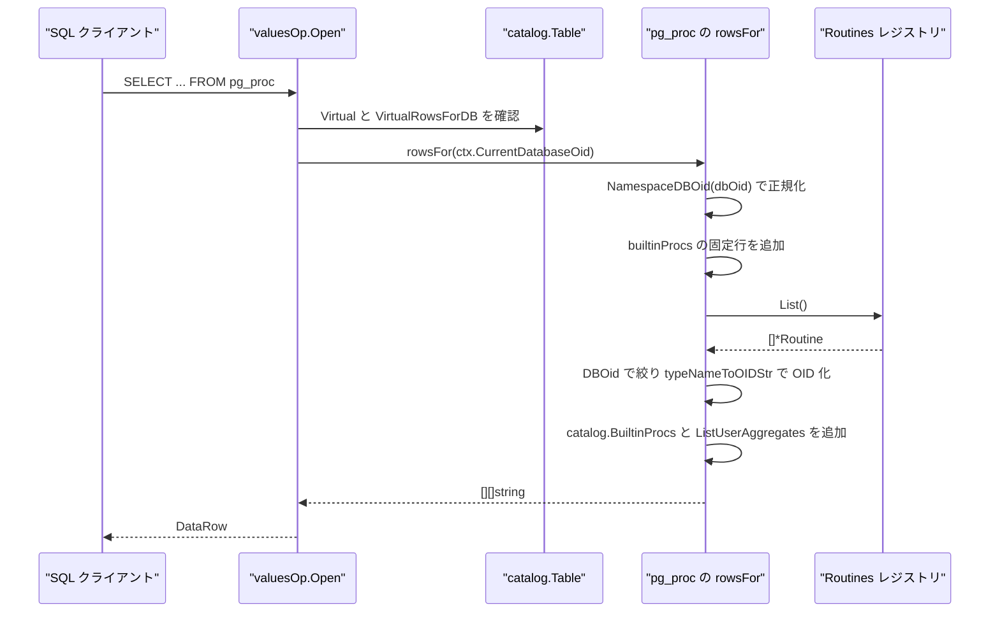
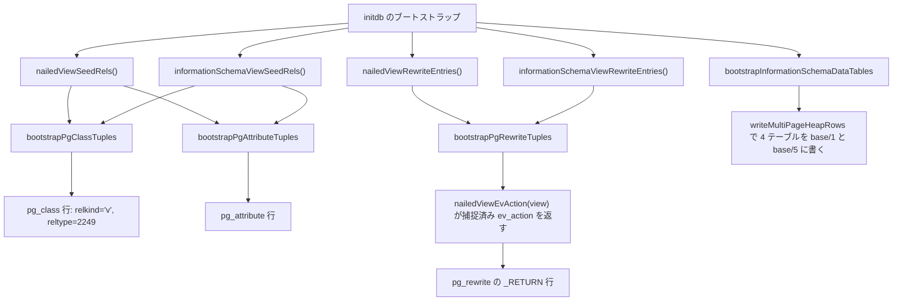

# システムビューと information_schema

<details>
<summary>関連ソースファイル</summary>

- [`internal/executor/pg18_user_catalog_rows.go`](https://github.com/ryogrid/goopg/blob/19856410e8d497d59787e1ab35a2febb3f5953d6/internal/executor/pg18_user_catalog_rows.go)
- [`internal/executor/pg_catalog_fk_data.go`](https://github.com/ryogrid/goopg/blob/19856410e8d497d59787e1ab35a2febb3f5953d6/internal/executor/pg_catalog_fk_data.go)
- [`internal/initdb/aio_views.go`](https://github.com/ryogrid/goopg/blob/19856410e8d497d59787e1ab35a2febb3f5953d6/internal/initdb/aio_views.go)
- [`internal/initdb/information_schema_proc_seed.go`](https://github.com/ryogrid/goopg/blob/19856410e8d497d59787e1ab35a2febb3f5953d6/internal/initdb/information_schema_proc_seed.go)
- [`internal/initdb/information_schema_sequences_view.go`](https://github.com/ryogrid/goopg/blob/19856410e8d497d59787e1ab35a2febb3f5953d6/internal/initdb/information_schema_sequences_view.go)
- [`internal/initdb/information_schema_tables.go`](https://github.com/ryogrid/goopg/blob/19856410e8d497d59787e1ab35a2febb3f5953d6/internal/initdb/information_schema_tables.go)
- [`internal/initdb/information_schema_view_seed_data.go`](https://github.com/ryogrid/goopg/blob/19856410e8d497d59787e1ab35a2febb3f5953d6/internal/initdb/information_schema_view_seed_data.go)
- [`internal/initdb/nailed_view_seed_data.go`](https://github.com/ryogrid/goopg/blob/19856410e8d497d59787e1ab35a2febb3f5953d6/internal/initdb/nailed_view_seed_data.go)
- [`internal/initdb/pg_aggregate_view.go`](https://github.com/ryogrid/goopg/blob/19856410e8d497d59787e1ab35a2febb3f5953d6/internal/initdb/pg_aggregate_view.go)
- [`internal/initdb/pg_proc_view.go`](https://github.com/ryogrid/goopg/blob/19856410e8d497d59787e1ab35a2febb3f5953d6/internal/initdb/pg_proc_view.go)
- [`internal/initdb/pg_sequences_view.go`](https://github.com/ryogrid/goopg/blob/19856410e8d497d59787e1ab35a2febb3f5953d6/internal/initdb/pg_sequences_view.go)
- [`internal/initdb/pg_stat_activity_view.go`](https://github.com/ryogrid/goopg/blob/19856410e8d497d59787e1ab35a2febb3f5953d6/internal/initdb/pg_stat_activity_view.go)
- [`internal/initdb/pg_stat_ssl_gssapi_view.go`](https://github.com/ryogrid/goopg/blob/19856410e8d497d59787e1ab35a2febb3f5953d6/internal/initdb/pg_stat_ssl_gssapi_view.go)
- [`internal/initdb/replication_views.go`](https://github.com/ryogrid/goopg/blob/19856410e8d497d59787e1ab35a2febb3f5953d6/internal/initdb/replication_views.go)
- [`internal/initdb/system_view_oid_pins.go`](https://github.com/ryogrid/goopg/blob/19856410e8d497d59787e1ab35a2febb3f5953d6/internal/initdb/system_view_oid_pins.go)
- [`internal/initdb/wal_io_views.go`](https://github.com/ryogrid/goopg/blob/19856410e8d497d59787e1ab35a2febb3f5953d6/internal/initdb/wal_io_views.go)

</details>

システムビューと `information_schema` は、goopg が SQL 利用者に見せる「カタログの読み取り面」を構成します。実装は 2 系統に分かれます。1 つは PostgreSQL 18.3 の `initdb` が `system_views.sql` / `information_schema.sql` で作るビューを **実ヒープ行として複製する** 系統で、`nailedViewSeedRels()` / `informationSchemaViewSeedRels()` が `pg_class` と `pg_attribute` の行を、`nailedViewRewriteEntries()` / `informationSchemaViewRewriteEntries()` が `pg_rewrite` の `_RETURN` 行を供給します。もう 1 つは goopg 自身の状態を **仮想テーブル** として登録する系統で、`pg_proc`・`pg_aggregate`・`pg_stat_activity`・`pg_stat_replication`・`pg_aios` などの `VirtualRows` クロージャが呼び出し時点のレジストリを読んで行を組み立てます。前者の OID は PG 18.3 の値に固定され（[12.6 組み込みカタログのブートストラップ](12.6-Catalog-Bootstrap.md)）、後者の行の形は executor の PG18 正規形ビルダ（`buildUserPGClassRow` など）と一致していなければなりません。

## 責務

- PostgreSQL 18.3 が `system_views.sql` で作る 80 ビューと `information_schema.sql` が作る 65 ビューの OID を、`systemViewOIDPin` の表で固定する（`internal/initdb/system_view_oid_pins.go:systemViewOIDPins`）。ビュー OID と `_RETURN` ルール OID の両方が対象で、`pinnedSystemViewOIDs` が両カタログ分の集合を作る。
- ビューの `pg_class` / `pg_attribute` 行を生成する（`internal/initdb/nailed_view_seed_data.go:nailedViewSeedRels`、`internal/initdb/information_schema_view_seed_data.go:informationSchemaViewSeedRels`）。`relkind='v'`、`reltype=2249`（RECORDOID）で、各列の型 OID・attlen を持つ。
- `_RETURN` ルール行を、キャプチャ済みの `ev_action`（シリアライズされた Query ツリー）とともに生成する（`nailedViewRewriteEntries`、`informationSchemaViewRewriteEntries`）。`EvQual` は `<>`、`EvType='1'`、`EvEnabled='O'`、`IsInstead=true`。
- `information_schema` の 4 つの実データテーブル `sql_features` / `sql_implementation_info` / `sql_parts` / `sql_sizing` を、埋め込み TSV からヒープへ書き込む（`internal/initdb/information_schema_tables.go:infoSchemaTables`、`bootstrapInformationSchemaDataTables`）。
- `information_schema` の 11 個のヘルパー関数を `pg_proc` の行として供給する（`internal/initdb/information_schema_proc_seed.go:informationSchemaHelperProcs`）。10 個は `prosqlbody` 形式、`_pg_expandarray` だけが `prosrc` テキスト。
- `pg_proc` を仮想テーブルとして登録し、組み込みスタブ・ユーザールーチン・`catalog.BuiltinProcs`・ユーザー集約を 1 つの行集合にまとめる（`internal/initdb/pg_proc_view.go:registerPgProcView`）。`VirtualRowsForDB` によりデータベースごとにユーザールーチンを絞る。
- `pg_aggregate` を、161 行の BKI 集約と `CREATE AGGREGATE` のライブ行の合成として登録する（`internal/initdb/pg_aggregate_view.go:registerPgAggregateView`）。BKI 側は `sync.OnceValue` で 1 度だけ文字列化する。
- 実行時カウンタを仮想ビューとして公開する。`pg_stat_activity`（`activity.Registry`）、`pg_stat_ssl` / `pg_stat_gssapi`（同じレジストリを client_port で絞る）、`pg_stat_replication` / `pg_stat_wal_receiver` / `pg_replication_slots` / `pg_stat_subscription*`（`xlog` レジストリ）、`pg_stat_aio` / `pg_stat_aio_targets` / `pg_aios`（`aio.Engine`）、`pg_stat_wal_io`（`xlog.Writer`）。
- `pg_sequences` と `information_schema.sequences` を登録する（`internal/initdb/pg_sequences_view.go:registerPgSequencesView`、`internal/initdb/information_schema_sequences_view.go:registerInformationSchemaSequencesView`）。仮想行クロージャは `DefaultDBOid` のフォールバックで、実運用では executor が接続 DB を渡して直接呼ぶ。
- ユーザーオブジェクトの PG18 正規形カタログ行（`pg_class` 34 列、`pg_attribute` 25 列、`pg_index` 21 列、`pg_statistic` 31 列、`pg_type` 32 列、`pg_aggregate` 22 列）を組み立てる（`internal/executor/pg18_user_catalog_rows.go:buildUserPGClassRow` ほか）。
- `pg_get_catalog_foreign_keys()` が使うシステムカタログ間の FK 関係表を保持する（`internal/executor/pg_catalog_fk_data.go:sysFKRelationships`）。`oidjoins.sql` の自己整合性チェックの入力になる。

## 処理フロー

### 実行時: 仮想ビューの行が返るまで

`SELECT * FROM pg_proc` のような問い合わせは、executor の values オペレータが `catalog.Table` の `VirtualRowsForDB` を優先し、無ければ `VirtualRows` を呼びます。`pg_proc` は `rowsFor(dbOid)` を両方に設定しているため、接続データベースに応じた行集合が返ります（`pg_proc_view.go:647-649`）。



- `pronamespace` は `pg_catalog`=11、`public`=2200、それ以外は `cat.SchemaOID(r.Schema, db)` で解決します。未登録なら public の 2200 が残ります（`pg_proc_view.go:419-432`）。
- `proargtypes` は空白区切りの OID 列（oidvector セマンティクス）で、`pronargs` は IN/INOUT/VARIADIC のみを数えます。OUT 引数は `proallargtypes` にだけ現れます（`pg_proc_view.go:504-521`）。
- `prosupport` は `regproc` 型なので InvalidOid を `"0"` ではなく `"-"` で描画します。`"0"` だと pg_dump が不正な `SUPPORT 0` を出力するためです（`pg_proc_view.go:304-310`）。
- `pg_stat_activity` は同じパターンで、`reg.Snapshot()` の各バックエンドを 1 行にします。`pid` は int4 型なので、`"cp-0"` のような非数値 PID は `numericPIDOrNull` が `catalog.VirtualNull` に変換します（`pg_stat_activity_view.go:16-26`、`65-97`）。

### ブートストラップ: ビューを実ヒープ行として書く

起動時の `initdb` は、生成済みの種データを `pg_class` / `pg_attribute` / `pg_rewrite` の物理ヒープへ流し込みます。`information_schema` の 4 テーブルだけは通常のデータ行も書きます。



- `nailedViewSeedRels` は 80 ビュー、`informationSchemaViewSeedRels` は 65 ビューを返します。どちらも `RelType` が 2249 で、コメントに上流の reltype 値（例: `pg_roles` は 12002）を残しています。goopg はビューごとの composite 型をまだ作らないため、この差異は意図的です（`nailed_view_seed_data.go:1-15`、`information_schema_view_seed_data.go:1-13`）。
- `information_schema` の 4 テーブルは「テーブル + 配列型 + composite 型 + TOAST ヒープ + TOAST 索引」の 5 OID を 1 つの `CREATE TABLE` で消費します。`infoSchemaTables` の OID 13456 / 13461 / 13466 / 13471 はこの規則で並んでいます（`information_schema_tables.go:61-97`）。
- 4 テーブルの行は `informationSchemaDataFS` に埋め込んだ TSV をパースします。フィールド数が列数と違えばエラー、`\N` は `executor.NullDatum`、`int4` 列は `strconv.ParseInt` で失敗すればエラーです（`information_schema_tables.go:158-198`）。
- 書き込みは `writeMultiPageHeapRows` を `base/1`（template1）と `base/5`（postgres）に対して行い、`template0` は後から `base/5` の複製で作られます（`information_schema_tables.go:200-216`）。

## 主要ファイル

| ファイル | 役割 |
| --- | --- |
| `internal/initdb/system_view_oid_pins.go` | 80 ビュー + ルールの OID 固定表と、その由来（PG 18.3 / catalog version）。`system_view_oid_pins.go:systemViewOIDPins`、`pinnedSystemViewOIDs` |
| `internal/initdb/nailed_view_seed_data.go` | `pg_catalog` 80 ビューの `pg_class` / `pg_attribute` 種データと `_RETURN` エントリ。`nailed_view_seed_data.go:nailedViewSeedRels` |
| `internal/initdb/information_schema_view_seed_data.go` | `information_schema` 65 ビューの種データと `_RETURN` エントリ。`information_schema_view_seed_data.go:informationSchemaViewSeedRels` |
| `internal/initdb/information_schema_tables.go` | 4 つの実データテーブル、埋め込み TSV、ドメイン OID、ヒープ書き込み。`information_schema_tables.go:bootstrapInformationSchemaDataTables` |
| `internal/initdb/information_schema_proc_seed.go` | `information_schema` の 11 ヘルパー関数（`pg_proc` 行）。`information_schema_proc_seed.go:informationSchemaHelperProcs` |
| `internal/initdb/pg_proc_view.go` | `pg_proc` 仮想ビューと型名→OID / 言語名→OID 変換。`pg_proc_view.go:registerPgProcView` |
| `internal/initdb/pg_aggregate_view.go` | `pg_aggregate` 仮想ビュー（BKI 161 行 + ライブ行）。`pg_aggregate_view.go:registerPgAggregateView` |
| `internal/initdb/pg_sequences_view.go` | `pg_catalog.pg_sequences`。`pg_sequences_view.go:registerPgSequencesView` |
| `internal/initdb/information_schema_sequences_view.go` | `information_schema.sequences`。`information_schema_sequences_view.go:registerInformationSchemaSequencesView` |
| `internal/initdb/pg_stat_activity_view.go` | `pg_stat_activity`（`activity.Registry` のスナップショット）。`pg_stat_activity_view.go:registerPgStatActivityView`、`numericPIDOrNull` |
| `internal/initdb/pg_stat_ssl_gssapi_view.go` | `pg_stat_ssl` / `pg_stat_gssapi`（TLS/GSSAPI 非実装の忠実な false）。`pg_stat_ssl_gssapi_view.go:registerPgStatSslView` |
| `internal/initdb/replication_views.go` | レプリケーション系の 10 ビューと LSN/時刻フォーマッタ。`replication_views.go:registerStatReplicationView`、`registerReplicationSlotsView` |
| `internal/initdb/aio_views.go` | `pg_stat_aio` / `pg_stat_aio_targets` / `pg_aios`。`aio_views.go:registerStatAIOView`、`registerPgAiosView` |
| `internal/initdb/wal_io_views.go` | `pg_stat_wal_io`（リングと WAL バッファのカウンタ）。`wal_io_views.go:registerStatWALIOView` |
| `internal/executor/pg18_user_catalog_rows.go` | ユーザーオブジェクト用の PG18 正規形行ビルダと 34/25/21/31/32/22 列スキーマ。`pg18_user_catalog_rows.go:PGClassColumnsPG18`、`buildUserPGAttributeRow` |
| `internal/executor/pg_catalog_fk_data.go` | システムカタログ間の FK 関係表。`pg_catalog_fk_data.go:sysFKRelationships` |

## 公開 API / エントリポイント

```go
// システムビューの OID 固定
func systemViewOIDPins() []systemViewOIDPin
func systemViewOIDPinByName(name string) (systemViewOIDPin, bool)
func pinnedSystemViewOIDs() map[uint32]string

// ビュー種データ
func nailedViewSeedRels() []nailedRel
func nailedViewRewriteEntries() []pgRewriteEntry
func informationSchemaViewSeedRels() []nailedRel
func informationSchemaViewRewriteEntries() []pgRewriteEntry
func informationSchemaHelperProcs() []pgProcEntry

// information_schema の実データテーブル
func infoSchemaTables() []infoSchemaTable
func informationSchemaDataTableRels() []nailedRel
func bootstrapInformationSchemaDataTables(dataDir string) error

// 仮想ビューの登録
func registerPgProcView(cat *catalog.InMemory) error
func registerPgAggregateView(cat *catalog.InMemory) error
func registerPgSequencesView(cat *catalog.InMemory) error
func registerInformationSchemaSequencesView(cat *catalog.InMemory) error
func registerPgStatActivityView(cat *catalog.InMemory, reg *activity.Registry) error
func registerPgStatSslView(cat *catalog.InMemory, reg *activity.Registry) error
func registerPgStatGssapiView(cat *catalog.InMemory, reg *activity.Registry) error
func registerStatReplicationView(cat *catalog.InMemory, senders *xlog.Senders, writer *xlog.Writer, syncRep *xlog.SyncRep) error
func registerStatWalReceiverView(cat *catalog.InMemory, receivers *xlog.Receivers) error
func registerStatSubscriptionView(cat *catalog.InMemory, subs *xlog.Subscribers) error
func registerReplicationSlotsView(cat *catalog.InMemory, slots *xlog.Slots) error
func registerPublicationViews(cat *catalog.InMemory, ps *catalog.PubSub) error
func registerSubscriptionViews(cat *catalog.InMemory, ps *catalog.PubSub) error
func registerStatAIOView(cat *catalog.InMemory, eng *aio.Engine) error
func registerPgAiosView(cat *catalog.InMemory, eng *aio.Engine) error
func registerStatWALIOView(cat *catalog.InMemory, w *xlog.Writer) error

// PG18 正規形の行ビルダ
func PGClassColumnsPG18() []catalog.Column
func buildUserPGClassRow(cat catalog.Catalog, tbl *catalog.Table, dbOid ...uint32) Row
func buildUserPGAttributeRow(cat catalog.Catalog, tbl *catalog.Table, col catalog.Column) Row
func buildUserPGIndexRow(cat catalog.Catalog, idx *catalog.Index) Row
func buildUserPGStatisticRow(tableOID uint32, attNum int16, stats catalog.ColumnStats) Row
func buildUserPGAggregateRow(ctx *Context, agg *catalog.UserAggregate) Row
func AggregateTypeOID(name string) uint32
func ResolveAggFuncOIDAndRetType(cat catalog.Catalog, name string) (uint32, string)
```

## 主要データ構造

### `systemViewOIDPin` — 1 ビュー分の OID 固定

```go
// systemViewOIDPin is one row of the pinned table: what PG 18.3's initdb
// assigns to a `system_views.sql` view and to its ON-SELECT `_RETURN` rule.
//
// UpstreamRelType is recorded but NOT yet adopted — goopg's nailed rows carry
// RelType 2249 (RECORDOID) where PG mints a per-view composite pg_type. That
// divergence is M0131-S6.5's probe and is ledgered; this field exists so the
// guard test can assert goopg's deliberate divergence is still the *only* one
// and so S6.5/S9 have the target values already captured.
type systemViewOIDPin struct {
	ViewName        string
	ViewOID         uint32
	RuleOID         uint32
	UpstreamRelType uint32
	RelNatts        int
}
```

（`system_view_oid_pins.go:systemViewOIDPin`）

`ViewOID` と `RuleOID` は PG 18.3 の `initdb` が割り当てた値をそのまま写したものです。`RuleOID` は多くの場合 `ViewOID + 3` ですが、これは固定の算術規則ではなく上流の実行順の結果です。`UpstreamRelType` は記録のみで、goopg の行は 2249 を使います。`RelNatts` は `pg_class.relnatts` と一致しなければならず、`pg_attribute` の行数と食い違うとビューの列数が壊れます。

### `infoSchemaCol` / `infoSchemaTable` — information_schema のデータテーブル定義

```go
// infoSchemaCol is one column of one information_schema data table. TypeOID is
// the DOMAIN OID carried by pg_attribute; BaseType is the base-type name the
// heap ENCODER uses — a domain stores its base type's binary representation and
// EncodeRowPG has no domain cases, so the two lists are decoupled by
// construction (0133-0003 §5). Coll is the attcollation (950 for the C-collated
// varlena domains, else 0).
type infoSchemaCol struct {
	name     string
	typeOID  uint32
	baseType string
	coll     uint32
}

// infoSchemaTable is one information_schema data table with its column list.
type infoSchemaTable struct {
	oid     uint32
	relname string
	reltype uint32 // composite rowtype OID (oid+2)
	cols    []infoSchemaCol
}
```

（`information_schema_tables.go:infoSchemaCol`、`infoSchemaTable`）

`typeOID` は `pg_attribute.atttypid` に書くドメイン OID（13287 / 13290 / 13300）で、`baseType` はヒープのエンコーダが使う基底型名（`int4` / `text`）です。この 2 つを分けているのは、ドメインが基底型のバイナリ表現で格納される一方、`EncodeRowPG` にドメイン用のケースが無いためです。`coll` は C コローションの varlena ドメインだけ 950 になります。`reltype` は `oid + 2` の composite 型 OID です。

### `sysFKRelationship` — カタログ間 FK の 1 行

```go
// sysFKRelationship mirrors PostgreSQL's genbki-generated SysFKRelationship
// (postgres/src/include/catalog/system_fk_info.h) — one row per compiled-in
// foreign-key relationship between two system catalogs. Data transcribed
// verbatim from that header. Backs pg_get_catalog_foreign_keys(), used by
// oidjoins.sql to self-check catalog FK integrity. M0134-0146.
type sysFKRelationship struct {
	FKTable uint32
	PKTable uint32
	FKCols  []string
	PKCols  []string
	IsArray bool
	IsOpt   bool
}
```

（`pg_catalog_fk_data.go:sysFKRelationship`）

`FKTable` / `PKTable` はカタログのリレーション OID（`pg_proc`=1255、`pg_class`=1259、`pg_type`=1247 など）です。`FKCols` と `PKCols` は同じ長さの並列配列で、複合 FK では `{"adrelid", " adnum"}` のように 2 要素になります。`IsArray` は参照側が配列（`conkey` など）、`IsOpt` は 0 を許す任意参照（`prosupport` など）を表します。

### `builtinProcRow` — `pg_proc` の組み込みスタブ

```go
// builtinProcRow holds the fixed values for a built-in pg_proc row.
// proargtypes is a space-separated list of OID strings (oidvector format).
// retType is the return type OID string.
// namespace is the pronamespace OID string (11=pg_catalog).
type builtinProcRow struct {
	oid       uint32
	name      string
	namespace string
	lang      string // "12" = internal
	retType   string // OID string
	argTypes  string // space-separated OID strings, empty for zero-arg
	src       string
}
```

（`pg_proc_view.go:builtinProcRow`）

`namespace` / `retType` / `argTypes` がすべて文字列なのは、仮想行が最終的に `[]string` だからです。`builtinProcs` には `abs` の 6 変種（OID 1395–1398、1704、1705）と `RI_FKey_*` の 10 個が並び、btree_index の RowCompare / LIKE テストが必要とする最小集合になっています（`pg_proc_view.go:175-197`）。

### `userTypeAttrs` — `pg_type` から引く物理属性

```go
// userTypeAttrs captures the four pg_type-derived properties needed to write
// a PG18-canonical pg_attribute row: typlen (attlen), typbyval (attbyval),
// typalign (attalign), typstorage (attstorage).
type userTypeAttrs struct {
	TypLen       int16 // -1 == variable-length
	TypByVal     bool
	TypAlign     byte // 'c' | 's' | 'i' | 'd'
	TypStorage   byte // 'p' | 'e' | 'x' | 'm'
	TypCollation uint32
}
```

（`pg18_user_catalog_rows.go:userTypeAttrs`）

`buildUserPGAttributeRow` は列の型 OID を決めた後、この構造体を `userTypeAttrsForOID` で引いて `attlen` / `attbyval` / `attalign` / `attstorage` / `attcollation` を埋めます。`TypLen == -1` が varlena、`TypAlign` が `'d'` なら 8 バイト境界です。未知の OID は「text 形の varlena」にフォールバックし、4 バイトの by-val 記述子として誤解釈されるより安全な側に倒します（`pg18_user_catalog_rows.go:129-135`）。

## 内部構造

### OID 固定ポリシー

goopg は `FirstUnpinnedObjectId..FirstNormalObjectId`（12000..16383）の帯域に、上流 `initdb` が `system_views.sql` 実行中に割り当てた OID をそのまま固定します（`system_view_oid_pins.go:1-32`）。`catalog.FirstUserOID = 16384` が動的採番の下限なので、この帯域に実行時アロケータが入り込むことはありません。goopg 独自のビュー（上流に対応物が無いもの）は `goopgOnlySystemViewOIDBase = 15000` から採番し、未固定の上流 OID と衝突しないようにしています。

固定表の由来は `systemViewOIDOracleVersion = "PostgreSQL 18.3"` と `systemViewOIDOracleCatVersion = 202506291` に記録されています。PG 18.4 / 19 で `system_views.sql` がオブジェクトを追加・並べ替えると帯域全体がずれるため、ガードテストがこの 2 定数と実際の固定表を突き合わせ、不一致を「再キャプチャが必要なハード失敗」として扱います（`system_view_oid_pins.go:40-47`）。

### ビュー間参照と `:relid` の埋め込み

`pg_user` は `pg_shadow` を FROM するため、その `ev_action` には `pg_shadow` の OID 12005 が `:relid` として埋め込まれます。Option A（上流 OID の固定）では、`pg_shadow` を先に固定しておけば埋め込み値が最初から正しくなります。`pg_stat_sys_tables` なども同様に、基底ビューの OID（12146 / 12151）を 1 つの RTE_RELATION として参照します（`system_view_oid_pins.go:130-140`、`276-306`）。

`pinnedSystemViewOIDs` は `pg_catalog` と `information_schema` の両方のビュー OID とルール OID を 1 つの集合にまとめます。`*_ev_action.dat` に現れる帯域内 `:relid` はすべてこの集合の要素でなければならない、というのがキャプチャの不変条件です（`system_view_oid_pins.go:419-437`）。

### ev_action のインライン上限と TOAST

`pg_rewrite.ev_action` は `pg_node_tree` の 1 値で、8000 バイトを超えるとインラインのヒープタプルに収まりません。`pg_indexes`（9002 B）、`pg_stats`（9316 B）、`pg_stat_ext`（12196 B）、`pg_statio_all_tables`（10475 B）などは、`DECLARE_TOAST(pg_rewrite, 2838, 2839)` で作った TOAST ヒープに 1996 バイトずつのチャンクとして格納され、本体には 18 バイトの `VARTAG_ONDISK` ポインタだけが残ります（`system_view_oid_pins.go:187-230`）。依存ビューは基底より先に固定しなければならない、という順序制約も同じ理由から来ています。

### 仮想ビューの登録パターン

どの `register*` も同じ形です。`catalog.Table{Schema, Name, Columns, Virtual: true}` を作り、`VirtualRows` にクロージャを入れて `cat.RegisterVirtualTable(tbl)` を呼びます。`RegisterVirtualTable` は `Virtual` と `VirtualRows` の両方を要求し、同名リレーションが既にあれば `relation %q already exists` を返し、`OID == 0` なら共有カウンタから採番し、列の `Ordinal` を 0 起点で振り直します（`internal/catalog/catalog.go:RegisterVirtualTable`）。したがって `register*` の呼び出し順は OID の割り当て順に影響しますが、明示 `OID` を持つ `pg_proc`（1255）と `pg_aggregate`（2600）は固定です（`pg_proc_view.go:358-364`、`pg_aggregate_view.go:62-68`）。

### データベーススコープ

`pg_proc` は `VirtualRowsForDB` を設定し、接続 DB のルーチンだけを返します。静的な `VirtualRows` は `DefaultDBOid` 用のフォールバックです（`pg_proc_view.go:647-649`）。`pg_sequences` / `information_schema.sequences` は逆で、仮想行クロージャは `DefaultDBOid` 固定のフォールバックにすぎず、executor の `valuesOp.Open` が `tbl.Name == "pg_sequences"` / `"sequences"` を見て接続 DB を渡し `executor.PGSequencesRows` / `InformationSchemaSequencesRows` を直接呼びます（`pg_sequences_view.go:29-40`、`information_schema_sequences_view.go:31-38`）。

### キャッシュと固定行

`pg_aggregate` の BKI 161 行は `sync.OnceValue` で 1 度だけ `[][]string` に変換されます（`pg_aggregate_view.go:26-56`）。以前はクエリごとに 161 行 × 22 列の `Sprintf` と OID→名前解決を繰り返していました。OID→`proname` の逆引き `pgProcOIDNameIndex` も `sync.Once` で 3397 行の `pg_proc.dat` から構築します（`pg_aggregate_view.go:134-149`）。`pg_aggregate` の関数名列（`aggtransfn` など）は、`regproc` の OID ではなく名前を直接入れます。`dumpAgg` はこれらを不透明なテキストとして読むだけで JOIN しないためです（`pg_aggregate_view.go:108-124`）。

### NULL の表現

仮想行は `[]string` なので、NULL の表現が列型ごとに変わります。`text` では `catalog.VirtualNull`（`"\x00\x00NULL\x00\x00"`）が必須で、空文字列は正当な値として扱われます。`pg_aggregate.agginitval` がその例で、`nullableAggText` が空文字列を `VirtualNull` に変換します（`pg_aggregate_view.go:172-185`）。`int4` の `pid` も同じで、`numericPIDOrNull` が非数値を `VirtualNull` にします。空文字列のままだと `TypedVirtualCell` の int4 分岐が `strconv.ParseInt` に失敗し、Go の pq ドライバが `parsing "": invalid syntax` で拒否します（`pg_stat_activity_view.go:8-15`）。

### レプリケーション・AIO ビューの欠測値

未実装の列は「上流で値が入らない状況」と一致する定数で埋めます。`pg_stat_replication` の `write_lag` / `flush_lag` / `replay_lag` は `"00:00:00"`、`usesysid` / `usename` / `reply_time` は空文字列です。`pg_stat_ssl` は `ssl=false` と TLS 詳細の NULL、`pg_stat_gssapi` は 3 つの false と principal の NULL を返し、TLS/GSSAPI を無効にした実 PG 18.3 と同じ形になります（`replication_views.go:89-117`、`pg_stat_ssl_gssapi_view.go:19-24`、`75-78`）。`pg_replication_slots` の未追跡列も同様に空文字列か `"f"` です（`replication_views.go:365-390`）。

### AIO / WAL の観測値

`pg_stat_aio` は 1 エンジンにつき read / write の 2 行を返し、`in_flight` は方向別に追跡していないため read 行に集計値、write 行に `"0"` を置きます。`avgLatencyUS` は完了数 0 のとき `"0"` を返し、NaN を避けます（`aio_views.go:51-91`）。`pg_aios` は `aio.Engine.InFlight()` の各エントリを `time.Now()` との差で `elapsed_us` に変換します（`aio_views.go:158-176`）。`pg_stat_wal_io` は writer が nil なら 0 行、あれば 11 列 1 行を返し、`format_version` は `w.Format().String()` です（`wal_io_views.go:58-84`）。

## エッジケースと不変条件

- **OID 固定のずれは検出する**。`systemViewOIDOracleVersion` / `systemViewOIDOracleCatVersion` と固定表が食い違う場合、ガードテストは再キャプチャを要求して失敗します。黙って再固定しません（`system_view_oid_pins.go:25-32`）。
- **`RelNatts` と `pg_attribute` 行数の一致**。`systemViewOIDPin.RelNatts` と `nailedViewSeedRels` の `RelNatts`、実際の `Attrs` 数がずれると、ビューの列数が壊れます。`pg_roles` なら 13、nailed 行の `pg_stat_activity` なら 22 です（`system_view_oid_pins.go:129`、`352`）。
- **`ev_action` の `:relid` は固定集合の要素でなければならない**。`pinnedSystemViewOIDs` に無い帯域内 OID が混ざると、ブロブ不変条件ガードが失敗します（`system_view_oid_pins.go:419-437`）。
- **ビュー OID は PG の `initdb` 実行順に依存する**。固定表は「PG 18.3 の 1 つのビルドで決まった値」であり、上流の `system_views.sql` が変われば帯域全体が動きます。goopg 側に自動追従の仕組みはありません。
- **仮想テーブル登録の失敗**。`RegisterVirtualTable` は nil、`Virtual=false`、`VirtualRows=nil` をそれぞれエラーにし、同名の既存リレーションも拒否します。`register*` の二重呼び出しはここで表面化します（`internal/catalog/catalog.go:RegisterVirtualTable`）。
- **バックエンド未接続でも SELECT は成功する**。`reg == nil` / `senders == nil` / `eng == nil` / `w == nil` のとき、各クロージャはエラーではなく 0 行を返します。運用者が `SELECT * FROM pg_stat_aio` を叩いて「未対応」エラーになることはありません（`aio_views.go:47-49`、`pg_stat_activity_view.go:66-68`）。
- **`pg_stat_ssl` / `pg_stat_gssapi` の行数**。`client_port` が空のバックエンド（バックグラウンドワーカー）は上流の `WHERE S.client_port IS NOT NULL` に合わせて除外されます。`pg_stat_activity` の行数とは一致しません（`pg_stat_ssl_gssapi_view.go:48-50`、`99-101`）。
- **`pg_proc` の `pronargs` と `proallargtypes` は別物**。`pronargs` は IN/INOUT/VARIADIC の数、`proallargtypes` は OUT を含む全引数です。OUT だけが異なる 2 つのルーチンは `Signature()` 上は同一なので、`pg_proc` 上も 1 行にしかなりません（`pg_proc_view.go:504-521`、`internal/catalog/routines.go:Signature`）。
- **`pg_aggregate.agginitval` の空文字列は NULL ではない**。空文字列は正当な INITCOND なので、`nullableAggText` を通さずに `""` を返すと pg_dump が `MINITCOND = ''` を出力してしまいます（`pg_aggregate_view.go:172-179`）。
- **`information_schema` TSV の厳格さ**。行のフィールド数が列数と一致しない、`int4` 列が数値でない、といった入力は起動時のエラーになります。`\N` だけが NULL として許されます（`information_schema_tables.go:169-197`）。
- **ドメイン列の attlen**。`cardinal_number`（int4 ドメイン）は 4、varchar ドメインは -1 です。`infoSchemaTypeLen` がこの 2 分岐だけを持ち、それ以外は varlena とみなします（`information_schema_tables.go:138-145`）。
- **`pg_proc` の列順は PG18 の attnum 順ではない**。既存 23 列の位置を保つため、`provariadic` 以降の 7 列を末尾に足しています。ヒープ側の `PGProcColumnsPG18` とは別物で、両者がずれると opr_sanity の検査が落ちます（`pg_proc_view.go:342-357`）。
- **`pg_type` 属性の未知 OID フォールバック**。`userTypeAttrsForOID` は未知の OID を varlena text 形として扱います。4 バイトの by-val として扱うと、インラインのバイト列をポインタとして逆参照してしまうためです（`pg18_user_catalog_rows.go:129-135`）。

ディスク上のカタログ行の書き込みは [12.2 カタログヒープとコーデック](12.2-Catalog-Heaps.md)、OID 採番と仮想テーブルの登録先は [12.1 インメモリカタログ](12.1-In-Memory-Catalog.md)、ブートストラップ全体の順序は [12.6 組み込みカタログのブートストラップ](12.6-Catalog-Bootstrap.md) を参照してください。

Sources:
- `internal/executor/pg18_user_catalog_rows.go`
- `internal/executor/pg_catalog_fk_data.go`
- `internal/initdb/aio_views.go`
- `internal/initdb/information_schema_proc_seed.go`
- `internal/initdb/information_schema_sequences_view.go`
- `internal/initdb/information_schema_tables.go`
- `internal/initdb/information_schema_view_seed_data.go`
- `internal/initdb/nailed_view_seed_data.go`
- `internal/initdb/pg_aggregate_view.go`
- `internal/initdb/pg_proc_view.go`
- `internal/initdb/pg_sequences_view.go`
- `internal/initdb/pg_stat_activity_view.go`
- `internal/initdb/pg_stat_ssl_gssapi_view.go`
- `internal/initdb/replication_views.go`
- `internal/initdb/system_view_oid_pins.go`
- `internal/initdb/wal_io_views.go`

<sub>Generated by deepwiki-4myself from `goopg` @ `19856410e`</sub>
