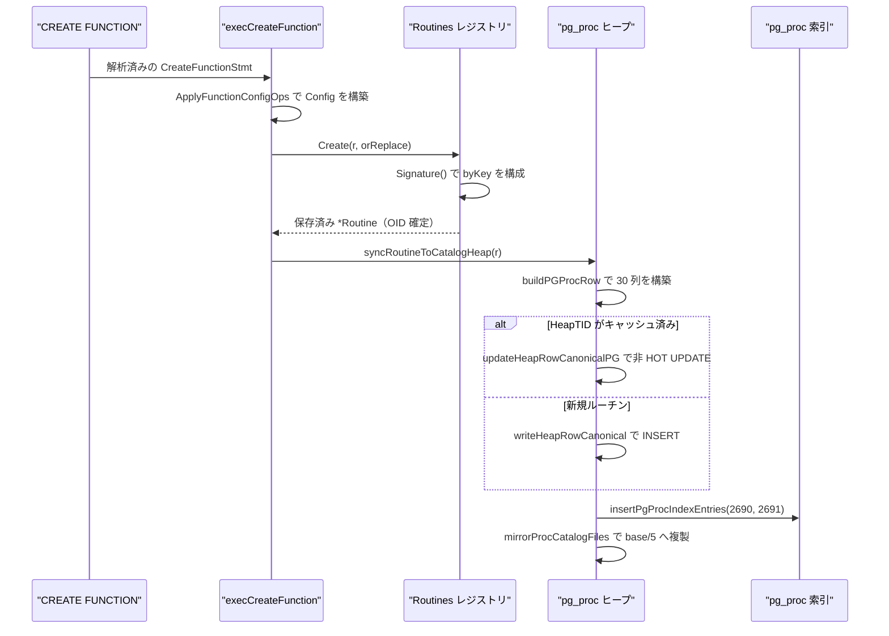
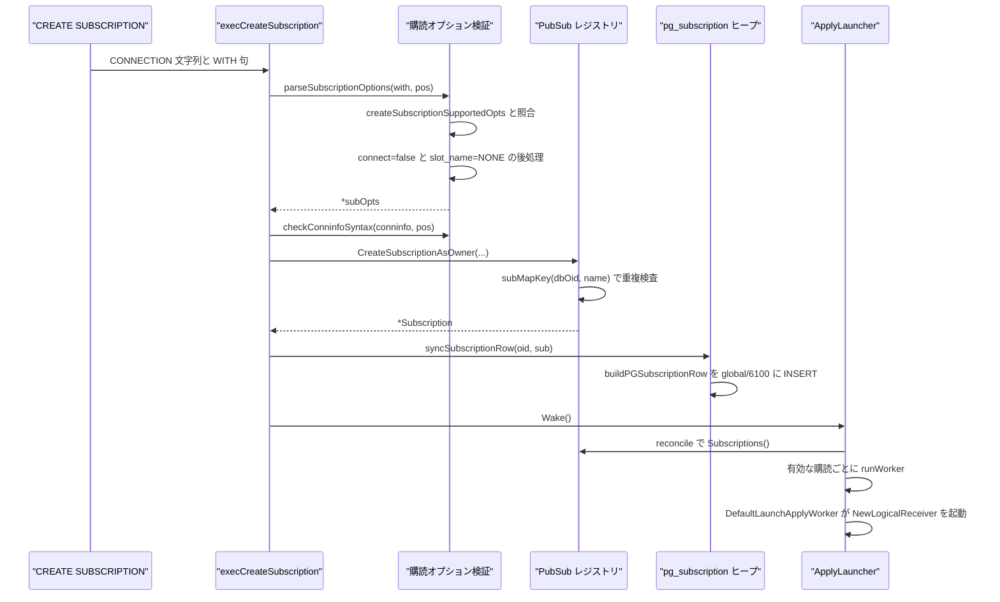
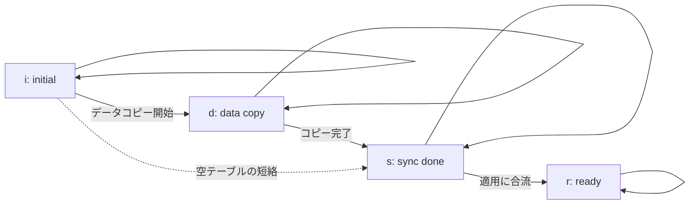

# ルーチンとパブリケーション

<details>
<summary>関連ソースファイル</summary>

- [`internal/catalog/pg_operator_data.go`](https://github.com/ryogrid/goopg/blob/19856410e8d497d59787e1ab35a2febb3f5953d6/internal/catalog/pg_operator_data.go)
- [`internal/catalog/pg_operator_seed_data.go`](https://github.com/ryogrid/goopg/blob/19856410e8d497d59787e1ab35a2febb3f5953d6/internal/catalog/pg_operator_seed_data.go)
- [`internal/catalog/pubsub.go`](https://github.com/ryogrid/goopg/blob/19856410e8d497d59787e1ab35a2febb3f5953d6/internal/catalog/pubsub.go)
- [`internal/catalog/routines.go`](https://github.com/ryogrid/goopg/blob/19856410e8d497d59787e1ab35a2febb3f5953d6/internal/catalog/routines.go)
- [`internal/executor/operators_pg_get_publication_tables.go`](https://github.com/ryogrid/goopg/blob/19856410e8d497d59787e1ab35a2febb3f5953d6/internal/executor/operators_pg_get_publication_tables.go)
- [`internal/executor/subscription_options.go`](https://github.com/ryogrid/goopg/blob/19856410e8d497d59787e1ab35a2febb3f5953d6/internal/executor/subscription_options.go)
- [`internal/executor/sys_pg_operator.go`](https://github.com/ryogrid/goopg/blob/19856410e8d497d59787e1ab35a2febb3f5953d6/internal/executor/sys_pg_operator.go)
- [`internal/executor/sys_pg_proc.go`](https://github.com/ryogrid/goopg/blob/19856410e8d497d59787e1ab35a2febb3f5953d6/internal/executor/sys_pg_proc.go)
- [`internal/executor/sys_pg_publication.go`](https://github.com/ryogrid/goopg/blob/19856410e8d497d59787e1ab35a2febb3f5953d6/internal/executor/sys_pg_publication.go)
- [`internal/executor/sys_pg_subscription.go`](https://github.com/ryogrid/goopg/blob/19856410e8d497d59787e1ab35a2febb3f5953d6/internal/executor/sys_pg_subscription.go)
- [`internal/postmaster/subscription_refresh.go`](https://github.com/ryogrid/goopg/blob/19856410e8d497d59787e1ab35a2febb3f5953d6/internal/postmaster/subscription_refresh.go)
- [`internal/replication/applylauncher.go`](https://github.com/ryogrid/goopg/blob/19856410e8d497d59787e1ab35a2febb3f5953d6/internal/replication/applylauncher.go)

</details>

ルーチンとパブリケーションは、goopg のカタログのうち「ユーザーが作る振る舞い」と「レプリケーションの契約」を担う部分です。`internal/catalog/routines.go` の `Routines` は `CREATE FUNCTION` / `PROCEDURE` の定義をプロセス内レジストリに保持し、`internal/executor/sys_pg_proc.go` が同じ内容を PG18 の 30 列 `pg_proc` ヒープ行として書き出します。演算子も同じ形で `pg_operator` ヒープと 2 本の索引に記録され（`internal/executor/sys_pg_operator.go`）、その `oprcode` / `oprresult` はルーチンレジストリの OID から解決されます。パブリケーション側では `internal/catalog/pubsub.go` の `PubSub` が `pg_publication` / `pg_publication_rel` / `pg_subscription` / `pg_subscription_rel` のメモリ像を持ち、executor がこれらを実ヒープへジャーナルし、`ApplyLauncher` が有効なサブスクリプションごとに apply worker を起動します。

## 責務

- ユーザー定義ルーチンを `schema + name + 引数型シグネチャ` で索引し、オーバーロード解決・作成・削除・改名・スキーマ移動を提供する（`internal/catalog/routines.go:Routines.Create`、`Lookup`、`Drop`、`RenameRoutine`、`SetSchema`）。
- ルーチンの `pg_proc` 行を、新規作成なら INSERT、`CREATE OR REPLACE` / ALTER なら非 HOT のヒープ UPDATE としてジャーナルし、`pg_proc_oid_index`（2690）と `pg_proc_proname_args_nsp_index`（2691）へ新しい TID の索引エントリを追加する（`internal/executor/sys_pg_proc.go:syncRoutineToCatalogHeap`、`insertPgProcIndexEntries`）。
- 30 列の物理行に収まらないメタデータ（引数名・モード・DEFAULT・RETURNS TABLE・BEGIN ATOMIC/RETURN 形式・依存情報）を `proargdefaults` の JSON に退避し、再起動時に `DecodePGProcArgMeta` で復元する（`sys_pg_proc.go:pgProcArgMetaJSON`）。
- ユーザー演算子を `pg_operator` の 1 行として upsert し、シェル作成と COMMUTATOR/NEGATOR の後追い更新を同じ「TID キャッシュ付き UPDATE」経路に集約する（`internal/executor/sys_pg_operator.go:upsertOperatorCatalogRow`）。
- PG18 の `pg_operator.dat` 全 799 行を `OperatorEntry` のスライスとして提供する（`internal/catalog/pg_operator_seed_data.go:PGOperatorAllEntries`）。initdb のブートストラップとノードツリー解決の前向き索引が同じ表を読む。
- パブリケーションとサブスクリプションを dbOid 込みの複合キーで保持し、同名オブジェクトを別データベースに共存させる（`internal/catalog/pubsub.go:pubMapKey`、`subMapKey`、`CreatePublicationAsOwner`、`CreateSubscriptionAsOwner`）。
- `CREATE SUBSCRIPTION` / `ALTER SUBSCRIPTION ... SET` の WITH オプションを PostgreSQL の `parse_subscription_options` と同じ順序・同じ SQLSTATE で検証し、CONNECTION 文字列の構文も `conninfo_parse` 相当で検査する（`internal/executor/subscription_options.go:parseSubscriptionOptions`、`checkConninfoSyntax`）。
- `pg_subscription` を共有カタログ `global/6100` の 18 列ヒープ行として書き、CREATE/ALTER は「同一 oid の旧行を xmax で消してから現在値を INSERT」、DROP は xmax スタンプだけで表す（`internal/executor/sys_pg_subscription.go:syncSubscriptionRow`）。
- tablesync の状態を `i → d → s → r` の単調な状態機械として管理し、逆行遷移を API 境界で拒否する（`internal/catalog/pubsub.go:AdvanceSubscriptionRel`、`validSubRelTransitions`）。
- `pg_get_publication_tables(VARIADIC text[])` を (relid, attrs, qual) の SRF として実装し、引数なしなら全 (publication, table) 対を返す（`internal/executor/operators_pg_get_publication_tables.go:buildPgGetPublicationTablesRows`）。
- `ALTER SUBSCRIPTION ... SET PUBLICATION` のコミット後データ同期を、publisher からのテーブル一覧取得 → ローカル解決 → `pg_subscription_rel` の差分更新 → tablesync → apply worker 停止、の順で実行する（`internal/postmaster/subscription_refresh.go:RefreshSubscriptionOnPublisher`）。
- 有効なサブスクリプションごとに apply worker を 1 本だけ走らせる。カタログ走査と worker 集合の差分を `reconcile` で取り、`Wake` で即時再走査する（`internal/replication/applylauncher.go:ApplyLauncher.Run`、`reconcile`、`DefaultLaunchApplyWorker`）。

## 処理フロー

### `CREATE FUNCTION` から `pg_proc` ヒープまで

`CREATE FUNCTION` の実行関数はレジストリにルーチンを登録し、戻り値の `*Routine`（OID が確定したコピー）を使ってヒープ同期を呼びます。ヒープ側は TID キャッシュの有無で INSERT と UPDATE を切り替え、どちらの場合も索引エントリを新しい TID で追加します。



- `Routines.Create` は `clone := *r` を保存するため、呼び出し元が元の構造体を後から書き換えてもレジストリには反映されません。OID は `FirstRoutineOID`（`1 << 17`）から昇順に採番されます（`routines.go:328-374`）。
- `buildPGProcRow` の `proargtypes` は入力引数だけ（IN/INOUT/VARIADIC）を空白区切りの oidvector にし、OUT は `proallargtypes` にだけ入れます。`proargmodes` / `proallargtypes` は非 IN 引数が 1 つも無ければ NULL です（`sys_pg_proc.go:105-136`、`204-210`）。
- `proargdefaults` には `pgProcArgMetaJSON` が `Routine` の JSON（`Body` を除く）を書き込みます。PostgreSQL は `pronargdefaults > 0` のときしかこの列を読まないため、通常の関数では実質 goopg 専用のメタデータ置き場になります（`sys_pg_proc.go:282-308`）。
- `insertPgProcIndexEntries` は `(oid)` と `(proname, proargtypes, pronamespace)` の 2 エントリを追加します。索引キーの導出は `buildPGProcRow` と同じ関数（`pgProcInputArgOIDs`、`namespaceOIDForSchema`）を使うため、行とキーがずれません（`sys_pg_proc.go:372-386`）。
- ヒープ更新は非 HOT です。旧 TID の索引エントリは死んだヒープ版を指したまま残り、VACUUM が回収するまで残ります。これは PostgreSQL の通常の UPDATE と同じ挙動です（`sys_pg_proc.go:3-15`）。

### `CREATE SUBSCRIPTION` から apply worker 起動まで

オプション検証・レジストリ登録・共有ヒープへの書き込み・launcher への通知が 1 つの文の中で順に走ります。launcher は `Wake` を受けて `reconcile` を実行し、有効な購読に worker を割り当てます。



- 検証順は上流の `CreateSubscription` に合わせています。重複名 → `slot_name` の既定解決 → CONNECTION 構文 → publication リストの重複、の順です（`subscription_options.go:9-52`）。
- `slot_name = NONE` は `opts.slotName = ""` に解決され、レジストリには「スロット無し」として保存されます。サブスクリプション名を既定スロット名にする処理は executor 側で行われ、レジストリ層では再適用しません（`subscription_options.go:262-273`、`pubsub.go:437-442`）。
- `pg_subscription` は共有カタログなので索引を作らず、`global/6100` のヒープだけを書きます。CREATE/ALTER は `stampSubscriptionRow` で同一 oid の行を消してから新しい行を INSERT します（`sys_pg_subscription.go:86-119`）。
- launcher の `Wake` はバッファ付き 1 のチャネルへ非ブロッキング送信するため、連続する DDL は 1 回の再走査に合流します（`applylauncher.go:165-173`）。

## 主要ファイル

| ファイル | 役割 |
| --- | --- |
| `internal/catalog/routines.go` | `Routine` と `Routines` レジストリ、シグネチャ、設定適用、DROP 候補解決。`routines.go:Routines.Create`、`routines.go:Signature` |
| `internal/catalog/pubsub.go` | `Publication` / `Subscription` / `SubscriptionRel` と `PubSub`、tablesync 状態機械。`pubsub.go:PubSub`、`AdvanceSubscriptionRel` |
| `internal/catalog/pg_operator_data.go` | `pg_operator` 1 行分の `OperatorEntry`。`pg_operator_data.go:OperatorEntry` |
| `internal/catalog/pg_operator_seed_data.go` | PG18 の 799 行の演算子シード。`pg_operator_seed_data.go:PGOperatorAllEntries` |
| `internal/executor/sys_pg_proc.go` | `pg_proc` 30 列の行ビルダ、ヒープ同期、索引、復元用 JSON。`sys_pg_proc.go:syncRoutineToCatalogHeap`、`buildPGProcRow` |
| `internal/executor/sys_pg_operator.go` | `pg_operator` 15 列の行ビルダと upsert、2 索引の保守。`sys_pg_operator.go:upsertOperatorCatalogRow` |
| `internal/executor/sys_pg_publication.go` | `pg_publication` / `pg_publication_rel` の行ビルダとヒープ同期。`sys_pg_publication.go:upsertPublicationCatalogRow` |
| `internal/executor/sys_pg_subscription.go` | `pg_subscription` 18 列の行ビルダと共有ヒープ同期。`sys_pg_subscription.go:syncSubscriptionRow` |
| `internal/executor/subscription_options.go` | WITH オプション検証、スロット名検証、CONNECTION 文字列パーサ。`subscription_options.go:parseSubscriptionOptions` |
| `internal/executor/operators_pg_get_publication_tables.go` | `pg_get_publication_tables()` SRF と publication→table 展開。`operators_pg_get_publication_tables.go:buildPgGetPublicationTablesRows` |
| `internal/postmaster/subscription_refresh.go` | 購読変更後のデータ同期（fetch → 差分 → tablesync → worker 停止）。`subscription_refresh.go:RefreshSubscriptionOnPublisher` |
| `internal/replication/applylauncher.go` | apply worker の起動・停止・再走査ループ。`applylauncher.go:ApplyLauncher.reconcile`、`DefaultLaunchApplyWorker` |

## 公開 API / エントリポイント

```go
// ルーチンレジストリ
func NewRoutines() *Routines
func (rs *Routines) Create(r *Routine, orReplace bool) (*Routine, error)
func (rs *Routines) CreateDuringRecovery(r *Routine) *Routine
func (rs *Routines) Lookup(name parser.ObjectName, argTypes []Type, dbOid ...uint32) (*Routine, bool)
func (rs *Routines) Drop(name parser.ObjectName, argTypes []Type, dbOid ...uint32) error
func (rs *Routines) DropByName(name parser.ObjectName, dbOid ...uint32) error
func (rs *Routines) RenameRoutine(r *Routine, newName string) error
func (rs *Routines) SetSchema(r *Routine, newSchema string) error
func (rs *Routines) List() []*Routine
func ApplyFunctionConfigOps(cfg []string, ops []parser.FunctionConfigOp) []string
func RoutineResultColumns(cat Catalog, r *Routine, alias string, colAliases []string) []Column

// ルーチンのヒープ同期
func PGProcColumnsPG18() []catalog.Column
func buildPGProcRow(cat catalog.Catalog, r *catalog.Routine, dbOid ...uint32) Row
func DecodePGProcArgMeta(meta string, body string) (*catalog.Routine, error)
func syncRoutineToCatalogHeap(ctx *Context, r *catalog.Routine) error
func deleteRoutineCatalogHeapRow(ctx *Context, oid uint32) error

// 演算子
func PGOperatorColumnsPG18() []catalog.Column
func PGOperatorAllEntries() []OperatorEntry
func buildPGOperatorRow(cat catalog.Catalog, op *catalog.UserOperator) Row
func upsertOperatorCatalogRow(ctx *Context, op *catalog.UserOperator) error

// パブリケーション / サブスクリプション
func NewPubSub() *PubSub
func (p *PubSub) CreatePublicationAsOwner(name string, tables []string, opts PublicationOptions, owner uint32, dbOid ...uint32) (*Publication, error)
func (p *PubSub) CreateSubscriptionAsOwner(name, conninfo string, publications []string, slotName string, enabled bool, owner uint32, dbOid ...uint32) (*Subscription, error)
func (p *PubSub) AdvanceSubscriptionRel(subName string, relOID uint32, newState string, newLSN uint64) (*SubscriptionRel, error)
func PGSubscriptionColumnsPG18() []catalog.Column
func syncSubscriptionRow(ctx *Context, oid uint32, sub *catalog.Subscription) error
func parseSubscriptionOptions(with map[string]string, pos int) (*subOpts, error)
func checkConninfoSyntax(conninfo string, pos int) error
func buildPgGetPublicationTablesRows(ctx *Context, args []Datum) ([]Row, error)

// 適用ワーカー
func NewApplyLauncher(cfg ApplyLauncherConfig) *ApplyLauncher
func (l *ApplyLauncher) Run(ctx context.Context)
func (l *ApplyLauncher) Wake()
func (l *ApplyLauncher) StopWorker(name string)
func (l *ApplyLauncher) RefreshSubscriptionOnPublisher(subName, conninfo string, dbOid uint32, pubs []string, copyData bool) error
```

## 主要データ構造

### `Routine` — ユーザー定義ルーチン 1 本

```go
type Routine struct {
	OID             uint32
	Schema          string
	Name            string
	ArgNames        []string // parallel to ArgTypes; empty string for positional-only args
	ArgTypes        []Type
	// ArgTypeSchemas is parallel to ArgTypes: the namespace each argument type
	// was declared in at CREATE FUNCTION/PROCEDURE ("" when unknown — a BARE
	// type name, whose owner schema goopg's user-type store cannot resolve, or a
	// pre-73rd reloaded routine that predates this field). Consulted ONLY by the
	// regprocedure output path (format_type_be arg-type qualification, deferral
	// row 1342): Signature() compares ArgTypes[i].Name only, so overload
	// resolution / ALTER/DROP lookups are unaffected.
	ArgTypeSchemas   []string
	// ArgTypeOIDs is parallel to ArgTypes: the resolved pg_type OID for each
	// argument type, NON-ZERO only for the one ambiguous spelling `char` AND its
	// array forms (a bare `char` → OIDBpChar 1042, a quoted `"char"` → OIDChar
	// 18 — deferral row 1351; bare `char[]` → OIDArrayBpChar 1014, quoted
	// `"char"[]` → OIDArrayChar 1002 — deferral row 1364). Every other spelling
	// (including non-char arrays like int4[]) is 0: its name-based
	// ArgTypeDisplayAlias is already a faithful format_type_be port, and
	// buildPGProcRow's TypeNameToOID fallback resolves a baked `[]` name to the
	// ARRAY OID, so carrying a name-derived OID would add nothing. Consulted by
	// the regprocedure/pg_get_function_* output paths and the proargtypes/
	// prorettype emission; Signature() and overload resolution are unaffected.
	ArgTypeOIDs      []uint32 `json:",omitempty"`
	ArgModes        []string // parallel to ArgTypes; "i"=IN, "o"=OUT, "b"=INOUT, "v"=VARIADIC; nil=all IN
	ArgDefaults     []string // parallel to ArgTypes; raw SQL expression for DEFAULT, "" = no default
	ReturnType      Type
	// ReturnTypeOID is the resolved pg_type OID for the RETURN type, NON-ZERO
	// only for the one ambiguous spelling `char` AND its array forms (a bare
	// `char` → OIDBpChar 1042, a quoted `"char"` → OIDChar 18 — deferral row
	// 1361, sibling of ArgTypeOIDs/row 1351; bare `char[]` → OIDArrayBpChar
	// 1014, quoted `"char"[]` → OIDArrayChar 1002 — deferral row 1364). Every
	// other spelling (including non-char arrays like int4[]) is 0: TypeNameToOID's
	// name-based map (now array-correct) is already a faithful fallback, so a
	// name-derived OID would add nothing. Consulted ONLY by the
	// pg_get_function_result / pg_get_functiondef renderers and the pg_proc
	// prorettype column; signature/overload semantics are unaffected.
	ReturnTypeOID   uint32
	ReturnsSet      bool   // RETURNS SETOF ... M0097-0020
	ReturnsTable    bool   // RETURNS TABLE (...) — table cols stored as trailing OUT args
	Language        string // lower-cased
	Body            string // raw routine source between the dollar-quote delimiters
	Strict          bool   // STRICT / CALLED ON NULL INPUT
	Volatile        string // "v"=volatile (default), "s"=stable, "i"=immutable
	Parallel        string // proparallel: "u"=unsafe (default), "s"=safe, "r"=restricted
	Cost            string // procost: COST n override; "" = language default (1 internal/C, else 100)
	Rows            string // prorows: ROWS n override for SRFs; "" = default (1000 for SRF, 0 otherwise)
	SecurityDefiner bool   // SECURITY DEFINER
	Leakproof       bool   // LEAKPROOF
	IsProcedure     bool   // true when created via CREATE PROCEDURE
	IsWindow        bool   // true when created with WINDOW attribute
	BeginAtomic     bool   // PG14 BEGIN ATOMIC ... END body (no AS keyword)
	IsReturnForm    bool   // PG14 RETURN expr body (stored as "SELECT expr" internally)
	KindChar        string // prokind: 'f'=function, 'p'=procedure, 'w'=window, 'a'=aggregate
	// Aggregate carries the full UserAggregate definition on the
	// synthesized prokind='a' pg_proc row (B2.2 slice 2). It rides the
	// proargdefaults JSON meta only (never the registry — aggregates live
	// in userAggregates): the physical pg_aggregate columns store proc
	// OIDs, which are 0 for builtin transition functions outside the
	// hand-curated BuiltinProc set, so the startup reload rebuilds the
	// registry from these names instead of a lossy OID reversal.
	Aggregate *UserAggregate `json:",omitempty"`
	// Owner is pg_proc.proowner (role OID), settable via ALTER FUNCTION/
	// PROCEDURE/ROUTINE ... OWNER TO. 0 means "unset, defaults to the
	// bootstrap superuser" — see OwnerOrDefault. M0097-0150.
	Owner uint32

	// Config is pg_proc.proconfig: a list of "name=value" per-function GUC
	// overrides set via CREATE FUNCTION's SET clause or ALTER FUNCTION/
	// PROCEDURE/ROUTINE ... SET/RESET, in insertion order (mirrors
	// InMemory's role/database-level roleSettings shape). nil renders as SQL
	// NULL (matches upstream: a routine that never had a SET clause has no
	// proconfig row at all). Applied around each call by the executor's
	// enterRoutineConfig (M0146-0155); see
	// docs/design/0100-0149/m0146-0155-function-set-clauses.md.
	Config []string

	// Dependency tracking populated at CREATE FUNCTION time for information_schema views.
	SequenceDeps    []RoutineSeqDep   // sequences referenced via nextval/currval
	RoutineCallOIDs []uint32          // OIDs of routines called in body/defaults
	TableDeps       []RoutineTableRef // tables referenced in FROM clauses
	ColumnDeps      []RoutineColRef   // columns referenced in SELECT/WHERE clauses

	// DBOid is the database this routine was CREATE FUNCTION/PROCEDURE'd
	// under (mirrors catalog.Domain.DBOid/EnumType.DBOid). The registry key
	// folds this in (routineKey/nameKey) so two distinct databases may each
	// register a same-named routine without colliding. Zero is normalized to
	// DefaultDBOid by Create/CreateDuringRecovery, matching every other
	// dbOid-scoped registry's convention. M0119-0004 DU-002 follow-up
	// (M0122-0007 4e-shaped fix, mirrors follow-up 36/37's ForeignServer/
	// UserMapping DBOid fields).
	DBOid uint32
}
```

（`routines.go:Routine`）

`Signature()` は `ArgTypes[i].Name` を小文字化して連結し、`ArgModes[i] == "o"` の OUT 引数を除外します。したがって OUT だけが異なる 2 定義は同一ルーチンとみなされます（`routines.go:184-198`）。`ArgTypeOIDs` と `ReturnTypeOID` は `char` 系の曖昧さ（bare `char` は bpchar 1042、quoted `"char"` は 18）を解消するためだけの非ゼロ値で、それ以外は 0 のまま `TypeNameToOID` の名前解決に任せます。`Owner == 0` は `OwnerOrDefault()` が 10 に読み替えます。

### `Publication` — `pg_publication` 1 行

```go
type Publication struct {
	Name string
	OID  uint32
	// Owner is the owning role's OID (pg_publication.pubowner). Real
	// pg_dump's getPublications() (pg_dump.c) always selects this column
	// and calls getRoleName() on it, which pg_fatal()s with "role with
	// OID %u does not exist" if the OID doesn't resolve — so an unset
	// (zero) Owner isn't a cosmetic gap, it makes pg_dump abort outright
	// on any database containing a publication. CreatePublication defaults
	// this to the bootstrap superuser OID (10); CreatePublicationAsOwner
	// (called from the executor with the connection's currently-effective
	// role, DU-002 slice 424) lets a session running under `SET ROLE`/`SET
	// SESSION AUTHORIZATION` own the publication it creates, mirroring
	// PostgreSQL's `GetUserId()`-as-owner convention (`CreatePublication`,
	// publicationcmds.c). DU-002 slice 422.
	Owner         uint32
	AllTables     bool
	PublishInsert bool
	PublishUpdate bool
	PublishDelete bool
	// Tables are qualified table names ("schema.name") the
	// publication is restricted to. Ignored when AllTables is
	// true. Insertion order is preserved so views render rows
	// in the order an operator added them.
	Tables []string
	// DBOid is the real physical database oid this publication was CREATE
	// PUBLICATION'd under (mirrors Subscription.DBOid + UserTSConfig.DBOid).
	// Two distinct databases may each create a same-named publication without
	// colliding (the DU-002 pg_dump round-trip restores a dump's publications
	// into a fresh database whose registry must not clash with the source
	// database's). Defaults to DefaultDBOid for every call site that does not
	// pass an explicit dbOid (resolveDBOid's convention), keeping the pre-DU-002
	// single-DB behaviour. M0119-0004 (DU-002 per-DB publication scoping).
	DBOid uint32
}
```

（`pubsub.go:Publication`）

`AllTables == true` のとき `Tables` は無視されます。`PublishTruncate` / `PublishViaRoot` に相当するフィールドは持たず、ヒープ行では常に false として書かれます（`sys_pg_publication.go:74-76`）。`Owner` は 0 のまま保存され得ますが、`buildPGPublicationRow` が 0 を 10 に読み替えて行を作ります（`sys_pg_publication.go:62-66`）。

### `Subscription` — `pg_subscription` 1 行

```go
type Subscription struct {
	Name     string
	OID      uint32
	Conninfo string
	// Owner is the owning role's OID (pg_subscription.subowner). Real
	// pg_dump's getSubscriptions() (pg_dump.c) always selects this column
	// and calls getRoleName() on it — same pg_fatal()-on-unresolved-OID
	// hazard pg_publication.pubowner had (DU-002 slice 422). CreateSubscription
	// defaults this to the bootstrap superuser OID (10);
	// CreateSubscriptionAsOwner (called from the executor with the
	// connection's currently-effective role, DU-002 slice 424) mirrors
	// Publication.Owner's same real-ownership convention.
	Owner        uint32
	Publications []string
	Enabled      bool
	// SlotName is pg_subscription.subslotname: "" is NULL, i.e.
	// slot_name = NONE (no publisher-side slot — DROP SUBSCRIPTION then
	// skips ReplicationSlotDropAtPubNode). The subscription-name default
	// for an unspecified slot_name is applied by the executor
	// (DefineSubscription), not stored here.
	SlotName string
	// DBOid is the database this subscription's apply worker resolves
	// local relations against — the connection's real dbOid at CREATE
	// SUBSCRIPTION time (catalog.NamespaceDBOid(ctx.CurrentDatabaseOid)),
	// same convention as catalog.Table.DBOid/catalog.Index.DBOid
	// (M0122-0007 4d-ii-part-2b item 2). Zero (the pre-item-1 default)
	// resolves to DefaultDBOid via NamespaceDBOid, matching legacy
	// single-database behavior. The apply launcher reads it to seed a
	// catalog.SearchPathCatalog for ApplyWorker.cat so its un-dbOid-
	// threaded LookupTable/IndexesOnTable calls resolve the subscribing
	// database's own tables instead of always DefaultDBOid's.
	DBOid uint32
}
```

（`pubsub.go:Subscription`）

`SlotName` の空文字列は「NULL、つまりスロットなし」を意味し、未指定時の「サブスクリプション名をスロット名にする」既定は executor が適用します。この区別をレジストリ層で潰すと、`slot_name = NONE` と既定指定が区別できなくなり、DROP 時に存在しないスロットを探しに行きます（`pubsub.go:437-442`）。`DBOid` は apply worker がローカルテーブルを解決するデータベースで、0 は `NamespaceDBOid` により `DefaultDBOid` に畳み込まれます。

### `SubscriptionRel` — tablesync の 1 行

```go
type SubscriptionRel struct {
	SubID  uint32
	RelOID uint32
	State  string
	LSN    uint64
}
```

（`pubsub.go:SubscriptionRel`）

`State` は `i`（initial）/ `d`（data copy）/ `s`（sync done）/ `r`（ready）のいずれかです。`LSN` は単調増加で、`AdvanceSubscriptionRel` は新しい値が既存値より大きいときだけ更新します（`pubsub.go:790-793`）。`SubID` はサブスクリプションの OID で、`subRels` のマップキーはサブスクリプション名です（`pubsub.go:140-145`）。

### `subOpts` — CREATE SUBSCRIPTION の解決済みオプション

```go
type subOpts struct {
	connect          bool
	enabled          bool
	createSlot       bool
	copyData         bool
	slotName         string // "" once slot_name = NONE has been resolved
	binary           bool
	streaming        string
	twoPhase         bool
	disableOnErr     bool
	passwordRequired bool
	runAsOwner       bool
	failover         bool
	origin           string
	specified        map[string]bool
}
```

（`subscription_options.go:subOpts`）

`specified` は「利用者が明示したか」を表すビットマスク相当です。`connect = false` の後処理では、`enabled` / `create_slot` / `copy_data` が明示的に true なら 42601、既定値の true なら黙って false に落とす、という分岐に使われます（`subscription_options.go:301-317`）。`slotName` は `slot_name = NONE` の解決後だけ空文字列になります。

## 内部構造

### レジストリとヒープの二層

ルーチンもパブリケーションも、メモリ上のレジストリがクエリの真実で、ヒープは再起動・スタンバイ・pg_dump のための写しです。ルーチンは OID → ヒープ TID のキャッシュ（`routineStore.heapTIDs`）を持ち、`syncRoutineToCatalogHeap` はキャッシュがあれば UPDATE、無ければ INSERT を行います。DROP は TID が無ければ何もせず、あれば xmax をスタンプします（`sys_pg_proc.go:343-442`）。パブリケーションは `PublicationHeapTID`、演算子は `OperatorHeapTID` という同型のキャッシュを使います（`sys_pg_publication.go:104`、`sys_pg_operator.go:170`）。

ヒープ同期は `ctx.Pool == nil` やカタログが `*catalog.InMemory` でない場合に黙ってスキップされます（`catalogHeapSyncAvailable`）。テスト用のインメモリ構成で DDL が失敗しないための分岐で、本番では常に有効です。

### 非 HOT 更新と索引の世代

`pg_proc` / `pg_operator` / `pg_publication` の UPDATE はすべて非 HOT で、新しいヒープ版と新しい TID を作ります。索引には新しい TID のエントリを追加し、旧 TID のエントリはそのまま残します。旧エントリは死んだヒープ版を指しますが、可視性フィルタが除外するため検索結果には現れません。VACUUM が旧版とエントリを回収するまで、索引は論理的に正しいままです（`sys_pg_proc.go:9-15`、`sys_pg_operator.go:153-158`）。

### 演算子のシェルと後追い更新

PostgreSQL の `CREATE OPERATOR` は 2 パスです。まず関数 OID だけを持つシェル行を作り、COMMUTATOR / NEGATOR の解決後に関連行を後追い更新します。goopg はこれを 1 つの upsert に畳んでいます。`upsertOperatorCatalogRow` は `OperatorHeapTID` の有無で INSERT / UPDATE を選び、どちらの場合も `pg_operator_oid_index`（2688）と `pg_operator_oprname_l_r_n_index`（2689）へ新しい TID を追加します（`sys_pg_operator.go:153-200`）。2689 のキーは 64 バイトの `NameData` + 3 つの OID（left/right/namespace）で 88 バイトです（`sys_pg_operator.go:112-136`）。`oprleft` / `oprright` は型名から OID を引き直しますが、これは再起動時に型名を復元する cast-reload パターンに合わせたものです（`sys_pg_operator.go:3-12`）。

### `proargdefaults` の JSON メタデータ

物理 30 列は `Routine` の全情報を運べません。引数名・モード・DEFAULT 式・RETURNS TABLE・BEGIN ATOMIC/RETURN 形式・依存情報は `proargdefaults` の JSON にまとめて入り、`Body` だけは `prosrc` が持ちます。`DecodePGProcArgMeta` は JSON を `Routine` に戻し、`prosrc` を `Body` に再結合します（`sys_pg_proc.go:282-319`）。PostgreSQL 側は `pronargdefaults == 0` の行ではこの列を読まないため、通常の関数では無害です。

### PubSub のキーとコピー

`PubSub` の内部キーは `"<dbOid>.<lower(name)>"` です（`pubsub.go:165-178`）。読み取り系（`LookupPublication`、`PublicationsForDBOid`、`LookupSubscription`）は必ず構造体とスライスを深くコピーして返すため、呼び出し元が返り値を書き換えてもレジストリは汚れません。`nextOID` は `FirstUserOID` から始まるレジストリ専用のカウンタで、テーブル OID とは独立に採番されます（`pubsub.go:146-162`）。

### tablesync の状態機械



同一状態への遷移は LSN だけを進める no-op として許可されます。逆行（`s → d` など）や未知の状態は `ErrInvalidSubRelState` / `ErrInvalidSubRelStateTransition` で拒否されます（`pubsub.go:668-708`、`769-796`）。`copy_data = false` のとき、refresh は `i → s → r` を 2 回に分けて進めます。登録簿の遷移表が `i → r` を直接許さないためです（`subscription_refresh.go:118-130`）。

### 購読オプションの検証順序

`parseSubscriptionOptions` は WITH 句を **ソート済みのキー順** で走査します。PostgreSQL は文に書かれた順で走査するため、2 つ以上が不正なときの報告対象が変わります。これは既知の差分として記録されています（`subscription_options.go:186-196`）。検証の順序自体は上流と同じで、未知オプション → 値の型 → `connect = false` の排他 → `slot_name = NONE` の排他の順に適用されます（`subscription_options.go:220-338`）。

`checkConninfoSyntax` は `conninfo_parse` の転写です。名前は `=` か空白まで、値は bare（バックスラッシュエスケープ可）または単一引用符、未知の名前は `libpqConninfoKeywords` で拒否します。`postgresql://` / `postgres://` で始まる URI 形式は検証せずに受け入れます（`subscription_options.go:461-486`）。`must_use_password` の検査は移植されていません。

### apply launcher の再走査

`ApplyLauncher` は `workers` マップをサブスクリプション名で保持し、`reconcile` で「有効な購読の集合」と「稼働中の worker」の差分を取ります。mutex は集合の更新中だけ保持し、実際の goroutine 起動はロック解放後に行うため、遅い dial が CREATE/DROP の呼び出し元を塞ぎません（`applylauncher.go:209-262`）。worker が自発的に終了した場合は `runWorker` が自分のエントリを同一性チェック付きで削除し、次の再走査で再起動されます（`applylauncher.go:264-279`）。`StopWorker` はキャンセル後に `<-w.done` で worker の終了を待つため、DROP 側はスロット削除の前に worker が止まったことを前提にできます（`applylauncher.go:144-158`）。

`DefaultLaunchApplyWorker` は conninfo から host:port を取り出し、`application_name` が無ければサブスクリプション名を使います。スロット名が空ならサブスクリプション名をスロット名にし、`Slots.Get(slotName)` の `ConfirmedFlushLSN` から開始 LSN を決めます。ローカルカタログは `applyWorkerCatalog` が `SearchPathCatalog{DBOid: sub.DBOid}` で包み、購読データベースのテーブルを解決させます（`applylauncher.go:316-369`）。

### publication のテーブル展開

`pg_get_publication_tables` は `PublicationsForDBOid` で接続 DB の publication を絞り、引数があれば名前集合でフィルタします。`AllTables` は `InMemory.AllTables()` を schema/name 順に展開し、明示テーブルは `ctx.Catalog.LookupTable` で OID を解決します。存在しなくなったテーブルは黙って飛ばされます（`operators_pg_get_publication_tables.go:92-197`）。`attrs` と `qual` は列リスト・行フィルタ未実装のため常に NULL です。

## エッジケースと不変条件

- **`CREATE OR REPLACE` は OID と Owner を保存する**。`Routines.Create` は既存行があれば `clone.OID` と `clone.Owner` を引き継ぎ、`IsProcedure` / `IsWindow` の変化だけを `ErrRoutineKindChange` で拒否します（`routines.go:349-367`）。
- **`Routines.Create` は clone-on-write**。登録されるのは `clone := *r` のコピーで、スライスは浅く共有されます。依存情報を登録するには戻り値の `*Routine` を使う必要があります。
- **`Lookup` のスキーマ省略**。まず `public` を試し、次に同じ DB の全スキーマを線形走査します。`DropByName` は裸名の候補が 2 件以上なら `ErrRoutineAmbiguous` を返します（`routines.go:527-548`、`628-672`）。
- **ヒープ同期のスキップ条件**。`ctx.Pool == nil`、レジストリが nil、カタログが `*catalog.InMemory` でない場合は静かに成功します。`deleteRoutineCatalogHeapRow` は TID が無ければ何もせず、既に xmax が立っている行もスキップします（`sys_pg_proc.go:396-442`）。
- **`proargtypes` と `proallargtypes`**。`proargtypes` は入力引数だけ、`proallargtypes` は OUT を含む全引数です。`proargmodes` / `proallargtypes` は非 IN 引数が無ければ NULL で、空の非 NULL 配列にしてはいけません（配列デコードが壊れます）（`sys_pg_proc.go:225-247`）。
- **`prosupport` の表現**。`regproc` 型なので InvalidOid は `0` ではなく `-` で描画します。`0` だと pg_dump が `SUPPORT 0` を出力します（`sys_pg_proc.go:304-310` のコメント、`pg_proc` 仮想ビュー側の同様の扱い）。
- **パブリケーション名の重複**。`CreatePublicationAsOwner` はレジストリのキーが既にあれば `ErrPublicationExists` を返します。サブスクリプションも同様に `ErrSubscriptionExists` です（`pubsub.go:225-251`、`429-458`）。
- **`Publication.Owner` / `Subscription.Owner` の 0**。レジストリには 0 が残り得ますが、ヒープ行ビルダが 10 に読み替えます。0 のまま書くと pg_dump の `getRoleName()` が `pg_fatal()` します（`sys_pg_publication.go:62-66`、`sys_pg_subscription.go:55-59`）。
- **`slot_name = NONE` と既定名の区別**。レジストリの `SlotName == ""` は NULL（スロットなし）で、未指定時のサブスクリプション名既定は executor が適用します。ここを再既定化すると DROP が存在しないスロットを探します（`pubsub.go:437-442`）。
- **tablesync 行のキー**。`subRels` はサブスクリプション名だけでキーされ、`Subscription.DBOid` は含みません。同名サブスクリプションが別 DB にあっても tablesync 行は共有されない前提で、`DropSubscription` も名前で削除します（`pubsub.go:140-145`、`549-555`）。
- **状態遷移の拒否**。未知の状態は `ErrInvalidSubRelState`、許可されない遷移は `ErrInvalidSubRelStateTransition`（メッセージは `"old → new"`）です。LSN は増加時のみ更新されます（`pubsub.go:769-796`）。
- **WITH オプションのエラーコード**。未知オプションは 42601、真偽値でない値は 42601、スロット名が空なら 42602、64 バイト以上なら 42622、不正文字は 42602、`origin` の不正値だけ 22023 です（`subscription_options.go:79-184`、`280-292`）。
- **`connect = false` の排他**。`enabled` / `create_slot` / `copy_data` を明示的に true にすると 42601、既定値の true は黙って false に落とされます。`slot_name = NONE` も同様に、明示 true は排他エラー、既定 true は `must also set ... false` エラーになります（`subscription_options.go:301-336`）。
- **publication リストの重複**。`PUBLICATION foo, testpub, foo` は最初の重複名 `foo` に対して 42710 を返します（`subscription_options.go:442-458`）。
- **CONNECTION 文字列**。`foo` のように `=` が無ければ 42601 `invalid connection string syntax: missing "=" after "foo" ...`、未知のキーは `invalid connection option "..."` です。URI 形式は未検証で通ります（`subscription_options.go:465-557`）。
- **refresh の失敗経路**。publisher への接続失敗は 08006、テーブル一覧の取得失敗は XX000、購読側に無いテーブルは 42P01 です。テーブル欠落は `pg_subscription_rel` を触る前に全件検査されるため、行の部分更新は起きません（`subscription_refresh.go:48-100`）。
- **refresh は worker を必ず止める**。同期が失敗しても `StopWorker` は実行され、`i` / `d` のまま残った行は次の refresh が拾います（`subscription_refresh.go:179-195`）。
- **launcher の worker 数**。1 サブスクリプションにつき 1 worker で、`reconcile` は停止を先に、起動を後に処理します。worker の起動はロック解放後なので、dial 中も DDL 側はブロックされません（`applylauncher.go:214-262`）。
- **`AllTables` publication の展開**。`pg_get_publication_tables` は全テーブルを schema/name 順で返します。明示リストの解決で見つからないテーブルはスキップされ、`relid` が 0 のテーブルは NULL になります（`operators_pg_get_publication_tables.go:105-121`、`170-197`）。

ルーチンのレジストリ構造そのものは [12.1 インメモリカタログ](12.1-In-Memory-Catalog.md)、`pg_proc` / `pg_publication` 行の物理書き込みは [12.2 カタログヒープとコーデック](12.2-Catalog-Heaps.md)、これらの行を仮想ビューとして見せる経路は [12.3 システムビューと information_schema](12.3-System-Views.md) を参照してください。

Sources:
- `internal/catalog/pg_operator_data.go`
- `internal/catalog/pg_operator_seed_data.go`
- `internal/catalog/pubsub.go`
- `internal/catalog/routines.go`
- `internal/executor/operators_pg_get_publication_tables.go`
- `internal/executor/subscription_options.go`
- `internal/executor/sys_pg_operator.go`
- `internal/executor/sys_pg_proc.go`
- `internal/executor/sys_pg_publication.go`
- `internal/executor/sys_pg_subscription.go`
- `internal/postmaster/subscription_refresh.go`
- `internal/replication/applylauncher.go`

<sub>Generated by deepwiki-4myself from `goopg` @ `19856410e`</sub>
