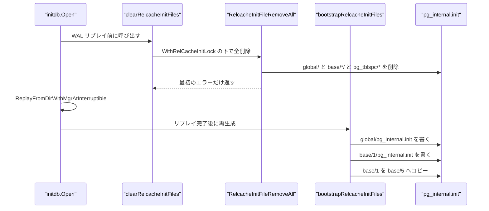
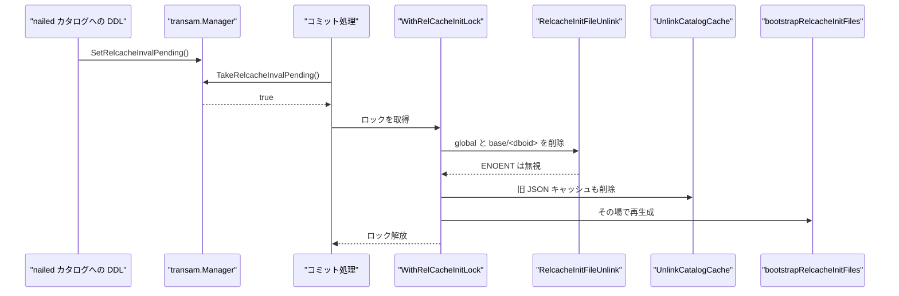
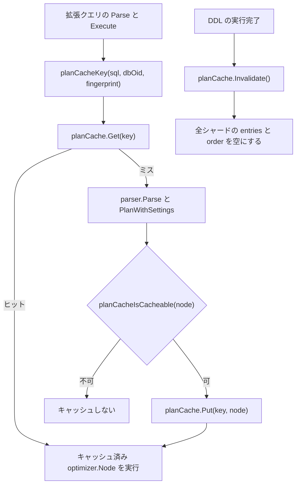

# リレキャッシュとプランキャッシュ

<details>
<summary>関連ソースファイル</summary>

- [`internal/access/nbtree/btree.go`](https://github.com/ryogrid/goopg/blob/19856410e8d497d59787e1ab35a2febb3f5953d6/internal/access/nbtree/btree.go)
- [`internal/catalog/catalog.go`](https://github.com/ryogrid/goopg/blob/19856410e8d497d59787e1ab35a2febb3f5953d6/internal/catalog/catalog.go)
- [`internal/catalog/relcache_inval.go`](https://github.com/ryogrid/goopg/blob/19856410e8d497d59787e1ab35a2febb3f5953d6/internal/catalog/relcache_inval.go)
- [`internal/executor/sys_catalog_btree_insert_split.go`](https://github.com/ryogrid/goopg/blob/19856410e8d497d59787e1ab35a2febb3f5953d6/internal/executor/sys_catalog_btree_insert_split.go)
- [`internal/executor/sys_catalog_btree_levels.go`](https://github.com/ryogrid/goopg/blob/19856410e8d497d59787e1ab35a2febb3f5953d6/internal/executor/sys_catalog_btree_levels.go)
- [`internal/executor/sys_catalog_btree_multilevel.go`](https://github.com/ryogrid/goopg/blob/19856410e8d497d59787e1ab35a2febb3f5953d6/internal/executor/sys_catalog_btree_multilevel.go)
- [`internal/executor/sys_catalog_btree_split.go`](https://github.com/ryogrid/goopg/blob/19856410e8d497d59787e1ab35a2febb3f5953d6/internal/executor/sys_catalog_btree_split.go)
- [`internal/initdb/catalog_cache.go`](https://github.com/ryogrid/goopg/blob/19856410e8d497d59787e1ab35a2febb3f5953d6/internal/initdb/catalog_cache.go)
- [`internal/initdb/open.go`](https://github.com/ryogrid/goopg/blob/19856410e8d497d59787e1ab35a2febb3f5953d6/internal/initdb/open.go)
- [`internal/initdb/relcache_init.go`](https://github.com/ryogrid/goopg/blob/19856410e8d497d59787e1ab35a2febb3f5953d6/internal/initdb/relcache_init.go)
- [`internal/postmaster/plancache.go`](https://github.com/ryogrid/goopg/blob/19856410e8d497d59787e1ab35a2febb3f5953d6/internal/postmaster/plancache.go)

</details>

このページが扱うのは、goopg が「毎回カタログを読み直さずに済ませる」ための 2 種類のキャッシュです。1 つは PostgreSQL の `pg_internal.init`（リレキャッシュ初期化ファイル）で、`internal/initdb/relcache_init.go` が nailed システムカタログの `RelationData` / `pg_class` / `pg_attribute` / `pg_index` サブレコードを PG18 のバイナリ形式で書き出します。もう 1 つは `internal/postmaster/plancache.go` のサーバー全体プランキャッシュで、正規化 SQL・データベース名前空間 OID・プランナ設定のフィンガープリントをキーに、解析済みの `optimizer.Node` をセッション横断で再利用します。両者とも DDL で無効化する必要があり、その接続点が `internal/catalog/relcache_inval.go` のファイル削除と `planCache.Invalidate` です。なお旧 M0114 の JSON カタログキャッシュは廃止済みで、`internal/initdb/catalog_cache.go` には互換のための削除処理だけが残っています。

## 責務

- PG18 互換の `pg_internal.init` を生成する。共有用は `global/pg_internal.init`、ローカル用は `base/1/pg_internal.init` で、`base/5` へはコピーします（`internal/initdb/relcache_init.go:bootstrapRelcacheInitFiles`）。
- ファイルに含める関係を PG の「クリティカルセット」に限定する。共有 5 ヒープ + 6 索引、ローカル 4 ヒープ + 7 索引だけで、順序も上流の `formrdesc` / `load_critical_index` の呼び出し順に合わせます（`relcache_init.go:criticalSharedHeapOIDs`、`criticalLocalHeapOIDs`、`filterCriticalRels`）。
- `RelationData`（488 バイト）、`FormData_pg_class`（144 バイト）、`FormData_pg_attribute`（100 バイト固定部）、`pg_index` サブレコードをリトルエンディアンで書く（`relcache_init.go:writeRelcacheInitFile`、`buildRelationDataBlob`、`buildPgClassBlob`、`buildPgAttributeBlob`、`writePgIndexSubrecord`）。
- 索引のキー列記述子を、`pg_index.indkey` と親ヒープの `nailedAttr` から導出する。`name` / `text` キーに oid 用の `attlen=4, attbyval=true` を残すと、PG の `_bt_compare` が inline バイトをポインタとして扱い SIGSEGV します（`relcache_init.go:flattenRels`、`deriveIndexAttrsFromHeap`）。
- 起動時・WAL リプレイ前に、クラスタ内の全 `pg_internal.init` を掃除する（`internal/initdb/open.go:clearRelcacheInitFiles`、`internal/catalog/relcache_inval.go:RelcacheInitFileRemoveAll`）。
- DDL コミット時に nailed カタログへ書き込みがあったら、両方の `pg_internal.init` を削除して再生成する。削除と再生成は `WithRelCacheInitLock` の下で行う（`internal/catalog/relcache_inval.go:RelcacheInitFileUnlink`、`open.go:1275-1293`）。
- 廃止済みの `pg_goopg_catalog_cache.json` が残っていれば削除する（`internal/initdb/catalog_cache.go:UnlinkCatalogCache`）。typmod・配列フラグ・identity などを落とす危険があったため、再読込には使いません。
- 正規化 SQL・名前空間 OID・プランナフィンガープリントをキーに、セッション横断のプランキャッシュを提供する（`internal/postmaster/plancache.go:planCache.Get`、`planCache.Put`。キー生成は `planCacheKey`）。
- DDL（および単純クエリ経路では ANALYZE / VACUUM）の後にキャッシュを全消しする（`plancache.go:Invalidate`）。プランは `*catalog.Table` / `*catalog.Index` のポインタを埋め込むため、スキーマ変更後の再利用は不正な参照になります。
- リレキャッシュが記述する索引の実体ページを、`internal/access/nbtree` と `internal/executor/sys_catalog_btree_*` が同じ PG 形式で維持する。`pg_internal.init` の記述子と実ページが食い違うと、PG は「could not open critical system index」で起動できません。

## 処理フロー

### 起動時: 掃除 → リプレイ → 再生成

`initdb.Open` は WAL を 1 レコードも再生する前に全 `pg_internal.init` を消します。ディスク上のファイルが実 PostgreSQL の書いたものかもしれず、これからリプレイでカタログが変わるためです。リプレイ完了後、PG スタンバイが即座に接続できるよう同じ内容を再生成します。



- 掃除は無条件です。クリーンシャットダウン後でも消します。上流の `StartupXLOG` が「安全のため常に消す」のと同じ判断です（`open.go:445-450`）。
- 削除に失敗しても起動は止めず、`slog.Warn` で「リプレイ前のカタログを記述した古いファイルが残る可能性」を記録します。反応的な無効化経路が後でもう一度消せます（`open.go:450`）。
- 初回 initdb でも `bootstrapRelcacheInitFiles` が呼ばれ、`global/` と `base/1/` を書き、`base/5` へバイト単位でコピーします。ファイルモードは 0600 で、`chmod` はしません。PG が DDL コミット時に削除・再作成できる必要があるためです（`relcache_init.go:30-52`）。

### DDL コミット時: 削除と即時再生成

nailed カタログ（`pg_class` / `pg_attribute` / `pg_proc` / `pg_type`）への書き込みを含むトランザクションは、コミット WAL に invalidation フラグを立て、`pg_internal.init` を消してから作り直します。



- 削除対象は `global/pg_internal.init` と `base/<dboid>/pg_internal.init` の 2 つです。`ENOENT` は正常として無視し、それ以外の最初のエラーだけ返します（`relcache_inval.go:23-37`）。
- 旧 JSON キャッシュの削除は `cat.DBOID()` の値で行います。`DefaultDBOid` 固定ではありません（`open.go:1285-1287`）。
- 削除直後に `bootstrapRelcacheInitFiles` を呼ぶのは、プライマリに常に新しいコピーを置き、`pg_basebackup` が空の状態を拾わないようにするためです（`open.go:1288-1292`）。
- チェックポイント後にも `PostCheckpointFn` が `WithRelCacheInitLock` の下で再生成します。バックエンド起動中の読み取りと競合しないためのロックです（`open.go:2169-2176`）。

### 実行時: プランキャッシュの参照

拡張クエリの実行経路は、キャッシュヒットなら解析・計画を丸ごと省略します。ミス時だけ解析・計画し、DDL / Transaction / Copy 以外をキャッシュします。DDL 後は全シャードを消します。



- キャッシュを使わない条件が 3 つあります。セッションの一時継承が有効、パーティション DETACH が保留中、継承変更が保留中、のいずれかです。いずれもカタログの可視集合がコミット前後で変わるため、キャッシュ済みプランを信用できません（`internal/postmaster/extended.go:749-760` 付近）。
- キーは `planCacheKey(sql, connDBOid, fingerprint)` が作り、先頭に `catalog.NamespaceDBOid(connDBOid)` を置きます。プランは `*catalog.Table` / `*catalog.Index` のポインタを含むので、名前空間が違う接続間で共有してはいけません（`plancache.go:8-19`、`catalog.go:NamespaceDBOid`）。
- フィンガープリントは `PlannerSettings` 全体と 4 つのスキャン方式トグル（`enable_seqscan` / `enable_indexscan` / `enable_bitmapscan` / `enable_indexonlyscan`）を含みます。同じ SQL でも設定が違えば別キーです（`plancache.go:8-11`）。
- `Copy` は `planCacheIsCacheable` で除外されます。`DDL` / `Transaction` も同様です（`plancache.go:168-177`）。

## 主要ファイル

| ファイル | 役割 |
| --- | --- |
| `internal/initdb/relcache_init.go` | `pg_internal.init` の生成、nailed 関係の定義、PG18 構造体ブロブ、索引サブレコード。`relcache_init.go:writeRelcacheInitFile`、`buildPgClassBlob` |
| `internal/catalog/relcache_inval.go` | init ファイルの削除・全走査・プロセス内ロック。`relcache_inval.go:RelcacheInitFileRemoveAll`、`WithRelCacheInitLock` |
| `internal/initdb/catalog_cache.go` | 廃止した JSON カタログキャッシュの削除のみ。`catalog_cache.go:UnlinkCatalogCache` |
| `internal/initdb/open.go` | 起動時の掃除、DDL コミット時の削除・再生成、チェックポイント後の再生成。`open.go:Open`、`clearRelcacheInitFiles` 呼び出し |
| `internal/postmaster/plancache.go` | 16 シャードのプランキャッシュ、doorkeeper、FIFO 追い出し、全消し。`plancache.go:planCache.Get`、`planCache.Put`、`planCache.Invalidate` |
| `internal/catalog/catalog.go` | 名前空間 OID の正規化と、プランが埋め込む `Table` / `Index` の実体。`catalog.go:NamespaceDBOid`、`catalog.go:InMemory.LookupTable` |
| `internal/access/nbtree/btree.go` | 索引ページ／タプルの基準形式（16 バイト opaque、8 バイト `IndexTupleData`）。`btree.go:PGBTItemRaw`、`btree.go:BTree` |
| `internal/executor/sys_catalog_btree_split.go` | 単一リーフの分割とリーフ／内部ページのバイト構築。`sys_catalog_btree_split.go:buildSysBtreeLeafPage`、`splitLeafRootAndInsert` |
| `internal/executor/sys_catalog_btree_insert_split.go` | 多段木の降下・ページ分割・親への伝播。`sys_catalog_btree_insert_split.go:insertSysBtreeMultiLevel`、`splitSysBtreePage` |
| `internal/executor/sys_catalog_btree_levels.go` | 任意高さの内部レベル構築。`sys_catalog_btree_levels.go:layoutSysBtreeInternalLevels` |
| `internal/executor/sys_catalog_btree_multilevel.go` | メタページ読み出し、リーフ列挙、一括再構築。`sys_catalog_btree_multilevel.go:readSysBtreeMeta`、`rebuildSysBtreeWithNewEntry` |

## 公開 API / エントリポイント

```go
// リレキャッシュ初期化ファイル
func bootstrapRelcacheInitFiles(dataDir string) error
func writeRelcacheInitFile(dataDir string, shared bool, rels []nailedRel) error
func filterCriticalRels(rels []nailedRel, heapOIDs, indexOIDs []uint32) []nailedRel
func buildRelationDataBlob(rel nailedRel) []byte
func buildPgClassBlob(rel nailedRel) []byte
func buildPgAttributeBlob(a nailedAttr) []byte
func deriveIndexAttrsFromHeap(idxOID uint32, natts int16, seedByOID map[uint32]pgIndexEntry, heapAttrByOID map[uint32]map[int16]nailedAttr) ([]nailedAttr, bool)

// 無効化
func RelcacheInitFileUnlink(dataDir string, dboid uint32) error
func RelcacheInitFileRemoveAll(dataDir string) error
func WithRelCacheInitLock(fn func() error) error
func UnlinkCatalogCache(dataDir string, dbOid uint32)

// プランキャッシュ
func newPlanCache() *planCache
func planCacheKey(sql string, connDBOid uint32, fingerprint string) string
func (pc *planCache) Get(key string) (optimizer.Node, bool)
func (pc *planCache) Put(key string, node optimizer.Node)
func (pc *planCache) Invalidate()
func planCacheIsCacheable(node optimizer.Node) bool

// 名前空間と関係の解決（キーとポインタの根拠）
func NamespaceDBOid(connDBOid uint32) uint32
func (c *InMemory) LookupTable(name parser.ObjectName, dbOid ...uint32) (*Table, bool)
func (c *InMemory) RelFileNode(table *Table) storage.RelFileNode
```

## 主要データ構造

### `nailedRel` / `nailedAttr` — init ファイルに書く関係と列

```go
// nailedRel describes one nailed relation or index for the init file.
type nailedRel struct {
	OID      uint32 // relation OID
	RelName  string
	RelType  uint32 // rowtype OID (for pg_type entry)
	RelKind  byte   // 'r'=heap, 'i'=index
	RelNatts int16  // number of attributes
	IsShared bool
	Attrs    []nailedAttr
}

type nailedAttr struct {
	Name      string
	TypeOID   uint32
	Num       int16
	Len       int16
	NotNull   bool
	IsDropped bool
	// Collation is the attcollation a non-nailed column carries (M0133-S3).
	// Nailed catalogs keep the historical 0 — PG loads their descriptors from
	// pg_internal.init — but the information_schema data tables are non-nailed,
	// so their heap pg_attribute is the sole source and must carry the domain's
	// C collation (950) for ORDER BY / comparisons to work. 0 otherwise.
	Collation uint32
}
```

（`relcache_init.go:nailedRel`、`nailedAttr`）

`RelKind` が `'r'` ならヒープ、`'i'` なら索引で、`'i'` のときだけ `pg_index` サブレコードが付きます。`RelNatts` は `pg_class.relnatts` と一致しなければならず、索引では `pg_index.indnatts` とも一致する必要があります。`IsShared` は共有カタログかどうかで、`pg_class.reltablespace` に `GLOBALTABLESPACE_OID`（1664）を書くかどうかを決めます。`nailedAttr.Len` は `attlen`、`TypeOID` は `atttypid`、`Collation` は非 nailed 列の `attcollation` です。

### `idxSpec` — 索引のキー記述子の上書き

```go
type idxSpec struct {
		OID  uint32
		Name string
		// Attrs, when non-nil, overrides the default oid-stamped descriptors
		// from indexKeyAttrs. Required for any index whose first key is a
		// non-oid type (e.g. name_ops, text_ops). PG's _bt_compare reads
		// values via index_getattr using these attlen/attbyval/attalign
		// fields; if attlen=4/attbyval=1 is left on a name-typed key, PG
		// loads 4 inline NameData bytes ("ryo\0") as a by-val Datum and
		// passes it to btnamecmp as a pointer → SIGSEGV in __strncmp_avx2.
		// Step 3dg: discovered via SEGV shim attribution
		// (si_addr=0x6f7972 == RDI, the "ryo\0" inline bytes).
		Attrs []nailedAttr
	}
```

（`relcache_init.go:idxSpec`）

`Attrs` が nil のとき、`flattenRels` は `pg_index.indkey` を親ヒープの `Attrs` に照合して記述子を自動導出します。導出できない（式インデックスなど）場合は oid 用の既定 `indexKeyAttrs` にフォールバックします。明示 `Attrs` は自動導出より優先され、`name` / `text` キーのように型が oid でない索引で必須です。

### `planCache` / `planCacheShard` — サーバー全体プランキャッシュ

```go
// planCache is the server-level cross-session plan cache. M0098-0005.
type planCache struct {
	shards [planCacheNumShards]planCacheShard
	// doorkeeper is the admission filter (perf-optimize-take3/06 candidate H).
	// Lock-free: one atomic Swap per Put.
	doorkeeper [planCacheDoorkeeperSize]atomic.Uint64
}

type planCacheShard struct {
	mu      sync.RWMutex
	entries map[string]optimizer.Node
	// order tracks insertion order for simple FIFO eviction.
	order []string
}
```

（`plancache.go:planCache`、`planCacheShard`）

`shards` は 16 個、各シャードは最大 32 エントリなので全体で 512 エントリです。`entries` はキー→プラン、`order` は FIFO 追い出し用の挿入順です。`doorkeeper` は 8192 スロットのロックフリーな admission フィルタで、同じキーを 2 回目に見たときだけキャッシュ登録を許します（`plancache.go:115-121`）。`Invalidate` は `entries` と `order` を消しますが、`doorkeeper` のマークは残します。

## 内部構造

### init ファイルのレコード配置

`writeRelcacheInitFile` はマジック `0x573266`（`RELCACHE_INIT_FILEMAGIC`）から始め、各関係について「長さ付きブロブ」を順に並べます。PG の `load_relcache_init_file` は末尾の「ヒープ数・索引数」と照合するため、含める関係の集合と順序は上流のクリティカルセットに固定されています。

| 順序 | 内容 | サイズ |
| --- | --- | --- |
| 1 | magic | 4 バイト |
| 2 | `RelationData` ブロブ | 488 バイト（先頭に長さ 4 バイト） |
| 3 | `FormData_pg_class` ブロブ | 144 バイト（長さ付き） |
| 4 | 各列の `FormData_pg_attribute` | 100 バイト固定部（列数分） |
| 5 | reloptions 長 | 4 バイト（常に 0） |
| 6 | `pg_index` サブレコード | `RelKind == 'i'` のときだけ |

- クリティカルセットは共有が `{1262, 1260, 1261, 3592, 6100}` の 5 ヒープと `{2671, 2672, 2676, 2677, 2695, 3593}` の 6 索引、ローカルが `{1259, 1249, 1255, 1247}` の 4 ヒープと `{2662, 2659, 2679, 2687, 2655, 2693, 2701}` の 7 索引です。`filterCriticalRels` はヒープを先、索引を後に並べます（`relcache_init.go:1718-1795`）。
- `FormData_pg_class` では `relnamespace=11`、`relowner=10`、`relfilenode=OID`、`relpersistence='p'`、`relispopulated=1`、`relfrozenxid=3`、`relminmxid=1` を書き、ヒープなら `relam=2`（heap AM）と `relhasindex=1`、索引なら `relam=403`（btree AM）にします。共有関係は `reltablespace=1664` です（`relcache_init.go:2042-2102`）。
- `FormData_pg_attribute` は `atttypmod=-1`、`attislocal=1`、`attstorage='p'`、`attbyval` を型 OID から（16/18/21/23/26/28/700/20/701 が by-val）、`attalign` を `attlen` から決めます（`relcache_init.go:2104-2163`）。
- `pg_index` サブレコードは 21 列のうち `indexprs` / `indpred` を NULL とし、null ビットマップ 3 バイト、`t_hoff=32` で組み立てます。索引 AM のサポート手続き数は `btreeAmsupport=6`（`BTNProcs`）で、`pg_opclass` の family/intype から比較関数（amproc #1）を引いて格納します（`relcache_init.go:1694-1716`、`1804-1960`）。

### クリティカル索引と実行時 B-tree の一致

`pg_internal.init` は「この索引はこういうキー列を持つ」と PG に教えるだけです。実ページがその記述子で読めなければ意味がありません。goopg のシステム B-tree は `internal/access/nbtree` と同じ PG 形式（16 バイトの `BTPageOpaque`、8 バイトの `IndexTupleData` ヘッダ、t_info 下位 13 ビットのサイズ）で、`internal/executor/sys_catalog_btree_*` がリーフ分割・内部レベル構築・一括再構築を行います（`sys_catalog_btree_split.go:buildSysBtreeLeafPage`、`sys_catalog_btree_insert_split.go:splitSysBtreePage`、`sys_catalog_btree_levels.go:layoutSysBtreeInternalLevels`、`sys_catalog_btree_multilevel.go:rebuildSysBtreeWithNewEntry`）。リレキャッシュ側の `RelNatts` / キー記述子と、実行時ライタが作るページのキー形状は同じ `pg_index` シードから導かれるため、両者がずれると PG の `_bt_compare` が誤った `attlen` で読むことになります。

### 廃止された JSON カタログキャッシュ

`internal/initdb/catalog_cache.go` には `catalogCacheFilename = "pg_goopg_catalog_cache.json"` と `UnlinkCatalogCache` だけが残っています。M0114 のキャッシュは列の名前・型名・NOT NULL・ordinal しか保存せず、typmod（`char(n)` / `varchar(n)` / `numeric(p,s)`）、配列フラグ、identity、テーブルスペース、データベースを落としていました。そのため `int4[]` がスカラーとして復元され、`char(16)` の長さが失われる事故があり、現在は `loadUserTablesFromHeap` が常にヒープから読み直します（`catalog_cache.go:3-19`、`open.go:1620-1636`）。

### プランキャッシュのキーとポインタ

`planCache.Get` はシャードの `RLock` だけで読み、`Put` は `admit` を通ったキーだけを `Lock` して書きます。FIFO 追い出しは `order[0]` を捨てるだけの単純な方式で、ヒット率の最適化より書き込みコストの低さを優先しています（`plancache.go:123-154`）。キーは `"<namespaceOid>\x00<fingerprint>\x00<normalizedSQL>"` の形で、`normalizeCompatSQL` が小文字化・空白圧縮・末尾セミコロン除去を行います（`plancache.go:8-19`）。

プランが `*catalog.Table` / `*catalog.Index` のポインタを埋め込むことが、無効化を「全消し」にしている理由です。テーブルの OID やスキーマが変わるとポインタの指す内容が変わり、古いプランは誤ったリレーションを参照します。goopg には PG の invalidation メッセージバスのようなきめ細かい伝播がないため、DDL 後は全シャードを消します。

### 無効化トリガの非対称性

単純クエリ経路は `planCacheInvalidatingStmt` を使い、`*optimizer.DDL` に加えて `ANALYZE` / `VACUUM` の `*optimizer.Utility` でもキャッシュを消します。統計が変わるとプランのコスト根拠が変わるためです。一方、拡張クエリ経路の `Execute` は `*optimizer.DDL` のときだけ `Invalidate` を呼びます（`dispatch_extended.go` の DDL 判定）。この非対称性は現行コードの事実で、ANALYZE 後に拡張プロトコルで同じ SQL を実行すると古い統計ベースのプランが残り得ます。

## エッジケースと不変条件

- **クリティカルセット以外は書かない**。`writeRelcacheInitFile` は `filterCriticalRels` で絞り込みます。PG の末尾カウント検査（`relcache.c:6510-6547`）が期待する件数と順序に一致させるためで、余分な関係を足すとロードに失敗します（`relcache_init.go:1964-1971`）。
- **`pg_index` シードが無い索引はエラー**。`RelKind == 'i'` なのに `buildPgIndexEntryByRelid()` に OID が無い場合、`writeRelcacheInitFile` は `no pg_index entry for OID %d` で失敗します（`relcache_init.go:2013-2019`）。
- **`relnatts` と `indnatts` の一致**。`flattenRels` は `pgIndexNattsByOID()` から索引の列数を取り、`pg_index` シードが無ければ 1 にフォールバックします。PG は不一致を `relnatts disagrees with indnatts for index <oid>` で FATAL にします（`relcache_init.go:1611-1622`）。
- **索引キー記述子の導出失敗**。`deriveIndexAttrsFromHeap` は `indkey` の全要素が親ヒープの `Attrs` に解決できたときだけ成功します。式インデックスやヒープが nailed でない索引は `indexKeyAttrs` にフォールバックし、oid 前提の `attlen=4, attbyval=true` が残ります（`relcache_init.go:1636-1653`）。
- **共有索引の `IsShared` 伝播**。`flattenRels` は `heaps[0].IsShared` を全索引へ伝播します。これが無いと `pg_database_oid_index`（2672）の `reltablespace` が 0 になり、PG が `base/<db>/2672` を探して `could not open file` で落ちます（`relcache_init.go:1565-1576`）。
- **ファイルモードは 0600、chmod しない**。PG が DDL コミット時に削除・再作成できる必要があるためです（`relcache_init.go:49-51`）。
- **削除失敗は起動を止めない**。`clearRelcacheInitFiles` は `WithRelCacheInitLock` の下で全削除し、失敗は `slog.Warn` のみです。古いファイルが残るリスクより、起動不能の方が大きいという判断です（`open.go:450` から呼ばれます）。
- **DDL で消したら即再生成**。削除だけだと、次の DDL まで `pg_basebackup` が init ファイル無しのクラスタを複製し得ます。`open.go:1288-1292` は同じロック内で再生成します。
- **旧 JSON キャッシュは `cat.DBOID()` で消す**。`DefaultDBOid` 固定にすると、非デフォルト OID の `postgres` データベースに残骸が残ります（`open.go:1285-1287`）。
- **プランキャッシュの上限**。16 シャード × 32 エントリ = 512。`doorkeeper` は 8192 スロットで、2 回目に見たキーだけを登録します。1 回限りの SQL は書き込みロックを一切取りません（`plancache.go:32-42`、`94-121`）。
- **admission の衝突は無害**。ハッシュ衝突で早く admitted になれば 1 回限りのプランが 1 つ入るだけで、従来と同じ挙動です。マークを失えば 1 回余分に解析するだけです（`plancache.go:110-114`）。
- **`Invalidate` は doorkeeper を消さない**。DDL を挟んでも「この SQL は見たことがある」は真のままなので、ホットな文は次回に即再登録されます（`plancache.go:112-114`、`158-166`）。
- **キャッシュ不可ノード**。`planCacheIsCacheable` は `*optimizer.DDL`、`*optimizer.Transaction`、`*optimizer.Copy` を拒否します。これらはサーバー状態を変えるか、実行ごとに異なる入力に依存します（`plancache.go:168-177`）。
- **名前空間をまたぐ再利用の禁止**。キーの先頭は `catalog.NamespaceDBOid(connDBOid)` です。`postgres`（5）と `DefaultDBOid`（1）は同じ名前空間に畳み込まれますが、実際に別 OID を持つデータベース同士は共有されません（`catalog.go:26151-26156`）。
- **キャッシュ bypass のカタログ状態**。一時継承が有効、DETACH PARTITION が保留中、INHERIT/NO INHERIT が未コミット、のいずれかではキャッシュを読まずに毎回計画します（`internal/postmaster/extended.go` の `sessionTempInheritanceActive` / `partitionDetachPending` / `inheritanceChangePending` 判定）。
- **ANALYZE / VACUUM の無効化は単純経路のみ**。単純クエリ経路は `planCacheInvalidatingStmt` で `ANALYZE` / `VACUUM` も検出しますが、拡張経路の DDL 判定は `*optimizer.DDL` だけです。統計更新後に拡張プロトコルで再利用すると古いプランが残り得ます。

リレキャッシュが前提とするカタログのメモリ像は [12.1 インメモリカタログ](12.1-In-Memory-Catalog.md)、`pg_internal.init` が記述する行の物理形式は [12.2 カタログヒープとコーデック](12.2-Catalog-Heaps.md)、nailed 関係の初期投入は [12.6 組み込みカタログのブートストラップ](12.6-Catalog-Bootstrap.md) を参照してください。

Sources:
- `internal/access/nbtree/btree.go`
- `internal/catalog/catalog.go`
- `internal/catalog/relcache_inval.go`
- `internal/executor/sys_catalog_btree_insert_split.go`
- `internal/executor/sys_catalog_btree_levels.go`
- `internal/executor/sys_catalog_btree_multilevel.go`
- `internal/executor/sys_catalog_btree_split.go`
- `internal/initdb/catalog_cache.go`
- `internal/initdb/open.go`
- `internal/initdb/relcache_init.go`
- `internal/postmaster/plancache.go`

<sub>Generated by deepwiki-4myself from `goopg` @ `19856410e`</sub>
