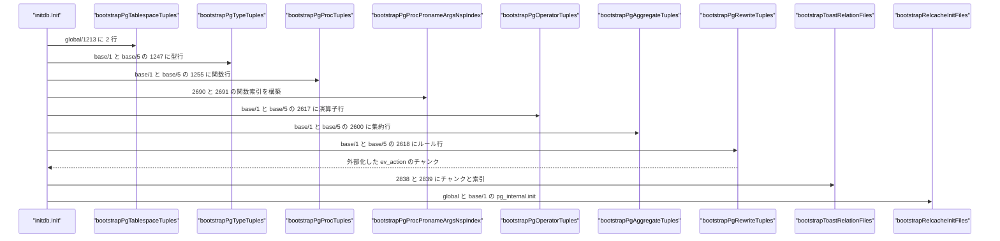
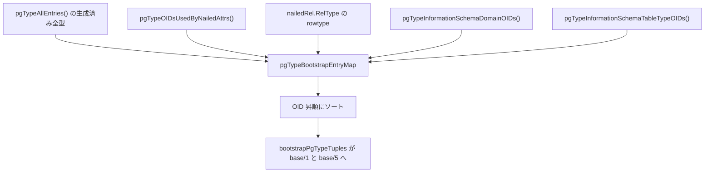
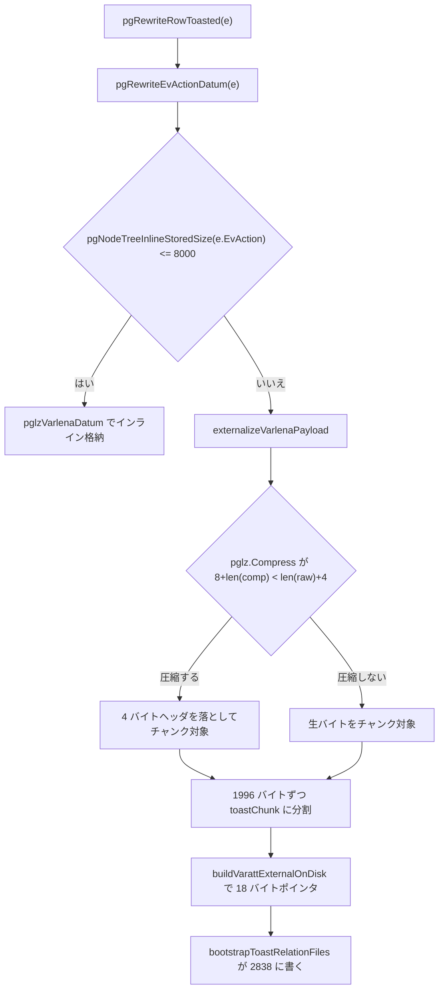

# 組み込みカタログのブートストラップ

<details>
<summary>関連ソースファイル</summary>

- [`internal/initdb/pg_aggregate_bootstrap.go`](https://github.com/ryogrid/goopg/blob/19856410e8d497d59787e1ab35a2febb3f5953d6/internal/initdb/pg_aggregate_bootstrap.go)
- [`internal/initdb/pg_amproc_entries.go`](https://github.com/ryogrid/goopg/blob/19856410e8d497d59787e1ab35a2febb3f5953d6/internal/initdb/pg_amproc_entries.go)
- [`internal/initdb/pg_cast_bootstrap.go`](https://github.com/ryogrid/goopg/blob/19856410e8d497d59787e1ab35a2febb3f5953d6/internal/initdb/pg_cast_bootstrap.go)
- [`internal/initdb/pg_collation_bootstrap.go`](https://github.com/ryogrid/goopg/blob/19856410e8d497d59787e1ab35a2febb3f5953d6/internal/initdb/pg_collation_bootstrap.go)
- [`internal/initdb/pg_constraint_bootstrap.go`](https://github.com/ryogrid/goopg/blob/19856410e8d497d59787e1ab35a2febb3f5953d6/internal/initdb/pg_constraint_bootstrap.go)
- [`internal/initdb/pg_conversion_bootstrap.go`](https://github.com/ryogrid/goopg/blob/19856410e8d497d59787e1ab35a2febb3f5953d6/internal/initdb/pg_conversion_bootstrap.go)
- [`internal/initdb/pg_language_bootstrap.go`](https://github.com/ryogrid/goopg/blob/19856410e8d497d59787e1ab35a2febb3f5953d6/internal/initdb/pg_language_bootstrap.go)
- [`internal/initdb/pg_operator_bootstrap.go`](https://github.com/ryogrid/goopg/blob/19856410e8d497d59787e1ab35a2febb3f5953d6/internal/initdb/pg_operator_bootstrap.go)
- [`internal/initdb/pg_opfamily_bootstrap.go`](https://github.com/ryogrid/goopg/blob/19856410e8d497d59787e1ab35a2febb3f5953d6/internal/initdb/pg_opfamily_bootstrap.go)
- [`internal/initdb/pg_proc_proname_args_nsp_index_bootstrap.go`](https://github.com/ryogrid/goopg/blob/19856410e8d497d59787e1ab35a2febb3f5953d6/internal/initdb/pg_proc_proname_args_nsp_index_bootstrap.go)
- [`internal/initdb/pg_proc_seed_data.go`](https://github.com/ryogrid/goopg/blob/19856410e8d497d59787e1ab35a2febb3f5953d6/internal/initdb/pg_proc_seed_data.go)
- [`internal/initdb/pg_proc_seed_defaults.go`](https://github.com/ryogrid/goopg/blob/19856410e8d497d59787e1ab35a2febb3f5953d6/internal/initdb/pg_proc_seed_defaults.go)
- [`internal/initdb/pg_range_bootstrap.go`](https://github.com/ryogrid/goopg/blob/19856410e8d497d59787e1ab35a2febb3f5953d6/internal/initdb/pg_range_bootstrap.go)
- [`internal/initdb/pg_rewrite_bootstrap.go`](https://github.com/ryogrid/goopg/blob/19856410e8d497d59787e1ab35a2febb3f5953d6/internal/initdb/pg_rewrite_bootstrap.go)
- [`internal/initdb/pg_rewrite_toast_bootstrap.go`](https://github.com/ryogrid/goopg/blob/19856410e8d497d59787e1ab35a2febb3f5953d6/internal/initdb/pg_rewrite_toast_bootstrap.go)
- [`internal/initdb/pg_rewrite_toast_writer.go`](https://github.com/ryogrid/goopg/blob/19856410e8d497d59787e1ab35a2febb3f5953d6/internal/initdb/pg_rewrite_toast_writer.go)
- [`internal/initdb/pg_tablespace_bootstrap.go`](https://github.com/ryogrid/goopg/blob/19856410e8d497d59787e1ab35a2febb3f5953d6/internal/initdb/pg_tablespace_bootstrap.go)
- [`internal/initdb/pg_type_bootstrap.go`](https://github.com/ryogrid/goopg/blob/19856410e8d497d59787e1ab35a2febb3f5953d6/internal/initdb/pg_type_bootstrap.go)
- [`internal/initdb/pg_type_seed_data.go`](https://github.com/ryogrid/goopg/blob/19856410e8d497d59787e1ab35a2febb3f5953d6/internal/initdb/pg_type_seed_data.go)

</details>

組み込みカタログのブートストラップは、`initdb.Init` が新しいデータディレクトリに PG18 の「最初から存在するカタログ行」を書き込む処理です。対象は `pg_type`（型）、`pg_proc`（関数）、`pg_operator`、`pg_aggregate`、`pg_cast`、`pg_range`、`pg_opfamily`、`pg_amproc`、`pg_collation`、`pg_conversion`、`pg_language`、`pg_constraint`、`pg_tablespace`、そして `pg_rewrite` とその TOAST です。各行は PostgreSQL 18 の `FormData_*` 構造体と同じ列順・同じ固定部サイズで書き、索引は PG の btree ページを一括構築して `base/1` と `base/5`（および共有カタログは `global/`）に置きます。これにより、goopg のクラスタディレクトリに実 PostgreSQL 18 を接続しても、`SearchSysCache` ベースの初期化がそのまま通ります。

## 責務

- PG18 の `.dat` ファイル由来のシード表を Go のスライスとして提供する。`pg_type` は生成表 193 型に導出分を加えたもの、`pg_proc` は 3397 行、`pg_operator` は 799 行、`pg_aggregate` は 161 行、`pg_cast` は 235 行、`pg_conversion` は 128 行、`pg_opfamily` は 146 行、`pg_amproc` は 714 行です（`internal/initdb/pg_proc_seed_data.go:pgProcAllEntries`、`internal/initdb/pg_aggregate_bootstrap.go:pgAggregateInitialEntries`、`internal/initdb/pg_amproc_entries.go:pgAmprocInitialEntries`）。
- 各カタログの列定義を PG18 の `FormData_*` とバイト単位で一致させる。`pg_type` は固定部 148 バイトで `typalign` が offset 128、`pg_aggregate` は 22 列、`pg_operator` は 15 列、`pg_rewrite` は 8 列です（`internal/initdb/pg_type_bootstrap.go:pgTypeColDefs`、`pg_aggregate_bootstrap.go:pgAggregateColDefs`、`pg_operator_bootstrap.go:pgOperatorColDefs`、`pg_rewrite_bootstrap.go:pgRewriteColDefs`）。
- 各行を `executor.Row` に変換し、`writeMultiPageHeapRows` で `base/1` と `base/5` のヒープファイルへ書く。ページに収まらない行は複数ページに分割します（`pg_type_bootstrap.go:bootstrapPgTypeTuples`、`pg_cast_bootstrap.go:bootstrapPgCastTuples`）。
- `pg_type` の行集合を「nailed 関係の列型」「nailed 関係の rowtype」「information_schema のドメイン」「information_schema データ表の rowtype と配列型」の和として導出する（`pg_type_bootstrap.go:pgTypeBootstrapEntryMap`）。
- `pg_type` の `typelem` / `typarray` / `typsubscript` / `typrelid` / `typnamespace` / `typbasetype` / `typtypmod` / `typispreferred` をオーバーレイ表で補う（`pgTypeElemArrayOverlay`、`pgTypeRelidOverlay`、`pgTypeNamespaceOverlay` など）。
- `pg_proc_proname_args_nsp_index`（2691）を、`(proname, proargtypes oidvector, pronamespace)` の可変長キーで一括構築する。約 3400 エントリ・1 リーフあたり約 75 件・内部ルート 1 ページという前提で、超過時は明示的にエラーにします（`internal/initdb/pg_proc_proname_args_nsp_index_bootstrap.go:bootstrapPgProcPronameArgsNspIndex`、`pgBuildBtreeBulkLoadVariable`）。
- `pg_proc` の引数 DEFAULT を `pg_proc_seed_defaults.go` の表から供給する。`system_functions.sql` を再生しない代わりに、`pronargdefaults` と `proargdefaults`（bare List の `pg_node_tree`）を PG と同一バイト列で埋めます（`pg_proc_seed_defaults.go:pgProcSeedDefault`、`pgProcSeedArgDefaults`）。
- `pg_rewrite` の `_RETURN` 行を、nailed ビューと information_schema ビューの両方について書き、`ev_action` がインライン上限（8000 バイト）を超える場合は TOAST に外部化する（`pg_rewrite_bootstrap.go:bootstrapPgRewriteTuples`）。
- `pg_rewrite` の TOAST ペア（2838 / 2839）を `pg_class` / `pg_attribute` に登録し、チャンクを 1996 バイトずつ `base/{1,5}/2838` に書く（`pg_rewrite_toast_bootstrap.go:nailedToastPairs`、`nailedToastRels`、`bootstrapToastRelationFiles`）。
- `pg_tablespace`（共有カタログ `global/1213`）に `pg_default`（1663）と `pg_global`（1664）を書き、2697 / 2698 の 2 索引を構築する（`pg_tablespace_bootstrap.go:bootstrapPgTablespaceTuples`、`bootstrapPgTablespaceOidIndex`、`bootstrapPgTablespaceSpcnameIndex`）。
- `pg_constraint` に information_schema の 2 つのドメイン CHECK を書き、本物の `nodeToString` 形式の `conbin` を持たせる。これにより接続した PG が `cardinal_number` や `yes_or_no` の値を実際に検証します（`pg_constraint_bootstrap.go:bootstrapPgConstraintTuples`）。

## 処理フロー

### `initdb.Init` の書き込み順

`Init` は共有カタログ → ローカルカタログ → ビュー／TOAST → リレキャッシュの順に呼び出します。順序には依存関係があり、たとえば `pg_type` のヒープは `pg_attribute` の型 OID を解決する前に存在し、`pg_rewrite` の TOAST チャンクは `pg_rewrite` のヒープ行を書いた後にしか生成できません。



- `bootstrapPgTablespaceTuples` は `global/1213` を直接 1 ページで組み立て、2 行を `FrozenTransactionID` のヒープタプルとして置きます。TID は `{Block: 0, Offset: slot}` です（`pg_tablespace_bootstrap.go:51-108`）。2697 / 2698 の索引は `bootstrapPgTablespaceOidIndex` と `bootstrapPgTablespaceSpcnameIndex` が同じエントリから構築します。
- 型索引 2703 / 2704 は `bootstrapPgTypeOidIndex` / `bootstrapPgTypeTypnameNspIndex` が `bootstrapPgTypeTuples` の返す TID マップから構築します。
- `bootstrapPgTypeTuples` は `pgTypeBootstrapEntryMap()` の全 OID を昇順に並べ、`base/1` と `base/5` の両方へ書きます。決定的なヒープ配置のために OID 順が固定されています（`pg_type_bootstrap.go:767-792`）。
- `bootstrapPgProcPronameArgsNspIndex` は `pgProcInitialEntries()` と TID の件数が一致しないとエラーにします。ソートは名前 → 引数の個数 → 引数 OID 列 → 名前空間の順です（`pg_proc_proname_args_nsp_index_bootstrap.go:251-302`）。
- `pg_rewrite` は行ごとに「インラインか外部化か」を決め、外部化した行だけ `writeMultiPageHeapRowsExternal` の external フラグを立てます。返したチャンクは `bootstrapToastRelationFiles` が唯一の書き手として処理します（`pg_rewrite_bootstrap.go:209-229`）。
- 最後の `bootstrapRelcacheInitFiles` が `pg_internal.init` を書きます。ここまでのヒープ／索引が揃っていないと、PG は critical index を開けずに PANIC します。詳細は [12.5 リレキャッシュとプランキャッシュ](12.5-Relcache.md) を参照してください。

### `pg_type` の行集合の導出

`pg_type` は「nailed 関係が参照する型」だけでは足りません。rowtype（composite）と information_schema のドメイン／データ表型は、どの `nailedAttr.TypeOID` にも現れないため、別の入力から足す必要があります。



- `pgTypeInitialEntries` は nailed 属性の型 OID を集め、`pgTypeCanonical(oid)` が見つかったものだけを返します。見つからない OID は静かに落ちます（`pg_type_bootstrap.go:325-363`）。
- `pgTypeBootstrapEntryMap` は生成済み全型に加えて、上記 4 系統の OID を `pgTypeCanonical` で補います。rowtype を `nailedRel.RelType` から導くのは、`pg_class.reltype` と `pg_type` 行の対応がずれないようにするためです（`pg_type_bootstrap.go:675-735`）。
- information_schema のドメインは 10 OID（13286/13287、13289/13290、13291/13292、13297/13298、13299/13300）、データ表の rowtype と配列型は 8 OID（13457/13458、13462/13463、13467/13468、13472/13473）です（`pg_type_bootstrap.go:737-765`）。

### `ev_action` のインライン／TOAST 分岐

`pg_rewrite.ev_action` は `pg_node_tree` の 1 値で、圧縮後の格納サイズが `maxInlineEvActionStored = 8000` を超えるとヒープタプルに収まりません。その場合は pglz 圧縮した本体を 1996 バイトずつに切り、18 バイトの `VARTAG_ONDISK` ポインタに置き換えます。



- ポインタは `VARATT_IS_1B_E`（0x01）+ `VARTAG_ONDISK`（18）+ `va_rawsize`（4）+ `va_extinfo`（4）+ `va_valueid`（4）+ `va_toastrelid`（4）の 18 バイトです。`va_extinfo` の下位 30 ビットが格納サイズ、上位 2 ビットが圧縮方式です（`pg_rewrite_toast_writer.go:70-102`、`126-141`）。
- 圧縮するかどうかは `pglz.Compress(raw) != nil && 8+len(comp) < len(raw)+4` で決まります。圧縮しない場合は `cmethod = 0` のままにし、PG の「サイズ一致なら非圧縮」という判定に合わせます（`pg_rewrite_toast_writer.go:156-171`）。
- チャンクの `chunk_id` は `ruleOID + 1` に固定されています。上流 initdb と同じ番号にすることで、TOAST ヒープの差分がバイトの差分だけになります（`pg_rewrite_toast_writer.go:205-211`）。
- `pgRewriteRow`（チャンクを返さない旧入口）は、外部化が必要な行に当たると panic します。呼び出し側は必ず `pgRewriteRowToasted` を使う契約です（`pg_rewrite_bootstrap.go:170-179`）。

## 主要ファイル

| ファイル | 役割 |
| --- | --- |
| `internal/initdb/pg_type_bootstrap.go` | `pg_type` の列定義・行集合の導出・オーバーレイ・ヒープ書き込み。`pg_type_bootstrap.go:pgTypeColDefs`、`pgTypeBootstrapEntryMap`、`bootstrapPgTypeTuples` |
| `internal/initdb/pg_type_seed_data.go` | 生成済みの全 `pg_type` 行と `typelem/typarray/typsubscript` 表。`pg_type_seed_data.go:pgTypeAllEntries` |
| `internal/initdb/pg_proc_seed_data.go` | `pg_proc.dat` 3397 行の生成済みシード。`pg_proc_seed_data.go:pgProcAllEntries` |
| `internal/initdb/pg_proc_seed_defaults.go` | 引数 DEFAULT の表と `pg_node_tree` 化。`pg_proc_seed_defaults.go:pgProcSeedArgDefaults` |
| `internal/initdb/pg_proc_proname_args_nsp_index_bootstrap.go` | 2691 の可変長 btree 一括構築。`pg_proc_proname_args_nsp_index_bootstrap.go:bootstrapPgProcPronameArgsNspIndex` |
| `internal/initdb/pg_operator_bootstrap.go` | `pg_operator` 799 行の行ビルダとヒープ書き込み。`pg_operator_bootstrap.go:bootstrapPgOperatorTuples` |
| `internal/initdb/pg_aggregate_bootstrap.go` | `pg_aggregate` 161 行の行ビルダとヒープ書き込み。`pg_aggregate_bootstrap.go:bootstrapPgAggregateTuples` |
| `internal/initdb/pg_cast_bootstrap.go` | `pg_cast` 235 行。`pg_cast_bootstrap.go:bootstrapPgCastTuples` |
| `internal/initdb/pg_collation_bootstrap.go` | `pg_collation` 7 行（12 列）。`pg_collation_bootstrap.go:bootstrapPgCollationTuples` |
| `internal/initdb/pg_conversion_bootstrap.go` | `pg_conversion` 128 行と `pg_enc` 定数。`pg_conversion_bootstrap.go:bootstrapPgConversionTuples` |
| `internal/initdb/pg_language_bootstrap.go` | `pg_language` 3 行（9 列）。`pg_language_bootstrap.go:bootstrapPgLanguageTuples` |
| `internal/initdb/pg_opfamily_bootstrap.go` | `pg_opfamily` 146 行。`pg_opfamily_bootstrap.go:bootstrapPgOpfamilyTuples` |
| `internal/initdb/pg_amproc_entries.go` | `pg_amproc` 714 行（OID は baseOID + index で採番）。`pg_amproc_entries.go:pgAmprocInitialEntries` |
| `internal/initdb/pg_range_bootstrap.go` | `pg_range` 6 行。`pg_range_bootstrap.go:bootstrapPgRangeTuples` |
| `internal/initdb/pg_constraint_bootstrap.go` | `pg_constraint` の 2 ドメイン CHECK と 3 索引。`pg_constraint_bootstrap.go:bootstrapPgConstraintTuples` |
| `internal/initdb/pg_tablespace_bootstrap.go` | 共有 `pg_tablespace` の 2 行と 2697 / 2698。`pg_tablespace_bootstrap.go:bootstrapPgTablespaceTuples` |
| `internal/initdb/pg_rewrite_bootstrap.go` | `_RETURN` 行の生成と TID マップ。`pg_rewrite_bootstrap.go:bootstrapPgRewriteTuples` |
| `internal/initdb/pg_rewrite_toast_bootstrap.go` | TOAST ペアの定義、nailed 行、チャンクのヒープ書き込み。`pg_rewrite_toast_bootstrap.go:bootstrapToastRelationFiles` |
| `internal/initdb/pg_rewrite_toast_writer.go` | 圧縮・チャンク分割・18 バイトポインタ生成。`pg_rewrite_toast_writer.go:externalizeVarlenaPayload` |

## 公開 API / エントリポイント

```go
// エントリポイント
func Init(opts Options) error

// pg_type
func pgTypeColDefs() []catalog.Column
func pgTypeCanonical(oid uint32) (pgTypeEntry, bool)
func pgTypeOIDsUsedByNailedAttrs() []uint32
func pgTypeInitialEntries() []pgTypeEntry
func pgTypeBootstrapEntryMap() map[uint32]pgTypeEntry
func bootstrapPgTypeTuples(dataDir string) (map[uint32]heapTID, error)

// pg_proc
func pgProcAllEntries() []pgProcEntry
func pgProcSeedArgDefaults(oid uint32) (int, string)
func pgEncodeOidvectorForIndex(oids []uint32) []byte
func pgBuildIndexTupleProcKey(heapBlk uint32, heapOff uint16, proname string, proargtypes []uint32, pronamespace uint32) []byte
func bootstrapPgProcPronameArgsNspIndex(dataDir string, tids []heapTID) error

// 各カタログのブートストラップ
func bootstrapPgOperatorTuples(dataDir string) (map[uint32]heapTID, error)
func bootstrapPgAggregateTuples(dataDir string) (map[uint32]heapTID, error)
func bootstrapPgCastTuples(dataDir string) (map[uint32]heapTID, error)
func bootstrapPgCollationTuples(dataDir string) (map[uint32]heapTID, error)
func bootstrapPgConversionTuples(dataDir string) (map[uint32]heapTID, error)
func bootstrapPgLanguageTuples(dataDir string) (map[uint32]heapTID, error)
func bootstrapPgOpfamilyTuples(dataDir string) (map[uint32]heapTID, error)
func bootstrapPgRangeTuples(dataDir string) (map[uint32]heapTID, error)
func bootstrapPgConstraintTuples(dataDir string) (map[uint32]heapTID, error)
func bootstrapPgTablespaceTuples(dataDir string) ([]pgTablespaceEntry, error)

// pg_rewrite と TOAST
func pgRewriteColDefs() []catalog.Column
func bootstrapPgRewriteTuples(dataDir string) (map[uint32]heapTID, []toastChunk, error)
func toastChunkCols() []catalog.Column
func toastChunkRows(chunks []toastChunk) []executor.Row
func writeToastChunkHeap(dataDir string, toastRel uint32, chunks []toastChunk) ([]heapTID, error)
func bootstrapToastRelationFiles(dataDir string, chunks []toastChunk) error
```

## 主要データ構造

### `pgTypeEntry` — `pg_type` 1 行の物理属性

```go
// pgTypeEntry captures the load-bearing fixed-part fields of a PG18
// pg_type row.  Field values are sourced from
// `postgres/src/include/catalog/pg_type.dat` (with regproc OIDs cross-
// referenced via `postgres/src/include/catalog/pg_proc.dat`).
type pgTypeEntry struct {
	OID      uint32
	Name     string
	Len      int16
	ByVal    bool
	Type     byte // 'b'=base, 'c'=composite, 'p'=pseudo, 'd'=domain, 'e'=enum, 'r'=range
	Category byte // typcategory; capital letter per pg_type.h TYPCATEGORY_*
	Align    byte // 'c'/'s'/'i'/'d'
	Storage  byte // 'p'/'e'/'x'/'m'
	// I/O regproc OIDs (pg_proc.oid). 0 = no function (legitimate for
	// pseudo types and aclitem). PG18's getTypeOutputInfo
	// (lsyscache.c:3063) ERRORs with `no output function available for
	// type ...` when typoutput == 0, which is the immediate FATAL the
	// M0106-0010 Step 3da fix closes for int4 (OID 23).
	Input   uint32 // typinput
	Output  uint32 // typoutput
	Receive uint32 // typreceive
	Send    uint32 // typsend
}
```

（`pg_type_bootstrap.go:pgTypeEntry`）

`Len` は `typlen`（-1 が varlena）、`ByVal` は `typbyval`、`Align` は `typalign`、`Storage` は `typstorage` です。`Type` が `'c'`（composite）の行は `typrelid` が有効でなければならず、`pgTypeRelidOverlay` がその値を補います。`Input` / `Output` が 0 の型は擬似型か `aclitem` だけで、通常の型で `Output == 0` は PG の `getTypeOutputInfo` がエラーになるため許されません。

### `pgAggregateEntry` — `pg_aggregate` 1 行

```go
// pgAggregateEntry mirrors one row of PG18's pg_aggregate (OID 2600).
// The first 20 columns are fixed-size; agginitval and aggminitval are
// variable-length text (nullable).
type pgAggregateEntry struct {
	AggFnOID        uint32 // aggfnoid (regproc) — also the row OID
	AggKind         byte   // aggkind: 'n'=normal, 'o'=ordered-set, 'h'=hypothetical
	AggNumDirectArgs int16  // aggnumdirectargs (direct args for ordered-set)
	AggTransFn      uint32 // aggtransfn
	AggFinalFn      uint32 // aggfinalfn (0 if none)
	AggCombineFn    uint32 // aggcombinefn (0 if none)
	AggSerialFn     uint32 // aggserialfn (0 if none)
	AggDeserialFn   uint32 // aggdeserialfn (0 if none)
	AggMTransFn     uint32 // aggmtransfn (0 if none)
	AggMInvTransFn  uint32 // aggminvtransfn (0 if none)
	AggMFinalFn     uint32 // aggmfinalfn (0 if none)
	AggFinalExtra   bool   // aggfinalextra
	AggMFinalExtra  bool   // aggmfinalextra
	AggFinalModify  byte   // aggfinalmodify: 'r','s','w'
	AggMFinalModify byte   // aggmfinalmodify: 'r','s','w'
	AggSortOp       uint32 // aggsortop (0 if none)
	AggTransType    uint32 // aggtranstype
	AggTransSpace   int32  // aggtransspace
	AggMTransType   uint32 // aggmtranstype (0 if none)
	AggMTransSpace  int32  // aggmtransspace
	AggInitVal      string // agginitval (empty = NULL)
	AggMInitVal     string // aggminitval (empty = NULL)
}
```

（`pg_aggregate_bootstrap.go:pgAggregateEntry`）

`pg_aggregate` には独立した `oid` 列がなく、`AggFnOID`（`aggfnoid`）が主キーです。そのため `bootstrapPgAggregateTuples` が返す TID マップのキーも `aggfnoid` になります（`pg_aggregate_bootstrap.go:79-107`、`1925-1944`）。`AggInitVal` / `AggMInitVal` の空文字列は `aggNullableText` により SQL NULL になります。

### `pgRewriteEntry` — `_RETURN` ルール 1 行

```go
// pgRewriteEntry describes one Form_pg_rewrite row to seed into the
// heap. EvQual and EvAction are nodeToString-formatted pg_node_tree
// strings; both are required to be non-empty (BKI_FORCE_NOT_NULL).
// The empty pg_node_tree convention is "<>".
type pgRewriteEntry struct {
	OID       uint32
	RuleName  string
	EvClass   uint32
	EvType    byte // '1' = CMD_SELECT, '2' = CMD_UPDATE, '3' = CMD_INSERT, '4' = CMD_DELETE
	EvEnabled byte // 'O' = ALWAYS (origin/local), 'D' = DISABLED, 'R' = REPLICA
	IsInstead bool
	EvQual    string
	EvAction  string
}
```

（`pg_rewrite_bootstrap.go:pgRewriteEntry`）

`EvClass` はビューの `pg_class.oid`、`OID` は `_RETURN` ルール自身の OID です。`EvQual` は空の `pg_node_tree` を表す `"<>"`、`EvAction` はキャプチャ済みの `nodeToString(Query)` です。両方とも `BKI_FORCE_NOT_NULL` なので NULL にできません。`EvAction` が 8000 バイトを超える場合は `pgRewriteRowToasted` が TOAST 化します。

### `toastRelPair` / `toastChunk` — TOAST 関係とチャンク

```go
// toastRelPair is one DECLARE_TOAST(parent, toastRel, toastIdx) declaration.
// The list is a closed set — goopg bootstraps a TOAST relation only where
// upstream declares one, because the OIDs are pinned upstream constants and a
// hosted PG resolves them by OID, not by name.
type toastRelPair struct {
	Parent   uint32 // heap whose oversize columns are stored out of line
	ToastRel uint32 // pg_class OID of the TOAST heap (relkind 't')
	ToastIdx uint32 // pg_class OID of its UNIQUE btree (chunk_id, chunk_seq)
	RelName  string // pg_toast_<Parent>; the index is <RelName>_index
}
```

（`pg_rewrite_toast_bootstrap.go:toastRelPair`）

```go
// toastChunk is one row of a TOAST relation: (chunk_id oid, chunk_seq int4,
// chunk_data bytea). Data is at most toastMaxChunkSize bytes and every chunk
// but the last of a value is exactly that long.
type toastChunk struct {
	ToastRel uint32 // which TOAST heap the chunk belongs in
	ChunkID  uint32
	Seq      int32
	Data     []byte
}
```

（`pg_rewrite_toast_writer.go:toastChunk`）

`nailedToastPairs` は `pg_rewrite`（2618 → 2838 / 2839）と information_schema の 4 データ表（13456/13461/13466/13471 とそれぞれの TOAST）を返します。後者は行が小さいためチャンクは 0 件で、空の TOAST ヒープだけが作られます。`toastChunk.Data` は `toastMaxChunkSize = 1996` バイト以下で、最後以外はちょうど 1996 バイトです。

### `pgProcSeedDefault` — 引数 DEFAULT の記述

```go
type pgProcSeedDefault struct {
	// nargDefaults is pg_proc.pronargdefaults: how many of the trailing
	// arguments have defaults.
	nargDefaults int
	// defaults are the default expressions for those trailing arguments, in
	// argument order; serialized into proargdefaults as a bare List.
	defaults []nodes.Node
}
```

（`pg_proc_seed_defaults.go:pgProcSeedDefault`）

`defaults` は IR のノード列で、`nodes.OutList` により `proargdefaults` の bare List に変換されます。`pgProcSeedDefaultsTrees` が `sync.OnceValue` で OID → 文字列をキャッシュするため、3397 行のシード中でも IR の走査は 1 回だけです（`pg_proc_seed_defaults.go:71-91`）。現在の表は `pg_create_physical_replication_slot`（OID 3779）の 2 引数だけを持ちます。

### `pgConstraintEntry` — ドメイン CHECK のシード

```go
type pgConstraintEntry struct {
	OID      uint32
	ConName  string
	ConTypID uint32 // contypid — the domain OID this check constrains
	ConBin   string // conbin — nodeToString(CheckExpr), captured from PG 18.3
}
```

（`pg_constraint_bootstrap.go:pgConstraintEntry`）

`ConBin` は PG がそのまま `stringToNode` できる `nodeToString` 形式です。ランタイムのドメイン CHECK が生 SQL テキストを `adbin` に入れるのとは異なり、ブートストラップ行は実 PG が検証に使える形式でなければなりません。`pgConstraintRow` は 28 列のうち FK 専用の char 列を半角スペース `" "`、配列列を NULL で埋めます（`pg_constraint_bootstrap.go:53-90`）。

## 内部構造

### 物理レイアウトの固定

各 `pgXxxColDefs()` は PG18 の `FormData_pg_xxx` と列順・型を一致させます。とくに `pg_type` は固定部が 148 バイトで、`typalign` が offset 128 に来ることが重要です。ここがずれると、PG の `populate_compact_attribute_internal` が `invalid attalign value` で FATAL します。`pg_type` の末尾 3 列（`typdefaultbin` / `typdefault` / `typacl`）は NULL の varlena として null ビットマップで表現します（`pg_type_bootstrap.go:10-55`）。

`pg_operator` は 15 列、`pg_aggregate` は 22 列、`pg_rewrite` は 8 列です。行ビルダは `executor.NewIntDatum` / `NewStringDatum` / `NewBoolDatum` / `NullDatum` を列順に並べるだけで、`char` 型の列も 1 バイト文字列として渡します。

### 生成テーブルと手書きテーブルの境界

`pg_proc` と `pg_type` の大半は `cmd/gen-*` が `.dat` から生成します（`pg_proc_seed_data.go` の 3397 行、`pg_type_seed_data.go` の全型と `pgTypeGeneratedElemArraySubscript`）。一方、PG18 の `.dat` に存在しない情報（information_schema の initdb 割り当て OID、`typelem/typarray` の補完、`pg_proc` の DEFAULT）は手書きのオーバーレイ／表で補います。生成部分を再生成しても手書き部分が消えない、というのがこの分割の意図です。

### `pg_proc_proname_args_nsp_index` の可変長バルク構築

2691 のキーは「64 バイトの `NameData` + oidvector + oid」で、oidvector の長さが関数ごとに違うため固定長バルク構築は使えません。`pgBuildBtreeBulkLoadVariable` は各タプルを 8 バイト境界に MAXALIGN し、右端以外のリーフには最大タプルサイズの P_HIKEY 領域を予約して単調に詰めます。内部レベルは 1 ルートページに収まる前提で、`~3400 エントリ / 1 リーフ ~75 件 / ~50 リーフ` を見込んでいます。超えた場合はエラーを返し、壊れた木を黙って作らない方針です（`pg_proc_proname_args_nsp_index_bootstrap.go:111-159`）。

oidvector の on-disk 形式は 24 バイトヘッダ + 4 バイト×n です。`vl_len_ = (24 + 4n) << 2`、`ndim=1`、`dataoffset=0`、`elemtype=26`、`dim1=n`、`lbound=0` で、これは PG の `buildoidvector` と同じです（`pg_proc_proname_args_nsp_index_bootstrap.go:41-67`）。

### `pg_type` のオーバーレイ

`pgTypeCanonical` だけでは表現できない関係を、次のマップが補います。

| マップ | 補う列 | 例 |
| --- | --- | --- |
| `pgTypeElemArrayOverlay` | `typelem` / `typarray` / `typsubscript` | `_pg_statistic`（10028）↔ `pg_statistic` rowtype（10029） |
| `pgTypeRelidOverlay` | `typrelid` | `pg_class` rowtype 83 → 1259、`pg_statistic` 10029 → 2619 |
| `pgTypeNamespaceOverlay` | `typnamespace` | information_schema の型 → 13273 |
| `pgTypeBaseTypeOverlay` | `typbasetype` | ドメイン → 基底型 |
| `pgTypeTypModOverlay` | `typtypmod` | ドメインの型修飾子 |
| `pgTypePreferredOverlay` | `typispreferred` | 優先型 |

これらの表は「PG18 の `.dat` に無いが、実際のクラスタには存在する行」を再現するためのものです。`typcollation` は別関数 `pgTypeCollationForOID` が担い、text/varchar/bpchar は 100（default）、name は 950（C）、配列は要素のコローションを継承します。この値がランタイムの `pg_attribute.attcollation` と食い違うと、pg_dump が全 collatable 列に余計な `COLLATE` を出力します（`pg_type_bootstrap.go:365-418`）。

### `pg_rewrite` の TOAST ヒープ

TOAST 関係 `2838` は 3 列（`chunk_id` oid、`chunk_seq` int4、`chunk_data` bytea）で、索引 `2839` は `(chunk_id, chunk_seq)` の UNIQUE btree です。`nailedToastRels` が `pg_class` / `pg_attribute` 行を生成し、`RelType` は 0 のまま、`pgClassRelnamespaceFor` が名前空間を 99（`pg_toast`）にします。TOAST 関係は `pg_internal.init` には入れません。PG は critical relcache の段階で TOAST 関係を開かず、detoast のときに初めて開くためです（`pg_rewrite_toast_bootstrap.go:76-137`）。

チャンクのヒープは 1996 バイトのタプルが約 2032 バイトになるため 1 ページに 4 行しか入りません。`writeToastChunkHeap` は最初から複数ページのライタを使い、`(chunk_id, chunk_seq)` 順に TID を返します（`pg_rewrite_toast_writer.go:251-262`）。

### `pg_tablespace` の直接ページ書き込み

`pg_tablespace` は共有カタログなので `global/1213` に置きます。2 行だけなので `writeMultiPageHeapRows` を使わず、`storage.InitPage` で 1 ページを作り、`storage.PageAddHeapTuple` で 2 行を追加します。xmin は `FrozenTransactionID`、xmax は `InvalidTransactionID` です。索引 2697 は oid 順、2698 は spcname 順にソートしてリーフ 1 ページの btree を作ります（`pg_tablespace_bootstrap.go:45-157`）。

### 失敗時の扱い

各 `bootstrapXxxTuples` は `writeMultiPageHeapRows` のエラーをカタログ名付きで返し、`Init` はそれを `fmt.Errorf("goopg init: ...: %w")` で包んで即座に中断します。部分的なカタログしかないクラスタで起動を続けるより、初期化を失敗させる方が安全という判断です。索引の件数不一致（`pg_proc` の entries と tids）や内部ルートのオーバーフローも同じくエラーです。

## エッジケースと不変条件

- **`pg_type` の OID 被覆**。`pgTypeInitialEntries` は `pgTypeCanonical` が知らない OID を静かにスキップします。nailed 属性が新しい型 OID を参照したのに canonical 表へ追加し忘れると、`pg_type` 行が欠落し、接続した PG が `TupleDescInitEntry` で FATAL します（`pg_type_bootstrap.go:325-363`）。
- **composite rowtype の `typrelid`**。`typtype='c'` の行は `typrelid` が 0 だと PG の `lookup_type_cache` がアサートで落ちます。`pgTypeRelidOverlay` が `pg_type` / `pg_attribute` / `pg_proc` / `pg_class` / `pg_statistic` と information_schema の rowtype を対応付けます（`pg_type_bootstrap.go:462-490`）。
- **`typcollation` の一致**。text 系 100 / name 950 / 配列は要素継承で、ランタイムの `pg_attribute.attcollation` と一致しなければなりません。不一致は pg_dump の余計な `COLLATE` になります（`pg_type_bootstrap.go:365-418`）。
- **`pg_proc` の `proargtypes`**。nil の `ArgTypes` は「内部引数 1 個（OID 2281）」を意味し、真空の 0 引数は明示的な `[]uint32{}` だけです。この区別を崩すと `pg_proc_proname_args_nsp_index` のキーが変わります（`pg_proc_proname_args_nsp_index_bootstrap.go:264-271`）。
- **`pg_proc` の名前空間**。既定は `pg_catalog`（11）で、information_schema のヘルパーは 13273 です。ここを 11 に固定すると、接続した PG の `FuncnameGetCandidates` がヘルパーを見つけられません（`pg_proc_proname_args_nsp_index_bootstrap.go:272-279`）。
- **2691 の件数一致**。`bootstrapPgProcPronameArgsNspIndex` は `len(pgProcInitialEntries()) != len(tids)` ならエラーにします。ヒープ行と索引エントリが 1:1 で対応するという不変条件です（`pg_proc_proname_args_nsp_index_bootstrap.go:251-255`）。
- **可変長バルクの上限**。`pgBuildBtreeBulkLoadVariable` は各タプルが 8 バイト境界でないとエラーにし、内部ルートが 1 ページに収まらない場合もエラーにします。黙って壊れた木を作らないための境界です（`pg_proc_proname_args_nsp_index_bootstrap.go:138-159`）。
- **`ev_action` のインライン上限**。`maxInlineEvActionStored = 8000` は capture スクリプトの guard #5 と同じ値です。この境界を片方だけ変えると、キャプチャは通るがヒープに収まらない、という状態になります（`pg_rewrite_toast_writer.go:92-102`）。
- **TOAST ポインタの互換性**。18 バイトの `VARTAG_ONDISK` は `va_rawsize` / `va_extinfo` / `va_valueid` / `va_toastrelid` の順で、`va_extinfo` の上位 2 ビットが圧縮方式です。圧縮しない場合は方式 0 のままで、PG はサイズ一致から非圧縮と判定します（`pg_rewrite_toast_writer.go:70-102`、`156-171`）。
- **`pgRewriteRow` の panic**。外部化が必要な行を `pgRewriteRow` で組むと panic します。chunk の行き場がないまま 18 バイトポインタだけをヒープに書くと、読めないタプルになるためです（`pg_rewrite_bootstrap.go:170-179`）。
- **TOAST 関係の `reltype` は 0**。`pg_class.reltype` の既定フォールバック（関係 OID を使う）を適用すると、存在しない `pg_type` 行を指し、PG の `RelationBuildDesc` がアサートで落ちます。`isNailedToastRel` がこのフォールバックを除外します（`pg_rewrite_toast_bootstrap.go:151-163`）。
- **`reltoastrelid` の一致**。親の `pg_class.reltoastrelid` が 0 だと、外部ポインタを detoast するときに `missing chunk number 0 for toast value` になります。`pgClassReltoastrelidFor` が親 → TOAST の対応を返します（`pg_rewrite_toast_bootstrap.go:196-208`）。
- **TOAST 列の `attstorage` は `'p'`**。チャンク自身をさらに TOAST 化すると再帰するため、PG も `'p'`（plain）です。`bytea` の型既定 `'x'` をそのまま使ってはいけません（`pg_rewrite_toast_bootstrap.go:210-237`）。
- **`pg_constraint` の `conbin` は実 node tree**。ランタイムの生 SQL テキストを入れると、接続した PG が検証時にパースできません。`pgConstraintRow` は `pglzVarlenaDatum` で圧縮した本物の `pg_node_tree` を書きます（`pg_constraint_bootstrap.go:53-90`）。
- **共有カタログの置き場所**。`pg_tablespace` は `global/1213`、索引は `global/2697` / `global/2698` です。`base/` に書くと PG の `TABLESPACEOID` 参照が空振りします（`pg_tablespace_bootstrap.go:1-9`、`118-158`）。

カタログ行のメモリ表現と OID 採番は [12.1 インメモリカタログ](12.1-In-Memory-Catalog.md)、行のバイト形式とデコーダは [12.2 カタログヒープとコーデック](12.2-Catalog-Heaps.md)、ビューと information_schema の種データは [12.3 システムビューと information_schema](12.3-System-Views.md)、生成した行を PG に読ませるリレキャッシュファイルは [12.5 リレキャッシュとプランキャッシュ](12.5-Relcache.md) を参照してください。

Sources:
- `internal/initdb/pg_aggregate_bootstrap.go`
- `internal/initdb/pg_amproc_entries.go`
- `internal/initdb/pg_cast_bootstrap.go`
- `internal/initdb/pg_collation_bootstrap.go`
- `internal/initdb/pg_constraint_bootstrap.go`
- `internal/initdb/pg_conversion_bootstrap.go`
- `internal/initdb/pg_language_bootstrap.go`
- `internal/initdb/pg_operator_bootstrap.go`
- `internal/initdb/pg_opfamily_bootstrap.go`
- `internal/initdb/pg_proc_proname_args_nsp_index_bootstrap.go`
- `internal/initdb/pg_proc_seed_data.go`
- `internal/initdb/pg_proc_seed_defaults.go`
- `internal/initdb/pg_range_bootstrap.go`
- `internal/initdb/pg_rewrite_bootstrap.go`
- `internal/initdb/pg_rewrite_toast_bootstrap.go`
- `internal/initdb/pg_rewrite_toast_writer.go`
- `internal/initdb/pg_tablespace_bootstrap.go`
- `internal/initdb/pg_type_bootstrap.go`
- `internal/initdb/pg_type_seed_data.go`

<sub>Generated by deepwiki-4myself from `goopg` @ `19856410e`</sub>
