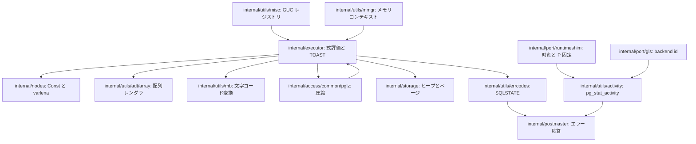
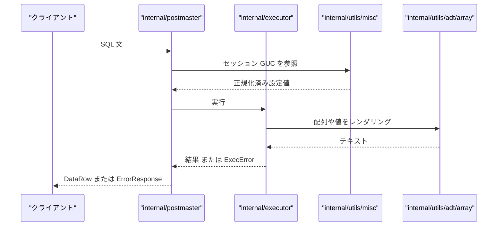

# ユーティリティとランタイム

<details>
<summary>関連ソースファイル</summary>

- [`internal/access/common/pglz/pglz.go`](https://github.com/ryogrid/goopg/blob/19856410e8d497d59787e1ab35a2febb3f5953d6/internal/access/common/pglz/pglz.go)
- [`internal/port/runtimeshim/doc.go`](https://github.com/ryogrid/goopg/blob/19856410e8d497d59787e1ab35a2febb3f5953d6/internal/port/runtimeshim/doc.go)
- [`internal/utils/adt/array/pgarray.go`](https://github.com/ryogrid/goopg/blob/19856410e8d497d59787e1ab35a2febb3f5953d6/internal/utils/adt/array/pgarray.go)
- [`internal/utils/errcodes/codes.go`](https://github.com/ryogrid/goopg/blob/19856410e8d497d59787e1ab35a2febb3f5953d6/internal/utils/errcodes/codes.go)
- [`internal/utils/mb/conv.go`](https://github.com/ryogrid/goopg/blob/19856410e8d497d59787e1ab35a2febb3f5953d6/internal/utils/mb/conv.go)
- [`internal/utils/misc/guc.go`](https://github.com/ryogrid/goopg/blob/19856410e8d497d59787e1ab35a2febb3f5953d6/internal/utils/misc/guc.go)
- [`internal/utils/mmgr/mctx.go`](https://github.com/ryogrid/goopg/blob/19856410e8d497d59787e1ab35a2febb3f5953d6/internal/utils/mmgr/mctx.go)

</details>

このサブシステムは、SQL 実行の外側にある共通基盤 — 設定値の解決、値のバイナリ表現、エラーコード、メモリコンテキスト、文字コード変換、圧縮、そしてランタイムのホットパス用プリミティブ — を提供する。データは設定ファイルや SQL の `SET` から GUC レジストリへ入り、実行エンジンがその値で式・配列・日付時刻を評価し、結果を PostgreSQL 互換のバイト列としてストレージへ渡す。失敗時は `errcodes` の SQLSTATE を持つエラーとして接続ハンドラへ戻る。

各コンポーネントは葉に近い独立パッケージに分かれ、相互の import cycle を避けるために不変の PostgreSQL 定数テーブルを複製している箇所がある。詳細は各子ページに譲り、ここでは語彙とデータの流れだけを示す。

## コンポーネント

- [13.1 GUC 設定システム](13-Utilities/13.1-GUC.md): `postgresql.conf` / `postgresql.auto.conf` の解析、[`misc.Variable`](https://github.com/ryogrid/goopg/blob/19856410e8d497d59787e1ab35a2febb3f5953d6/internal/utils/misc/guc.go) の正規化・検証、[`misc.Registry`](https://github.com/ryogrid/goopg/blob/19856410e8d497d59787e1ab35a2febb3f5953d6/internal/utils/misc/guc.go) とセッション層の `SET` / `SET LOCAL` を扱う。
- [13.2 データ型と ADT](13-Utilities/13.2-ADT.md): スカラー `Const` の PostgreSQL バイナリ、配列 `ArrayType`、numeric、jsonb、範囲型、日付時刻と `SIMILAR TO` の変換を扱う。
- [13.3 エラーコードとメモリ管理](13-Utilities/13.3-Errors-and-Memory.md): [`errcodes.Code`](https://github.com/ryogrid/goopg/blob/19856410e8d497d59787e1ab35a2febb3f5953d6/internal/utils/errcodes/codes.go) の SQLSTATE カタログ、[`mmgr.Context`](https://github.com/ryogrid/goopg/blob/19856410e8d497d59787e1ab35a2febb3f5953d6/internal/utils/mmgr/mctx.go) の階層メモリ、行・パーサプール、activity registry と per-P カウンタを扱う。
- [13.4 エンコーディングとロケール](13-Utilities/13.4-Encoding.md): エンコーディング名の正規化、`goopg init` の `-E` / ロケール解決、LATIN1 / LATIN2 / EUC_JP / EUC_KR と UTF8 の変換を扱う。
- [13.5 ランタイムシムと goroutine ローカル](13-Utilities/13.5-Runtime-Shim.md): `//go:linkname` で接続する `Nanotime` / `PinP` / セマフォ、pprof ラベルによる goroutine ローカルのバックエンド ID、WAL stripe の `paddedMutex` を扱う。
- [13.6 PGLZ 圧縮と TOAST](13-Utilities/13.6-PGLZ-and-TOAST.md): PGLZ の varlena 形式、TOAST の 12 バイトポインタ、チャンク格納・デトースト、B-tree の外部 TOAST 拒否を扱う。

## サブシステム図



ボックスは実在するパッケージであり、辺は実際の呼び出しまたはデータの受け渡しを表す。`CFG` は実行時の `Get` / `GetDisplay`、`MEM` は式評価中の `Acquire` / `Alloc`、`PGLZ` は TOAST 書き込み時の圧縮結果、`ERR` は `ExecError` や `ValidationError` から接続ハンドラへの応答である。`runtimeshim` と `gls` は activity registry の時刻・procNum 解決に使われる。

## データフロー

1. **設定の取り込み**: 起動時に `misc.BuildDefaultRegistry()` が既定値を作り、[`misc.Registry.ApplyConfigEntries`](https://github.com/ryogrid/goopg/blob/19856410e8d497d59787e1ab35a2febb3f5953d6/internal/utils/misc/guc.go) が設定ファイルのエントリを [`Variable.canonicalizeFrom`](https://github.com/ryogrid/goopg/blob/19856410e8d497d59787e1ab35a2febb3f5953d6/internal/utils/misc/guc.go) で正規化して `Value` に格納する。`BootVal` は作者向けの生リテラル、`Value` は正規化済み文字列である。実行時は `Registry.Get` または `SessionRegistry.GetDisplay` が読む。
2. **クエリ実行時の値処理**: 実行エンジンは [`mmgr.Acquire`](https://github.com/ryogrid/goopg/blob/19856410e8d497d59787e1ab35a2febb3f5953d6/internal/utils/mmgr/mctx.go) で文・式用の `Context` を作り、`Alloc` / `AllocBytes` でスカラー値や varlena ペイロードを確保する。配列は [`array.RenderTextStyled`](https://github.com/ryogrid/goopg/blob/19856410e8d497d59787e1ab35a2febb3f5953d6/internal/utils/adt/array/pgarray.go)、文字コードは [`mb.DoEncodingConversion`](https://github.com/ryogrid/goopg/blob/19856410e8d497d59787e1ab35a2febb3f5953d6/internal/utils/mb/conv.go) を経由する。
3. **TOAST 書き込み**: 2000 バイトを超える toast 可能列は、[`pglz.Compress`](https://github.com/ryogrid/goopg/blob/19856410e8d497d59787e1ab35a2febb3f5953d6/internal/access/common/pglz/pglz.go) と [`BuildCompressedVarlena`](https://github.com/ryogrid/goopg/blob/19856410e8d497d59787e1ab35a2febb3f5953d6/internal/access/common/pglz/pglz.go) で圧縮 varlena を作り、TOAST チャンクとして `internal/storage` に書く。メイン行には 12 バイトポインタを埋め込む。読み出しは逆方向にチャンクを集め、圧縮フラグがあれば `pglz.DecodeInlineCompressed` を通す（詳細は [13.6](13-Utilities/13.6-PGLZ-and-TOAST.md)）。
4. **エラー応答**: 検証失敗は `misc.ValidationError`、実行時失敗は `executor.ExecError` として上がり、SQLSTATE の値は [`errcodes.Lookup`](https://github.com/ryogrid/goopg/blob/19856410e8d497d59787e1ab35a2febb3f5953d6/internal/utils/errcodes/codes.go) と `Class` の対象になる。接続ハンドラは SQLSTATE・メッセージ・HINT を `ErrorResponse` に変換する。
5. **ランタイム計測**: [`internal/port/runtimeshim/doc.go`](https://github.com/ryogrid/goopg/blob/19856410e8d497d59787e1ab35a2febb3f5953d6/internal/port/runtimeshim/doc.go) の `Nanotime` / `PinP` と `gls` のバックエンド ID が activity registry に供給され、`pg_stat_activity` の待機イベントと時刻になる（詳細は [13.3](13-Utilities/13.3-Errors-and-Memory.md) と [13.5](13-Utilities/13.5-Runtime-Shim.md)）。



## 共有データ型

### `Variable` / `Registry` — GUC の語彙

[`internal/utils/misc/guc.go:Variable`](https://github.com/ryogrid/goopg/blob/19856410e8d497d59787e1ab35a2febb3f5953d6/internal/utils/misc/guc.go#L175-L195):

```go
type Variable struct {
	Name        string
	Type        Type
	Unit        Unit
	BootVal     string
	Value       string // current effective value, in canonical string form
	Source      Source
	Context     Context
	Scope       Scope
	Flags       VarFlag
	MinVal      float64 // valid for Int/Real
	MaxVal      float64
	EnumOptions []string            // valid for Enum
	// EnumHidden maps a hidden config_enum_entry name (hidden = true in
	// guc_tables.c) to the visible option with the same value: accepted
	// on input, stored and shown as that option, and never listed in
	// enumvals or the error HINT (`debug` -> `debug2` for the message-level
	// enums). Keys are lower case.
	EnumHidden map[string]string
	CheckFn    func(string) error // optional validation of the canonical value, every type
}
```

`BootVal` は作者が書いた生のリテラル（`"128MB"` など）、`Value` は `canonicalize` 後の文字列（KB 数の `"131072"` など）である。`Type` と `Unit` が入力の解釈を決め、`Context` は `ContextInternal` から `ContextUserset` へ制限の強い順に並ぶ。`MinVal` / `MaxVal` は両方が 0 のとき無効なので、0..0 のような制約は `CheckFn` で表す。`EnumHidden` と `CheckFn` は検証の一部であり、`Value` は常に正規化済みでなければならない。

[`internal/utils/misc/guc.go:Registry`](https://github.com/ryogrid/goopg/blob/19856410e8d497d59787e1ab35a2febb3f5953d6/internal/utils/misc/guc.go#L575-L578):

```go
type Registry struct {
	vars     map[string]*Variable
	onChange map[string]func(value string) // M0054-0006e-followup
}
```

`vars` のキーは小文字化された名前で、`Variable.Name` は表示用の元の綴りを保つ。`onChange` は名前ごとに高々 1 個のコールバックで、再登録は置き換えになる。`Registry` は goroutine-safe ではなく、リスナー起動前の構築かセッション経由の利用が前提である。

### `Context` — メモリの語彙

[`internal/utils/mmgr/mctx.go:Context`](https://github.com/ryogrid/goopg/blob/19856410e8d497d59787e1ab35a2febb3f5953d6/internal/utils/mmgr/mctx.go#L66-L79):

```go
type Context struct {
	parent   *Context
	children []*Context
	chunks   []chunk
	head     int32 // index of current active chunk
	id       ContextID
	gen      uint32 // bumped on Reset; for debug use-after-Reset detection
	kind     Kind
	cs       uint32 // chunkSize for this context

	// lc tracks lifetime memory counters used by EXPLAIN (MEMORY).
	// Stored as a pointer to keep Context ≤96 B (design constraint).
	lc *lifetimeCounters
}
```

`parent` / `children` が `SessionContext → TxnContext → StmtContext → ExprContext` の木を作り、`chunks` と `head` がバンプアロケータの状態、`id` がレジストリのスロット、`gen` が `Reset` 回数、`cs` がチャンクサイズである。`lc` は寿命カウンタへのポインタで、`Context` を 96 バイト以下に保つ。通常の `Context` は単一 goroutine が所有し、プロセス共有されるのは `Perm()` の permanent context だけである。

### `Code` / `Severity` — SQLSTATE の語彙

[`internal/utils/errcodes/codes.go:Code`](https://github.com/ryogrid/goopg/blob/19856410e8d497d59787e1ab35a2febb3f5953d6/internal/utils/errcodes/codes.go#L5-L17):

```go
// Severity is the upstream classification (E=error, W=warning, S=success).
type Severity byte

const (
	SeverityError   Severity = 'E'
	SeverityWarning Severity = 'W'
	SeveritySuccess Severity = 'S'
)

// Code is a 5-character SQLSTATE string. The named constants below are
// generated from upstream's errcodes.txt; new codes must be added there
// (and re-generated) rather than introduced ad hoc.
type Code string
```

`Code` の定数は PostgreSQL の `errcodes.txt` から生成され、`Lookup` は未知のコードに `(0, false)` を返す。`Class` は先頭 2 文字を SQL クラスとして返す。`Severity` のゼロ値は `0` で `E` ではないため、未知コードをそのままエラー重大度として扱ってはならない。

### `OutputStyle` — 配列出力の語彙

[`internal/utils/adt/array/pgarray.go:OutputStyle`](https://github.com/ryogrid/goopg/blob/19856410e8d497d59787e1ab35a2febb3f5953d6/internal/utils/adt/array/pgarray.go#L53-L74):

```go
type OutputStyle struct {
	// Style and Order are the pair config.ParseDateStyleValue returns
	// ("ISO"/"MDY", "German"/"DMY", …).
	Style, Order string
	// Zone is the raw `TimeZone` GUC spelling; "" means the boot default, UTC
	// (config.FormatTimestampTZ resolves it).
	Zone string
	// RegOut renders a reg* array element's 4-byte OID as its name —
	// executor.RegOut's contract (OID 0 → "-", an unresolvable OID → the
	// numeric spelling). internal/pgarray is a leaf and cannot import the
	// executor, so the executor threads the renderer in as a value from
	// arrayOutputStyle; a nil renderer (the pgoutput decoder and pure-codec
	// callers have no catalog) falls back to "-"/numeric. M0119-0006 reg*
	// element slice.
	RegOut func(typeName string, oid uint32) string
	// ByteaMode selects the `bytea_output` GUC's rendering for a bytea array
	// element: "" or "hex" (the default) → ByteaOutHex, "escape" →
	// ByteaOutEscape. Any other/unrecognised spelling also falls back to hex,
	// matching the scalar renderer (PG validates the enum at SET time, so the
	// output path never needs to error). M0134-0001 S12.
	ByteaMode string
}
```

`Style` / `Order` / `Zone` は `date` / `timestamp` / `timestamptz` 要素の表示に使われ、`ByteaMode` は `bytea` 要素の hex / escape を切り替える。`RegOut` は `reg*` 要素の OID を名前にする関数で、`nil` の場合は OID 0 を `-`、それ以外を数値表記にする。

### `ConvProc` — 文字コード変換の語彙

[`internal/utils/mb/conv.go:ConvProc`](https://github.com/ryogrid/goopg/blob/19856410e8d497d59787e1ab35a2febb3f5953d6/internal/utils/mb/conv.go#L21):

```go
type ConvProc func(src []byte, noError bool) (consumed int, dest []byte, err error)
```

`src` は変換元、`noError` は失敗時に途中までの結果を許すフラグ、戻り値は消費バイト数・変換後バイト列・エラーである。エンコーディング ID は引数に含まれず、`BuiltinConversions` に登録されたペア専用関数として呼ばれる。

## 主要な設計判断

- **不変テーブルの複製**: エンコーディング名表や PostgreSQL の固定名テーブルのように、import cycle を避ける必要がある場所では同じ定数表を複製する。値は PostgreSQL の固定定数なので、変更時はすべてのコピーを同時に更新する必要がある。
- **Value は常に正規化済み**: GUC の `BootVal` は生のリテラルだが、`Value` は `canonicalize` 済みの文字列である。`SHOW` の表示形式は `FormatDisplayValue` が別途作る。この二層を混同すると、単位付き GUC の比較やリロードで値がずれる。
- **SQLSTATE はデータ**: エラーは Go の文字列ではなく `errcodes.Code` として扱い、`Lookup` の未知コードは `(0,false)` になる。新しいコードは `errcodes.txt` から生成する。
- **メモリは所有権で分ける**: `mmgr.Context` はバックエンドごとの単一所有で、共有されるのは permanent context だけである。`AllocFor` / `AllocSlice` は pointer-free な型専用で、GC 可能なポインタを noscan 領域に置いてはならない。
- **圧縮とストレージの分離**: PGLZ は varlena のバイト形式だけを知り、TOAST のチャンク配置は `executor`、ページ・行の物理形式は `storage`、B-tree は外部 TOAST を拒否する。各層の境界が `0x01` 外部ポインタ、`4B_C` 圧縮 varlena、`HEAP_HASEXTERNAL` で接続される。
- **ランタイムシムは境界付き**: `//go:linkname` は `runtimeshim` と `gls` に隔離され、Go 1.24〜1.26 の範囲と `noLinkname` タグで制御される。サポート外では公開 API のフォールバックが選ばれ、性能は落ちるが契約は維持される。

Sources:
- `internal/access/common/pglz/pglz.go`
- `internal/port/runtimeshim/doc.go`
- `internal/utils/adt/array/pgarray.go`
- `internal/utils/errcodes/codes.go`
- `internal/utils/mb/conv.go`
- `internal/utils/misc/guc.go`
- `internal/utils/mmgr/mctx.go`

<sub>Generated by deepwiki-4myself from `goopg` @ `19856410e`</sub>
