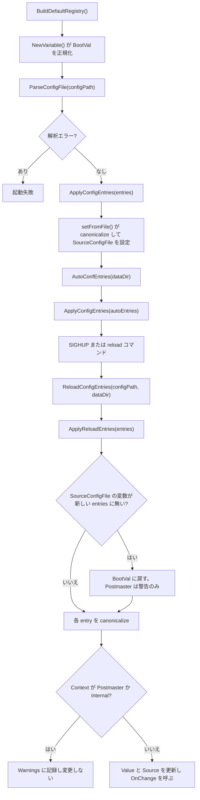
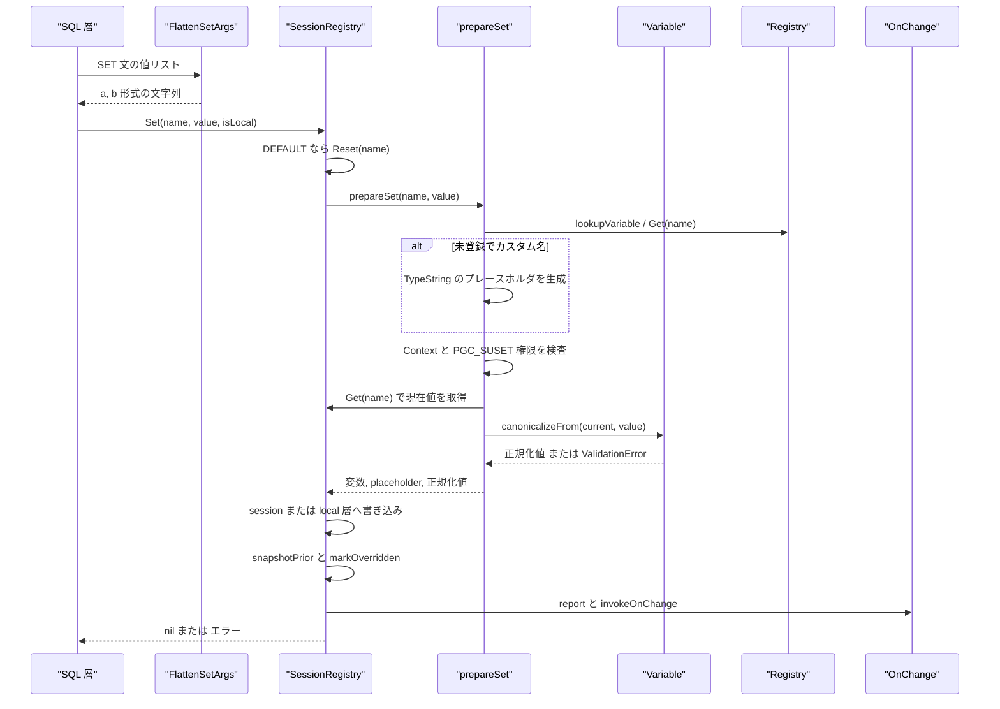

# GUC 設定システム

<details>
<summary>関連ソースファイル</summary>

- [`internal/utils/misc/guc.go`](https://github.com/ryogrid/goopg/blob/19856410e8d497d59787e1ab35a2febb3f5953d6/internal/utils/misc/guc.go)
- [`internal/utils/misc/session.go`](https://github.com/ryogrid/goopg/blob/19856410e8d497d59787e1ab35a2febb3f5953d6/internal/utils/misc/session.go)
- [`internal/utils/misc/defaults.go`](https://github.com/ryogrid/goopg/blob/19856410e8d497d59787e1ab35a2febb3f5953d6/internal/utils/misc/defaults.go)
- [`internal/utils/misc/parser.go`](https://github.com/ryogrid/goopg/blob/19856410e8d497d59787e1ab35a2febb3f5953d6/internal/utils/misc/parser.go)
- [`internal/utils/misc/alter_system.go`](https://github.com/ryogrid/goopg/blob/19856410e8d497d59787e1ab35a2febb3f5953d6/internal/utils/misc/alter_system.go)
- [`internal/utils/misc/config_array.go`](https://github.com/ryogrid/goopg/blob/19856410e8d497d59787e1ab35a2febb3f5953d6/internal/utils/misc/config_array.go)
- [`internal/utils/misc/set_args.go`](https://github.com/ryogrid/goopg/blob/19856410e8d497d59787e1ab35a2febb3f5953d6/internal/utils/misc/set_args.go)
- [`internal/utils/misc/session_save_level.go`](https://github.com/ryogrid/goopg/blob/19856410e8d497d59787e1ab35a2febb3f5953d6/internal/utils/misc/session_save_level.go)
- [`internal/utils/misc/session_set_privilege.go`](https://github.com/ryogrid/goopg/blob/19856410e8d497d59787e1ab35a2febb3f5953d6/internal/utils/misc/session_set_privilege.go)
- [`internal/utils/misc/datestyle.go`](https://github.com/ryogrid/goopg/blob/19856410e8d497d59787e1ab35a2febb3f5953d6/internal/utils/misc/datestyle.go)
- [`internal/utils/misc/timezone_check.go`](https://github.com/ryogrid/goopg/blob/19856410e8d497d59787e1ab35a2febb3f5953d6/internal/utils/misc/timezone_check.go)
- [`internal/utils/misc/tz_canonical.go`](https://github.com/ryogrid/goopg/blob/19856410e8d497d59787e1ab35a2febb3f5953d6/internal/utils/misc/tz_canonical.go)
- [`internal/utils/misc/timestamptz_out.go`](https://github.com/ryogrid/goopg/blob/19856410e8d497d59787e1ab35a2febb3f5953d6/internal/utils/misc/timestamptz_out.go)
- [`internal/utils/misc/encoding_guc.go`](https://github.com/ryogrid/goopg/blob/19856410e8d497d59787e1ab35a2febb3f5953d6/internal/utils/misc/encoding_guc.go)
- [`internal/utils/misc/recovery_target.go`](https://github.com/ryogrid/goopg/blob/19856410e8d497d59787e1ab35a2febb3f5953d6/internal/utils/misc/recovery_target.go)
- [`internal/utils/misc/goopg_gucs.go`](https://github.com/ryogrid/goopg/blob/19856410e8d497d59787e1ab35a2febb3f5953d6/internal/utils/misc/goopg_gucs.go)
- [`internal/utils/misc/sample.go`](https://github.com/ryogrid/goopg/blob/19856410e8d497d59787e1ab35a2febb3f5953d6/internal/utils/misc/sample.go)
- [`internal/utils/misc/version.go`](https://github.com/ryogrid/goopg/blob/19856410e8d497d59787e1ab35a2febb3f5953d6/internal/utils/misc/version.go)
- [`internal/utils/misc/pg_gucs_gen.go`](https://github.com/ryogrid/goopg/blob/19856410e8d497d59787e1ab35a2febb3f5953d6/internal/utils/misc/pg_gucs_gen.go)

</details>

GUC 設定システムは、`postgresql.conf` / `postgresql.auto.conf` の読み込み、GUC 名の登録と既定値の管理、値の正規化・検証、セッションおよびトランザクション単位の `SET` / `SET LOCAL` の重ね合わせ、`SHOW` / `ALTER SYSTEM` / SIGHUP リロードを一貫した一つの層で扱う。実装は `internal/utils/misc` パッケージにあり、中心は [`internal/utils/misc/guc.go:Registry`](https://github.com/ryogrid/goopg/blob/19856410e8d497d59787e1ab35a2febb3f5953d6/internal/utils/misc/guc.go) と [`internal/utils/misc/session.go:SessionRegistry`](https://github.com/ryogrid/goopg/blob/19856410e8d497d59787e1ab35a2febb3f5953d6/internal/utils/misc/session.go) である。コンポーネント全体の位置づけは [13 ユーティリティとランタイム](../13-Utilities.md) を参照。

## 責務

- **既定レジストリの構築**: [`internal/utils/misc/defaults.go:BuildDefaultRegistry`](https://github.com/ryogrid/goopg/blob/19856410e8d497d59787e1ab35a2febb3f5953d6/internal/utils/misc/defaults.go) が PostgreSQL 18.3 の `guc_tables.c` を根拠に 200 を超える GUC を登録する。型・コンテキスト・スコープ・単位・範囲・列挙値・検証フックをここで宣言する。
- **設定ファイルの構文解析**: [`internal/utils/misc/parser.go:ParseConfigFile`](https://github.com/ryogrid/goopg/blob/19856410e8d497d59787e1ab35a2febb3f5953d6/internal/utils/misc/parser.go) が `name = value`、引用符、コメント、`include` / `include_if_exists` / `include_dir` を解決し、ソース順の [`ConfigEntry`](https://github.com/ryogrid/goopg/blob/19856410e8d497d59787e1ab35a2febb3f5953d6/internal/utils/misc/parser.go) 列を返す。
- **正規化と検証**: [`internal/utils/misc/guc.go:Variable.canonicalizeFrom`](https://github.com/ryogrid/goopg/blob/19856410e8d497d59787e1ab35a2febb3f5953d6/internal/utils/misc/guc.go) が bool / int / real / string / enum の各型を正規化し、単位接尾辞の変換、範囲検査、列挙値検査、`CheckFn` 呼び出しを行う。失敗は原則 [`ValidationError`](https://github.com/ryogrid/goopg/blob/19856410e8d497d59787e1ab35a2febb3f5953d6/internal/utils/misc/guc.go) となり、SQLSTATE と HINT を運ぶ。
- **セッション層**: [`internal/utils/misc/session.go:SessionRegistry`](https://github.com/ryogrid/goopg/blob/19856410e8d497d59787e1ab35a2febb3f5953d6/internal/utils/misc/session.go) がグローバル値の上に `session`（`SET`）と `local`（`SET LOCAL`）を重ね、参照時は local → session → global の順で解決する。起動パケットの値は `startup` に保持し、`RESET` の復元先（PostgreSQL の `reset_val`）にする。
- **トランザクション連動**: `BeginTransaction` / `BeginImplicitTransaction` / `EndTransaction` / `EndImplicitTransaction` が `SET LOCAL` の破棄と、ロールバック時の `SET` の巻き戻しを担う。ルーチンの `SET` 句は [`internal/utils/misc/session_save_level.go:PushSaveLevel`](https://github.com/ryogrid/goopg/blob/19856410e8d497d59787e1ab35a2febb3f5953d6/internal/utils/misc/session_save_level.go) のネストレベルで囲む。
- **権限**: [`internal/utils/misc/session_set_privilege.go:checkSetPrivilege`](https://github.com/ryogrid/goopg/blob/19856410e8d497d59787e1ab35a2febb3f5953d6/internal/utils/misc/session_set_privilege.go) が `PGC_SUSET` の GUC に対してスーパーユーザーまたは `pg_parameter_acl` の `SET` 権限を要求する。
- **永続化と再読み込み**: [`internal/utils/misc/alter_system.go:AlterSystemSetConfigFile`](https://github.com/ryogrid/goopg/blob/19856410e8d497d59787e1ab35a2febb3f5953d6/internal/utils/misc/alter_system.go) が `postgresql.auto.conf` を書き換え、[`ReloadConfigEntries`](https://github.com/ryogrid/goopg/blob/19856410e8d497d59787e1ab35a2febb3f5953d6/internal/utils/misc/alter_system.go) と [`ApplyReloadEntries`](https://github.com/ryogrid/goopg/blob/19856410e8d497d59787e1ab35a2febb3f5953d6/internal/utils/misc/guc.go) が SIGHUP / reload 時の差分適用を行う。
- **値の意味づけ**: `DateStyle` の部分指定マージ（[`mergeDateStyle`](https://github.com/ryogrid/goopg/blob/19856410e8d497d59787e1ab35a2febb3f5953d6/internal/utils/misc/datestyle.go)）、`TimeZone` / `log_timezone` のタイムゾーン名・POSIX 仕様・INTERVAL 解決（[`checkTimeZone`](https://github.com/ryogrid/goopg/blob/19856410e8d497d59787e1ab35a2febb3f5953d6/internal/utils/misc/timezone_check.go)）、`client_encoding` の正規名解決（[`encodingNameToCanonical`](https://github.com/ryogrid/goopg/blob/19856410e8d497d59787e1ab35a2febb3f5953d6/internal/utils/misc/encoding_guc.go)）を提供する。日付時刻の出力側は [13.2 データ型と ADT](13.2-ADT.md)、エンコーディングの詳細は [13.4 エンコーディングとロケール](13.4-Encoding.md) を参照。

登録されていることと、その値が実際にエンジンで使われることは別である。`defaults.go` のコメントが明示するとおり、`jit*`、`lc_*`、`default_table_access_method`、`default_toast_compression`、`password_encryption` などには、`SET` / `SHOW` を通すための受け入れ専用（no-op）のものがある。TOAST 圧縮の実装は [13.6 PGLZ 圧縮と TOAST](13.6-PGLZ-and-TOAST.md) を参照。

## 処理フロー

### 起動時とリロード

起動時はまず既定レジストリを作り、`postgresql.conf`、続いて `postgresql.auto.conf` の順に適用する。後者が勝つのは PostgreSQL の `ProcessConfigFileInternal` と同じ順序である。起動時のファイル適用は [`setFromFile`](https://github.com/ryogrid/goopg/blob/19856410e8d497d59787e1ab35a2febb3f5953d6/internal/utils/misc/guc.go) を通るため、`Variable.Set` のコンテキスト制限を受けず、`PGC_POSTMASTER` の値も設定できる。リロードは逆に、実行中サーバーを壊さないよう `PGC_POSTMASTER` と `PGC_INTERNAL` を変更せず警告に落とす。



`ApplyReloadEntries` の最初の走査は、現在 `SourceConfigFile` であるのに新しいファイル集合に現れない変数を `BootVal` に戻す。これは `ALTER SYSTEM RESET` が `pg_reload_conf()` で効く経路であり、`present` マップは entry 名を小文字化して作る。`Postmaster` コンテキストの変数はこの復元でも警告だけを出して値を維持し、`Internal` は黙ってスキップする ([`guc.go:ApplyReloadEntries`](https://github.com/ryogrid/goopg/blob/19856410e8d497d59787e1ab35a2febb3f5953d6/internal/utils/misc/guc.go))。

### `SET` の実行経路

SQL の `SET name = value` は、まず値リストを [`FlattenSetArgs`](https://github.com/ryogrid/goopg/blob/19856410e8d497d59787e1ab35a2febb3f5953d6/internal/utils/misc/set_args.go) で一つの文字列にし、[`SessionRegistry.Set`](https://github.com/ryogrid/goopg/blob/19856410e8d497d59787e1ab35a2febb3f5953d6/internal/utils/misc/session.go) に渡す。`value` が `DEFAULT` の場合は `Reset` に分岐する。`prepareSet` が変数の解決、コンテキスト検査、`PGC_SUSET` 権限検査、現在値に対する正規化を行い、成功時だけ session 層または local 層へ書き込む。



`SET` の書き込み側では、`isLocal` が真なら `s.local[key]` を更新するだけで、現在のトランザクションが終わるまで保持する。偽なら `snapshotPrior(key)` でロールバック用の事前値を一度だけ記録し、`s.session[key]` を更新して `s.local[key]` を削除する。これは PostgreSQL の「`SET` はセッション値の変更と同時に既存の `LOCAL` を暗黙に解除する」挙動に対応する。最後に `report`（`FlagReport` の `ParameterStatus`）と `global.invokeOnChange` を呼ぶため、コールバックは更新後の実効値を `Get` で観測できる ([`session.go:Set`](https://github.com/ryogrid/goopg/blob/19856410e8d497d59787e1ab35a2febb3f5953d6/internal/utils/misc/session.go))。

## 主要ファイル

| ファイル | 役割 |
|---|---|
| `internal/utils/misc/guc.go` | 型・コンテキスト・単位・フラグの定義、`Variable` の正規化と `Registry`、起動時・リロード時の適用。`guc.go:Variable`, `guc.go:canonicalizeFrom`, `guc.go:ApplyConfigEntries`, `guc.go:ApplyReloadEntries` |
| `internal/utils/misc/session.go` | セッション / トランザクション層、起動値（`reset_val`）、`SET` / `RESET` / `SHOW` 用の参照。`session.go:SessionRegistry`, `session.go:Set`, `session.go:SetStartup`, `session.go:GetDisplay` |
| `internal/utils/misc/defaults.go` | 既定レジストリと PostgreSQL 由来の値・範囲・列挙・`CheckFn`。`defaults.go:BuildDefaultRegistry` |
| `internal/utils/misc/parser.go` | `postgresql.conf` の字句解析、引用符解除、`include*` の再帰展開。`parser.go:ParseConfigFile`, `parser.go:parseConfigLine` |
| `internal/utils/misc/alter_system.go` | `ALTER SYSTEM` の検証と `postgresql.auto.conf` のクラッシュセーフな書き換え、リロード対象の合成。`alter_system.go:AlterSystemSetConfigFile`, `alter_system.go:ReloadConfigEntries` |
| `internal/utils/misc/config_array.go` | `pg_proc.proconfig` / `pg_db_role_setting` 用の名前検証・正規化と、PostgreSQL 組み込み名テーブル。`config_array.go:ConfigArrayItem`, `config_array.go:CanonicalGUCName` |
| `internal/utils/misc/set_args.go` | `SET` の値リストを一つの文字列へ平坦化し、`GUC_LIST_INPUT` / `GUC_LIST_QUOTE` を適用。`set_args.go:FlattenSetArgs` |
| `internal/utils/misc/session_save_level.go` | ルーチンの `SET` 句を囲む GUC ネストレベル。`session_save_level.go:PushSaveLevel`, `session_save_level.go:PopSaveLevel` |
| `internal/utils/misc/session_set_privilege.go` | `PGC_SUSET` の権限検査と `SECURITY DEFINER` 用のロールスタック。`session_set_privilege.go:SetPrivilegeHook`, `session_set_privilege.go:checkSetPrivilege` |
| `internal/utils/misc/datestyle.go` | `DateStyle` の部分指定マージ、`ParseDateStyleValue`、日付・タイムスタンプの整形。`datestyle.go:mergeDateStyle`, `datestyle.go:FormatTimestamp` |
| `internal/utils/misc/timezone_check.go` | `TimeZone` / `log_timezone` の検証、INTERVAL・数値オフセット・POSIX TZ の解釈、`ZoneLocation`。`timezone_check.go:checkTimeZone`, `timezone_check.go:ZoneLocation` |
| `internal/utils/misc/tz_canonical.go` | tzdata ファイルを大文字小文字を無視して探索し、ディスク上の綴りを返すキャッシュ。`tz_canonical.go:lookupZoneFile` |
| `internal/utils/misc/timestamptz_out.go` | セッション `TimeZone` を `*time.Location` に解決し、`timestamptz` をゾーン付きで出力。`timestamptz_out.go:sessionLocation`, `timestamptz_out.go:FormatTimestampTZ` |
| `internal/utils/misc/encoding_guc.go` | `client_encoding` の正規名・別名解決と検証。`encoding_guc.go:encodingNameToCanonical`, `encoding_guc.go:checkClientEncoding` |
| `internal/utils/misc/recovery_target.go` | `recovery_target_timeline` / `recovery_target_lsn` / `recovery_target_xid` の解析とチェック。`recovery_target.go:ParseRecoveryTargetTimeline`, `recovery_target.go:ParsePGLSN` |
| `internal/utils/misc/goopg_gucs.go` | goopg 専用の `goopg.` 名前空間の定数。`goopg_gucs.go:GoopgWalSenderMemoryBuffer`, `goopg_gucs.go:GoopgEnableOpportunisticPrune` |
| `internal/utils/misc/sample.go` | `postgresql.conf.sample` を `go:embed` で返す。`sample.go:SampleConfig` |
| `internal/utils/misc/version.go` | 対象 PostgreSQL バージョンとカタログバージョン、テーブルスペースのバージョンディレクトリ名。`version.go:MajorVersion`, `version.go:CatalogVersionNo` |
| `internal/utils/misc/pg_gucs_gen.go` | PostgreSQL 18.3 の全組み込み GUC 406 件の名前・コンテキスト表。`pg_gucs_gen.go:pgGUCs` |

## 公開 API / エントリポイント

```go
func BuildDefaultRegistry() *Registry
func ParseConfigFile(path string) ([]ConfigEntry, error)
func ParseConfigReader(r io.Reader, label string) ([]ConfigEntry, error)
func (r *Registry) Register(v *Variable) error
func (r *Registry) MustRegister(v *Variable)
func (r *Registry) Get(name string) (*Variable, bool)
func (r *Registry) Set(name, value string, source Source) error
func (r *Registry) ApplyConfigEntries(entries []ConfigEntry) error
func (r *Registry) ApplyReloadEntries(entries []ConfigEntry) ReloadResult
func (r *Registry) AlterSystemSetConfigFile(dataDir, name, value string, set, resetAll bool) error
func AutoConfEntries(dataDir string) ([]ConfigEntry, error)
func ReloadConfigEntries(configPath, dataDir string) ([]ConfigEntry, error)

func NewSessionRegistry(global *Registry) *SessionRegistry
func (s *SessionRegistry) Get(name string) (*Variable, string, bool)
func (s *SessionRegistry) GetDisplay(name string) (*Variable, string, bool)
func (s *SessionRegistry) Set(name, value string, isLocal bool) error
func (s *SessionRegistry) SetStartup(name, value string) error
func (s *SessionRegistry) SetInternal(name, value string) error
func (s *SessionRegistry) Reset(name string) error
func (s *SessionRegistry) ResetAll()
func (s *SessionRegistry) BeginTransaction()
func (s *SessionRegistry) EndTransaction(committed bool)
func (s *SessionRegistry) BeginImplicitTransaction(implicitBlock bool)
func (s *SessionRegistry) EndImplicitTransaction(committed bool)
func (s *SessionRegistry) PushSaveLevel(config []string) (int, error)
func (s *SessionRegistry) PopSaveLevel(level int)
func (s *SessionRegistry) AlterSystem(dataDir, name, value string, set, resetAll bool) error

func FlattenSetArgs(name string, args []SetArg) (string, error)
func ConfigArrayItem(name string, value *string) (string, error)
func CanonicalGUCName(name string) string
func ZoneLocation(zone string) *time.Location
func FormatTimestampTZ(t time.Time, style, order, zone string) string
```

`Registry.Set` はグローバル値への直接書き込みであり、`SourceSession` / `SourceLocal` を渡してもその層には入らない。セッションの `SET` は必ず `SessionRegistry.Set` を使う。`SHOW` は `GetDisplay` を使うことで、単位付き整数を `77MB` のような表示形式に変換する。`AllDisplay` は `FlagNoShowAll` の変数を `SHOW ALL` から除外する。内部の算術に生の正規化値が必要な呼び出し元は `Get` を使う、という分担が [`session.go:GetDisplay`](https://github.com/ryogrid/goopg/blob/19856410e8d497d59787e1ab35a2febb3f5953d6/internal/utils/misc/session.go) に明記されている。

## 主要データ構造

### `Variable` — 1 個の GUC 定義と現在値

[`internal/utils/misc/guc.go:Variable`](https://github.com/ryogrid/goopg/blob/19856410e8d497d59787e1ab35a2febb3f5953d6/internal/utils/misc/guc.go#L175-L195):

```go
type Variable struct {
	Name        string
	Type        Type
	Unit        Unit
	BootVal     string
	Value       string // current effective value, in canonical string form
	Source      Source
	Context     Context
	Scope       Scope
	Flags       VarFlag
	MinVal      float64 // valid for Int/Real
	MaxVal      float64
	EnumOptions []string            // valid for Enum
	// EnumHidden maps a hidden config_enum_entry name (hidden = true in
	// guc_tables.c) to the visible option with the same value: accepted
	// on input, stored and shown as that option, and never listed in
	// enumvals or the error HINT (`debug` -> `debug2` for the message-level
	// enums). Keys are lower case.
	EnumHidden map[string]string
	CheckFn    func(string) error // optional validation of the canonical value, every type
}
```

- `BootVal` は作者向けの生リテラル（例: `shared_buffers` の `"128MB"`、`search_path` の `"$user", public`）で、`Value` は `canonicalize` 後の文字列（例えば `shared_buffers` は KB 数の `"131072"`）である。この区別は重要で、`ExplainVariables` は比較時に `BootVal` を改めて正規化する ([`session.go:ExplainVariables`](https://github.com/ryogrid/goopg/blob/19856410e8d497d59787e1ab35a2febb3f5953d6/internal/utils/misc/session.go))。
- `Type` は `TypeBool` / `TypeInt` / `TypeReal` / `TypeString` / `TypeEnum`。`Unit` が `UnitNone` でない整数 GUC は接尾辞付き入力を受け付け、`UnitBlocks` は `blockSize = 8192` バイトのブロック数としてバイト系の単位変換に参加する。
- `Context` は制限の強い順に `ContextInternal`（0）から `ContextUserset`（6）まで並ぶ。`SET` / `SET LOCAL` を受け付けるのは `Context >= ContextSuset` のものだけであり、この順序が検査の根拠になっている。
- `Source` は値の由来（既定・環境変数・設定ファイル・コマンドライン・セッション・ローカル）。`Scope` は現状サーバー / セッション / トランザクションの区別を記録するビットマスクで、コメントにあるとおり Database / Role 層はまだカタログに接続されていない。
- `MinVal` / `MaxVal` の範囲検査は `MinVal != 0 || MaxVal != 0` のときだけ有効になる。したがって「0 から 0 だけを許す」ような制約は範囲では表現できず、`ssl_renegotiation_limit` のように `CheckFn` で実装する ([`defaults.go:registerSSLGUCs`](https://github.com/ryogrid/goopg/blob/19856410e8d497d59787e1ab35a2febb3f5953d6/internal/utils/misc/defaults.go))。
- `EnumHidden` は隠し enum 名を可視の値へ写す。キーは小文字で、入力時だけ受け付けて `EnumOptions` やエラー HINT には出さない。代表例は message-level enum の `debug` → `debug2`。
- `CheckFn` は型別の正規化が終わった**正規化後の値**を受け取る。`NewVariable` は起動値の検証に失敗したら panic する。起動値はユーザー入力ではなく作者の定義ミスだからである。

不変条件として、`Value` は常に `canonicalize` 済みで、`NewVariable` が `BootVal` から初期 `Value` を作る際にも必ず通る。`Variable.Set` は `Value` をベースラインに `canonicalize` するが、セッション層のように実効値がグローバル値と異なる場合は `canonicalizeFrom(current, value)` を使う。`DateStyle` だけが現在値に依存する型であり、部分指定を現在の実効値へマージする。

### `Registry` — プロセス全体の GUC 表

[`internal/utils/misc/guc.go:Registry`](https://github.com/ryogrid/goopg/blob/19856410e8d497d59787e1ab35a2febb3f5953d6/internal/utils/misc/guc.go#L575-L578):

```go
type Registry struct {
	vars     map[string]*Variable
	onChange map[string]func(value string) // M0054-0006e-followup
}
```

`vars` のキーは常に `strings.ToLower(v.Name)` で、表示用の `v.Name` は登録時の綴り（`DateStyle`、`TimeZone`）を保持する。`Get` はまず生の名前で引き、失敗したときだけ小文字化する高速化を行っている。`Register` は同名・同型の再登録を許可するが、型が違えばエラーにする。`onChange` は名前ごとに高々 1 個のコールバックで、再登録は置き換えである。`Registry` は goroutine-safe ではなく、リスナー起動前の構築か、`SessionRegistry` 経由のアクセスが前提とされている。

### `SessionRegistry` — セッション層とトランザクション層

[`internal/utils/misc/session.go:SessionRegistry`](https://github.com/ryogrid/goopg/blob/19856410e8d497d59787e1ab35a2febb3f5953d6/internal/utils/misc/session.go#L23-L75):

```go
type SessionRegistry struct {
	global  *Registry
	id      uint64            // stable, process-unique per-session identity (see UniqueID)
	session map[string]string // session-scoped values, canonicalised
	local   map[string]string // transaction-scoped values, canonicalised
	// startup is the per-session RESET target (PG's reset_val): the value the
	// connection supplied at session start (startup packet / environment, PG's
	// PGC_S_CLIENT source). SetStartup is its only writer; Reset restores it
	// when present instead of falling through to the global default. Mirrors
	// guc.c's RESET restoring reset_val rather than boot_val
	// (postgres/src/backend/utils/misc/guc.c:3308-3309, :3727). Design
	// 0134-0075-guc-reset-session-start-value.
	startup map[string]string
	custom  map[string]*Variable
	inTx    bool

	// xactOpen marks an autocommit transaction in progress — a simple-query
	// message or an extended-protocol Execute that runs outside an explicit
	// block (BeginImplicitTransaction). Like an explicit transaction it
	// journals plain SET in txPrior and drops the local layer when it ends,
	// which is AtEOXact_GUC for transactions the client never opened.
	xactOpen bool
	// implicitBlock marks the implicit transaction block PostgreSQL opens for
	// a simple-query message holding more than one statement
	// (exec_simple_query's use_implicit_block). SET LOCAL there is no
	// out-of-block use and draws no warning.
	implicitBlock bool

	// txPrior is the undo journal for plain SET while inTx: for each
	// session-layer key mutated since BeginTransaction, the value that key
	// held in s.session before the first mutation in this transaction. A
	// nil *string means the key was absent from s.session at that point (so
	// EndTransaction's restore must delete, not write ""). Mirrors PostgreSQL's
	// GucStack / AtEOXact_GUC(isCommit=false) at goopg's flat, non-nested
	// fidelity. Design 0134-0001-p6-guc-transaction-rollback.
	txPrior map[string]*string

	// saveLevels are the GUC nest levels open for routines with SET clauses
	// (PushSaveLevel / PopSaveLevel), innermost last.
	saveLevels []*gucSaveLevel

	// currentRole / mayGrant / roleStack back the PGC_SUSET privilege check
	// (session_set_privilege.go). M0146-0158.
	currentRole func() string
	mayGrant    func(role, name string) bool
	roleStack   []string

	// onReportableChange, if non-nil, is called whenever a Report-flagged
	// variable's effective value changes. The caller (the server) wires
	// this to a ParameterStatus emitter so libpq clients see auto-tracked
	// settings update mid-session.
	onReportableChange func(name, value string)
}
```

- 参照の優先順位は `local` → `session` → グローバル `Registry` → `custom`。`custom` は未登録のドット付き名に対して `SET` 時に生成されるプレースホルダで、`TypeString`、`ContextUserset`、`FlagCustom | FlagDisallowInFile | FlagNotInSample` を持つ。
- `startup` は `SetStartup` だけが書く。`SET` は決してここへ書かない。`RESET` は `startup` に値があればそれを `session` に戻し、なければ `session` から削除してグローバル値へフォールスルーする。これが PostgreSQL の `reset_val` と `boot_val` の区別に対応する。
- `txPrior` はトランザクション開始後の**最初の**変更時だけ記録する undo ジャーナル。値が `nil` なら「変更前は session 層に存在しなかった」ことを意味し、ロールバック時は削除する。同じキーを 2 回変更しても事前値は最初の 1 回分だけが残る。
- `inTx` は明示的 `BEGIN`、`xactOpen` は暗黙トランザクション（単一メッセージ実行や extended protocol の `Execute`）を表す。`implicitBlock` は複数文の simple-query メッセージが作る暗黙ブロックで、`SET LOCAL` の「トランザクションブロック外」警告を抑えるために使われる。
- `saveLevels` の各要素は `gucSaveLevel` で、ルーチンの `SET` 句が開いたネストを表す。`currentRole` / `mayGrant` / `roleStack` は `PGC_SUSET` の権限判定、`onReportableChange` は `FlagReport` の `ParameterStatus` 送出に使う。
- `SessionRegistry` は接続ハンドラの goroutine ごとに 1 個という前提で、内部にロックを持たない。`id` だけは `sessionIDCounter` からプロセス一意に発行される。

### `gucSaveLevel` — ルーチン `SET` 句の 1 レベル

[`internal/utils/misc/session_save_level.go:gucSaveLevel`](https://github.com/ryogrid/goopg/blob/19856410e8d497d59787e1ab35a2febb3f5953d6/internal/utils/misc/session_save_level.go#L24-L29):

```go
type gucSaveLevel struct {
	keys       []string           // saved keys (lower-cased), in apply order
	prior      map[string]*string // local-layer value before the level; nil = none
	overridden map[string]bool    // a plain SET / RESET replaced the saved value
	reported   map[string]bool    // a ParameterStatus went out for the key meanwhile
}
```

`keys` の順序は適用順で、`PopSaveLevel` は逆順に復元する。`prior` の `nil` はそのキーが local 層になかったことを示す。`overridden` が真のキーは、ルーチン内の素の `SET` / `RESET` が値を持ち越すため復元しない。`reported` はルーチン内で `ParameterStatus` を送ったキーを覚え、復元時にもクライアントへ通知するために使う。

### `ConfigEntry` — 設定ファイル 1 行

[`internal/utils/misc/parser.go:ConfigEntry`](https://github.com/ryogrid/goopg/blob/19856410e8d497d59787e1ab35a2febb3f5953d6/internal/utils/misc/parser.go#L20-L25):

```go
type ConfigEntry struct {
	Name       string
	Value      string
	SourceFile string
	SourceLine int
}
```

`Name` は `parseStream` で `strings.ToLower` 済みであり、後段の `Registry` のキーとそのまま一致する。`SourceFile` は include 展開後の実ファイル（絶対パス）、`SourceLine` はそのファイル内の行番号で、エラーメッセージの `file:line` を作る。エントリの順序は include をまたいで保持され、後から現れた値が前の値を上書きする。

## 内部構造

### 検証と正規化の実際

- **bool**: `on` / `true` / `yes` / `1` / `t` を真、`off` / `false` / `no` / `0` / `f` を偽として受け付け、保存値は `on` / `off` に揃える ([`parseBoolish`](https://github.com/ryogrid/goopg/blob/19856410e8d497d59787e1ab35a2febb3f5953d6/internal/utils/misc/guc.go))。
- **int**: [`parseIntWithUnit`](https://github.com/ryogrid/goopg/blob/19856410e8d497d59787e1ab35a2febb3f5953d6/internal/utils/misc/guc.go) が符号・数字の後に単位接尾辞を読み、`unitFromSuffix` の `b` / `kb` / `mb` / `gb` / `tb` / `ms` / `s` / `min` / `h` / `d` を [`convertUnit`](https://github.com/ryogrid/goopg/blob/19856410e8d497d59787e1ab35a2febb3f5953d6/internal/utils/misc/guc.go) でネイティブ単位に変換する。バイト系と時間系の相互変換はエラーになる。乗算は [`scaleUnit`](https://github.com/ryogrid/goopg/blob/19856410e8d497d59787e1ab35a2febb3f5953d6/internal/utils/misc/guc.go) がオーバーフローを検査する。
- **real**: [`realNumericPrefixLen`](https://github.com/ryogrid/goopg/blob/19856410e8d497d59787e1ab35a2febb3f5953d6/internal/utils/misc/guc.go) が `strtod` 相当の最長数値接頭辞を探すため、`1e-2` のような科学記法も数値部と単位部に正しく分かれる。`NaN` / `Inf` は拒否される。時間単位への変換は `us` の 0.001 倍を含む。
- **string**: `client_encoding` は [`encodingNameToCanonical`](https://github.com/ryogrid/goopg/blob/19856410e8d497d59787e1ab35a2febb3f5953d6/internal/utils/misc/encoding_guc.go) の結果を保存し、`TimeZone` / `log_timezone` は [`checkTimeZone`](https://github.com/ryogrid/goopg/blob/19856410e8d497d59787e1ab35a2febb3f5953d6/internal/utils/misc/timezone_check.go) / [`checkLogTimeZone`](https://github.com/ryogrid/goopg/blob/19856410e8d497d59787e1ab35a2febb3f5953d6/internal/utils/misc/timezone_check.go) の返す正規名を保存する。それ以外は原則そのまま。
- **enum**: 大文字小文字を無視して `EnumOptions` を探し、見つからなければ `EnumHidden` を引き、`on` と `off` を両方持つ enum では bool の別名も受け付ける。失敗時は `invalid value for parameter ...` をメッセージにし、`Available values: ...` を**別の HINT** として返す ([`guc.go:canonicalizeType`](https://github.com/ryogrid/goopg/blob/19856410e8d497d59787e1ab35a2febb3f5953d6/internal/utils/misc/guc.go))。
- **表示**: [`Variable.FormatDisplayValue`](https://github.com/ryogrid/goopg/blob/19856410e8d497d59787e1ab35a2febb3f5953d6/internal/utils/misc/guc.go) は `TypeInt` かつ `Unit` 付きの正の値だけを `kB` / `MB` / `GB` / `TB` または `ms` / `s` / `min` / `h` / `d` に整形する。`0` と負値はそのまま返すため、`statement_timeout = 0` の `SHOW` は `0` になる。`UnitBlocks` の `kB` 行だけは乗数が負で、ブロック数に 8 を掛けて `512kB` のように表示する。

### 設定ファイルの構文と include

[`parseConfigLine`](https://github.com/ryogrid/goopg/blob/19856410e8d497d59787e1ab35a2febb3f5953d6/internal/utils/misc/parser.go) は `name = value` の `=` を省略可能とし、シングルクォート（`''` はリテラルの `'`、バックスラッシュは `\b` `\f` `\n` `\r` `\t`、最大 3 桁の八進、それ以外はその文字自身）とダブルクォートを読む。裸の値は空白区切りで複数トークンを 1 個のスペースで再結合するため、`DateStyle = ISO, MDY` も一つの値として扱える。`include_dir` はディレクトリ直下の `.conf` だけを辞書順に読み、サブディレクトリへは自動で降りない。include の循環は「現在の展開スタック」に同じ絶対パスが現れた場合に検出する。

### `ALTER SYSTEM` と `postgresql.auto.conf`

[`AlterSystemSetConfigFile`](https://github.com/ryogrid/goopg/blob/19856410e8d497d59787e1ab35a2febb3f5953d6/internal/utils/misc/alter_system.go) は、データディレクトリが空なら `0A000` で拒否する。既知の変数では `ContextInternal` と `FlagDisallowInFile` を `55P02` で拒否し、`SET` 時は正規化と `CheckFn` を通す。未知の名前はドット付きのカスタム名形式だけを許し、それ以外は `42704` にする。`SET` 値に改行が含まれると `22023` で拒否する（設定ファイル文法に改行のエスケープがないため）。`resetAll` は既存エントリをすべて捨て、ヘッダだけのファイルを書く。

書き込みは `autoFileLock`（プロセス内の `sync.Mutex`）の下で、既存ファイルを [`ParseConfigFile`](https://github.com/ryogrid/goopg/blob/19856410e8d497d59787e1ab35a2febb3f5953d6/internal/utils/misc/parser.go) で読み、[`replaceAutoConfigValue`](https://github.com/ryogrid/goopg/blob/19856410e8d497d59787e1ab35a2febb3f5953d6/internal/utils/misc/alter_system.go) で同名エントリを大小無視で除去して新しい値を末尾に追加する。その後、一時ファイルを `0600` で作成し、内容を書いて `fsync`、`rename`、ディレクトリの `fsync` を行う。値は [`escapeSingleQuotesASCII`](https://github.com/ryogrid/goopg/blob/19856410e8d497d59787e1ab35a2febb3f5953d6/internal/utils/misc/alter_system.go) で `'` と `\` を二重化し、`ParseConfigFile` のシングルクォート読み取りと往復できる形にする。

### タイムゾーンと日付書式

`TimeZone` は名前だけではなく、`INTERVAL '+02:00'` のような INTERVAL 形式、`-8` のような数値オフセット、`EST5EDT,M3.2.0,M11.1.0` のような POSIX TZ 仕様も受け付ける。`log_timezone` は INTERVAL や数値オフセットを受け付けず、[`zoneName`](https://github.com/ryogrid/goopg/blob/19856410e8d497d59787e1ab35a2febb3f5953d6/internal/utils/misc/timezone_check.go) が解決する tzdata 名または POSIX TZ 仕様だけを受け付ける。INTERVAL では月と日が拒否され、秒未満は切り捨てられる。数値と INTERVAL は `<-08>+08` のような固定オフセット名に変換され、名前は tzdata ファイルのディスク上の綴り（`utc` → `UTC`）または大文字化した POSIX 仕様になる。tzdata の探索は [`lookupZoneFile`](https://github.com/ryogrid/goopg/blob/19856410e8d497d59787e1ab35a2febb3f5953d6/internal/utils/misc/tz_canonical.go) がパス要素ごとに大小無視で照合し、見つかった名前と見つからなかった結果の両方を `sync.Map` にキャッシュする。`ZoneLocation` / [`sessionLocation`](https://github.com/ryogrid/goopg/blob/19856410e8d497d59787e1ab35a2febb3f5953d6/internal/utils/misc/timestamptz_out.go) は、解決できない値を UTC にフォールバックする。`timestamptz` の出力は [`FormatTimestampTZ`](https://github.com/ryogrid/goopg/blob/19856410e8d497d59787e1ab35a2febb3f5953d6/internal/utils/misc/timestamptz_out.go) がセッションゾーンへ変換してから `DateStyle` で整形し、ISO では数値オフセット、SQL / Postgres / German ではゾーン略称を付ける（略称を持たないゾーンは数値オフセットにフォールバックする）。

`DateStyle` は [`mergeDateStyle`](https://github.com/ryogrid/goopg/blob/19856410e8d497d59787e1ab35a2febb3f5953d6/internal/utils/misc/datestyle.go) が「表示スタイル（ISO / SQL / Postgres / German）」と「フィールド順（YMD / DMY / MDY）」を別々にマージする。`SET datestyle = 'SQL'` は現在の順序を保持し、`GERMAN` は明示的な順序指定がなければ DMY を選ぶ。`DEFAULT` は `BootVal` を `ParseDateStyleValue` で解釈し、既定のスタイルと順序を採用する。矛盾する指定（`ISO, SQL` など）はエラーになる。

### エンコーディング

`client_encoding` の正規化は、[`pgEncNames`](https://github.com/ryogrid/goopg/blob/19856410e8d497d59787e1ab35a2febb3f5953d6/internal/utils/misc/encoding_guc.go) の 42 個の正規名を [`cleanEncName`](https://github.com/ryogrid/goopg/blob/19856410e8d497d59787e1ab35a2febb3f5953d6/internal/utils/misc/encoding_guc.go)（英数字以外を除去して小文字化）で比較し、次に `pgEncAliases` を引く。`UTF-8`、`utf_8`、`UTF8` は同じキーになる。goopg は実際の文字コード変換を行わず、名前の妥当性検査だけを行う。

### 権限とカスタム GUC

`prepareSet` は `Context < ContextSuset` を [`cantChangeError`](https://github.com/ryogrid/goopg/blob/19856410e8d497d59787e1ab35a2febb3f5953d6/internal/utils/misc/guc.go) で拒否する。この関数はコンテキストごとに `cannot be changed`、`cannot be changed without restarting the server`、`cannot be changed now`、`cannot be set after connection start` を出し分け、SQLSTATE は `55P02` である。`PGC_SUSET` では [`checkSetPrivilege`](https://github.com/ryogrid/goopg/blob/19856410e8d497d59787e1ab35a2febb3f5953d6/internal/utils/misc/session_set_privilege.go) が現在ロールを見て、スーパーユーザー（`currentRole` が `""`）または `mayGrant` が真を返す場合だけ許可し、それ以外は `42501` を返す（フックが未設定なら検査しない）。`PushRole` / `PopRole` は `SECURITY DEFINER` ルーチンが所有者の権限で `SET` 句を適用するためのロールスタックである。`SetInternal` は `is_superuser` のような `ContextInternal` の値をバックエンド自身が session 層へ書くための経路で、コンテキスト検査も権限検査も行わない。クライアント入力を直接渡してはならない。

未登録名の `SET` は [`isCustomGUCName`](https://github.com/ryogrid/goopg/blob/19856410e8d497d59787e1ab35a2febb3f5953d6/internal/utils/misc/session.go) が受理する形（2 個以上のドット区切り、各要素は英字か `_` で始まり、以降は英数字か `_`）のときだけプレースホルダを作る。goopg 自身の設定は [`goopg_gucs.go`](https://github.com/ryogrid/goopg/blob/19856410e8d497d59787e1ab35a2febb3f5953d6/internal/utils/misc/goopg_gucs.go) の `goopg.wal_sender_memory_buffer` と `goopg.enable_opportunistic_prune` のように、PostgreSQL の拡張 GUC と同じドット名前空間に置かれている。

### `SET` の値リスト

[`FlattenSetArgs`](https://github.com/ryogrid/goopg/blob/19856410e8d497d59787e1ab35a2febb3f5953d6/internal/utils/misc/set_args.go) は [`builtinVarFlags`](https://github.com/ryogrid/goopg/blob/19856410e8d497d59787e1ab35a2febb3f5953d6/internal/utils/misc/set_args.go) で変数のフラグを一度だけ構築した表から引き、`FlagListInput` がなければ引数がちょうど 1 個であることを要求する。複数要素は `, ` で連結し、`FlagListQuote` がある場合は文字列要素を `sqlkeywords.QuoteIdentifier` に通す。そのため `search_path = 'a b', public` は `"a b", public` のように後段のリスト分割に耐える形になる。未登録のカスタム名はフラグ 0 として扱われるため、複数引数は受け付けない。

### リカバリターゲットの解析

`recovery_target_timeline` は [`ParseRecoveryTargetTimeline`](https://github.com/ryogrid/goopg/blob/19856410e8d497d59787e1ab35a2febb3f5953d6/internal/utils/misc/recovery_target.go) が `current` / `latest` を特別扱いし、それ以外は glibc の `strtoul(s, NULL, 0)` 相当（先頭空白、符号、`0x` の 16 進、先頭 `0` の 8 進、最長の数字列）で読む。`ERANGE` に相当するオーバーフローだけが `ok=false` で、負値は 2^64 の剰余として扱われたうえで `uint32` に切り詰められる。`recovery_target_lsn` は [`ParsePGLSN`](https://github.com/ryogrid/goopg/blob/19856410e8d497d59787e1ab35a2febb3f5953d6/internal/utils/misc/recovery_target.go) が「`/` の前後それぞれ 1〜8 桁の 16 進」だけを受け付け、`recovery_target_xid` は空文字を「ターゲットなし」として許可する。3 つとも `TypeString` の `CheckFn` として登録されている。

### サンプル設定とバージョン定数

[`SampleConfig`](https://github.com/ryogrid/goopg/blob/19856410e8d497d59787e1ab35a2febb3f5953d6/internal/utils/misc/sample.go) は `go:embed` した `postgresql.conf.sample` を返す。すべてのエントリがコメントアウトされているため、このファイルをそのまま `postgresql.conf` として置いても実効設定はレジストリの `BootVal` と一致する。戻り値はプロセス共有のバッキング配列なので、呼び出し元は変更してはならない。[`version.go`](https://github.com/ryogrid/goopg/blob/19856410e8d497d59787e1ab35a2febb3f5953d6/internal/utils/misc/version.go) の `MajorVersion = "18"`、`CatalogVersionNo = 202506291`、`TablespaceVersionDirectory = "PG_18_202506291"` は、`server_version` や `PG_VERSION`、テーブルスペースのディレクトリ名と共有される。

### `GUCArray` と `pg_settings`

[`ConfigArrayItem`](https://github.com/ryogrid/goopg/blob/19856410e8d497d59787e1ab35a2febb3f5953d6/internal/utils/misc/config_array.go) は `pg_proc.proconfig` や `pg_db_role_setting` のように「後で適用する値」を保存する前の検証である。古い名前（`sort_mem` → `work_mem`、`vacuum_mem` → `maintenance_work_mem`、`ssl_ecdh_curve` → `ssl_groups`）を [`mapOldGUCNames`](https://github.com/ryogrid/goopg/blob/19856410e8d497d59787e1ab35a2febb3f5953d6/internal/utils/misc/config_array.go) で読み替え、既知なら PostgreSQL 側の `pgGUCs` のコンテキストと綴りを優先する。goopg が実装していない PostgreSQL の名前でも、名前とコンテキストだけで受け入れる。`CanonicalGUCName` は `SHOW datestyle` の結果列名を `DateStyle` にするための同じ正規化を提供する。

`pg_gucs_gen.go` の [`pgGUCs`](https://github.com/ryogrid/goopg/blob/19856410e8d497d59787e1ab35a2febb3f5953d6/internal/utils/misc/pg_gucs_gen.go) は 406 件の組み込み名を持つ生成表で、goopg の登録より広い。`ConfigArrayItem` が「goopg では未実装だが PostgreSQL では実在する」GUC を拒否しないのはこの表があるためである。

## エッジケースと不変条件

- **起動時とリロードの非対称性**: 起動時の [`ApplyConfigEntries`](https://github.com/ryogrid/goopg/blob/19856410e8d497d59787e1ab35a2febb3f5953d6/internal/utils/misc/guc.go) は未知の非カスタム名を `file:line: unknown parameter ...` として集約し、1 件でもあれば起動を失敗させる。一方、リロードの [`ApplyReloadEntries`](https://github.com/ryogrid/goopg/blob/19856410e8d497d59787e1ab35a2febb3f5953d6/internal/utils/misc/guc.go) は決して失敗せず、未知名・不正値・`Postmaster` / `Internal` を `Warnings` に積んで続行する。
- **リロードで値が戻る条件**: 最初の走査は `v.Source == SourceConfigFile` の変数だけを対象にする。`SET` でセッション層に上書きされているグローバル値は、設定ファイルから消えても `BootVal` に戻るが、セッションの実効値は `local` / `session` が優先されるため見え方は変わらない。`Postmaster` は復元自体を行わず警告だけ、`Internal` は無言でスキップする。
- **`BootVal` と `Value` のずれ**: `ApplyReloadEntries` の復元経路と [`Variable.Reset`](https://github.com/ryogrid/goopg/blob/19856410e8d497d59787e1ab35a2febb3f5953d6/internal/utils/misc/guc.go) は `v.Value = v.BootVal` をそのまま代入する。`BootVal` は生リテラルなので、`work_mem` のような単位付き GUC では `Value` が `"524288"` ではなく `"512MB"` になり得る（`work_mem` は `ContextUserset` なのでリロードの復元対象になる）。`NewVariable` や `canonicalize` を通る通常経路では起きないが、この経路だけは正規化を経ない点に注意する。
- **`SET LOCAL` のスコープ**: トランザクション外でも値自体は適用され、囲んでいる暗黙トランザクションの終了時に [`EndImplicitTransaction`](https://github.com/ryogrid/goopg/blob/19856410e8d497d59787e1ab35a2febb3f5953d6/internal/utils/misc/session.go) が local 層を落とす。`SET LOCAL can only be used in transaction blocks` の 25P01 警告は `SET LOCAL` 文側（executor）の責務で、`SessionRegistry.Set` は警告を出さない。
- **起動パケットのコンテキスト**: [`SetStartup`](https://github.com/ryogrid/goopg/blob/19856410e8d497d59787e1ab35a2febb3f5953d6/internal/utils/misc/session.go) も `Context < ContextSuset` を拒否する。PostgreSQL は `PGC_BACKEND` 系を起動パケットで受け付けるが、goopg は受け付けない（`SetStartup` のコメントが deferral として明記している）。
- **ロールバック**: [`EndTransaction(false)`](https://github.com/ryogrid/goopg/blob/19856410e8d497d59787e1ab35a2febb3f5953d6/internal/utils/misc/session.go) は `txPrior` の各キーを復元する。事前値が `nil` なら session から削除し、そうでなければ書き戻す。復元後の実効値が変わり、かつ `FlagReport` なら `ParameterStatus` を送る。コミット時は local 層を落とすだけで、`SET` の session 値は残る。
- **ユニット変換の境界**: `parseIntWithUnit` は空文字、数字で始まらない値、未知の接尾辞、`UnitNone` の変数への単位指定をすべてエラーにする。`scaleUnit` は `n * mul` のオーバーフローを `value exceeds integer range` として拒否する。整数の `us` は `unitFromSuffix` で `ms` と同じ `UnitMs` に写像されるため、実数の `us` のような 0.001 倍変換は行われない。
- **範囲の 0 の扱い**: `MinVal` / `MaxVal` が両方 0 のときは「範囲指定なし」と解釈される。0..0 を強制したい場合は `CheckFn` が必要で、`ssl_renegotiation_limit` がその例である。
- **enum の失敗**: 列挙外の値は `ValidationError` の `Msg` と `Hint` に分かれる。呼び出し側が `errors.As` で取り出さないと HINT が失われる。`SQLState()` は `Code` が空なら `22023` を返す。`TimeZone` の INTERVAL 解析失敗だけは `interval_in` の SQLSTATE `22007` を持つ。
- **TimeZone の境界**: 固定オフセットは `167:59:59` を超えると `UTC timezone offset is out of range.` になる。`INTERVAL` の月・日は拒否され、秒未満は切り捨てられる。tzdata 名は `..`、NUL、先頭 `/` を拒否し、見つからない名前もキャッシュされるため、同じ無効名の再検索はディスクを読まない。
- **パーサの限界**: `parseStream` の `bufio.Scanner` は初期 64 KiB、最大 1 MiB の行を許す。それを超える行は読み取りエラーになる。`include` の循環検出は展開スタック上の絶対パスだけを見るため、同じファイルを循環なしで複数回 include することは許される。
- **`ALTER SYSTEM` の排他**: `autoFileLock` はプロセス内の mutex であり、複数プロセスで同じデータディレクトリを同時に書き換える排他ではない。goopg の通常構成（単一サーバープロセス）を前提とした実装である。書き込みは一時ファイル + `fsync` + `rename` + ディレクトリ `fsync` で、途中失敗時は一時ファイルを削除する。
- **goroutine 安全性**: `Registry` は「構築後に読み取り専用」または `SessionRegistry` 経由での利用が前提で、`SessionRegistry` は接続ごとに 1 個、ロックなしである。`builtinRegistry` は `sync.Once` で一度だけ構築される不変表、tzdata と `ZoneLocation` のキャッシュは `sync.Map` で共有される。
- **`OnChange` の粒度**: 名前ごとに 1 コールバックだけで、2 回目の登録は置き換えになる。`SessionRegistry.Set` / `Reset` / `SetStartup` / `SetInternal` と、ロールバック復元・`PushSaveLevel` / `PopSaveLevel` が呼ぶが、起動時の `ApplyConfigEntries` は呼ばない（その時点でまだ購読者がいないため）。
- **`Scope` の現状**: `ScopeDatabase` / `ScopeRole` は定数として存在するが、カタログ層がまだ接続されていないため、実際の値の由来はサーバー・セッション・トランザクションが中心である。
- **カスタム GUC の可視性**: 未登録名から作った `custom` のプレースホルダは `global.All()` を走査する `All` / `AllDisplay` / `ReportableVariables` には現れない。したがって `SHOW ALL` には載らず、名前を指定した `SHOW` / `Get` でのみ見える。`FlagNoShowAll` の変数は `AllDisplay` が明示的に除外する。

Sources:
- `internal/utils/misc/guc.go`
- `internal/utils/misc/session.go`
- `internal/utils/misc/defaults.go`
- `internal/utils/misc/parser.go`
- `internal/utils/misc/alter_system.go`
- `internal/utils/misc/config_array.go`
- `internal/utils/misc/set_args.go`
- `internal/utils/misc/session_save_level.go`
- `internal/utils/misc/session_set_privilege.go`
- `internal/utils/misc/datestyle.go`
- `internal/utils/misc/timezone_check.go`
- `internal/utils/misc/tz_canonical.go`
- `internal/utils/misc/timestamptz_out.go`
- `internal/utils/misc/encoding_guc.go`
- `internal/utils/misc/recovery_target.go`
- `internal/utils/misc/goopg_gucs.go`
- `internal/utils/misc/sample.go`
- `internal/utils/misc/version.go`
- `internal/utils/misc/pg_gucs_gen.go`

<sub>Generated by deepwiki-4myself from `goopg` @ `19856410e`</sub>
