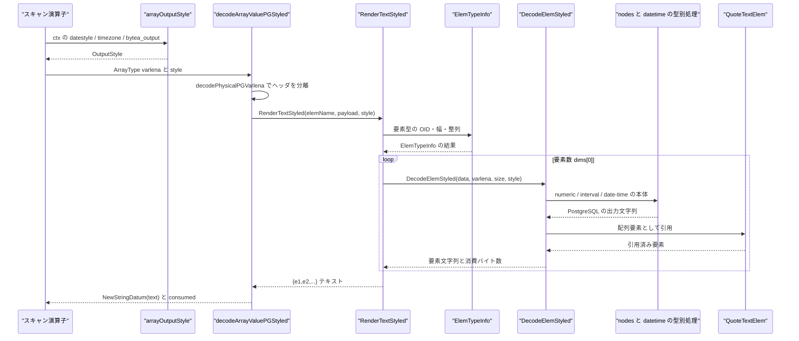
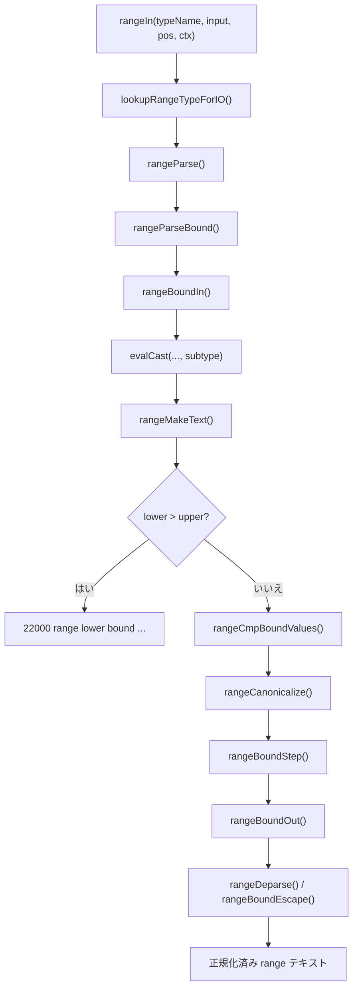

# データ型と ADT

<details>
<summary>関連ソースファイル</summary>

- [`internal/nodes/datum.go`](https://github.com/ryogrid/goopg/blob/19856410e8d497d59787e1ab35a2febb3f5953d6/internal/nodes/datum.go)
- [`internal/nodes/numeric_storage.go`](https://github.com/ryogrid/goopg/blob/19856410e8d497d59787e1ab35a2febb3f5953d6/internal/nodes/numeric_storage.go)
- [`internal/executor/codec_array.go`](https://github.com/ryogrid/goopg/blob/19856410e8d497d59787e1ab35a2febb3f5953d6/internal/executor/codec_array.go)
- [`internal/utils/adt/array/pgarray.go`](https://github.com/ryogrid/goopg/blob/19856410e8d497d59787e1ab35a2febb3f5953d6/internal/utils/adt/array/pgarray.go)
- [`internal/executor/jsonb_canonical.go`](https://github.com/ryogrid/goopg/blob/19856410e8d497d59787e1ab35a2febb3f5953d6/internal/executor/jsonb_canonical.go)
- [`internal/executor/rangetypes.go`](https://github.com/ryogrid/goopg/blob/19856410e8d497d59787e1ab35a2febb3f5953d6/internal/executor/rangetypes.go)
- [`internal/utils/adt/datetime/normalize.go`](https://github.com/ryogrid/goopg/blob/19856410e8d497d59787e1ab35a2febb3f5953d6/internal/utils/adt/datetime/normalize.go)
- [`internal/utils/adt/datetime/monthname.go`](https://github.com/ryogrid/goopg/blob/19856410e8d497d59787e1ab35a2febb3f5953d6/internal/utils/adt/datetime/monthname.go)
- [`internal/utils/adt/datetime/era.go`](https://github.com/ryogrid/goopg/blob/19856410e8d497d59787e1ab35a2febb3f5953d6/internal/utils/adt/datetime/era.go)
- [`internal/utils/adt/datetime/timeofday.go`](https://github.com/ryogrid/goopg/blob/19856410e8d497d59787e1ab35a2febb3f5953d6/internal/utils/adt/datetime/timeofday.go)
- [`internal/utils/adt/datetime/adjust_typmod.go`](https://github.com/ryogrid/goopg/blob/19856410e8d497d59787e1ab35a2febb3f5953d6/internal/utils/adt/datetime/adjust_typmod.go)
- [`internal/utils/adt/datetime/interval_typmod.go`](https://github.com/ryogrid/goopg/blob/19856410e8d497d59787e1ab35a2febb3f5953d6/internal/utils/adt/datetime/interval_typmod.go)
- [`internal/utils/adt/datetime/interval_format.go`](https://github.com/ryogrid/goopg/blob/19856410e8d497d59787e1ab35a2febb3f5953d6/internal/utils/adt/datetime/interval_format.go)
- [`internal/utils/adt/datetime/pg_datetime_format.go`](https://github.com/ryogrid/goopg/blob/19856410e8d497d59787e1ab35a2febb3f5953d6/internal/utils/adt/datetime/pg_datetime_format.go)
- [`internal/utils/adt/similarto/similarto.go`](https://github.com/ryogrid/goopg/blob/19856410e8d497d59787e1ab35a2febb3f5953d6/internal/utils/adt/similarto/similarto.go)

</details>

このページは、goopg が SQL の値を PostgreSQL と同じバイト列・同じ文字列として扱うための ADT（抽象データ型）層を扱う。スカラー `Const` の PostgreSQL バイナリ・イメージを作る `internal/nodes` の関数群、配列の `ArrayType` varlena を読み書きする `internal/executor` と `internal/utils/adt/array`、`numeric` の `NumericData` 変換、`jsonb` の正規化、範囲型のテキスト表現、日付時刻の入力正規化・typmod・出力、`SIMILAR TO` の正規表現変換が含まれる。セッション GUC の `DateStyle` / `TimeZone` / `bytea_output` を読む仕組み自体は [13.1 GUC 設定システム](13.1-GUC.md) を参照。

## 責務

- **スカラー Const のバイナリ化**: `int2` / `int4` / `int8` / `bool` / `oid` / `float4` / `float8` / `text` / `varchar` / `bpchar` / `bit` / `varbit` / `numeric` / `date` / `time` / `timetz` / `timestamp` / `timestamptz` の `Const` を、PostgreSQL の `outfuncs.c` が読み戻せる形で組み立てる。`byvalWord` は 8 バイトの Datum 語、`textVarlena` は 4 バイトヘッダ付き varlena、`bitVarlena` は bit 長とパック済みバイト列を作る ([`internal/nodes/datum.go:byvalWord`](https://github.com/ryogrid/goopg/blob/19856410e8d497d59787e1ab35a2febb3f5953d6/internal/nodes/datum.go)、[`internal/nodes/datum.go:NewNumericConst`](https://github.com/ryogrid/goopg/blob/19856410e8d497d59787e1ab35a2febb3f5953d6/internal/nodes/datum.go))。
- **numeric の格納形式**: [`NumericBodyFromText`](https://github.com/ryogrid/goopg/blob/19856410e8d497d59787e1ab35a2febb3f5953d6/internal/nodes/numeric_storage.go) が小数・科学記法・`NaN` / `±Infinity` を PostgreSQL の base-10000 `NumericData` 本体に変換し、[`NumericTextFromStoredPayload`](https://github.com/ryogrid/goopg/blob/19856410e8d497d59787e1ab35a2febb3f5953d6/internal/nodes/numeric_storage.go) が旧形式のテキスト・ペイロードとの判別を含めて読み戻す。
- **配列の入出力**: [`internal/executor/codec_array.go:encodeArrayValuePGCtx`](https://github.com/ryogrid/goopg/blob/19856410e8d497d59787e1ab35a2febb3f5953d6/internal/executor/codec_array.go) が配列テキスト `{…}` を PG の 1 次元 `ArrayType` varlena に変換し、[`internal/utils/adt/array/pgarray.go:RenderTextStyled`](https://github.com/ryogrid/goopg/blob/19856410e8d497d59787e1ab35a2febb3f5953d6/internal/utils/adt/array/pgarray.go) が逆方向のレンダリングを担う。要素型の OID・幅・整列は [`ElemTypeInfo`](https://github.com/ryogrid/goopg/blob/19856410e8d497d59787e1ab35a2febb3f5953d6/internal/utils/adt/array/pgarray.go) の一つの表に集約されている。
- **jsonb の入力正規化**: [`canonicalizeJSONB`](https://github.com/ryogrid/goopg/blob/19856410e8d497d59787e1ab35a2febb3f5953d6/internal/executor/jsonb_canonical.go) がオブジェクト・キーの長さ優先ソート、重複キーの last-wins、`jsonb_out` 形式のエスケープ、数値の `numeric_in` / `numeric_out` 往復を行う。`json` 型は [`validateJSONText`](https://github.com/ryogrid/goopg/blob/19856410e8d497d59787e1ab35a2febb3f5953d6/internal/executor/jsonb_canonical.go) で構文だけを検査する。
- **範囲型の正規化**: [`internal/executor/rangetypes.go:rangeIn`](https://github.com/ryogrid/goopg/blob/19856410e8d497d59787e1ab35a2febb3f5953d6/internal/executor/rangetypes.go) が `[1,5)` 形式を解析し、[`rangeMakeText`](https://github.com/ryogrid/goopg/blob/19856410e8d497d59787e1ab35a2febb3f5953d6/internal/executor/rangetypes.go) で境界の順序検査・空範囲の折り畳み・離散型の `[)` 正規化を行う。値は新しい Datum 型ではなく、常に PostgreSQL の `range_out` が返す正規化済みテキストとして保持する。
- **日付時刻の入力**: [`NormalizeInput`](https://github.com/ryogrid/goopg/blob/19856410e8d497d59787e1ab35a2febb3f5953d6/internal/utils/adt/datetime/normalize.go) / [`NormalizeDateTimeInput`](https://github.com/ryogrid/goopg/blob/19856410e8d497d59787e1ab35a2febb3f5953d6/internal/utils/adt/datetime/normalize.go) が PostgreSQL のフィールド単位デコードを Go の固定レイアウトに橋渡しし、[`ParseTimeOfDay`](https://github.com/ryogrid/goopg/blob/19856410e8d497d59787e1ab35a2febb3f5953d6/internal/utils/adt/datetime/timeofday.go) が時刻フィールドを解釈する。
- **日付時刻の出力と typmod**: [`internal/utils/adt/datetime/pg_datetime_format.go`](https://github.com/ryogrid/goopg/blob/19856410e8d497d59787e1ab35a2febb3f5953d6/internal/utils/adt/datetime/pg_datetime_format.go) が `date` / `time` / `timestamp` / `timetz` の整数イメージを PostgreSQL の出力関数と同じ文字列にし、[`AdjustTimeForTypmod`](https://github.com/ryogrid/goopg/blob/19856410e8d497d59787e1ab35a2febb3f5953d6/internal/utils/adt/datetime/adjust_typmod.go) / [`AdjustIntervalForTypmod`](https://github.com/ryogrid/goopg/blob/19856410e8d497d59787e1ab35a2febb3f5953d6/internal/utils/adt/datetime/interval_typmod.go) が精度指定を適用する。
- **`SIMILAR TO`**: [`internal/utils/adt/similarto/similarto.go:Convert`](https://github.com/ryogrid/goopg/blob/19856410e8d497d59787e1ab35a2febb3f5953d6/internal/utils/adt/similarto/similarto.go) が SQL パターンを POSIX ERE に変換し、[`ConvertSubstring`](https://github.com/ryogrid/goopg/blob/19856410e8d497d59787e1ab35a2febb3f5953d6/internal/utils/adt/similarto/similarto.go) が `SUBSTRING(... SIMILAR ...)` のキャプチャ区切りを扱う。

## 処理フロー

### 配列列の読み出し

配列はヒープ上では `ArrayType` varlena であり、goopg は**デコード時**に `{…}` テキストへ変換する。これは PostgreSQL が出力時に `array_out` を呼ぶのとは異なるが、`DateStyle` / `TimeZone` / `bytea_output` を要素の出力関数に反映するため、[`arrayOutputStyle`](https://github.com/ryogrid/goopg/blob/19856410e8d497d59787e1ab35a2febb3f5953d6/internal/executor/codec_array.go) がセッション GUC を [`OutputStyle`](https://github.com/ryogrid/goopg/blob/19856410e8d497d59787e1ab35a2febb3f5953d6/internal/utils/adt/array/pgarray.go) に詰めてデコード経路へ渡す。



配列ヘッダは [`arrayHeaderSize = 24`](https://github.com/ryogrid/goopg/blob/19856410e8d497d59787e1ab35a2febb3f5953d6/internal/executor/codec_array.go) バイトで、`varlena` 長、`ndim=1`、`dataoffset=0`、要素 OID、要素数、`lbound=1` が並ぶ。`RenderTextStyled` は payload の先頭が `ndim` であることを前提にし、`len(payload) < 20` または `ndim == 0` なら `"{}"` を返す。要素データは `payload[20:]` から始まり、各要素の前に `ElemTypeInfo` の整列幅でパディングされる ([`pgarray.go:RenderTextStyled`](https://github.com/ryogrid/goopg/blob/19856410e8d497d59787e1ab35a2febb3f5953d6/internal/utils/adt/array/pgarray.go))。

### 範囲型の入力

`int4range` などの入力は `range_in` の順序をそのままたどる。境界の生文字列を先に切り出し、各境界をサブタイプの入力関数（goopg では `evalCast`）に渡してから、値の比較・正規化・再出力を行う。サブタイプのエラーは範囲型のエラーに包み直さず、そのまま返す。



`rangeParse` は下限が `[` か `(`、上限が `]` か `)` かを見てフラグを立て、境界が空なら無限（`rangeFlagLbInf` / `rangeFlagUbInf`）にする。引用された境界では `""` を 1 個の `"`、`\` を次の 1 文字のエスケープとして読み、`["",b)` の空文字列と `[,b)` の無限を区別する ([`rangetypes.go:rangeParseBound`](https://github.com/ryogrid/goopg/blob/19856410e8d497d59787e1ab35a2febb3f5953d6/internal/executor/rangetypes.go))。

## 主要ファイル

| ファイル | 役割 |
|---|---|
| `internal/nodes/datum.go` | スカラー `Const` の PostgreSQL バイナリ・イメージ、整数・浮動小数・bool・bit・numeric・日付時刻の入力補助。`datum.go:NewNumericConst`, `datum.go:ScanBitInput`, `datum.go:parseTimestamptzMicros` |
| `internal/nodes/numeric_storage.go` | `NumericData` 本体とテキストの相互変換、旧テキスト形式の判別、int64 高速デコード。`numeric_storage.go:NumericBodyFromText`, `numeric_storage.go:NumericTextFromStoredPayload`, `numeric_storage.go:NumericInt64FromStoredPayload` |
| `internal/executor/codec_array.go` | 配列テキストから `ArrayType` へのエンコード、ヒープ blob からのデコード、セッション出力スタイルの取得。`codec_array.go:encodeArrayValuePGCtx`, `codec_array.go:decodeArrayValuePGStyled`, `codec_array.go:arrayOutputStyle` |
| `internal/utils/adt/array/pgarray.go` | 配列要素型テーブル、要素デコーダ、配列テキスト整形、bytea 出力。`pgarray.go:ElemTypeInfo`, `pgarray.go:RenderTextStyled`, `pgarray.go:DecodeElemStyled` |
| `internal/executor/jsonb_canonical.go` | `jsonb` の入力正規化と `json` の構文検査。`jsonb_canonical.go:canonicalizeJSONB`, `jsonb_canonical.go:validateJSONText` |
| `internal/executor/rangetypes.go` | 6 種の組み込み範囲型の入出力、境界検証、離散範囲の正規化、範囲コンストラクタ。`rangetypes.go:rangeIn`, `rangetypes.go:rangeMakeText`, `rangetypes.go:evalRangeConstructor` |
| `internal/utils/adt/datetime/normalize.go` | PostgreSQL のフィールド単位日付時刻デコードを Go レイアウト向けに正規化。`normalize.go:NormalizeInput`, `normalize.go:NormalizeDateTimeInput`, `normalize.go:ValidateDateToken` |
| `internal/utils/adt/datetime/monthname.go` | テキスト月名を含む日付の `YYYY-MM-DD` 正規化と 2 桁年のウィンドウ処理。`monthname.go:normalizeTextualMonthDate` |
| `internal/utils/adt/datetime/era.go` | 末尾の `BC` / `AD` の分離、天文学的年の計算、年ゼロの拒否。`era.go:SplitEra`, `era.go:ApplyEra`, `era.go:EraYear` |
| `internal/utils/adt/datetime/timeofday.go` | 時刻フィールドのデコード、AM/PM、24 時・60 秒の扱い、日跨ぎの正規化。`timeofday.go:ParseTimeOfDay`, `timeofday.go:TimeOfDay.Normalize` |
| `internal/utils/adt/datetime/adjust_typmod.go` | `time(N)` / `timetz(N)` の小数秒丸め。`adjust_typmod.go:AdjustTimeForTypmod` |
| `internal/utils/adt/datetime/interval_typmod.go` | `interval` の範囲マスクと `SECOND(p)` 精度の適用。`interval_typmod.go:AdjustIntervalForTypmod` |
| `internal/utils/adt/datetime/interval_format.go` | `interval` の `postgres` スタイル出力。`interval_format.go:FormatInterval` |
| `internal/utils/adt/datetime/pg_datetime_format.go` | `date` / `time` / `timestamp` / `timetz` の整数イメージから PostgreSQL 出力への変換。`pg_datetime_format.go:FormatDate`, `pg_datetime_format.go:FormatTimestamp`, `pg_datetime_format.go:FormatTimeTZ` |
| `internal/utils/adt/similarto/similarto.go` | `SIMILAR TO` の POSIX ERE 変換と `SUBSTRING` 用キャプチャ処理。`similarto.go:Convert`, `similarto.go:ConvertSubstring` |

## 公開 API / エントリポイント

```go
// nodes: スカラー Const の構築
func NewInt2Const(v int16) *Const
func NewInt4Const(v int32) *Const
func NewInt8Const(v int64) *Const
func NewBoolConst(v bool) *Const
func NewOidConst(v uint32) *Const
func NewFloat4Const(v float32) *Const
func NewFloat8Const(v float64) *Const
func NewTextConst(s string) *Const
func NewVarcharConst(s string) *Const
func NewBpcharConst(s string) *Const
func NewBitConst(s string) (*Const, error)
func NewVarBitConst(s string) (*Const, error)
func NewNumericConst(text string, negative bool) (*Const, error)
func NewDateConst(days int32) *Const
func NewTimeConst(micros int64) *Const
func NewTimeTZConst(micros int64, zoneOffset int32) *Const
func NewTimestampConst(usec int64) *Const
func NewTimestamptzConst(usec int64) *Const
func ScanBitInput(s string) (digits string, code, msg string, ok bool)

// nodes: numeric の格納形式
func NumericBodyFromText(text string) ([]byte, error)
func NumericTextFromBody(body []byte) (string, error)
func NumericTextFromStoredPayload(payload []byte) (string, error)
func NumericInt64FromStoredPayload(payload []byte) (int64, int16, bool)

// array: 要素テーブルとレンダリング
func ElemTypeInfo(elemName string) (oid uint32, size, align int, varlena, ok bool)
func RenderText(elemName string, payload []byte) (string, error)
func RenderTextStyled(elemName string, payload []byte, st OutputStyle) (string, error)
func DecodeElemStyled(elemName string, data []byte, varlena bool, size int, st OutputStyle) (string, int, error)
func DefaultOutputStyle() OutputStyle
func FormatDateElem(days int32, st OutputStyle) string
func FormatTimestampElem(micros int64, st OutputStyle) string
func FormatTimestampTZElem(micros int64, st OutputStyle) string
func ByteaOutStyled(b []byte, mode string) string
func QuoteTextElem(s string) string

// datetime: 入力、typmod、出力
func AdjustTimeForTypmod(micros int64, typmod int32) int64
func AdjustIntervalForTypmod(months, days int32, micros int64, typmod int32) (int32, int32, int64)
func SplitEra(s string) (string, bool)
func ApplyEra(t time.Time, bc bool) (time.Time, error)
func NormalizeInput(s string) string
func NormalizeDateTimeInput(s string, bc bool) string
func ParseTimeOfDay(s string) (TimeOfDay, error)
func CanonicalizeTimeToken(s string) (string, int, error)
func FormatInterval(months, days int32, micros int64) string
func FormatDate(days int32) string
func FormatTime(micros int64) string
func FormatTimestamp(micros int64) string
func FormatTimeTZ(micros int64, zoneSecs int32) string

// similarto: SQL パターン変換
func ValidateEscape(escape string) error
func Convert(pattern, escape string) string
func ConvertSubstring(pattern, escape string) (string, error)
```

`internal/executor` 内の配列・JSONB・範囲エントリポイント（`encodeArrayValuePGCtx`、`decodeArrayValuePGStyled`、`canonicalizeJSONB`、`rangeIn`、`evalRangeConstructor`）は非公開だが、ヒープ・キャスト・COPY の各経路から呼ばれる実入口である。`internal/executor` の `Datum` や `Context` はこのページの対象外の型で、ADT 関数はそれらを値の入れ物として受け取る。

## 主要データ構造

### `numericVar` — base-10000 の数値表現

[`internal/nodes/datum.go:numericVar`](https://github.com/ryogrid/goopg/blob/19856410e8d497d59787e1ab35a2febb3f5953d6/internal/nodes/datum.go#L610-L618):

```go
type numericVar struct {
	negative bool
	weight   int
	dscale   int
	digits   []int16
	// special is 0 for a finite value; otherwise the NUMERIC_SPECIAL n_header
	// (numericNaN / numericPInf / numericNInf). A special carries no digits.
	special uint16
}
```

- `digits` は最上位から並ぶ base-10000 の桁で、各要素は 0..9999。`weight` は `digits[0]` が表す 10000 の冪、`dscale` は表示上の小数桁数である。値は `D × 10000^(weight−len(digits)+1)` として読める。
- `special` が非ゼロなら `NaN` / `+Infinity` / `-Infinity` を表し、`digits` は空である。有限値と特殊値は同じ直列化形式を共有しない。
- [`strip`](https://github.com/ryogrid/goopg/blob/19856410e8d497d59787e1ab35a2febb3f5953d6/internal/nodes/datum.go) が先頭・末尾の 0 桁を取り除き、値がゼロなら符号を正・`weight` を 0 に固定する。この正規化により、同じ数値は同じ `numericVar` になる。
- [`varlena`](https://github.com/ryogrid/goopg/blob/19856410e8d497d59787e1ab35a2febb3f5953d6/internal/nodes/datum.go) は `dscale <= 63` かつ `weight` が -64..63 のとき short 形式（`numericShort` と 7 ビット符号付き weight）、それ以外は long 形式（sign/dscale と int16 weight）を選ぶ。`NaN` / `Infinity` は長さ 6 バイトの特殊ヘッダだけになる。

### `OutputStyle` — 配列要素の出力 GUC

[`internal/utils/adt/array/pgarray.go:OutputStyle`](https://github.com/ryogrid/goopg/blob/19856410e8d497d59787e1ab35a2febb3f5953d6/internal/utils/adt/array/pgarray.go#L53-L74):

```go
type OutputStyle struct {
	// Style and Order are the pair config.ParseDateStyleValue returns
	// ("ISO"/"MDY", "German"/"DMY", …).
	Style, Order string
	// Zone is the raw `TimeZone` GUC spelling; "" means the boot default, UTC
	// (config.FormatTimestampTZ resolves it).
	Zone string
	// RegOut renders a reg* array element's 4-byte OID as its name —
	// executor.RegOut's contract (OID 0 → "-", an unresolvable OID → the
	// numeric spelling). internal/pgarray is a leaf and cannot import the
	// executor, so the executor threads the renderer in as a value from
	// arrayOutputStyle; a nil renderer (the pgoutput decoder and pure-codec
	// callers have no catalog) falls back to "-"/numeric. M0119-0006 reg*
	// element slice.
	RegOut func(typeName string, oid uint32) string
	// ByteaMode selects the `bytea_output` GUC's rendering for a bytea array
	// element: "" or "hex" (the default) → ByteaOutHex, "escape" →
	// ByteaOutEscape. Any other/unrecognised spelling also falls back to hex,
	// matching the scalar renderer (PG validates the enum at SET time, so the
	// output path never needs to error). M0134-0001 S12.
	ByteaMode string
}
```

`DefaultOutputStyle()` は `ISO` / `MDY` / UTC を返す。`Style` と `Order` は `date` / `timestamp` / `timestamptz` の表示だけに影響し、`Zone` は `timestamptz` にだけ影響する。`RegOut` が `nil` のとき、reg* 要素は OID 0 なら `-`、それ以外は数値表記にフォールバックする。`ByteaMode` は `escape` のときだけ [`ByteaOutEscape`](https://github.com/ryogrid/goopg/blob/19856410e8d497d59787e1ab35a2febb3f5953d6/internal/utils/adt/array/pgarray.go) を選び、それ以外は hex になる。

### `rangeBound` — 範囲の片側境界

[`internal/executor/rangetypes.go:rangeBound`](https://github.com/ryogrid/goopg/blob/19856410e8d497d59787e1ab35a2febb3f5953d6/internal/executor/rangetypes.go#L110-L115):

```go
type rangeBound struct {
	val       Datum
	infinite  bool
	inclusive bool
	lower     bool
}
```

`val` はサブタイプの入力関数が返した値、`infinite` が真なら `val` は使わない。`inclusive` は境界が閉じているか、`lower` はこの境界が下限か（上限なら偽）を表す。`rangeMakeText` では無限境界をけっして inclusive にせず、`lower.infinite` / `upper.infinite` から `rangeFlagLbInf` / `rangeFlagUbInf` を立てる。`lower` は `rangeIn` と `evalRangeConstructor` が下限側だけに設定する。

### `builtinRangeType` — 範囲型のサブタイプと正規化種別

[`internal/executor/rangetypes.go:builtinRangeType`](https://github.com/ryogrid/goopg/blob/19856410e8d497d59787e1ab35a2febb3f5953d6/internal/executor/rangetypes.go#L73-L76):

```go
type builtinRangeType struct {
	subtype   string
	canonical rangeCanonicalKind
}
```

`subtype` は `int4` / `int8` / `numeric` / `date` / `timestamp` / `timestamptz` のいずれかで、境界の入出力に使う型名である。`canonical` は `rangeCanonicalNone` / `rangeCanonicalInt4` / `rangeCanonicalInt8` / `rangeCanonicalDate` のいずれかで、`[)` 正規化を行うのは離散型の 3 種だけである。`builtinRangeTypes` は `int4range` / `int8range` / `numrange` / `daterange` / `tsrange` / `tstzrange` をこの構造体に写す。

### `jsonbValue` — 正規化前の JSON 木

[`internal/executor/jsonb_canonical.go:jsonbValue`](https://github.com/ryogrid/goopg/blob/19856410e8d497d59787e1ab35a2febb3f5953d6/internal/executor/jsonb_canonical.go#L43-L70):

```go
// jsonbKind enumerates the JSON value shapes. It is private to this file: the
// tree is only built to be re-emitted canonically, never stored or compared.
type jsonbKind int

const (
	jsonbNull jsonbKind = iota
	jsonbBool
	jsonbNumber
	jsonbString
	jsonbArray
	jsonbObject
)

// jsonbValue is an ordered JSON value. Object members keep their INPUT order so
// the last-wins duplicate rule can be applied before the canonical sort.
type jsonbValue struct {
	kind jsonbKind
	b    bool
	num  string // raw number literal (json.Number's text)
	str  string // unescaped string payload
	arr  []jsonbValue
	obj  []jsonbMember
}

type jsonbMember struct {
	key string
	val jsonbValue
}
```

`kind` がどのフィールドを使うかを決める。`num` は入力の数値リテラルをそのまま保持し、`jsonb_out` へ出す段で `numeric_in` / `numeric_out` に通す。`obj` は入力順のまま保持され、[`canonicalJSONBObjectPairs`](https://github.com/ryogrid/goopg/blob/19856410e8d497d59787e1ab35a2febb3f5953d6/internal/executor/jsonb_canonical.go) が後ろから走査して最後の重複を残し、長さ→バイト順でソートする。この「入力順を保持してから正規化する」ことが、重複キーの last-wins を可能にしている。

### `TimeOfDay` — 範囲検査前の時刻フィールド

[`internal/utils/adt/datetime/timeofday.go:TimeOfDay`](https://github.com/ryogrid/goopg/blob/19856410e8d497d59787e1ab35a2febb3f5953d6/internal/utils/adt/datetime/timeofday.go#L23-L28):

```go
type TimeOfDay struct {
	Hour int
	Min  int
	Sec  int
	Nsec int
}
```

`Hour` は 24 を、`Sec` は 60 を取り得る。これは PostgreSQL の `DecodeTimeCommon` がフィールドをそのまま残し、型入力関数が最後に範囲検査するのと同じである。`Nsec` はナノ秒で、`totalNsec` が 24 時間を超える場合だけ `Overflows` が真になる。`Normalize` はちょうど 24:00:00 を「翌日 0 時」と日跨ぎ 1 に変換し、60 秒は分への繰り上げとして扱う。

## 内部構造

### numeric の格納形式と互換性

`NumericBodyFromText` は入力を `parseNumericVar` に渡し、`numericVar.varlena()` の先頭 4 バイト（varlena ヘッダ）を落とした本体を返す。ヒープ側は短い varlena ヘッダを自分で付けるため、ここではヘッダを含めない。`NumericTextFromBody` は逆に、ヘッダなし本体を 4 バイトのダミーヘッダで包み直して `decodeNumericVar` に渡す ([`numeric_storage.go`](https://github.com/ryogrid/goopg/blob/19856410e8d497d59787e1ab35a2febb3f5953d6/internal/nodes/numeric_storage.go))。

`NumericTextFromStoredPayload` は、M0119-0006 より前に書かれた「数値テキストそのもの」のペイロードと、現在の `NumericData` を区別する。判定は [`numericPayloadIsLegacyText`](https://github.com/ryogrid/goopg/blob/19856410e8d497d59787e1ab35a2febb3f5953d6/internal/nodes/numeric_storage.go) の文字集合テストで、`[0-9+-.eE]` の全バイトがこの集合に入る `NumericData` は存在しないという性質を使う。`NaN` / `Infinity` などの旧スペルは別途 `bytes.EqualFold` で判定する。この判別は `executor` の `decodePhysicalPGValueMctx` と `wal` の pgoutput で共有され、二つの読み手が同じ結果を返す。

`NumericInt64FromStoredPayload` は `mantissa × 10^-dscale` を int64 で表せる場合だけ成功する高速経路である。base-10000 の桁列を 128 ビットで累積し、`e = 4*(weight-n+1) + dscale` が正なら 10^e を掛け、負なら割り切れることを要求する。特殊値、旧テキスト、int64 に収まらない仮数、dscale を超える有意桁、壊れたヘッダは `ok=false` となり、呼び出し側はテキスト経路へ戻る ([`numeric_storage.go:NumericInt64FromStoredPayload`](https://github.com/ryogrid/goopg/blob/19856410e8d497d59787e1ab35a2febb3f5953d6/internal/nodes/numeric_storage.go))。

### 配列の要素テーブルと旧 blob

`ElemTypeInfo` は要素型名を PG の OID・固定幅・整列・varlena 属性に写す。`int2` は `(21,2,2,false)`、`int4` は `(23,4,4,false)`、`uuid` は `(2950,16,1,false)`、`interval` は `(1186,16,8,false)`、`date` は `(1082,4,4,false)`、`timetz` は `(1266,12,8,false)`、`numeric` / `bytea` / `text` は varlena である。未知の要素型は呼び出し側で OID 25 のテキスト要素へフォールバックする ([`pgarray.go:ElemTypeInfo`](https://github.com/ryogrid/goopg/blob/19856410e8d497d59787e1ab35a2febb3f5953d6/internal/utils/adt/array/pgarray.go))。

`encodeArrayValuePGCtx` は 1 次元・NULL なしの配列だけを書く。要素に `NULL` が現れると `0A000` で拒否し、各要素の後に整列パディングを入れ、最後の要素の後もパディングして `VARSIZE` を PG と一致させる。`numeric` は `NumericBodyFromText` の本体を、`bytea` は生バイトを、`interval` は `{micros int64, days int32, months int32}` の 16 バイトを、日付時刻はスカラーの `encodeValuePG` の結果を格納する。`reg*` は `regIdentifierInput` で名前を OID に解決する ([`codec_array.go:encodeArrayElem`](https://github.com/ryogrid/goopg/blob/19856410e8d497d59787e1ab35a2febb3f5953d6/internal/executor/codec_array.go))。

読み出し側には旧 blob 互換がある。`RenderTextStyled` は既知の要素型に対して blob の `elemtype` が期待 OID ではなく 25（text）なら、要素をテキストとして読む。これは旧エンコーダが未知型フォールバックで書いた blob を読むための経路で、`elemtype` がヘッダに明示されているため判別は厳密である。`numeric` の要素本体はさらに `NumericTextFromStoredPayload` が旧テキスト形式を吸収する ([`pgarray.go:RenderTextStyled`](https://github.com/ryogrid/goopg/blob/19856410e8d497d59787e1ab35a2febb3f5953d6/internal/utils/adt/array/pgarray.go))。

### `jsonb` の正規形

`canonicalizeJSONB` は Go の `json.Decoder` を `UseNumber` 付きで使い、`parseJSONBValue` でトークン列から入力順の木を作る。オブジェクトは `canonicalJSONBObjectPairs` で「後ろから走査して最初に現れたキーだけを残す」ため最後の重複が勝ち、その後 [`lengthCompareJSONBKey`](https://github.com/ryogrid/goopg/blob/19856410e8d497d59787e1ab35a2febb3f5953d6/internal/executor/jsonb_canonical.go) で長さ優先・同長ならバイト順にソートする。文字列は `escape_json_char` と同じ 7 つの名前付きエスケープと `0x20` 未満の `\u00xx` だけを出し、非 ASCII はそのまま通す。数値は `nodes.NumericBodyFromText` → `nodes.NumericTextFromBody` の往復で `1e0` → `1`、`3e1` → `30`、`1.00` → `1.00`、`-0.0` → `0.0` になる ([`jsonb_canonical.go`](https://github.com/ryogrid/goopg/blob/19856410e8d497d59787e1ab35a2febb3f5953d6/internal/executor/jsonb_canonical.go))。

`validateJSONText` は `json` 型用で、正規化はせず「一つの値で、後続が EOF だけ」であることだけを検査する。エラーは `invalidJSONBError` の `22P02` で、メッセージは PostgreSQL の `json` / `jsonb` 共通の `invalid input syntax for type json` である。

### 範囲型の正規化

`rangeMakeText` は下限 > 上限なら `22000`、等しくて両端が閉じていなければ `empty`、等しくて両端が閉じている場合はそのまま正規化へ進む（離散型では `[1,1]` が `[1,2)` になる）、という `range_serialize` の規則を実装する。無限境界は `rangeFlagLbInf` / `rangeFlagUbInf` になり、inclusive にはならない。離散型では `rangeCanonicalize` が下限の排他を +1 して閉じ、上限の閉を +1 して開くことで `[1,4]` と `[1,5)` を同じ `[1,5)` にする。`int4` / `int8` は最大値で `22003`、`date` は 5874897 年超で `22008` を返す ([`rangetypes.go:rangeCanonicalize`](https://github.com/ryogrid/goopg/blob/19856410e8d497d59787e1ab35a2febb3f5953d6/internal/executor/rangetypes.go))。

`evalRangeConstructor` は 2 引数または 3 引数の `range_constructor2/3` を実装する。NULL の境界は無限として扱い、NULL のフラグ引数は `22004`、フラグ文字列が `[]` / `[)` / `(]` / `()` 以外なら `22P02` と HINT を返す。境界値の型変換エラーはサブタイプのエラーをそのまま伝える。

### 日付時刻の入力正規化

`NormalizeInput` は `DecodeTimeOnly` 相当、`NormalizeDateTimeInput` は `DecodeDateTime` 相当である。違いは run-together 日付（`20200101`）とテキスト月名（`May 1, 2002`）を扱うかどうかで、`time` / `timetz` に後者を適用すると PostgreSQL が受け付けない入力を作ってしまうため分かれている。`padDateFields` は先頭年が 3 桁以上、月日が 2 桁以下の `Y-M-D` だけをゼロ詰めし、`padTimeFields` は `h:m[:s]` をゼロ詰めして秒がなければ `:00` を補う。範囲検査は行わず、`2002-13-01` のような値は下流の `ValidateDateToken` / `ValidateDayOfMonth` が `22008` にする ([`normalize.go`](https://github.com/ryogrid/goopg/blob/19856410e8d497d59787e1ab35a2febb3f5953d6/internal/utils/adt/datetime/normalize.go))。

`NormalizeDateTimeInput` だけが `expandRunTogetherDate` と `normalizeTextualMonthDate` を呼ぶ。2 桁年は 1970..2069 にウィンドウされ、BC のときはウィンドウしない。`SplitEra` は末尾の `BC` / `AD` だけを、直前が数字である場合に限って剥がす。`ApplyEra` は年 0 を `ErrFieldOutOfRange` にし、BC の年を `1 - y` で天文学的年に変換する ([`era.go`](https://github.com/ryogrid/goopg/blob/19856410e8d497d59787e1ab35a2febb3f5953d6/internal/utils/adt/datetime/era.go))。

`ParseTimeOfDay` はコロン形式と run-together 形式を別々に扱う。`10:00.5` は PostgreSQL の「MM:SS.frac」規則に従って `00:10:00.5` にフィールドをずらし、`040506` は `04:05:06`、`0405` は `04:05:00`、`allballs` は 0 時になる。`12:00 AM` は 0 時、`12:00 PM` は 12 時で、12 を超える AM/PM は `ErrTimeFieldOverflow` になる ([`timeofday.go`](https://github.com/ryogrid/goopg/blob/19856410e8d497d59787e1ab35a2febb3f5953d6/internal/utils/adt/datetime/timeofday.go))。

### typmod と出力

`AdjustTimeForTypmod` は typmod が 0..6 のときだけ `10^(6-p)` の量子で丸める。負値は絶対値で丸めて符号を戻し、half-away-from-zero にする。typmod が -1 や 6 超なら入力をそのまま返す。`AdjustIntervalForTypmod` は typmod を範囲ビットと精度に分解し、範囲の右側のフィールドをゼロ化したあと、`SECOND(p)` の精度でマイクロ秒を丸める。`typmod < 0` と `±infinity` は無変更である ([`interval_typmod.go`](https://github.com/ryogrid/goopg/blob/19856410e8d497d59787e1ab35a2febb3f5953d6/internal/utils/adt/datetime/interval_typmod.go))。

`FormatInterval` は `postgres` スタイルで、月を年+月に分解し、`year` / `mon` / `day` を非ゼロのときだけ出し、時間部を `HH:MM:SS[.ffffff]` で出す。フィールドごとの符号と、負値の次の正値に `+` を付ける PostgreSQL の `is_before` の癖も再現する。零 interval は `00:00:00`、`±infinity` は bare word になる ([`interval_format.go`](https://github.com/ryogrid/goopg/blob/19856410e8d497d59787e1ab35a2febb3f5953d6/internal/utils/adt/datetime/interval_format.go))。

`pg_datetime_format.go` の `FormatDate` / `FormatTime` / `FormatTimestamp` / `FormatTimeTZ` は、PG が保存する整数イメージを直接読む。`date` は 2000-01-01 からの日数、`time` は深夜からのマイクロ秒、`timestamp` / `timestamptz` は 2000-01-01 からのマイクロ秒、`timetz` はマイクロ秒 + 秒西向きのゾーンである。`FormatTimeTZ` はゾーンを符号反転して東向きとして表示する。ISO 出力専用の関数であり、セッション `DateStyle` を反映する配列要素は `array.FormatDateElem` / `FormatTimestampElem` / `FormatTimestampTZElem` を経由する。

### `SIMILAR TO` の変換

`Convert` は入力を `^(?:` で始め `)$` で閉じる。`%` を `.*`、`_` を `.`、SQL の `(` を非キャプチャグループ `(?:` に変換し、`\`、`.`、`^`、`$` は正規表現メタ文字としてエスケープする。ブラケット式の内側はネストを追跡してそのままコピーし、SQL のエスケープ文字は出力から落として次の 1 文字を `\<char>` にする。`ConvertSubstring` はさらに、ブラケット外の `escape + '"'` を part1 / part2 / part3 の区切りとして扱い、2 個を超えると `ErrTooManyQuoteSeparators`（SQLSTATE 2200C）を返す。`ValidateEscape` は空文字または 1 ルーンだけを許し、それ以上なら `ErrInvalidEscape`（22025）を返す ([`similarto.go`](https://github.com/ryogrid/goopg/blob/19856410e8d497d59787e1ab35a2febb3f5953d6/internal/utils/adt/similarto/similarto.go))。

## エッジケースと不変条件

- **配列は 1 次元・NULL なしだけ**: `encodeArrayValuePGCtx` は `ndim=1`、`dataoffset=0`、`lbound=1` の `ArrayType` を書き、要素が `NULL` なら `0A000` で拒否する。多次元配列や NULL ビットマップはこの経路では表現できない。
- **要素の整列と末尾パディング**: 各要素の前に `alignPad` を入れ、最後の要素の後にもパディングして `VARSIZE` を PG の `construct_md_array` と一致させる。`timetz` の 12 バイト要素と `interval` の 16 バイト要素はこのパディングがないと後続要素のオフセットがずれる。
- **未知の要素型**: `ElemTypeInfo` が `ok=false` を返すと、エンコーダは OID 25 の text 要素として書き、デコーダも text として読む。したがって未知型の配列は「値は往復するが、PG の型 OID とは一致しない」状態になる。
- **旧配列 blob**: `RenderTextStyled` は期待 OID と blob の `elemtype` が食い違い、blob 側が 25 のときだけ text 経路へ切り替える。この条件は旧エンコーダのフォールバックに限られ、新しい OID の blob を誤って text と解釈しない。
- **numeric の完全性**: `NumericInt64FromStoredPayload` は「割り切れる」「int64 に収まる」場合だけ成功し、丸めは行わない。`dscale` が int16 の範囲外、桁が 10000 以上、128 ビット累積がオーバーフロー、`e` が 18 を超える、といった場合はすべて `ok=false` でテキスト経路に戻る。
- **numeric の旧形式**: `numericPayloadIsLegacyText` は空ペイロードを旧形式と見なさない。旧形式の判定は `[0-9+-.eE]` の文字集合か `NaN` / `Infinity` / `±inf` のスペルだけで、`NumericData` とは排他的である。この不変条件が崩れると、ヒープ上の数値が文字列として誤読される。
- **範囲の空と無限**: 下限 > 上限は `22000` で拒否し、下限 == 上限で両端が閉じていない場合は `empty` に折り畳む。無限境界はけっして inclusive にならず、`[,b)` と `["",b)` は別の値である。
- **離散範囲の上限**: `rangeBoundStep` は `int4` の `MaxInt32` で `22003`、`int8` の `MaxInt64` で `22003`、`date` の 5874897 年超で `22008` を返す。無限の `date` はステップしない。
- **範囲コンストラクタ**: NULL の境界は無限、NULL のフラグは `22004`。フラグは `rangeConstructorFlags` が `[]` / `[)` / `(]` / `()` の完全一致だけを受け付け、それ以外は `22P02` と HINT を返す。
- **日付正規化は範囲検査をしない**: `NormalizeInput` / `NormalizeDateTimeInput` は桁揃えと綴りの変換だけを行い、月 13 や 2 月 30 日をここで拒否しない。最終判定は `ValidateDateToken` と `ValidateDayOfMonth` が担う。`ValidateDayOfMonth` は月が 1..12 であることを前提にしているため、呼び出し側が検証順を守らないと panic する。
- **年ゼロと BC**: `SplitEra` は末尾の `BC` / `AD` だけを、直前が数字である場合に限って認識する。`ApplyEra` は年 0 と「符号付きの負年 + BC」を `ErrFieldOutOfRange` にし、1 BC を天文学的 year 0 に写す。
- **時刻の 24 時・60 秒**: `TimeOfDay.Overflows` は hour 24、second 60 を単独では許すが、合計が 24 時間を超える値（`24:00:00.5`、`24:00:01`）は拒否する。`Normalize` はちょうど 24:00:00 を翌日 0 時として日跨ぎ 1 を返す。
- **typmod の無効値**: `AdjustTimeForTypmod` は 0..6 の外側を no-op にし、`AdjustIntervalForTypmod` は `typmod < 0` を no-op にする。範囲外の typmod はカラム定義の検証済み値を前提としており、関数自身はエラーを返さない。
- **`jsonb` の失敗**: `canonicalizeJSONB` は構文エラーにも後続ゴミにも `22P02` の `invalid input syntax for type json` を返す。`json` の `validateJSONText` は同じエラーを返すが、入力の表記は変更しない。
- **`SIMILAR TO` のエスケープ**: `ValidateEscape` は 2 ルーン以上を `22025`、`ConvertSubstring` は 3 個目の区切りで `2200C` を返す。`Convert` は part-separator を実装せず、`"` を通常のエスケープ対象文字として扱う。
- **配列の GUC 依存**: 配列の `date` / `timestamp` / `timestamptz` は `OutputStyle` の `DateStyle` / `TimeZone` を読むが、`time` / `timetz` は `DateStyle` に依存しない。`bytea` は `ByteaMode` に依存し、未知の値は hex にフォールバックする。

Sources:
- `internal/nodes/datum.go`
- `internal/nodes/numeric_storage.go`
- `internal/executor/codec_array.go`
- `internal/utils/adt/array/pgarray.go`
- `internal/executor/jsonb_canonical.go`
- `internal/executor/rangetypes.go`
- `internal/utils/adt/datetime/normalize.go`
- `internal/utils/adt/datetime/monthname.go`
- `internal/utils/adt/datetime/era.go`
- `internal/utils/adt/datetime/timeofday.go`
- `internal/utils/adt/datetime/adjust_typmod.go`
- `internal/utils/adt/datetime/interval_typmod.go`
- `internal/utils/adt/datetime/interval_format.go`
- `internal/utils/adt/datetime/pg_datetime_format.go`
- `internal/utils/adt/similarto/similarto.go`

<sub>Generated by deepwiki-4myself from `goopg` @ `19856410e`</sub>
