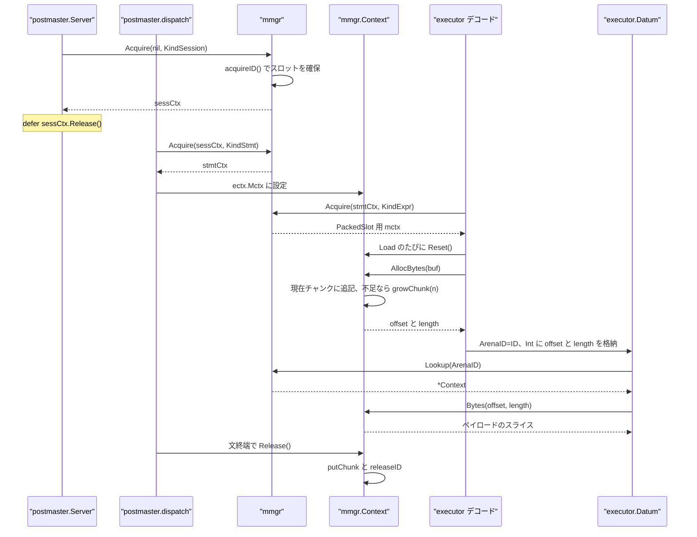
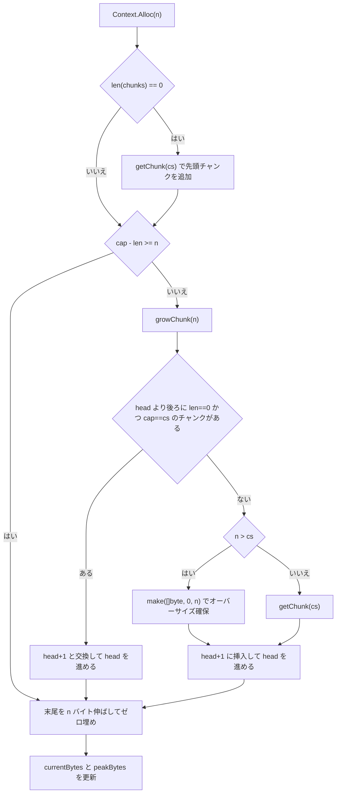

# エラーコードとメモリ管理

<details>
<summary>関連ソースファイル</summary>

- [`internal/executor/row_pool.go`](https://github.com/ryogrid/goopg/blob/19856410e8d497d59787e1ab35a2febb3f5953d6/internal/executor/row_pool.go)
- [`internal/parser/parser_pool.go`](https://github.com/ryogrid/goopg/blob/19856410e8d497d59787e1ab35a2febb3f5953d6/internal/parser/parser_pool.go)
- [`internal/utils/activity/activity.go`](https://github.com/ryogrid/goopg/blob/19856410e8d497d59787e1ab35a2febb3f5953d6/internal/utils/activity/activity.go)
- [`internal/utils/activity/registry.go`](https://github.com/ryogrid/goopg/blob/19856410e8d497d59787e1ab35a2febb3f5953d6/internal/utils/activity/registry.go)
- [`internal/utils/activity/stats/counter.go`](https://github.com/ryogrid/goopg/blob/19856410e8d497d59787e1ab35a2febb3f5953d6/internal/utils/activity/stats/counter.go)
- [`internal/utils/errcodes/codes.go`](https://github.com/ryogrid/goopg/blob/19856410e8d497d59787e1ab35a2febb3f5953d6/internal/utils/errcodes/codes.go)
- [`internal/utils/misc/set_args.go`](https://github.com/ryogrid/goopg/blob/19856410e8d497d59787e1ab35a2febb3f5953d6/internal/utils/misc/set_args.go)
- [`internal/utils/mmgr/mctx.go`](https://github.com/ryogrid/goopg/blob/19856410e8d497d59787e1ab35a2febb3f5953d6/internal/utils/mmgr/mctx.go)
- [`internal/utils/pgprng/pgprng.go`](https://github.com/ryogrid/goopg/blob/19856410e8d497d59787e1ab35a2febb3f5953d6/internal/utils/pgprng/pgprng.go)
- [`internal/utils/pgqsort/pgqsort.go`](https://github.com/ryogrid/goopg/blob/19856410e8d497d59787e1ab35a2febb3f5953d6/internal/utils/pgqsort/pgqsort.go)
- [`internal/executor/datum.go`](https://github.com/ryogrid/goopg/blob/19856410e8d497d59787e1ab35a2febb3f5953d6/internal/executor/datum.go)
- [`internal/executor/packedslot.go`](https://github.com/ryogrid/goopg/blob/19856410e8d497d59787e1ab35a2febb3f5953d6/internal/executor/packedslot.go)
- [`internal/parser/adapter.go`](https://github.com/ryogrid/goopg/blob/19856410e8d497d59787e1ab35a2febb3f5953d6/internal/parser/adapter.go)
- [`internal/parser/yacc_parser.go`](https://github.com/ryogrid/goopg/blob/19856410e8d497d59787e1ab35a2febb3f5953d6/internal/parser/yacc_parser.go)
- [`internal/postmaster/dispatch.go`](https://github.com/ryogrid/goopg/blob/19856410e8d497d59787e1ab35a2febb3f5953d6/internal/postmaster/dispatch.go)
- [`internal/postmaster/server.go`](https://github.com/ryogrid/goopg/blob/19856410e8d497d59787e1ab35a2febb3f5953d6/internal/postmaster/server.go)

</details>

本ページは、クエリ結果そのものではなく、結果の寿命・診断情報・乱数列といった外から観測できる挙動を決めるユーティリティ群を扱う。具体的には、(1) PostgreSQL の `errcodes.txt` から生成した SQLSTATE 表とその重要度分類、(2) `Datum` がポインタを持たずに文字列・バイト列を参照するための階層メモリコンテキスト `mmgr.Context`、(3) 行と goyacc パーサ構造体の再利用戦略、(4) `pg_stat_activity` を支えるバックエンド活動レジストリと P シャードカウンタ、(5) `SET` 値の平坦化、(6) PG と同一の乱数ストリーム・同一の非安定ソートである。

## 責務

- **SQLSTATE の分類**: `internal/utils/errcodes/codes.go:Code` は 5 文字の SQLSTATE 文字列、`Severity` は上流の E/W/S 分類を持つ。`Lookup` で重要度を、`Class` で先頭 2 文字のクラスを引く。定数と `severities` マップは `cmd/gen-sqlstate` の生成物であり、手で追加してはならない(ファイル冒頭の警告)。
- **メモリの寿命管理**: `internal/utils/mmgr/mctx.go` が Session → Txn → Stmt → Expr の 4 階層を提供し、`Alloc`/`AllocBytes` で 64 KiB チャンクからバンプ確保、`Reset` で巻き戻し、`Release` でチャンクをサイズ別 `sync.Pool` に返す。
- **ポインタフリーな値参照**: `Datum` は `ArenaID mmgr.ContextID` と `Int` に詰めた `(offset, length)` だけを保持し(`internal/executor/datum.go:Datum`)、読み出し時に `mmgr.Lookup` → `Context.Bytes` で解決する。`internal/executor/datum.go:StringValue` と `BytesValue` がその経路。
- **アロケーション削減の実測に基づく取捨**: `internal/executor/row_pool.go` は行プールを撤去し、代わりに 32 行を 1 アロケーションから切り出す `rowChunk` を残す。`internal/parser/parser_pool.go` は 26,664 バイトの `yyParserImpl` を `sync.Pool` で再利用する。
- **バックエンド状態の公開**: `internal/utils/activity/registry.go:ActivityRegistry` がバックエンドごとの 64 バイトスロットに待機イベント・状態・クエリを保持し、`Snapshot` が `pg_stat_activity` 用の `[]Backend` を組み立てる。ホットパスはグローバルロックを取らない。
- **統計のスケール**: `internal/utils/activity/stats/counter.go:Counter` が `runtimeshim.PinP` の P インデックスで 256 シャードに分散し、`Add` のキャッシュライン競合を避ける。
- **PG 互換の決定性**: `internal/utils/pgprng` は xoroshiro128\*\* + splitmix64 を、`internal/utils/pgqsort` は Bentley-McIlroy クイックソートを逐語移植する。GEQO の探索結果を PG と一致させるには、正しい乱数値だけでなく同じ順列・同じ消費順序が必要になる。

## 処理フロー

中心となるのはメモリコンテキストのライフサイクルである。接続 → 文 → 式スロットの順に `Context` がぶら下がり、デコードが確保したバイト列を `Datum` が `(ContextID, offset, length)` で指し、読み出し側がレジストリ経由で解決する。



1. 接続処理は `internal/postmaster/server.go:1229` で `mmgr.Acquire(nil, mmgr.KindSession)` を呼び、直後の `defer sessCtx.Release()` で接続終了時の解放を保証する。
2. 各文の実行は `internal/postmaster/dispatch.go:261` で `mmgr.Acquire(sessCtxForStmt, mmgr.KindStmt)` を行い、`defer stmtCtx.Release()` を張って `ectx.Mctx` に渡す(`dispatch.go:270`)。セッションが無いテスト経路では親が `nil` になる。
3. 行デコード用の `PackedSlot` は `internal/executor/packedslot.go:122` で `mmgr.Acquire(parent, mmgr.KindExpr)` を呼び、4 KiB の小さなチャンククラスを選ばせる。`Load` のたびに `s.mctx.Reset()` でウォーターマークを戻す(`packedslot.go:142`)。
4. デコードは `sctx.AllocBytes` / `AllocString` を呼ぶ。`Context.allocBytes` は現在の `chunks[head]` の末尾にコピーし、収まらなければ `growChunk(n)` で次チャンクを用意してから `offset = head*cs + start` を返す(`mctx.go:450-480`)。
5. `Datum` は `ArenaID: ctx.ID()`、`Int: int64(off)<<32 | int64(length)&0xFFFFFFFF` を設定する(`internal/executor/datum.go:735-742` の `newBigNumericInCtx` が代表例)。
6. 読み出しは `d.StringValue()` / `d.BytesValue()` が `mmgr.Lookup(d.ArenaID)` で `Context` を引き、`ctx.Bytes(off, len)` で `chunks[off/cs][off%cs : off%cs+len]` を返す(`datum.go:207-225`、`datum.go:242-251`)。
7. 行境界・ページ境界では `Reset` が呼ばれる(`internal/executor/operators_bitmap.go:733` など)。文が終われば `Release` が子をたどってチャンクをプールへ返し、`releaseID` がレジストリのスロットを `nil` にしてから ID をフリーリストへ積む。
8. 同じ階層化の思想は他のユーティリティにも現れる。パーサは `internal/parser/adapter.go:154,168` の `parsePooled` が `parserPool.Get()` → `p.Parse()` → クリア → `Put()` を 1 文ごとに回し、行生成は `rowChunk.take` が 32 行分の `[]Datum` を切り分ける。活動レジストリは `WaitEventStart`/`WaitEventEnd` がスロットへの atomic ストアだけで完結し、`Snapshot` が後からまとめて読む。

## 主要ファイル

| ファイル | 役割 |
| --- | --- |
| `internal/utils/errcodes/codes.go` | SQLSTATE 定数、`Severity`、`severities` マップ、`Lookup` / `Class`。 |
| `internal/utils/mmgr/mctx.go` | `Context` / `chunk` / `lifetimeCounters`、チャンクプール、`Acquire` / `Alloc` / `Bytes` / `Reset` / `Release`。 |
| `internal/executor/row_pool.go` | `acquireRow` / `releaseRow`(プール撤去の記録)と `rowChunk.take`。 |
| `internal/parser/parser_pool.go` | `parserPool` と `parsePooled` による `yyParserImpl` の再利用。 |
| `internal/utils/activity/registry.go` | `ActivityRegistry`、`activitySlot`、`coldActivity`、待機イベントのパック/アンパック、`Snapshot`。 |
| `internal/utils/activity/activity.go` | `Backend` 構造体、`WaitType*` / `Wait*` 定数、旧 `Registry` API の互換層。 |
| `internal/utils/activity/stats/counter.go` | `Counter` と 64 バイト `shard`、`Add` / `Sum` / `Reset`。 |
| `internal/utils/misc/set_args.go` | `SetArgKind` / `SetArg` と `FlattenSetArgs`。 |
| `internal/utils/pgprng/pgprng.go` | `State`、`Seed` / `FSeed`、`Uint64` / `Uint64Range` / `Double`。 |
| `internal/utils/pgqsort/pgqsort.go` | `Sort`、`med3`、`swapN`。 |

## 公開 API / エントリポイント

```go
// internal/utils/errcodes
func Lookup(code Code) (Severity, bool)
func Class(code Code) string

// internal/utils/mmgr
func Acquire(parent *Context, kind Kind) *Context
func Lookup(id ContextID) *Context
func Perm() *Context
func (c *Context) ID() ContextID
func (c *Context) Generation() uint32
func (c *Context) Alloc(n int) []byte
func (c *Context) AllocAligned(n, align int) []byte
func (c *Context) AllocBytes(b []byte) (offset, length uint32)
func (c *Context) AllocString(s string) (offset, length uint32)
func (c *Context) Bytes(offset, length uint32) []byte
func (c *Context) Reset()
func (c *Context) Release()
func (c *Context) Usage() (allocated int64, peak int64)

// internal/utils/activity
func NewRegistry() *Registry
func NewActivityRegistry(nRegular int) *ActivityRegistry
func SetGlobalRegistry(reg *ActivityRegistry)
func LookupByBackendID() (*ActivityRegistry, int32, bool)
func SetCurrentGoroutine(reg *ActivityRegistry, procNum int32)
func ClearCurrentGoroutine()
func (r *ActivityRegistry) RegisterAt(procNum int32, b *Backend)
func (r *ActivityRegistry) RegisterBackground(idx int, b *Backend) int32
func (r *ActivityRegistry) Unregister(pid string)
func (r *ActivityRegistry) WaitEventStart(procNum int32, waitTypeStr, waitEventStr string)
func (r *ActivityRegistry) WaitEventEnd(procNum int32) time.Duration
func (r *ActivityRegistry) UpdateState(procNum int32, state, query string)
func (r *ActivityRegistry) Snapshot() []Backend
func (r *ActivityRegistry) CountByDatName(name string) int32
func (r *ActivityRegistry) UpdateTrackIOTiming(procNum int32, on bool)
func (r *ActivityRegistry) BackendFlushAfterOverride() (int32, bool)

// internal/utils/activity/stats
func (c *Counter) Add(delta int64)
func (c *Counter) Sum() int64
func (c *Counter) Reset()

// internal/utils/misc
func FlattenSetArgs(name string, args []SetArg) (string, error)

// internal/utils/pgprng
func Seed(seed uint64) State
func FSeed(fseed float64) State
func (s *State) Uint64() uint64
func (s *State) Uint64Range(rmin, rmax uint64) uint64
func (s *State) Double() float64

// パッケージ内エントリポイント
func parsePooled(yylex yyLexer) int
func acquireRow(width int) Row
func releaseRow(r Row)
func (c *rowChunk) take(width int) Row
```

型パラメータを取る関数は、確保側が `AllocFor`(`c` から `*T` を 1 個)と `AllocSlice`(`c` から長さ `n` の `[]T`)、ソート側が `Sort`(`data []T` を比較関数 `cmp(a, b *T) int` で in-place に並べ替え)である。`AllocFor` / `AllocSlice` は内部で `AllocAligned` を呼び、`T` がポインタを含まないことを前提とする。

## 主要データ構造

### `mmgr.Context` と寿命カウンタ

`internal/utils/mmgr/mctx.go:Context`。バンプアロケータの状態とレジストリ上の身元を 1 つにまとめた型である。

```go
// chunk is a single backing slab.
type chunk struct {
	buf []byte // len == bytes consumed; cap == chunk size
}

// Context is a bump-allocator with explicit Reset/Release semantics.
// Each backend owns its own context tree exclusively; concurrent access
// is a contract violation.
type Context struct {
	parent   *Context
	children []*Context
	chunks   []chunk
	head     int32 // index of current active chunk
	id       ContextID
	gen      uint32 // bumped on Reset; for debug use-after-Reset detection
	kind     Kind
	cs       uint32 // chunkSize for this context

	// lc tracks lifetime memory counters used by EXPLAIN (MEMORY).
	// Stored as a pointer to keep Context ≤96 B (design constraint).
	lc *lifetimeCounters
}

// lifetimeCounters are the per-Context memory counters that survive
// Reset(). totalAllocated is the cumulative sum of cap across all chunks
// ever created; currentBytes is the sum of len(buf) across all live
// chunks; peakBytes is the high-water mark of currentBytes.
type lifetimeCounters struct {
	totalAllocated int64
	currentBytes   int64
	peakBytes      int64
}
```

- `parent` / `children` は寿命のカスケードを表す。`Reset` と `Release` は子へ再帰し、`Release` は先に `c.children` を切り離してから各子を解放する(`mctx.go:294-327`)。
- `chunks` と `head` がアドレス空間そのもの。`chunks[head]` が現在の追記先で、`head` より後ろのチャンクは `Reset` 後または `growChunk` の挿入後に空であるという不変条件を持つ。
- `cs` はコンテキスト固有のチャンクサイズ。`Acquire` は `KindExpr` のときだけ 4 KiB、それ以外は 64 KiB を選ぶ(`mctx.go:244-256`)。
- `id` は `Datum` に埋め込まれる 16 ビットのレジストリ番号。0 は無効、1 はプロセス永久コンテキストに予約される。
- `gen` は `Reset` のたびに増える。`Bytes` は世代を検査しないため、これはデバッグ用の手掛かりであり、use-after-Reset を自動検出する仕組みではない。
- `lc` は `EXPLAIN (MEMORY)` 用の累計値。`totalAllocated` は新規バッファを確保したときだけ増え、`peakBytes` は `currentBytes` の最大値、`currentBytes` だけが `Reset` で 0 に戻る。したがって `peakBytes >= currentBytes` が常に成り立つ。

中心的な不変条件は **offset のエンコーディング** である。`allocBytes` は `offset = head*cs + start` を返し、`Bytes` は `chunkIdx = offset/cs`、`chunkStart = offset%cs` で逆算する(`mctx.go:478`、`mctx.go:505-515`)。この式が正しいのは、1 つのチャンク内のどのアロケーションも開始位置が `cs` 未満で、かつ `start+length` がチャンクの `cap` を超えない場合だけである。`growChunk` がオーバーサイズチャンクを小さな確保に再利用しないこと、`putChunk` が `cap(b) != cs` のバッファをプールへ入れないことは、いずれもこの前提を守るためのガードである。

### `activitySlot` と `coldActivity`

`internal/utils/activity/registry.go:activitySlot`。待機イベントのホットパスと、頻繁に変わらないバックエンド属性を 64 バイトに収めたスロットである。

```go
// activitySlot is a 64-byte cache-line-aligned per-backend state block.
// Index in the slots array is the backend's procNum.
//
// Layout (verified by the compile-time assertion below):
//
//	offset  0: waitInfo    (4 B)
//	offset  4: _pad0       (4 B)
//	offset  8: stateChange (8 B)
//	offset 16: cold        (8 B)
//	offset 24: _pad1       (40 B)
//	total:                 64 B
type activitySlot struct {
	waitInfo    atomic.Uint32 // packed (typeCode<<16)|eventCode; 0 = no wait
	_pad0       [4]byte       //nolint:structcheck // explicit alignment padding
	stateChange atomic.Int64  // unix nanos; updated on every WaitEvent* call
	// cold is an atomic pointer (C3-S5 fix): connection proc slots are
	// now RECYCLED on disconnect (mvcc.AcquireConnSlot), so a re-acquire
	// of a just-freed slot races concurrent registry scans
	// (CountByDatName / Snapshot) on this field — plain pointer accesses
	// were only quiet under the old never-reused modulo procNums.
	cold  atomic.Pointer[coldActivity] // set at acquire; nil when slot is free
	_pad1 [40]byte                     //nolint:structcheck // pad to 64 B
}
```

```go
// coldActivity holds infrequently-updated backend fields.
// Immutable fields (PID, DatName, etc.) are set once at Register/Acquire and
// never modified; they are safe to read without the mutex.
// Mutable cold fields (XactStart, QueryStart, State, BackendXID/XMin, Query)
// are accessed via their own atomic types so pg_stat_activity readers never
// block query execution.
type coldActivity struct {
	// Immutable after Acquire.
	PID        string
	DatName    string
	UserName   string
	ClientAddr string
	// ApplicationName is mutable: SET application_name updates it via
	// UpdateApplicationName. Use atomic.Pointer so Snapshot readers never block.
	ApplicationName atomic.Pointer[string]
	ClientPort      string
	BackendStart    int64 // unix nanos; 0 = not set
	BackendType     string

	// Mutable; updated at transaction / query boundaries by the owning backend.
	// Atomic so Snapshot() readers see consistent values without taking a lock.
	XactStart   atomic.Int64  // unix nanos; 0 = not in transaction
	QueryStart  atomic.Int64  // unix nanos; 0 = no active query
	State       atomic.Uint32 // backendStateCode
	BackendXID  atomic.Uint64
	BackendXMin atomic.Uint64
	Query       atomic.Pointer[string] // nil = no active query

	// TrackIOTimingOn is this backend's effective track_io_timing
	// setting. Seeded at connection setup from the session's boot-time
	// value and updated live by the GUC OnChange hook on `SET
	// track_io_timing` (M0122-0003 runtime-SET follow-up). Zero value
	// (false) matches the GUC's "off" bootval.
	TrackIOTimingOn atomic.Bool

	// BackendFlushAfterBlocks is this backend's effective
	// backend_flush_after setting (in BLCKSZ-page units), mirrored the
	// same way as TrackIOTimingOn: seeded at connection setup from the
	// session's boot-time value, updated live by the GUC OnChange hook on
	// `SET backend_flush_after` (upstream's GUC is PGC_USERSET, so it is
	// independently settable per session — M0122-0003 writeback
	// follow-up, closes the "applied process-wide, not per-session"
	// simplification). Zero value (0) matches the GUC's "disabled"
	// bootval.
	BackendFlushAfterBlocks atomic.Int32
}
```

- スロット配列の添字がそのまま `procNum`。`waitInfo` は上位 16 ビットが待機種別、下位 16 ビットがイベントのパック値で、`0` が「待機なし」を意味する。
- `stateChange` は `WaitEventStart` / `WaitEventEnd` / `UpdateState` / `BeginTransaction` / `EndTransaction` のたびに `runtimeshim.Nanotime()` で更新される単調時計の値。`Snapshot` が `wallEpoch + (mono - monoEpoch)` で壁時計へ変換する(`registry.go:509-514`)。
- `cold` が `nil` ならスロットは空き。接続スロットは切断時に再利用されるため、`atomic.Pointer` にして `Snapshot` / `CountByDatName` の走査と再取得が競合しても壊れないようにしている。
- `coldActivity` のうち `PID`・`DatName`・`UserName`・`ClientAddr`・`ClientPort`・`BackendType`・`BackendStart` は取得後に不変。`ApplicationName`・`State`・`Query`・`XactStart`・`QueryStart`・`BackendXID`・`BackendXMin` は可変だが、すべて atomic なので読み手はロックを取らない。

### `ActivityRegistry`

`internal/utils/activity/registry.go:ActivityRegistry`。スロット配列と、まれにしか更新されない PID マップ・時刻エポックをまとめた型である。

```go
// ActivityRegistry is the per-backend wait-event registry.
// Hot-path WaitEventStart / WaitEventEnd are O(1) atomic stores with
// no global mutex — they write to the owning backend's private slot.
//
// This type replaces the old Registry (which serialised all WaitEvent* calls
// on a single sync.RWMutex and accounted for ~91 % of mutex delay at c=100).
// The old exported name Registry is kept as a type alias for backward compat.
type ActivityRegistry struct {
	slots  []activitySlot // len = nReg + BackgroundWorkerSlots
	nReg   int            // number of regular backend slots
	bgBase int32          // first background-worker slot index

	// pid → procNum mapping; updated only at Register / Unregister (rare).
	// Hot-path WaitEventStart callers that already hold procNum bypass this.
	pidMu  sync.RWMutex
	pidMap map[string]int32

	// Monotonic↔wall conversion epoch. All slot timestamps
	// (stateChange, XactStart, QueryStart) are stored as
	// runtimeshim.Nanotime() readings — monotonic since the
	// runtime started, which is ~10× cheaper than time.Now() on the
	// per-frame WaitEvent path. Snapshot() converts each stored
	// reading to a wall-clock nanos value via wallEpoch + (mono - monoEpoch)
	// for wire-format output (pg_stat_activity expects wall-clock
	// timestamps).
	//
	// The two epochs are captured atomically-as-possible in
	// NewActivityRegistry. Sub-microsecond skew between the two reads
	// is acceptable: pg_stat_activity timestamps are intended for
	// human consumption at second/millisecond resolution.
	monoEpoch int64
	wallEpoch int64

	// trackIOTimingFastPath gates LookupTrackedGoroutine's expensive
	// goroutine-map lookup. It starts false (matching track_io_timing's
	// "off" bootval) and latches true the first time any backend enables
	// track_io_timing (boot-time config or a runtime SET) — see
	// UpdateTrackIOTiming / EnableTrackIOTimingFastPath. It is never reset
	// back to false: reverting would require tracking whether every
	// backend has since turned it back off, which isn't worth the
	// complexity for a rarely-toggled debug GUC.
	trackIOTimingFastPath atomic.Bool
}
```

`slots` の長さは `nReg + BackgroundWorkerSlots` で、通常バックエンドの `procNum` は `[0, nReg)`、バックグラウンドワーカーは `bgBase = nReg` 以降に固定インデックスで割り当てる(`registry.go:192-208`)。`pidMap` は `Register` / `RegisterAt` / `Unregister` / `RegisterBackground` / `ReleaseBackground` のときだけ更新され、ホットパスはこれを通らない。`monoEpoch` と `wallEpoch` は生成時に 2 回の時計読みで取得されるため、両者の間には無視できる程度のずれがある。

### `Backend`

`internal/utils/activity/activity.go:Backend`。`Snapshot` が返し、`Register` / `RegisterAt` が受け取る `pg_stat_activity` の 1 行分である。

```go
// Backend represents one server backend/connection for pg_stat_activity.
// This struct is used by Register() and Snapshot() for backward compat with
// the pg_stat_activity view and server.go's Register call.
type Backend struct {
	PID             string
	DatID           string
	DatName         string
	UserSysID       string
	UserName        string
	ApplicationName string
	ClientAddr      string
	ClientPort      string
	BackendStart    string
	XactStart       string
	QueryStart      string
	StateChange     string
	State           string
	WaitEventType   string
	WaitEvent       string
	BackendXID      string
	BackendXMin     string
	Query           string
	BackendType     string
}
```

全フィールドが文字列で、空文字列は「未設定」を表す。`Snapshot` は `BackendStart` / `StateChange` / `XactStart` / `QueryStart` を RFC3339Nano に整形し、`XID` / `XMin` が 0 のときは空のままにする(`registry.go:441-485`)。`Register` 側では逆に `BackendStart` を RFC3339Nano として解析し、解析できなければ登録時刻で埋める(`registry.go:554-576`)。

### `rowChunk`

`internal/executor/row_pool.go:rowChunk`。プールではなく、1 回の `make` から 32 行を切り出すバッチアロケータである。

```go
// rowChunkRows is how many rows of one width a rowChunk carves from a single
// allocation.
const rowChunkRows = 32

// rowChunk hands out fresh rows carved from one shared backing array, so a
// producer that emits many rows of one width pays one allocation per
// rowChunkRows rows instead of one per row (M0122-0012 slice 66: a Gather
// worker shipping TPC-DS Q39's 2.3 M join rows). It is not a pool: nothing
// is reused, each row is still zeroed, owned by its consumer and collected
// with the rest of its chunk. A consumer that retains one row keeps its
// whole chunk alive, which rowChunkRows bounds. Every row's capacity is its
// length, so an append on one row cannot write into its neighbour. A nil
// *rowChunk falls back to acquireRow.
type rowChunk struct {
	buf []Datum
}

func (c *rowChunk) take(width int) Row {
	if c == nil || width <= 0 {
		return acquireRow(width)
	}
	if len(c.buf) < width {
		c.buf = make([]Datum, width*rowChunkRows)
	}
	r := c.buf[:width:width]
	c.buf = c.buf[width:]
	return r
}
```

`buf` は「まだ配っていない残り」を表す前方スライスで、`take` は三指数スライス `[:width:width]` によって各行の `cap` を `len` に固定する。これにより呼び出し側が 1 行に `append` しても隣の行を上書きできない。残りが `width` 未満になった場合は末尾を捨てて新しい 32 行分を確保する。`nil` レシーバと `width <= 0` は `acquireRow` にフォールバックする。

### `SetArg` と `SetArgKind`

`internal/utils/misc/set_args.go:SetArg`。`SET` / `ALTER SYSTEM` / `ALTER ROLE ... SET` の値リストを、平坦化前の形で保持する。

```go
// SetArgKind is the node kind of one SET value element — the A_Const value
// tag gram.y's var_list builds (T_Integer, T_Float, T_String).
type SetArgKind uint8

const (
	// SetArgInteger is an integer literal that fits int32 (ICONST). Val is
	// its decimal rendering, which is what flattening prints (%d).
	SetArgInteger SetArgKind = iota
	// SetArgFloat is any other numeric literal (FCONST, including integers
	// too large for int32). Val is the text as written, sign included.
	SetArgFloat
	// SetArgString is a string literal or an identifier (downcased unless it
	// was double-quoted) — gram.y represents both as a String const, and
	// flattening treats them alike.
	SetArgString
)

// SetArg is one element of a SET / ALTER SYSTEM / ALTER ROLE|DATABASE SET /
// function SET clause value list, as parsed (before flattening).
type SetArg struct {
	Kind SetArgKind
	Val  string
}
```

`Kind` は `Val` の解釈だけを決める。整数は int32 に収まるものだけが `SetArgInteger` で 10 進表記、それ以外の数値は符号を含む原文が `SetArgFloat`、文字列と識別子は `SetArgString` に入る。したがって `Val` は「そのまま出力してよい文字列」であり、数値の再フォーマットは平坦化時には行われない。

`FlattenSetArgs` は `builtinVarFlags` で変数の `VarFlag` を引き、`FlagListInput` を持たない変数で要素数が 1 でなければ(0 個でも 2 個以上でも)`&ValidationError{Msg: "SET <name> takes only one argument"}` を返す(`set_args.go:63-67`)。要素は `", "` で連結し、`FlagListQuote` を持つ変数の `SetArgString` だけを `sqlkeywords.QuoteIdentifier` に通す。整数・浮動小数はクォート対象外である。フラグの定義と組み込み変数の登録は [13.1 GUC 設定システム](13.1-GUC.md) にある。

### `Counter` と `shard`

`internal/utils/activity/stats/counter.go:Counter`。P ごとのシャードに分けた加算専用カウンタである。

```go
// shard is padded to one cache line (64 B) so independent Ps writing
// to neighbouring shards never share a cache line. The 8-byte counter
// plus 56-byte padding sums to exactly 64.
type shard struct {
	n atomic.Int64
	_ [56]byte
}

// Counter is a 64-bit additive counter sharded across logical processors.
// The zero value is a valid empty counter. Counter MUST be passed by
// pointer once any Add has been observed; copying after the first Add
// would split the count and lose contributions from the original.
type Counter struct {
	shards [maxShards]shard
}
```

`maxShards` は 256。`Add` は `PinP` が返した P インデックスを `pid & (maxShards-1)` で折り畳む(`counter.go:67-69`)。このマスクは `GOMAXPROCS > 256` でも範囲外アクセスを起こさないためのもので、その場合は 2 つの P が同じシャードを共有する。`Sum` は全シャードを atomic ロードで合計するが、走査中の `Add` を取りこぼし得るスナップショットである。`Reset` も同様に全体で原子的ではなく、テストやエポック切り替え専用と明記されている。

### `pgprng.State`

`internal/utils/pgprng/pgprng.go:State`。PG の `pg_prng_state` と同じ 2 ワードである。

```go
// State mirrors pg_prng_state (postgres/src/include/common/pg_prng.h): the
// two 64-bit words of the xoroshiro128** state vector.
type State struct {
	S0, S1 uint64
}
```

`S0` / `S1` が xoroshiro128\*\* の状態ベクトルそのもので、`Uint64` が 1 回の抽選ごとに両方を更新する。`Seed` は splitmix64 を 2 回使って初期状態を作り、両方が 0 という xoroshiro の不動点に落ちた場合だけ Knuth の LCG 定数 `0x5851F42D4C957F2D` / `0x14057B7EF767814F` に置き換える。

### `errcodes.Severity` と `Code`

`internal/utils/errcodes/codes.go:Code`。SQLSTATE は 5 文字の文字列で、型を分けることで「ただの文字列」との取り違えを防ぐ。

```go
// Severity is the upstream classification (E=error, W=warning, S=success).
type Severity byte

const (
	SeverityError   Severity = 'E'
	SeverityWarning Severity = 'W'
	SeveritySuccess Severity = 'S'
)

// Code is a 5-character SQLSTATE string. The named constants below are
// generated from upstream's errcodes.txt; new codes must be added there
// (and re-generated) rather than introduced ad hoc.
type Code string
```

この後に約 270 個の名前付き定数と `severities` マップが続く。値は SQLSTATE 文字列そのものなので、同じ SQLSTATE を持つ別名(例: `InvalidCatalogName` と `UndefinedDatabase` はどちらも `3D000`)は同一のキーになる。`Lookup` は `severities[code]` を引き、上流で「no spec name」とされた別名の一部はマップに載っていないため `(0, false)` を返す。

実際の利用は `Code` 定数をエラー応答へ渡す形が中心である。`internal/postmaster/dispatch.go:191` と `:252` は `errcodes.SystemError` を、`:759` は受信した `rerr.Code` を `errcodes.Code` に変換して `writeQueryError` へ渡す。`Lookup` / `Class` はリポジトリ内に非テストの呼び出しが見当たらず、照会用の公開 API として定義されている。

## 内部構造

### レジストリと ID の再利用

`ctxRegistry` は `[65536]atomic.Pointer[Context]` で、`Lookup` はロックを取らずに 1 回の atomic ロードで済む(`mctx.go:106-184`)。読み出しが毎 Datum で発生するため、かつてのプロセス全体ミューテックスを外した経緯がコメントに残っている。ID の払い出しとフリーリストだけが `ctxMu` で保護される。

`releaseID` はフリーリストへ積む **前に** `ctxRegistry[id].Store(nil)` を実行する。これは、解放済み ID をまだ握っている読み手が「次にそのスロットを取った別の Context」を見てしまうのを防ぐためである。`ctxRegistryNext` は 2 から始まり、0(無効)と 1(永久コンテキスト)を避ける。

### チャンク確保の分岐

`Alloc` / `AllocAligned` / `allocBytes` はいずれも同じ成長経路を通る。`growChunk` の再利用判定が性能と正しさの両方の要である。



`growChunk` は `head+1` 以降を走査し、空で標準サイズのチャンクがあればそれを `head+1` と交換して再利用する(`mctx.go:345-371`)。`Reset` 後はどのチャンクも空なので、ページごとに `Reset` するスキャンはチャンクを増やさずに済む。オーバーサイズチャンク(`cap > cs`)は、たとえ空でも小さい確保には再利用されない。そこに 2 つ目のアロケーションを置くと開始位置が `cs` を超え、`offset = chunkIdx*cs + start` の式で表現できなくなるからである。

`putChunk` も同じ理由で `cap(b) != int(cs)` のバッファを捨てる(`mctx.go:213-238`)。コメントが明示するとおり、これを許すと `getChunk` が別コンテキストへ `cap > cs` のバッファを渡し、`Bytes` が誤ったチャンク(しばしば存在しない)を指して `nil` を返す。

### 永久コンテキストだけが共有される

`permanentContext`(スロット 1)はプロセス寿命のリテラル用で、`Reset` も `Release` もされない。この 1 個だけが複数 goroutine から触られ得るため、`isShared()` が真を返すときだけ `permMu`(`sync.RWMutex`)を取る(`mctx.go:122-152`)。書き込みは `Alloc` 系、読み出しは `Bytes` の双方がロックする。`Bytes` が読み取りロックを取るのは、`growChunk` が `chunks` の末尾を memmove するため、ロックなしではスライスヘッダの断裂や移動を観測し得るからである。

### 活動レジストリのホット/コールド分離

待機イベントは `waitInfo` に格納した 32 ビットのパック値 1 個で表現される。文字列→コードの対応表 `waitTypeStringCode` / `waitEventStringCode` は init 時に構築され、以降は読み取り専用である(`registry.go:720-829`)。未知の種別・イベント名はマップのゼロ値 0 になり、`unpackWaitStrings` では該当する側が空文字列になる。`WaitEventEnd` は `stateChange` を読んでから `waitInfo` を 0 にし、`stateChange` を現在時刻で上書きする。戻り値はその `stateChange` からの経過時間なので、`WaitEventStart` を経ていないスロットでも `acquire` や `UpdateState` が残した時刻を起点にした値が返り得る。0 になるのは `stateChange` が 0 以下、または時計が逆転した場合だけである。

`Snapshot` はスロットを先頭から走査し、`cold == nil` を空きとして飛ばす。各フィールドは atomic に読むが、複数フィールド間の一貫性は保証しない。たとえば `State` と `Query` は別々の瞬間の値になり得る。これは `pg_stat_activity` が人間向けのスナップショットであることを前提とした設計である。

### パーサ構造体のゼロ化は省略できない

`parsePooled` は `p.Parse` の後に `lval`・`char`・`stack` をクリアしてから `Put` する(`internal/parser/parser_pool.go:32-43`)。クリアが必要な理由は goyacc の ε プロダクションが `yyVAL = yyS[yyp+1]` として「スタックtop の 1 つ上」を読むためである。新しいアロケーションならそこはゼロだが、再利用した構造体では前の文の `yySymType` が残り、一部フィールドだけを設定するアクションが無関係な前回の値を次へ流してしまう。`yySymType` は `string` や `[]Stmt` を含むため、AST への参照をプールに残さない意味でも `Put` 前のクリアが効く。

## エッジケースと不変条件

### メモリコンテキスト

- `Alloc(n)` は `n <= 0` で `nil` を返す。一方 `AllocAligned` に `n <= 0` のガードはない。`AllocFor` や、`n > 0` でゼロサイズの型 `T` を渡した `AllocSlice` では `AllocAligned(0, align)` が長さ 0 のスライスを返し、直後の `&buf[0]` が範囲外アクセスになる。コード上に回避策は見当たらない。
- `AllocAligned` の `align` は 1〜64 の 2 の冪という前提で、剰余計算 `(align - (offset & (align-1))) & (align-1)` を使う(`mctx.go:422-426`)。範囲外や非 2 の冪を検査するコードはない。
- `Bytes` は範囲外の `chunkIdx` と `chunkStart+length > cap(page)` のとき `nil` を返す。エラーにはならないため、`Datum` 側も `nil`/空文字列にフォールバックする(`datum.go:211-218`)。
- `Bytes` は `len(page)` ではなく `cap(page)` まで読める。これは「確保済みだが `len` を超えた位置」を読むためで、旧 `executor.Arena.Bytes` と同じ挙動である。
- `Reset` はバッキング配列を保持したまま `len` を 0 に戻すだけで、バイト列をゼロ化しない。古い `(offset, length)` で `Reset` 後に読むと、範囲検査を通れば前のサイクルのデータがそのまま返る。`gen` はこの検出を助けるが、強制はしない。
- `Release` は子を先に切り離してから解放する。そうしないと、子の `Release` が親の `children` を詰める際に走査中のスライスがずれ、2 つおきに飛ばしたり二重解放したりする(コメントの review/260831-2 UT-4)。
- 永久コンテキストに `Release` を呼んではならない。`releaseID` はスキップされるが、`chunks` はプールへ返され `id` は `InvalidContextID` に上書きされる(`mctx.go:294-315`)。
- 16 ビット ID の枯渇(同時に 65,534 個を超える Context)に対する検査はコード上に見当たらず、その場合の挙動は不明である。
- `allocBytes` のコメントは `offset = chunkIdx * defaultChunkSize + ...` と書くが、実装は `c.cs` を使う(`mctx.go:447-449` と `mctx.go:478`)。`KindExpr` の 4 KiB コンテキストでは両者が異なるため、同じ `offset` を 64 KiB 前提の旧 Arena で解釈してはならない。`Datum` が `ArenaID` から `Context` を引くのはこのためである。
- `largeChunkSize`(256 KiB)は `getChunk`/`putChunk` にケースがあるが、`Acquire` が `cs` に設定する経路はパッケージ内に見当たらない。現状は単発の大きな確保が `cap = n` のオーバーサイズチャンクとして扱われる。

### 活動レジストリ

- `WaitEventStart` / `WaitEventEnd` / `UpdateState` などは `procNum` が範囲外なら黙って戻る。エラーを返さないため、誤った `procNum` は「何も記録されない」形で現れる。
- `Register` は数値 PID から `(u-1) % nReg` でスロットを決め、非数値 PID は `bgBase` に落とす(`registry.go:539-552`)。`nReg` を法とするため、異なる PID が同じスロットに衝突し得る。接続が独自の `procNum` を持つ場合は `RegisterAt` を使わなければならず、`Register` と混ぜると `UpdateState` が別スロットを更新して状態が固まる(コメントで明示)。
- `UpdateState` は `query == ""` のとき `Query` をクリアしない。PG が idle / idle-in-transaction でも最後のクエリ文字列を保持する挙動に合わせたものである(`registry.go:337-344`)。
- `WaitEventEnd` の経過時間は `stateChange` を Start の記録として流用する。したがって Start と End の間に `UpdateState` が割り込むと、その時刻が開始点になる。
- `acquire` は既存の `cold` の有無を確認せず上書きする。スロットの再利用は呼び出し側の責務である。
- `trackIOTimingFastPath` は一度 `true` になると `false` に戻らない(`registry.go:186`、`registry.go:643-645`)。`SET track_io_timing = off` をしてもフラグ自体は立ったままで、各バックエンドの `TrackIOTimingOn` を見て判定する。
- `SetCurrentGoroutine` は goroutine ID をキーにしたマップへ登録し、`LookupCurrentGoroutine` はまず `gls.BackendID()` を試し、使えないランタイムでは `runtime.Stack` で goroutine ID を抽出する遅い経路に落ちる(`registry.go:904-929`)。詳細は [13.5 ランタイムシムと goroutine ローカル](13.5-Runtime-Shim.md) を参照。

### カウンタ・プール・乱数・ソート

- `Counter` は最初の `Add` 後にコピーしてはならない。シャード配列ごと複製されるため、コピー元とコピー先で合計が分裂する。
- `Counter.Add` の `PinP` はフォールバック時 0 を返す。`maxShards` が 256 なのは、`GOMAXPROCS > 256` でもマスクで収めるためであり、シャードが共有されても合計値は失われない。
- `acquireRow(width)` は `width < 0` で `nil`、`width == 0` で長さ 0 の `Row` を返す。`releaseRow` は意図的な no-op で、ゼロ化もしない。プール撤去の根拠(ヒット率 0.1%、`acquireRow` 26,720 回に対し `releaseRow` 20 回、CPU 約 4.2〜4.4% の追加コスト)はファイル冒頭のコメントに数値付きで残っている。
- `rowChunk` の 1 行を保持すると、その行が属する 32 行分の配列全体が、行が回収されるまで生き残る。保持する行数が少ない消費者ほどメモリ効率が悪くなる点が、この方式のトレードオフである。
- `parsePooled` は `Parse` が失敗しても同じクリア処理を通る。`p.stack` の `clear` はスタック全体(固定長配列)に対して行われる。
- `pgprng.Uint64Range` は `rmax <= rmin` のとき **抽選を消費せず** `rmin` を返す(`pgprng.go:77-89`)。GEQO の `init_tour` が先頭で 1 値の範囲に当たる場合、この仕様を変えると乱数ストリームがずれて PG と一致しなくなる。
- `pgprng.FSeed` は `int64(float64((1<<52)-1) * fseed)` で切り捨ててから `uint64` に読み替える。負の `fseed` は負の `int64` を経由し、巨大な `uint64` になる。
- `pgqsort.Sort` は非安定である。等しいキーの要素の最終位置は PG の実装依存であり、GEQO の `sort_pool` のように「同点の並び」から次の選択を行うアルゴリズムでは、正しいソート結果だけでなく同じ順列が必要になる。要素数 7 未満は挿入ソート、全体が既に昇順なら早期 return、40 要素超では 3 点の med3 を追加で使う。
- `errcodes.Lookup` は未知のコードと「no spec name」の別名の双方で `(0, false)` を返す。`Class` は 2 文字未満なら空文字列を返すが、数字かどうかの検査はしない。

Sources:
- `internal/executor/row_pool.go`
- `internal/parser/parser_pool.go`
- `internal/utils/activity/activity.go`
- `internal/utils/activity/registry.go`
- `internal/utils/activity/stats/counter.go`
- `internal/utils/errcodes/codes.go`
- `internal/utils/misc/set_args.go`
- `internal/utils/mmgr/mctx.go`
- `internal/utils/pgprng/pgprng.go`
- `internal/utils/pgqsort/pgqsort.go`
- `internal/executor/datum.go`
- `internal/executor/packedslot.go`
- `internal/parser/adapter.go`
- `internal/parser/yacc_parser.go`
- `internal/postmaster/dispatch.go`
- `internal/postmaster/server.go`

<sub>Generated by deepwiki-4myself from `goopg` @ `19856410e`</sub>
