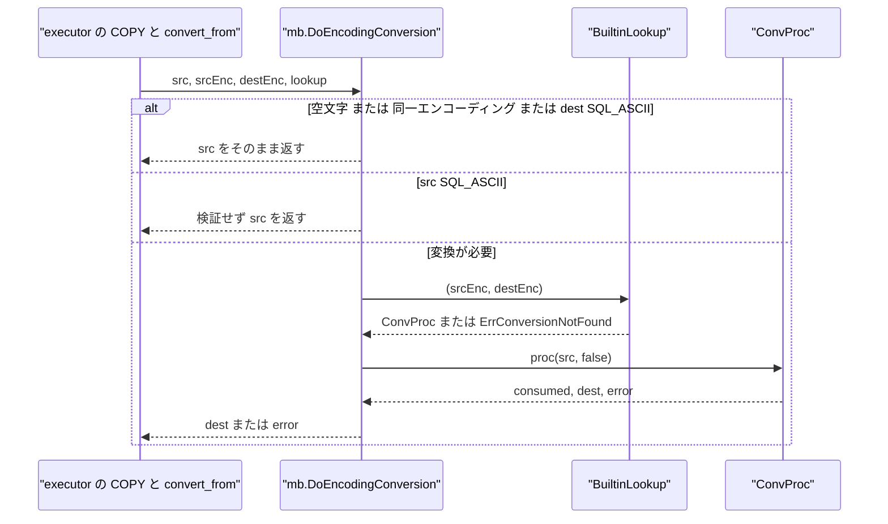
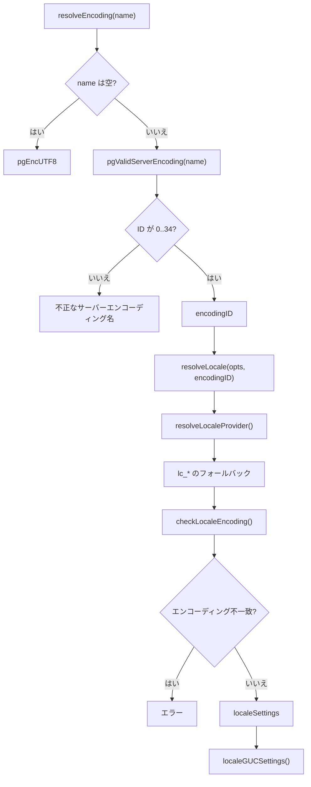

# エンコーディングとロケール

<details>
<summary>関連ソースファイル</summary>

- [`internal/catalog/encoding.go`](https://github.com/ryogrid/goopg/blob/19856410e8d497d59787e1ab35a2febb3f5953d6/internal/catalog/encoding.go)
- [`internal/initdb/encoding.go`](https://github.com/ryogrid/goopg/blob/19856410e8d497d59787e1ab35a2febb3f5953d6/internal/initdb/encoding.go)
- [`internal/initdb/locale.go`](https://github.com/ryogrid/goopg/blob/19856410e8d497d59787e1ab35a2febb3f5953d6/internal/initdb/locale.go)
- [`internal/utils/mb/conv.go`](https://github.com/ryogrid/goopg/blob/19856410e8d497d59787e1ab35a2febb3f5953d6/internal/utils/mb/conv.go)
- [`internal/utils/mb/euc_jp.go`](https://github.com/ryogrid/goopg/blob/19856410e8d497d59787e1ab35a2febb3f5953d6/internal/utils/mb/euc_jp.go)
- [`internal/utils/mb/euc_kr.go`](https://github.com/ryogrid/goopg/blob/19856410e8d497d59787e1ab35a2febb3f5953d6/internal/utils/mb/euc_kr.go)
- [`internal/utils/mb/latin1.go`](https://github.com/ryogrid/goopg/blob/19856410e8d497d59787e1ab35a2febb3f5953d6/internal/utils/mb/latin1.go)
- [`internal/utils/mb/latin2.go`](https://github.com/ryogrid/goopg/blob/19856410e8d497d59787e1ab35a2febb3f5953d6/internal/utils/mb/latin2.go)
- [`internal/utils/mb/wchar.go`](https://github.com/ryogrid/goopg/blob/19856410e8d497d59787e1ab35a2febb3f5953d6/internal/utils/mb/wchar.go)
- [`internal/utils/misc/encoding_guc.go`](https://github.com/ryogrid/goopg/blob/19856410e8d497d59787e1ab35a2febb3f5953d6/internal/utils/misc/encoding_guc.go)

</details>

このページは、goopg のエンコーディング名の解決、`goopg init` が書き込むデータベースエンコーディングとロケール設定、そして `LATIN1` / `LATIN2` / `EUC_JP` / `EUC_KR` と `UTF8` の間の変換処理を扱う。エンコーディング名の正規化表は `internal/catalog`、`internal/initdb`、`internal/utils/misc` にそれぞれ存在し、import cycle を避けるために意図的に複製されている。実際のバイト変換は [`internal/utils/mb:DoEncodingConversion`](https://github.com/ryogrid/goopg/blob/19856410e8d497d59787e1ab35a2febb3f5953d6/internal/utils/mb/conv.go) がディスパッチし、変換プロシージャは `BuiltinConversions` に登録される。`client_encoding` GUC の検証は [13.1 GUC 設定システム](13.1-GUC.md) の `CheckFn` として接続される。

## 責務

- **エンコーディング名の正規化**: [`internal/catalog/encoding.go:EncodingNameToID`](https://github.com/ryogrid/goopg/blob/19856410e8d497d59787e1ab35a2febb3f5953d6/internal/catalog/encoding.go) と [`internal/initdb/encoding.go:pgCharToEncoding`](https://github.com/ryogrid/goopg/blob/19856410e8d497d59787e1ab35a2febb3f5953d6/internal/initdb/encoding.go) が、大文字小文字・句読点を無視した名前を PostgreSQL の `pg_enc` 整数 ID に写す。`pg_enc2name` の 42 エントリと `pg_encname` の別名表を、それぞれのパッケージに複製して持つ。
- **サーバーエンコーディングの制限**: [`ValidServerEncodingName`](https://github.com/ryogrid/goopg/blob/19856410e8d497d59787e1ab35a2febb3f5953d6/internal/catalog/encoding.go) / [`pgValidServerEncoding`](https://github.com/ryogrid/goopg/blob/19856410e8d497d59787e1ab35a2febb3f5953d6/internal/initdb/encoding.go) が `PG_ENCODING_BE_LAST = 34` 以下の ID だけをサーバー側として許可する。`SJIS`、`BIG5`、`GBK`、`UHC`、`GB18030`、`JOHAB`、`SHIFT_JIS_2004` はクライアント専用であり、データベースエンコーディングにはできない。
- **`client_encoding` の検証**: [`internal/utils/misc/encoding_guc.go:checkClientEncoding`](https://github.com/ryogrid/goopg/blob/19856410e8d497d59787e1ab35a2febb3f5953d6/internal/utils/misc/encoding_guc.go) は `catalog.ValidServerEncodingName` と違い、クライアント専用を含む**すべての**既知エンコーディング名を受け付ける。`client_encoding` は接続ごとの設定だからである。
- **`goopg init` のエンコーディング決定**: [`internal/initdb/encoding.go:resolveEncoding`](https://github.com/ryogrid/goopg/blob/19856410e8d497d59787e1ab35a2febb3f5953d6/internal/initdb/encoding.go) が `-E/--encoding` を検証し、未指定なら `UTF8` を返す。未知の名前やクライアント専用名は initdb の文言で拒否する。
- **ロケールの検証と `lc_*` の生成**: [`internal/initdb/locale.go:resolveLocale`](https://github.com/ryogrid/goopg/blob/19856410e8d497d59787e1ab35a2febb3f5953d6/internal/initdb/locale.go) が `--locale-provider` と `--locale` 系の組み合わせを検証し、[`localeSettings`](https://github.com/ryogrid/goopg/blob/19856410e8d497d59787e1ab35a2febb3f5953d6/internal/initdb/locale.go) に `pg_database` 用の `datcollate` / `datctype` / `datlocale` と `lc_messages` / `lc_monetary` / `lc_numeric` / `lc_time` を詰める。
- **変換のディスパッチ**: [`internal/utils/mb/conv.go:DoEncodingConversion`](https://github.com/ryogrid/goopg/blob/19856410e8d497d59787e1ab35a2febb3f5953d6/internal/utils/mb/conv.go) が空文字・同一エンコーディング・`SQL_ASCII` の高速経路を処理し、それ以外は `ConvProcLookup` で変換プロシージャを引いて実行する。
- **文字集合変換**: LATIN1 / LATIN2 / EUC_JP / EUC_KR の各変換プロシージャが [`BuiltinConversions`](https://github.com/ryogrid/goopg/blob/19856410e8d497d59787e1ab35a2febb3f5953d6/internal/utils/mb/conv.go) に登録される。LATIN1 / LATIN2 はテーブル変換、EUC_JP は構造検証のみ、EUC_KR は `golang.org/x/text/encoding/korean` の EUCKR デコーダを使う。

## 処理フロー

### バイト列の変換経路

`DoEncodingConversion` は最初に 4 つの高速経路を判定する。空入力、`srcEnc == destEnc`、`destEnc == PG_SQL_ASCII` はそのまま返し、`srcEnc == PG_SQL_ASCII` は「宛先として妥当か」の検証が TODO のまま、そのまま返す。実際の変換が必要な場合だけ `ConvProcLookup` を呼び、取得した `ConvProc` に `noError=false` を渡す。



`ConvProc` は PostgreSQL の `conv_proc` に相当するが、エンコーディング ID は引数に取らない。変換プロシージャ自体が特定のペアに登録されているため、ディスパッチ済みのペアを前提にしている ([`conv.go:ConvProc`](https://github.com/ryogrid/goopg/blob/19856410e8d497d59787e1ab35a2febb3f5953d6/internal/utils/mb/conv.go))。`DoEncodingConversion` はプロシージャが返した `consumed` を使わず、変換後のバイト列だけを返す。

### `goopg init` のエンコーディングとロケール決定

`initdb` はオプション解析後に `resolveEncoding` でエンコーディング ID を決め、その ID を `resolveLocale` に渡す。`resolveLocale` はプロバイダを解決し、`lc_*` のフォールバックを適用し、`checkLocaleEncoding` でロケール由来のエンコーディングとの整合性を検査する。最後に `localeGUCSettings` が `postgresql.conf` に書く `lc_*` の組を返す。



`resolveEncoding` は空文字なら `pgEncUTF8` を返し、それ以外は `pgValidServerEncoding` の結果が 0 以上ならその ID、そうでなければ `goopg init: %q is not a valid server encoding name` を返す。`resolveLocale` は `--builtin-locale` / `--icu-locale` / `--icu-rules` が対応するプロバイダ以外で指定されるとエラーにし、`--locale-provider=icu` はこのビルドではサポートされず、ICU 分岐で `ICU is not supported in this build` を返す（datlocale が空なら先に `locale must be specified` になる） ([`locale.go:resolveLocale`](https://github.com/ryogrid/goopg/blob/19856410e8d497d59787e1ab35a2febb3f5953d6/internal/initdb/locale.go))。

## 主要ファイル

| ファイル | 役割 |
|---|---|
| `internal/catalog/encoding.go` | カタログ側のエンコーディング名表、ID↔名前変換、サーバーエンコーディング判定。`encoding.go:EncodingIDToName`, `encoding.go:EncodingNameToID`, `encoding.go:ValidServerEncodingName` |
| `internal/initdb/encoding.go` | `goopg init -E` の名前解決、`pg_enc` 定数、initdb 用の別名表。`encoding.go:pgCharToEncoding`, `encoding.go:pgValidServerEncoding`, `encoding.go:resolveEncoding` |
| `internal/initdb/locale.go` | ロケールプロバイダ、`lc_*` のフォールバック、エンコーディング整合性、`localeSettings`。`locale.go:resolveLocale`, `locale.go:checkLocaleEncoding`, `locale.go:localeGUCSettings` |
| `internal/utils/mb/conv.go` | 変換ディスパッチ、`ConvProc` 型、組み込み変換表、`ErrConversionNotFound`。`conv.go:DoEncodingConversion`, `conv.go:BuiltinLookup` |
| `internal/utils/mb/euc_jp.go` | EUC_JP の構造検証と ASCII 変換。非 ASCII は変換表未実装のため untranslatable。`euc_jp.go:eucJPVerifyChar`, `euc_jp.go:euc_jp_to_utf8` |
| `internal/utils/mb/euc_kr.go` | EUC_KR の構造検証と `x/text` EUCKR による双方向変換。`euc_kr.go:eucKRVerifyChar`, `euc_kr.go:euc_kr_to_utf8` |
| `internal/utils/mb/latin1.go` | ISO 8859-1 ↔ UTF8 の直接変換。`latin1.go:iso8859_1_to_utf8`, `latin1.go:utf8_to_iso8859_1` |
| `internal/utils/mb/latin2.go` | ISO 8859-2 の 128 エントリ変換表と逆引きマップ。`latin2.go:iso8859_2_to_utf8_table`, `latin2.go:utf8_to_iso8859_2` |
| `internal/utils/mb/wchar.go` | PG のエンコーディング ID、UTF8 の長さ・正当性検査、変換エラー型。`wchar.go:pgUTF8IsLegal`, `wchar.go:ErrInvalidEncoding`, `wchar.go:ErrUntranslatableChar` |
| `internal/utils/misc/encoding_guc.go` | `client_encoding` GUC の名前正規化と `CheckFn`。`encoding_guc.go:encodingNameToCanonical`, `encoding_guc.go:checkClientEncoding` |

## 公開 API / エントリポイント

```go
// catalog: カタログからの名前解決
func EncodingIDToName(id int32) string
func EncodingNameToID(name string) int32
func ValidServerEncodingName(name string) int32

// mb: 変換ディスパッチ
func DoEncodingConversion(src []byte, srcEnc, destEnc int32, lookup ConvProcLookup) ([]byte, error)
func BuiltinLookup(srcEnc, destEnc int32) (ConvProc, error)

// initdb: パッケージ内の初期化経路
func resolveEncoding(name string) (int32, error)
func resolveLocale(opts Options, encodingID int32) (localeSettings, error)
func resolveLocaleProvider(name string) (byte, error)
func pgGetEncodingFromLocale(locale string) int32
func checkLocaleEncoding(locale string, userEnc int32) bool
func (ls localeSettings) localeGUCSettings() []GUCSetting
func pgCharToEncoding(name string) int32
func pgValidServerEncoding(name string) int32
func pgEncodingToChar(enc int32) string

// misc: GUC の CheckFn
func checkClientEncoding(value string) error
```

`catalog.EncodingNameToID` は未知の名前に対して `-1` を返し、`EncodingIDToName` は範囲外の ID に対して `""` を返す。`ValidServerEncodingName` は ID が `0..34` の範囲外なら `-1` を返す。`mb.BuiltinLookup` は組み込みの 8 ペアだけを解決し、それ以外は `ErrConversionNotFound` を返す。`initdb` の関数は `initdb.Init` から呼ばれるパッケージ内 API である。

## 主要データ構造

### `localeSettings` — initdb が解決するロケール

[`internal/initdb/locale.go:localeSettings`](https://github.com/ryogrid/goopg/blob/19856410e8d497d59787e1ab35a2febb3f5953d6/internal/initdb/locale.go#L40-L54):

```go
type localeSettings struct {
	provider  byte   // datlocprovider: 'c' libc / 'b' builtin / 'i' icu
	collate   string // datcollate (text, NOT NULL)
	ctype     string // datctype   (text, NOT NULL)
	datlocale string // datlocale; "" → NULL (libc records no datlocale)
	messages  string // lc_messages GUC
	monetary  string // lc_monetary GUC
	numeric   string // lc_numeric GUC
	time      string // lc_time GUC
	// specified is true when the user passed any locale option, so Init
	// knows to seed the lc_* GUCs into postgresql.conf (when false the
	// template's commented defaults are left untouched, matching the
	// established -T/--set "no-op when unset" pattern).
	specified bool
}
```

`provider` は `pg_database.datlocprovider` の `c` / `b` / `i` で、`collate` と `ctype` は NOT NULL の `datcollate` / `datctype` になる。`datlocale` は libc では空文字（NULL）、builtin / icu では解決済みのロケール名である。`specified` が偽のとき `localeGUCSettings` は `nil` を返し、`postgresql.conf` のコメント済み既定を変更しない。

### `ConvProc` — 変換プロシージャの型

[`internal/utils/mb/conv.go:ConvProc`](https://github.com/ryogrid/goopg/blob/19856410e8d497d59787e1ab35a2febb3f5953d6/internal/utils/mb/conv.go#L21):

```go
type ConvProc func(src []byte, noError bool) (consumed int, dest []byte, err error)
```

`src` は変換元、`noError` は変換失敗時にエラーではなく途中まで返すフラグ、戻り値は消費した元バイト数・変換後バイト列・エラーである。エンコーディング ID は引数に含まれず、ディスパッチ済みのペア専用関数として `BuiltinConversions` に登録される。

### `ErrConversionNotFound` — 変換ペアがない

[`internal/utils/mb/conv.go:ErrConversionNotFound`](https://github.com/ryogrid/goopg/blob/19856410e8d497d59787e1ab35a2febb3f5953d6/internal/utils/mb/conv.go#L94-L97):

```go
type ErrConversionNotFound struct {
	SrcEnc  int32
	DestEnc int32
}
```

`SrcEnc` / `DestEnc` は解決できなかった `pg_enc` ID である。`Error()` は `default conversion function for encoding %d to %d does not exist` を返す。`BuiltinLookup` が組込みペア以外で返し、`DoEncodingConversion` はそのまま呼び出し元へ返す。

### `ErrInvalidEncoding` — 不正なバイト列

[`internal/utils/mb/wchar.go:ErrInvalidEncoding`](https://github.com/ryogrid/goopg/blob/19856410e8d497d59787e1ab35a2febb3f5953d6/internal/utils/mb/wchar.go#L120-L125):

```go
type ErrInvalidEncoding struct {
	Encoding string
	Byte     byte
	Len      int
	Bytes    []byte
}
```

`Encoding` は `"UTF8"` / `"LATIN1"` / `"EUC_JP"` などの名前、`Bytes` は問題のバイト列（最大 8 バイトがエラーメッセージに載る）、`Byte` / `Len` は LATIN1 / LATIN2 の旧来の単一バイト経路用である。`Bytes` が空なら `Byte` が使われる。メッセージは `invalid byte sequence for encoding "UTF8": 0xNN ...` の形になり、SQLSTATE は 22021 として扱われる。

### `ErrUntranslatableChar` — 変換先に表現できない文字

[`internal/utils/mb/wchar.go:ErrUntranslatableChar`](https://github.com/ryogrid/goopg/blob/19856410e8d497d59787e1ab35a2febb3f5953d6/internal/utils/mb/wchar.go#L150-L153):

```go
type ErrUntranslatableChar struct {
	SrcEncoding string
	DestEncoding string
}
```

変換元と変換先の名前だけを保持し、`Error()` は `character cannot be converted from <src> to <dest>` を返す。LATIN1 / LATIN2 の範囲外コードポイント、EUC_JP の非 ASCII、EUC_KR の U+FFFD 置換がこの型になる。SQLSTATE は 22028 として扱われる。

## 内部構造

### 3 つのエンコーディング表

`internal/catalog`、`internal/initdb`、`internal/utils/misc` はそれぞれ同じ 42 エントリの `pg_enc2name` 表を持つ。import cycle を避けるためで、catalog はカタログの `pg_encoding_to_char` / `pg_char_to_encoding`、initdb は `-E` の検証、misc は `client_encoding` GUC の正規化に使う。`clean...EncodingName` は ASCII の大文字を小文字にし、英数字以外を捨てる。そのため `UTF-8`、`utf_8`、`UTF8` は同じキーになる ([`catalog/encoding.go`](https://github.com/ryogrid/goopg/blob/19856410e8d497d59787e1ab35a2febb3f5953d6/internal/catalog/encoding.go)、[`initdb/encoding.go`](https://github.com/ryogrid/goopg/blob/19856410e8d497d59787e1ab35a2febb3f5953d6/internal/initdb/encoding.go)、[`misc/encoding_guc.go`](https://github.com/ryogrid/goopg/blob/19856410e8d497d59787e1ab35a2febb3f5953d6/internal/utils/misc/encoding_guc.go))。

catalog の `EncodingNameToID` はまず正規名を比較し、次に別名表を引く。initdb の `pgCharToEncoding` は `NAMEDATALEN` に合わせて 64 バイト以上の名前を拒否する。`EncodingNameToID` にはこの長さガードがないため、同じ名前でも経路によって受理範囲が異なる。`pgEncodingBELast = 34` は `PG_KOI8U` で、35 以上の ID はクライアント専用である。

### 変換プロシージャの登録

`BuiltinConversions` は proc OID から `ConvProc` へのマップで、初期値に LATIN1 / LATIN2 の 4 プロシージャを持ち、`builtinPair` に対応する 4 ペアが入っている。`init()` 群が EUC_JP の `4362` / `4363` と EUC_KR の `4364` / `4365` を追加し、`builtinPair` にペアを登録する。最終的に 8 ペア（LATIN1 / LATIN2 / EUC_JP / EUC_KR の各双方向）が `BuiltinLookup` で解決できる。`BuiltinLookup` はこのマップだけを引き、カタログの `pg_conversion` を参照する本番の `ConvProcLookup` とは別のフォールバックである ([`conv.go`](https://github.com/ryogrid/goopg/blob/19856410e8d497d59787e1ab35a2febb3f5953d6/internal/utils/mb/conv.go))。

`DoEncodingConversion` は `lookup` が `nil` でも組み込みにフォールバックしない。呼び出し元が `BuiltinLookup` を渡すか、カタログ検索を渡すかを選ぶ。プロシージャには常に `noError=false` が渡るため、埋め込み NUL や不正バイトはエラーになる。`consumed` は呼び出し元へ返されない。

### LATIN1 / LATIN2

LATIN1 の `iso8859_1_to_utf8` は ASCII をそのまま通し、0x80..0xFF を `[0xC0|(c>>6), 0x80|(c&0x3F)]` の 2 バイト UTF8 に展開する。逆方向の `utf8_to_iso8859_1` は 2 バイト UTF8 だけを `0x80..0xFF` の範囲で受理し、3 バイト以上のコードポイントは untranslatable にする ([`latin1.go`](https://github.com/ryogrid/goopg/blob/19856410e8d497d59787e1ab35a2febb3f5953d6/internal/utils/mb/latin1.go))。

LATIN2 は `iso8859_2_to_utf8_table` の 128 エントリで 0x80..0xFF を 2 バイト UTF8 に写し、`init()` で逆向きの `map[uint16]byte` を構築する。逆変換は 2 バイト UTF8 だけを扱い、表にないコードポイントは untranslatable になる ([`latin2.go`](https://github.com/ryogrid/goopg/blob/19856410e8d497d59787e1ab35a2febb3f5953d6/internal/utils/mb/latin2.go))。

### EUC_JP と EUC_KR

EUC_JP の `eucJPVerifyChar` は SS2 (`0x8e`) の 2 バイト、SS3 (`0x8f`) の 3 バイト、JIS X 0208 の 2 バイト、ASCII の 1 バイトを構造的に判定する。ただし `euc_jp_to_utf8` は JIS X 0208/0212 の Unicode 対応表を持たないため、構造的に正しい非 ASCII は `ErrUntranslatableChar` にし、ASCII だけを通過させる。不正な構造は `ErrInvalidEncoding` になる ([`euc_jp.go`](https://github.com/ryogrid/goopg/blob/19856410e8d497d59787e1ab35a2febb3f5953d6/internal/utils/mb/euc_jp.go))。

EUC_KR は SS2/SS3 を持たず、高位ビットが立つ 2 バイトを KS X 1001 として扱う。`euc_kr_to_utf8` は `korean.EUCKR.NewDecoder()` を使い、CP949 のスーパーセットで変換する。x/text は範囲内だが未対応のバイト対を U+FFFD に置換するため、その場合は untranslatable とする。逆方向は `korean.EUCKR.NewEncoder()` を使う ([`euc_kr.go`](https://github.com/ryogrid/goopg/blob/19856410e8d497d59787e1ab35a2febb3f5953d6/internal/utils/mb/euc_kr.go))。

### ロケールと `lc_*`

`resolveLocale` は `--lc-collate` / `--lc-ctype` / `--lc-messages` / `--lc-monetary` / `--lc-numeric` / `--lc-time` のそれぞれについて、指定値 → `--locale` → `"C"` の順にフォールバックする。`libc` の `datlocale` は空のままで、`builtin` は `C` / `C.UTF-8` / `C.UTF8` / `PG_UNICODE_FAST` だけを許可し、`C.UTF8` は `C.UTF-8` に正規化する。`C.UTF-8` / `PG_UNICODE_FAST` は `UTF8` エンコーディングを要求する。`localeGUCSettings` が返すのは `lc_messages` / `lc_monetary` / `lc_numeric` / `lc_time` の 4 つで、`lc_collate` / `lc_ctype` は `pg_database` 側に記録されるため含まれない。

`pgGetEncodingFromLocale` は `""` / `C` / `POSIX` を `SQL_ASCII` にし、それ以外は最後の `.` 以降を codeset として取り出し、`@modifier` を落として `pgValidServerEncoding` に通す。codeset が未知なら `-1` を返し、`checkLocaleEncoding` は `SQL_ASCII` または `-1` を常に互換として扱う。goopg の実行エンジンは固定の C / UTF8 ロケールで動くため、ここで解決した値は `pg_database` と `postgresql.conf` の互換サーフェスに記録されるものであり、実行時の照合順序を切り替えるものではない。

## エッジケースと不変条件

- **`SQL_ASCII` の高速経路**: `srcEnc == PG_SQL_ASCII` のとき `DoEncodingConversion` は `pg_verify_mbstr` を呼ばずにそのまま返す。コードの TODO が残っており、宛先エンコーディングとして妥当かどうかの検証は未実装である。`destEnc == PG_SQL_ASCII` も任意のバイト列をそのまま通す。
- **空文字と同一エンコーディング**: `len(src) == 0` と `srcEnc == destEnc` は変換プロシージャを呼ばずに `src` を返す。ゼロ長は常に有効である。
- **変換ペアの不足**: `BuiltinLookup` は LATIN1 / LATIN2 / EUC_JP / EUC_KR の 8 ペア以外で `ErrConversionNotFound` を返す。`DoEncodingConversion` は呼び出し元が渡した `lookup` の結果をそのまま伝える。`lookup` が `nil` の状態で変換が必要になると、呼び出し自体が panic するため、`BuiltinLookup` かカタログの検索関数を必ず渡す。
- **埋め込み NUL**: 各変換プロシージャは NUL を検出すると、`noError=false` なら `ErrInvalidEncoding`、`noError=true` ならその位置までの部分結果を返す。ディスパッチは常に `false` を渡すため、通常経路では NUL はエラーになる。
- **UTF8 の正当性**: `pgUTFMblen` は先頭バイトから 1..4 バイトを推定し、`pgUTF8IsLegal` が継続バイト、overlong、surrogate、`0xF4` 超を拒否する。`pgUTFMblen` 自体は不正な先頭バイトに対して 1 を返すが、`pgUTF8IsLegal` の `0x80..0xC1` と `0xF4` 超の検査で弾かれる。
- **LATIN1 / LATIN2 の逆変換範囲**: 逆変換は 2 バイト UTF8 だけを受理する。3 バイト以上のコードポイントは LATIN1 / LATIN2 の範囲外として `ErrUntranslatableChar` になる。LATIN1 はコードポイント `0x80..0xFF`、LATIN2 は逆引き表に存在するコードポイントだけを受理する。
- **EUC_JP の未実装変換**: 構造的に正しい EUC_JP の非 ASCII は、Unicode 対応表がないため `ErrUntranslatableChar` になる。ASCII はそのまま往復する。これはバグではなく、変換表を導入するまでの明示的な制限である。
- **EUC_KR の U+FFFD**: `x/text` の EUCKR デコーダは範囲内だが未対応のバイト対を U+FFFD に置換する。goopg はこれを PostgreSQL の untranslatable として扱う。
- **`MAX_CONVERSION_GROWTH`**: 値は 4 で、最悪のバイト膨張率として定義されている。ただし現在の `DoEncodingConversion` は最大長バッファを確保せず、各変換プロシージャが自分の出力バッファを確保する。以前の「使われない最大長バッファ」は削除されている。
- **42 エントリの表**: `pgEncNames` / `pgConvEncNames` は 42 個の正規名を持ち、ID 0 が `SQL_ASCII`、6 が `UTF8`、34 が `KOI8U` である。`pgEncodingBELast = 34` を超える 35..41 はクライアント専用で、`ValidServerEncodingName` / `pgValidServerEncoding` は拒否する。
- **名前の長さ**: `initdb.pgCharToEncoding` は `len(name) >= 64` を拒否するが、`catalog.EncodingNameToID` は長さ制限を持たない。`client_encoding` の `checkClientEncoding` も長さ制限を持たず、正規名か別名に解決できるかだけを見る。
- **クライアント専用名**: `client_encoding` は SJIS / BIG5 / GBK / UHC / GB18030 / JOHAB / SHIFT_JIS_2004 を受け付ける。データベースエンコーディングとしては同じ名前が拒否される。
- **ロケールの互換性**: `checkLocaleEncoding` は `localeEnc == userEnc`、`localeEnc == SQL_ASCII`、`localeEnc == -1`、`userEnc == SQL_ASCII` のいずれかで真になる。したがって `C` / `POSIX` ロケールや未知の codeset は、エンコーディング不一致にならない。
- **ICU 非対応**: `--locale-provider=icu` は `resolveLocaleProvider` では受理されるが、`resolveLocale` の provider 分岐で `ICU is not supported in this build` になる。`--icu-locale` / `--icu-rules` は provider が `icu` でない時点で先に拒否される。
- **`specified` の意味**: `localeSettings.specified` はロケール関連オプションが一つでも指定されたときだけ真になる。偽なら `localeGUCSettings` は `nil` を返し、`postgresql.conf` のコメント済み既定を変更しない。`--locale` だけを指定した場合も真になる。

Sources:
- `internal/catalog/encoding.go`
- `internal/initdb/encoding.go`
- `internal/initdb/locale.go`
- `internal/utils/mb/conv.go`
- `internal/utils/mb/euc_jp.go`
- `internal/utils/mb/euc_kr.go`
- `internal/utils/mb/latin1.go`
- `internal/utils/mb/latin2.go`
- `internal/utils/mb/wchar.go`
- `internal/utils/misc/encoding_guc.go`

<sub>Generated by deepwiki-4myself from `goopg` @ `19856410e`</sub>
