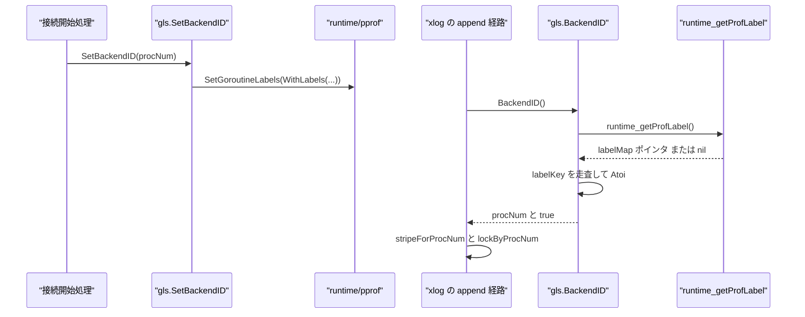
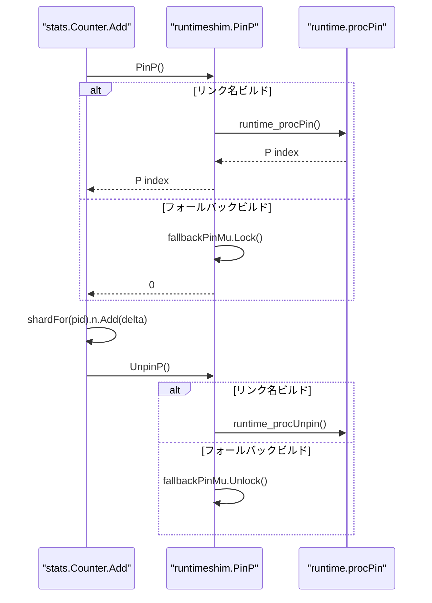

# ランタイムシムと goroutine ローカル

<details>
<summary>関連ソースファイル</summary>

- [`internal/access/transam/xlog/padded_mutex.go`](https://github.com/ryogrid/goopg/blob/19856410e8d497d59787e1ab35a2febb3f5953d6/internal/access/transam/xlog/padded_mutex.go)
- [`internal/port/gls/gls.go`](https://github.com/ryogrid/goopg/blob/19856410e8d497d59787e1ab35a2febb3f5953d6/internal/port/gls/gls.go)
- [`internal/port/gls/gls_fallback.go`](https://github.com/ryogrid/goopg/blob/19856410e8d497d59787e1ab35a2febb3f5953d6/internal/port/gls/gls_fallback.go)
- [`internal/port/gls/gls_linkname.go`](https://github.com/ryogrid/goopg/blob/19856410e8d497d59787e1ab35a2febb3f5953d6/internal/port/gls/gls_linkname.go)
- [`internal/port/runtimeshim/doc.go`](https://github.com/ryogrid/goopg/blob/19856410e8d497d59787e1ab35a2febb3f5953d6/internal/port/runtimeshim/doc.go)
- [`internal/port/runtimeshim/nanotime_fallback.go`](https://github.com/ryogrid/goopg/blob/19856410e8d497d59787e1ab35a2febb3f5953d6/internal/port/runtimeshim/nanotime_fallback.go)
- [`internal/port/runtimeshim/nanotime_linkname.go`](https://github.com/ryogrid/goopg/blob/19856410e8d497d59787e1ab35a2febb3f5953d6/internal/port/runtimeshim/nanotime_linkname.go)
- [`internal/port/runtimeshim/pinp_fallback.go`](https://github.com/ryogrid/goopg/blob/19856410e8d497d59787e1ab35a2febb3f5953d6/internal/port/runtimeshim/pinp_fallback.go)
- [`internal/port/runtimeshim/pinp_linkname.go`](https://github.com/ryogrid/goopg/blob/19856410e8d497d59787e1ab35a2febb3f5953d6/internal/port/runtimeshim/pinp_linkname.go)
- [`internal/port/runtimeshim/sema_fallback.go`](https://github.com/ryogrid/goopg/blob/19856410e8d497d59787e1ab35a2febb3f5953d6/internal/port/runtimeshim/sema_fallback.go)
- [`internal/port/runtimeshim/sema_linkname.go`](https://github.com/ryogrid/goopg/blob/19856410e8d497d59787e1ab35a2febb3f5953d6/internal/port/runtimeshim/sema_linkname.go)

</details>

このページは、Go の標準 API だけでは表現できないホットパス用プリミティブを、`//go:linkname` でランタイム内部へ限定的に接続する層を扱う。対象は、WAL の stripe 選択に使う goroutine ローカルのバックエンド ID（pprof ラベル）、単調時計 `Nanotime`、P 固定の `PinP` / `UnpinP`、ランタイムセマフォ `SemaAcquire` / `SemaRelease`、そして WAL の 8 本の append ロックをキャッシュライン分離する `paddedMutex` / `appendLockSet` である。リンク名を使うファイルと、同じ API を公開 Go API で実装するフォールバックファイルがビルドタグで対になっている。

## 責務

- **リンク名の隔離**: [`internal/port/runtimeshim/doc.go`](https://github.com/ryogrid/goopg/blob/19856410e8d497d59787e1ab35a2febb3f5953d6/internal/port/runtimeshim/doc.go) の方針どおり、ランタイム内部への `//go:linkname` は `internal/port/runtimeshim` と `internal/port/gls` に閉じ込める。呼び出し側はエクスポートされた `Nanotime`、`PinP`、`SemaAcquire` などだけを使う。
- **goroutine ローカルのバックエンド ID**: [`internal/port/gls/gls.go:SetBackendID`](https://github.com/ryogrid/goopg/blob/19856410e8d497d59787e1ab35a2febb3f5953d6/internal/port/gls/gls.go) が pprof の goroutine ラベルに `goopg_backend_id` を設定し、[`BackendID`](https://github.com/ryogrid/goopg/blob/19856410e8d497d59787e1ab35a2febb3f5953d6/internal/port/gls/gls.go) が現在のラベルを読む。`runtime.Stack` を使わず、WAL append のたびに goroutine ID を解析するコストを避ける。
- **単調時計**: [`internal/port/runtimeshim/nanotime_linkname.go:Nanotime`](https://github.com/ryogrid/goopg/blob/19856410e8d497d59787e1ab35a2febb3f5953d6/internal/port/runtimeshim/nanotime_linkname.go) が `runtime.nanotime` を直接読み、`time.Now()` の壁時計変換を挟まずにナノ秒の単調時刻を返す。サポート外のビルドでは `time.Now().UnixNano()` にフォールバックする。
- **P 固定**: [`internal/port/runtimeshim/pinp_linkname.go:PinP`](https://github.com/ryogrid/goopg/blob/19856410e8d497d59787e1ab35a2febb3f5953d6/internal/port/runtimeshim/pinp_linkname.go) が `runtime.procPin` で goroutine を現在の P に固定し、`[0, GOMAXPROCS)` の P インデックスを返す。`UnpinP` が `runtime.procUnpin` で解除する。フォールバックはグローバル `sync.Mutex` で相互排他を保証し、常に 0 を返す。
- **ランタイムセマフォ**: [`internal/port/runtimeshim/sema_linkname.go:SemaAcquire`](https://github.com/ryogrid/goopg/blob/19856410e8d497d59787e1ab35a2febb3f5953d6/internal/port/runtimeshim/sema_linkname.go) / [`SemaRelease`](https://github.com/ryogrid/goopg/blob/19856410e8d497d59787e1ab35a2febb3f5953d6/internal/port/runtimeshim/sema_linkname.go) が `sync.runtime_Semacquire` / `sync.runtime_Semrelease` に接続し、`uint32` セル 1 個の待ち行列をランタイムの park 機構で処理する。フォールバックはグローバル mutex と `sync.Cond` で同じ契約を実装する。
- **WAL stripe のキャッシュライン分離**: [`internal/access/transam/xlog/padded_mutex.go:paddedMutex`](https://github.com/ryogrid/goopg/blob/19856410e8d497d59787e1ab35a2febb3f5953d6/internal/access/transam/xlog/padded_mutex.go) が `sync.Mutex` を 64 バイトにパディングし、[`appendLockSet`](https://github.com/ryogrid/goopg/blob/19856410e8d497d59787e1ab35a2febb3f5953d6/internal/access/transam/xlog/padded_mutex.go) が 8 本の stripe を保持する。`procNum & (appendLockStripes-1)` で stripe を選び、隣接 stripe のロックが同じキャッシュラインを共有しないようにする。
- **ビルドタグによるフォールバック**: リンク名ファイルは `go1.24 && !go1.27 && !noLinkname`、フォールバックは `!go1.24 || go1.27 || noLinkname` で選択される。`noLinkname` はサポート対象のツールチェーンでも強制的にフォールバックを選ぶ運用スイッチである。

## 処理フロー

### バックエンド ID の設定と WAL stripe 選択

接続開始時に `SetBackendID(procNum)` が pprof ラベルを設定する。ラベルは `go` で起動した子 goroutine に継承される。WAL append 側では `BackendID()` が `runtime_getProfLabel` から現在の label map を取得し、`goopg_backend_id` を探して `int32` に戻す。得られた procNum は `stripeForProcNum` と `lockByProcNum` に渡され、8 本の `paddedMutex` のどれかをロックする。



`SetBackendID` は `pprof.SetGoroutineLabels(pprof.WithLabels(context.Background(), pprof.Labels(labelKey, strconv.Itoa(int(id)))))` を呼ぶだけで、ホットパスではなく接続開始時の 1 回だけの処理である。`BackendID` は `glsUsable` が偽なら即座に `(0, false)` を返し、真なら `readLabelID` でラベルを走査する。`labelKey` は `"goopg_backend_id"` で固定されている。

### `PinP` / `UnpinP` のリンク名経路とフォールバック

`stats.Counter.Add` のような per-P 処理は、`PinP` で P を固定してから P 固有のシャードを更新する。リンク名ビルドでは `runtime.procPin` / `runtime.procUnpin` が使われ、フォールバックビルドではグローバル mutex が使われる。



`PinP` と `UnpinP` の間は、チャネル送受信、待つ可能性のある mutex、syscall、STW を誘発し得る GC 可能な割り当てを行ってはならない。`SemaAcquire` は goroutine を park する可能性があるため、`PinP` ウィンドウの内側では呼べない。

## 主要ファイル

| ファイル | 役割 |
|---|---|
| `internal/access/transam/xlog/padded_mutex.go` | 64 バイトパディングの `paddedMutex`、8 stripe の `appendLockSet`、procNum からの stripe 選択。`padded_mutex.go:paddedMutex`, `padded_mutex.go:appendLockSet`, `padded_mutex.go:lockByProcNum` |
| `internal/port/gls/gls.go` | `SetBackendID` とパッケージ API、`labelKey` 定数。`gls.go:SetBackendID` |
| `internal/port/gls/gls_fallback.go` | サポート外 Go / `noLinkname` 用の `BackendID`。常に `(0,false)`。`gls_fallback.go:BackendID` |
| `internal/port/gls/gls_linkname.go` | `runtime/pprof.runtime_getProfLabel` のリンク名、ラベルレイアウトのミラー、起動時プローブ、`BackendID`。`gls_linkname.go:readLabelID`, `gls_linkname.go:probeLayout` |
| `internal/port/runtimeshim/doc.go` | リンク名の隔離・ビルドタグ・フォールバックの運用規約。 |
| `internal/port/runtimeshim/nanotime_linkname.go` | `runtime.nanotime` のリンク名と `Nanotime`。`nanotime_linkname.go:Nanotime` |
| `internal/port/runtimeshim/nanotime_fallback.go` | `time.Now().UnixNano()` による `Nanotime`。`nanotime_fallback.go:Nanotime` |
| `internal/port/runtimeshim/pinp_linkname.go` | `runtime.procPin` / `procUnpin` のリンク名と `PinP` / `UnpinP`。`pinp_linkname.go:PinP`, `pinp_linkname.go:UnpinP` |
| `internal/port/runtimeshim/pinp_fallback.go` | グローバル mutex で P 固定を模擬する `PinP` / `UnpinP`。`pinp_fallback.go:PinP` |
| `internal/port/runtimeshim/sema_linkname.go` | `sync.runtime_Semacquire` / `runtime_Semrelease` のリンク名、`SemaAcquire` / `SemaRelease`。`sema_linkname.go:SemaAcquire`, `sema_linkname.go:SemaRelease` |
| `internal/port/runtimeshim/sema_fallback.go` | `sync.Mutex` + `sync.Cond` によるセマフォのフォールバック。`sema_fallback.go:fallbackCondFor`, `sema_fallback.go:SemaAcquire` |

## 公開 API / エントリポイント

```go
// gls: goroutine ローカルのバックエンド ID
func SetBackendID(id int32)
func BackendID() (int32, bool)

// runtimeshim: ホットパス用ランタイムプリミティブ
func Nanotime() int64
func PinP() int
func UnpinP()
func SemaAcquire(s *uint32)
func SemaRelease(s *uint32)

// xlog: パッケージ内の stripe 選択
func stripeForProcNum(procNum int32) int
func (s *appendLockSet) lockByProcNum(procNum int32) (unlock func())
```

`gls.fallback` / `runtimeshim.*_fallback.go` は同じシグネチャを提供するが、ビルドタグによってどちらか一方だけがコンパイルされる。呼び出し側はビルドタグを意識せず、`PinP` の戻り値が `0` でも正しく動くように per-P 配列の長さを 1 以上にしておく必要がある。

## 主要データ構造

### `paddedMutex` — キャッシュライン分離ミューテックス

[`internal/access/transam/xlog/padded_mutex.go:paddedMutex`](https://github.com/ryogrid/goopg/blob/19856410e8d497d59787e1ab35a2febb3f5953d6/internal/access/transam/xlog/padded_mutex.go#L21-L24):

```go
type paddedMutex struct {
	mu sync.Mutex
	_  [56]byte // pad sync.Mutex (8 B) to 64 B (one cache line)
}
```

`mu` は 8 バイトの `sync.Mutex`、`_` は 56 バイトのパディングで、構造体全体を 64 バイト（一般的なキャッシュライン）に揃える。配列に並べたとき、隣接する stripe のロックが同じキャッシュラインを共有しないため、無関係な stripe をロックする writer 同士のコヒーレンストラフィックを避けられる。この型は executor 側の同名型と意図的に複製されており、WAL と executor のロック順序階層を混ぜないために共有パッケージ化されていない。

### `appendLockSet` — 8 本の WAL append stripe

[`internal/access/transam/xlog/padded_mutex.go:appendLockSet`](https://github.com/ryogrid/goopg/blob/19856410e8d497d59787e1ab35a2febb3f5953d6/internal/access/transam/xlog/padded_mutex.go#L41-L43):

```go
type appendLockSet struct {
	locks [appendLockStripes]paddedMutex
}
```

`appendLockStripes = 8` は PostgreSQL の `NUM_XLOGINSERT_LOCKS = 8` に対応する。`locks[i]` は `i` 番目の stripe を守り、`stripeForProcNum(procNum)` は `int(uint32(procNum) & (appendLockStripes-1))` で `0..7` を返す。`lockByProcNum` は選んだ `paddedMutex.mu` を `Lock` し、その `Unlock` メソッドを返す。LSN の予約は別の `insertPosTracker` が担い、stripe ロックは WAL バッファへのバイト書き込みだけを直列化する。

### `labelMirror` / `labelMapMirror` — pprof ラベルのメモリ配置

[`internal/port/gls/gls_linkname.go:labelMirror`](https://github.com/ryogrid/goopg/blob/19856410e8d497d59787e1ab35a2febb3f5953d6/internal/port/gls/gls_linkname.go#L29-L36):

```go
type labelMirror struct {
	key   string
	value string
}

type labelMapMirror struct {
	list []labelMirror
}
```

Go 1.24..1.26 の `runtime/pprof.labelMap` は `label.Set` を埋め込み、`label.Set` は `[]Label`、`Label` は `Key, Value string` である。`labelMapMirror` はその先頭のスライスだけをミラーし、`runtime_getProfLabel` が返す `unsafe.Pointer` を `*labelMapMirror` にキャストして `list` を走査する。レイアウトが変わると誤ったポインタ解釈になるため、`probeLayout` が起動時に往復プローブを行う。

## 内部構造

### ビルドタグとリンク名の対応

`runtimeshim` のリンク名ファイルは次の 3 つで、いずれも `go1.24 && !go1.27 && !noLinkname` でコンパイルされる。

| API | リンク名ターゲット | フォールバック |
|---|---|---|
| `Nanotime` | `runtime.nanotime` | `time.Now().UnixNano()` |
| `PinP` / `UnpinP` | `runtime.procPin` / `runtime.procUnpin` | `fallbackPinMu`（グローバル mutex） |
| `SemaAcquire` / `SemaRelease` | `sync.runtime_Semacquire` / `sync.runtime_Semrelease` | `fallbackSemaMu` + `sync.Cond` |

`gls` は書き込み側に `runtime/pprof.SetGoroutineLabels` という公開 API を使い、読み取り側だけを `runtime/pprof.runtime_getProfLabel` にリンクする。サポート外の Go では `gls_fallback.go` の `BackendID() (0,false)` に切り替わる。`doc.go` は「1 パッケージに全リンク名を閉じ込める」「1 フォールバックファイル/サイト」「`-race` でクリーン」「`//go:nosplit` を付けない」という規律を定めている。

### `gls` のレイアウトプローブ

`glsUsable` は `probeLayout()` の戻り値で初期化される。`probeLayout` は使い捨ての goroutine を起動し、`SetBackendID(1234567)` の後に `readLabelID()` で同じ値を読めるかを確認する。レイアウト不一致による不正ポインタ参照は `recover()` で捕捉し、プローブが失敗すれば `glsUsable=false` のままにする。以後 `BackendID` は常に `(0,false)` を返し、呼び出し側は WAL stripe 0 にフォールバックする。`BackendID` はラベルの `value` を `strconv.Atoi` で解析し、失敗したら `(0,false)` を返す。`SetBackendID` は `int32` を十進文字列にして格納するが、負値の禁止などはここでは検査しない。

### `PinP` の契約

リンク名経路では `runtime.procPin` が `m.locks` を増やし、preemption と goroutine migration を止める。`PinP` と `UnpinP` の間でブロックするとランタイムの preemption とデッドロックし得る。`defers` は動くが約 20 ns のコストがあり、サブ 100 ns のホットパスではインラインの `UnpinP` が推奨される。

フォールバックは `fallbackPinMu.Lock()` / `Unlock()` で、`PinP` は常に 0 を返す。`sync.Mutex` は再入不可なので、同じ goroutine で `UnpinP` の前に再度 `PinP` を呼ぶとデッドロックする。リンク名経路はランタイムの `m.locks` カウンタによりネストした `PinP` を許すが、goopg の本番呼び出しはネストしない前提である。

### `SemaAcquire` / `SemaRelease` の契約

リンク名経路では、`*uint32` セルのアドレスが待ち行列のキーになる。`SemaAcquire` は `*s > 0` になるまで park し、`runtime_Semacquire` がデクリメントする。`SemaRelease` は `runtime_Semrelease(s, false, 0)` でインクリメントし、同じアドレスで待つ 1 つを起こす。`handoff=false` / `skipframes=0` は `sync.Mutex.Unlock` の呼び出しと同じで、所有権の引き渡しをしない。

フォールバックはプロセス全体の `fallbackSemaMu` と、セルアドレスごとの `sync.Cond` を使う。`fallbackCondFor` は初回に `sync.NewCond(&fallbackSemaMu)` を作って `fallbackSemaConds` に格納する。この map はプロセス寿命まで単調に増え、セルは削除されない。`SemaAcquire` は `for *s == 0 { c.Wait() }` のループで spurious wake-up に耐え、`*s--` の後に mutex を解放する。`SemaRelease` は `*s++` の後に同じセルの Cond へ `Signal` する。

### `paddedMutex` と WAL stripe

`paddedMutex` の `_ [56]byte` は `sync.Mutex` の 8 バイトを 64 バイトに揃える。`appendLockSet` は値型で、`Writer` に埋め込んでもポインタで持っても配列レイアウトは変わらない。`stripeForProcNum` は `uint32(procNum)` にキャストしてから `& 7` するため、負の procNum でも `0..7` に収まる。`lockByProcNum` は選んだ stripe の `Unlock` 関数を返し、呼び出し側が defer などで解放する。

## エッジケースと不変条件

- **リンク名のサポート窓**: リンク名ファイルは Go 1.24 以上 1.27 未満でだけコンパイルされる。Go 1.27 以降、Go 1.24 未満、または `noLinkname` タグ付きのビルドではフォールバックが選ばれる。サポート窓を広げるには `!go1.27` を新しい未テスト版に上げ、実際に検証したことを明示する。
- **`gls` のレイアウト不一致**: `probeLayout` が panic を recover した場合や往復値が一致しない場合、`glsUsable` は偽になり `BackendID` は `(0,false)` を返す。このとき WAL は stripe 0 を使うため、性能は落ちるが正しさは保たれる。
- **pprof ラベルの継承**: `SetBackendID` で設定したラベルは、その後に `go` で起動した子 goroutine に継承される。goopg は goroutine ラベルをこの用途に予約しており、他のコードが同じ `goopg_backend_id` を設定してはならない。
- **ラベル値の解析失敗**: `readLabelID` は `strconv.Atoi` に失敗したら `(0,false)` を返す。`SetBackendID` は `int32` を十進化するだけなので、負値もそのまま格納され得る。`BackendID` の呼び出し側は `ok=false` と同様に扱う必要がある。
- **`PinP` 中のブロッキング禁止**: リンク名経路では preemption が無効になるため、`PinP` から `UnpinP` の間にブロックする操作を入れてはならない。`SemaAcquire` は park するので `PinP` ウィンドウ内では呼べない。`UnpinP` は対応する `PinP` なしで呼ぶと未定義である。
- **フォールバックの再入不可**: `fallbackPinMu` は `sync.Mutex` なので、同じ goroutine で `PinP` をネストするとデッドロックする。リンク名経路の `m.locks` はネストを許すが、goopg の本番コードはネストしない契約である。
- **フォールバックの P インデックス**: `PinP` は常に 0 を返す。per-P 配列を `PinP` の戻り値で索引するコードは、長さ 1 以上を確保しておかなければならない。
- **セマフォのアドレス同一性**: `SemaAcquire` はセルのアドレスで待ち行列を識別する。`*uint32` のアドレスは、同時に待つ acquirer と releaser が存在する間ずっと安定していなければならない。`SemaRelease` は `handoff=false` なので、待っている特定の goroutine へ所有権を渡す保証はない。
- **セマフォのフォールバック map**: `fallbackSemaConds` はセルごとに `sync.Cond` を作り、プロセス寿命まで保持する。セルが解放されても map からは消えないため、同じアドレスが再利用されると以前の Cond を再利用する。外部から見た契約はリンク名経路と同じである。
- **`Nanotime` の意味**: リンク名経路の値はプロセス内で単調非減少だが、壁時計ではなく、プロセス間や suspend/resume をまたいで比較できない。フォールバックは `time.Now().UnixNano()` を使うため、リンク名経路と同一のクロック源ではない。経過時間の測定以外に使ってはならない。
- **`paddedMutex` のサイズ**: `sync.Mutex` の 8 バイトに 56 バイトのパディングを足して 64 バイトにする。`appendLockStripes = 8` は `NUM_XLOGINSERT_LOCKS = 8` に対応し、`stripeForProcNum` は `procNum` の下位 3 ビットだけを使う。stripe 数と `& (n-1)` の関係は 2 の冪であることが前提である。
- **`noLinkname` の意味**: サポート対象の Go でも `-tags noLinkname` で全リンク名サイトをフォールバックに切り替えられる。フォールバックは正しさを優先し、性能はリンク名経路より大幅に低い。

Sources:
- `internal/access/transam/xlog/padded_mutex.go`
- `internal/port/gls/gls.go`
- `internal/port/gls/gls_fallback.go`
- `internal/port/gls/gls_linkname.go`
- `internal/port/runtimeshim/doc.go`
- `internal/port/runtimeshim/nanotime_fallback.go`
- `internal/port/runtimeshim/nanotime_linkname.go`
- `internal/port/runtimeshim/pinp_fallback.go`
- `internal/port/runtimeshim/pinp_linkname.go`
- `internal/port/runtimeshim/sema_fallback.go`
- `internal/port/runtimeshim/sema_linkname.go`

<sub>Generated by deepwiki-4myself from `goopg` @ `19856410e`</sub>
