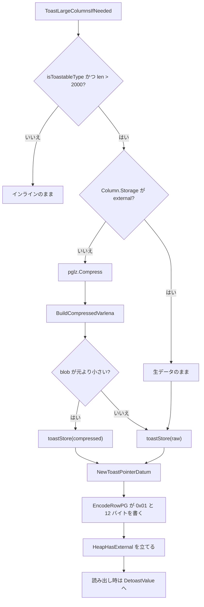
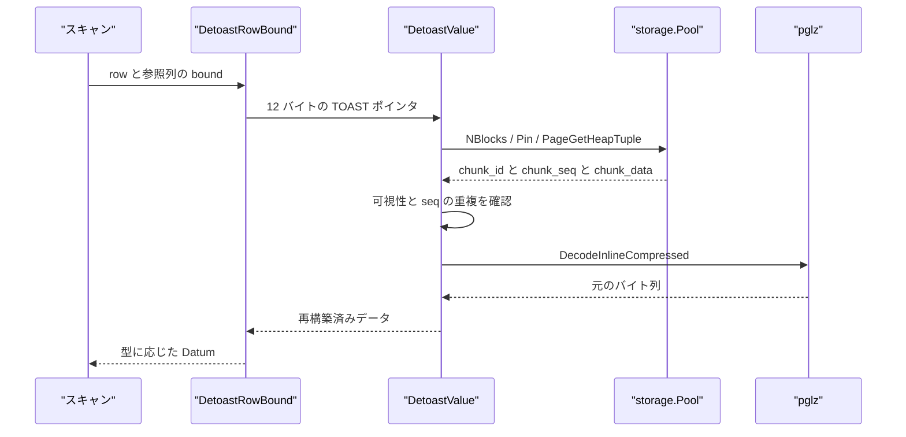

# PGLZ 圧縮と TOAST

<details>
<summary>関連ソースファイル</summary>

- [`internal/access/common/pglz/pglz.go`](https://github.com/ryogrid/goopg/blob/19856410e8d497d59787e1ab35a2febb3f5953d6/internal/access/common/pglz/pglz.go)
- [`internal/access/nbtree/pgtuple.go`](https://github.com/ryogrid/goopg/blob/19856410e8d497d59787e1ab35a2febb3f5953d6/internal/access/nbtree/pgtuple.go)
- [`internal/catalog/codec.go`](https://github.com/ryogrid/goopg/blob/19856410e8d497d59787e1ab35a2febb3f5953d6/internal/catalog/codec.go)
- [`internal/executor/codec.go`](https://github.com/ryogrid/goopg/blob/19856410e8d497d59787e1ab35a2febb3f5953d6/internal/executor/codec.go)
- [`internal/executor/expr.go`](https://github.com/ryogrid/goopg/blob/19856410e8d497d59787e1ab35a2febb3f5953d6/internal/executor/expr.go)
- [`internal/executor/toast.go`](https://github.com/ryogrid/goopg/blob/19856410e8d497d59787e1ab35a2febb3f5953d6/internal/executor/toast.go)
- [`internal/initdb/pglz.go`](https://github.com/ryogrid/goopg/blob/19856410e8d497d59787e1ab35a2febb3f5953d6/internal/initdb/pglz.go)
- [`internal/nodes/datum.go`](https://github.com/ryogrid/goopg/blob/19856410e8d497d59787e1ab35a2febb3f5953d6/internal/nodes/datum.go)
- [`internal/storage/heap.go`](https://github.com/ryogrid/goopg/blob/19856410e8d497d59787e1ab35a2febb3f5953d6/internal/storage/heap.go)
- [`internal/storage/page.go`](https://github.com/ryogrid/goopg/blob/19856410e8d497d59787e1ab35a2febb3f5953d6/internal/storage/page.go)

</details>

このページは、可変長値（varlena）を PostgreSQL の PGLZ 形式で圧縮する処理と、閾値を超えた値を `pg_toast` 相当の別リレーションへ分割格納する TOAST の実装を扱う。PGLZ は [`internal/access/common/pglz`](https://github.com/ryogrid/goopg/blob/19856410e8d497d59787e1ab35a2febb3f5953d6/internal/access/common/pglz/pglz.go) のワイヤ形式ポート、TOAST は [`internal/executor/toast.go`](https://github.com/ryogrid/goopg/blob/19856410e8d497d59787e1ab35a2febb3f5953d6/internal/executor/toast.go) のチャンク管理、ヒープ上の 13 バイト外部 varlena ポインタは [`internal/executor/codec.go`](https://github.com/ryogrid/goopg/blob/19856410e8d497d59787e1ab35a2febb3f5953d6/internal/executor/codec.go) が担う。B-tree のインデックスタプルは外部 TOAST ポインタを格納せず、8 KiB ページのタプル上限と `HEAP_HASEXTERNAL` フラグが格納可否を決める。

## 責務

- **PGLZ の圧縮・展開**: [`pglz.Compress`](https://github.com/ryogrid/goopg/blob/19856410e8d497d59787e1ab35a2febb3f5953d6/internal/access/common/pglz/pglz.go) が 4095 バイトの履歴窓と 4 バイトのハッシュ連鎖で最長一致を探し、[`pglz.Decompress`](https://github.com/ryogrid/goopg/blob/19856410e8d497d59787e1ab35a2febb3f5953d6/internal/access/common/pglz/pglz.go) が重なりコピーを含むトークン列を元の長さへ戻す。
- **varlena フレーミング**: [`BuildCompressedVarlena`](https://github.com/ryogrid/goopg/blob/19856410e8d497d59787e1ab35a2febb3f5953d6/internal/access/common/pglz/pglz.go) が `va_header` と `va_tcinfo` を付けた `VARATT_IS_4B_C` 形式を作り、[`DecodeInlineCompressed`](https://github.com/ryogrid/goopg/blob/19856410e8d497d59787e1ab35a2febb3f5953d6/internal/access/common/pglz/pglz.go) がその形式を読み戻す。PGLZ の method は 0 で、LZ4 は未実装。
- **TOAST 判定と格納**: [`ToastLargeColumnsIfNeeded`](https://github.com/ryogrid/goopg/blob/19856410e8d497d59787e1ab35a2febb3f5953d6/internal/executor/toast.go) が toast 可能な型の値について、2000 バイト超なら圧縮を試し、圧縮が効くか `STORAGE external` なら [`toastStore`](https://github.com/ryogrid/goopg/blob/19856410e8d497d59787e1ab35a2febb3f5953d6/internal/executor/toast.go) で TOAST リレーションへ分割格納する。
- **TOAST ポインタの埋め込み**: 12 バイトの `(toast_oid, total_len, num_chunks|compressed_flag)` を [`KindToastPointer`](https://github.com/ryogrid/goopg/blob/19856410e8d497d59787e1ab35a2febb3f5953d6/internal/executor/toast.go) として行に返し、[`EncodeRowPG`](https://github.com/ryogrid/goopg/blob/19856410e8d497d59787e1ab35a2febb3f5953d6/internal/executor/codec.go) がヒープ上で `0x01`（`VARATT_IS_1B_E`）+ 12 バイトの外部 varlena として書く。
- **読み出し時の再構築**: [`DetoastValue`](https://github.com/ryogrid/goopg/blob/19856410e8d497d59787e1ab35a2febb3f5953d6/internal/executor/toast.go) が TOAST リレーションを走査し、可視なチャンクを `chunk_seq` 順に連結する。圧縮フラグが立っていれば `pglz.DecodeInlineCompressed` で元の値に戻す。
- **OID の再発行防止**: [`SeedToastOIDCounter`](https://github.com/ryogrid/goopg/blob/19856410e8d497d59787e1ab35a2febb3f5953d6/internal/executor/toast.go) が起動時に既存 TOAST リレーションの最大 `chunk_id` を走査し、プロセス再起動後に同じ OID を再発行して別の行のチャンクと混ざる事故を防ぐ。
- **インデックスの非外部化**: [`FormPGIndexTuple`](https://github.com/ryogrid/goopg/blob/19856410e8d497d59787e1ab35a2febb3f5953d6/internal/access/nbtree/pgtuple.go) は外部 TOAST ポインタを受け付けず、値はデトースト済み・非圧縮のイメージとして扱う。`Storage` が `p` 以外の varlena は 1 バイト短ヘッダへ再ヘッダリングできる。
- **ページ上限**: [`internal/storage/heap.go`](https://github.com/ryogrid/goopg/blob/19856410e8d497d59787e1ab35a2febb3f5953d6/internal/storage/heap.go) の `HeapHasExternal = 0x0004` が外部 TOAST を持つタプルを示し、`MaxHeapTupleSize = 8160` / `MaxHeapTuplesPerPage = 291` が 8 KiB ページの物理上限を与える。

## 処理フロー

### 書き込み: 圧縮判定から TOAST ポインタまで

`ToastLargeColumnsIfNeeded` は行の各列を調べ、toast 可能な型（`text` / `varchar` / `char` / `bytea` / `json` / `jsonb` / `xml` など）で、NULL でなく、まだ `KindToastPointer` でない値だけを対象にする。文字列は幅付き `bpchar` の空白パディングを先に適用し、バイト列はそのまま使う。2000 バイトを超えると、`STORAGE` が `external` でない限り PGLZ を試し、圧縮結果が元より小さければ圧縮 varlena を、そうでなければ生データをチャンクへ分割する。



`toastStore` は値 OID を [`toastNextOID`](https://github.com/ryogrid/goopg/blob/19856410e8d497d59787e1ab35a2febb3f5953d6/internal/executor/toast.go) で採番し、最大 `ToastMaxChunkSize = 1996` バイトずつ `chunk_id` / `chunk_seq` / `chunk_data` の 3 列からなる TOAST タプルへ書く。戻り値はビッグエンディアンの 12 バイトで、`num_chunks` の最上位ビットを圧縮フラグに使う。メインの行にはこの 12 バイトを `KindToastPointer` として返す。

### 読み出し: チャンク走査と再構築

スキャンは `HEAP_HASEXTERNAL` が立っている行だけを対象に TOAST ポインタを解決する。`DetoastRowBound` は参照される列の範囲だけをデトーストし、`DetoastValue` が TOAST リレーションの全ブロックを走査して同じ OID のチャンクを集める。現状は (`chunk_id, chunk_seq`) の専用インデックスを持たず、リレーションの順次走査である。



`DetoastValue` はポインタ長が 12 か、`totalLen` が `maxDetoastTotalLen` 以下か、`numChunks` が `maxDetoastChunks = 1<<20` 以下かを検査する。各チャンクは MVCC 可視性を確認してから読み、`chunk_seq` が範囲内のものだけを採用する。再構築後のバイト列に圧縮フラグが立っていれば `pglz.DecodeInlineCompressed` を通す。`DetoastAttr` は 1 列、`DetoastRow` は行全体、`DetoastRowBound` は指定された前置範囲だけを処理する。

## 主要ファイル

| ファイル | 役割 |
|---|---|
| `internal/access/common/pglz/pglz.go` | PGLZ の圧縮・展開、`VARATT_IS_4B_C` varlena の構築・解析。`pglz.go:Compress`, `pglz.go:Decompress`, `pglz.go:BuildCompressedVarlena`, `pglz.go:DecodeInlineCompressed` |
| `internal/executor/toast.go` | TOAST 閾値判定、PGLZ 試行、チャンク格納、OID 採番・再シード、デトースト。`toast.go:ToastLargeColumnsIfNeeded`, `toast.go:toastStore`, `toast.go:DetoastValue` |
| `internal/executor/codec.go` | 外部 varlena `0x01 + 12 バイト` のエンコード、短ヘッダ/4 バイトヘッダ/4B_C のデコード、`HEAP_HASEXTERNAL` 判定ヘルパ。`codec.go:encodeRowPGCtx`, `codec.go:decodePhysicalPGVarlena`, `codec.go:pgRowHasExternal` |
| `internal/access/nbtree/pgtuple.go` | B-tree インデックスタプルの varlena ヘッダ処理と外部 TOAST の拒否。`pgtuple.go:PGIndexAttr`, `pgtuple.go:FormPGIndexTuple`, `pgtuple.go:pgVarSizeAny` |
| `internal/catalog/codec.go` | `pg_attribute` の `attstorage` / `attcompression` を含む列定義。`codec.go:PGAttributeColumns` |
| `internal/executor/expr.go` | `pg_relation_size` が TOAST リレーションを含める処理と `pg_column_size` の表示サイズ計算。`expr.go:pg_column_size` |
| `internal/initdb/pglz.go` | ブートストラップ `pg_node_tree` 用の PGLZ 済み varlena 生成。`pglz.go:pglzVarlenaDatum` |
| `internal/nodes/datum.go` | text 系と bytea の元になる varlena ペイロード、および numeric / bit / 日付時刻の varlena 生成。`datum.go:textVarlena`, `datum.go:NewNumericConst` |
| `internal/storage/heap.go` | `HeapHasExternal`、`MaxHeapTupleSize`、`MaxHeapTuplesPerPage`、TOAST チャンク行のページ配置。`heap.go:HeapHasExternal`, `heap.go:PageAddHeapTuple` |
| `internal/storage/page.go` | `BlockSize = 8192` と `SizeOfPageHeaderData = 24`、ページ初期化。`page.go:BlockSize`, `page.go:InitPage` |

## 公開 API / エントリポイント

```go
// pglz: 圧縮形式
func Compress(data []byte) []byte
func Decompress(src []byte, rawSize int) ([]byte, error)
func BuildCompressedVarlena(compressed []byte, rawSize int) []byte
func DecodeInlineCompressed(data []byte) ([]byte, int, error)

// executor: TOAST
func ToastLargeColumnsIfNeeded(ctx *Context, rel storage.RelFileNode, cols []catalog.Column, row Row) (Row, error)
func DetoastValue(ctx *Context, toastRel storage.RelFileNode, pointer []byte) ([]byte, error)
func DetoastAttr(ctx *Context, mainRel storage.RelFileNode, col catalog.Column, d Datum) (Datum, error)
func DetoastRow(ctx *Context, mainRel storage.RelFileNode, cols []catalog.Column, row Row) (Row, error)
func DetoastRowBound(ctx *Context, mainRel storage.RelFileNode, cols []catalog.Column, row Row, bound int) (Row, error)
func ToastRelFor(mainRel storage.RelFileNode) storage.RelFileNode
func MaxToastChunkIDInRel(pool *storage.Pool, toastRel storage.RelFileNode) (uint32, bool, error)
func SeedToastOIDCounter(pool *storage.Pool, mainRels []storage.RelFileNode) error
func AdvanceToastOIDCounterPast(used uint32)
func DetoastValueCalls() int64
func ResetDetoastValueCalls()

// executor/codec: PG 物理行
func EncodeRowPG(cols []catalog.Column, row Row) ([]byte, error)
func EncodeRowPGCtx(cols []catalog.Column, row Row, ctx *Context, pos int) ([]byte, error)

// btree: インデックスタプル
func FormPGIndexTuple(attrs []PGIndexAttr, values [][]byte, isnull []bool, tid storage.ItemPointer) ([]byte, error)
func DeformPGIndexTuple(raw []byte, attrs []PGIndexAttr, natts int) ([][]byte, []bool, error)
```

`toastStore`、`detoastedDatumForType`、`pglzVarlenaDatum` はパッケージ内の実装関数である。`pglz.Compress` は varlena ヘッダを含まない生トークン列を返すため、単体で保存する場合は `BuildCompressedVarlena` で包む。`DetoastValue` は `Context.Pool` が必要で、`DetoastAttr` は非ポインタの Datum をそのまま返す。

## 主要データ構造

### `PGIndexAttr` — インデックス属性の物理情報

[`internal/access/nbtree/pgtuple.go:PGIndexAttr`](https://github.com/ryogrid/goopg/blob/19856410e8d497d59787e1ab35a2febb3f5953d6/internal/access/nbtree/pgtuple.go#L123-L136):

```go
type PGIndexAttr struct {
	// Len is attlen: > 0 fixed width, -1 varlena, -2 cstring.
	Len int16
	// ByVal is attbyval.
	ByVal bool
	// AlignBy is attalignby: 1, 2, 4 or 8 (the decoded form of attalign).
	AlignBy uint8
	// Storage is attstorage: 'p' plain, 'e' external, 'm' main, 'x' extended.
	Storage byte
}
```

`Len > 0` は固定長、`-1` は varlena、`-2` は cstring である。`AlignBy` は 1/2/4/8 の整列幅、`Storage` は `plain` / `external` / `main` / `extended` に対応する。`Len == -1 && Storage != 'p'` の属性だけが `packable()` となり、1 バイト短ヘッダへの再ヘッダリング対象になる。外部 TOAST ポインタは `pgVarSizeAny` が明示的に拒否し、インデックスには格納されない。

### `HeapTupleHeader` — `HEAP_HASEXTERNAL` を持つ行ヘッダ

[`internal/storage/heap.go:HeapTupleHeader`](https://github.com/ryogrid/goopg/blob/19856410e8d497d59787e1ab35a2febb3f5953d6/internal/storage/heap.go#L372-L380):

```go
type HeapTupleHeader struct {
	Xmin      TransactionID
	Xmax      TransactionID
	Xvac      TransactionID
	CTID      ItemPointer
	Infomask  uint16
	Infomask2 uint16
	Hoff      uint8
}
```

`Infomask` の `HeapHasExternal = 0x0004` が「外部に格納された属性（TOAST ポインタ）を持つ」ことを示す。`Infomask2` の下位 11 ビットは `HeapNattsMask = 0x07FF` で属性数を持ち、`Hoff` は行データの開始オフセットである。`pgRowHasExternal` が `KindToastPointer` を一つでも見つけたとき `HEAP_HASEXTERNAL` を立て、読み出し側の `scanNeedsDetoast` がこのビットで列走査を省略する。`HeapHasVarWidth = 0x0002` は varlena の有無を示す別のビットである。

## 内部構造

### PGLZ のワイヤ形式

圧縮 varlena は 3 部分からなる。

```text
[4B va_header = (totalSize << 2) | 0x02]  // VARATT_IS_4B_C
[4B va_tcinfo = rawSize | (method << 30)] // PGLZ = 0
[PGLZ token stream]
```

`Compress` は生のトークン列だけを返し、`BuildCompressedVarlena` が上の 8 バイトを付ける。`Decompress` は制御バイト 1 個につき 8 トークンを読み、ビットが 1 なら 2 バイト（長さが 18 以上ならさらに 1 バイト）の一致、0 なら 1 バイトのリテラルとして扱う。一致の長さは最小 3、最大 273、オフセットは最大 4095 である。`off < length` の重なり一致は 1 バイトずつ複製する。`Decompress` は出力長が `rawSize` と一致しない場合や、オフセットが 0 または出力開始より前を指す場合にエラーを返す。

`Compress` は 4096 個のハッシュバケット `head` と、位置のリング `ring` を使う。`histIdx` は次の 4 バイト（末尾では 1 バイト）のハッシュで、`addPos` が同じハッシュの鎖を更新する。`goodMatch = 128` / `goodDrop = 10` は履歴探索を打ち切る戦略パラメータで、同一ハッシュの候補だけをたどるため、反復の多い入力でも二次関数的な全探索にはならない。圧縮結果は PostgreSQL とバイト一致しないことがあるが、PGLZ のトークン列として有効であり、どちらの実装でも展開できる。

### TOAST の格納形式

TOAST リレーションはメインの `RelFileNode` の `RelOid + 100_000_000` で作られ、`ToastRelFor` がこれを返す。チャンク表の列は `chunk_id int4`、`chunk_seq int4`、`chunk_data bytea` の 3 列である。`toastStore` は `ToastMaxChunkSize = 1996` バイトずつ切り、可視性・XID・コマンド ID を付けた通常のヒープタプルとして `writeHeapTupleToRel` で書き込む。TOAST リレーションは FSM/VM の追跡対象外で、書き込みごとに WAL のヒープ挿入ログを出す。

メイン行に埋め込む 12 バイトポインタのレイアウトは次のとおり。

```text
[0:4]   toast_oid      uint32 big-endian
[4:8]   total_len      uint32 big-endian（圧縮時は圧縮 varlena の物理長）
[8:12]  num_chunks     uint32 big-endian、最上位ビット = compressed フラグ
```

`num_chunks` の最上位ビットは `toastCompressedFlag = 1 << 31` で、`numChunks` は上限 `maxDetoastChunks = 1 << 20` より十分小さいため衝突しない。圧縮フラグが立っていると、チャンクを連結した結果は `pglz.BuildCompressedVarlena` が作った varlena であり、`DetoastValue` が `DecodeInlineCompressed` で元の値に戻す。

### 閾値とポリシー

`ToastThreshold = 2000` はメイン行にインラインで置く最大長、`ToastMaxChunkSize = 1996` は 1 チャンクの最大ペイロードである。`pglzToastThreshold = 2048` は initdb のブートストラップ `pg_node_tree` 用で、executor の 2000 とは別の定数である。`ToastLargeColumnsIfNeeded` は `col.Storage == "external"` の列では圧縮を試さず、生データをそのままチャンク化する。`pglz.Compress` が nil を返す空入力や、圧縮結果が元より小さくならない場合は生データを選ぶ。

`catalog.Column.Compression` は `pg_attribute.attcompression` を `pg_dump` とラウンドトリップするための記録であり、現在の `ToastLargeColumnsIfNeeded` はこのフィールドを参照しない。実際に試す圧縮は PGLZ だけで、LZ4 は `pglz` パッケージでも未実装である。`internal/catalog/codec.go` の `PGAttributeColumns` も `attstorage` と `attcompression` を列として持つが、TOAST の実行時判断は `Column.Storage` と型名で行われる。

### デトーストと可視性

`DetoastValue` は TOAST リレーションの全ブロックを走査し、`TupleVisible` で可視なタプルだけを読む。`chunk_id` が一致し、`chunk_seq` が `0..numChunks-1` のものを採用する。同じ `chunk_seq` が複数見つかった場合は最初の 1 個だけを数え、後から見つかったもので上書きする。専用のチャンクインデックスは未実装で、値のチャンクがすべて見つかった時点で走査を打ち切るが、見つからないチャンクがあっても最終的な個数検証は行わない。このため、破損したポインタでは見つかったチャンクだけを連結した短い結果が返り得る。

`SeedToastOIDCounter` は起動時に各メインリレーションの TOAST リレーションを走査し、物理的に存在するタプルの最大 `chunk_id` を求めて `AdvanceToastOIDCounterPast` に渡す。`toastOIDCounter` はプロセス内の `atomic.Int64` で、再起動後も既存チャンクと衝突しないようにシードされる。`MaxToastChunkIDInRel` は可視性を無視して全タプルを読むため、削除済みだが物理的に残るチャンクの ID も再利用しない。

### 行コーデックとインデックス

`EncodeRowPG` / `encodeRowPGCtx` は `KindToastPointer` を `0x01` の外部 varlena マーカーと 12 バイトのポインタで書き、4 バイト境界に整列する。`0x01` は通常のデータ varlena の長さとして解釈できない値なので、12 文字の文字列の old `0x1B` 衝突を避けている。`decodePhysicalPGVarlena` は短ヘッダ、`4B_U`、`4B_C` を扱い、外部 `0x01` は「external varlena not supported」として拒否する。TOAST ポインタは呼び出し側が `NewToastPointerDatum` に変換する。

B-tree は `FormPGIndexTuple` で外部ポインタを拒否し、`pgVarSizeAny` も `0x01` をエラーにする。インデックス値はデトースト済みで、短ヘッダ化は `packable` と `pgCanMakeShort` の条件を満たす varlena に限る。`FormPGIndexTuple` のコメントどおり、`TOAST_INDEX_HACK` の外部デトーストや `TOAST_INDEX_TARGET` 超のインライン圧縮はここでは行わない。

### ページとサイズ観測

`BlockSize = 8192`、`SizeOfPageHeaderData = 24`、`MaxHeapTupleSize = 8160`、`MaxHeapTuplesPerPage = 291` がストレージ層の物理上限である。TOAST チャンク行は 3 列で、1 チャンク 1996 バイトに抑えることで 8 KiB ページに収める。`pg_relation_size` は `ToastRelFileNode` を引いて TOAST リレーションのサイズも合計する。一方、`pg_column_size` は現在 `len(v.Format())` を返すだけで、圧縮・外部化後の物理バイト数を測る実装ではない。

## エッジケースと不変条件

- **PGLZ の空入力**: `Compress(nil)` と `Compress([]byte{})` は `nil` を返す。`BuildCompressedVarlena(nil, 0)` は 8 バイトのヘッダだけを作るが、通常の TOAST 経路は空値を対象にしない。
- **PGLZ の壊れた入力**: `Decompress` は `rawSize < 0`、トークンの切り詰め、拡張バイトの不足、オフセット 0、出力開始より前のオフセット、最終長の不一致をエラーにする。`DecodeInlineCompressed` は varlena の `total` が 8 未満または入力長を超える場合、method が PGLZ 以外の場合も拒否する。
- **圧縮の採用条件**: TOAST は `len(blob) < len(data)` のときだけ圧縮を採用する。`pglzVarlenaDatum` は `8 + len(compressed) >= len(data) + 4` のとき非圧縮に戻す。同じ「小さくならなければ生」という方針だが、比較するヘッダ込みの長さが異なる。
- **圧縮方式**: `CompressionMethodPGLZ = 0` だけが実装されている。`va_tcinfo` の上位 2 ビットが 1（LZ4）や未知の値なら `DecodeInlineCompressed` はエラーになる。`Column.Compression` に `lz4` が記録されていても、TOAST の実行時経路は LZ4 を使わない。
- **TOAST 対象型**: `isToastableType` は `text` / `varchar` / `character varying` / `char` / `character` / `bpchar` / `bytea` / `unknown` / `json` / `jsonb` / `xml` だけを対象にする。`text[]` や `pg_node_tree` などはこの関数では toast されず、別の経路が必要である。
- **`STORAGE external`**: `col.Storage == "external"` の列は圧縮せず、生データを分割格納する。`main` / `extended` / `plain` など、それ以外の値は PGLZ を試す。`Column.Compression` はこの判定に参加しない。
- **ポインタ長**: `DetoastValue` は 12 バイト以外のポインタを拒否する。`totalLen` は `maxDetoastChunks * ToastMaxChunkSize` 以下、`numChunks` は `1<<20` 以下でなければならない。`totalLen > 0` で `numChunks <= 0` の場合はエラー、`totalLen > numChunks*1996` もエラーになる。
- **チャンク欠落**: `DetoastValue` は `numChunks` 個すべてを見つけたかを最後に検査しない。可視チャンクが見つからない場合、見つかった分だけを連結した短い結果を返し得る。また `totalLen` と実際の連結長の一致も検証しない。
- **チャンクの可視性**: `DetoastValue` は `TupleVisible` を通ったタプルだけを使う。TOAST チャンクは通常のヒープタプルなので、MVCC の可視性ルールがそのまま適用される。
- **OID の再利用**: `toastOIDCounter` はプロセス再起動でリセットされ得るが、`SeedToastOIDCounter` が既存の物理チャンクの最大 ID を超えるまで進める。`MaxToastChunkIDInRel` は可視性を無視して物理タプルを読むため、削除済みチャンクの ID も再利用しない。
- **外部 varlena の衝突回避**: ヒープ上の外部ポインタは `0x01` で始まる 13 バイトである。旧 `0x1B` は 12 文字の文字列の varlena ヘッダと衝突したため、`0x01` に変更された。`decodePhysicalPGVarlena` は `0x01` を外部参照として拒否し、呼び出し側が TOAST ポインタとして処理する。
- **B-tree の非外部化**: インデックスには外部 TOAST ポインタを格納できない。`FormPGIndexTuple` と `pgVarSizeAny` は `0x01` を拒否し、`PGIndexImageInline` は `1B_E` をインラインと見なさない。インデックス値はデトースト済みでなければならない。
- **ページ上限**: `MaxHeapTupleSize` は 8160 バイト、`MaxHeapTuplesPerPage` は 291 である。TOAST チャンクを 1996 バイトに制限するのは、チャンク行のタプルヘッダと 3 列のデータを 8 KiB ページに収めるためである。
- **サイズ関数の限界**: `pg_relation_size` はメインと TOAST の両方を合計するが、`pg_column_size` は `len(v.Format())` を返すだけで、圧縮後の物理長や外部チャンクの長さを測らない。サイズの観測にはこの差がある。

Sources:
- `internal/access/common/pglz/pglz.go`
- `internal/access/nbtree/pgtuple.go`
- `internal/catalog/codec.go`
- `internal/executor/codec.go`
- `internal/executor/expr.go`
- `internal/executor/toast.go`
- `internal/initdb/pglz.go`
- `internal/nodes/datum.go`
- `internal/storage/heap.go`
- `internal/storage/page.go`

<sub>Generated by deepwiki-4myself from `goopg` @ `19856410e`</sub>
