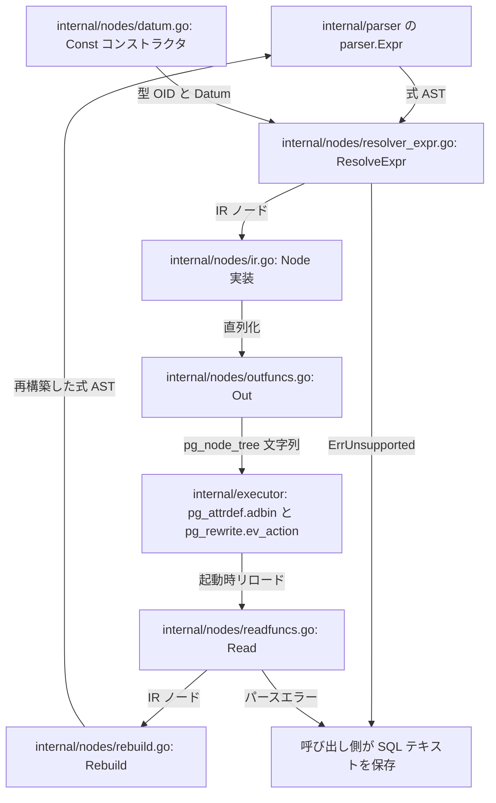

# ノード IR とシリアライズ

<details>
<summary>関連ソースファイル</summary>

- [`internal/nodes/datum.go`](https://github.com/ryogrid/goopg/blob/19856410e8d497d59787e1ab35a2febb3f5953d6/internal/nodes/datum.go)
- [`internal/nodes/ir.go`](https://github.com/ryogrid/goopg/blob/19856410e8d497d59787e1ab35a2febb3f5953d6/internal/nodes/ir.go)
- [`internal/nodes/outfuncs.go`](https://github.com/ryogrid/goopg/blob/19856410e8d497d59787e1ab35a2febb3f5953d6/internal/nodes/outfuncs.go)
- [`internal/nodes/readfuncs.go`](https://github.com/ryogrid/goopg/blob/19856410e8d497d59787e1ab35a2febb3f5953d6/internal/nodes/readfuncs.go)
- [`internal/nodes/rebuild.go`](https://github.com/ryogrid/goopg/blob/19856410e8d497d59787e1ab35a2febb3f5953d6/internal/nodes/rebuild.go)
- [`internal/nodes/resolver_expr.go`](https://github.com/ryogrid/goopg/blob/19856410e8d497d59787e1ab35a2febb3f5953d6/internal/nodes/resolver_expr.go)
- [`internal/nodes/resolver_query.go`](https://github.com/ryogrid/goopg/blob/19856410e8d497d59787e1ab35a2febb3f5953d6/internal/nodes/resolver_query.go)
- [`internal/nodes/unsupported.go`](https://github.com/ryogrid/goopg/blob/19856410e8d497d59787e1ab35a2febb3f5953d6/internal/nodes/unsupported.go)

</details>

`internal/nodes` は、goopg の SQL 式を PostgreSQL 18 の `pg_node_tree`(S 式テキスト)と 1 対 1 に対応する中間表現(IR)へ変換し、その IR をバイト単位で PostgreSQL 互換に直列化・復元するサブシステムである。入力はパーサが作る `parser.Expr` と、カタログの型・演算子・関数 OID であり、出力は `pg_attrdef.adbin` や `pg_rewrite.ev_action` にそのまま格納できる文字列になる(`internal/nodes/resolver_expr.go:ResolveExpr`、`internal/nodes/outfuncs.go:Out`)。

逆向きの経路も同じパッケージが担う。起動時のカタログリロードは保存済みの `pg_node_tree` を `Read` で IR に戻し、`Rebuild` で `parser.Expr` に再構築する(`internal/nodes/readfuncs.go:Read`、`internal/nodes/rebuild.go:Rebuild`)。つまりこのサブシステムは「式 → IR → バイト列」と「バイト列 → IR → 式」の両方向を持ち、どちらも途中で諦める場合は **部分出力せず** 呼び出し側を SQL テキスト保存へ退避させる。

## コンポーネント

- [14.1 式 IR とリゾルバ](14-Node-IR/14.1-Expression-IR.md) — `parser.Expr` を IR へ畳む順方向(`ResolveExpr` / `ResolveViewQuery`)と、IR を `parser.Expr` へ戻す逆方向(`Rebuild` / `RebuildViewQuery`)。`Const.Datum` の組み立てと型付け規則もここで扱う。
- [14.2 PG 互換ノードシリアライザ](14-Node-IR/14.2-PG-NodeTree.md) — IR と `pg_node_tree` テキストの相互変換(`Out` / `OutList` / `Read`)、`pg_attrdef` / `pg_rewrite` への書き込み、initdb のシード、`pg_get_viewdef` の整形。

## サブシステム図



## データフロー

1. **式の解析。** パーサが `parser.Expr` を返す。列 DEFAULT なら `ResolveForColumnTypmod`、ビューなら `ResolveViewQuery` が入口になる(`internal/nodes/resolver_expr.go:ResolveForColumnTypmod`、`internal/nodes/resolver_query.go:ResolveViewQuery`)。
2. **IR への解決。** `ResolveExpr` は `resolve` の型スイッチでリテラル・単項演算・キャスト・二項演算子・関数呼び出し・CASE・`IS NULL` 系を振り分け、各ノードの結果型 OID を返す。演算子と関数の OID はカタログの索引で決まる(`internal/nodes/resolver_expr.go:resolve`、`buildOpExpr`、`buildFuncExpr`)。
3. **`Datum` の構築。** `Const` は `datum.go` のコンストラクタ(`NewInt4Const`、`NewTextConst`、`NewNumericConst` など)で作る。by-value 型は 8 バイトのリトルエンディアン語、by-reference 型は varlena の生バイトを保持する(`internal/nodes/datum.go:byvalWord`、`textVarlena`)。
4. **直列化。** `Out` が `outNode` でタグ付き S 式を組み立て、`wInt`/`wBool`/`wNodeList`/`outDatum` が PostgreSQL の `outfuncs.c` と同じフィールド順・同じ表記を書く(`internal/nodes/outfuncs.go:Out`、`outConst`)。
5. **保存。** 呼び出し側は得た文字列を `pg_attrdef.adbin` または `pg_rewrite.ev_action` に書く。前者は先頭 `{`、後者は先頭 `({` が正規形の目印になる。
6. **読み戻し。** リロードは `Read` で IR に戻し、`Rebuild` で `parser.Expr` に再構築する。`Rebuild` は暗黙キャストを `funcformat` で判別して巻き戻すため、`Resolve → Rebuild → Resolve` が不動点になる(`internal/nodes/rebuild.go:rebuildFuncExprWith`)。
7. **退避。** `resolve` が `ErrUnsupported` を返すか、`Read` が未知タグ・未知フィールド値を見つけると、呼び出し側はその式を SQL テキストとして保存する。部分的に正規化されたノード木は決して書かれない(`internal/nodes/unsupported.go:SupportsExpr`)。

## 共有データ型

このサブシステムの語彙は `Node` と、その実装である `Const` / `FuncExpr` である。リゾルバ・ライター・リーダー・再構築の 4 者はすべてこの形を介して受け渡す。

```go
// Node is the interface implemented by every canonical pg_node_tree IR node.
// nodeTag returns the uppercase S-expression label PostgreSQL writes after the
// opening brace (e.g. "CONST"), matching WRITE_NODE_TYPE in outfuncs.c.
type Node interface {
	nodeTag() string
}
```

`internal/nodes/ir.go:Node`(25 行目)。`nodeTag()` が非公開なので実装できるのは `internal/nodes` パッケージ内だけであり、`Out` のタグ文字列と `Read` のタグ判定が同じ語彙に閉じる。`Node` は nil を取りうる(`Out(nil)` は `<>`、`Read("<>")` は `(nil, nil)`)。

```go
type Const struct {
	ConstType   uint32 // consttype  (type OID)
	ConstTypmod int32  // consttypmod
	ConstCollid uint32 // constcollid (collation OID; 100 = default for text)
	ConstLen    int32  // constlen    (typlen; -1 for varlena)
	ConstByval  bool   // constbyval
	ConstIsNull bool   // constisnull
	Location    int32  // location    (parse location; -1 when normalized)
	Datum       []byte // constvalue wire bytes (see comment above)
}
```

`internal/nodes/ir.go:Const`(35 行目)。`ConstType`/`ConstLen`/`ConstByval`/`ConstCollid` は `pg_type` の組み合わせとして整合していなければならない(例: `int4` = 23/4/true/0、`text` = 25/-1/false/100)。`Datum` は by-value なら常に 8 バイト、by-reference なら varlena 全体で、`ConstIsNull` が真のときは無視される。`Location` は正規化後 `-1` に固定される。

```go
type FuncExpr struct {
	Funcid         uint32 // funcid
	Funcresulttype uint32 // funcresulttype
	Funcretset     bool   // funcretset
	Funcvariadic   bool   // funcvariadic
	Funcformat     int32  // funcformat (CoercionForm enum)
	Funccollid     uint32 // funccollid
	Inputcollid    uint32 // inputcollid
	Args           []Node // args
	Location       int32  // location
}
```

`internal/nodes/ir.go:FuncExpr`(49 行目)。キャスト・関数呼び出し・長さ強制のすべてがこの 1 型に集約される。`Funcformat` が 0(明示呼び出し)/1(明示キャスト)/2(暗黙キャスト)のどれかで、`Rebuild` が `parser.FuncCall` に戻すか `parser.CastExpr` に戻すか、あるいは引数へ透過するかが決まる。`Args` の型並びと `Funcid` は `catalog.LookupProcForNode` の結果として一致していなければならない。

## 主要な設計判断

- **バイト一致が最優先。** フィールド順・`Datum` の符号付き 10 進表記・`<>` の使い方まで PostgreSQL 18 の `nodeToString` に合わせる。ずれは「動くが別物」ではなく、ホスト側 PostgreSQL の `stringToNode` 失敗や誤った `Datum` の評価に直結する。
- **全か無か。** 式の一部だけを正規化して保存することはしない。`ErrUnsupported` は異常ではなく「SQL テキストで保存せよ」という正常な分岐シグナルであり、`SupportsExpr` がその判定を述語化している。
- **2 形式の同居。** 同じ列に「正規 `pg_node_tree`」と「従来の SQL テキスト」が混在し、先頭バイト(`{` / `({`)で判別する。リーダーは正規形を読めない場合にエラーを返し、呼び出し側がテキスト経路へ落ちる。
- **クエリ木 IR は PostgreSQL より狭い。** `Query` はビュー形状の一部フィールドしか持たず、残りはライターが既定値で埋める。リーダーはその既定値からの逸脱を検出して「このビューは正規形ではない」と判断する。
- **書き込み側の破損は panic、読み取り側の破損は error。** ライターが未知のノード型に出会うのはプログラマの誤りなので即座に落とし、外部から来たバイト列を読むリーダーはエラーを返して呼び出し側に判断を委ねる。

関連ページ: [14.1 式 IR とリゾルバ](14-Node-IR/14.1-Expression-IR.md)、[14.2 PG 互換ノードシリアライザ](14-Node-IR/14.2-PG-NodeTree.md)、[4 SQL パーサー](4-SQL-Parser.md)、[12 カタログとシステムビュー](12-Catalog.md)。

Sources:
- internal/nodes/datum.go
- internal/nodes/ir.go
- internal/nodes/outfuncs.go
- internal/nodes/readfuncs.go
- internal/nodes/rebuild.go
- internal/nodes/resolver_expr.go
- internal/nodes/resolver_query.go
- internal/nodes/unsupported.go

<sub>Generated by deepwiki-4myself from `goopg` @ `19856410e`</sub>
