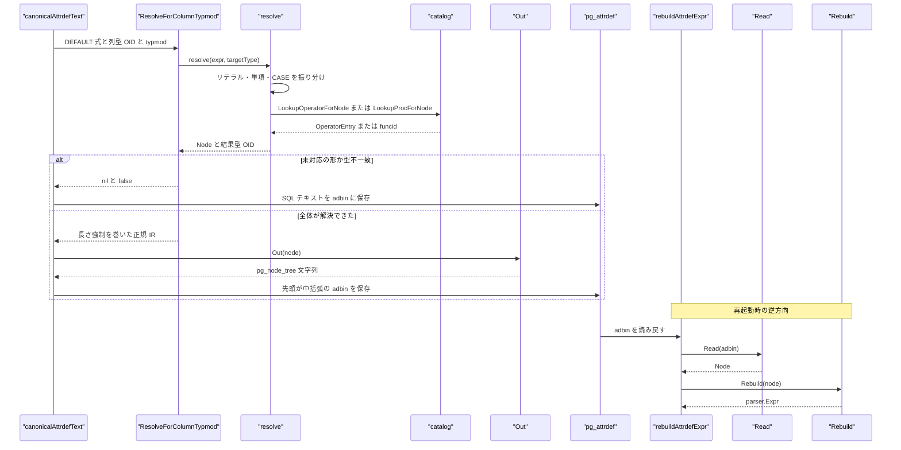
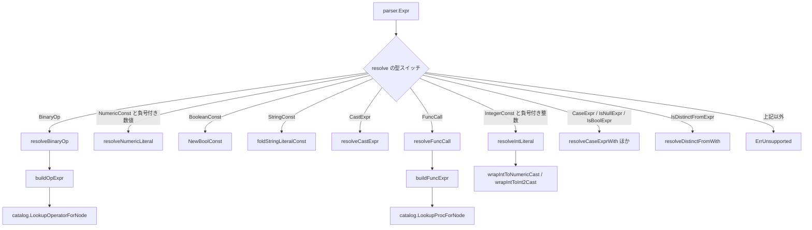

# 式 IR とリゾルバ

<details>
<summary>関連ソースファイル</summary>

- [`internal/nodes/datum.go`](https://github.com/ryogrid/goopg/blob/19856410e8d497d59787e1ab35a2febb3f5953d6/internal/nodes/datum.go)
- [`internal/nodes/ir.go`](https://github.com/ryogrid/goopg/blob/19856410e8d497d59787e1ab35a2febb3f5953d6/internal/nodes/ir.go)
- [`internal/nodes/ir_query.go`](https://github.com/ryogrid/goopg/blob/19856410e8d497d59787e1ab35a2febb3f5953d6/internal/nodes/ir_query.go)
- [`internal/nodes/numeric_storage.go`](https://github.com/ryogrid/goopg/blob/19856410e8d497d59787e1ab35a2febb3f5953d6/internal/nodes/numeric_storage.go)
- [`internal/nodes/rebuild.go`](https://github.com/ryogrid/goopg/blob/19856410e8d497d59787e1ab35a2febb3f5953d6/internal/nodes/rebuild.go)
- [`internal/nodes/rebuild_query.go`](https://github.com/ryogrid/goopg/blob/19856410e8d497d59787e1ab35a2febb3f5953d6/internal/nodes/rebuild_query.go)
- [`internal/nodes/resolver_expr.go`](https://github.com/ryogrid/goopg/blob/19856410e8d497d59787e1ab35a2febb3f5953d6/internal/nodes/resolver_expr.go)
- [`internal/nodes/resolver_query.go`](https://github.com/ryogrid/goopg/blob/19856410e8d497d59787e1ab35a2febb3f5953d6/internal/nodes/resolver_query.go)
- [`internal/nodes/unsupported.go`](https://github.com/ryogrid/goopg/blob/19856410e8d497d59787e1ab35a2febb3f5953d6/internal/nodes/unsupported.go)
- [`internal/parser/ast.go`](https://github.com/ryogrid/goopg/blob/19856410e8d497d59787e1ab35a2febb3f5953d6/internal/parser/ast.go)
- [`internal/parser/expr.go`](https://github.com/ryogrid/goopg/blob/19856410e8d497d59787e1ab35a2febb3f5953d6/internal/parser/expr.go)
- [`internal/executor/sys_pg_attrdef.go`](https://github.com/ryogrid/goopg/blob/19856410e8d497d59787e1ab35a2febb3f5953d6/internal/executor/sys_pg_attrdef.go)
- [`internal/initdb/catalog_heap_reload.go`](https://github.com/ryogrid/goopg/blob/19856410e8d497d59787e1ab35a2febb3f5953d6/internal/initdb/catalog_heap_reload.go)

</details>

`internal/nodes` パッケージは、goopg の SQL 式 `parser.Expr` を PostgreSQL 18 の `pg_node_tree`(S 式)と 1 対 1 に対応する IR に変換し、その逆変換も提供する。このページが扱うのは変換の中核部分 — IR の型定義、`parser.Expr` → IR のリゾルバ(`ResolveExpr` / `ResolveViewQuery`)、IR → `parser.Expr` の再構築(`Rebuild` / `RebuildViewQuery`)、そして `Const` の `Datum` を PostgreSQL のオンディスク表現とバイト一致で組み立てる `datum.go` / `numeric_storage.go` である。シリアライザ本体(`Out` / `Read`)は [14.2 PG 互換ノードシリアライザ](14.2-PG-NodeTree.md) を参照。

## 責務

- 列 DEFAULT・統計式・ビュー定義の式を、実 PostgreSQL 18 のスタンバイが `stringToNode()` で読み戻して評価できる正規 IR に変換する(`internal/nodes/resolver_expr.go:ResolveExpr`、`internal/nodes/resolver_query.go:ResolveViewQuery`)。
- 数値リテラルを「型 OID + 長さ / by-value 属性 + `Datum` の生バイト」の組に畳み込む。`Datum` の作り方が PostgreSQL の `outDatum` とバイト一致することが、この IR の存在理由そのものである(`internal/nodes/datum.go:byvalWord`、`internal/nodes/datum.go:textVarlena`)。
- 変換できない式を **部分出力せず** 全体を失敗させる。`ErrUnsupported` は呼び出し側にとって「SQL テキストで保存せよ」という正常系のシグナルであり、エラーではない(`internal/nodes/unsupported.go:SupportsExpr`)。
- 格納済み IR を再起動時に goopg の AST へ戻す(`internal/nodes/rebuild.go:Rebuild`、`internal/nodes/rebuild_query.go:RebuildViewQuery`)。`Resolve → Rebuild → Resolve` がバイト単位の不動点になるよう、暗黙キャストの巻き戻し規則を `funcformat` で判別する。
- 数値のオンディスク表現(`NumericData`)を `pg_node_tree` の `Const` とヒープ格納の両方で共有する(`internal/nodes/numeric_storage.go:NumericBodyFromText`)。

## 処理フロー

DDL 実行時の書き込み方向と、起動時の読み戻し方向を 1 つのシーケンスで示す。書き込み側の入口はエグゼキュータの `canonicalAttrdefText`、読み戻し側の入口は initdb の `rebuildAttrdefExpr` である。



書き込み側の判定は 3 段になっている。

1. `resolve` が式全体を再帰的に畳み、各ノードの結果型 OID を返す。途中で 1 つでも未知の形が出れば `ErrUnsupported` で即座に中断する(`internal/nodes/resolver_expr.go:resolve`)。
2. `ResolveForColumnTypmod` が最上位の結果型 OID と列型 OID の **完全一致** を要求する。これは PostgreSQL の `build_column_default` が保存前に列型へ強制変換しているためで、`DEFAULT 0` を `numeric` 列に、`DEFAULT 5` を `smallint` 列に入れると不一致になり `(nil, false)` を返す(`internal/nodes/resolver_expr.go:ResolveForColumnTypmod`)。
3. 一致した場合のみ、列の typmod に応じて長さ強制 `FuncExpr` / `RelabelType` を外側に巻く。`numeric(10,2)` なら funcid 1703(funcformat 2)、`varchar(N)` なら funcid 669、`bit(N)` なら funcid 1685 といった具合である。

ビュー側は同じ骨格を `ResolveViewQuery` が担う。`rejectUnsupportedClauses` で JOIN・GROUP BY・DISTINCT・LIMIT・集合演算・CTE・ウィンドウを先に落とし、FROM が 1 個の素のテーブルであることを確認してから、`queryScope` が各ターゲットと WHERE 式を解決する(`internal/nodes/resolver_query.go:ResolveViewQuery`)。

## 主要ファイル

| ファイル | 役割 |
| --- | --- |
| `internal/nodes/ir.go` | スカラー式 IR のノード型と `Node` インタフェース。`Const`・`FuncExpr`・`OpExpr`・`BoolExpr`・`CaseExpr` など(`internal/nodes/ir.go:Const` ほか)。 |
| `internal/nodes/ir_query.go` | クエリ木 IR。`Query`・`RangeTblEntry`・`TargetEntry`・`Var`・`Alias`・`Bitmapset`(`internal/nodes/ir_query.go:Query`)。 |
| `internal/nodes/datum.go` | 型 OID 定数、`Const` コンストラクタ、整数/真偽/テキスト/bit/数値/日時のパーサとフォーマッタ(`internal/nodes/datum.go:NewInt4Const`、`NewTextConst`、`NewNumericConst`)。 |
| `internal/nodes/numeric_storage.go` | `NumericData` のエンコード/デコードをヒープ向けに公開。旧形式テキストとの判別と int64 高速デコード(`internal/nodes/numeric_storage.go:NumericBodyFromText`)。 |
| `internal/nodes/resolver_expr.go` | `parser.Expr` → スカラー IR。リテラルの型付け、キャスト、演算子、関数呼び出し、CASE、DISTINCT(`internal/nodes/resolver_expr.go:ResolveExpr`)。 |
| `internal/nodes/resolver_query.go` | 単一基底リレーションの SELECT をクエリ木 IR へ。`Var` 生成と `selectedCols` の記録(`internal/nodes/resolver_query.go:ResolveViewQuery`)。 |
| `internal/nodes/rebuild.go` | スカラー IR → `parser.Expr`。暗黙キャストの巻き戻しと明示キャストの再構成(`internal/nodes/rebuild.go:Rebuild`)。 |
| `internal/nodes/rebuild_query.go` | クエリ木 IR → `parser.SelectStmt`。`Var` の attno を eref の列名へ逆引き(`internal/nodes/rebuild_query.go:RebuildViewQuery`)。 |
| `internal/nodes/unsupported.go` | `ResolveExpr` を述語化した `SupportsExpr`。全か無かの判定だけを外部に公開する(`internal/nodes/unsupported.go:SupportsExpr`)。 |
| `internal/parser/expr.go` | 入力側の式 AST(`IntegerConst`・`NumericConst`・`CastExpr`・`CaseExpr`・`FuncCall` など)。 |
| `internal/parser/ast.go` | 入力側の SELECT AST(`SelectStmt`・`RangeVar`・`ResTarget`・`FromExpr` など)。 |

## 公開 API / エントリポイント

```go
func ResolveExpr(e parser.Expr, targetType uint32) (Node, error)
func ResolveForColumn(e parser.Expr, targetType uint32) (Node, bool)
func ResolveForColumnTypmod(e parser.Expr, targetType uint32, targetTypmod int32) (Node, bool)
func SupportsExpr(e parser.Expr, targetType uint32) bool
func NumericColumnTypmod(args []int64) int32
func ColumnTypmod(typeName string, args []int64) int32

func Rebuild(n Node) (parser.Expr, error)

func ResolveViewQuery(sel *parser.SelectStmt, r RelationResolver) (*Query, error)
func RebuildViewQuery(q *Query) (*parser.SelectStmt, error)

func NumericBodyFromText(text string) ([]byte, error)
func NumericTextFromBody(body []byte) (string, error)
func NumericTextFromStoredPayload(payload []byte) (string, error)
func NumericInt64FromStoredPayload(payload []byte) (int64, int16, bool)
```

`RelationResolver` は `LookupRelation(schema, name string) (*RelationInfo, bool)` を持つ 1 メソッドインタフェースで、カタログ側が実装する(`internal/nodes/resolver_query.go:RelationResolver`)。

## 主要データ構造

### `Node` — 全 IR ノードの共通インタフェース

```go
// Node is the interface implemented by every canonical pg_node_tree IR node.
// nodeTag returns the uppercase S-expression label PostgreSQL writes after the
// opening brace (e.g. "CONST"), matching WRITE_NODE_TYPE in outfuncs.c.
type Node interface {
	nodeTag() string
}
```

`internal/nodes/ir.go:Node`(25 行目)。`nodeTag()` は非公開メソッドなので、このインタフェースを満たせるのは `internal/nodes` パッケージ内の型だけである。タグ文字列は PostgreSQL の `WRITE_NODE_TYPE` トークン(`"CONST"`、`"FUNCEXPR"`、`"DISTINCTEXPR"` …)と一致し、`Out` がそのまま S 式の先頭に書く。

### `Const` — リテラルとその `Datum`

```go
type Const struct {
	ConstType   uint32 // consttype  (type OID)
	ConstTypmod int32  // consttypmod
	ConstCollid uint32 // constcollid (collation OID; 100 = default for text)
	ConstLen    int32  // constlen    (typlen; -1 for varlena)
	ConstByval  bool   // constbyval
	ConstIsNull bool   // constisnull
	Location    int32  // location    (parse location; -1 when normalized)
	Datum       []byte // constvalue wire bytes (see comment above)
}
```

`internal/nodes/ir.go:Const`(35 行目)。`ConstType`/`ConstLen`/`ConstByval`/`ConstCollid` は PostgreSQL の `pg_type` から引いた固定的な組み合わせで、IR 内では相互に整合していなければならない。たとえば `int4` は `(23, 4, true, 0)`、`text` は `(25, -1, false, 100)`、`numeric` は `(1700, -1, false, 0)`、`timetz` は `(1266, 12, false, 0)` である。`Datum` の符号化は 2 系統ある。

- by-value 型: `byvalWord` が **常に 8 バイト** のリトルエンディアン語を作る。`constlen` が 4 でも 8 バイトなのは、PostgreSQL の `outDatum` が `sizeof(Datum)` バイトを無条件に出力するため。負の `int4` は符号拡張され、`oid` は 32 ビット符号なしとしてゼロ拡張される(`internal/nodes/datum.go:byvalWord`)。
- by-reference 型: 4 バイトの varlena ヘッダ(`VARSIZE << 2`)に本体を続けた「メモリ上のそのまま」のバイト列。`text`/`varchar`/`bpchar` は共通、bit 系はヘッダ + `int32` ビット長 + データ、`numeric` は短縮/長形式 + base-10000 数字列である。

`ConstIsNull` が真のとき `Datum` は無視される。省略された `ELSE` 用の型付き NULL は `newNullConst` が `ConstIsNull: true, Datum: nil` で作り、`constlen`/`constbyval` だけは結果型のものを保持する(`internal/nodes/datum.go:newNullConst`)。

### `FuncExpr` — キャスト・関数呼び出し・長さ強制の共通形

```go
type FuncExpr struct {
	Funcid         uint32 // funcid
	Funcresulttype uint32 // funcresulttype
	Funcretset     bool   // funcretset
	Funcvariadic   bool   // funcvariadic
	Funcformat     int32  // funcformat (CoercionForm enum)
	Funccollid     uint32 // funccollid
	Inputcollid    uint32 // inputcollid
	Args           []Node // args
	Location       int32  // location
}
```

`internal/nodes/ir.go:FuncExpr`(49 行目)。このページで最も不変条件が多い型である。`Funcid` は `pg_proc` OID で、通常の関数呼び出しでは `Args` の型並びから `catalog.LookupProcForNode` が一意に決め、キャスト由来の場合は `numericFamilyCastFuncid` や長さ強制のヘルパーが固定の OID を選ぶ。`Funcformat` は `CoercionForm` の値で、`0` = 明示呼び出し、`1` = 明示キャスト、`2` = 暗黙キャストを表す。この 3 値は再構築時に「SQL として書けるか」を分ける判断材料になる。

- `funcformat 0`: 通常の関数呼び出し。`Rebuild` は `catalog.RegprocName` で関数名を引き、`parser.FuncCall` に戻す。
- `funcformat 1`: `::type` として書かれた明示キャスト。`Rebuild` は `explicitCastTypeName` で型名を決め、`parser.CastExpr` に戻す。
- `funcformat 2`: 文脈から PostgreSQL が導出した暗黙キャスト。SQL 構文を持たないので `Rebuild` は `Args[0]` へ透過する(`internal/nodes/rebuild.go:rebuildFuncExprWith`)。

`Funccollid` は結果型が照合可能なときだけ `DefaultCollationOid`(100)、`Inputcollid` は引数のいずれかが照合可能なときだけ 100 になる。このサブセットで照合可能なのは `text` のみ(`internal/nodes/resolver_expr.go:isCollatable`)。

### `OpExpr` — 二項演算子

```go
type OpExpr struct {
	Opno         uint32 // opno
	Opfuncid     uint32 // opfuncid
	Opresulttype uint32 // opresulttype
	Opretset     bool   // opretset
	Opcollid     uint32 // opcollid
	Inputcollid  uint32 // inputcollid
	Args         []Node // args
	Location     int32  // location
}
```

`internal/nodes/ir.go:OpExpr`(64 行目)。`Opno` と `Opfuncid` は `catalog.LookupOperatorForNode(spelling, leftOID, rightOID)` が返す `OperatorEntry` の `OID`/`Code` をそのまま入れる。つまり演算子名だけでは一意にならず、**両オペランドの型 OID の組** が不変条件である。`Args` は必ず 2 要素で、`Opretset` は常に偽、`Location` は正規化後 `-1` に固定される。

`DistinctExpr` は `type DistinctExpr OpExpr` という定義型で、フィールドは `OpExpr` と完全に同一、`nodeTag()` だけが `"DISTINCTEXPR"` を返す(`internal/nodes/ir.go:DistinctExpr`)。`IS DISTINCT FROM` は `=` の `OpExpr` を組み立ててからタグだけ差し替える、という PostgreSQL の `make_distinct_op` の挙動をそのまま写している。

### `BoolExpr` — AND / OR / NOT

```go
type BoolExpr struct {
	Boolop   int32  // boolop (BoolExprType: 0=and, 1=or, 2=not)
	Args     []Node // args
	Location int32  // location
}
```

`internal/nodes/ir.go:BoolExpr`(140 行目)。`Boolop` は `BoolExprAnd=0` / `BoolExprOr=1` / `BoolExprNot=2`。AND/OR は **n 項** で、`a AND b AND c` は 3 引数の 1 ノードになる。`resolveBoolBinaryWith` が左オペランドの解決結果を `*BoolExpr` として検査し、同じ `Boolop` なら `be.Args = append(be.Args, rNode)` で伸ばす。左結合の背骨だけが平坦化され、`a AND (b AND c)` は入れ子のまま残る(`internal/nodes/resolver_expr.go:resolveBoolBinaryWith`)。NOT は必ず 1 引数で、`Rebuild` 側も 1 引数でないとエラーにする。

### `CaseExpr` と `CaseTestExpr`

```go
type CaseExpr struct {
	Casetype   uint32 // casetype   (common result type OID)
	Casecollid uint32 // casecollid (0 for the non-collatable subset)
	Arg        Node   // arg        (nil for the searched form)
	Args       []Node // args       (list of *CaseWhen)
	Defresult  Node   // defresult  (ELSE result, or a typed NULL Const)
	Location   int32  // location
}
```

`internal/nodes/ir.go:CaseExpr`(210 行目)。`Arg` が非 nil なら simple form(`CASE operand WHEN …`)、nil なら searched form。simple form では各 `CaseWhen.Expr` が「`CaseTestExpr` プレースホルダ = WHEN 値」の `OpExpr` になり、`CaseTestExpr` は `Typeid`/`Typemod`/`Collation` にオペランドの型情報を保持する(`internal/nodes/ir.go:CaseTestExpr`)。`Casetype` は全 WHEN 結果と ELSE の共通型で、`Casecollid` は照合可能型を扱わないため常に 0。ELSE 省略時は `Defresult` に `Casetype` の型付き NULL が入る。

### ビュー解決スコープ

```go
type ColumnInfo struct {
	Name      string
	Attno     int32
	TypeOID   uint32
	Typmod    int32
	Collation uint32
}
```

`internal/nodes/resolver_query.go:ColumnInfo`(53 行目)。

```go
type RelationInfo struct {
	Relid   uint32
	Relname string
	Relkind byte // 'r', 'v', 'm', 'p', …
	Columns []ColumnInfo
}
```

`internal/nodes/resolver_query.go:RelationInfo`(65 行目)。`Columns` は **属性番号順の全列** でなければならない。`ResolveViewQuery` はこれをそのまま RTE の `eref.colnames` に詰め、`RebuildViewQuery` は `Varattno - 1` でこの配列を引く。選択列だけを入れると再構築時に添字がずれる。

```go
type queryScope struct {
	rel     *RelationInfo
	varno   int32
	effName string
	byName  map[string]ColumnInfo
	used    map[int32]bool
}
```

`internal/nodes/resolver_query.go:queryScope`(84 行目)。`byName` は列名 → メタデータ、`used` は参照された attno の集合で、最後に `selectedCols()` が `attno + 7` の昇順 `Bitmapset` に変換する。`varno` は単一リレーションなので常に 1、`effName` は修飾参照を受け付ける名前(このサブセットではエイリアスが無いのでリレーション名)。

### `scopedResolve` — 再帰の差し替え点

```go
type scopedResolve = func(parser.Expr, uint32) (Node, uint32, error)
```

`internal/nodes/resolver_expr.go:scopedResolve`(1361 行目)。型エイリアスなので、スカラー用の `resolve` とビュー用の `queryScope.resolveExpr` を同じビルダーに渡せる。`resolveBoolBinaryWith` / `resolveNullTestWith` / `resolveCaseExprWith` / `resolveDistinctFromWith` / `resolveBoolNotWith` がこの形を受け取り、リテラル専用だった組み立てロジックを列 `Var` にもそのまま使い回す。

## 内部構造

`resolve` のディスパッチは入力 AST の型スイッチ 1 段で、各枝が独立したヘルパーに落ちる。どこにも「デフォルトの変換」は無く、未知の型は最後の枝で `ErrUnsupported` になる。



**整数リテラルの型付け。** `resolveIntLiteral` は符号込みの値で `math.MinInt32..math.MaxInt32` に入るかを見て `int4` か `int8` を選ぶ(`fitsInt4`)。ただし文脈型が `int8` なら常に `int8`、`numeric` なら `int4_numeric`(1740)/`int8_numeric`(1781)の暗黙 `FuncExpr`、`int2` なら `int2(int4)`(314)/`int2(int8)`(714)の暗黙 `FuncExpr` を巻く。PostgreSQL が `int2` の裸の `Const` をリテラルから作らないのと同じで、裸の `int2 Const` は文字列リテラルの畳み込みからしか生まれない(`internal/nodes/datum.go:NewInt2Const` のコメント)。

**キャストの 3 分類。** `resolveCastExpr` は対象型を `catalog.TypeNameToOID` で引き、次の順で判定する。

1. typmod 無し + オペランドが `StringConst` → `foldStringLiteralConst`。`'123'::int4` はキャストノードではなく裸の `Const` になる(PostgreSQL の `stringTypeToConst`)。
2. typmod 有り → `numeric(p[,s])` のみ対応。`resolveNumericTypmodCast` が funcid 1703 の明示キャストを組み立てる。
3. typmod 無しの数値ファミリ(`int2/int4/int8/numeric/float4/float8`)→ 同一型なら無変換、それ以外は `numericFamilyCastFuncid` の表で funcid を引く。この表は同一型 6 対を除く 30 対のうち 28 対を網羅する(`int8(int4)=481`、`numeric_int4=1744`、`float8(int4)=316`、`float4(float8)=312` など)。残る `int2→int4` と `int2→int8` は表に無く、`(x::int2)::int4` のような入れ子キャストは退避する。

**CASE の共通型。** `selectCaseCommonType` は `int4 < int8 < numeric < float4 < float8` の順で広い方を選び、`float8` が 1 つでもあればそれを優先する(PostgreSQL の `TYPCATEGORY_NUMERIC` の preferred type)。`coerceCaseResult` が狭い側を対応する暗黙キャストで包む。共通型が文字列など照合可能な型になる場合は `caseTypeMeta` が `ok=false` を返し、`ErrUnsupported` に落ちる — このサブセットは `casecollid` を 0 に固定しているため、照合順序を持つ CASE を出すと本物の PostgreSQL と不一致になるからである。

**simple form の WHEN。** `resolveCaseWhenCond` は「プレースホルダ = 値」の `=` を `catalog.LookupOperatorForNode("=", argType, valType)` で探し、見つからなければ値をオペランド型へ `coerceCaseResult` で持ち上げてから再探索する。プレースホルダ側は決して強制変換しない — これが `ruleutils` が simple form を復元できる形の条件である。

**再構築の不動点。** `Rebuild` は `*Const`・`*OpExpr`・`*DistinctExpr`・`*FuncExpr`・`*RelabelType`・`*BoolExpr`・`*NullTest`・`*BooleanTest`・`*CaseExpr` の 9 種を受け付け、それ以外は `unsupported node %T` で失敗する。`FuncExpr` の分岐順が重要で、(1) 暗黙の数値/幅/長さ強制(`isImplicit*`)なら引数へ透過、(2) funcid 1703 + funcformat 1 なら `numeric(p,s)` の `CastExpr`、(3) `explicitCastTypeName` に載る funcformat 1 なら `::type`、(4) それ以外は通常の関数呼び出し、という順で判定する。同じ OID が funcformat によって「透過すべき暗黙キャスト」と「残すべき明示キャスト」の両方に現れるため、`funcformat` を見ないと `Resolve → Rebuild → Resolve` が不動点にならない。

**数値の二重表現。** `numeric_storage.go` の `NumericBodyFromText` / `NumericTextFromBody` は `Const.Datum` 用の varlena から 4 バイトヘッダを外した「ペイロード」を扱う。ヒープ側の varlena  framing は呼び出し側の責務だからである。旧クラスタには数値列に decimal 文字列がそのまま入っているため、`NumericTextFromStoredPayload` が文字集合テストで両形式を判別する。短形式ヘッダの上位バイトは必ず `0x80` 以上、長形式の数字の上位バイトは `0x27` 以下、特殊値も `0xC0` 以上で、decimal 文字列の文字集合(`0-9 + - . e E`)とは決して交わらない — この非交差性が判別をヒューリスティックではなく厳密にしている(`internal/nodes/numeric_storage.go:numericPayloadIsLegacyText`)。

## エッジケースと不変条件

- **部分出力の禁止。** `ErrUnsupported` が出たら式全体を諦める。中途半端な `pg_node_tree` は実 PostgreSQL 18 の relcache を FATAL させるため、SQL テキストへ退避する方が常に安全である(`internal/nodes/unsupported.go` の冒頭コメント)。
- **裸の NULL は表現できない。** `resolve` に `*parser.NullConst` の枝が無いため、`DEFAULT NULL` は `ErrUnsupported` になる。NULL が IR に現れるのは、ELSE 省略時の合成 `Const` と、`IS [NOT] DISTINCT FROM NULL` が `NullTest` に書き換わる場合だけである。
- **`IS DISTINCT FROM NULL` の優先順位。** `distinctNullTestArg` は **右** オペランドを先に検査し、次に左を見る。PostgreSQL の `make_nulltest_from_distinct` と同じ順序で、`NULL IS DISTINCT FROM NULL` は左の NULL を対象にした `NullTest` へ書き換わる。ただしその左 NULL 自体は `resolve` できないため、この式は最終的に `ErrUnsupported` になる。`NULL::int` のようなキャスト付き NULL は `*parser.NullConst` ではないので通常の `DISTINCTEXPR` 経路に落ちる(`internal/nodes/resolver_expr.go:distinctNullTestArg`)。
- **数値 typmod の保守的範囲。** `numericTypmodValue` は精度 1〜1000、スケール 0〜精度 のみ受け付ける。PostgreSQL 18 は負のスケールや精度超えのスケールも許すが、このサブセットは受け付けた範囲で PostgreSQL と同一の typmod `((p << 16) | (s & 0x7ff)) + 4` を計算できることだけを保証し、外れたら退避する。
- **長さ修飾子の変換規則。** `varchar`/`bpchar` は `maxlen + 4`(VARHDRSZ)、`bit`/`varbit` はビット長そのもの、`timestamp`/`time`/`timestamptz`/`timetz` は精度 0〜6 をそのまま typmod にする。範囲外は `-1`(修飾なし)として扱われ、長さ強制は巻かれない(`internal/nodes/resolver_expr.go:ColumnTypmod`)。
- **関数呼び出しの拒否条件。** `funcCallGuard` は `Star`・`Distinct`・`Over`・`Filter`・`OrderBy`・`WithinGroup`・`VARIADIC` のいずれか、および `pg_catalog` 以外のスキーマ修飾を拒否する。集約・ウィンドウの意味を落とした `FuncExpr` を黙って出さないための防波堤である(`internal/nodes/resolver_expr.go:funcCallGuard`)。
- **`selectedCols` のバイアス。** `selectedColsBias = 7` は `-FirstLowInvalidHeapAttributeNumber`。attno 1 のユーザー列はメンバー 8 として格納され、`Bitmapset` は必ず昇順で出す。0 列参照なら `nil`(空の `"(b)"`)になる(`internal/nodes/resolver_query.go:selectedCols`)。
- **ビューの固定フィールド。** 生成される `RangeTblEntry` は `Rtekind: 0`、`Rellockmode: 1`(AccessShareLock)、`Perminfoindex: 1`、`InFromCl: true`、`RTEPermissionInfo.RequiredPerms: 2`(ACL_SELECT)に固定される。`ReadRuleAction` 側はこれらが動いていないことを検証し、ずれていれば「正規ビューではない」として SQL テキストへ退避させる(`internal/nodes/ir_query.go:RangeTblEntry`)。
- **再構築の失敗は握りつぶさない。** `Rebuild` は未知の演算子 OID・未知の関数 OID・引数個数の不一致・不正な `relabelformat` をすべてエラーにする。呼び出し側(`internal/initdb/catalog_heap_reload.go:rebuildAttrdefExpr`)はその 1 列だけを NULL デフォルトに落とし、起動自体は継続する。
- **`relabelformat` の 2 形態。** `RelabelType` は `wrapNumericRelabelToBare` が作る 2 種類しか存在しない。format 2 は「裸の `numeric` 列に typmod 付きデフォルトが入った」暗黙の巻き戻しで `Rebuild` は引数へ透過、format 1 は `(x)::numeric` の明示キャストで `::numeric` の `CastExpr` に戻す。それ以外の値はエラーである(`internal/nodes/rebuild.go:rebuildRelabelType`)。
- **負の整数の再構築形状。** `Rebuild` は `int4`/`int8` の負値を 1 個の `IntegerConst` に戻す(`UnaryOp` ではない)。パーサが `-N` を単一定数に畳むようになったためで、`UnaryOp` に戻すとダンプが `'-1'::integer` になって不動点が壊れる。一方 `numeric` の負値は `UnaryOp{OpUnaryNeg}` + 正の `NumericConst` に戻す(`internal/nodes/rebuild.go:rebuildConst`)。
- **文字列リテラルの再構築先。** `int2`・`oid`・`float4`・`float8`・日時・bit 系の `Const` は、元が unknown 型文字列の畳み込みだから `StringConst` に戻す。`IntegerConst` に戻すとリゾルバが別の型に型付けして不動点が壊れる、という理由が各枝に明記されている。
- **並行性。** リゾルバと `Rebuild` は呼び出しごとに新しいノードを組み立てる純粋関数で、共有可変状態を持たない。唯一の共有状態は `operatorNameForOID` の逆引きマップで、`sync.Once` の下で 1 度だけ構築され、以降は読み取り専用である。`PGOperatorAllEntries` のうち `Kind == 'b'`(二項演算子)だけを索引し、同じ OID は最初の 1 件が勝つ(`internal/nodes/rebuild.go:operatorNameForOID`)。
- **n 項 `BoolExpr` の再構築。** `Rebuild` は 2 引数未満の AND/OR、1 引数でない NOT をエラーにする。AND/OR は左結合の `BinaryOp` 連鎖へ戻すので、前方の平坦化と正確に逆になる(`internal/nodes/rebuild.go:rebuildBoolExprWith`)。
- **コメントと実装のずれ。** `resolver_query.go` の `CaseExpr` の枝には「searched form only」と書かれているが、実際に呼ばれる `resolveCaseExprWith` は `Operand != nil` の simple form も処理する。ビューの CASE を判断するときはコメントではなく実装(`internal/nodes/resolver_expr.go:resolveCaseExprWith`)を参照すること。

関連ページ: [14.2 PG 互換ノードシリアライザ](14.2-PG-NodeTree.md)、[4 SQL パーサー](../4-SQL-Parser.md)、[14 ノード IR とシリアライズ](../14-Node-IR.md)。

Sources:
- internal/nodes/datum.go
- internal/nodes/ir.go
- internal/nodes/ir_query.go
- internal/nodes/numeric_storage.go
- internal/nodes/rebuild.go
- internal/nodes/rebuild_query.go
- internal/nodes/resolver_expr.go
- internal/nodes/resolver_query.go
- internal/nodes/unsupported.go
- internal/parser/ast.go
- internal/parser/expr.go
- internal/executor/sys_pg_attrdef.go
- internal/initdb/catalog_heap_reload.go

<sub>Generated by deepwiki-4myself from `goopg` @ `19856410e`</sub>
