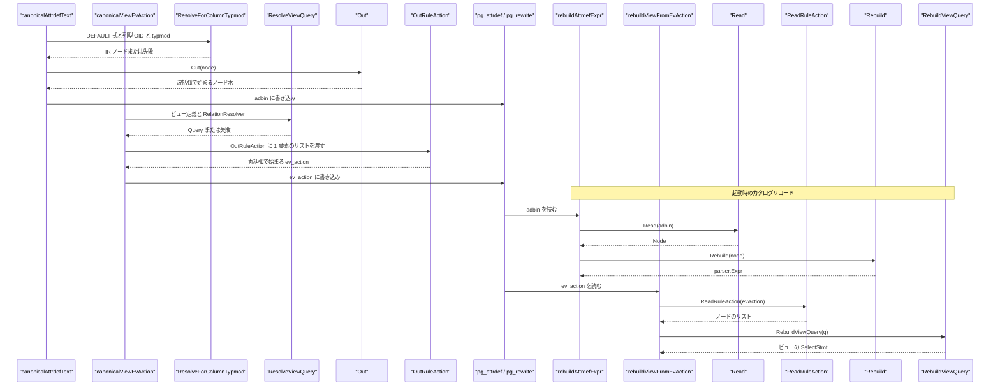
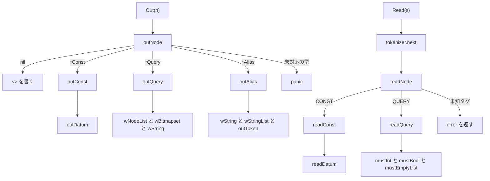

# PG 互換ノードシリアライザ

<details>
<summary>関連ソースファイル</summary>

- [`internal/nodes/ir.go`](https://github.com/ryogrid/goopg/blob/19856410e8d497d59787e1ab35a2febb3f5953d6/internal/nodes/ir.go)
- [`internal/nodes/ir_query.go`](https://github.com/ryogrid/goopg/blob/19856410e8d497d59787e1ab35a2febb3f5953d6/internal/nodes/ir_query.go)
- [`internal/nodes/outfuncs.go`](https://github.com/ryogrid/goopg/blob/19856410e8d497d59787e1ab35a2febb3f5953d6/internal/nodes/outfuncs.go)
- [`internal/nodes/outfuncs_query.go`](https://github.com/ryogrid/goopg/blob/19856410e8d497d59787e1ab35a2febb3f5953d6/internal/nodes/outfuncs_query.go)
- [`internal/nodes/readfuncs.go`](https://github.com/ryogrid/goopg/blob/19856410e8d497d59787e1ab35a2febb3f5953d6/internal/nodes/readfuncs.go)
- [`internal/nodes/readfuncs_query.go`](https://github.com/ryogrid/goopg/blob/19856410e8d497d59787e1ab35a2febb3f5953d6/internal/nodes/readfuncs_query.go)
- [`internal/nodes/rebuild_query.go`](https://github.com/ryogrid/goopg/blob/19856410e8d497d59787e1ab35a2febb3f5953d6/internal/nodes/rebuild_query.go)
- [`internal/nodes/unsupported.go`](https://github.com/ryogrid/goopg/blob/19856410e8d497d59787e1ab35a2febb3f5953d6/internal/nodes/unsupported.go)
- [`internal/executor/sys_pg_attrdef.go`](https://github.com/ryogrid/goopg/blob/19856410e8d497d59787e1ab35a2febb3f5953d6/internal/executor/sys_pg_attrdef.go)
- [`internal/executor/sys_pg_rewrite.go`](https://github.com/ryogrid/goopg/blob/19856410e8d497d59787e1ab35a2febb3f5953d6/internal/executor/sys_pg_rewrite.go)
- [`internal/executor/viewdef_deparse.go`](https://github.com/ryogrid/goopg/blob/19856410e8d497d59787e1ab35a2febb3f5953d6/internal/executor/viewdef_deparse.go)
- [`internal/initdb/nailed_view_ev_action.go`](https://github.com/ryogrid/goopg/blob/19856410e8d497d59787e1ab35a2febb3f5953d6/internal/initdb/nailed_view_ev_action.go)
- [`internal/initdb/pg_rewrite_bootstrap.go`](https://github.com/ryogrid/goopg/blob/19856410e8d497d59787e1ab35a2febb3f5953d6/internal/initdb/pg_rewrite_bootstrap.go)
- [`internal/initdb/catalog_heap_reload.go`](https://github.com/ryogrid/goopg/blob/19856410e8d497d59787e1ab35a2febb3f5953d6/internal/initdb/catalog_heap_reload.go)

</details>

`internal/nodes` の `Out` / `OutList` / `OutRuleAction` は、goopg の IR を PostgreSQL 18 の `nodeToString()` が出力するのとまったく同じ S 式テキスト(`pg_node_tree`)に変換する。`Read` / `ReadRuleAction` はその逆で、`pg_strtok` + `nodeRead` 相当のトークナイザで文字列を IR に戻す。このページでは、フィールド順の契約、`Datum` のバイト表現、`Query` の固定スケルトン、そして生成した `pg_attrdef.adbin` / `pg_rewrite.ev_action` が書き込み・リロード・initdb シード・`pg_get_viewdef` という 4 つの消費経路でどう扱われるかを扱う。IR の型そのものとリゾルバは [14.1 式 IR とリゾルバ](14.1-Expression-IR.md) を参照。

## 責務

- IR ノードをタグ付き S 式(`{CONST :consttype 23 ...}`)へ直列化する。フィールドの順序は PostgreSQL の `outfuncs.c` / 生成 `outfuncs.funcs.c` と 1 対 1 で、順序が変わればバイト列が変わる(`internal/nodes/outfuncs.go:outNode`)。
- `Const.Datum` を PostgreSQL の `outDatum` と同じ形式で書く。by-value は `constlen` を前置しつつ常に 8 バイト、by-reference は varlena の実長だけを **符号付き 10 進** で並べる(`internal/nodes/outfuncs.go:outDatum`)。
- クエリ木については、対応するビュー形状のフィールドだけを IR から読み、残りを「ビューの既定値」で埋めて `Query` 全フィールドを出力する。`ReadRuleAction` はその既定値からの逸脱を検出して「正規ビューではない」ことを呼び出し側に伝える(`internal/nodes/outfuncs_query.go:outQuery`、`internal/nodes/readfuncs_query.go:readQuery`)。
- 読み戻した IR が壊れている場合・未知のタグの場合にエラーを返す。ライター側の未知ノードは panic、リーダー側の未知タグは error という非対称な扱いをしている(`internal/nodes/readfuncs.go:readNode`)。
- 生成物を実際のカタログ行に載せる: `pg_attrdef.adbin` は列 DEFAULT、`pg_rewrite.ev_action` はビューの `_RETURN` ルール。どちらも「正規バイト列」か「SQL テキスト」の 2 形式を先頭バイトで判別する(`internal/executor/sys_pg_attrdef.go:canonicalAttrdefText`、`internal/executor/sys_pg_rewrite.go:canonicalViewEvAction`)。
- initdb では、upstream から採取した `ev_action` ブロブを `//go:embed` で同梱し、`pg_rewrite` ヒープへシードする。ブロブが壊れていれば起動時に panic して、後段の PostgreSQL の `stringToNode` 失敗まで持ち越さない(`internal/initdb/nailed_view_ev_action.go:nailedViewEvAction`)。

## 処理フロー

書き込み側は「IR を作る → `Out*` で文字列化 → ヒープ行に載せる」、読み戻し側は「先頭バイトで形式を判別 → `Read*` → `Rebuild*`」である。`pg_get_viewdef` はこれとは別に、保存された SQL テキストを再パースして整形する第三の経路を持つ。



この経路の分岐点は先頭バイトである。

- `pg_attrdef.adbin`: 正規形は `nodeToString` の `{` で始まる。SQL テキスト形は式の先頭が数字・識別子・引用符・符号のいずれかで、`{` にはならない。リロードは `adbin[0] == '{'` で分ける(`internal/initdb/catalog_heap_reload.go:rebuildAttrdefExpr`)。
- `pg_rewrite.ev_action`: 正規形はクエリ木のリストなので `({` で始まる。SQL テキスト形の SELECT は `(` で始まらない(括弧付きサブクエリのビューはこのサブセットに入らないため、テキスト側が `(` で始まることはない)。リロードは `strings.HasPrefix(evAction, "({")` で分ける(`internal/initdb/catalog_heap_reload.go:rebuildViewFromEvAction`)。

`canonicalViewEvAction` は正規化を **`buildUserPGClassRow` より前** に解決する。`relhasrules` は `tbl.RuleIsCanonical` から決まるため、`ev_action` を正規形で書いたのに `relhasrules=false` のままヒープへ流すと、スタンバイはルールを展開できない。この順序は `internal/executor/sys_pg_rewrite.go:canonicalViewEvAction` のコメントで明示されている。

`pg_get_viewdef` は `pg_node_tree` を読まない。`deparseViewDef` が `view.ViewDef` の SQL テキストを `parser.Parse` で再パースし、`ruleutils.c` 風の整形結果を返す。対応外なら `ok=false` を返し、呼び出し側は保存テキストをそのまま返す(`internal/executor/viewdef_deparse.go:deparseViewDef`)。

## 主要ファイル

| ファイル | 役割 |
| --- | --- |
| `internal/nodes/outfuncs.go` | スカラー IR のライター。`Out`・`OutList`・`outNode` と `wInt`/`wBool`/`wNodeList`/`outDatum`、タグ別 `outConst` など(`internal/nodes/outfuncs.go:Out`)。 |
| `internal/nodes/outfuncs_query.go` | クエリ木のライター。`OutRuleAction`、文字列/char/uint64/Bitmapset のフィールドヘルパー、`outToken`、`outQuery`・`outRangeTblEntry`・`outAlias`(`internal/nodes/outfuncs_query.go:OutRuleAction`)。 |
| `internal/nodes/readfuncs.go` | スカラー IR のリーダー。`Read`、`tokenizer`、`readNode` と `readDatum`/`readNodeListField`、タグ別 `readConst` など(`internal/nodes/readfuncs.go:Read`)。 |
| `internal/nodes/readfuncs_query.go` | クエリ木のリーダー。`ReadRuleAction`、`mustInt`/`mustBool`/`mustNilNode`/`mustEmptyList` による形状ゲート、`readQuery`(`internal/nodes/readfuncs_query.go:ReadRuleAction`)。 |
| `internal/nodes/rebuild_query.go` | 読み戻した `Query` を `parser.SelectStmt` に戻す再構築側。`commandType` と `*Alias` の最終検証を担う(`internal/nodes/rebuild_query.go:RebuildViewQuery`)。 |
| `internal/nodes/ir.go` | ライター/リーダーが扱うスカラー IR の型定義(`Const`・`FuncExpr`・`OpExpr`・`BoolExpr`・`CaseExpr` など)。 |
| `internal/nodes/ir_query.go` | クエリ木 IR の型定義。`Query`・`RangeTblEntry`・`Bitmapset`・`Alias` など。 |
| `internal/nodes/unsupported.go` | `SupportsExpr`。正規形を出せるかどうかをリゾルバ経由で述語化する。 |
| `internal/executor/sys_pg_attrdef.go` | `pg_attrdef` 行の生成。`canonicalAttrdefText` が `Out` を呼び、`writeAttrdefRow` がヒープと 2 本の索引に書く(`internal/executor/sys_pg_attrdef.go:canonicalAttrdefText`)。 |
| `internal/executor/sys_pg_rewrite.go` | `pg_rewrite` 行の生成。`canonicalViewEvAction` が `OutRuleAction` を呼び、`writeViewRewriteRow` が `_RETURN` 行を書く(`internal/executor/sys_pg_rewrite.go:canonicalViewEvAction`)。 |
| `internal/executor/viewdef_deparse.go` | `pg_get_viewdef` 用デパーサ。保存 SQL テキストを ruleutils 風に整形する。ノード木は扱わない(`internal/executor/viewdef_deparse.go:deparseViewDef`)。 |
| `internal/initdb/nailed_view_ev_action.go` | システムビューの採取済み `ev_action` ブロブの `//go:embed` 読み込みと検証(`internal/initdb/nailed_view_ev_action.go:nailedViewEvAction`)。 |
| `internal/initdb/pg_rewrite_bootstrap.go` | `pg_rewrite` の `_RETURN` 行を initdb 時にシードする。`pgRewriteEntry` と `bootstrapPgRewriteTuples`(`internal/initdb/pg_rewrite_bootstrap.go:bootstrapPgRewriteTuples`)。 |
| `internal/initdb/catalog_heap_reload.go` | 起動時のリロード。先頭バイトで正規形/SQL テキストを判別し、`Read`/`ReadRuleAction` に振る(`internal/initdb/catalog_heap_reload.go:rebuildAttrdefExpr`)。 |

## 公開 API / エントリポイント

```go
func Out(n Node) string
func OutList(nodes []Node) string
func OutRuleAction(nodes []Node) string

func Read(s string) (Node, error)
func ReadRuleAction(s string) ([]Node, error)
```

`OutList` は `pg_proc.proargdefaults` のように「ノードのリスト」を値とする列のための入口で、空リストを `<>` に落とす(`internal/nodes/outfuncs.go:OutList`)。`OutRuleAction` は空リストでも `"()"` を返し、`<>` にはしない(`internal/nodes/outfuncs_query.go:OutRuleAction`)。`ReadRuleAction` は外側の `(` 〜 `)` を読み、末尾にトークンが残ればエラーにする(`internal/nodes/readfuncs_query.go:ReadRuleAction`)。

## 主要データ構造

### `Query` — 出力スケルトンが固定するクエリ木

```go
type Query struct {
	CommandType  int32  // commandType (1 = CMD_SELECT)
	Rtable       []Node // rtable (RangeTblEntry list)
	RtePermInfos []Node // rteperminfos (RTEPermissionInfo list)
	Jointree     Node   // jointree (*FromExpr)
	TargetList   []Node // targetList (TargetEntry list)
}
```

`internal/nodes/ir_query.go:Query`(123 行目)。IR としては 5 フィールドしか持たないが、`outQuery` は PostgreSQL の `_outQuery` と同じ **45 フィールド** を出力する。IR に無いものは固定値(`querySource 0`、`canSetTag true`、`hasAggs` 以下すべて false、`cteList <>`、`override 0`、`stmt_location -1`、`stmt_len -1` など)で埋める。したがってこの型の不変条件は「5 フィールド以外はビューの既定値から動かないこと」であり、`readQuery` が `mustInt("querySource", 0)` などの検証でそれを強制する。`Rtable` と `RtePermInfos` は `ResolveViewQuery` が必ず 1 要素ずつ入れる。

### `tokenizer` — `pg_strtok` の移植

```go
type tokenizer struct {
	s   string
	pos int
}
```

`internal/nodes/readfuncs.go:tokenizer`(30 行目)。区切りは空白(`' '`, `'\n'`, `'\t'` のみ)、`(`, `)`, `{`, `}` は 1 文字トークン、`<>` はそのまま 1 トークンとして返る。`\` の次は無条件に 1 文字読み飛ばすので、`outToken` が入れたエスケープを透過できる(`internal/nodes/readfuncs.go:next`)。`peek` は `pos` を保存・復元するだけで、リスト終端の `)` を消費せずに判定するのに使う。

### `Bitmapset` — `selectedCols` などの集合

```go
type Bitmapset []int32
```

`internal/nodes/ir_query.go:Bitmapset`(27 行目)。ライターは `"(b m0 m1 ...)"`、空なら `"(b)"` を書く。メンバーはワイヤ上の整数そのままで、attno の +7 バイアスのような意味付けはリゾルバの責務である(`internal/nodes/outfuncs_query.go:wBitmapset`)。リーダーは `(` → `b` → 数値列 → `)` の順を厳密に要求する(`internal/nodes/readfuncs_query.go:readBitmapsetField`)。

### `pgRewriteEntry` — initdb がシードする `_RETURN` 行

```go
type pgRewriteEntry struct {
	OID       uint32
	RuleName  string
	EvClass   uint32
	EvType    byte // '1' = CMD_SELECT, '2' = CMD_UPDATE, '3' = CMD_INSERT, '4' = CMD_DELETE
	EvEnabled byte // 'O' = ALWAYS (origin/local), 'D' = DISABLED, 'R' = REPLICA
	IsInstead bool
	EvQual    string
	EvAction  string
}
```

`internal/initdb/pg_rewrite_bootstrap.go:pgRewriteEntry`(90 行目)。`EvQual` と `EvAction` は `nodeToString` 形式の `pg_node_tree` 文字列で、両方とも空であってはならない(`BKI_FORCE_NOT_NULL`)。空のノード木の慣習は `"<>"` で、ビューの `ev_qual` は実際に `"<>"` が入る。`EvClass` は `pg_class` のビュー OID、`OID` は `_RETURN` ルール自身の OID で、どちらも upstream の採番に固定されている(例: `pgRewriteOIDPgStatWalReceiverReturn = 12243`、`pgStatWalReceiverViewOID = 12240`)。

### `viewDeparser` — `pg_get_viewdef` の整形状態

```go
type viewDeparser struct {
	buf         []byte
	indentLevel int
	cat         *catalog.InMemory
	visible     func(schema, name string) bool
	pretty      bool
	rtes        []*vdRTE
	useprefix   bool
	ok          bool
}
```

`internal/executor/viewdef_deparse.go:viewDeparser`(36 行目)。`buf` が出力、`indentLevel` が `appendContextKeyword` 相当のインデント状態、`rtes` が FROM 項目ごとの `vdRTE`、`useprefix` が「RTE が 1 個でないときだけ列を修飾する」規則の保持、`ok` が「対応サブセット内」フラグである。途中で対応外の形に当たると `fail()` が `ok=false` にし、`deparseViewDef` は全体を失敗させる。部分的な整形結果は返さない。インデント定数は `prettyIndentStd=8`、`prettyIndentVar=4`、`prettyIndentLimit=40`(`internal/executor/viewdef_deparse.go:viewDeparser`)。

## 内部構造

ライターとリーダーは対称に見えるが、ディスパッチの失敗時の扱いが異なる。ライターは未知の型で panic し、リーダーは未知のタグで error を返す。どちらも「中途半端に書かない/読まない」という同じ方針の現れである。



**フィールド順が契約。** 各 `out<Tag>` は `wInt(sb, "consttypmod", ...)` のように「` :名前` + 空白 + 値」を書く。`read<Tag>` 側は `skipField()` で `:名前` を **検査せずに捨て**、値だけを読む(`internal/nodes/readfuncs.go:skipField`)。つまりフィールド名を間違えても往復は成功し、フィールドの順序を入れ替えると壊れる。`Read` は最後に余分なトークンがあれば `trailing token %q after node` で拒否するので、フィールドが余る場合は検出できる。

**トークンのエスケープ。** `outToken` は先頭が `<`・`"`・数字、または符号付き数値の形(`+`/`-` の次が数字か `.`)なら先頭に `\` を足す。本文中では空白・改行・タブ・`(`・`)`・`{`・`}`・`\` の前に `\` を入れる(`internal/nodes/outfuncs_query.go:outToken`)。これにより `readStringField` の 1 トークン読みが値の途中で切れない。二重引用符はエスケープ対象ではないため、`wStringList` が付ける外側の `"` と区別できない文字列は、この経路では特別扱いされない。

**`Datum` の出力。** by-value では `constlen`(4 や 8)を前置し、そのあとに **常に 8 個** の符号付きバイトを書く。by-reference では `len(c.Datum)` を前置し、その長さだけ書く。したがって by-value の `Const` は `Datum` が 8 バイト未満だと `outDatum` が範囲外アクセスで panic する。`datum.go` のコンストラクタはすべて `byvalWord` 経由で 8 バイトを保証しており、この不変条件が崩れるのは手で `Const` を組んだ場合だけである(`internal/nodes/outfuncs.go:outDatum`)。

**クエリ木の固定スケルトン。** `outQuery` は IR の 5 フィールドを適所に差し込み、残りを既定値で埋める。`outRangeTblEntry` は `alias`/`eref`/`rtekind`/`relid`/`inh`/`relkind`/`rellockmode`/`perminfoindex`/`tablesample <>`/`lateral`/`inFromCl`/`securityQuals <>` の 12 フィールドを出す。`outRTEPermissionInfo` は `requiredPerms` を `uint64`、`selectedCols`/`insertedCols`/`updatedCols` を Bitmapset として書く。`relkind` は `wChar` で 1 バイトそのまま、`aliasname`/`colnames` は `wString`/`wStringList` で書く(`internal/nodes/outfuncs_query.go:outQuery`)。

**リーダーの形状ゲート。** `readQuery` は `commandType` を読むだけで検証せず、その後の 16 個の固定フィールドをテーブル駆動で検証する。続いて `rtable`/`rteperminfos`/`jointree` を実データとして読み、`mergeActionList` 以降の 21 個を再度検証する。`mustEmptyList` は `nil` と長さ 0 の両方を通すので、`<>` と `()` の差は吸収される(`internal/nodes/readfuncs_query.go:readQuery`)。

**`Read` と `Out` の非対称。** `Read` は 1 ノードしか読まない。`OutList` の出力(外側括弧のノード列)は `ReadRuleAction` が同じ文法で読めるが、空リストの表現が違う(`OutList` は `<>`、`ReadRuleAction` は `(` を要求)。`OutRuleAction` は空でも `()` を出すので、こちらは往復する。

**`pg_get_viewdef` は別系統。** このデパーサは `pg_node_tree` を一切読まず、保存された `ViewDef` テキストを再パースする。`pretty=true`(psql の `\d+`)では演算子式を扱えず `d.expr` が `fail()` する。`IntegerConst` も 0〜2147483647 の範囲だけを許し、負値は失敗する。`funcCall` は `Over` 付きとスキーマ修飾付きを拒否する。JOIN・集合演算・CTE・ウィンドウ・`DISTINCT ON`・`WITH TIES`・`LOCKING` は `selectQuery` の冒頭で拒否される(`internal/executor/viewdef_deparse.go:selectQuery`)。

## エッジケースと不変条件

- **ライター側は黙って間違ったバイトを書かず panic する。** `outNode` は未知のノード型で `unsupported node type %T`、`boolopToken` は `BoolExprAnd/Or/Not` 以外で `bad boolop %d` を投げる。initdb の `nailedViewEvAction` もブロブ欠落・非括弧で panic する。いずれも「壊れたデータをディスクに書くより、その場で落とす」判断である(`internal/nodes/outfuncs.go:outNode`、`internal/nodes/outfuncs.go:boolopToken`)。
- **リーダーの数値は切り詰められる。** `readUint32` は 64 ビットでパースして `uint32(v)` に切り詰め、`readInt32` も同様に `int32(v)` へ切り詰める。範囲外の値はエラーにならない(`internal/nodes/readfuncs.go:readUint32`)。
- **`readBool` は "true" 以外をすべて false とする。** `TRUE` や `1` は false になる。`want=false` の固定フィールドではそのまま通ってしまい、`want=true` のフィールドだけが `mustBool` でエラーになる(`internal/nodes/readfuncs.go:readBool`)。
- **`commandType` は `Read`/`ReadRuleAction` では検証されない。** `readQuery` は値をそのまま IR に入れる。`CMD_SELECT` 以外を弾くのは `RebuildViewQuery` の `commandType %d (want 1=CMD_SELECT)` である。同様に `RangeTblEntry` の `alias`/`eref` は nil でも読み通せ、`*Alias` を要求するのは再構築側(`internal/nodes/rebuild_query.go:RebuildViewQuery`)。
- **`rtekind` と周辺だけは読み取り時に拒否する。** `readRangeTblEntry` は `rtekind != 0`、非 nil の `tablesample`、非空の `securityQuals` をエラーにする。一方 `inh`/`lateral`/`inFromCl`/`rellockmode`/`perminfoindex`/`relkind` の値そのものは検証しない(`internal/nodes/readfuncs_query.go:readRangeTblEntry`)。
- **`OutList` と `OutRuleAction` の空リスト表現が違う。** 前者は `<>`、後者は `()`。`pg_proc.proargdefaults` に空を書くときと `ev_action` に空を書くときで扱いを変えている(`internal/nodes/outfuncs.go:OutList`)。
- **`tokenizer` は `\r` を空白として扱わない。** 区切りは `' '`・`'\n'`・`'\t'` のみ。採取済み `ev_action` ブロブに CRLF や末尾改行が混ざると読めないため、`nailedViewEvAction` は先頭 `(`・末尾 `)` を検証し、末尾改行を明確に不正とする(`internal/initdb/nailed_view_ev_action.go:nailedViewEvAction`)。
- **`ev_action` のバイト列はそのまま使う。** initdb の `nailedViewEvAction` はトリムも書き換えもせず、`//go:embed *_ev_action.dat` の内容を返す。1 バイトでも変われば、ホスト側 PostgreSQL の `stringToNode` が読むバイトが変わる(`internal/initdb/nailed_view_ev_action.go:evActionFS`)。
- **`pg_rewrite` 行の `ev_action` は PGLZ/TOAST されうる。** `pgRewriteRowToasted` は `pglzVarlenaDatum(e.EvQual)` と `pgRewriteEvActionDatum(e)` を使い、インラインに収まらない `ev_action` は 18 バイトの `varatt_external` と TOAST チャンクに分かれる。`pgRewriteRow`(チャンクを置けない呼び出し元向け)はその場合 panic する(`internal/initdb/pg_rewrite_bootstrap.go:pgRewriteRow`)。
- **`ev_class` の位置はバイトオフセットで決め打ちされる。** `pgRewriteEvClassOffset = 68` は `oid(4) + rulename(name, 64)`。`stampViewRewriteRows` はこの位置の 4 バイトを読んで行を一致させるので、`pg_rewrite` の列レイアウトを変えると静かに壊れる(`internal/executor/sys_pg_rewrite.go:pgRewriteEvClassOffset`)。
- **索引が無いと PostgreSQL 側で読めない。** 書き込み側は `pg_attrdef` の 2656/2657、`pg_rewrite` の 2693/2692 にリーフを入れる。goopg 自身のリロードはシーケンシャルスキャンで読むが、PostgreSQL の `AttrDefaultFetch` と `RelationBuildRuleLock` は索引しか使わない(`internal/executor/sys_pg_attrdef.go:writeAttrdefRow`、`internal/executor/sys_pg_rewrite.go:writeViewRewriteRow`)。
- **マテリアライズドビューは常に SQL テキスト側。** `canonicalViewEvAction` は `tbl.View != nil && !tbl.IsMatView` のときだけ `ResolveViewQuery` を試す。マテリアライズドビューは `canonical=false` になり `relhasrules` も false のままである(`internal/executor/sys_pg_rewrite.go:canonicalViewEvAction`)。
- **`Var` の型 OID は `pg_attribute` の書き込みと一致必須。** `viewRelationResolver.LookupRelation` は `viewColumnCanonicalType` を経由して `buildUserPGAttributeRow` の値をそのまま `ColumnInfo` に入れる。配列・ドメイン・ユーザー定義型(`typeOID >= catalog.FirstUserOID`)は `ok=false` になり、ビュー全体が SQL テキストへ退避する(`internal/executor/sys_pg_rewrite.go:viewColumnCanonicalType`)。
- **並行性。** `Out*`/`Read*` は呼び出しごとに `strings.Builder` と `tokenizer` を新しく作るだけで、共有可変状態を持たない。`operatorNameForOID` のような `sync.Once` キャッシュはこのページの経路には現れない。initdb のシード関数はエラーを返さず panic で止める設計である。

関連ページ: [14.1 式 IR とリゾルバ](14.1-Expression-IR.md)、[12 カタログとシステムビュー](../12-Catalog.md)、[14 ノード IR とシリアライズ](../14-Node-IR.md)。

Sources:
- internal/nodes/ir.go
- internal/nodes/ir_query.go
- internal/nodes/outfuncs.go
- internal/nodes/outfuncs_query.go
- internal/nodes/readfuncs.go
- internal/nodes/readfuncs_query.go
- internal/nodes/rebuild_query.go
- internal/nodes/unsupported.go
- internal/executor/sys_pg_attrdef.go
- internal/executor/sys_pg_rewrite.go
- internal/executor/viewdef_deparse.go
- internal/initdb/nailed_view_ev_action.go
- internal/initdb/pg_rewrite_bootstrap.go
- internal/initdb/catalog_heap_reload.go

<sub>Generated by deepwiki-4myself from `goopg` @ `19856410e`</sub>
