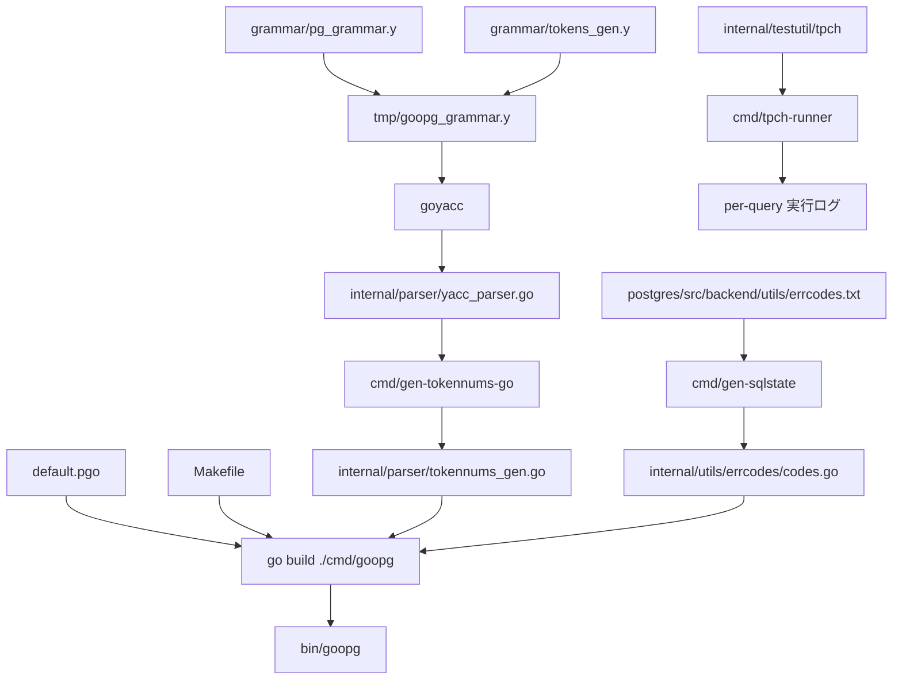

# ビルドと開発ツール

<details>
<summary>関連ソースファイル</summary>

- [`Makefile`](https://github.com/ryogrid/goopg/blob/19856410e8d497d59787e1ab35a2febb3f5953d6/Makefile)
- [`cmd/gen-sqlstate/main.go`](https://github.com/ryogrid/goopg/blob/19856410e8d497d59787e1ab35a2febb3f5953d6/cmd/gen-sqlstate/main.go)
- [`cmd/gen-tokennums-go/main.go`](https://github.com/ryogrid/goopg/blob/19856410e8d497d59787e1ab35a2febb3f5953d6/cmd/gen-tokennums-go/main.go)
- [`cmd/tpch-runner/main.go`](https://github.com/ryogrid/goopg/blob/19856410e8d497d59787e1ab35a2febb3f5953d6/cmd/tpch-runner/main.go)
- [`grammar/pg_grammar.y`](https://github.com/ryogrid/goopg/blob/19856410e8d497d59787e1ab35a2febb3f5953d6/grammar/pg_grammar.y)
- [`tools.go`](https://github.com/ryogrid/goopg/blob/19856410e8d497d59787e1ab35a2febb3f5953d6/tools.go)

</details>

このサブシステムは、goopg の実行バイナリを作る `Makefile` のライフサイクルと、
リポジトリ内で動くコード生成器・開発用ツールをまとめる。入力は 2 種類ある。
ひとつは `grammar/*.y` や PostgreSQL のオラクルファイル(`errcodes.txt` など)で、
これらは goyacc や生成コマンドによって `internal/parser` や
`internal/utils/errcodes` の Go ソースへ変換され、最終的に `bin/goopg` に
リンクされる。もうひとつは開発者が起動した TPC-H クエリや `make` の
ターゲットで、生成物とビルド済みバイナリを使って測定・診断が行われる。

出力側は「コミットされた生成物」と「実行時ログ」に分かれる。生成された
パーサや定数表はリポジトリに残り、レビューと差分比較の対象になる。
ベンチマークのログは `bench/` 配下や標準出力に残り、ゲートの入力になる。
このページでは両者の位置づけを示し、詳細は 2 つの子ページに譲る。

## コンポーネント

- [15.1 ビルドとコード生成](15-Build-and-Tooling/15.1-Build-and-Codegen.md)
  — `Makefile` のビルド/起動ターゲット、`grammar/pg_grammar.y` を中心とする
  goyacc 文法パイプライン、PostgreSQL カタログを Go 表へ転記する
  `cmd/gen-*` 群、SQLSTATE 表の生成を扱う。
- [15.2 開発ツールとベンチマーク](15-Build-and-Tooling/15.2-Development-Tools.md)
  — TPC-H クエリドライバ `cmd/tpch-runner` と結果ダイジェスト比較、
  プラン回帰・推定監査、ベンチ用シェル、cgroup メモリ上限、複雑度・
  Mermaid 検証ツールを扱う。

## サブシステム図



`Makefile` がビルドと生成の両方を駆動する。文法側は `pg_grammar.y` と
生成済みの `tokens_gen.y` を連結して goyacc に渡し、その出力から
`gen-tokennums-go` が終端番号表を作る。SQLSTATE 側は上流の `errcodes.txt` を
`gen-sqlstate` が読み、定数表を書く。どちらの生成物も `go build` の入力に
なる。開発時ツールの `tpch-runner` はビルド済みの `bin/goopg` とは独立に
`internal/testutil/tpch` のクエリ定義を読み、サーバーへ SQL を送って
ログを出す。

## データフロー

1. `make build` は `GOAMD64`(既定 `v3`)を決め、`default.pgo` があれば
   `-pgo` を付けて `./cmd/goopg` を `bin/goopg` にビルドする
   (`Makefile:build`)。`default.pgo` の有無だけが引数を変える。
2. `make gen-parser` は `cmd/gen-kwlist-go` を `-tokens-out` /
   `-kwlists-out` 付きで実行し、`grammar/tokens_gen.y` と
   `grammar/kwlists_gen.y` を更新する(`Makefile:gen-parser`)。
3. 同じターゲットが `header.y`、`tokens_gen.y`、`pg_grammar.y`、
   `kwlists_gen.y`、`goopg_ext.y` を `tmp/goopg_grammar.y` に連結し、
   末尾に区切り行を足してから `internal/parser` で goyacc を実行する。
   出力は `internal/parser/yacc_parser.go` と状態表 `y.output`。
4. `cmd/gen-tokennums-go` が `yacc_parser.go` の `const NAME = N` 行を
   `constRe` で抜き、名前→数値の `genTokenNums` を
   `internal/parser/tokennums_gen.go` に書く
   (`cmd/gen-tokennums-go/main.go:main`)。goyacc の名前付き終端は
   Unicode 私用領域の値を持つため、この抽出が必要になる。
5. 文法の本体 `grammar/pg_grammar.y` は `%start root` で始まり、
   非キーワード終端と優先順位表を定義したうえで、上流 `gram.y` の行範囲を
   コメントに持つ規則を並べる(`grammar/pg_grammar.y:1`)。
6. `cmd/gen-sqlstate` は `errcodes.txt` を `parse` で `entry` の列にし、
   `emit` で SQLSTATE 順に並べ替えて `Severity` / `Code` 定数、
   `Lookup`、`Class` を `internal/utils/errcodes/codes.go` に書き出す
   (`cmd/gen-sqlstate/main.go:emit`)。出力は `format.Source` を通す。
7. `cmd/tpch-runner` は `internal/testutil/tpch` のクエリ本文を引き、
   `db.Conn` で問ごとの専用接続を取って実行する
   (`cmd/tpch-runner/main.go:timeOneWithCancel`)。行数とダイジェストは
   `okLine` が 1 行にまとめ、`rows=N` を必ず行末に置く
   (`cmd/tpch-runner/main.go:okLine`)。`-diff` 指定時は接続を開かず、
   2 本のログを読むオフライン経路に分岐する
   (`cmd/tpch-runner/main.go:main`)。

## 共有データ型

生成器の中で入力行と出力定数の橋渡しをする型。`errcodes.txt` の 1 行が
`entry` 1 個に対応し、`parse` が作り `emit` が消費する。

`cmd/gen-sqlstate/main.go:30`

```go
type entry struct {
	SQLState string
	Severity byte // E / W / S
	Macro    string
	Spec     string
	Section  string
}
```

`SQLState` は 5 文字でなければ `parse` がエラーにする。`Severity` は
`E` / `W` / `S` の 1 文字だけを許し、それ以外はパース段階で拒否される。
`Macro` は上流の `ERRCODE_...` 名で、`emit` の中で `goName` により
UpperCamelCase の Go 識別子へ書き換えられる(`SQL` `SRF` `FDW` `JSON`
`OID` `DBA` `IO` は大文字のまま保持)。`Section` は `Section:` 行で切り替わり、
生成される const ブロックのコメントになる。`Spec` は 4 列目が存在するときだけ
入り、空なら生成時に `(no spec name)` と補われる。

`emit` は入口で `SQLState` による安定ソートを行い、Go 識別子の重複を
`_2`、`_3` の接尾辞で解消する。さらに `severities` マップは SQLSTATE 単位で
重複排除するため、同じコードを指す複数のマクロは定数としては全部残り、
マップには 1 エントリだけが入る。この「定数は全件、表はコード単位」という
不変条件が、生成ファイルの監査性を支えている。

## 主要な設計判断

- **生成物はコミットする**。goyacc の出力や SQLSTATE 表はリポジトリに残し、
  差分レビューの対象にする。`tools.go` は `//go:build tools` で goyacc を
  `golang.org/x/tools` に固定し、チームと CI が同じ生成器バージョンを使う
  ようにしている(`tools.go:1`)。
- **コンフリクトは件数で縛る**。goyacc は未解決コンフリクトがあっても
  exit 0 を返すため、`make gen-parser` は `y.output` を数え、既知の 60 件
  以外なら失敗する。`y.output` が読めない場合は既定値 999 に倒れる
  (`Makefile:gen-parser`)。
- **ビルドの既定は最適化済み**。`GOAMD64=v3` を既定にし、`default.pgo` が
  あれば PGO を適用する。移植性が必要な場合は `make GOAMD64=v1 build` で
  落とす(`Makefile:build`)。
- **起動はメモリ上限付き**。`make start` は `scripts/goopg-test-run.sh` を
  経由し、`GOOPG_MEM_HIGH=20G`、`GOOPG_MEM_MAX=24G`、
  `GOOPG_MEM_SWAP_MAX=0` の cgroup v2 スコープでサーバーを動かす
  (`Makefile:start`)。暴走クエリはスコープ内で SIGKILL され、
  ホスト全体の OOM killer を避ける。
- **ダイジェストは行数の代替ではなく追加**。`tpch-runner` の `-digest` は
  行数の後ろではなく手前にトークンを置き、`rows=N` を行末に保つ。
  これにより既存の行数抽出ゲートを壊さずに値比較を足せる
  (`cmd/tpch-runner/main.go:okLine`)。
- **SQLSTATE は手書きしない**。すべてのコードは `errcodes.txt` 由来で、
  生成器を再実行しない限り新しいコードは増えない。`Lookup` と `Class` を
  同じ生成ファイルに置くことで、各パッケージが SQLSTATE 文字列を
  再パースしなくて済む(`cmd/gen-sqlstate/main.go:emit`)。

関連ページ: [1 プロジェクト概要](1-Overview.md)、
[4 SQL パーサー](4-SQL-Parser.md)、
[5 クエリプランナー](5-Query-Planner.md)、
[6 実行エンジン](6-Executor.md)。

Sources:

- `Makefile`
- `cmd/gen-sqlstate/main.go`
- `cmd/gen-tokennums-go/main.go`
- `cmd/tpch-runner/main.go`
- `grammar/pg_grammar.y`
- `tools.go`

<sub>Generated by deepwiki-4myself from `goopg` @ `19856410e`</sub>
