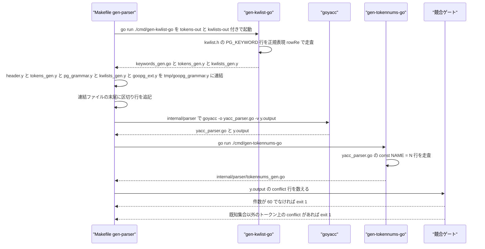
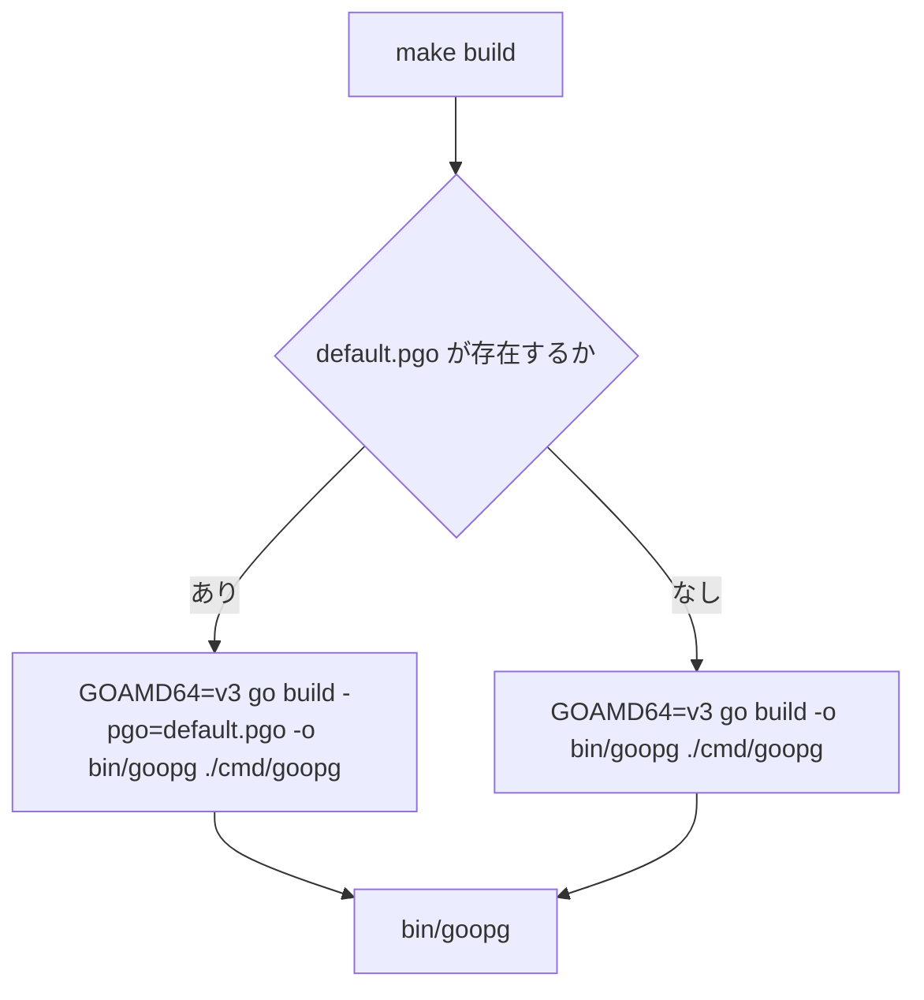
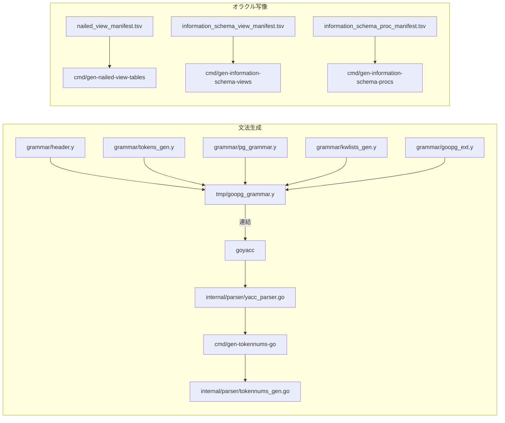

# ビルドとコード生成

<details>
<summary>関連ソースファイル</summary>

- [`Makefile`](https://github.com/ryogrid/goopg/blob/19856410e8d497d59787e1ab35a2febb3f5953d6/Makefile)
- [`tools.go`](https://github.com/ryogrid/goopg/blob/19856410e8d497d59787e1ab35a2febb3f5953d6/tools.go)
- [`cmd/gen-information-schema-procs/main.go`](https://github.com/ryogrid/goopg/blob/19856410e8d497d59787e1ab35a2febb3f5953d6/cmd/gen-information-schema-procs/main.go)
- [`cmd/gen-information-schema-views/main.go`](https://github.com/ryogrid/goopg/blob/19856410e8d497d59787e1ab35a2febb3f5953d6/cmd/gen-information-schema-views/main.go)
- [`cmd/gen-isolation-coverage/main.go`](https://github.com/ryogrid/goopg/blob/19856410e8d497d59787e1ab35a2febb3f5953d6/cmd/gen-isolation-coverage/main.go)
- [`cmd/gen-kwlist-go/main.go`](https://github.com/ryogrid/goopg/blob/19856410e8d497d59787e1ab35a2febb3f5953d6/cmd/gen-kwlist-go/main.go)
- [`cmd/gen-nailed-view-tables/main.go`](https://github.com/ryogrid/goopg/blob/19856410e8d497d59787e1ab35a2febb3f5953d6/cmd/gen-nailed-view-tables/main.go)
- [`cmd/gen-oracle-inventory/main.go`](https://github.com/ryogrid/goopg/blob/19856410e8d497d59787e1ab35a2febb3f5953d6/cmd/gen-oracle-inventory/main.go)
- [`cmd/gen-oracle-report/main.go`](https://github.com/ryogrid/goopg/blob/19856410e8d497d59787e1ab35a2febb3f5953d6/cmd/gen-oracle-report/main.go)
- [`cmd/gen-pg-operator-data/main.go`](https://github.com/ryogrid/goopg/blob/19856410e8d497d59787e1ab35a2febb3f5953d6/cmd/gen-pg-operator-data/main.go)
- [`cmd/gen-pg-proc-data/main.go`](https://github.com/ryogrid/goopg/blob/19856410e8d497d59787e1ab35a2febb3f5953d6/cmd/gen-pg-proc-data/main.go)
- [`cmd/gen-pg-type-data/main.go`](https://github.com/ryogrid/goopg/blob/19856410e8d497d59787e1ab35a2febb3f5953d6/cmd/gen-pg-type-data/main.go)
- [`cmd/gen-planner-flag-labels/main.go`](https://github.com/ryogrid/goopg/blob/19856410e8d497d59787e1ab35a2febb3f5953d6/cmd/gen-planner-flag-labels/main.go)
- [`cmd/gen-regress-coverage/main.go`](https://github.com/ryogrid/goopg/blob/19856410e8d497d59787e1ab35a2febb3f5953d6/cmd/gen-regress-coverage/main.go)
- [`cmd/gen-sqlstate/main.go`](https://github.com/ryogrid/goopg/blob/19856410e8d497d59787e1ab35a2febb3f5953d6/cmd/gen-sqlstate/main.go)
- [`cmd/gen-tap-coverage/main.go`](https://github.com/ryogrid/goopg/blob/19856410e8d497d59787e1ab35a2febb3f5953d6/cmd/gen-tap-coverage/main.go)
- [`cmd/gen-tokennums-go/main.go`](https://github.com/ryogrid/goopg/blob/19856410e8d497d59787e1ab35a2febb3f5953d6/cmd/gen-tokennums-go/main.go)
- [`grammar/header.y`](https://github.com/ryogrid/goopg/blob/19856410e8d497d59787e1ab35a2febb3f5953d6/grammar/header.y)
- [`grammar/goopg_ext.y`](https://github.com/ryogrid/goopg/blob/19856410e8d497d59787e1ab35a2febb3f5953d6/grammar/goopg_ext.y)
- [`grammar/kwlists_gen.y`](https://github.com/ryogrid/goopg/blob/19856410e8d497d59787e1ab35a2febb3f5953d6/grammar/kwlists_gen.y)
- [`grammar/pg_grammar.y`](https://github.com/ryogrid/goopg/blob/19856410e8d497d59787e1ab35a2febb3f5953d6/grammar/pg_grammar.y)
- [`grammar/tokens_gen.y`](https://github.com/ryogrid/goopg/blob/19856410e8d497d59787e1ab35a2febb3f5953d6/grammar/tokens_gen.y)

</details>

このページは、goopg の実行バイナリを組み立てる `Makefile` のライフサイクルと、
リポジトリ内で動く 2 系統のコード生成器を扱う。第 1 は goyacc 用文法の生成で、
`postgres/src/include/parser/kwlist.h` からキーワード終端記号と 6 つの
キーワードリスト非終端記号を作り、5 つの `.y` 断片を連結して goyacc に渡し、
生成されたパーサから終端記号の数値を逆抽出する。第 2 は「オラクル写像」で、
実 PostgreSQL 18.3 のカタログ `.dat` やキャプチャ済みマニフェスト TSV を、
`internal/initdb` / `internal/catalog` の Go テーブルへ一字一句転記する。
どちらの系統も、生成物はコミットされ、入力と出力のドリフトはテストで検出される
設計になっている。このページ自体はテストコードを扱わない。

## 責務

- `make build` で `./cmd/goopg` から `bin/goopg` を作る。既定で `GOAMD64=v3`、
  `default.pgo` があれば `-pgo` を付ける(`Makefile:build`)。
- `make gen-parser` で `grammar/*.y` から `internal/parser/yacc_parser.go` を
  再生成し、**既知の 60 件以外のコンフリクトをビルド失敗にする**
  (`Makefile:gen-parser`)。
- `cmd/gen-kwlist-go` で `kwlist.h` を単一の真実源として
  `internal/parser/keywords_gen.go`、`grammar/tokens_gen.y`、
  `grammar/kwlists_gen.y` を作る(`cmd/gen-kwlist-go/main.go:writeTokensY`,
  `cmd/gen-kwlist-go/main.go:writeKwlistsY`)。
- `cmd/gen-tokennums-go` で goyacc が割り当てた終端記号番号を
  `internal/parser/tokennums_gen.go` に写す(`cmd/gen-tokennums-go/main.go:constRe`)。
- `cmd/gen-pg-{type,proc,operator}-data` で PostgreSQL の `.dat` カタログを
  `pgTypeAllEntries` / `pgProcAllEntries` / `PGOperatorAllEntries` に変換する。
- `cmd/gen-nailed-view-tables` / `cmd/gen-information-schema-{views,procs}` で
  キャプチャ TSV を `nailedRel` / `pgRewriteEntry` / `pgProcEntry` のシードへ変換する。
- `cmd/gen-sqlstate` で `errcodes.txt` から SQLSTATE 定数と `Severity` 表を作る。
- `cmd/gen-{oracle-inventory,oracle-report,regress-coverage,isolation-coverage,tap-coverage}`
  でテスト移植の進捗 CSV を Markdown レポートへ描画する(CSV は書き換えない)。
- `cmd/gen-planner-flag-labels` でプランナ既定値をゲート用のシェル断片へ焼き込む。

## 処理フロー

`make gen-parser` の実経路を追う。Makefile はまずキーワード生成器を
`-tokens-out` / `-kwlists-out` 付きで呼び、そのあと 5 つの断片を
`tmp/goopg_grammar.y` に連結して閉じの区切り行を追記し、`internal/parser`
ディレクトリで goyacc を実行する。goyacc のあとに終端番号抽出器を走らせ、
最後に `y.output` を数えてコンフリクト件数を検査する。



連結順は Makefile のとおり
`header.y → tokens_gen.y → pg_grammar.y → kwlists_gen.y → goopg_ext.y` で、
`grammar/header.y:1` のコメントは `kwlists_gen.y` を挙げていないため、
順序は Makefile 側を正とする。goyacc の出力は `-o yacc_parser.go` で
`internal/parser` に置かれ、`-v y.output` の状態表がコンフリクト検査の
入力になる。`gen-tokennums-go` はその後段に置かれており、
`internal/parser/yacc_parser.go` が存在しないと
`cmd/gen-tokennums-go/main.go:fail` で停止する。

ビルド側の分岐は単純で、`default.pgo` の有無だけが `go build` の引数を変える。



`make init` / `make start` / `make goopg-test-server` はすべて `build` に依存する。
`start` は `postmaster.pid` が既にあれば起動せずに exit 1 し、起動時は
`scripts/goopg-test-run.sh` 経由で cgroup v2 スコープに入れる
(`Makefile:start`)。メモリ上限は `GOOPG_MEM_HIGH=20G`、
`GOOPG_MEM_MAX=24G`、`GOOPG_MEM_SWAP_MAX=0` が既定で、環境変数で上書きできる。

## 主要ファイル

| ファイル | 役割 |
| --- | --- |
| `Makefile` | ビルド・起動・停止、`gen-parser`、`regen-testport`、ベンチ・PGO・プラン回帰・race ゲートの入口。`Makefile:build` / `Makefile:gen-parser` / `Makefile:regen-testport` |
| `tools.go` | `//go:build tools` で goyacc を go.mod に固定する。`go run golang.org/x/tools/cmd/goyacc` の供給源。`tools.go:1` |
| `cmd/gen-kwlist-go/main.go` | `kwlist.h` → `keywords_gen.go` / `tokens_gen.y` / `kwlists_gen.y`。`cmd/gen-kwlist-go/main.go:rowRe`、`writeTokensY`、`writeKwlistsY` |
| `cmd/gen-tokennums-go/main.go` | goyacc 生成物の `const NAME = N` を名前→数値表へ。`cmd/gen-tokennums-go/main.go:constRe` |
| `grammar/header.y` | goyacc プロローグ、合成終端 `TYPEDLIT` / `VALUES_LA` / `CHECKBODY`、`%union`。`grammar/header.y:28` |
| `grammar/tokens_gen.y` | 全キーワードの `%token <str>` 宣言と 6 非終端記号の `%type`。生成物 |
| `grammar/kwlists_gen.y` | `unreserved_keyword` などの 6 つのキーワードリスト規則。生成物 |
| `grammar/pg_grammar.y` | 移植本体。`%start root`、非キーワード終端、優先順位表、各規則。`grammar/pg_grammar.y:14` |
| `grammar/goopg_ext.y` | goopg 固有の拡張規則。各規則に `GOOPG-EXT:` タグを要求。`grammar/goopg_ext.y:1` |
| `cmd/gen-pg-type-data/main.go` | `pg_type.dat` と `pg_proc.dat` → `pgTypeAllEntries` と `pgTypeGeneratedElemArraySubscript`。`cmd/gen-pg-type-data/main.go:resolveLen` |
| `cmd/gen-pg-proc-data/main.go` | `pg_proc.dat` → `pgProcAllEntries`。`-names` / `-flags` / `-aggcost` で別出力。`cmd/gen-pg-proc-data/main.go:parseProcDat` |
| `cmd/gen-pg-operator-data/main.go` | `pg_operator.dat` を 2 パスで解決し `PGOperatorAllEntries` を出力。`cmd/gen-pg-operator-data/main.go:parseOperatorDatFirstPass` |
| `cmd/gen-nailed-view-tables/main.go` | `nailed_view_manifest.tsv` → `nailedViewSeedRels` / `nailedViewRewriteEntries`。`cmd/gen-nailed-view-tables/main.go:parseManifest` |
| `cmd/gen-information-schema-views/main.go` | `information_schema_view_manifest.tsv` → `informationSchemaViewSeedRels` / `informationSchemaViewRewriteEntries`。`cmd/gen-information-schema-views/main.go:main` |
| `cmd/gen-information-schema-procs/main.go` | `information_schema_proc_manifest.tsv` → `informationSchemaHelperProcs`。`cmd/gen-information-schema-procs/main.go:parseManifest` |
| `cmd/gen-sqlstate/main.go` | `errcodes.txt` → `internal/utils/errcodes/codes.go`。`cmd/gen-sqlstate/main.go:parse`、`goName`、`emit` |
| `cmd/gen-oracle-inventory/main.go` | 進捗 CSV を suite 単位に集計し Markdown 表へ。`cmd/gen-oracle-inventory/main.go:loadInventory` |
| `cmd/gen-oracle-report/main.go` | `framework.LoadStatusCSV` で検証し互換性レポートを出力。`cmd/gen-oracle-report/main.go:main` |
| `cmd/gen-regress-coverage/main.go` | 上流 `pg_regress` ケースの分類表。`cmd/gen-regress-coverage/main.go:excludedCases`、`loadCSV` |
| `cmd/gen-isolation-coverage/main.go` | isolation spec の発見結果と CSV を突き合わせる。`cmd/gen-isolation-coverage/main.go:loadCSV` |
| `cmd/gen-tap-coverage/main.go` | TAP `.pl` を走査し `port` / `defer` / `excluded` に分類。`cmd/gen-tap-coverage/main.go:classify`、`collect` |
| `cmd/gen-planner-flag-labels/main.go` | `optimizer.RenderFlagProvenanceEnv()` を stdout へ。`cmd/gen-planner-flag-labels/main.go:main` |

## 公開 API / エントリポイント

生成器はいずれも `package main` なので、外部から import できる API は無い。
入口は `make` ターゲットと `go run ./cmd/<name>` の CLI フラグである。

| コマンド | 主なフラグ | 出力 |
| --- | --- | --- |
| `make gen-parser` | なし | `internal/parser/yacc_parser.go`、`internal/parser/tokennums_gen.go`、`grammar/{tokens,kwlists}_gen.y` |
| `make regen-testport` | なし | `docs/test-port/*.md`、`analysis/postgres-oracle-compatibility-report.md` |
| `gen-kwlist-go` | `-kwlist` `-out` `-tokens-out` `-kwlists-out` | `internal/parser/keywords_gen.go` |
| `gen-tokennums-go` | `-in` `-out` | `internal/parser/tokennums_gen.go` |
| `gen-sqlstate` | `-in` `-out` `-package` | `internal/utils/errcodes/codes.go`(既定 `-out` と一致) |
| `gen-pg-proc-data` | `-names` `-flags` `-aggcost` | `internal/initdb/pg_proc_seed_data.go`、`internal/catalog/pg_proc_names_generated.go` など |
| `gen-pg-type-data` | なし(固定パス) | `internal/initdb/pg_type_seed_data.go` |
| `gen-pg-operator-data` | なし(固定パス) | `internal/initdb/pg_operator_seed_data.go` |
| `gen-nailed-view-tables` | なし | `internal/initdb/nailed_view_seed_data.go` |
| `gen-information-schema-views` | なし | `internal/initdb/information_schema_view_seed_data.go` |
| `gen-information-schema-procs` | なし | `internal/initdb/information_schema_proc_seed.go` |
| `gen-oracle-inventory` | `-repo-root` `-csv` `-out-md` | `docs/test-port/postgres-oracle-target-inventory.md` |
| `gen-oracle-report` | `-repo-root` `-inventory-csv` `-out` | `analysis/postgres-oracle-compatibility-report.md` |
| `gen-regress-coverage` | `-repo-root` `-csv` `-out` | `docs/test-port/upstream-regress-coverage.md` |
| `gen-isolation-coverage` | `-repo-root` `-csv` `-out` | `docs/test-port/upstream-isolation-coverage.md` |
| `gen-tap-coverage` | `-repo-root` `-csv` `-out` | `docs/test-port/upstream-tap-coverage.md` |
| `gen-planner-flag-labels` | なし | stdout(リダイレクト先 `scripts/planner-flags.env`) |

`gen-sqlstate` はファイル冒頭のコメントが `internal/sqlstate/codes.go` と
書いているが、実際の `-out` 既定値と生成物は
`internal/utils/errcodes/codes.go` である(`cmd/gen-sqlstate/main.go:40`)。

## 主要データ構造

文法生成の中心は `%union` である。goyacc には位置情報の自動機構が無いため、
バイト位置 `p` を含む全フィールドを 1 つの union に詰めている。

`grammar/header.y:28`

```c
%union {
	str    string           // IDENT / SCONST / keyword text / Op value ...
	ival   int              // ICONST / PARAM numbers
	i64    int64            // signed integer literals in option lists
	b      bool             // set_quantifier ALL flag etc
	p      int              // byte position threading (see select_pos helper)
	stmt   Stmt      // single-statement productions
	stmts  []Stmt    // statement lists (root)
	expr   Expr      // expression productions
	targets []ResTarget
	rt     ResTarget
	rvar   RangeVar
	rvars   []RangeVar
	sortbys []SortBy
	sortby  SortBy
	joins   []JoinExpr
	fexpr   FromExpr
	fexprs  []FromExpr
	jspec   *joinSpec
	exprs   []Expr
	tfr     *TableFuncRef
	rfes    []RowsFromEntry
	vrows   [][]Expr
	ctes    []*CommonTableExpr
	withc   *WithClause
	rfe     RowsFromEntry
	strs   []string         // identifier lists
	qn     qname            // dotted-name carrier (support.go)
	node   any              // multi-value carriers like distinctInfo
	wd     *WindowDef
	fr     *WindowFrame
	ct     castType
	isrc   *insSrc
	onames []ObjectName
	fargs  []FunctionArg
	ivq    ivQual
	lrels  []LockTableRelation
	lrel   LockTableRelation
	mwc    *MergeWhenClause
	mwcs   []*MergeWhenClause
	tflds  []TypeField
	tfld   TypeField
	nodes  []any
	copts  []CopyOption
	telems []*tableElem
	copt   CopyOption
	fitems []DropFunctionItem
	ctt    *ctTail
	wp     [2]string
	oc     *OnConflictClause
	oct    *OnConflictTarget
	ualist []UpdateAssign
	ua     UpdateAssign
	nwd    NamedWindowDef
	nwds   []NamedWindowDef
	list   []any            // heterogeneous lists, mirroring PG's untyped List
}
```

`str` は識別子・文字列・キーワードテキスト・演算子値の共通キャリアで、
キーワード終端記号がすべて `%token <str>` なのはこのためである。
`p` は `@n` の代替であり、明示アクションを持つ規則は自分で `pos` を
種から設定しなければならない。`list []any` は PostgreSQL の型無し `List` に対応し、
異種要素を並べる規則だけが使う。合成終端 `TYPEDLIT` は
`"type\x1fvalue"` を `str` に詰め、`CHECKBODY` は `(` の位置を `p`、
`)` の位置を `ival` に持つ(`grammar/header.y:16`〜`grammar/header.y:26`)。

オラクル写像側の代表型は、いずれも「マニフェスト 1 行 = 構造体 1 個」の
写像であり、派生計算を持たない。

`cmd/gen-information-schema-procs/main.go:41`

```go
// proc is one information_schema helper pg_proc row.
type proc struct {
	Name       string
	OID        uint32
	Namespace  uint32
	Cost       int64
	Rows       int64
	Support    uint32
	Kind       byte
	Volatile   byte
	Parallel   byte
	IsStrict   bool
	RetSet     bool
	Lang       uint32
	RetType    uint32
	ArgTypes   []uint32
	AllArgType []uint32
	ArgModes   []byte
	ArgNames   []string
	ProcSrc    string
	HasSqlBody bool
}
```

`HasSqlBody` はマニフェストの最終列が `-` か否かだけで決まり、真なら
出力の `SqlBody` フィールドに関数名そのものが入る。SQL 本文は Go に展開されず、
`<name>_prosqlbody.dat` から実行時に解決される。`ArgTypes` は
`proargtypes` の oidvector、`AllArgType` / `ArgModes` / `ArgNames` は
`proallargtypes` / `proargmodes` / `proargnames` の PG 配列リテラル由来で、
`-` は NULL として `nil` になる。`OID` の重複は
`cmd/gen-information-schema-procs/main.go:parseManifest` が即座に拒否する。

`cmd/gen-nailed-view-tables/main.go:53`(情報スキーマ版も同一定義)

```go
type attr struct {
	Num       int16
	Name      string
	TypeOID   uint32
	Len       int16
	NotNull   bool
	IsDropped bool
}

type rel struct {
	Name          string
	OracleOID     uint32
	GoopgOID      uint32
	RuleOID       uint32
	OracleRelType uint32
	GoopgRelType  uint32
	RelKind       byte
	RelNatts      int16
	Attrs         []attr
}
```

不変条件は生成前にまとめて検査される。`RelNatts == len(Attrs)`、
`OracleOID == GoopgOID`(Option A の恒等写像)、`Attrs[i].Num == i+1`、
`RuleOID != 0`、`RuleOID != GoopgOID`、そして全 `rel` を跨いだ
view OID と rule OID の一意性である。`GoopgRelType` は常に 2249
(RECORDOID)で、upstream の複合型 OID はコメントに退避される。

`cmd/gen-pg-proc-data/main.go:131`

```go
type procEntry struct {
	OID          uint32
	Name         string
	RetType      uint32
	ArgTypes     []uint32 // nil means absent (→ use default [2281] for AM handlers)
	ArgTypeNames []string // raw proargtypes typname tokens (INPUT args only), nil if the key was absent
	Volatile     byte     // 0 means absent (default 'v')
	Parallel     byte     // 0 means absent (default 's')
	RetSet       bool
	Kind         byte // prokind; 0 means absent (default 'f', a plain function)
	NotStrict    bool // inverse of proisstrict; absent → strict (false)
	Lang         uint32
	HandlerName  string
	AllArgTypes  []uint32
	ArgModes     []byte
	ArgNames     []string
}
```

`ArgTypes` の `nil` と空スライスは意味が違う。`nil` は `proargtypes` キー自体が
無い場合で、AM ハンドラの既定 `[2281]` を意味する。空スライスは
`proargtypes => ''` の明示的な 0 引数を意味する。`Volatile` と `Parallel` の
ゼロ値は「省略」を表し、既定はそれぞれ `'v'` と `'s'` である。ただし
`-flags` 出力では `pg_proc.h` の `BKI_DEFAULT(i)` に合わせ、省略を
IMMUTABLE として扱う(`cmd/gen-pg-proc-data/main.go:emitFlags`)。

`cmd/gen-pg-type-data/main.go:106`

```go
// typeEntry mirrors internal/initdb.pgTypeEntry for generation purposes.
type typeEntry struct {
	OID      uint32
	Name     string
	Len      int16
	ByVal    bool
	Type     byte // typtype
	Category byte // typcategory
	Align    byte // typalign: 'c','s','i','d'
	Storage  byte // typstorage: 'p','e','x','m'
	Input    uint32
	Output   uint32
	Receive  uint32
	Send     uint32
}
```

`Len` は `-1` / `ANYSIZE` → `-1`、`NAMEDATALEN` → `64`、
`SIZEOF_POINTER` / `ALIGNOF_POINTER` → `8` に解決される。
配列要素型は `Name: "_" + 基底名`、`Len: -1`、`ByVal: false`、`Type: 'b'`、
`Category: 'A'`、`Storage: 'x'` で合成され、I/O 関数は汎用配列の
750 / 751 / 2400 / 2401 に固定される。alignment だけは要素型が `d` なら
`d`、それ以外は `i` になる。

`cmd/gen-pg-operator-data/main.go:134`

```go
type operatorEntry struct {
	OID        uint32
	Name       string
	Namespace  uint32
	Owner      uint32
	Kind       byte
	CanMerge   bool
	CanHash    bool
	LeftType   uint32
	RightType  uint32
	ResultType uint32
	Commutator uint32
	Negator    uint32
	Code       uint32
	Restrict   uint32
	Join       uint32
}
```

`Namespace` は 11(pg_catalog)、`Owner` は 10 に固定される。
`Commutator` / `Negator` は `(名前, 左型 OID, 右型 OID)` の三つ組で
別の演算子を指すため、全エントリを読み終える前には解決できない。
これが 2 パス構成の理由である。`Code` / `Restrict` / `Join` は
`oprcode` / `oprrest` / `oprjoin` の関数参照を OID に解決した値で、
解決できなければ警告のうえ 0 になる。

`cmd/gen-sqlstate/main.go:30`

```go
type entry struct {
	SQLState string
	Severity byte // E / W / S
	Macro    string
	Spec     string
	Section  string
}
```

`Section` は `Section:` 行で切り替わる見出しで、出力の const ブロックに
コメントとして入る。`Severity` は `E` / `W` / `S` の 1 文字だけを許し、
それ以外はパース段階でエラーになる。`Macro` は
`ERRCODE_` を剥がして UpperCamelCase 化されるが、`SQL` `SRF` `FDW`
`JSON` `OID` `DBA` `IO` は大文字のまま保持される。

`cmd/gen-oracle-inventory/main.go:18`

```go
type suiteAgg struct {
	suiteID  string
	kind     string
	total    int
	pass     int
	failed   int
	notTried int
	excluded int
	port     int
	defer_   int
	example  string
}
```

`defer_` は Go の予約語を避けたフィールド名である。`example` は
その suite で最初に現れた `item_path` を保持する。集計は `suite_id` の
初出順を保つ `order []*suiteAgg` と `byID` の二重管理で行われ、
CSV の並びがそのままレポートの行順になる。

## 内部構造

生成器は 3 つの家族に分かれる。

1. **文法生成**(`make gen-parser`)。入力は `kwlist.h` と手書きの `.y`、
   出力は生成パーサと終端表。ここだけが goyacc という外部ツールに依存する。
2. **オラクル写像**。`postgres/...` の `.dat` またはキャプチャ TSV を読み、
   `internal/initdb` / `internal/catalog` の Go リテラルを stdout に出す。
   `gen-nailed-view-tables`、`gen-information-schema-{views,procs}`、
   `gen-pg-{type,proc,operator}-data` が該当し、いずれも
   `//go:build ignore` を持つため `go build ./...` の対象外である。
3. **進捗レポート**。CSV を読み、Markdown をファイルへ直接書く。
   `gen-{oracle-inventory,oracle-report,regress-coverage,isolation-coverage,tap-coverage}`
   が該当し、ビルドタグを持たない通常の `main` パッケージなので
   `go build ./...` で常にコンパイルされる。



出力スタイルは 2 種類ある。`gen-nailed-view-tables` などは `os.Stdout` に
`fmt.Fprintf` し、利用側が `> internal/initdb/...go` でリダイレクトする。
一方 `gen-kwlist-go` / `gen-tokennums-go` / `gen-sqlstate` / レポート系は
`os.WriteFile` または `os.Create` でパスを直接書く。前者はシェル側の
リダイレクトミスがそのまま空ファイルになるため、生成器自身は
「マニフェストに `# Oracle:` スタンプが無ければ die」といった入力側の
検査を厚くしている。

`gen-kwlist-go` は 1 回の走査で 3 つの成果物を作る。`-out` は常に書き、
`-tokens-out` と `-kwlists-out` は指定時だけ書く。キーワードの重複は
テキストと終端名の両方で検査され、どちらかが重複すれば exit 1 する
(`cmd/gen-kwlist-go/main.go:72`)。`-kwlists-out` の 6 つのリストのうち
1 つでも空になれば「kwlist.h の退行」として失敗する。

`gen-tokennums-go` が存在する理由は goyacc の採番にある。goyacc は名前付き
終端に Unicode 私用領域の値(`yyPrivate = 57344 + n`)を割り当てるため、
`yyToknames` の添字 + 1 はパーサ値と一致しない。そこで生成ソースの
`const NAME = N` 行を正規表現で拾い、名前→数値の `genTokenNums` を作る。
この表は文法を再生成しても再実行不要な `keywords_gen.go` と違い、
goyacc のたびに更新が必要である。

`cmd/gen-planner-flag-labels` だけは他の生成器と性質が異なる。
`internal/optimizer.RenderFlagProvenanceEnv()` をそのまま stdout に流すだけで、
内容の判断はプランナ側の関数に委ねる。過去に
`GOOPG_RELSIZE_FALLBACK`(M0125-0005)と `GOOPG_PGSHAPED_DP`(M0127-P5.9)の
既定値が反転したのにラベルが手書きのまま残り、成果物が測定対象と逆の
状態を記録した。これを防ぐため、ラベルは既定値を解決する関数から導出され、
生成ファイルはリポジトリにコミットされる(Go の無いホストでもゲートが
動くようにするため)。ドリフトはテストで検出される。

## エッジケースと不変条件

- **コンフリクト件数は 60 で固定**。`make gen-parser` は
  `grep -cE '^ *[0-9]+:.*(shift/reduce|reduce/reduce) conflict'` の結果が
  60 でなければ失敗する。goyacc は未解決コンフリクトがあっても exit 0 を
  返すため、この grep が唯一の防波堤である。`y.output` が読めない場合は
  既定値 999 にフォールバックし、必ず失敗側に倒れる。
- **既知集合外のコンフリクトも失敗**。`(` `)` `.` `[` `ON` `IF_P` `NOT`
  `SESSION` `LOCAL` `CONSTRAINTS` `SAVEPOINT` `IN_P` `COLLATE` `EXECUTE`
  `CLASS` `FAMILY` 以外のトークンでコンフリクトが出ると exit 1 する。
  件数が合っていても新しいクラスが混入すれば通らない。
- **goyacc のバージョン固定**。`tools.go` は `golang.org/x/tools` を
  `v0.49.0` に固定し、`//go:build tools` で本番ビルドから除外する。
  バージョンを上げるときはコンフリクトゲートの再実行が前提である。
- **`gen-kwlist-go` の全行一致**。`PG_KEYWORD(` で始まる行が正規表現
  `rowRe` に一致しなければ、ファイル名と行番号付きで失敗する。
  4 列目のラベルは `BARE_LABEL` / `AS_LABEL` の 2 値しか許さない。
- **マニフェストの厳格さ**。`rel` 行は 9 フィールド、`attr` 行は 8 フィールド、
  `proc` 行は 20 フィールドでなければならない。`attr` 行が対応する `rel` 行より
  前に来ると失敗する。`relnatts` と実際の属性数の不一致は
  「N 列を約束する pg_class 行と M 個の pg_attribute」という
  ホスト側の `cache lookup failed` を生むため、生成前に止める。
- **OID の恒等性**。`OracleOID != GoopgOID` は Option A の pin に反するので
  失敗する。rule OID が 0 の場合はキャプチャスクリプトが `pg_rewrite` を
  読めなかったことを意味し、再キャプチャを促して停止する。view OID と
  rule OID が冲突した場合も、pg_class と pg_rewrite が同じ OID を別物として
  指すことになるため失敗する。
- **information_schema 固有の検査**。`gen-information-schema-views` は
  さらに `RelKind == 'v'` を要求する。information_schema の関係は
  上流でも nail されず、namespace 13273 の別コーパスとして扱われる。
- **SQLSTATE の重複**。上流マクロは一意だが、防御的に Go 識別子の重複を
  `_2`、`_3` の接尾辞で解消する。一方 `severities` マップは SQLSTATE 単位で
  重複排除するため、`ERRCODE_ARRAY_ELEMENT_ERROR` と
  `ERRCODE_ARRAY_SUBSCRIPT_ERROR` のように同じ `2202E` を指す 2 つの定数は
  両方残り、マップには 1 エントリだけが入る。
- **`gen-sqlstate` の gofmt 必須**。生成後に `format.Source` を通し、
  失敗した場合は生成途中のソースを添えて停止する。壊れた Go を
  書き出さないための最終ゲートである。
- **`.dat` の既定値**。`provolatile` 省略は `pg_proc.h` の
  `BKI_DEFAULT(i)` に従い IMMUTABLE として扱われる。`proisstrict` は
  `'f'` のときだけ `NotStrict` が立ち、省略は strict である。`prolang` は
  `sql` → 14、`c` → 13、それ以外 → 0(実行時に internal の 12 を使う)。
- **proc 解決の曖昧さ**。`oprcode` が引数型付きで書かれていれば型 OID 列を
  完全一致で照合し、一致しなければ同名の先頭 OID にフォールバックして警告する。
  引数型なしの名前は一意である前提で先頭を使う。未知の型名は警告のうえ 0。
- **集計コストの決定性**。`-aggcost` は集約の支援関数名ごとに `procost` の
  集合を作り、値が 1 つでなければ「推測せず停止」する。`procost` 省略は
  1 として扱う。`aggtransfn` / `aggserialfn` / `aggdeserialfn` /
  `aggcombinefn` / `aggtranstype` / `agginitval` を `|` で連結した
  `TransKey` は、遷移状態を共有できる集約の判定に使われる。
- **レポートの二重計上**。`gen-oracle-inventory` では `status=port` かつ
  `pass_required=yes` の行が `port` と `pass` の両方に数えられるため、
  `*-tap` suite では状態列の合計が `total` を超える。これは意図された仕様で、
  生成される Markdown にも注記される。`pass_rate` は `excluded` を分母から
  除き、`modules-suites` と `contrib-suites` は suite 自身の行も全体集計も
  除外される。
- **TAP 分類の既定値**。`recovery/t` と `subscription/t` は `defer`、
  `postgres/src/bin/<tool>/t/` は tool 名で分岐し、
  `pgbench` `psql` `pg_isready` `pg_ctl` `initdb` は `port`、`scripts` は
  `defer`、それ以外は `excluded`。CSV に同じ `item_path` の行があれば
  そちらの status と rationale が優先される。
- **ビルドの前提**。`GOAMD64=v3` は AVX2 / BMI2 / FMA を要求するため、
  古い CPU では `make GOAMD64=v1 build` で落とす必要がある。
  `pgo-profile` は `127.0.0.1:6060/debug/pprof/` が 200 を返さなければ
  開始せず、480 秒のプロファイル取得と `tpch-runner` の
  Q1/Q3/Q12/Q13/Q21 実行を並行させる。
- **race-gate の分割整合性**。`internal/initdb` は `RACE_SHARDS=4` で
  `go test -list` の上位テスト名をラウンドロビン分割する。分割後の
  テスト数合計が `go test -list` の件数と一致しなければ
  「partition BUG」として失敗し、カバレッジを報告しない。
- **起動の排他**。`make start` は `postmaster.pid` の存在で二重起動を拒否し、
  起動後は最大 5 秒(0.1 秒 × 50 回)待って pid ファイルを確認する。
  タイムアウト時はログの場所を示して exit 1 する。

関連ページ: [15.2 開発ツールとベンチマーク](15.2-Development-Tools.md)、
[4 SQL パーサー](../4-SQL-Parser.md)、
[12 カタログとシステムビュー](../12-Catalog.md)。

Sources:

- `Makefile`
- `tools.go`
- `cmd/gen-information-schema-procs/main.go`
- `cmd/gen-information-schema-views/main.go`
- `cmd/gen-isolation-coverage/main.go`
- `cmd/gen-kwlist-go/main.go`
- `cmd/gen-nailed-view-tables/main.go`
- `cmd/gen-oracle-inventory/main.go`
- `cmd/gen-oracle-report/main.go`
- `cmd/gen-pg-operator-data/main.go`
- `cmd/gen-pg-proc-data/main.go`
- `cmd/gen-pg-type-data/main.go`
- `cmd/gen-planner-flag-labels/main.go`
- `cmd/gen-regress-coverage/main.go`
- `cmd/gen-sqlstate/main.go`
- `cmd/gen-tap-coverage/main.go`
- `cmd/gen-tokennums-go/main.go`
- `grammar/header.y`
- `grammar/goopg_ext.y`
- `grammar/kwlists_gen.y`
- `grammar/pg_grammar.y`
- `grammar/tokens_gen.y`

<sub>Generated by deepwiki-4myself from `goopg` @ `19856410e`</sub>
