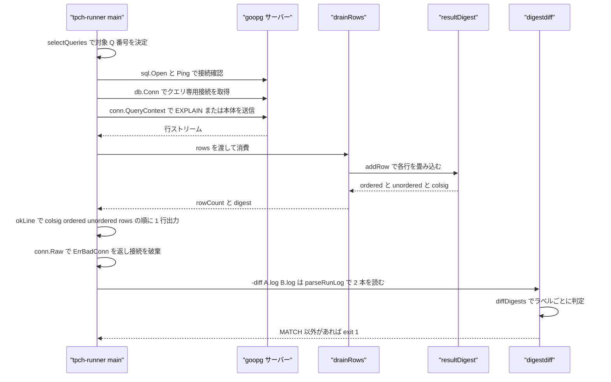
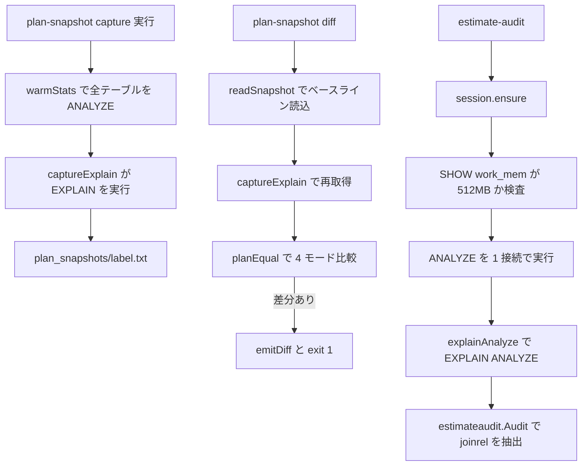

# 開発ツールとベンチマーク

<details>
<summary>関連ソースファイル</summary>

- [`bench/pgbench-compare/run_comparison.sh`](https://github.com/ryogrid/goopg/blob/19856410e8d497d59787e1ab35a2febb3f5953d6/bench/pgbench-compare/run_comparison.sh)
- [`bench/tpcds/server.sh`](https://github.com/ryogrid/goopg/blob/19856410e8d497d59787e1ab35a2febb3f5953d6/bench/tpcds/server.sh)
- [`bench/tpch/run_power_test_goopg.sh`](https://github.com/ryogrid/goopg/blob/19856410e8d497d59787e1ab35a2febb3f5953d6/bench/tpch/run_power_test_goopg.sh)
- [`bench/tpch/setup_goopg.sh`](https://github.com/ryogrid/goopg/blob/19856410e8d497d59787e1ab35a2febb3f5953d6/bench/tpch/setup_goopg.sh)
- [`cmd/diag/main.go`](https://github.com/ryogrid/goopg/blob/19856410e8d497d59787e1ab35a2febb3f5953d6/cmd/diag/main.go)
- [`cmd/estimate-audit/main.go`](https://github.com/ryogrid/goopg/blob/19856410e8d497d59787e1ab35a2febb3f5953d6/cmd/estimate-audit/main.go)
- [`cmd/parsetest/main.go`](https://github.com/ryogrid/goopg/blob/19856410e8d497d59787e1ab35a2febb3f5953d6/cmd/parsetest/main.go)
- [`cmd/plan-snapshot/main.go`](https://github.com/ryogrid/goopg/blob/19856410e8d497d59787e1ab35a2febb3f5953d6/cmd/plan-snapshot/main.go)
- [`cmd/tpch-runner/digest.go`](https://github.com/ryogrid/goopg/blob/19856410e8d497d59787e1ab35a2febb3f5953d6/cmd/tpch-runner/digest.go)
- [`cmd/tpch-runner/digestdiff.go`](https://github.com/ryogrid/goopg/blob/19856410e8d497d59787e1ab35a2febb3f5953d6/cmd/tpch-runner/digestdiff.go)
- [`cmd/tpch-runner/main.go`](https://github.com/ryogrid/goopg/blob/19856410e8d497d59787e1ab35a2febb3f5953d6/cmd/tpch-runner/main.go)
- [`cmd/validate-ralph-state/main.go`](https://github.com/ryogrid/goopg/blob/19856410e8d497d59787e1ab35a2febb3f5953d6/cmd/validate-ralph-state/main.go)
- [`scripts/goopg-test-run.sh`](https://github.com/ryogrid/goopg/blob/19856410e8d497d59787e1ab35a2febb3f5953d6/scripts/goopg-test-run.sh)
- [`tools/gocomplexity/cli.py`](https://github.com/ryogrid/goopg/blob/19856410e8d497d59787e1ab35a2febb3f5953d6/tools/gocomplexity/cli.py)
- [`tools/mermaid-validator/validate.mjs`](https://github.com/ryogrid/goopg/blob/19856410e8d497d59787e1ab35a2febb3f5953d6/tools/mermaid-validator/validate.mjs)

</details>

このページは、goopg を測定・診断・検証するための周辺ツール群を扱う。
中心にあるのは TPC-H 用のクエリドライバ `cmd/tpch-runner` で、Per-query の
タイムアウトとキャンセルを効かせながら 1 問ずつ実行し、`-digest` を付けると
結果集合の値ハッシュまで記録して 2 本のログを値単位で比較できる。これに
プラン回帰の `cmd/plan-snapshot`、推定精度を EXPLAIN ANALYZE で監査する
`cmd/estimate-audit`、クラスタを用意するベンチ用シェル、メモリ上限を強制する
`scripts/goopg-test-run.sh`、コード複雑度と Mermaid 構文の静的検証ツール、
Ralph ループ状態の整合性チェッカが加わる。ベンチ用シェルは結果を
`bench/.../results/` や `analysis/...` に残し、Go のコマンドは失敗時に
非ゼロ終了してゲートとして使えることを前提に設計されている。

## 責務

- TPC-H Q1〜Q22 を 1 問ずつ実行し、各問の成否・経過時間・行数を出力する
  (`cmd/tpch-runner/main.go:main`、`timeOneWithCancel`)。
- 各問を専用の `*sql.Conn` で実行し、終了時に `driver.ErrBadConn` を返して
  プールから破棄する。1 問のエラーが次問のストリームを汚さないようにする
  (`cmd/tpch-runner/main.go:timeOneWithCancel`)。
- `-digest` で ordered / unordered / colsig の 3 ハッシュを計算し、
  `-diff` で 2 本のログを値単位で比較して非 MATCH なら exit 1 する
  (`cmd/tpch-runner/digest.go:resultDigest`、`cmd/tpch-runner/digestdiff.go:runDigestDiff`)。
- TPC-H の EXPLAIN を `plan_snapshots/<label>.txt` に保存し、再取得した
  プランと 4 つの比較モードで突き合わせる (`cmd/plan-snapshot/main.go:runCapture`、
  `planEqual`)。
- EXPLAIN ANALYZE で joinrel ごとの推定行数と実測行数を比べ、
  しきい値を超えた joinrel があれば exit 1 する
  (`cmd/estimate-audit/main.go:capture`、`estimateaudit.Violations`)。
- PG 18.3 の参照プランや列挙トレースと突き合わせ、spine diff と
  parity ratchet を同じレポートに載せる (`cmd/estimate-audit/main.go:referenceReports`、
  `renderEnum`)。
- goopg / PostgreSQL のクラスタを初期化・起動し、メモリ上限付きで
  TPC-H / TPC-DS / pgbench を回す (`bench/tpch/setup_goopg.sh`、
  `bench/tpcds/server.sh`、`bench/pgbench-compare/run_comparison.sh`)。
- 任意のコマンドを cgroup v2 スコープに閉じ込め、暴走クエリを
  スコープ内で SIGKILL する (`scripts/goopg-test-run.sh`)。
- Go の循環的・認知的複雑度と重複コードを測り、`--fail-over` で CI ゲートに
  できる (`tools/gocomplexity/cli.py:main`)。
- Markdown 中の Mermaid をヘッドレス Chromium でパースし、構文エラーを
  ファイル名と行番号付きで報告する (`tools/mermaid-validator/validate.mjs`)。
- `.ralph/status.json` と `.ralph/progress.json` の不整合を検出し、
  既知のパターンだけを安全に自動修復する
  (`cmd/validate-ralph-state/main.go:validate`、`autoRepair`)。

## 処理フロー

`cmd/tpch-runner` の 1 問実行と、その出力を使う `-diff` の経路を追う。
`main` はフラグを解析したあと `-diff` なら接続を開かずに `runDigestDiff` へ
分岐する。通常実行では `db.SetMaxOpenConns(1)` と `SetMaxIdleConns(1)` を
設定し、各問ごとに `db.Conn` で専用接続を取ってからクエリを投げる。



`okLine` の出力順には契約がある。`rows=N` は必ず行末に置かれ、digest の
トークンはその手前に来る。呼び出し側のゲートは `rows=\([0-9]\+\)$` という
行末アンカー付きの正規表現で行数を抜くため、digest を後ろに足すと
既存ゲートが空文字を拾って静かに壊れる(`cmd/tpch-runner/main.go:okLine`)。`drainRows` は EXPLAIN 時には全カラムを
タブ結合して plan 行を集め、`-digest` 時には `sql.RawBytes` のまま
`resultDigest.addRow` に渡す。スキャンに失敗した行があると digest は
破棄され、後の diff は NO-DIGEST として失敗する。

`-diff` 側は接続を一切開かない。`parseRunLog` が runner の stdout から
`label: OK/ERROR/XFAIL ... key=value` 行だけを拾い、`diffDigests` が
A を基準にラベルを並べて判定する。`MATCH` と `EXPECTED-ERROR` だけが通過で、
`ORDER-DIFF`、`NO-DIGEST`、`VALUE-DIFF`、`BOTH-ERROR` などは失敗になる。

## 主要ファイル

| ファイル | 役割 |
| --- | --- |
| `cmd/tpch-runner/main.go` | TPC-H の 1 問ずつ実行、Q15 の CREATE VIEW 分解、timeout / cancel / signal file、`okLine` 出力。`cmd/tpch-runner/main.go:timeOneWithCancel` |
| `cmd/tpch-runner/digest.go` | 結果集合の ordered / unordered / colsig ハッシュ。`cmd/tpch-runner/digest.go:resultDigest`、`addRow` |
| `cmd/tpch-runner/digestdiff.go` | 2 本のログの値比較と verdict 判定。`cmd/tpch-runner/digestdiff.go:diffDigests`、`renderDigestDiff` |
| `cmd/plan-snapshot/main.go` | EXPLAIN の capture / diff、4 モードの plan 比較、warm-stats。`cmd/plan-snapshot/main.go:runCapture`、`planEqual` |
| `cmd/estimate-audit/main.go` | EXPLAIN ANALYZE による joinrel 監査、PG 参照との parity/spine 比較、stats epoch。`cmd/estimate-audit/main.go:capture`、`session.ensure` |
| `cmd/diag/main.go` | 任意 SQL を 1 本だけ実行して先頭 10 行を表示する手動デバッガ。`cmd/diag/main.go:main` |
| `cmd/parsetest/main.go` | 3 つの固定 SQL を `parser.Parse` に通す最小スモーク。`cmd/parsetest/main.go:main` |
| `cmd/validate-ralph-state/main.go` | status/progress JSON の整合性検証と限定的な自動修復。`cmd/validate-ralph-state/main.go:validate`、`autoRepair` |
| `scripts/goopg-test-run.sh` | systemd の transient scope でメモリ上限と swap 禁止を適用。`scripts/goopg-test-run.sh:to_bytes` |
| `bench/tpch/setup_goopg.sh` | TPC-H 用 goopg クラスタのビルド・init・設定・起動。`bench/tpch/setup_goopg.sh` |
| `bench/tpch/run_power_test_goopg.sh` | HammerDB の power test を goopg に対して駆動。`bench/tpch/run_power_test_goopg.sh` |
| `bench/tpcds/server.sh` | TPC-DS の sf1 / sf025 / PostgreSQL 参照サーバーの start/stop/status。`bench/tpcds/server.sh:goopg_start` |
| `bench/pgbench-compare/run_comparison.sh` | goopg と PostgreSQL を交互に pgbench で測り TPS 比を出す。`bench/pgbench-compare/run_comparison.sh:run_pgbench_test` |
| `tools/gocomplexity/cli.py` | Go 複雑度・重複・ソースメトリクスの CLI とレポート生成。`tools/gocomplexity/cli.py:main` |
| `tools/mermaid-validator/validate.mjs` | Markdown 内の Mermaid をブラウザでパース検証。`tools/mermaid-validator/validate.mjs` |

## 公開 API / エントリポイント

いずれも `package main` またはシェル/スクリプトなので import 可能な API は無い。
入口はコマンドラインと環境変数である。

| 入口 | 主な引数 | 出力 / 終了条件 |
| --- | --- | --- |
| `tpch-runner` | `-queries` `-per-query-timeout` `-cancel-after` `-signal-file` `-explain` `-digest` `-diff` `-checkpoint` `-parallel-workers` | stdout の per-query 行。`-diff` は非 MATCH で exit 1 |
| `plan-snapshot capture` | `--label` `--queries` `--timeout` `--warm-stats` | `plan_snapshots/<label>.txt` |
| `plan-snapshot diff` | `--label` `--mode structural｜strict-text｜semantic-cost｜costs` | MATCH/DIFFER を表示し、差分があれば exit 1 |
| `estimate-audit` | `--label` `--queries` `--tripwire` `--final-max` `--serial` `--plan-only` `--from-plans` `--reference` `--enum-trace` | `analysis/leftdeep-joins/<label>.txt` など。違反があれば exit 1 |
| `diag` | `-q <SQL>` | 先頭 10 行と `rows=N elapsed=...` |
| `parsetest` | なし | 固定 3 文のパース結果 |
| `validate-ralph-state` | `-status` `-progress` `-max-skew` `-fix` | 0=一致、1=不一致、2=読み書き失敗 |
| `scripts/goopg-test-run.sh` | `<command> [args...]` と `GOOPG_MEM_*` 環境変数 | コマンドを scope 内で exec |
| `bench/tpch/setup_goopg.sh` | `--reset` | クラスタを起動して ready 待ち |
| `bench/tpcds/server.sh` | `start｜stop｜status [sf1｜sf025｜pg｜all]` | 3 サーバーの管理 |
| `bench/pgbench-compare/run_comparison.sh` | `PGBENCH_*` 環境変数 | `bench/pgbench-compare/results/` に生ログ |
| `gocomplexity` | `ROOT...` `--fail-over` `--no-duplication` `--output-dir` | `report_<timestamp>/`、しきい値超過で exit 1 |
| `node tools/mermaid-validator/validate.mjs` | `[file.md｜dir]` | `Total/Pass/Fail`、失敗で exit 1 |

## 主要データ構造

結果ダイジェストの中心型。ゼロ値は使えず、`newResultDigest` で
`ordered` と `colsig` を FNV オフセット基底に初期化する必要がある。

`cmd/tpch-runner/digest.go:65`

```go
type resultDigest struct {
	cols      []string
	colsig    uint64
	ordered   uint64
	unordered uint64 // wrapping sum of per-row hashes: order-independent
	rows      int

	buf []byte // reused row-encoding scratch
}
```

`ordered` は行をスキャン順に FNV-1a/64 へ畳み込むため、値・NULL と空文字・
列数・行順のすべてに敏感である。`unordered` は行ごとのハッシュの
ラッピング加算なので順序に依存しないマルチセットダイジェストになり、
XOR と違って重複行も数える。`colsig` は列名だけを順序込みでハッシュし、
列の入れ替えや改名を値差分と別カテゴリで報告できるようにする。
行エンコードは長さ前置で、区切り文字を使わない。任意のバイトを含む
テキスト列でも区切りが偽造できないようにするためである。NULL は
`digestNullMarker`(0x00)、非 NULL は `digestValueMarker`(0x01) で始まり、
`NULL` と `''` が同じハッシュにならない。

diff 側の 1 ラベル分のパース結果。

`cmd/tpch-runner/digestdiff.go:43`

```go
type qResult struct {
	label     string
	status    string // "OK" or "ERROR"
	rows      int
	haveRows  bool
	colsig    string
	ordered   string
	unordered string
	detail    string // error text, for STATUS-DIFF reporting
	seq       int    // first-appearance order, so the report follows the run
}
```

`haveRows` は `rows=0` と「`rows=` が無い」を区別する。`haveDigest` は
`ordered` と `unordered` の両方が空でないときだけ真になる。`seq` は
そのラベルが最初に現れた順序で、A に無いラベルは 1,000,000 を足した
キーで B の順に並ぶ(`sortKey`)。同じラベルが 2 回現れた場合は
最初の出現を残し、NOTE を出す。

比較結果の 1 行。

`cmd/tpch-runner/digestdiff.go:131`

```go
type digestVerdict struct {
	label   string
	verdict string
	detail  string
	seq     int
}
```

`ok()` が真を返すのは `MATCH` と `EXPECTED-ERROR` だけである。
`EXPECTED-ERROR` はベースライン側にだけ書かれた `XFAIL` 行と、
実行ログ側のエラー本文が完全一致した場合に限る。

`plan-snapshot` の capture 設定。`diff` 側はこれに `mode` を足した
`diffFlags` を使う。

`cmd/plan-snapshot/main.go:135`

```go
type captureFlags struct {
	host    string
	port    int
	db      string
	user    string
	pass    string
	label   string
	queries string
	timeout time.Duration
	warm    bool
}
```

`label` は空だと `usage` を出して exit 2 になる。`warm` の既定は真で、
capture と diff の両方が同じ統計状態を読むように `warmStats` を呼ぶ。

`cmd/plan-snapshot/main.go:250`

```go
type diffFlags struct {
	host    string
	port    int
	db      string
	user    string
	pass    string
	label   string
	queries string
	mode    string
	timeout time.Duration
	warm    bool
}
```

`mode` は `structural` / `strict-text` / `semantic-cost` / `costs` の
4 つ以外を拒否する。既定は `structural`。

`estimate-audit` の全フラグを保持する設定型。

`cmd/estimate-audit/main.go:96`

```go
type flags struct {
	host      string
	port      int
	db        string
	user      string
	pass      string
	label     string
	queries   string
	outDir    string
	timeout   time.Duration
	tripwire  float64
	finalMax  float64
	failOn    bool
	keepPlan  bool
	analyze   bool
	serial    bool
	fromPlans string
	refPlans  string
	refPort   int
	refDB     string
	refUser   string
	refPass   string
	slack     float64
	floor     float64
	enumTrace string
	planOnly  bool
}
```

`planOnly` が真のとき `parseFlags` は `failOn` を強制的に偽にする。
actual 行が無いのに tripwire だけ残すと「何も測っていない」が
終了コード 0 になるためである。`fromPlans` は接続を開かずに
`<label>.plans.txt` を再生し、`refPlans` / `refPort` のどちらかで
PG 18.3 参照側を用意する。

`estimate-audit` の測定セッション。goopg の ANALYZE 統計が
コネクション単位であるため、プールではなく 1 本の `*sql.Conn` を保持する。

`cmd/estimate-audit/main.go:339`

```go
type session struct {
	db       *sql.DB
	conn     *sql.Conn
	warmup   bool
	serial   bool
	timeout  time.Duration
	planOnly bool
}
```

`ensure` は接続取得時に `SHOW work_mem` が `512MB` でなければ失敗する。
測定クラスタの `postgresql.conf` で固定する規約であり、セッション SET では
上書きしない。`serial` が真なら
`SET max_parallel_workers_per_gather = 0` を発行し、`warmup` が真なら
`tpch.Tables()` の各テーブルに `ANALYZE <name>` を 1 本の接続で順に実行する。

Ralph 状態の検証対象。

`cmd/validate-ralph-state/main.go:15`

```go
type statusFile struct {
	Timestamp          string `json:"timestamp"`
	LoopCount          int    `json:"loop_count"`
	CallsMadeThisHour  int    `json:"calls_made_this_hour"`
	MaxCallsPerHour    int    `json:"max_calls_per_hour"`
	TokensUsedThisHour int    `json:"tokens_used_this_hour"`
	MaxTokensPerHour   int    `json:"max_tokens_per_hour"`
	LastAction         string `json:"last_action"`
	Status             string `json:"status"`
	ExitReason         string `json:"exit_reason"`
}

type progressFile struct {
	Status    string `json:"status"`
	Timestamp string `json:"timestamp"`
}
```

両ファイルは構造体へデコードすると同時に `jsonObject`(`map[string]any`)へも
デコードされ、修復時は未知のキーを保持したまま既知キーだけを書き換える
(`applyStatusToRaw` / `applyProgressToRaw`)。不変条件は
「`status.status` が running なら `progress.status` は completed であっては
ならない」「`last_action` が executing なら status は running」などで、
タイムスタンプのずれは既定 2 分(`-max-skew`)まで許容される。

## 内部構造

ツールは役割で 4 群に分かれる。

1. **クラスタライフサイクル**(`bench/tpch/setup_goopg.sh`、
   `bench/tpcds/server.sh`、`bench/pgbench-compare/run_comparison.sh`)。
   バイナリのビルド、`init`、`postgresql.conf` / `pg_hba.conf` の追記、
   起動、ready 待ちまでをシェルで行う。
2. **クエリ駆動と測定**(`tpch-runner`、`plan-snapshot`、`estimate-audit`、
   `diag`、`parsetest`)。`tpch-runner` は実行、`plan-snapshot` は
   EXPLAIN のみ、`estimate-audit` は EXPLAIN ANALYZE と役割が分かれる。
3. **静的検証**(`gocomplexity`、`mermaid-validator`、
   `validate-ralph-state`)。
4. **実行隔離**(`goopg-test-run.sh`)。上のどれがサーバーを起動する場合でも、
   このスクリプト経由ならメモリ上限が効く。

プラン取得系の流れは capture と audit で統計の扱いが異なる。



`plan-snapshot` の `planEqual` はモードごとに比較対象が変わる。
`strict-text` は前後空白だけ落として完全一致、`structural` は
`rowsRegexp`(`\s*\(cost=[0-9.]+\.\.[0-9.]+ rows=(\d+) width=\d+\)`)を
両側から削除して形状だけを見る。`semantic-cost` は削除後の形状一致に加え、
各行の `rows=` 推定値が ±10% 以内であることを要求する。`costs` は
行ごとに空白を落としたうえで完全一致を要求するため、コストだけが動いた
再価格付けも DIFFER になる。`rowsRegexp` はかつて `\s*\(rows=(\d+)\)` という
EXPLAIN が出力しない形で、`structural` が実質 `strict-text` と同じ、
`semantic-cost` が空のコスト列を比べていた。

`estimate-audit` の出力は 3 ファイルに分かれる。`writeReport` は
`<label>.txt`、`<label>.plans.txt`、PG 参照を取った場合は
`<label>.pg.plans.txt` を `analysis/leftdeep-joins/` に書く。
レポート先頭には必ず `# stats-epoch: <16 hex>` 行が付き、これは
`pg_stat_user_tables(relname, n_live_tup)` を relname 順に
`relname|n_live_tup\n` で連結した SHA-256 の先頭 16 桁である。
`--from-plans` のオフライン再生では `UNKNOWN(offline replay ...)` になる。

`validate-ralph-state` の自動修復は 3 つの規則に限定される。
(a) status が running/executing で progress が completed、かつ progress が
max-skew より新しい → status を completed/idle にする。
(b) 同じ状態で progress が新しくない → progress を in_progress に戻す。
これは「前ループの正常終了マーカー」をプロジェクト完了と誤認しないためで、
(a) と排他の条件になっている。(c) progress が failed/error で新しい →
status を idle にする。どの規則にも合わなければ exit 1 で、書き込みはしない。

## エッジケースと不変条件

- **`rows=N` は常に行末**。`okLine` は `elapsed=%.2fs` の後ろに digest を、
  最後に `rows=%d` を置く。3 つのゲートが行末アンカーの正規表現で行数を
  抜くため、順序を変えると `-digest` を付けた瞬間に既存ゲートが
  空文字を拾う(`cmd/tpch-runner/main.go:okLine`)。
- **digest の部分的成功は禁止**。1 行でもスキャンに失敗したら digest 全体を
  破棄する。部分的な行集合のハッシュは偶然一致し得るためで、diff 側は
  NO-DIGEST として失敗させる(`cmd/tpch-runner/main.go:drainRows`)。
- **接続は毎問破棄**。`conn.Raw` で `driver.ErrBadConn` を返してから
  `Close` するので、プールに戻らず次の問は新しい TCP + startup を張る。
  `MaxOpenConns=1` と合わせ、前問のエラーや読み残しが次問に漏れない。
- **キャンセルの 2 系統**。`-per-query-timeout` は外側の
  `context.WithTimeout` でハード予算、`-cancel-after` はそれより短い場合のみ
  内側の `context.WithCancel` を発火させる。`-signal-file` は 500ms ごとに
  ファイルの有無を見て、見つけたら削除してからキャンセルする。キャンセルは
  lib/pq が CancelRequest を送り、サーバーは SQLSTATE 57014 を返す。
- **Q15 の特殊扱い**。Q15 は `create or replace view revenue0 ...`、
  ビュ本体 SELECT、main SELECT の 3 文に分解される。`-explain` でも
  CREATE VIEW と DROP VIEW は EXPLAIN で包まない。包むと `revenue0` が
  存在せず 42P01 になる。`plan-snapshot` はさらに踏み込み、Q15 全体を
  スキップして `Q15a-VIEWBODY` だけをキャプチャする。
- **diff の強弱**。`VALUE-DIFF` は unordered の不一致なので決定的、
  `ORDER-DIFF` はマルチセット一致・スキャン順不一致で、ORDER BY に
  同着があるクエリでは正当な差になり得るため「問い」として報告される。
  `NO-DIGEST` は合格ではなく失敗で、`-digest` 無しの実行が
  「全部一致」と読まれることを防ぐ。`BOTH-ERROR` も両者が同じように
  失敗しただけで値は比較していないため失敗する。
- **ベースライン専用の XFAIL**。`XFAIL` は実行ログには書かれず、
  ベースラインにだけ置ける。実行側に現れたら `XFAIL-IN-RUN` で失敗する。
  ベースラインの XFAIL と同じエラーが再現すれば `EXPECTED-ERROR` で通るが、
  別のエラーは `ERROR-DIFF`、OK に戻った場合は `XFAIL-RESOLVED` となり、
  ベースラインを実測ダイジェストで再ピンするまで失敗し続ける。
- **ラベルの重複**。`parseRunLog` は同じラベルが 2 回出たら最初の出現を
  残して NOTE を出す。上書きすると同一クエリの二重実行が隠れるためである。
- **`--queries` の解釈差**。`plan-snapshot` の `selectQueries` は範囲の
  両端を `Atoi` してエラーを捨てる(`lo, _ :=`)ため、`5-` のような入力は
  0 件選択になり得る。`estimate-audit` 側は両端のパース失敗・`lo < 1`・
  `hi < lo` をすべて `fatal` にし、裸の負数も拒否する。同じ名前の関数でも
  入力検証の厳しさが違う点に注意する。
- **work_mem は 512MB 固定**。`estimate-audit` の `session.ensure` は
  `SHOW work_mem` が `512MB` でなければ接続を閉じてエラーにする。
  セッション SET で合わせるのではなく `postgresql.conf` に書く規約で、
  違反は黙って別のメモリ予算で測るのではなく即座に失敗する。
- **UNMEASURED は消さない**。`capture` はタイムアウトやエラーした問を
  レポートから落とさず `AuditError` として残す。黙って欠けた問は
  「監査済みで問題なし」と読めてしまうためである。
- **stats epoch は二次情報**。`statsEpochLine` は `sql.Open` や問い合わせの
  失敗で `fatal` せず `UNKNOWN(reason)` を書く。本監査を落とさないため。
  ただし `--from-plans` では接続が無いので常に UNKNOWN になる。
- **plan-only は節を省略する**。`--plan-only` では §5 の推定監査と §4 の
  parity を空表で出すのではなく、`planOnlyBanner` に置き換えて節ごと
  落とす。空の表は「測って何も無かった」と見分けが付かないためである。
- **メモリ上限の拒否条件**。`goopg-test-run.sh` は `GOOPG_MEM_HIGH` が
  `GOMEMLIMIT` より小さい構成を拒否して exit 2 する。GOGC=off の環境では
  GC が GOMEMLIMIT 付近でしか動かず、MemoryHigh がその下にあると
  カーネルの reclaim/throttle 帯に常駐して全文が極端に遅くなる。
  既定値は per-scope が 20G / 24G / swap 0、共有スライスが
  22G / 26G / 8G、`GOMEMLIMIT=18GiB`、`oom_score_adj=400`。
- **scope 名の一意性**。同時に走る上限付きコマンドはそれぞれ別の
  `GOOPG_CG_UNIT` を必要とする。systemd は同名 scope の二重起動を拒否する。
  `--collect` は失敗時も unit を回収するので、次回に `reset-failed` を
  要求しない。systemd の delegation が無い場合は警告のうえ上限なしで
  `exec "$@"` する。
- **再ビルド禁止の検査**。`bench/tpcds/server.sh` の
  `refuse_rebuild_of_served_binary` は、`GOOPG_BIN` が :65433 の固定参照
  バイナリなら拒否し、他の live プロセスが同じ実行ファイルを使っていれば
  pid と cmdline を示して停止する。`go build -o` で上書きすると
  そのサーバーの `/proc/<pid>/exe` が `(deleted)` になるためである。
  さらに `pkill -f goopg` は自爆するので禁止されている。
- **TPC-DS のログローテーション**。`server.sh start` は sf025 のときだけ
  `rotate_log_generations "${LOG}" 5` を実行し、5 世代を保持する。
  プラン DP トレースが 1 キャプチャあたり約 138MB 追記され、共有ログが
  6 週間で 159GB に達した実績への対処である。
- **work_mem / shared_buffers の警告**。`server.sh` は conf に明示が
  無ければ警告する。shared_buffers 未設定は 128MB(16,384 スロット)で
  1GiB 超の作業集合に対して不足し、値ゲートはともかくタイミングは
  公開してはならない。work_mem は 512MB の明示が測定規約である。
- **TPC-H セットアップの拒否と冪等性**。`setup_goopg.sh` は
  `${PGDATA}.HOLD` があれば証拠保全として exit 3 する。既にサーバーが
  動いていればバイナリを再ビルドしない。`--reset` 無しの再実行は既存
  クラスタをそのまま起動する。ビルドは `go build -o <bin>.new.$$` の
  あと `mv -f` で原子的に差し替える。ready 待ちは 1 秒 × 30 回。
- **pgbench 比較の固定条件**。`run_comparison.sh` は scale factor 100、
  100 clients、100 threads、180 秒、shared_buffers 2560MB、wal_buffers
  100MB、checkpoint_timeout 24h、max_wal_size 1024GB を両エンジンに
  同じだけ適用する。goopg は 5433、PostgreSQL は 5434 で、workload ごとに
  goopg → PostgreSQL の順で交互に走らせ、最後に TPS 比を `bc` で出す。
  クラスタディレクトリが不完全なら `rm -rf` して作り直す。
- **複雑度ゲートの終了コード**。`gocomplexity` は Go ファイルが 0 件なら
  exit 1、設定の読み込み失敗は exit 2、外部ツール不在や実行時エラーは
  exit 3、`--fail-over` 超過は exit 1 とする。レポートは
  `report_<YYYYmmdd_HHMMSS>/` に毎回新規作成される。
- **Mermaid 検証の前提**。`validate.mjs` は `puppeteer` と
  `node_modules/mermaid/dist/mermaid.min.js` を要求し、どちらかが無ければ
  起動前にエラー終了する。検証は `mermaid.parse()` のみで、
  レンダリング結果の見た目は判定しない。失敗時は `file:line` 形式で
  最大 200 文字のメッセージを出して exit 1 する。
- **Ralph 状態のタイムゾーン**。RFC3339 以外のタイムゾーン無し形式は
  `time.ParseInLocation(..., time.Local)` でローカル時刻として読む。
  UTC として読むと JST の progress が UTC の status より約 9 時間進んで
  見え、偽の skew エラーになる。既定の許容ずれは 2 分である。

関連ページ: [15.1 ビルドとコード生成](15.1-Build-and-Codegen.md)、
[4 SQL パーサー](../4-SQL-Parser.md)、
[5 クエリプランナー](../5-Query-Planner.md)。

Sources:

- `bench/pgbench-compare/run_comparison.sh`
- `bench/tpcds/server.sh`
- `bench/tpch/run_power_test_goopg.sh`
- `bench/tpch/setup_goopg.sh`
- `cmd/diag/main.go`
- `cmd/estimate-audit/main.go`
- `cmd/parsetest/main.go`
- `cmd/plan-snapshot/main.go`
- `cmd/tpch-runner/digest.go`
- `cmd/tpch-runner/digestdiff.go`
- `cmd/tpch-runner/main.go`
- `cmd/validate-ralph-state/main.go`
- `scripts/goopg-test-run.sh`
- `tools/gocomplexity/cli.py`
- `tools/mermaid-validator/validate.mjs`

<sub>Generated by deepwiki-4myself from `goopg` @ `19856410e`</sub>
