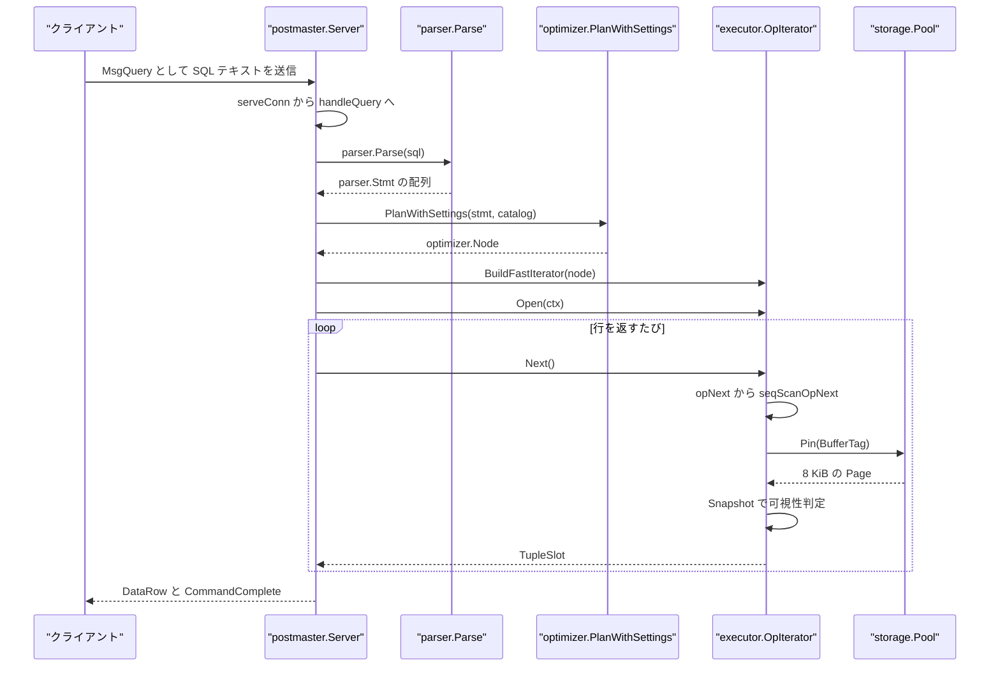
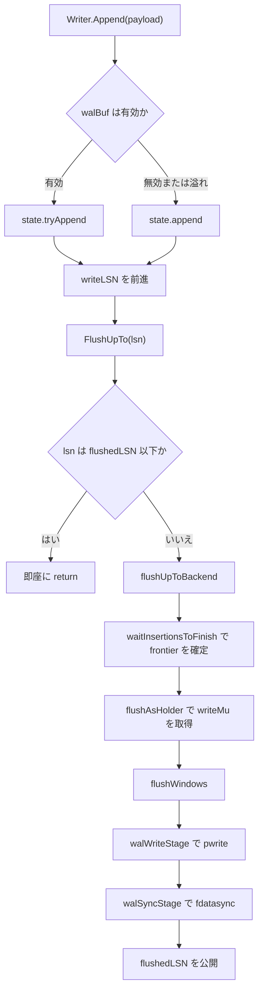

# 用語集

<details>
<summary>関連ソースファイル</summary>

- [`README.md`](https://github.com/ryogrid/goopg/blob/19856410e8d497d59787e1ab35a2febb3f5953d6/README.md)
- [`internal/access/nbtree/btree.go`](https://github.com/ryogrid/goopg/blob/19856410e8d497d59787e1ab35a2febb3f5953d6/internal/access/nbtree/btree.go)
- [`internal/access/transam/snapshot.go`](https://github.com/ryogrid/goopg/blob/19856410e8d497d59787e1ab35a2febb3f5953d6/internal/access/transam/snapshot.go)
- [`internal/access/transam/xlog/writer.go`](https://github.com/ryogrid/goopg/blob/19856410e8d497d59787e1ab35a2febb3f5953d6/internal/access/transam/xlog/writer.go)
- [`internal/catalog/catalog.go`](https://github.com/ryogrid/goopg/blob/19856410e8d497d59787e1ab35a2febb3f5953d6/internal/catalog/catalog.go)
- [`internal/executor/opnode.go`](https://github.com/ryogrid/goopg/blob/19856410e8d497d59787e1ab35a2febb3f5953d6/internal/executor/opnode.go)
- [`internal/executor/operators_storage.go`](https://github.com/ryogrid/goopg/blob/19856410e8d497d59787e1ab35a2febb3f5953d6/internal/executor/operators_storage.go)
- [`internal/optimizer/path.go`](https://github.com/ryogrid/goopg/blob/19856410e8d497d59787e1ab35a2febb3f5953d6/internal/optimizer/path.go)
- [`internal/optimizer/plan.go`](https://github.com/ryogrid/goopg/blob/19856410e8d497d59787e1ab35a2febb3f5953d6/internal/optimizer/plan.go)
- [`internal/optimizer/planner.go`](https://github.com/ryogrid/goopg/blob/19856410e8d497d59787e1ab35a2febb3f5953d6/internal/optimizer/planner.go)
- [`internal/parser/ast.go`](https://github.com/ryogrid/goopg/blob/19856410e8d497d59787e1ab35a2febb3f5953d6/internal/parser/ast.go)
- [`internal/parser/parser.go`](https://github.com/ryogrid/goopg/blob/19856410e8d497d59787e1ab35a2febb3f5953d6/internal/parser/parser.go)
- [`internal/postmaster/dispatch.go`](https://github.com/ryogrid/goopg/blob/19856410e8d497d59787e1ab35a2febb3f5953d6/internal/postmaster/dispatch.go)
- [`internal/postmaster/query.go`](https://github.com/ryogrid/goopg/blob/19856410e8d497d59787e1ab35a2febb3f5953d6/internal/postmaster/query.go)
- [`internal/postmaster/server.go`](https://github.com/ryogrid/goopg/blob/19856410e8d497d59787e1ab35a2febb3f5953d6/internal/postmaster/server.go)
- [`internal/storage/page.go`](https://github.com/ryogrid/goopg/blob/19856410e8d497d59787e1ab35a2febb3f5953d6/internal/storage/page.go)

</details>

このページは、goopg の複数サブシステムにまたがって同じ単語が別の意味で使われやすい箇所を整理するための用語集である。SQL 文が `postmaster.Server` に届いてから `parser.Parse`、`optimizer.PlanWithSettings`、`executor.BuildFastIterator` を経て `storage.Pool.Pin` に至る実行経路を軸に、ページとブロック、スナップショットと XID、Path とプランノード、WAL の LSN といった隣接概念を、実在する型・関数・定数に結び付けて定義する。単なる辞書ではなく、各項目がどのファイルのどのシンボルで実装されているかを追跡できることを目的とする。

## 責務

- **語彙の固定**: 「ページ」「ブロック」「バッファ」「タプル」「スロット」のように、ストレージ層と実行層で名前が衝突しやすい語を、`storage.Page`、`storage.BlockNumber`、`storage.BufferTag`、`executor.Slot` に対応付ける。
- **層の境界の明示**: 文字列 → AST(`parser.Stmt`)→ プラン(`optimizer.Node`)→ 実行木(`executor.OpNode`)→ 行(`executor.Slot`)という変換の各段で、何が入力で何が出力かを定義する。変換の起点は `internal/parser/parser.go:166 Parse`、計画は `internal/optimizer/planner.go:111 PlanWithSettings`、実行木の構築は `internal/executor/opnode.go:483 BuildFastIterator` である。
- **不変条件の共有**: `Snapshot` の XID 配列が取得後不変であること、`opTreeSlab` が `BuildFast` 完了後に不変であること、WAL の `writeLSN >= drainedLSN >= flushedLSN` といった、コードを読むだけでは見落としやすい契約を 1 か所に集める。
- **PostgreSQL 対応用語の案内**: README が列挙する HOT、Visibility Map、FSM、SSI、pgoutput、論理/物理レプリケーションなどの高レベル用語を、goopg 内の実装箇所へ橋渡しする。
- **誤解の予防**: 「XID と LSN」「OID と relfilenode」「Path とプランノード」「スナップショットとトランザクション」など、似ているが別物である概念を明示的に区別する。

## 処理フロー

もっとも代表的な経路は、クライアントが送った単純クエリ(`MsgQuery`)が 1 本の `SELECT` として実行され、行が返るまでの流れである。以下は実際の関数呼び出し順であり、各段の型がこのページで定義する用語に対応する。

1. `postmaster.Server.Run` が TCP リスナーを開き、`acceptLoop` が接続ごとに goroutine を起動して `serveConn` を呼ぶ(`internal/postmaster/server.go:620 Run`、`internal/postmaster/server.go:988 acceptLoop`、`internal/postmaster/server.go:1019 serveConn`)。
2. `serveConn` は `handleStartup` で認証と起動パラメータを処理した後、フレームを読み続け、`MsgQuery` を `handleQuery` に渡す(`internal/postmaster/server.go:1635 handleStartup`、`internal/postmaster/query.go:111 handleQuery`)。
3. `handleQuery` は複数文や通常の SELECT を `dispatchSimpleQueryViaExecutor` に委ねる(`internal/postmaster/query.go:146`、`internal/postmaster/dispatch.go:42 dispatchSimpleQueryViaExecutor`)。この関数が SQL 文字列を `parser.Parse` に渡す(`internal/postmaster/dispatch.go:69`、`internal/parser/parser.go:166 Parse`)。
4. `parser.Parse` は字句解析したトークン列を `parseBatch` に渡し、LALR 系の `routeBatch` が担当できる文はそこで AST 化し、担当外の文だけ従来の再帰下降パーサへフォールバックする(`internal/parser/parser.go:170 parseBatch`)。結果は `[]parser.Stmt` で、SELECT は `*parser.SelectStmt` になる(`internal/parser/ast.go:929 SelectStmt`)。
5. ディスパッチ層はプランキャッシュを引くか、ミス時に `optimizer.PlanWithSettings` を呼ぶ(`internal/postmaster/dispatch.go:1102`、`internal/postmaster/dispatch.go:3709`、`internal/optimizer/planner.go:111 PlanWithSettings`)。プランナーは `RelOptInfo` と `Path` の候補を比較し、`optimizer.Node` の木を返す(`internal/optimizer/path.go:172 Path`、`internal/optimizer/plan.go:19 Node`)。
6. 実行層は `executor.BuildFastIterator` で `optimizer.Node` を `opTreeSlab` 上の `OpNode` 木へ変換し、`OpIterator.Open` で各ノードを初期化する(`internal/executor/opnode.go:483 BuildFastIterator`、`internal/executor/opnode.go:492 Open`)。
7. `OpIterator.Next` は `opNext` の switch を回し、`OpSeqScan` なら `seqScanOpNext` から `seqScanOp.Next` を直接呼ぶ(`internal/executor/opnode.go:508 Next`、`internal/executor/opnode.go:828 opNext`、`internal/executor/opnode.go:868 seqScanOpNext`)。
8. `seqScanOp.Next` はブロックごとに `storage.Pool.Pin(BufferTag{Rel, Block})` で 8 KiB ページを固定し、行ポインタを走査して `transam.TupleVisibleSubxact` で可視性を判定する(`internal/executor/operators_storage.go:1971 Next`、同 2015 の `Pin` 呼び出し、同 2109 の可視性判定)。
9. 得られた `TupleSlot` は `Slot.fillFromTupleSlot` で `Slot` に写され、上位の `Filter` / `Project` / `Limit` を抜けてディスパッチ層に戻る。ディスパッチ層は `DataRow` と `CommandComplete`/`ReadyForQuery` をクライアントへ書く。



この経路には短絡がある。`SELECT 1` のような定数文は `handleQuery` の文字列一致で実行層に入らず、複数文は `dispatchSimpleQueryViaExecutor` の文ループで 1 文ずつ同じ処理を繰り返す。プランキャッシュがヒットした場合は `optimizer.PlanWithSettings` が省略され、キャッシュされた `optimizer.Node` から直接 `BuildFastIterator` に進む。逆に `WHERE CURRENT OF` や `SET enable_seqscan=off` などキャッシュ対象外の文は毎回計画し直す。

## 主要ファイル

| ファイル | 役割 |
| --- | --- |
| `README.md` | プロジェクト全体の目的、実装済み機能、HOT・VM・FSM・AIO・SSI・pgoutput などの高レベル用語の定義(`README.md:31`) |
| `internal/storage/page.go` | 8 KiB ページの型とヘッダ配置。`BlockSize`、`PageHeader`、`BlockNumber`、`LSN`、`RelFileNode`、`BufferTag`(`internal/storage/page.go:PageHeader`) |
| `internal/access/transam/snapshot.go` | MVCC の可視性境界。`Snapshot` と `IsolationLevel`、XID の進行中/中断判定(`internal/access/transam/snapshot.go:Snapshot`) |
| `internal/access/transam/xlog/writer.go` | WAL の追記と耐久化。`Writer`、`Config`、`state`、`writeRqst`、LSN の 3 段階公開(`internal/access/transam/xlog/writer.go:Writer`) |
| `internal/access/nbtree/btree.go` | B-tree のページ形式と操作。`BTree`、`BTPageOpaque`、`item`、`Options`、`Insert`、`Search`(`internal/access/nbtree/btree.go:BTree`) |
| `internal/catalog/catalog.go` | カタログの型と格納。`Type`、`Column`、`Table`、`Index`、`Catalog` インタフェース、`InMemory`(`internal/catalog/catalog.go:Type`) |
| `internal/executor/opnode.go` | Volcano 実行器の具体型ディスパッチ。`Slot`、`OpKind`、`OpNode`、`opTreeSlab`、`OpIterator`(`internal/executor/opnode.go:OpNode`) |
| `internal/executor/operators_storage.go` | シーケンシャルスキャンの実体。`seqScanOp.Next` が `Pool.Pin` と可視性判定を行う(`internal/executor/operators_storage.go:1971 Next`) |
| `internal/optimizer/path.go` | コストベース探索の基盤。`Path`、`RelOptInfo`、`Cost`、`PathKind`、`addPath`、`setCheapest`(`internal/optimizer/path.go:Path`) |
| `internal/optimizer/plan.go` | 実行プランノードと式。`Node`、`Schema`、`SchemaColumn`、`Expr`、`SeqScan`(`internal/optimizer/plan.go:Node`) |
| `internal/optimizer/planner.go` | 文からプランへの入口。`Plan`、`PlanWithSettings`(`internal/optimizer/planner.go:100 Plan`) |
| `internal/parser/ast.go` | SQL AST の型。`Node`、`Stmt`、`ObjectName`、`SelectStmt`(`internal/parser/ast.go:SelectStmt`) |
| `internal/parser/parser.go` | 字句解析と構文解析の入口。`Parse`、`parseBatch`(`internal/parser/parser.go:166 Parse`) |
| `internal/postmaster/server.go` | プロセスとしてのサーバー。`Server`、`Config`、`Run`、`serveConn`(`internal/postmaster/server.go:363 Server`) |
| `internal/postmaster/query.go` | 単純クエリの受信。`handleQuery`(`internal/postmaster/query.go:111 handleQuery`) |
| `internal/postmaster/dispatch.go` | 文の振り分けと実行。`dispatchSimpleQueryViaExecutor`、プランキャッシュ、`BuildFastIterator` 呼び出し(`internal/postmaster/dispatch.go:42`) |

## 公開 API / エントリポイント

他パッケージから呼ばれる主要な入口は次のとおり。

- `parser.Parse(input string, mc ...*mmgr.Context) ([]Stmt, error)` — SQL 文字列を文の列へ変換する(`internal/parser/parser.go:166`)。
- `optimizer.Plan(stmt parser.Stmt, cat catalog.Catalog) (Node, error)` — 既定設定で計画する(`internal/optimizer/planner.go:100`)。
- `optimizer.PlanWithSettings(stmt parser.Stmt, cat catalog.Catalog, plannerSet PlannerSettings) (Node, error)` — セッションの GUC を反映した計画入口(`internal/optimizer/planner.go:111`)。
- `executor.BuildFastIterator(plan optimizer.Node) (*OpIterator, error)` — プランノードを `opTreeSlab` 上の実行木へ変換する(`internal/executor/opnode.go:483`)。
- `(*executor.OpIterator).Open(ctx *Context) error` / `Next() (TupleSlot, error)` / `Close() error` — Volcano の 3 メソッド(`internal/executor/opnode.go:492`、`508`、`524`)。
- `storage.Header(p Page) (PageHeader, error)` / `storage.InitPage(p Page) error` — ページの型付きビュー取得と初期化(`internal/storage/page.go:107`、`211`)。
- `storage.PageIsAllVisible(p Page) bool` / `PageSetAllVisible` / `PageClearAllVisible` — `PD_ALL_VISIBLE` の操作(`internal/storage/page.go:163`、`168`、`173`)。
- `transam.ParseIsolationLevel(v string) (IsolationLevel, error)` — PostgreSQL 表記の分離レベル名を解釈する(`internal/access/transam/snapshot.go:44`)。
- `(*transam.Snapshot).HasInProgress(xid)` / `HasAborted(xid)` / `SeesCommittedXID(xid)` / `XidIsConcurrent(xid)` — 可視性の判定プリミティブ(`internal/access/transam/snapshot.go:138`、`156`、`200`、`185`)。
- `xlog.NewWriter(cfg Config) (*Writer, error)` — WAL ライターを開く(`internal/access/transam/xlog/writer.go:577`)。
- `(*xlog.Writer).Append(payload []byte) (uint64, uint64, error)` / `FlushUpTo(lsn uint64) error` — WAL レコードの追記と耐久化(`internal/access/transam/xlog/writer.go:899`、`982`)。
- `nbtree.Open(pool *storage.Pool, rel storage.RelFileNode) (*BTree, error)` / `Create(...)` — 既存 B-tree のオープンと作成(`internal/access/nbtree/btree.go:1969`、`1992`)。
- `(*nbtree.BTree).Insert(key []byte, ptr storage.ItemPointer) error` / `Search(key []byte) (storage.ItemPointer, bool, error)` — 索引の挿入と点検索(`internal/access/nbtree/btree.go:2808`、`4623`)。
- `postmaster.New(cfg Config) *Server` / `(*Server).Run(ctx context.Context) error` — サーバーの構築と起動(`internal/postmaster/server.go:441`、`620`)。

## 主要データ構造

以下では、各サブシステムの中心型のうち、契約が型定義そのものに表れているものを一字一句引用する。`Table`、`Path`、`Writer`、`Server` のような巨大なキャリア型は、全定義を貼ると読みづらいため、主要フィールドを本文で説明し、出典を `path:Symbol` で示す。

### ページとファイル識別子

`storage.PageHeader` は 8 KiB ページの先頭 24 バイトへの型付きビューである。`Page` は単なる `[]byte` であり、ヘッダは長さを検証してから作られる。

```go
// PageHeader is a typed view over the first SizeOfPageHeaderData bytes
// of a Page. All accessors validate the page length so callers can
// receive a Page from anywhere without re-asserting size.
//
// Field offsets and semantics mirror upstream's PageHeaderData; see
// docs/design/0006-storage-format.md for the layout table.
type PageHeader struct {
	Page Page
}
```

出典: `internal/storage/page.go:101 PageHeader`

`RelFileNode` は「どのテーブル空間・データベース・リレーション・フォークか」を表し、`BufferTag` はそれにブロック番号を足したバッファプールのキーである。`TblOid` が 0 のときは既定テーブル空間(`pg_default`)を意味し、ファイルは `base/<DBOid>/` 配下に解決される。非 0 なら `pg_tblspc/<TblOid>/...` を経由する。

```go
type RelFileNode struct {
	TblOid uint32
	DBOid  uint32
	RelOid uint32
	Fork   ForkNumber
}
```

```go
type BufferTag struct {
	Rel   RelFileNode
	Block BlockNumber
}
```

出典: `internal/storage/page.go:76 RelFileNode`、`internal/storage/page.go:85 BufferTag`

`Fork` は `MainFork`(0)、`FSMFork`(1)、`VisibilityMapFork`(2)、`InitFork`(3) のいずれかである(`internal/storage/page.go:56 ForkNumber`)。`BlockNumber` はリレーション内の相対ブロック番号で、`InvalidBlockNumber = 0xFFFFFFFF` が「存在しないブロック」の番兵になる(`internal/storage/page.go:52`)。

### MVCC のスナップショット

`Snapshot` は 1 文の可視性の地平線を表す。`Xmin` 未満の XID は完了済み、`Xmax` 以上は未来、その間は `InProgress` に載っていれば進行中、`Aborted` に載っていれば中断済みとして扱う。

```go
type Snapshot struct {
	Xmin       storage.TransactionID
	Xmax       storage.TransactionID
	InProgress []storage.TransactionID
	Aborted    []storage.TransactionID

	// PartitionDetachEpoch is the value of the global partition-detach epoch
	// (CurrentPartitionDetachEpoch) at the moment this snapshot was captured.
	// catalog.VisiblePartitionChildren omits a partition child whose
	// DetachPendingEpoch is <= this value, so a snapshot taken before a
	// concurrent DETACH PARTITION CONCURRENTLY still scans the partition while
	// later snapshots do not. Zero for snapshots captured outside the manager
	// (e.g. in unit tests). Design 0118-0058 (M0118-0008).
	PartitionDetachEpoch uint64

	// clog, when non-nil, is the durable commit log consulted as a fallback
	// for in-window XIDs the in-memory InProgress/Aborted arrays cannot
	// classify (gap G4 / M0117-0002). It mirrors PostgreSQL's
	// TransactionIdDidCommit/DidAbort consult after the running-array check in
	// HeapTupleSatisfiesMVCC. nil (the default) preserves the pre-M0117-0002
	// v0 behaviour exactly. Set via WithCLog / Manager.SetCLog.
	clog *CLog
}
```

出典: `internal/access/transam/snapshot.go:69 Snapshot`

`Xmin`/`Xmax` はスナップショット取得時点の境界、`InProgress` は取得時に走っていた XID の昇順リスト、`Aborted` は巻き戻された XID のリストである。`PartitionDetachEpoch` は `DETACH PARTITION CONCURRENTLY` との競合を判定するためのエポックで、`catalog.VisiblePartitionChildren` が子パーティションを除外するかどうかを決める。`clog` は非公開フィールドで、`WithCLog` 経由でのみ設定される永続コミットログへのフォールバックである。

### プランナーのコスト

`Cost` は PostgreSQL と同じ 2 軸のコストである。`Startup` は最初の 1 行が出るまでのコスト、`Total` は全行を返すまでのコストで、LIMIT がある場合は `Startup` の小さい経路が勝つことがある。

```go
type Cost struct {
	Startup float64
	Total   float64
}
```

出典: `internal/optimizer/path.go:39 Cost`

`Path` は「あるリレーションを生成する 1 つの方法」であり、`Kind PathKind`、`Cost`、`Rows`、`Pathkeys`、`Children []*Path`、`RequiredOuter RelSet` などを持つ(`internal/optimizer/path.go:172 Path`)。`RelOptInfo` はリレーション(基底でも結合でもよい)とその候補 `Path` のリストを保持し、`Rows` をカーディナリティの唯一の情報源とする(`internal/optimizer/path.go:568 RelOptInfo`)。`RelSet` は基底リレーション ID のビット集合で、1 クエリの結合対象を 16 基底リレーションに制限する(`internal/optimizer/path.go:33 RelSet`)。

### 実行木のノードと行

`OpNode` は Phase C 実行器のタグ付き共用体である。子は `*OpNode` ではなく `opTreeSlab` の添字で表され、`noChild = -1` が子なしを意味する。

```go
type OpNode struct {
	Kind   OpKind
	childA int32 // index into ops slab; noChild (-1) if none
	childB int32 // index into ops slab; noChild (-1) if none
	state  any   // concrete per-Kind state struct (GC-safe)
}
```

出典: `internal/executor/opnode.go:292 OpNode`

`OpKind` は `OpSeqScan`、`OpFilter`、`OpProject`、`OpLimit`、`OpUpdate`、`OpDelete`、`OpSort`、`OpInsert`、`OpJoin`、`OpBitmapIndexScan`、`OpBitmapHeapScan`、`OpBitmapAnd`、`OpBitmapOr`、`OpAdapter` を識別する(`internal/executor/opnode.go:215 OpKind`)。`state` には `Kind` ごとの具象構造体(`*filterState`、`*projectState`、`*limitState`、`*opAdapterState` など)が入る。

`Slot` は 1 行分の値を受け渡す具体型である。`Cells` は呼び出しごとに上書きされるため、次の `Next` をまたいで行を保持するには `CopyTo` で複製する必要がある。

```go
type Slot struct {
	schema optimizer.Schema
	Cells  []Datum
	HasRow bool // false == DML nil-row; true == real row (may have 0 cols)
	// M0097-0062: ctid system column forwarded from MaterializedSlot.
	// Set by fillFromTupleSlot when the incoming TupleSlot is a
	// *MaterializedSlot that carries ctid info (seqScanOp path).
	hasCTID   bool
	ctidBlock uint32
	ctidOff   uint16
}
```

出典: `internal/executor/opnode.go:64 Slot`

`HasRow=false` は INSERT/UPDATE/DELETE が結果行を返さない「DML nil-row」、`HasRow=true` かつ `Cells` が空は「0 列の実在する行」を意味する。この 2 つはどちらも `Cells` が空になり得るため、`HasRow` が判別子になる。`hasCTID`/`ctidBlock`/`ctidOff` は `ctid` システム列を上位へ運ぶ副チャネルである。

### B-tree のページ付加情報

`BTPageOpaque` は B-tree ページ末尾の特殊領域への型付きビューである。ディスク上は PostgreSQL の `BTPageOpaqueData` で、`readOpaque`/`writeOpaque` が相互変換する。メモリ上では「次兄弟なし」を `storage.InvalidBlockNumber` で表し、フラグは goopg の `BT*` ビットで保持する。

```go
type BTPageOpaque struct {
	Prev  storage.BlockNumber
	Next  storage.BlockNumber
	Level uint32
	Flags uint16
}
```

出典: `internal/access/nbtree/btree.go:128 BTPageOpaque`

`HasHighKey` は保存ビットではなく `Next != InvalidBlockNumber` から計算される(`internal/access/nbtree/btree.go:177`)。`Flags` の `BTLeaf`、`BTRoot`、`BTDeleted`、`BTIncompleteSplit`、`BTHalfDead`、`BTHasGarbage` はそれぞれ葉、ルート、削除済み、分割未完了、半死、ゴミありを表す(`internal/access/nbtree/btree.go:56`)。

### カタログの型

`Type` は列の型を表す。`Name` は要素型名、`Args` は `varchar(10)` や `numeric(10,2)` のような型修飾の引数、`IsArray` は SQL の `[]` 接尾辞による配列性を別途保持する。

```go
type Type struct {
	Name string
	Args []int64
	// IsArray is true for a column declared with the SQL `[]` array suffix
	// (e.g. `tags text[]`). Name still holds the element type ("text"); the
	// array-ness is tracked separately so the runtime evaluator keeps using
	// the element type while catalog builders (pg_attribute.atttypid →
	// _text/_int4/…) and pg_dump's format_type render the array type.
	// DU-002 slice 62.
	IsArray bool
}
```

出典: `internal/catalog/catalog.go:376 Type`

`Column` は列名、型、`NotNull`、0 起点のヒープ内位置 `Ordinal` を持ち、`Dropped` の列も `Ordinal` を保持したまま不可視になる(`internal/catalog/catalog.go:389 Column`)。`Table` は `Schema`、`Name`、`Columns`、`OID`、`RelFileNodeOID`、`DBOid`、`Virtual`、`View`、`Stats` などを束ねる(`internal/catalog/catalog.go:613 Table`)。`Index` は `Table` へのポインタ、`Columns`、`Unique`、`Method`、`Primary`、`OID` を持ち、式インデックスの `ColExprs` や部分インデックスの `Predicate` も運ぶ(`internal/catalog/catalog.go:2271 Index`)。

### パーサーの AST 基盤

すべての AST ノードは `Node`、トップレベル文は `Stmt` を実装する。`ObjectName` はスキーマ修飾付きの名前を表す。

```go
// Node is implemented by every AST node. Pos returns the byte offset
// of the node's first token, used by error messages.
type Node interface {
	Pos() int
}

// Stmt is implemented by every top-level SQL statement.
type Stmt interface {
	Node
	stmtNode()
}

// ObjectName is a (possibly schema-qualified) relation/object name.
// "schema.table" or just "table". Quoted parts retain their case.
type ObjectName struct {
	pos    int
	Schema string // empty when unqualified
	Name   string
}
```

出典: `internal/parser/ast.go:7 Node`、`internal/parser/ast.go:12 Stmt`、`internal/parser/ast.go:19 ObjectName`

`SelectStmt` は `Targets`、`From`、`FromExprs`、`Where`、`GroupBy`、`Having`、`OrderBy`、`Limit`、`Offset`、`SetOp`、`With` を持ち、`SetOpOperand` によって集合演算を連結リストではなく木として表現する(`internal/parser/ast.go:929 SelectStmt`)。`Parenthesized` は「文全体が 1 対の括弧で囲まれ、外側に何も続かない」ことを示す。

### WAL の書き込み要求

`writeRqst` は WAL の 2 段階書き込みを表す。`write` までをセグメントファイルへ pwrite し、`flush` までを fdatasync する。`flush == 0` は書き込みのみを意味する。

```go
type writeRqst struct {
	write uint64 // drain ring bytes up to here into segment files (pwrite)
	flush uint64 // additionally fdatasync segments up to here; 0 = write-only
}
```

出典: `internal/access/transam/xlog/writer.go:2276 writeRqst`

`Writer` は `writeLSNAtomic`、`flushedLSNAtomic`、`drainedLSNAtomic` の 3 つを公開し、`flushWaiters`、`commitDelayUs`、`commitSiblings`、`stickyErr` でグループコミットを制御する(`internal/access/transam/xlog/writer.go:276 Writer`)。`Config` は `WALDir`、`SegmentSize`、`WALBuffers`、`PageHeaders`、`SyncMethod`、`FsyncDisabled`、`MinWALSize`、`MaxWALSize` などを持つ(`internal/access/transam/xlog/writer.go:62 Config`)。

## 内部構造

### 用語対応表

| 用語 | 定義 | 出典 |
| --- | --- | --- |
| ページ / ブロック | 8 KiB 固定長のストレージ単位。`BlockSize = 8192`。ブロック番号はリレーション内の相対位置 | `internal/storage/page.go:15 BlockSize`、`internal/storage/page.go:49 BlockNumber` |
| ページヘッダ | 先頭 24 バイト。LSN(0–8)、チェックサム(8–10)、フラグ(10–12)、lower(12–14)、upper(14–16)、special(16–18)、pagesize/version(18–20)、prune XID(20–24) | `internal/storage/page.go:18 SizeOfPageHeaderData`、`internal/storage/page.go:101 PageHeader` |
| フォーク | リレーションの用途別ファイル。main、FSM、visibility map、init | `internal/storage/page.go:56 ForkNumber` |
| BufferTag | `RelFileNode` + `BlockNumber`。バッファプールのハッシュキー | `internal/storage/page.go:85 BufferTag` |
| バッファプール | `storage.Pool`。`BufferTag` で 8 KiB ページを固定し、clock-sweep で退避する | `internal/storage/page.go:250 tagPartition`、`README.md:58` |
| タプル | ヒープページ内の 1 行データ。実行層の 1 行(`Slot`)とは別の層の概念 | `README.md:48` |
| LSN | 64 ビットのログ位置。ページヘッダでは high 32 ビット→low 32 ビットの順に LE で格納 | `internal/storage/page.go:44 LSN`、`internal/storage/page.go:128 LSN()` |
| PD_ALL_VISIBLE | ページ上の全タプルが全スナップショットから可視であることを示すフラグ。VACUUM が VM と同時に立て、ヒープ変更がクリアする | `internal/storage/page.go:163 PageIsAllVisible` |
| XID | トランザクション識別子 `storage.TransactionID`。スナップショットの `Xmin`/`Xmax` と比較される | `internal/access/transam/snapshot.go:69 Snapshot` |
| トランザクション | 1 つの XID を持つ作業単位。スナップショットはその可視性の境界を固定する | `internal/access/transam/snapshot.go:64` |
| スナップショット | 1 文の可視性の地平線。取得後は `InProgress`/`Aborted` を書き換えてはならない | `internal/access/transam/snapshot.go:69 Snapshot` |
| Xmin / Xmax | スナップショット取得時に完了済みと未来の境界。`Xmin` 未満は完了扱い | `internal/access/transam/snapshot.go:69 Snapshot` |
| InProgress | スナップショット取得時に進行中だった XID の昇順リスト。16 件以下は線形走査、超えると二分探索 | `internal/access/transam/snapshot.go:128 snapshotLinearScanThreshold` |
| Aborted | 巻き戻された XID のリスト。`Xmin` 未満でもここに載る XID は不可視 | `internal/access/transam/snapshot.go:156 HasAborted` |
| CLOG | 永続コミットログ。メモリ上の配列で分類できない in-window XID のフォールバック | `internal/access/transam/snapshot.go:90 clog` |
| ヒントビット | `HEAP_XMIN_COMMITTED` などタプルヘッダのキャッシュ。設定後に CLOG 参照を省ける | `internal/access/transam/snapshot.go:284 SeesCommittedXIDHinted` |
| 分離レベル | READ COMMITTED、REPEATABLE READ、SERIALIZABLE。READ UNCOMMITTED は READ COMMITTED に折り畳まれる | `internal/access/transam/snapshot.go:15 IsolationLevel` |
| SSI | Serializable Snapshot Isolation。`XidIsConcurrent` が直列化可能性の競合判定に使われる | `internal/access/transam/snapshot.go:185 XidIsConcurrent` |
| AST | 構文木。`parser.Stmt` を根とし、SELECT は `SelectStmt` | `internal/parser/ast.go:12 Stmt` |
| プランノード | `optimizer.Node`。`Pos` と `Output` を持ち、実行器が解釈する | `internal/optimizer/plan.go:19 Node` |
| スキーマ | `optimizer.Schema`(`[]SchemaColumn`)。列名・型・ソース表番号・resjunk を持つ | `internal/optimizer/plan.go:26 Schema` |
| Path | リレーションを生成する 1 つの物理的方法。コスト・順序・子 Path を運ぶ | `internal/optimizer/path.go:172 Path` |
| RelOptInfo | 基底/結合リレーションと候補 Path の集合。`Rows` が基数の唯一の情報源 | `internal/optimizer/path.go:568 RelOptInfo` |
| PathKind | Path が表す物理演算子。SeqScan、IndexScan、HashJoin、NestLoop、Sort、Agg など | `internal/optimizer/path.go:46 PathKind` |
| パラメータ化 Path | `RequiredOuter` が非空の Path。外側の値に依存して再実行される索引経路など | `internal/optimizer/path.go:458 RequiredOuter` |
| コストのファジー比較 | 1% 以内の差は同等とみなす。`disabled_nodes` の差はコストより優先される | `internal/optimizer/path.go:27 stdFuzzFactor` |
| OpNode | 実行木のタグ付き共用体。子はスラブ添字、状態は `any` | `internal/executor/opnode.go:292 OpNode` |
| OpKind | OpNode の判別子。SeqScan、Filter、Project、Limit、DML、Join、Bitmap、Adapter | `internal/executor/opnode.go:215 OpKind` |
| opTreeSlab | OpNode の連続配列。`BuildFast` 完了後は不変 | `internal/executor/opnode.go:269 opTreeSlab` |
| Slot | 1 行の値と ctid 副チャネルを持つ具体型。呼び出しごとに上書きされる | `internal/executor/opnode.go:64 Slot` |
| TupleSlot | 実行器が行を渡すインタフェース。`Slot` はその 1 実装で、`Materialize` が独立コピーを返す | `internal/executor/opnode.go:117 Materialize` |
| DML nil-row | INSERT/UPDATE/DELETE が結果行を返さないことを `Slot.HasRow=false` で表す規約 | `internal/executor/opnode.go:55` |
| Volcano モデル | `Open`/`Next`/`Close` で行を 1 つずつ引く反復子モデル | `internal/executor/opnode.go:508 Next` |
| B-tree オペーク | ページ末尾の `Prev`/`Next`/`Level`/`Flags`。高キーの有無は `Next` から導出 | `internal/access/nbtree/btree.go:128 BTPageOpaque` |
| ハイキー | ページが保持するキー範囲の上限。右兄弟がある場合だけ存在する | `internal/access/nbtree/btree.go:177 HasHighKey` |
| ピボット | 内部ページの下向きリンクやハイキーを表す索引タプル | `internal/access/nbtree/btree.go:352 item` |
| 分割未完了 | `BTIncompleteSplit`。親への下向きリンク挿入前に落ちた左半分。書き込み前に `finishSplit` が必要 | `internal/access/nbtree/btree.go:66` |
| 半死ページ | `BTHalfDead`。2 相削除の Phase 1 完了・Phase 2 未完了。`completeDeletion` が必要 | `internal/access/nbtree/btree.go:75` |
| メタページ | B-tree のブロック 0。ルートブロックとレベルを保持する | `internal/access/nbtree/btree.go:87 MetaBlock` |
| カタログ | テーブル・列・索引・型などのメタデータ。`Catalog` インタフェースと `InMemory` 実装 | `internal/catalog/catalog.go:2509 Catalog` |
| OID | オブジェクト識別子。`Table.OID`、`Index.OID` など。物理ファイル名は `RelFileNodeOID` が優先される | `internal/catalog/catalog.go:613 Table` |
| 仮想テーブル | ヒープを持たないカタログ表。`Table.Virtual` と `VirtualRows` で行を生成する | `internal/catalog/catalog.go:642` |
| WAL | Write-Ahead Log。データページより先に永続化される変更ログ | `internal/access/transam/xlog/writer.go:276 Writer` |
| WAL セグメント | 16 MiB のファイル単位。`DefaultSegmentSize` | `internal/access/transam/xlog/writer.go:28 DefaultSegmentSize` |
| グループコミット | 複数の `FlushUpTo` を 1 回の fdatasync にまとめる。`flushWaiters` と `commitDelayUs` で制御 | `internal/access/transam/xlog/writer.go:1011 flushUpToBackend` |
| walwriter | バックグラウンドで WAL を先行 flush する goroutine。`BackgroundWrite` | `internal/access/transam/xlog/writer.go:1147 BackgroundWrite` |
| postmaster | `postmaster.Server`。TCP 接続を受け、接続ごとに goroutine を起動する | `internal/postmaster/server.go:363 Server` |
| バックエンド / セッション | 1 本の接続に対応する goroutine と `misc.SessionRegistry` | `internal/postmaster/server.go:1019 serveConn` |
| GUC | PostgreSQL 互換の設定変数。`postgresql.conf` と `SET`/`SHOW` で操作する | `README.md:44` |
| HOT | Heap-Only Tuple 更新。索引列が変わらない更新で索引更新を省く | `README.md:51` |
| Visibility Map | 全可視ページを記録し、Index-Only Scan の可否を決める | `README.md:52` |
| FSM | Free Space Map。空き容量の足りるページへ INSERT を誘導する | `README.md:57` |
| AIO | 非同期 I/O エンジン。プリフェッチと並列ページ読み取りに使う | `README.md:59` |
| pgoutput | 論理レプリケーションの出力プロトコル | `README.md:103` |
| 物理レプリケーション | WAL をストリーミング転送する複製。README は goopg→goopg と goopg↔PG18 の非同期/同期を挙げる | `README.md:102` |
| レプリケーションスロット | レプリケーションの進行管理に使うスロット。README では walsender / walreceiver と共に列挙される | `README.md:104` |

### 層ごとの特徴

**ストレージ層**では、`Page` は `[]byte` であり、`PageHeader` はその先頭 24 バイトを解釈するだけのビューである。`InitPage` は全バイトを 0 にした後、`lower=24`、`upper=special=8192`、`pagesize_version = BlockSize | 4` を書く(`internal/storage/page.go:211`)。`IsNew` は `upper == 0` で未初期化ページを判定する(`internal/storage/page.go:228`)。バッファプールは `BufferTag` を FNV-1a で 128 個のパーティションに分散する(`internal/storage/page.go:250 tagPartition`)。README によれば、退避アルゴリズムは clock-sweep である(`README.md:58`)。

**パーサー層**では、`Parse` が `tokenSlicePool` からトークン列を取り、`routeBatch` が担当できる文だけを LALR 系パーサで処理する。担当外の文は再帰下降の `parser` 構造体へフォールバックする(`internal/parser/parser.go:170`)。したがって「パーサー」と言っても 1 つの実装ではなく、ルーティング層と 2 つの解析器の組み合わせである。

**プランナー層**では、`Path` と `optimizer.Node` を明確に区別する。`Path` はまだ物理演算子に落ちていない候補で、`addPath` が `RelOptInfo` の候補リストへ追加し、`setCheapest` が最安経路を選ぶ(`internal/optimizer/path.go:1277 addPath`、`internal/optimizer/path.go:1594 setCheapest`)。`createPlan` が選ばれた `Path` を `Node` に変換して初めて実行可能になる。`Path` の比較では `DisabledNodes` の差が最優先され、次に `Total`、`Startup` の順で 1% のファジー許容比較を行う(`internal/optimizer/path.go:1078 comparePathCostsFuzzily`)。

**実行層**では、`OpNode` の `Kind` ごとに `opNext` が switch で分岐する。`OpSeqScan`、`OpFilter`、`OpProject`、`OpLimit` はインタフェースを経由しない具象ディスパッチであり、それ以外は `OpAdapter` が従来の `Operator` インタフェースを 1 回だけ型アサートして呼ぶ(`internal/executor/opnode.go:828`)。`Slot` は 1 本の goroutine が使い回す前提で、`HasRow` が DML の「行なし」と「0 列の行」を区別する。

**B-tree 層**では、ブロック 0 がメタページ、ブロック 1 が初期ルート兼リーフである(`internal/access/nbtree/btree.go:87`)。各ページの `BTPageOpaque` は前後の兄弟とレベルを持ち、高キーは `P_HIKEY` の項目としてページ上に置かれる。`Insert` は高速パスで右端リーフのキャッシュを使い、ミス時はルートから降下する(`internal/access/nbtree/btree.go:2808 Insert`)。`Search` は降下後にアンリンク済みページを見つけると右へ移動する(`internal/access/nbtree/btree.go:4623 Search`)。

**MVCC 層**では、`Snapshot` の `InProgress` と `Aborted` は取得後に不変であり、`Clone` は浅いコピーを返す(`internal/access/transam/snapshot.go:106 Clone`)。`SeesCommittedXID` は `Aborted` を先に確認し、次に CLOG を参照し、その後に `Xmin` 未満ショートカットを適用する。この順序はクラッシュ復旧直後の誤判定を防ぐために重要である(`internal/access/transam/snapshot.go:200`)。

**WAL 層**では、`Append` が WAL バッファへ書き、容量超過時は `state.append` の遅い経路へ落ちる(`internal/access/transam/xlog/writer.go:899`)。`FlushUpTo` は `flushedLSN` 以下なら即座に戻り、そうでなければ `flushUpToBackend` で書込ロックを取得してグループコミットする(`internal/access/transam/xlog/writer.go:982`)。`writeLSNAtomic >= drainedLSNAtomic >= flushedLSNAtomic` が常に成り立つ(`internal/access/transam/xlog/writer.go:303`)。



**カタログ層**では、`Catalog` インタフェースがプランナー向けの検索 API を定義し、`InMemory` が実装する(`internal/catalog/catalog.go:2509`)。`Table.Virtual` が真の表はヒープを持たず、`VirtualRows`/`VirtualRowsForDB` が行を合成する(`internal/catalog/catalog.go:642`)。物理ファイルの識別には `OID` ではなく `RelFileNodeOID` が優先され、0 のときだけ `OID` にフォールバックする(`internal/catalog/catalog.go:618`)。

**サーバー層**では、`Server.Run` が 1 つの TCP リスナーを開き、`acceptLoop` が接続ごとに `serveConn` を goroutine で起動する(`internal/postmaster/server.go:620`、`988`)。`Server` は `nextPID`、`nextBackendID`、`connWG`、`runCancel`、`roles`、`pc`(プランキャッシュ)、`notify`、`preparedXacts` などを保持する(`internal/postmaster/server.go:363`)。PostgreSQL のマルチプロセスモデルではなく、1 プロセス内の goroutine 並列である。

## エッジケースと不変条件

- **スナップショット配列の不変性**: `Snapshot.InProgress` と `Snapshot.Aborted` は取得後に書き換えてはならない。書き換えると、浅いコピーを共有する REPEATABLE READ / SERIALIZABLE の各文が互いの可視性を壊す。`Clone` が深いコピーをやめたのはこの不変性に依存している(`internal/access/transam/snapshot.go:93`)。
- **可視性判定の順序**: `SeesCommittedXID` は `Aborted` → CLOG → `Xmin` 未満 → `Xmax` 以上 → `InProgress` の順で判定する。CLOG を `Xmin` ショートカットより先に置くのは、再起動後に `NextXID` が進み、クラッシュ時に進行中だった XID が `Xmin` 未満に落ちるためである(`internal/access/transam/snapshot.go:200`)。
- **ヒントビット付き判定**: `SeesCommittedXIDHinted` は CLOG を参照しないが、スナップショット窓の判定は省略しない。ヒントビットは「xmin がコミットした」ことしか記録せず、「自分のスナップショットより前にコミットした」ことは記録しない(`internal/access/transam/snapshot.go:284`)。
- **線形走査の閾値**: `InProgress`/`Aborted` の長さが 16 以下なら線形走査、17 以上なら `sort.Search` で二分探索する(`internal/access/transam/snapshot.go:128`)。配列は昇順に構築されることが前提である。
- **ページ長の厳密性**: `storage.Header` は長さが `BlockSize` と完全一致しないとエラーを返す。`MustHeader` は検証済み呼び出し向けに panic する(`internal/storage/page.go:107`、`116`)。
- **ページフラグの整合性**: `PD_ALL_VISIBLE` は VACUUM が VM の `ALL_VISIBLE` と同時に立て、タプルを不可視にし得るヒープ変更が排他ロック下でクリアする。`PageClearAllVisible` はクリア前に立っていたかを返す(`internal/storage/page.go:156`、`173`)。
- **ブロック番号の番兵**: `InvalidBlockNumber = 0xFFFFFFFF` は「ブロックなし」を意味する。B-tree の `BTPageOpaque.Next` がこの値なら右兄弟なし、すなわち高キーなしである(`internal/storage/page.go:52`、`internal/access/nbtree/btree.go:177`)。
- **B-tree の分割と削除の途中状態**: `BTIncompleteSplit` のページへ書き込む前に `finishSplit` が必要で、`BTHalfDead` のページを通常ページとして扱う前に `completeDeletion` が必要である(`internal/access/nbtree/btree.go:60`、`67`)。削除済みページは `IsDeleted` でも `BTHalfDead` でなければ「アンリンク済み」であり、読み手は右へ移動しなければならない(`internal/access/nbtree/btree.go:156`、`167`)。
- **B-tree の最大項目数**: `MaxItemsPerPage = (BlockSize - SizeOfPageHeaderData) / (4 + SizeOfIndexTupleData)` は、最小の項目(4 バイト行ポインタ + 8 バイトの索引タプルヘッダ)から導かれる上限である。特殊領域を無視する分だけ緩く、破損検出の誤検知を避ける(`internal/access/nbtree/btree.go:385`)。
- **実行木の不変性**: `opTreeSlab` は `BuildFast` の間だけ追記され、完了後は不変である。`OpIterator` と `opNodeOperator` は `*opTreeSlab` を共有するため、`append` による再配置後も最終スライスを見られる(`internal/executor/opnode.go:265`)。
- **Slot の再利用**: `Slot.Cells` は次の `Next` で上書きされる。ソート、ハッシュ結合のビルド、集約など、行を保持する演算子は `CopyTo` で複製しなければならない(`internal/executor/opnode.go:83`)。`Reset` は `HasRow` を false にする(`internal/executor/opnode.go:78`)。
- **DML nil-row の伝播**: `HasRow=false` の行は述語評価や射影を行わず、そのまま上位へ流す。`filterOpNext` と `projectOpNext` の両方がこの規約を実装している(`internal/executor/opnode.go:881`、`914`)。
- **WAL の LSN 順序**: `writeLSN >= drainedLSN >= flushedLSN` が常に成り立つ。`flushedLSN` は fdatasync 完了後にのみ公開されるため、これを見て「永続化済み」と判断できる(`internal/access/transam/xlog/writer.go:287`、`296`、`304`)。
- **空 WAL レコードの禁止**: `Append` は空ペイロードを `ErrEmptyPayload` で拒否する。長さ 0・CRC 0 のヘッダは、事前確保セグメントの EOS 番兵として予約されているためである(`internal/access/transam/xlog/writer.go:41`、`899`)。
- **WAL フォーマットの混在禁止**: `Config.PageHeaders` の設定が既存データディレクトリの形式と食い違う場合、`NewWriter` は `ErrWALFormatMismatch` で起動を拒否する。同一ストリーム内で旧形式と PG 互換形式を混ぜるとリカバリが壊れるためである(`internal/access/transam/xlog/writer.go:50`)。
- **fsync 無効化の範囲**: `Config.FsyncDisabled` はコミットパスの `doSync` だけを無効化する。リングの drain、pwrite、LSN の前進は続くため、プロセスクラッシュからの復旧は可能で、ホストクラッシュ時の耐久性だけが失われる(`internal/access/transam/xlog/writer.go:179`、`2399`)。
- **コスト比較の同点処理**: 1% 以内の差は「同等」とみなし、`DisabledNodes`、pathkey、並列安全性、`RequiredOuter`、挿入順で勝敗を決める。厳密なコスト値で同点を割らないのは PostgreSQL の `STD_FUZZ_FACTOR` に合わせた決定性の担保である(`internal/optimizer/path.go:27`、`1078`)。
- **結合探索の上限**: `RelSet` は 32 ビットのビット集合だが、1 クエリの結合対象は 16 基底リレーションに制限される。この上限は探索側の `maxSearchRels` が定める(`internal/optimizer/path.go:29`、`33`)。
- **カタログの列位置の保持**: `ALTER TABLE DROP COLUMN` で削除された列も `Column.Ordinal` は保持され、`Dropped=true` として SELECT や列検索から隠される。既存タプルの列位置をずらさないためである(`internal/catalog/catalog.go:440`)。
- **カタログの配列型**: 配列列は `Type.Name` に要素型を保持し、`Type.IsArray` で配列性を別に持つ。実行時評価は要素型を使い、`pg_attribute` や `pg_dump` は配列型 OID を描画する(`internal/catalog/catalog.go:379`)。
- **ハンドシェイクと停止の期限**: `Config.HandshakeTimeout` の既定は 30 秒、`ShutdownDeadline` は 120 秒である。停止時は `connWG.Wait()` がこの期限で上限付けされる(`internal/postmaster/server.go:340`、`375`)。

## 関連ページ

用語の背景となるサブシステムは、次のページで詳しく扱っている。

- [1 プロジェクト概要](1-Overview.md)
- [2 システムアーキテクチャ](2-Architecture.md)
- [3 サーバーと接続](3-Server.md)
- [4 SQL パーサー](4-SQL-Parser.md)
- [5 クエリプランナー](5-Query-Planner.md)
- [6 実行エンジン](6-Executor.md)
- [7 ストレージ](7-Storage.md)
- [8 B-tree インデックス](8-Btree.md)
- [9 トランザクションと MVCC](9-Transactions.md)
- [10 WAL と耐久性](10-WAL.md)
- [11 レプリケーションとバックアップ](11-Replication.md)
- [12 カタログとシステムビュー](12-Catalog.md)
- [13 ユーティリティとランタイム](13-Utilities.md)
- [14 ノード IR とシリアライズ](14-Node-IR.md)
- [15 ビルドと開発ツール](15-Build-and-Tooling.md)

Sources:
- `README.md`
- `internal/access/nbtree/btree.go`
- `internal/access/transam/snapshot.go`
- `internal/access/transam/xlog/writer.go`
- `internal/catalog/catalog.go`
- `internal/executor/opnode.go`
- `internal/executor/operators_storage.go`
- `internal/optimizer/path.go`
- `internal/optimizer/plan.go`
- `internal/optimizer/planner.go`
- `internal/parser/ast.go`
- `internal/parser/parser.go`
- `internal/postmaster/dispatch.go`
- `internal/postmaster/query.go`
- `internal/postmaster/server.go`
- `internal/storage/page.go`

<sub>Generated by deepwiki-4myself from `goopg` @ `19856410e`</sub>
