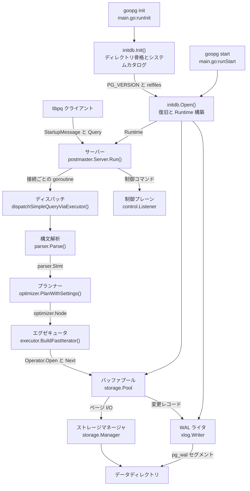
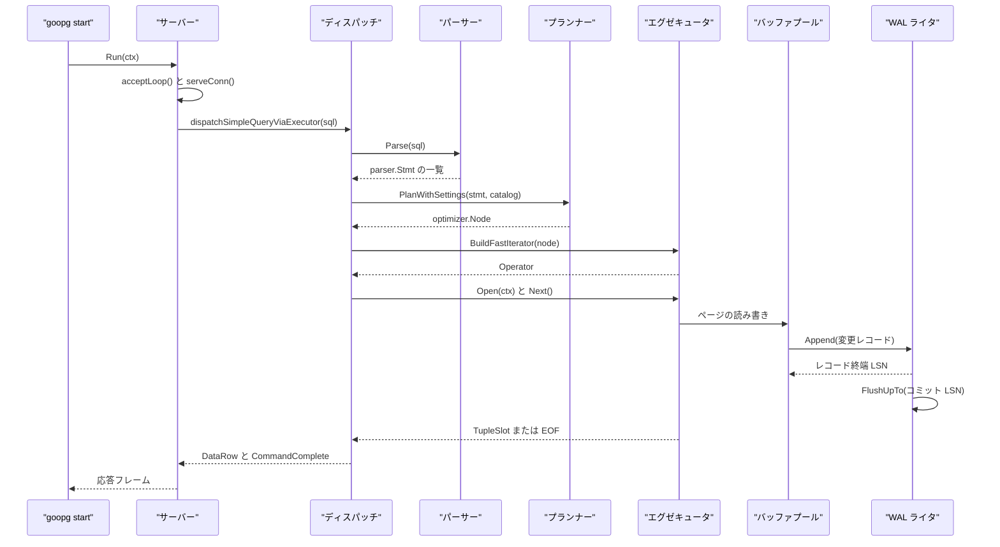

# システムアーキテクチャ

<details>
<summary>関連ソースファイル</summary>

- [`README.md`](https://github.com/ryogrid/goopg/blob/19856410e8d497d59787e1ab35a2febb3f5953d6/README.md)
- [`cmd/goopg/main.go`](https://github.com/ryogrid/goopg/blob/19856410e8d497d59787e1ab35a2febb3f5953d6/cmd/goopg/main.go)
- [`internal/access/transam/xlog/writer.go`](https://github.com/ryogrid/goopg/blob/19856410e8d497d59787e1ab35a2febb3f5953d6/internal/access/transam/xlog/writer.go)
- [`internal/executor/executor.go`](https://github.com/ryogrid/goopg/blob/19856410e8d497d59787e1ab35a2febb3f5953d6/internal/executor/executor.go)
- [`internal/executor/opnode.go`](https://github.com/ryogrid/goopg/blob/19856410e8d497d59787e1ab35a2febb3f5953d6/internal/executor/opnode.go)
- [`internal/executor/operator.go`](https://github.com/ryogrid/goopg/blob/19856410e8d497d59787e1ab35a2febb3f5953d6/internal/executor/operator.go)
- [`internal/initdb/initdb.go`](https://github.com/ryogrid/goopg/blob/19856410e8d497d59787e1ab35a2febb3f5953d6/internal/initdb/initdb.go)
- [`internal/initdb/open.go`](https://github.com/ryogrid/goopg/blob/19856410e8d497d59787e1ab35a2febb3f5953d6/internal/initdb/open.go)
- [`internal/optimizer/plan.go`](https://github.com/ryogrid/goopg/blob/19856410e8d497d59787e1ab35a2febb3f5953d6/internal/optimizer/plan.go)
- [`internal/optimizer/planner.go`](https://github.com/ryogrid/goopg/blob/19856410e8d497d59787e1ab35a2febb3f5953d6/internal/optimizer/planner.go)
- [`internal/parser/ast.go`](https://github.com/ryogrid/goopg/blob/19856410e8d497d59787e1ab35a2febb3f5953d6/internal/parser/ast.go)
- [`internal/postmaster/dispatch.go`](https://github.com/ryogrid/goopg/blob/19856410e8d497d59787e1ab35a2febb3f5953d6/internal/postmaster/dispatch.go)
- [`internal/postmaster/server.go`](https://github.com/ryogrid/goopg/blob/19856410e8d497d59787e1ab35a2febb3f5953d6/internal/postmaster/server.go)
- [`internal/storage/bufpool.go`](https://github.com/ryogrid/goopg/blob/19856410e8d497d59787e1ab35a2febb3f5953d6/internal/storage/bufpool.go)

</details>

goopg は PostgreSQL 互換のワイヤプロトコルを話す実験用データベースサーバーであり、`README.md` が述べるとおり単一の Go プロセスとして動作します。PostgreSQL が initdb・postmaster・pg_ctl に分けている役割を、このプロジェクトでは `cmd/goopg/main.go` のサブコマンド群（`init` / `start` / `stop` / `reload` / `checkpoint` / `promote` / `status`）が兼ねます。制御の入り口は「オペレータが叩く CLI」と「クライアントが接続する TCP ポート」の二つで、データは `initdb` が作るデータディレクトリを起点に、`postmaster` → パーサー → プランナー → エグゼキュータ → ストレージ／WAL の順に流れます。

このページはサブシステム全体の骨格と、各コンポーネント間で受け渡される型・制御の流れを示す概要です。個々の詳細は子ページに譲ります。隣接するサブシステムの内部は [4 SQL パーサー](4-SQL-Parser.md)、[5 クエリプランナー](5-Query-Planner.md)、[6 実行エンジン](6-Executor.md)、[7 ストレージ](7-Storage.md)、[10 WAL と耐久性](10-WAL.md) を参照してください。

## コンポーネント

- **プロセスと並行性モデル** — `postmaster.Server.Run` がリスナーと制御プレーンを起動し、`acceptLoop` が接続ごとに goroutine を割り当てて `serveConn` を走らせます。バッファプール・カタログ・WAL はプロセス内で共有されます。詳細は [2.1 プロセスと並行性モデル](2-Architecture/2.1-Process-and-Concurrency.md)。
- **クエリ実行パイプライン** — `parser.Parse` が SQL を `parser.Stmt` にし、`optimizer.PlanWithSettings` が `optimizer.Node` の計画木に変換し、`executor.BuildFastIterator` / `executor.Build` が `executor.Operator` のイテレータ木にします。詳細は [2.2 クエリ実行パイプライン](2-Architecture/2.2-Query-Pipeline.md)。
- **データディレクトリの初期化** — `initdb.Init` が `base/`、`global/`、`pg_wal/`、`PG_VERSION` などの骨格と、システムカタログのヒープ・インデックスをディスク上に構築します。詳細は [2.3 データディレクトリの初期化](2-Architecture/2.3-Data-Directory.md)。
- **起動時の復旧とカタログ再構築** — `initdb.Open` が WAL のクラッシュリプレイ、CLOG の再構築、システムカタログとユーザーテーブルの復元を行い、`initdb.Runtime` を返します。詳細は [2.4 起動時の復旧とカタログ再構築](2-Architecture/2.4-Startup-Recovery.md)。

## サブシステム図



## データフロー

1. **初期化**: `goopg init` は `runInit` から `initdb.Init` を呼びます（`cmd/goopg/main.go:runInit`、`internal/initdb/initdb.go:Init`）。`Init` はサブディレクトリを作成し、`bootstrapSystemCatalogs` や `bootstrapPgClassTuples` などでシステムカタログの実体を書き込みます（`internal/initdb/initdb.go:Init`、`internal/initdb/initdb.go:bootstrapSystemCatalogs`、`internal/initdb/initdb.go:bootstrapPgClassTuples`）。
2. **構成の決定**: `goopg start` は `runStart` で GUC レジストリを構築し、`postgresql.conf` と `postgresql.auto.conf` を適用してから、バッファプール数や WAL バッファなどの値を `initdb.OpenOptions` に詰めます（`cmd/goopg/main.go:runStart`）。データディレクトリのロックファイルは `Open` より先に取得されます。
3. **復旧と Runtime 構築**: `initdb.Open` は `storage.NewManager` の後、バッファプールをオンラインにする前に `xlog.ReplayFromDirWithMgrAtInterruptible` で WAL をリプレイします（`internal/initdb/open.go:Open`）。続いて `xlog.NewWriter`、`storage.NewPool`、`catalog.NewInMemory` を構築し、CLOG とカタログを復元して `initdb.Runtime` を返します。ユーザーテーブルの復元は `loadUserTablesFromHeap` が担います（`internal/initdb/open.go:loadUserTablesFromHeap`）。
4. **サーバー起動**: `runStart` は `Runtime` の各ハンドルを `postmaster.Config` にコピーし、`postmaster.New(cfg)` と `srv.Run(ctx)` を呼びます（`cmd/goopg/main.go:runStart`）。`Server.Run` は TCP リスナーをバインドし、`startControlPlane` で pidfile と Unix ドメインソケットを用意し、`acceptLoop` に入ります（`internal/postmaster/server.go:Server.Run`）。
5. **接続処理**: `acceptLoop` は接続ごとに goroutine を起動して `serveConn` を実行します（`internal/postmaster/server.go:acceptLoop`）。`serveConn` がスタートアップハンドシェイクを終えると、`runPostStartupLoop` 経由でクエリが `dispatchSimpleQueryViaExecutor` に渡ります（`internal/postmaster/server.go:serveConn`）。
6. **クエリ実行**: ディスパッチ層は `parser.Parse` → `optimizer.PlanWithSettings` → `executor.BuildFastIterator` の順に呼び、得た `executor.Operator` を `Open`・`Next` で駆動します（`internal/postmaster/dispatch.go:dispatchSimpleQueryViaExecutor`）。拡張クエリプロトコルでは `executor.Build` が同じ役割を担います（`internal/executor/executor.go:Build`）。
7. **ページと WAL**: オペレータは `storage.Pool` を介してページを読み書きし、変更は `storage.Manager` に届きます（`internal/storage/bufpool.go:Pool`）。バッファプールに配線された WAL フックが `xlog.Writer.Append` で変更レコードを追加し、コミット時は `FlushUpTo` で耐久化します（`internal/access/transam/xlog/writer.go:Append`、`internal/access/transam/xlog/writer.go:FlushUpTo`）。
8. **停止**: 制御ソケットの STOP は `runCancel` を呼び、`Server.Run` は接続のドレインを待って戻ります（`internal/postmaster/server.go:startControlPlane`）。`runStart` の遅延処理が `SaveCatalog`・`SaveVM`・`SaveFSM` を実行してから `Runtime.Close` でクラスタを閉じます（`cmd/goopg/main.go:runStart`）。



## 共有データ型

`initdb.Open` の戻り値である `initdb.Runtime` は、起動フェーズとサーバーフェーズをつなぐ中心的な器です。`cmd/goopg` はこの構造体から `Pool`・`Catalog`・`TxnMgr`・`WAL` などを取り出して `postmaster.Config` に渡します。

`internal/initdb/open.go:Runtime`

```go
type Runtime struct {
	StorageMgr *storage.Manager
	Pool       *storage.Pool
	TxnMgr     *transam.Manager
	Catalog    catalog.Catalog
	// FSM is the in-memory free-space map (M0046-0003). VACUUM updates
	// it; INSERT consults it before extending the relation.
	FSM *storage.FSM
	// VM is the in-memory visibility map (M0046-0004). VACUUM sets the
	// ALL_VISIBLE bit; index-only scans check it to skip heap fetches.
	VM           *storage.VisibilityMap
	WAL          *xlog.Writer
	Checkpointer *xlog.Checkpointer
	Slots        *xlog.Slots
	// SyncRep is the synchronous-replication wait primitive
	// (M0102-0005). The commit-path xactMarkerLogger uses it to
	// block COMMIT until configured standbys ack the commit LSN; the
	// walsender feedback handler calls UpdateStandbyProgress. nil
	// here would disable sync replication entirely, but Open
	// constructs one unconditionally — it is a no-op when
	// `synchronous_standby_names` is empty (upstream's async default).
	SyncRep        *xlog.SyncRep
	WalSenders     *xlog.Senders
	WalReceivers   *xlog.Receivers
	WalSubscribers *xlog.Subscribers
	PubSub         *catalog.PubSub
	AIO            *aio.Engine
	DataDir        string

	// Activity is the backend-activity registry backing
	// pg_catalog.pg_stat_activity (M0022 Stage A). nil when
	// not configured.
	Activity *activity.Registry

	// Standby is true when `<DataDir>/standby.signal` was present
	// at Open time. cmd/goopg start uses this to decide whether to
	// dial the configured `primary_conninfo` and spawn a
	// `WalReceiver` instead of accepting client writes directly.
	// See docs/design/0005-0001-streaming-replication-architecture.md.
	Standby bool

	// NextMultiXact is pg_control's checkPointCopy.nextMulti as read at
	// Open time — the MultiXactId the previous run would have handed out
	// next. cmd/goopg seeds the process-shared multixact.Store from it
	// (multixact.NewStoreAt) so a restarted cluster does not re-issue
	// MultiXactIds the pre-restart run already stamped into tuple xmax
	// fields. 0 when there was no usable control file; NewStoreAt clamps
	// that up to FirstMultiXactId. M0131-S20.4.
	NextMultiXact uint32

	// Recovery is true when `<DataDir>/recovery.signal` was present
	// at Open time. cmd/goopg start uses this to enter archive recovery
	// (fetch WAL segments via restore_command, replay them, then
	// promote). See docs/design/0130-0009-recovery-signal-archive-recovery.md.
	Recovery bool

	// walwriterStop, when non-nil, is closed by Close() to signal the
	// background WAL writer loop to exit. nil when the loop wasn't
	// started (WalWriterDelay == 0 in tests).
	walwriterStop chan struct{}
	// walwriterDelay is the loop's live wal_writer_delay; walwriterKick
	// wakes it after SetWalWriterDelay changes it (a reload).
	walwriterDelay atomic.Int64 // time.Duration
	walwriterKick  chan struct{}

	// bgwriter is the background page-writer goroutine (M0048-0003).
	// nil when BgwriterDelay == 0.
	bgwriter *storage.Bgwriter

	// immediateShutdown, when true, makes Close() skip the final
	// shutdown checkpoint so pg_control's State stays DB_IN_PRODUCTION
	// (an unclean cluster). Set via SetImmediateShutdown from the
	// control-plane STOPIMMEDIATE handler (`goopg stop -mode
	// immediate`), mirroring upstream's immediate (SIGQUIT) shutdown.
	// (M0110-0004 / RW-002 b.)
	immediateShutdown bool
}
```

- `StorageMgr` と `Pool` が物理ページの読み書きとバッファ管理を担い、`TxnMgr` が MVCC のトランザクション状態を、`Catalog` がテーブル・インデックスの論理定義を保持します。`Open` はこの 4 つを揃えてから返すため、サーバー側は「ストレージがないのにカタログだけある」状態を扱わなくて済みます。
- `WAL`・`Checkpointer`・`Slots` は耐久性とチェックポイントの共有ハンドルです。バッファプールの WAL フックは `Open` 内で `xlog.Writer` に結線されるため、`Runtime` を受け取った時点でページ変更のログ出力先は確定しています。
- `FSM` と `VM` はインメモリの補助構造で、`VACUUM` が更新し、`INSERT` や Index-Only Scan が参照します。`NextMultiXact` は再起動をまたいで MultiXactId を巻き戻さないためのシード値です。
- `Standby` と `Recovery` はシグナルファイルの存在を表し、`runStart` がストリーミングレプリケーションやアーカイブリカバリの分岐に使います。`immediateShutdown` は `Close` の最終チェックポイントを抑止するフラグです。

パーサーとプランナーの間では、文は `parser.Stmt` として渡されます。`Node` を埋め込むマーカーインターフェースなので、プランナーは具体型の switch で文種別を判別できます。

`internal/parser/ast.go:Stmt`

```go
// Node is implemented by every AST node. Pos returns the byte offset
// of the node's first token, used by error messages.
type Node interface {
	Pos() int
}

// Stmt is implemented by every top-level SQL statement.
type Stmt interface {
	Node
	stmtNode()
}
```

プランナーとエグゼキュータの間では、計画木が `optimizer.Node` として渡されます。各ノードは元の SQL トークン位置 `Pos` と、親に渡す行スキーマ `Output` を持ちます。

`internal/optimizer/plan.go:Node`

```go
// Node is implemented by every plan-tree node. Pos is the byte offset
// of the originating SQL token; Output is the row schema this node
// emits to its parent.
type Node interface {
	Pos() int
	Output() Schema
}

// Schema is the ordered set of columns a plan node produces. Each
// column has an output name and a typed source.
type Schema []SchemaColumn
```

エグゼキュータの内部では、計画ノードが `executor.Operator` のイテレータに変換されます。Volcano モデルの契約がそのままインターフェースになっており、`Open` → `Next`（`EOF` まで）→ `Close` の順序が不変条件です。

`internal/executor/operator.go:Operator`

```go
// Operator is the iterator interface every executor node implements.
//
// Lifecycle:
//
//	Open(ctx) -> Next ... Next -> EOF -> Close
//
// Open prepares any per-statement state (pinning resources,
// pre-computing constant subexpressions). Next advances by one row
// and returns either (row, nil) or (nil, EOF) at end of stream. Close
// releases resources; Close MUST be called even after Next returned
// an error.
type Operator interface {
	Open(ctx *Context) error
	Next() (TupleSlot, error)
	Close() error
	Schema() optimizer.Schema
}
```

## 主要な設計判断

- **単一プロセス・接続ごとの goroutine** — PostgreSQL のようなバックエンドプロセス分割ではなく、1 プロセス内の goroutine で接続を処理します（`internal/postmaster/server.go:acceptLoop`）。そのためバッファプール・カタログ・WAL はプロセス共有のオブジェクトとして扱われ、排他制御は各コンポーネント内部のロックに依存します。
- **復旧をバッファプールより先に行う** — `initdb.Open` は WAL リプレイをバッファプールのオンライン化前に実行します（`internal/initdb/open.go:Open`）。これにより、プールが観測するディスク状態は常にリプレイ済みの一貫した状態になります。
- **GUC を Open より前に確定する** — `runStart` は `misc.BuildDefaultRegistry` と設定ファイルの適用を `initdb.Open` の前に行い、`shared_buffers` や WAL 関連の値を `OpenOptions` に反映します（`cmd/goopg/main.go:runStart`）。起動後に設定を変えてもプールのスロット数などは作り直されません。
- **制御プレーンは Unix ドメインソケット** — `Server.Run` は `control.Listener` を起動し、STOP・RELOAD・CHECKPOINT・PROMOTE を pidfile とソケット経由で受けます（`internal/postmaster/server.go:startControlPlane`）。シグナル（SIGTERM/SIGINT/SIGHUP/SIGQUIT）も同じ経路に合流します。
- **WAL フックはクロージャで配線する** — `internal/storage` が `internal/access/transam/xlog` を import すると循環になるため、`Open` がフルページイメージやヒープ／B-tree 変更のログ関数をクロージャとしてプールに渡します（`internal/initdb/open.go:Open`）。この結線が済んで初めて、ページ変更が WAL に記録されます。
- **正常停止では補助状態を永続化する** — `runStart` の遅延処理が `SaveCatalog`・`SaveVM`・`SaveFSM` を呼び、その後 `Runtime.Close` が最終チェックポイントを行います（`cmd/goopg/main.go:runStart`）。即時停止では `immediateShutdown` により最終チェックポイントを飛ばし、次回起動の WAL リプレイに委ねます。

## Sources:

- `README.md`
- `cmd/goopg/main.go`
- `internal/access/transam/xlog/writer.go`
- `internal/executor/executor.go`
- `internal/executor/opnode.go`
- `internal/executor/operator.go`
- `internal/initdb/initdb.go`
- `internal/initdb/open.go`
- `internal/optimizer/plan.go`
- `internal/optimizer/planner.go`
- `internal/parser/ast.go`
- `internal/postmaster/dispatch.go`
- `internal/postmaster/server.go`
- `internal/storage/bufpool.go`

<sub>Generated by deepwiki-4myself from `goopg` @ `19856410e`</sub>
