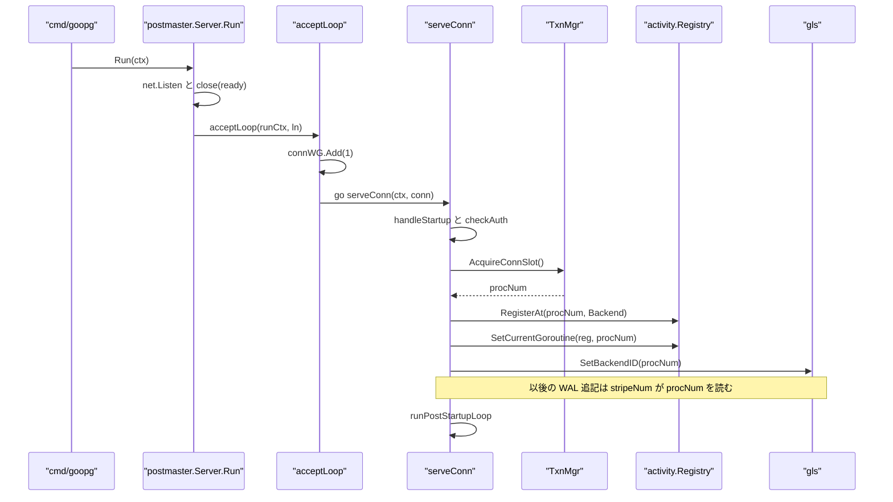
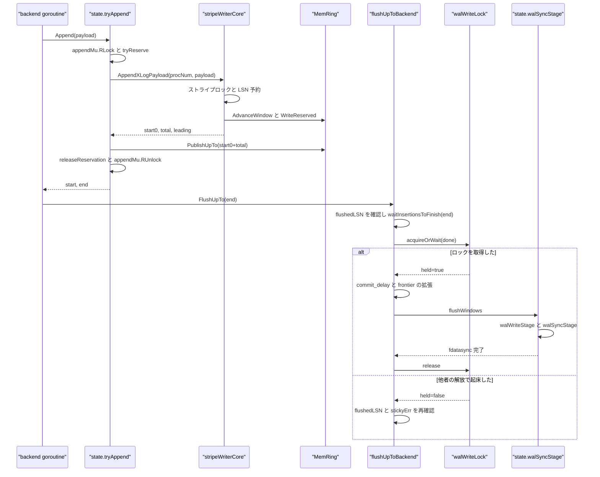
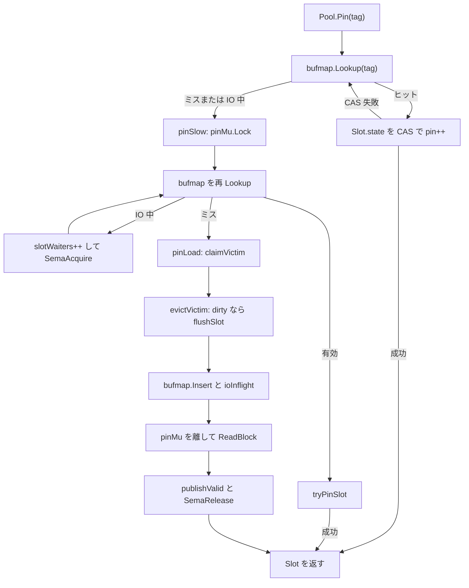
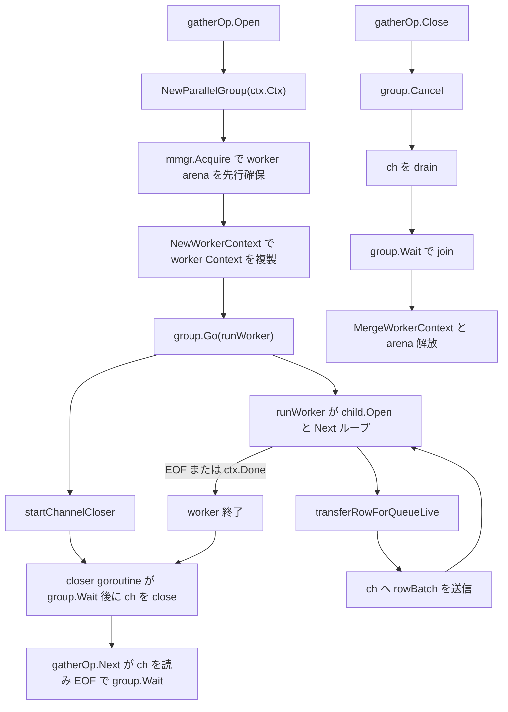

# プロセスと並行性モデル

<details>
<summary>関連ソースファイル</summary>

- [`internal/access/transam/xlog/mem_ring_concurrent.go`](https://github.com/ryogrid/goopg/blob/19856410e8d497d59787e1ab35a2febb3f5953d6/internal/access/transam/xlog/mem_ring_concurrent.go)
- [`internal/access/transam/xlog/writer.go`](https://github.com/ryogrid/goopg/blob/19856410e8d497d59787e1ab35a2febb3f5953d6/internal/access/transam/xlog/writer.go)
- [`internal/access/transam/xlog/mem_ring.go`](https://github.com/ryogrid/goopg/blob/19856410e8d497d59787e1ab35a2febb3f5953d6/internal/access/transam/xlog/mem_ring.go)
- [`internal/access/transam/xlog/padded_mutex.go`](https://github.com/ryogrid/goopg/blob/19856410e8d497d59787e1ab35a2febb3f5953d6/internal/access/transam/xlog/padded_mutex.go)
- [`internal/access/transam/xlog/stripe_writer_core.go`](https://github.com/ryogrid/goopg/blob/19856410e8d497d59787e1ab35a2febb3f5953d6/internal/access/transam/xlog/stripe_writer_core.go)
- [`internal/access/transam/xlog/stripe_append_emitted.go`](https://github.com/ryogrid/goopg/blob/19856410e8d497d59787e1ab35a2febb3f5953d6/internal/access/transam/xlog/stripe_append_emitted.go)
- [`internal/access/transam/xlog/wal_write_lock.go`](https://github.com/ryogrid/goopg/blob/19856410e8d497d59787e1ab35a2febb3f5953d6/internal/access/transam/xlog/wal_write_lock.go)
- [`internal/executor/parallel_runtime.go`](https://github.com/ryogrid/goopg/blob/19856410e8d497d59787e1ab35a2febb3f5953d6/internal/executor/parallel_runtime.go)
- [`internal/executor/parallel_worker_ctx.go`](https://github.com/ryogrid/goopg/blob/19856410e8d497d59787e1ab35a2febb3f5953d6/internal/executor/parallel_worker_ctx.go)
- [`internal/executor/operators_gather.go`](https://github.com/ryogrid/goopg/blob/19856410e8d497d59787e1ab35a2febb3f5953d6/internal/executor/operators_gather.go)
- [`internal/port/gls/gls.go`](https://github.com/ryogrid/goopg/blob/19856410e8d497d59787e1ab35a2febb3f5953d6/internal/port/gls/gls.go)
- [`internal/port/gls/gls_linkname.go`](https://github.com/ryogrid/goopg/blob/19856410e8d497d59787e1ab35a2febb3f5953d6/internal/port/gls/gls_linkname.go)
- [`internal/port/runtimeshim/doc.go`](https://github.com/ryogrid/goopg/blob/19856410e8d497d59787e1ab35a2febb3f5953d6/internal/port/runtimeshim/doc.go)
- [`internal/port/runtimeshim/nanotime_linkname.go`](https://github.com/ryogrid/goopg/blob/19856410e8d497d59787e1ab35a2febb3f5953d6/internal/port/runtimeshim/nanotime_linkname.go)
- [`internal/port/runtimeshim/pinp_linkname.go`](https://github.com/ryogrid/goopg/blob/19856410e8d497d59787e1ab35a2febb3f5953d6/internal/port/runtimeshim/pinp_linkname.go)
- [`internal/port/runtimeshim/sema_linkname.go`](https://github.com/ryogrid/goopg/blob/19856410e8d497d59787e1ab35a2febb3f5953d6/internal/port/runtimeshim/sema_linkname.go)
- [`internal/postmaster/server.go`](https://github.com/ryogrid/goopg/blob/19856410e8d497d59787e1ab35a2febb3f5953d6/internal/postmaster/server.go)
- [`internal/storage/bufpool.go`](https://github.com/ryogrid/goopg/blob/19856410e8d497d59787e1ab35a2febb3f5953d6/internal/storage/bufpool.go)
- [`internal/utils/activity/activity.go`](https://github.com/ryogrid/goopg/blob/19856410e8d497d59787e1ab35a2febb3f5953d6/internal/utils/activity/activity.go)
- [`internal/utils/activity/registry.go`](https://github.com/ryogrid/goopg/blob/19856410e8d497d59787e1ab35a2febb3f5953d6/internal/utils/activity/registry.go)
- [`internal/utils/activity/stats/counter.go`](https://github.com/ryogrid/goopg/blob/19856410e8d497d59787e1ab35a2febb3f5953d6/internal/utils/activity/stats/counter.go)

</details>

goopg は PostgreSQL の「バックエンドプロセス 1 本 = 1 接続」というモデルを、**1 プロセス内の goroutine** に写像している。`internal/postmaster/server.go:serveConn` がクライアント TCP 接続ごとに 1 本の goroutine を起動し、その goroutine がトランザクション状態・バッファピン・WAL 追記・同期コミットのフラッシュまでを所有する。一方、チェックポイント・WAL のバックグラウンド書き込み・自動 VACUUM・WAL サマライザ・walsender・論理レプリケーションの apply worker は、接続とは独立した goroutine として同じプロセス内で動く。このページでは、その goroutine 群を支える識別子の伝播（`internal/port/gls`）、WAL のストライプ並行書き込みと group commit、バッファプールのロックフリー pin、並列クエリの fan-out と停止順序、そしてホットパスをランタイム内部へ短絡する `internal/port/runtimeshim` を扱う。

## 責務

- **接続ごとの goroutine を生成し、ライフサイクルを管理する。** `acceptLoop` が `connWG.Add(1)` して `go s.serveConn(ctx, conn)` を起動し、`Run` が `connWG.Wait()` で回収する。`serveConn` は panic を recover してプロセスを落とさず、接続を閉じてログにスタックを残す (`internal/postmaster/server.go:serveConn`)。
- **バックエンド識別子（procNum）を 1 接続につき 1 つ払い出す。** `TxnMgr.AcquireConnSlot()` が接続ライフタイムのスロットを取得し、`activity.Registry.RegisterAt(procNum, ...)` と `gls.SetBackendID(procNum)` に同じ値を渡す。procNum は `pg_stat_activity` のスロット、待機イベント、WAL ストライプ選択の共通キーになる (`internal/postmaster/server.go:serveConn`)。
- **WAL 追記をストライプ単位で並行化する。** `state.tryAppend` が `core.AppendXLogPayload(procNum, ...)` を呼び、`appendLockStripes = 8` 本のストライプロックのうち `stripeForProcNum` が選ぶ 1 本（`procNum & 7`）だけを取る。LSN の予約は `insertPosTracker` が直列化するが、バイトの memcpy は互いに素な LSN 範囲で並行に走る (`internal/access/transam/xlog/writer.go:tryAppend`, `internal/access/transam/xlog/padded_mutex.go:appendLockSet`, `internal/access/transam/xlog/stripe_writer_core.go`)。
- **コミット時のフラッシュを group commit にまとめる。** `FlushUpTo` は `flushedLSNAtomic` を見て既に durable なら即 return し、そうでなければ `flushUpToBackend` で `walWriteLock` を `acquireOrWait` する。勝者が集約フロンティアを 1 回のフラッシュ（対象セグメントごとの fdatasync）で永続化し、敗者は解放後に durable LSN を再確認して I/O なしで戻る (`internal/access/transam/xlog/writer.go:FlushUpTo`, `flushUpToBackend`, `flushAsHolder`)。
- **バッファプールの pin をロックフリーにする。** `Pool.Pin` のヒット時は `bufmap.Lookup` と `Slot.state` の CAS だけで pin を取る。ミス時のみ `pinMu` を取り、同一タグの同時ミスは per-slot セマフォで 1 回のディスク読みを共有する (`internal/storage/bufpool.go:Pin`, `pinSlow`, `pinLoad`)。
- **並列クエリの worker を安全に起動・停止する。** `ParallelGroup` が worker の context・panic 変換・first-error-wins・join を所有し、`NewWorkerContext` が leader の `executor.Context` を「共有」「値コピー」「空生成」「nil 固定」の 4 分類で複製する (`internal/executor/parallel_runtime.go`, `internal/executor/parallel_worker_ctx.go`)。
- **ホットパスから `runtime.Stack` を排除する。** 接続開始時に pprof の goroutine ラベルへ procNum を刻み、以降は `gls.BackendID()` のポインタロードとラベル走査だけで識別する。WAL 追記のたびに `runtime.Stack` を呼んでいた旧実装は pgbench simple-update でサーバ CPU の 57% を占めていた (`internal/port/gls/gls.go`, `internal/access/transam/xlog/writer.go:stripeNum`)。

## 処理フロー

### 接続の受け入れと goroutine アイデンティティの確立

`Server.Run` は listener を bind すると `ready` を閉じ、`acceptLoop` に入る。`acceptLoop` は `AcceptDeadline`（既定 250ms）を都度設定して `Accept` のブロックを区切るため、context キャンセルを 250ms 以内に観測できる。接続ごとに `serveConn` が起動され、起動ハンドシェイクと認証を終えた後、procNum を払い出して 3 つの場所へ同じ値を登録する。これが「この goroutine は誰か」を以後の全ホットパスが引けるようにする境界である。



`AcquireConnSlot` が失敗すると接続はログを残して閉じられる（スロット枯渇時の拒否）。`cfg.Activity` が nil のときは `RegisterAt` / `SetCurrentGoroutine` / `SetBackendID` をすべてスキップするため、その接続の WAL 追記はストライプ 0 に縮退する。`RegisterAt` を使うのは、`Register` の PID ハッシュ由来スロットと接続の procNum が別のインデックス空間になり、以後の `UpdateState` / `WaitEventStart` が別スロットを更新してしまうためである。`gls.SetBackendID` は pprof ラベルを設定するので、この goroutine が後から `go` で spawn するヘルパーにもラベルが継承される。

### WAL 追記から group commit まで

バッファ付き WAL の高速路では、クライアント goroutine 自身がエンコードとリングへの書き込みを行う。`state.appendMu` は共有 (`RLock`) で取られ、LSN 予約は `insertPosTracker`、バイト書き込みは `MemRing` の read ロック、という内訳で並行性が成立している。フラッシュ側は `writeMu`（`walWriteLock`）だけを取り、`appendMu` を取らない。これにより fdatasync 中も高速路の追記が止まらない。



`waitInsertionsToFinish` は `writeMu` を取る**前**に呼ばれる。ある LSN 以下のストライプ書き込みがまだ in-flight だと publish 済みフロンティアがその LSN に届かないため、先に待ってから書込ロックを取る。スピンは 64 回まで `runtime.Gosched`、以降は 10µs スリープで、`lsn` が `writeLSNMirror` を超えている場合は無限ループせず即座に返り、呼び出し側の `ErrLSNNotWritten` 検査に委ねる。

## 主要ファイル

| ファイル | 役割 |
|---|---|
| `internal/postmaster/server.go` | listener、接続ごとの goroutine、認証、procNum 登録、停止ラダー。`Run` / `acceptLoop` / `serveConn` / `runPostStartupLoop` / `StopImmediate` |
| `internal/port/gls/gls.go` | pprof ラベルによる goroutine ローカルな backend id の設定。`SetBackendID` |
| `internal/port/gls/gls_linkname.go` | ラベル読み出しの `//go:linkname` とレイアウト自己検査。`BackendID` / `probeLayout` |
| `internal/port/runtimeshim/doc.go` | linkname を 1 パッケージに閉じ込める規約とサポート Go バージョン窓 |
| `internal/port/runtimeshim/nanotime_linkname.go` | `runtime.nanotime` を直接読み、ホットパスの時刻取得を約 5ns にする。`Nanotime` |
| `internal/port/runtimeshim/pinp_linkname.go` | `runtime.procPin` / `procUnpin` で goroutine を P に固定する。`PinP` / `UnpinP` |
| `internal/port/runtimeshim/sema_linkname.go` | `sync.runtime_Semacquire` / `sync.runtime_Semrelease` による軽量セマフォ。`SemaAcquire` / `SemaRelease` |
| `internal/utils/activity/stats/counter.go` | `PinP` で選んだ P ごとのシャードに加算する統計カウンタ。`Counter.Add` / `Sum` |
| `internal/utils/activity/activity.go` | 待機イベント種別・名前の定数と `Backend` レコード、後方互換 API |
| `internal/utils/activity/registry.go` | 64B キャッシュライン整合の per-backend スロット、待機イベントの原子的記録、`Snapshot` |
| `internal/storage/bufpool.go` | バッファプール。ロックフリー pin 高速路、`pinMu` 低速路、per-slot セマフォ、clock-sweep 追い出し |
| `internal/access/transam/xlog/writer.go` | WAL Writer と `state`。追記・フラッシュ・バックグラウンド書き込み・ストライプ選択 |
| `internal/access/transam/xlog/wal_write_lock.go` | tri-state の WAL 書込ロック。`acquireOrWait` / `lock` / `release` |
| `internal/access/transam/xlog/padded_mutex.go` | 64B パディングしたストライプ mutex と `stripeForProcNum`。`appendLockSet` |
| `internal/access/transam/xlog/stripe_writer_core.go` | ストライプ・LSN 予約・insertion tracker・tail publisher を束ねる。`AppendXLogPayload` / `PublishUpTo` |
| `internal/access/transam/xlog/mem_ring.go` | WAL の RAM ミラー。`MemRing` の head/tail と `Append` / `ReadAt` |
| `internal/access/transam/xlog/mem_ring_concurrent.go` | ストライプ並行 writer 向けの `WriteReserved` / `PublishUpTo` / `AdvanceWindow` |
| `internal/executor/parallel_runtime.go` | 行の所有権移転、first-error-wins、`ParallelGroup` |
| `internal/executor/parallel_worker_ctx.go` | leader から worker への `Context` 分割と、join 後の計測マージ |
| `internal/executor/operators_gather.go` | Gather の fan-out、channel、leader 参加、停止順序 |

## 公開 API / エントリポイント

- `func gls.SetBackendID(id int32)` — 接続開始時に 1 回だけ呼ぶ。`pprof.SetGoroutineLabels` で `goopg_backend_id` を刻む。小さなアロケーションを伴う cold path。
- `func gls.BackendID() (int32, bool)` — ラベルから id を読む。未設定・非対応ランタイム・レイアウト不一致では `(0, false)`。
- `func runtimeshim.Nanotime() int64` — 単調増加のナノ秒。`time.Now().UnixNano()` ではないため、プロセス外や suspend を跨いだ比較には使えない。
- `func runtimeshim.PinP() int` / `func UnpinP()` — 呼び出し goroutine を現在の P に固定し、P のインデックスを返す。両者の間でブロックしてよい操作（チャネル送受信、待つ可能性のある mutex、syscall、STW を誘発しうるアロケーション）は禁止。
- `func runtimeshim.SemaAcquire(s *uint32)` / `func SemaRelease(s *uint32)` — 呼び出し側が所有する uint32 セル上のセマフォ。`SemaAcquire` は park しうるので `PinP` ウィンドウ内では呼べない。
- `func NewParallelGroup(parent context.Context) *ParallelGroup` — 親からキャンセル可能な子 context を作る。`Context()` / `Go(fn)` / `Wait()` / `Cancel()` を提供。
- `func NewWorkerContext(leader *Context, workerMctx *mmgr.Context, workerCtx context.Context) *Context` — worker 用の `executor.Context` を 1 goroutine 専用として組み立てる。`workerMctx` は leader が事前に `mmgr.Acquire` しておく必要がある。
- `func MergeWorkerContext(leader, worker *Context)` — join 後に notice/warning、hash join 計測、sort/memoize 計測を leader へ畳み込む。同期は不要で、join の happens-before に依存する。
- `func MaterializeForTransfer(row Row) Row` — 行を別 goroutine へ渡す唯一の公認経路。`cloneRow` や `Slot.CopyTo` では不十分。
- `func (w *Writer) Append(payload []byte) (start, end uint64, err error)` — 空 payload は `ErrEmptyPayload`。バッファがあり予約に成功すれば呼び出し goroutine 上で完結し、`ok=false`（バッファなし・溢れ・容量超過）のときだけ slow path の `state.append`（`writeMu` を取り、Path A ではさらに `appendMu.Lock()`）に落ちる。
- `func (w *Writer) FlushUpTo(lsn uint64) error` — `lsn == 0` と `lsn <= flushedLSN` は no-op。書かれていない LSN は `ErrLSNNotWritten`。
- `func (w *Writer) BackgroundWrite() error` — walwriter の周期処理。published frontier を plain `lock()` で取り、write と flush を同じ LSN まで行う。
- `func (r *MemRing) WriteReserved(pos int64, data []byte) error` / `PublishUpTo(safeTail int64)` / `AdvanceWindow(upTo int64)` — ストライプ writer がバイトを置き、publisher が可視化し、境界越えの前に窓を滑らせる。
- `func (r *ActivityRegistry) WaitEventStart(procNum int32, waitTypeStr, waitEventStr string)` / `WaitEventEnd(procNum int32) time.Duration` — 待機イベントの開始・終了。どちらも O(1) の atomic 操作でグローバル mutex を取らない。
- `func (r *ActivityRegistry) RegisterAt(procNum int32, b *Backend)` / `Unregister(pid string)` — 接続ライフタイムのスロット登録・解放。
- `func LookupCurrentGoroutine() (*ActivityRegistry, int32, bool)` — `gls` 高速路、失敗時は goroutine ID マップへフォールバック。
- `func (p *Pool) Pin(tag BufferTag) (*Slot, error)` — pin を取得する。呼び出し側は必ず `Unpin` する。

## 主要データ構造

### `Writer` — 追記・フラッシュ・購読の調整役

`internal/access/transam/xlog/writer.go:Writer`（276 行）:

```go
type Writer struct {
	// done is closed exactly once by Close to wake parked flush waiters and
	// reject new appends. closeOnce/closeErr make Close idempotent.
	done      chan struct{}
	closeOnce sync.Once
	closeErr  error

	// writeLSNAtomic mirrors state.writeLSN so external observers
	// (notably the checkpointer's max_wal_size trigger) can read
	// the current write position without serialising through the
	// op channel.
	writeLSNAtomic atomic.Uint64

	// flushedLSNAtomic mirrors state.flushedLSN — the highest LSN whose
	// bytes have been fdatasync'd to the segment files. Published by the
	// writer goroutine AFTER each sync barrier so a reader that observes
	// lsn <= flushedLSNAtomic knows lsn is durable. FlushUpTo reads it to
	// skip the group-flush queue entirely when the target is already
	// durable — the goopg analog of PG's `record <= LogwrtResult.Flush`
	// fast exit in XLogFlush (analysis/perf-optimize2, fix-03).
	flushedLSNAtomic atomic.Uint64

	// drainedLSNAtomic mirrors state.drainedLSN — the highest LSN whose bytes
	// have been drained from the ring to the segment files (pwritten to the OS
	// cache, not necessarily fdatasync'd). This is the goopg analog of PG's
	// logWriteResult; the background walwriter reads it to decide whether a
	// pre-write round has anything to do (docs/design/wal-backend-flush/, 03/04).
	// Invariant: writeLSNAtomic >= drainedLSNAtomic >= flushedLSNAtomic.
	drainedLSNAtomic atomic.Uint64

	// subscribers receive a non-blocking wake-up after every
	// successful Append. Used by RecordIterator (and walsender
	// goroutines) to block until more WAL is available instead of
	// polling WrittenLSN. Subscribers maintain their own buffer
	// channel; Writer drops the wake-up if the channel is full —
	// the iterator will catch up on the next event or by a manual
	// re-poll.
	subMu       sync.Mutex
	subscribers map[chan<- struct{}]struct{}

	// memRing is shared with state.memRing (one allocation,
	// two pointers). Exposed via MemRing() so the iterator
	// and observability code can read it without serialising
	// through the writer's loop. nil when
	memRing *MemRing

	// --- backend-driven flush (docs/design/wal-backend-flush/, slice 3) ---
	// writeMuOf reaches the state's WAL write lock; flushWaiters counts
	// in-flight FlushUpTo callers (the commit_siblings gate); commitDelayUs /
	// commitSiblings snapshot the GUCs; stickyErr lets losing committers
	// return a flush error without re-acquiring the lock (stampede guard).
	flushWaiters   atomic.Int32
	commitDelayUs  atomic.Int64
	commitSiblings atomic.Int32
	stickyErr      atomic.Pointer[flushErr]

	// walWriterFlushAfter is wal_writer_flush_after (bytes; BootVal 1MB): the
	// background walwriter fsync-throttle threshold. Stored for BackgroundWrite;
	// it only gates a skip once async-LSN early wakeups land (a timer tick always
	// satisfies PG's "≥ wal_writer_delay since last flush" rule and therefore
	// flushes) — see BackgroundWrite (docs/design/wal-backend-flush/ 03 §3.4).
	walWriterFlushAfter atomic.Int64

	// stateRef is a reference to the state struct, needed by
	// Writer.Append to call encodeAndBuffer directly (M0026
	// concurrent append path).
	stateRef *state

	// walBufferCounters shares atomics with state for the
	// M0013-0003 wal_buffers_* columns of pg_stat_wal_io.
	walBufferCounters *walBufferCounters

	// pageHeaders mirrors Config.PageHeaders so RecordIterator
	// (and any other reader holding a *Writer reference) can
	// decide whether to skip page-header bytes when streaming
	// records. Static for the Writer's lifetime.
	pageHeaders bool
	// segmentSize mirrors Config.SegmentSize so iterators can
	// distinguish a long-form (segment-boundary) page header
	// from a short-form one without having to thread cfg in.
	segmentSize int64

	// core is the M0107-0007 slice B WAL-insert striping packaging
	// struct (`docs/design/0107-0007v-wal-stripe-writer-core.md`).
	// Mounted here so the eventual call-site rewrite can replace
	// `state.append`'s body with `s.core.Append(procNum, encoded)`
	// and the drain goroutine's per-tick prelude with
	// `s.core.PublishUpTo(...)` — see
	// `docs/design/0107-0007w-wal-stripe-writer-core-mount.md`. The
	// core is constructed in `NewWriter` after `loadState` so it
	// borrows the same `walBuf` / `memRing` rings as the legacy path
	// (one allocation, two consumers — duplicating the rings would
	// fork on-disk visibility). The append paths reach it through
	// `AppendXLogPayload` since the slice B call-site rewrite
	// (644af04fe); tests reach it through the `stripeCore()` accessor
	// below.
	core *stripeWriterCore

	// OnWALWrite and OnWALSync are optional hooks called before
	// blocking WAL write / fdatasync operations.  The caller
	// (initdb.Open) sets them via activity.LookupGoroutine so
	// pg_stat_activity can report WALWrite / WALSync wait events.
	OnWALWrite func()
	OnWALSync  func()

	// OnWALWriteDone pairs with OnWALWrite — called immediately after the
	// ring→segment drain completes (success or error), mirroring
	// OnWALSyncDone's balance guarantee. Since the probe-audit split, the
	// commit path emits WALWrite for the park/drain phases and WALSync only
	// around the fdatasync barrier (PG WAIT_EVENT_WAL_WRITE /
	// WAIT_EVENT_WAL_SYNC).
	OnWALWriteDone func()

	// OnWALSyncDone pairs with OnWALSync — called immediately after
	// the fdatasync completes (success or error) so observability
	// code can balance every WaitEventStart with a WaitEventEnd.
	// (M0058-0006.)
	OnWALSyncDone func()

	// sharedFsyncTimeNanos accumulates real wall-clock time spent inside
	// FlushUpTo's fdatasync wait, backing pg_stat_io's (client backend,
	// wal, normal) fsync_time column (M0122-0003 track_io_timing
	// follow-up). initdb.Open's OnWALSyncDone hook calls
	// AddFsyncTimeNanos only when the calling backend's own
	// track_io_timing is on (via ActivityRegistry.LookupTrackedGoroutine),
	// mirroring storage.Pool's OnPinDone/AddReadTimeNanos gating exactly —
	// see AddFsyncTimeNanos's doc comment. Plain atomic.Int64 (not a
	// sharded stats.Counter) because fsyncs are already serialised through
	// group commit, unlike per-buffer read/write/extend ops.
	sharedFsyncTimeNanos atomic.Int64

	// walRecords counts the lifetime number of WAL records appended
	// (incremented once per successful Append call). walBytes counts
	// the lifetime total bytes written to WAL (record payload size,
	// not including the xlog record header). Both back EXPLAIN (WAL)
	// output (M0122-0003). Plain atomic.Int64 because the per-stripe
	// locks serialise the counter bumps within Append already.
	walRecords atomic.Int64
	walBytes   atomic.Int64
}
```

- 3 つの LSN ミラーは読み取り専用の外部 API である。**不変条件は `writeLSNAtomic >= drainedLSNAtomic >= flushedLSNAtomic`**。`write` は予約・追記済み、`drained` はリングからセグメントファイルへ pwrite 済み（OS キャッシュ、まだ durable でない）、`flushed` は fdatasync 済みを意味する。構造体コメントには「writer goroutine が publish する」とあるが、slice 5 以降は専用 writer goroutine を廃止しており、実際には `flushAsHolder` / `backgroundFlushLocked` が `walWriteStage` / `walSyncStage` 経由で publish する。
- `done` は `Close` が 1 回だけ close する。`walWriteLock.acquireOrWait` はこのチャネルも select するので、park 中のコミッタは shutdown で `ErrClosed` として起きる。`closeOnce` / `closeErr` が `Close` の冪等性を保証する。
- `subMu` / `subscribers` は `RecordIterator` や walsender への「WAL が進んだ」通知。送信は非ブロッキングで、チャネルが満杯なら通知を落とす。購読者は `WrittenLSN` を再ポーリングするので、通知の合流は問題にならない。
- `flushWaiters` / `commitDelayUs` / `commitSiblings` は group commit の制御、`stickyErr` は失敗の共有。`core` と `memRing` は `state` と同じリングを指す共有ポインタで、ここを別インスタンスにするとディスク可視性が分岐する。
- `OnWALWrite` / `OnWALWriteDone` と `OnWALSync` / `OnWALSyncDone` は必ず対で呼ばれる。待機イベントの開始と終了が釣り合わないと `pg_stat_activity` の待機表示が固定化するため、`flushWindows` はエラー経路でも各ペアの釣り合いを保つ。

### `MemRing` — WAL の RAM ミラー

`internal/access/transam/xlog/mem_ring.go:MemRing`（38 行）:

```go
type MemRing struct {
	mu sync.RWMutex

	buf  []byte // capacity = cap; never reallocated
	cap  int64
	head int64 // 0-based byte offset of oldest resident byte
	tail int64 // 0-based byte offset one past newest resident byte

	// hits / misses are observability counters surfaced via
	// Hits()/Misses() so M0010-0003's `pg_stat_wal_io` /
	// `pg_stat_replication.send_buffer_*` surface can read them
	// without taking the mutex. Per-P sharded via stats.Counter
	// so concurrent walsender ReadAt callers (one goroutine per
	// active replication connection) don't contend on a single
	// cache line — eliminates cross-core invalidation on the
	// streaming hot path. See M0107-0008 loop 8.
	hits   stats.Counter
	misses stats.Counter
}
```

- `buf`/`cap` は構築後に再確保されない。`head` と `tail` は 0 起点の WAL バイト位置で、リングが保持する範囲は `[head, tail)`。`head` はリングが満杯になった後は `tail - cap` に対応する。
- `mu` は 1 本の RWMutex。`WriteReserved` と `ReadAt` は read ロック、`PublishUpTo` / `AdvanceWindow` / `Append` は write ロックを取る。したがって **複数の `WriteReserved` は互いに素な LSN 範囲なら並行に memcpy できる**が、重なる範囲を同時に書くのは契約違反で、内容は未定義になる。
- `hits` / `misses` は `stats.Counter`（P ごとのシャード）なので、walsender が増えても単一キャッシュラインで競合しない。
- `tail` は公開済みの安全な末尾（`PublishUpTo` が進める値）で、単一 writer モデルでは writer の `writePos` に一致する。複数ストライプが未公開のバイトを持つ間は、writer の `writePos` の方が `tail` より先に進みうる。

### `walWriteLock` — tri-state の WAL 書込ロック

`internal/access/transam/xlog/wal_write_lock.go:walWriteLock`（24 行）:

```go
type walWriteLock struct {
	mu    sync.Mutex    // the exclusive WAL-write lock itself
	genMu sync.Mutex    // guards the generation-channel swap
	gen   chan struct{} // closed once per release ("one flush completed")
}
```

- `mu` が実体の排他ロック。`gen` は解放ごとに close されて差し替わる世代チャネルで、待機者は「ロックを取れた（`held=true`）」「誰かの解放で起きた（`held=false`）」「shutdown で起きた（`ErrClosed`）」の 3 状態を区別できる。
- `acquireOrWait` は `genMu` の下で `gen` を捕まえてから park する。`release` も `genMu` の下で close と差し替えを行うため、待機者が「二度と close されないチャネル」を掴むことはない。これが missed-wakeup を防ぐ不変条件である。
- `held=false` の敗者はロックを保持しない。durable LSN を再確認し、まだ足りなければ再度 `acquireOrWait` する。このループが「解放ごとに 1 回起きて再検査する」group commit の実体になる。

### `stripeWriterCore` — ストライプ writer の束ね役

`internal/access/transam/xlog/stripe_writer_core.go:stripeWriterCore`（124 行）:

```go
type stripeWriterCore struct {
	locks      *appendLockSet
	posTracker *insertPosTracker
	inserting  *insertionTracker
	publisher  *tailPublisher
	walBuf     *walBuffer
	memRing    *MemRing
}
```

- `locks` は 8 本のストライプロック。`procNum` から 1 本を選ぶので、同じ backend の追記は常に同じストライプで直列化され、異なる backend は別ストライプで並行になる。
- `posTracker` は `(curr, prev)` を `posMu` の下で共同で更新する。`curr` は次に使う LSN、`prev` は次のレコードの `xl_prev` に入れる値で、**この 2 つは必ず同じ臨界区間で進む**。片方だけ読むと `xl_prev` チェーンが壊れる。
- `inserting` はストライプごとの「現在書き込み中の開始 LSN」を持ち、`publisher` はそれを参照して「全ストライプが完了した連続フロンティア」を計算する。`core.PublishUpTo` がその結果を `walBuffer` と `MemRing` の双方へ公開する。
- `walBuf` / `memRing` は `Writer` の `state` と同じポインタを共有する（1 アロケーション・2 消費者）。別々に作るとディスク可視性が分岐するため、`NewWriter` が `loadState` の後に一度だけ構築する。

### `parallelErrBox` と `ParallelGroup` — 並列 worker の失敗と join

`internal/executor/parallel_runtime.go:parallelErrBox`（176 行）:

```go
type parallelErrBox struct {
	once sync.Once
	err  error
}
```

`internal/executor/parallel_runtime.go:ParallelGroup`（202 行）:

```go
type ParallelGroup struct {
	cancel context.CancelFunc
	ctx    context.Context
	wg     sync.WaitGroup
	errBox parallelErrBox
}
```

- `parallelErrBox.record` は `sync.Once` で最初の非 nil エラーだけを採用する。同時に 2 つの worker が失敗した場合、どちらが勝つかは非決定的であり、これは PostgreSQL と同じ性質である。
- `ParallelGroup.Go` は worker の panic を recover し、`XX000` の `ExecError` に変換する。`serveConn` の recover は接続 goroutine しか守らないため、ここで変換しないとプロセス全体が落ちる。
- `Wait` は**先にキャンセルしない**。先にキャンセルすると、`ctx.Done()` で起きた worker の `context.Canceled` が本物の失敗を first-error レースで追い越し、クライアントに誤った原因を返す。キャンセルは失敗の結果であり、対等な事象ではない。
- `cancel` は `Wait` の最後にも呼ばれる。全 worker が戻った後の context 解放である。

### `activitySlot` — 64 バイトに収めた待機状態

`internal/utils/activity/registry.go:activitySlot`（45 行）:

```go
type activitySlot struct {
	waitInfo    atomic.Uint32 // packed (typeCode<<16)|eventCode; 0 = no wait
	_pad0       [4]byte       //nolint:structcheck // explicit alignment padding
	stateChange atomic.Int64  // unix nanos; updated on every WaitEvent* call
	// cold is an atomic pointer (C3-S5 fix): connection proc slots are
	// now RECYCLED on disconnect (mvcc.AcquireConnSlot), so a re-acquire
	// of a just-freed slot races concurrent registry scans
	// (CountByDatName / Snapshot) on this field — plain pointer accesses
	// were only quiet under the old never-reused modulo procNums.
	cold  atomic.Pointer[coldActivity] // set at acquire; nil when slot is free
	_pad1 [40]byte                     //nolint:structcheck // pad to 64 B
}
```

- `waitInfo` は待機タイプと待機イベントを 16bit + 16bit に詰めたもの。`wait_type` のコードは `1<<16` 単位（IO=1, Lock=2, Client=3, ...）、イベントは下位 16bit の連番である。0 は「待機していない」を意味する。
- `stateChange` は `runtimeshim.Nanotime()` の単調時刻。`Snapshot` が `wallEpoch + (mono - monoEpoch)` で壁時計に変換する。単調時計を保存するのは、ホットパスで `time.Now()` の VDSO と壁時計変換を払わないため。
- `cold` は接続ごとに 1 回だけ差し替わる `coldActivity` へのポインタ。スロットが解放されると `nil` に戻る。読み手は `cold.Load()` が `nil` でないことで「使用中」を判定する。`coldActivity` の不変フィールド（PID、DatName など）は取得後に書き換えられず、可変フィールド（状態、クエリ、XID）は個別の atomic 型で更新される。
- サイズはコンパイル時アサーションで 64 バイトに固定されている。隣接スロットが同じキャッシュラインを共有すると、無関係な backend の待機イベント更新が false sharing を起こすため。

### `Slot` とパックされた状態ワード

`internal/storage/bufpool.go:slotPinMask`（26 行、状態ビット定数）:

```go
const (
	slotPinMask    = uint64((1 << 22) - 1) // bits 0..21
	slotUsageShift = 22
	slotUsageMask  = uint64(((1 << 8) - 1) << slotUsageShift)
	slotDirtyBit   = uint64(1 << 30)
	slotValidBit   = uint64(1 << 31)
	slotIOBit      = uint64(1 << 32)
	slotGenShift   = 33
	slotGenMask    = uint64(((1 << 15) - 1) << slotGenShift)
	maxUsageCount  = 5
	maxPinCount    = (1 << 22) - 1
)
```

`internal/storage/bufpool.go:Slot`（51 行）:

```go
type Slot struct {
	page Page // alias into the arena

	// idx is this slot's fixed index into Pool.slots, set once in
	// NewPool. Lets MarkDirty* (which only receive a *Slot) address
	// Pool.slotEvents without pointer arithmetic. See DebugTraceSlotEvents.
	idx int32

	// Tag identifies the (rel, fork, block) the slot currently holds.
	// Written only while ioInflight is set in state; readable once valid.
	tag BufferTag

	// state packs pinCount, usageCount, dirty, valid, ioInflight, gen
	// into a single 64-bit atomic word for lock-free Pin/Unpin.
	state atomic.Uint64

	// nativeImageLSN is the end-LSN of the last NATIVE full-page image
	// (RecordKindPageImage via logFPI, or the multi-page-image records the
	// MarkDirtyWithLSN* callers log) emitted for the page occupying this
	// slot; 0 on load/reuse. The FPI decision keys on THIS token — not on
	// pd_lsn — because pd_lsn is stamped by BOTH record families: a
	// canonical record's stamp would otherwise satisfy the test and
	// suppress the native image the native-family replay depends on (the
	// cross-family poisoning class rejected as F1 in the C1 design review;
	// rediscovered as a live S2 regression by the S3a crash-sim tests).
	// Slot-keyed: eviction/reload re-arms conservatively (extra image).
	nativeImageLSN atomic.Uint64

	// contentMu guards the Page bytes for read/write. The pool does
	// not hold any global lock while this is taken.
	contentMu sync.RWMutex
}
```

- `state` は pin 数・使用カウント・dirty・valid・io-inflight・世代を 1 語に詰める。pin の取得は「valid かつ io-inflight でなく、世代が `bufmap` の記録と一致する」ことを確認した上での CAS 1 回で済む。
- `usage` は 5 で飽和する clock-sweep の second-chance カウンタ。`claimVictim` は `usage > 0` なら 1 減らして次へ進み、0 のスロットだけを victim にする。
- `gen` は 15bit で、victim を claim するたびに +1 される ABA ガード。`Pin` 高速路が古い世代を掴んだまま pin を増やそうとしても CAS が失敗する。`InvalidateRel` / `InvalidateBlock` は通常は valid/dirty を落として `bufmap` から消すが、対象スロットが io-inflight のときは世代を進める。これにより、進行中の dirty flush は「自分が書こうとしたページはもう無効化された」と判断して書き込みを破棄できる。
- 不変条件: `tag` は `ioInflight` が立っている間だけ書き換えられ、`valid` になってから読める。`page` の内容は `contentMu` が守る。`nativeImageLSN` はスロットに紐づくため、追い出し時に `evictedImageLSN` へ退避され、再ロード時に引き継がれる。

## 内部構造

### ロック階層と「触ってはいけない順序」

WAL 経路のロック順はソースコメントで明示されている。

1. **追記側**: `appendLockSet.lockByProcNum`（8 本のうち 1 本） → `insertPosTracker.reserve`（`posMu`） → `insertionTracker.setInsertingAt` → `walBuffer.writeReserved` → `MemRing.WriteReserved`。ストライプを取ったまま `posMu` を取り、`posMu` を離してからバイトを書く。
2. **低速追記側**: `state.writeMu` → `state.appendMu`。`appendPGCompat` の Path A と `appendRaw` はこの順で取り、`appendMu.Lock()` を drain から `walBuf.reset`、tracker の再同期まで保持する。ここで `appendMu` を途中で離すと、fast-path のストライプ writer が同じ LSN 範囲に予約を入れ、drain tail の巻き戻しと競合する。
3. **フラッシュ側**: `state.writeMu`（実体は `walWriteLock`）だけを取り、`appendMu` は取らない。これが「fdatasync 中も追記が進む」ことの根拠である。`writeMu` を解放する defer は panic 時にも必ず走る。接続 goroutine の panic は接続単位で recover されるため、defer なしで unlock すると `writeMu` が永久に漏れて全コミットが止まる。

`state.appendMu` の使われ方は 2 種類ある。`tryAppend` は `RLock`（複数同時可、ストライプが互いに素な範囲を書く）、Path A / `appendRaw` / 古い非 page-headers 経路は `Lock`（排他、drain と `resetPosition` を含む）。この非対称性が「読み取りは並行、破壊的変更は排他」という境界を作っている。

### バッファプールの pin 経路



- `claimVictim` は `clockHand` を 1 つ進めながら最大 `n * (maxUsageCount + 2)` 回プローブする。pin 中・IO 中・usage>0 のスロットを飛ばし、`ioInflight` を立てて世代を進めた CAS が成功したスロットを victim にする。すべて失敗すると `ErrNoBuffer`。
- `evictVictim` は dirty なら `pinMu` を一旦解放して `contentMu` を取り、flush する。この間に他の goroutine が victim を奪わないのは、`ioInflight` が立っているからである。flush 後、`bufmap` からの削除は**flush が完了してから**行う。先に削除すると、待機者がミスと判断して自分のディスク読みを始め、flush 前の古いページを別スロットにキャッシュしてしまう。
- `pinLoad` は `bufmap.Insert` の後に `pinMu` を解放して `ReadBlock` する。読み終えたら `slotWaiters[victimIdx]` を `pinMu` 下で読み、`publishValid` の後にその回数だけ `SemaRelease` する。待機者数を io-inflight クリア前に読むことで、取りこぼしを防ぐ。
- `SemaAcquire` は goroutine を park しうるので、`stats.Counter.Add` の `PinP` ウィンドウとは入れ子にできない。`runtimeshim` の doc コメントも「complementary, not nestable」と明記している。

### 並列クエリの fan-out と停止順序

Gather は worker の起動前に leader 側で準備を済ませる。共有ハッシュテーブルの build、bitmap scan の事前構築、initplan の評価、worker 用 `mmgr.Context` の確保をすべて `Open` の中で行う。`mctx.Acquire` は `parent.children` へ無同期で append するので、worker 自身に確保させるとスライス append の競合になる。



停止順序が重要である。`Close` は「Cancel → drain → Wait」の順で行う。先に Cancel しないと worker は止まらず、先に drain しないと channel 送信でブロックした worker がキャンセルを観測できず `Wait` がデッドロックする。`startChannelCloser` は `group.Wait()` の後に `ch` を閉じる goroutine を起動する。この closer を `Open` の最後ではなく「最後の `group.Go` の直後」に起動するのは、`Open` の途中のエラー return でも channel を閉じる経路を保証するためである。

`NewWorkerContext` のフィールド分類は次の 4 つ。

- **共有（読み取り専用）**: `Pool` / `Catalog` / `TxnMgr` / `Tx` / `Snap` / `WAL` / `LockMgr` / `SharedHashBuilds` / `ParallelHashBuilds` など。ポインタは同じオブジェクトを指すが、文の間は不変か内部同期済みであることが前提。`mvcc.Snapshot` のスライスはキャプチャ後に変更されないから浅いコピーで安全、という不変条件を壊してはいけない。
- **値コピー**: `ParamExec` / `ParamSet` / `ParamDirty` / `OuterRows`。`SetParamExec` がスライスを伸ばすため、共有 backing array だと append が競合する。空にすると `ExecParamRef` が `XX000` で落ちる。
- **空生成**: `NewContext()` が新しく作るキャッシュ・統計マップ・notice/warning バッファ。worker のアリーナは leader が確保した `workerMctx` を `w.Mctx` として渡す。`CTERowCache` / `MaterializedCTEs` / `WorkTableRows` は実行中に書かれるので、共有すると Go の map 同時書き込みでプロセスが fatal 終了する（`-race` ではなくランタイムの throw）。
- **nil 固定**: 約 40 個の接続コールバック。worker が `GetSetting` や `CancelBackend` を呼ぶと、セッション状態を誤った goroutine から書き換える前に呼び出し地点で panic する。planner の並列安全ゲートが漏れたときの機械的なバックストップである。

## エッジケースと不変条件

- **`gls.BackendID` の縮退**: サポート窓（`go1.24`〜`go1.26`）外、`noLinkname` タグ、または `probeLayout` の自己検査失敗では `(0, false)` を返す。`stripeNum` は 0 にフォールバックし、全員がストライプ 0 を使う（正しいが並行性は落ちる）。`probeLayout` はレイアウト不一致による wild pointer deref を recover してプロセスを守る。goopg は goroutine の pprof ラベルをこの用途に予約しており、他のコードは設定しない。
- **`MemRing.WriteReserved` の境界**: nil レシーバと `len(data)==0` は nil を返す no-op。範囲検査は `pos < head || pos+n > head+cap` で、`pos+n == head+cap` は「最後の 1 バイトを含む」ため許可される。範囲外は `errMemRingReservedOutOfRange`（sentinel）で、呼び出し側はこれを窓違反として識別できる。重なる範囲への同時 `WriteReserved` は検出されず、リング内容は未定義になる。呼び出し側の `insertPosTracker` が互いに素な範囲を保証する。
- **`PublishUpTo` の単調性**: `safeTail <= r.tail` は無変更で返る。リングを超える場合は `head = tail - cap` で古いバイトを追い出す。nil レシーバは no-op。publisher は書き込みロックを取るため、in-flight の `WriteReserved` が低い LSN を memcpy 中に head を進めることはない（ただし呼び出し側の watermark が正しいことが前提）。
- **`AdvanceWindow` を忘れると必ず失敗する**: リングの初期窓を超えて書き始めると、`PublishUpTo(end)` が `tail=end, head=end-cap` にした後、窓は `[end-cap, end)` となり `end` 自身を含まない。`WriteReserved` の検査は strict な `>` なので、`end` への書き込みは常に範囲外になる。`AdvanceWindow(upTo)` は `head = max(head, upTo-cap)` で窓を前へ滑らせ、このデッドロックを防ぐ。
- **`MemRing` への書き込み失敗は append 失敗とは限らない**: `AdvanceWindow` と `WriteReserved` は 1 つの臨界区間ではないため、peer stripe の `AdvanceWindow` が `head` を `start` の手前まで滑らせると `errMemRingReservedOutOfRange` になりうる。`MemRing` は walsender 用の読みキャッシュで、ミスはセグメントファイルの pread に落ちるため、`stripeAppendEmitted` はこのエラーを無視する。一方、生の `stripeAppend` は呼び出し元へ返す。リングの欠落は正しさではなくレイテンシの劣化として扱う、という区別である (`internal/access/transam/xlog/stripe_append_emitted.go`)。
- **`FlushUpTo` の fast exit**: `lsn <= flushedLSNAtomic` ならロック取得や待機に進まず return する。`flushedLSNAtomic` は fdatasync ループの**後**にしか publish されないため、これを通った LSN は真正に durable である。古い（低すぎる）読みは単に通常経路へ落ちるだけで安全性は損なわれない。
- **`commit_delay` の条件**: `commitDelayUs > 0` かつ `flushWaiters >= commitSiblings` のときだけ、ロック保持中に `time.Sleep` する。既定は `commit_delay=0` / `commit_siblings=5` で、`CommitSiblings` は 1 未満に設定できない。これは「同時にフラッシュ待ちがいる場合だけバッチを広げる」という PostgreSQL の意味論をそのまま写したもの。
- **sticky error のスタンピード防止**: フラッシュに失敗した holder は `stickyErr` にエラーを格納する。ロックを取れずに起きた敗者は `flushedLSN` を確認した後 `stickyErr` を読み、失敗中ならロックを再取得せずに同じエラーを返す。これがないと、壊れたディスクに対して全コミッタがロックを取り直して I/O を叩き続ける。
- **`waitInsertionsToFinish` の上限動作**: `lsn` が `writeLSNMirror` を超えると、その LSN は永久に publish されないためスピンせず `written` を返す。呼び出し側は `ErrLSNNotWritten` で拒否する。64 回の `Gosched` の後は 10µs スリープに移行し、in-flight のストライプ memcpy が終わるのを待つ。
- **`ParallelGroup.Wait` の前提**: 呼び出し前に worker の出力チャネルを drain していなければならない。送信でブロックした worker はキャンセルを観測できず、`Wait` が永久に返らない。早期終了（LIMIT 充足、Gather より上のエラー）では `Cancel` を先に呼ぶ。`Wait` 単体は worker の自然終了を待つだけである。
- **行の越境は必ず `MaterializeForTransfer`**: worker の `Slot` は次の `Next()` で上書きされるか、`seqScanOp` のブロック境界でアリーナがリセットされる。`cloneRow` / `Slot.CopyTo` は浅く `ArenaID` を保持するため、単一 goroutine では正しく、越境すると黙って壊れる。`transferRowForQueueLive` は `liveCols` の列だけを `MaterializeArena` し、それ以外を NULL のままにする。
- **バッファプールの上限**: `maxPinCount = (1<<22)-1` に達すると `Pin` は `ErrNoBuffer`。`claimVictim` が `n * (maxUsageCount + 2)` 回プローブしても victim を見つけられない場合も `ErrNoBuffer`。`maxUsageCount=5` は second-chance の上限で、これを超えて usage を増やさない。
- **`stats.Counter` のシャード数**: `maxShards=256` で、`PinP()` の戻り値を `pid & 255` で折り畳む。`GOMAXPROCS > 256` でも添字外れにならず、2 つの P が同じシャードを共有するだけ。`Add` 後に `Counter` をコピーするとカウントが分裂するので、必ずポインタで渡す。`Sum` はスナップショットであり、進行中の `Add` をすべて反映する保証はない。
- **`runtimeshim` のビルド窓**: 各 linkname ファイルは `go1.24 && !go1.27 && !noLinkname`。窓外では inverse タグのフォールバックが選ばれ、正しいが遅い実装になる。`noLinkname` はサポート済みツールチェーンでもフォールバックを強制する運用者の逃げ道で、`go test -tags noLinkname ./...` で検証する。linkname サイトに `//go:nosplit` は付けない。
- **`PinP` 中の禁止操作**: `PinP` は `m.locks` を増やしてプリエンプションと goroutine マイグレーションを止める。その間にチャネル送受信・待つ mutex・syscall・GC 可能なアロケーションを行うと、ランタイムのプリエンプションとデッドロックしうる。`SemaAcquire` は park するので、`PinP` の内側では呼べない。
- **停止時の猶予**: `ShutdownDeadline` の既定は 120 秒。超過すると 1MiB の goroutine スタックダンプを取得し、`<DataDir>/shutdown_goroutines.txt` に書き出す。`STOPIMMEDIATE` は deadline を 0 にして即時停止し、最終チェックポイントをスキップするので、次回起動は WAL リプレイになる。`AcceptDeadline` は 250ms、`HandshakeTimeout` は 30 秒、TCP keepalive は 30 秒で、半分閉じた接続を約 3 分で検出する。

## 関連ページ

- 接続の認証・プロトコル詳細は [3 サーバーと接続](../3-Server.md)
- クエリがどのように実行されるかは [2.2 クエリ実行パイプライン](2.2-Query-Pipeline.md)
- WAL のフォーマットとリカバリは [10 WAL と耐久性](../10-WAL.md)
- データディレクトリ初期化時のバックグラウンド起動順は [2.3 データディレクトリの初期化](2.3-Data-Directory.md)
- 起動時のリプレイとカタログ再構築は [2.4 起動時の復旧とカタログ再構築](2.4-Startup-Recovery.md)

Sources:
- `internal/postmaster/server.go`
- `internal/port/gls/gls.go`
- `internal/port/gls/gls_linkname.go`
- `internal/port/runtimeshim/doc.go`
- `internal/port/runtimeshim/nanotime_linkname.go`
- `internal/port/runtimeshim/pinp_linkname.go`
- `internal/port/runtimeshim/sema_linkname.go`
- `internal/utils/activity/activity.go`
- `internal/utils/activity/registry.go`
- `internal/utils/activity/stats/counter.go`
- `internal/storage/bufpool.go`
- `internal/access/transam/xlog/writer.go`
- `internal/access/transam/xlog/wal_write_lock.go`
- `internal/access/transam/xlog/stripe_writer_core.go`
- `internal/access/transam/xlog/stripe_append_emitted.go`
- `internal/access/transam/xlog/mem_ring.go`
- `internal/access/transam/xlog/padded_mutex.go`
- `internal/access/transam/xlog/mem_ring_concurrent.go`
- `internal/executor/parallel_runtime.go`
- `internal/executor/parallel_worker_ctx.go`
- `internal/executor/operators_gather.go`

<sub>Generated by deepwiki-4myself from `goopg` @ `19856410e`</sub>
