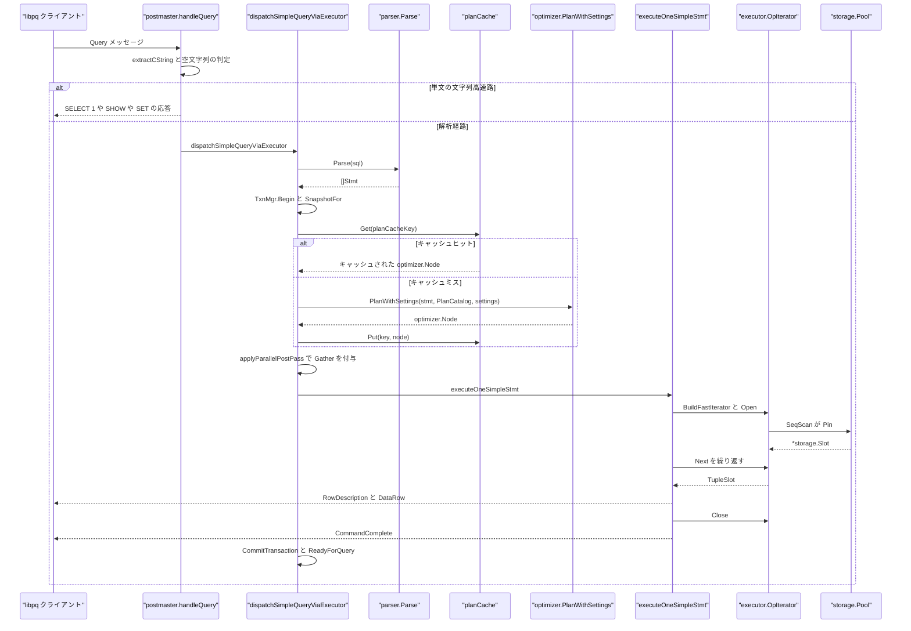
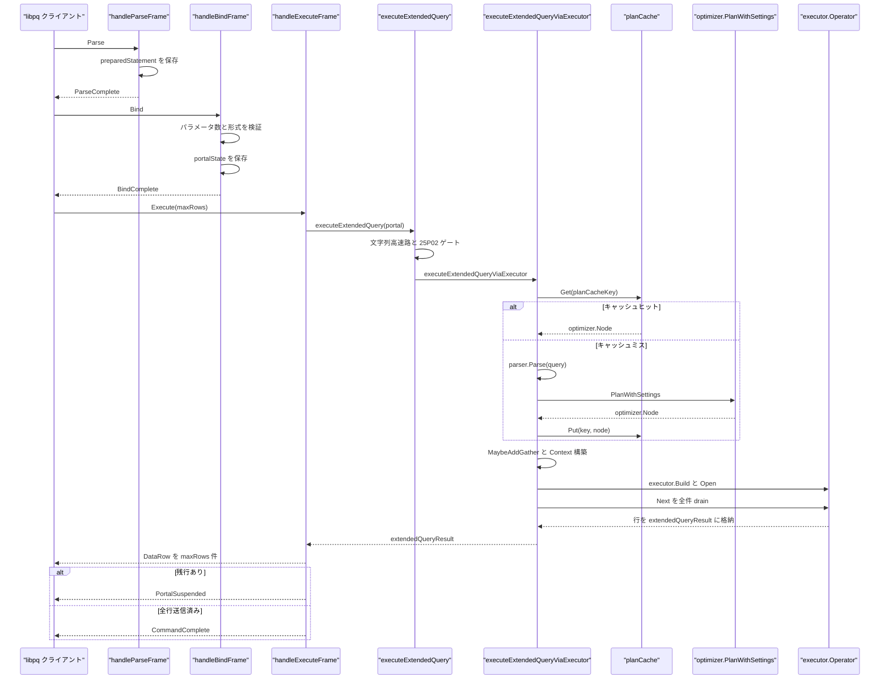

# クエリ実行パイプライン

<details>
<summary>関連ソースファイル</summary>

- [`internal/postmaster/query.go`](https://github.com/ryogrid/goopg/blob/19856410e8d497d59787e1ab35a2febb3f5953d6/internal/postmaster/query.go)
- [`internal/postmaster/dispatch.go`](https://github.com/ryogrid/goopg/blob/19856410e8d497d59787e1ab35a2febb3f5953d6/internal/postmaster/dispatch.go)
- [`internal/postmaster/dispatch_extended.go`](https://github.com/ryogrid/goopg/blob/19856410e8d497d59787e1ab35a2febb3f5953d6/internal/postmaster/dispatch_extended.go)
- [`internal/postmaster/plancache.go`](https://github.com/ryogrid/goopg/blob/19856410e8d497d59787e1ab35a2febb3f5953d6/internal/postmaster/plancache.go)
- [`internal/postmaster/extended.go`](https://github.com/ryogrid/goopg/blob/19856410e8d497d59787e1ab35a2febb3f5953d6/internal/postmaster/extended.go)
- [`internal/parser/parser.go`](https://github.com/ryogrid/goopg/blob/19856410e8d497d59787e1ab35a2febb3f5953d6/internal/parser/parser.go)
- [`internal/parser/ast.go`](https://github.com/ryogrid/goopg/blob/19856410e8d497d59787e1ab35a2febb3f5953d6/internal/parser/ast.go)
- [`internal/optimizer/planner.go`](https://github.com/ryogrid/goopg/blob/19856410e8d497d59787e1ab35a2febb3f5953d6/internal/optimizer/planner.go)
- [`internal/optimizer/plan.go`](https://github.com/ryogrid/goopg/blob/19856410e8d497d59787e1ab35a2febb3f5953d6/internal/optimizer/plan.go)
- [`internal/optimizer/parallel.go`](https://github.com/ryogrid/goopg/blob/19856410e8d497d59787e1ab35a2febb3f5953d6/internal/optimizer/parallel.go)
- [`internal/executor/context.go`](https://github.com/ryogrid/goopg/blob/19856410e8d497d59787e1ab35a2febb3f5953d6/internal/executor/context.go)
- [`internal/executor/executor.go`](https://github.com/ryogrid/goopg/blob/19856410e8d497d59787e1ab35a2febb3f5953d6/internal/executor/executor.go)
- [`internal/executor/opnode.go`](https://github.com/ryogrid/goopg/blob/19856410e8d497d59787e1ab35a2febb3f5953d6/internal/executor/opnode.go)
- [`internal/executor/operator.go`](https://github.com/ryogrid/goopg/blob/19856410e8d497d59787e1ab35a2febb3f5953d6/internal/executor/operator.go)
- [`internal/executor/slot.go`](https://github.com/ryogrid/goopg/blob/19856410e8d497d59787e1ab35a2febb3f5953d6/internal/executor/slot.go)
- [`internal/executor/operators_storage.go`](https://github.com/ryogrid/goopg/blob/19856410e8d497d59787e1ab35a2febb3f5953d6/internal/executor/operators_storage.go)
- [`internal/storage/bufpool.go`](https://github.com/ryogrid/goopg/blob/19856410e8d497d59787e1ab35a2febb3f5953d6/internal/storage/bufpool.go)

</details>

クエリ実行パイプラインは、ワイヤ層が受け取った SQL 文字列を、**パース → 計画 → 演算子ツリーの構築 → 行の反復 → RowDescription / DataRow / CommandComplete** へ変換する。goopg には 2 本の経路がある。シンプルクエリは `handleQuery` の文字列マッチ高速路と `dispatchSimpleQueryViaExecutor` を通り、拡張クエリは `handleParseFrame` / `handleBindFrame` / `handleExecuteFrame` を経て `executeExtendedQueryViaExecutor` に到達する。計画はプロセス共有の `planCache` に置かれ、キャッシュには `PlanWithSettings` の出力をそのまま保存する。ただしキーにはプランナ GUC のフィンガープリントが入る。シンプル経路では実行直前の `applyParallelPostPass` が `optimizer.MaybeAddGather` / `optimizer.StripGather` にトランザクション分離レベルも渡して並列性を確定し、拡張経路も `MaybeAddGather` にセッションの並列 GUC とサイズを渡す。実行時は `executor.Context` がトランザクション・スナップショット・設定・メモリ文脈を運び、`OpIterator` が `opOpen` / `opNext` / `opClose` で `opTreeSlab` を駆動する。

## 責務

- **プロトコルごとに入口を分ける。** シンプルクエリは `handleQuery` が `SELECT 1`、`SHOW`、`RESET`、および単純な `SET` を文字列マッチで処理する。`SET TRANSACTION` / `SET CONSTRAINTS` / `SET TIME ZONE` などの複雑形、複数文、それ以外の SQL は `dispatchSimpleQueryViaExecutor` に渡す。拡張クエリは `handleParseFrame` / `handleBindFrame` / `handleExecuteFrame` が prepared statement と portal を管理し、実体は `executeExtendedQuery` が振り分ける (`internal/postmaster/query.go:handleQuery`, `internal/postmaster/extended.go`)。
- **SQL を AST に変換する。** `parser.Parse` は文境界で分割した `[]parser.Stmt` を返す。まず LALR の `routeBatch` を試し、担当外の文だけ従来の再帰下降 `parseStatement` に落とす。トークン列は `tokenSlicePool` から再利用する (`internal/parser/parser.go:Parse`, `parseBatch`)。
- **計画をキャッシュし、セッション差分だけ後置する。** `planCacheKey` は「名前空間 OID + プランナ・フィンガープリント + 正規化 SQL」でキーを作る。キャッシュには `PlanWithSettings` の出力をそのまま置き、`applyParallelPostPass` / `MaybeAddGather` / `StripGather` をキャッシュの後で適用する (`internal/postmaster/dispatch.go:planCacheKey`, `applyParallelPostPass`, `internal/postmaster/plancache.go`)。
- **計画木を実行可能な演算子木に変換する。** シンプルクエリは `executor.BuildFastIterator` → `BuildFast` で `opTreeSlab` を作り、`OpIterator` で駆動する。拡張クエリは `executor.Build` で従来の `Operator` インターフェース木を作る (`internal/executor/executor.go:Build`, `BuildFast`; `internal/executor/opnode.go:BuildFastIterator`)。
- **文ごとの実行状態を組み立てる。** `executor.NewContext` に `Pool` / `Catalog` / `PlanCatalog` / `TxnMgr` / `Tx` / `Snap` / `Session` / `Params` / `Mctx` を配線し、文末で `CloseSubPlans` と `ReleaseSpillFiles` を呼ぶ (`internal/postmaster/dispatch.go`, `internal/postmaster/dispatch_extended.go`, `internal/executor/context.go:Context`)。
- **行をストリームし、コマンドタグを付ける。** シンプル経路は `op.Next()` のたびに `appendTypedCellText` でテキスト化して DataRow を書き、最後に `commandTagFor` で `SELECT n` / `INSERT 0 n` / DDL タグを返す。拡張経路は全行を `extendedQueryResult` に物質化し、portal の `RowPos` で `maxRows` ずつ切り出す (`internal/postmaster/dispatch.go:executeOneSimpleStmt`, `internal/postmaster/dispatch_extended.go`, `internal/postmaster/extended.go:handleExecuteFrame`)。
- **キャッシュを無効化する。** DDL、`ANALYZE`、`VACUUM` はスキーマまたは統計を変えるため `planCache.Invalidate` を呼ぶ。`ON COMMIT DROP` のような文を伴わない変更は `Context.OnCommitDDL` 経由で同じ無効化に到達する (`internal/postmaster/dispatch.go:planCacheInvalidatingStmt`, `internal/postmaster/plancache.go:Invalidate`)。
- **ストレージは 1 ブロックずつ pin する。** スキャン演算子は `ctx.Pool.Pin(BufferTag{Rel, Block})` でページを固定し、ブロックを進めるたびに `Unpin` する。pin 中は追い出しが起きないため、`Slot` のページを安全に読める (`internal/executor/operators_storage.go:seqScanOp.Next`, `internal/storage/bufpool.go:Pin`)。

## 処理フロー

### シンプルクエリ: 文字列高速路から行ストリームまで

`handleQuery` はまず空文字列を `EmptyQueryResponse` にし、セミコロンを 1 つでも含む入力（末尾のものを除く）を解析経路へ送る。単文でも `SELECT 1` や `SHOW` / `SET` / `RESET` はパーサもプランナも通らない。それ以外は `dispatchSimpleQueryViaExecutor` が `parser.Parse` から始め、1 メッセージ内の複数文を 1 トランザクションで順に実行する。



`dispatchSimpleQueryViaExecutor` は 1 メッセージにつき 1 つのトランザクションを開始する。明示的な `BEGIN` がすでに開いていれば `connTx.Tx()` を再利用し、自動コミットなら `TxnMgr.Begin(IsolationReadCommitted, procNum)` と `SnapshotFor` を行う。エラーが起きた文以降は実行せず、`ReadyForQuery` はメッセージ全体で 1 回だけ送る。`executeOneSimpleStmt` は `node.Output()` が非 nil のときだけ RowDescription を書き、DML / DDL / トランザクション文はコマンドタグだけを返す。

### 拡張クエリ: Parse / Bind / Execute と portal

拡張プロトコルでは、`Parse` は SQL を **解析しない**。`handleParseFrame` は prepared statement 名・クエリ文字列・推定パラメータ数を `preparedStatement` に保存するだけである。`Bind` がパラメータ数・形式を検証して `portalState` を作り、`Execute` が初めてポータルを実行する。



`executeExtendedQueryViaExecutor` は **パースより先に** プランキャッシュを引く。ヒットした場合は `parser.Parse` を完全に省略できる。ミス時だけ `parser.Parse` → `PlanWithSettings` → `planCache.Put` を行う。`Describe` も `describeViaPlanner` で同じキャッシュキーを使うため、Describe と Execute が同じプランを見る。Execute は結果を `extendedQueryResult.Rows` に全件物質化する。`maxRows > 0` で残行があれば `PortalSuspended` を返し、次の Execute が `portal.RowPos` から続きを送る。

## 主要ファイル

| ファイル | 役割 |
|---|---|
| `internal/postmaster/query.go:handleQuery` | シンプルクエリの入口。`handleQuery` が文字列高速路を処理し、解析経路へ振り分ける |
| `internal/postmaster/dispatch.go:dispatchSimpleQueryViaExecutor` | シンプルクエリの解析・計画・実行。`dispatchSimpleQueryViaExecutor` / `executeOneSimpleStmt` / `planCacheKey` / `applyParallelPostPass` |
| `internal/postmaster/dispatch_extended.go:executeExtendedQueryViaExecutor` | 拡張クエリの実行。`executeExtendedQueryViaExecutor` / `paramsToDatums` |
| `internal/postmaster/extended.go:handleExecuteFrame` | 拡張メッセージ処理。`handleParseFrame` / `handleBindFrame` / `handleDescribeFrame` / `handleExecuteFrame`、`portalState` / `extendedQueryResult` |
| `internal/postmaster/plancache.go:planCache` | プロセス共有の `planCache`。16 シャード・512 エントリ・FIFO・doorkeeper 付き |
| `internal/parser/parser.go:Parse` | `Parse` / `ParseExpr`。LALR の `routeBatch` と再帰下降の `parseStatement` |
| `internal/parser/ast.go:Stmt` | `Node` / `Stmt` と文・式の AST |
| `internal/optimizer/planner.go:PlanWithSettings` | `Plan` / `PlanWithSettings` / `PlanSchemaOnly` / `PlanError` |
| `internal/optimizer/plan.go:Node` | `Node` / `Schema` / `SchemaColumn` / `Expr` の計画契約 |
| `internal/optimizer/parallel.go:MaybeAddGather` | `MaybeAddGather` / `StripGather` / `ParallelSettings` |
| `internal/executor/context.go:Context` | 文単位の `Context`。ストレージ・トランザクション・設定・サブプラン状態を運ぶ |
| `internal/executor/executor.go:BuildFast` | `Build` / `BuildWorker` / `BuildFast` / `Run` / `RunFast` とオペレータ構築 |
| `internal/executor/opnode.go:OpIterator` | `OpKind` / `OpNode` / `opTreeSlab` / `OpIterator` / `opOpen` / `opNext` / `opClose` |
| `internal/executor/operator.go:Operator` | `Operator` インターフェースと `EOF` / `ErrSelfTerminate` |
| `internal/executor/slot.go:TupleSlot` | `TupleSlot` / `SlotView` / `MaterializedSlot` の行受け渡し契約 |
| `internal/executor/operators_storage.go:seqScanOp.Next` | `seqScanOp.Next` など、スキャン時の `Pool.Pin` / `Unpin` |
| `internal/storage/bufpool.go:Pin` | `Pool.Pin` / `Unpin` と `Slot` のパック状態ワード |

## 公開 API / エントリポイント

- `func parser.Parse(input string, mc ...*mmgr.Context) ([]Stmt, error)` — SQL バッチを文単位に分割して AST を返す。空入力は空スライス。`mc` は互換性のための no-op。
- `func parser.ParseExpr(input string, mc ...*mmgr.Context) (Expr, error)` — 単一の式を AST にする。PL/pgSQL の本体パーサが使う。
- `func optimizer.Plan(stmt parser.Stmt, cat catalog.Catalog) (Node, error)` — 既定設定で計画する。
- `func optimizer.PlanWithSettings(stmt parser.Stmt, cat catalog.Catalog, plannerSet PlannerSettings) (Node, error)` — セッション GUC を反映した計画。内部で `planWithRtableSize` を呼ぶ。
- `func optimizer.PlanSchemaOnly(s *parser.SelectStmt, cat catalog.Catalog) (Node, error)` — 実行しない SELECT のスキーマだけを得る。22xxx の定数畳み込みエラーはスキーマが有効なら握りつぶす。
- `func optimizer.MaybeAddGather(root Node, s ParallelSettings) Node` — 計画木に Gather を後付けする。並列不可の条件では `StripGather` し、既存の Gather があれば再決定しない。キャッシュされたノードは変更しない。
- `func executor.Build(plan optimizer.Node) (Operator, error)` — 従来の `Operator` インターフェース木を作る。
- `func executor.BuildFast(plan optimizer.Node) (*opTreeSlab, int32, error)` — `OpNode` のスラブと根インデックスを作る。
- `func executor.BuildFastIterator(plan optimizer.Node) (*OpIterator, error)` — スラブを `Operator` として包む。シンプル経路が使う。
- `func executor.Run(op Operator, ctx *Context) ([]Row, error)` / `func executor.RunFast(tree *opTreeSlab, rootIdx int32, ctx *Context) ([]Row, error)` — 全行を読み切る便宜関数。本番のワイヤ経路は `Open` / `Next` / `Close` を直接使う。
- `func (s *Server) dispatchSimpleQueryViaExecutor(ctx context.Context, r *libpq.FrameReader, w *libpq.FrameWriter, sess *misc.SessionRegistry, sql string, connTx *connTxState, prepStmts *preparedStatements) error` — シンプルクエリの解析・計画・実行。
- `func (s *Server) executeOneSimpleStmt(w *libpq.FrameWriter, ctx *executor.Context, stmt parser.Stmt, connTx *connTxState, autoCommitPtr *bool, cachedNode ...optimizer.Node) error` — 1 文を計画（またはキャッシュ利用）して実行し、ワイヤフレームを書く。
- `func (s *Server) executeExtendedQueryViaExecutor(ctx context.Context, sess *misc.SessionRegistry, query string, params []boundParam, procNum int32, dbName string, connTx *connTxState) (*extendedQueryResult, *extendedQueryError)` — 拡張クエリの実行本体。
- `func (s *Server) handleExecuteFrame(ctx context.Context, state *extendedState, payload []byte, w *libpq.FrameWriter, sess *misc.SessionRegistry, connTx *connTxState) (*extendedMessageError, error)` — Execute メッセージの入口。portal のバッチ送出を担う。
- `func (pc *planCache) Get(key string) (optimizer.Node, bool)` / `Put(key string, node optimizer.Node)` / `Invalidate()` — 共有プランキャッシュの読み書きと全消去。
- `func (p *Pool) Pin(tag BufferTag) (*Slot, error)` / `func (p *Pool) Unpin(s *Slot)` — 実行中のページ固定と解放。

## 主要データ構造

### `optimizer.Node` / `Schema` / `SchemaColumn` — 計画木の契約

`internal/optimizer/plan.go:Node`（16 行）:

```go
// Node is implemented by every plan-tree node. Pos is the byte offset
// of the originating SQL token; Output is the row schema this node
// emits to its parent.
type Node interface {
	Pos() int
	Output() Schema
}

// Schema is the ordered set of columns a plan node produces. Each
// column has an output name and a typed source.
type Schema []SchemaColumn

// SchemaColumn is one entry in a plan node's output schema.
//
// SourceTableIdx (M0071-0009) identifies which FROM-clause range
// binding produced this column. The binder assigns 1..N (one per
// base-table FROM-binding within a single planning scope) when
// the column originates from a base-table scan. Zero (the Go
// zero-value) means "unknown / derived" — used for Project
// targets that aren't pure ColumnRef pass-throughs, aggregate
// outputs, computed expressions, and subquery-derived columns.
// Used by `findColumnIndexByNameAndSource` and `predRebind` to
// disambiguate self-joins (e.g. Q21's three lineitem aliases
// l1/l2/l3 sharing `l_suppkey`) when MHJ OID-sorts the schema
// and Name-only disambiguation fails.
type SchemaColumn struct {
	Name           string
	Type           catalog.Type
	SourceTableIdx int16
	// Resjunk marks a column that rides the row for an enclosing operator's
	// use but is not part of the user-visible output — PostgreSQL's resjunk
	// targetlist mark. Today only the rowmark ctid columns injected by
	// wireRowMarkCtidColumns carry it; LockRows strips resjunk positions from
	// its output and whole-row dedup (distinctOp) excludes them from the
	// dedup key. M0143-0009.
	Resjunk bool
}
```

- `Output()` は「このノードが親に渡す列」を返す。`executeOneSimpleStmt` は `node.Output()` が非 nil かで読み取り系と書き込み系を分け、ゼロ列の `SELECT` でも非 nil の空スキーマなら DataRow を 1 行出す。
- `SchemaColumn.Type` は `libpq.FieldDescription.TypeOID` に変換され、`IsArray` のときは `catalog.ArrayOIDForBase` で配列 OID に差し替えられる。
- `SourceTableIdx` は 1..N が実テーブル由来、0 が式・集約・サブクエリ由来。`Resjunk` は行に載るがユーザー可視でない列で、`LockRows` と重複排除が除外する。
- 計画木は `planCache` に共有されるため、実行時に破壊してはいけない。`MaybeAddGather` が「キャッシュ済みの子を共有する新しい根」を返すのはこの不変条件による。

### `parser.Node` / `parser.Stmt` — パーサの出力契約

`internal/parser/ast.go:Stmt`（5 行）:

```go
// Node is implemented by every AST node. Pos returns the byte offset
// of the node's first token, used by error messages.
type Node interface {
	Pos() int
}

// Stmt is implemented by every top-level SQL statement.
type Stmt interface {
	Node
	stmtNode()
}
```

- `Pos()` は先頭トークンのバイト位置。`SyntaxError.Pos` と `PlanError.Pos` に引き継がれ、ワイヤの `FieldPosition` になる。
- `Stmt` は `stmtNode()` で封じられたインターフェースであり、外部パッケージが新しい文型を実装することはできない。`Parse` の戻り値はこの `Stmt` のスライスで、`dispatchSimpleQueryViaExecutor` の `for i, stmt := range stmts` が 1 文ずつ処理する。

### `executor.Operator` — 行反復の契約

`internal/executor/operator.go:Operator`（23 行）:

```go
// Operator is the iterator interface every executor node implements.
//
// Lifecycle:
//
//	Open(ctx) -> Next ... Next -> EOF -> Close
//
// Open prepares any per-statement state (pinning resources,
// pre-computing constant subexpressions). Next advances by one row
// and returns either (row, nil) or (nil, EOF) at end of stream. Close
// releases resources; Close MUST be called even after Next returned
// an error.
type Operator interface {
	Open(ctx *Context) error
	Next() (TupleSlot, error)
	Close() error
	Schema() optimizer.Schema
}
```

- `Open` はページ pin やハッシュテーブルの build など文単位の準備を行う。`Next` は `TupleSlot` を 1 つ返し、終端は `EOF`（`operator.go:EOF`）。
- `Close` は `Next` がエラーを返した後でも必ず呼ぶ。`executeOneSimpleStmt` は `Next` のエラー経路でも `op.Close()` を呼んでから ErrorResponse を書く。
- DML は `RowCounter` を実装し、`RowsAffected()` が `INSERT 0 n` / `UPDATE n` / `DELETE n` の数値になる。

### `OpKind` / `opTreeSlab` / `OpNode` — スラブ実行エンジン

`internal/executor/opnode.go:OpKind`（215 行）:

```go
type OpKind uint8
```

`internal/executor/opnode.go:OpKind`（217 行）:

```go
const (
	OpInvalid OpKind = iota

	// Migrated operators (concrete dispatch, no interface per Next call).
	OpSeqScan
	OpFilter
	OpProject
	OpLimit

	// Phase C.1 follow-up: DML operators (no Operator child — they drive
	// storage directly via extractScan).
	OpUpdate
	OpDelete

	// Phase C.1 follow-up: Sort (uses opNodeOperator bridge for child so
	// the child subtree runs on concrete dispatch while sortOp itself is
	// unchanged).
	OpSort

	// Phase C.1 follow-up: Insert (opNodeOperator bridge for the VALUES
	// child; ON CONFLICT path still uses OpAdapter).
	OpInsert

	// Phase C.1 follow-up: Join (opNodeOperator bridges for left/right
	// children; the joinOp itself is unchanged).
	OpJoin

	// M0128-P2.3: Bitmap scan operators.
	// BitmapIndexScan produces a TIDBitmap; BitmapHeapScan consumes it.
	// BitmapAnd/BitmapOr combine multiple bitmap subtrees.
	OpBitmapIndexScan
	OpBitmapHeapScan
	OpBitmapAnd
	OpBitmapOr

	// Adapter — wraps a legacy Operator interface.
	// All unmigrated operators use this until they are individually
	// promoted to a concrete kind.
	OpAdapter
)
```

`internal/executor/opnode.go:opTreeSlab`（269 行）:

```go
// opTreeSlab is the backing store for an OpNode tree. All nodes are
// appended during BuildFast; the slab is immutable after BuildFast returns.
// opNodeOperator and OpIterator hold a *opTreeSlab pointer so they always
// see the final slice, even if append relocated the backing array during build.
type opTreeSlab struct {
	ops     []OpNode
	exprs   exprTreeSlab     // expression-tree slab (Phase C.3); immutable after BuildFast
	plans   planTreeSlab     // plan-tree slab (Phase C.3); immutable after BuildFast
	schemas []optimizer.Schema // output-schema pool for OpProject nodes; indexed by schemaIdx
}
```

`internal/executor/opnode.go:OpNode`（292 行）:

```go
// OpNode is the central node type for the Phase C execution engine.
// Each query plan corresponds to a tree of OpNodes stored in an opTreeSlab.
// The tree is built by BuildFast (which populates the slab) and driven by
// RunFast. Children are encoded as int32 indices into the slab; noChild (-1)
// means "no child". This eliminates GC-scanned pointers in the hot tree.
type OpNode struct {
	Kind   OpKind
	childA int32 // index into ops slab; noChild (-1) if none
	childB int32 // index into ops slab; noChild (-1) if none
	state  any   // concrete per-Kind state struct (GC-safe)
}
```

- `OpKind` は Go のインターフェースディスパッチを避けるための判別子。`OpAdapter` だけが旧 `Operator` を包み、未移行の演算子を駆動する。
- 子は `int32` のスラブ添字で、`noChild = -1` が「子なし」。`BuildFast` 中に `append` で backing array が移動しても、`OpIterator` は `*opTreeSlab` を持つので最終スライスを見る。
- `opTreeSlab` は `BuildFast` の戻り値以降不変である。`opOpen` / `opNext` / `opClose` はこの不変性を前提に、毎回の `Next` でアロケーションせずに再帰する。
- `OpNode.state` は `any` だが、各 `OpKind` に対応する具体的な状態構造体（`filterState` / `projectState` / `limitState` / `joinOpState` など）だけが入る。型不一致は `opOpen` / `opNext` の `XX000` になる。

### `planCache` / `planCacheShard` — 共有プランキャッシュ

`internal/postmaster/plancache.go:planCache`（32 行）:

```go
const (
	planCacheNumShards   = 16
	planCacheMaxPerShard = 32 // 16 * 32 = 512 total entries

	// planCacheDoorkeeperSize is the admission filter's slot count (power of
	// two). See planCache.admit. Sized well above the 512 cache entries so a
	// genuinely repeated statement is unlikely to have its mark evicted by
	// one-shot traffic between two executions.
	planCacheDoorkeeperSize = 8192
	planCacheDoorkeeperMask = planCacheDoorkeeperSize - 1
)

// planCache is the server-level cross-session plan cache. M0098-0005.
type planCache struct {
	shards [planCacheNumShards]planCacheShard
	// doorkeeper is the admission filter (perf-optimize-take3/06 candidate H).
	// Lock-free: one atomic Swap per Put.
	doorkeeper [planCacheDoorkeeperSize]atomic.Uint64
}

type planCacheShard struct {
	mu      sync.RWMutex
	entries map[string]optimizer.Node
	// order tracks insertion order for simple FIFO eviction.
	order []string
}
```

- `shards` は 16 個。`shardIndex` は FNV-1a/32 でキーを均し、各シャードは `sync.RWMutex` で守る。`Get` は read ロック、`Put` は write ロック。
- 各シャードは最大 32 エントリ、全体で 512。`order` は挿入順で、あふれたら**最古**を消す FIFO であり LRU ではない。既存キーの `Put` は `order` を伸ばさず、値だけ差し替える。
- `doorkeeper` は 8192 スロットの `atomic.Uint64` 配列。`admit` は `hashKey64` の値を `Swap` し、**2 回目の観測**で初めて `Put` を許可する。1 回限りの SQL（リテラルを埋め込んだ pgbench のシンプルクエリなど）が write ロックを取らないためのフィルタである。
- `Invalidate` は全シャードの `entries` を `clear` し `order` を切り詰める。doorkeeper のマークは消さない（「この SQL は以前見た」は DDL 後も真であるため）。

### `extendedQueryResult` — 拡張プロトコルの物質化結果

`internal/postmaster/extended.go:extendedQueryResult`（53 行）:

```go
type extendedQueryResult struct {
	Fields     []libpq.FieldDescription
	Rows       [][][]byte
	CommandTag string
	Empty      bool
	Notice     string // NoticeResponse text to emit before CommandComplete; "" = none
	// WarnFields is a fully-formed NoticeResponse field set to emit before
	// CommandComplete — the shape PG's "there is no transaction in progress"
	// WARNING needs (severity WARNING + SQLSTATE 25P01), which the plain
	// Notice string above cannot express. M0132-S2.
	WarnFields []libpq.ErrorField
	// NoticeFrames are the executor's queued NOTICE/WARNING messages
	// (executorNoticeFrames), emitted before CommandComplete as the
	// simple-query path does. Before they were carried here, every
	// operator-raised NOTICE or WARNING was dropped on the extended protocol.
	NoticeFrames [][]libpq.ErrorField
}
```

- `Rows` はすでにテキスト化されたセル列の配列。`executeExtendedQueryViaExecutor` が `appendTypedCellText` で全行を作るため、Execute のたびに演算子木を再実行しない。
- `Empty` は空クエリ（`EmptyQueryResponse`）、`Rows` が空で `Empty=false` ならコマンドタグのみ（DML / DDL）を返す。両者は別状態である。
- `Fields` は `node.Output()` から作られるが、現行の `handleExecuteFrame` は `Fields` を参照しない。RowDescription は `Describe` の `describeViaPlanner` / `handleDescribeFrame` が返す。
- `Notice` / `WarnFields` / `NoticeFrames` は CommandComplete より前に送出される。`NoticeFrames` は executor が `Context` に積んだ NOTICE/WARNING で、シンプル経路と共通の `executorNoticeFrames` から取り出す。

### `executor.Slot` — 行の再利用バッファ

`internal/executor/opnode.go:Slot`（64 行）:

```go
// HasRow distinguishes two zero-Cells cases:
//   - HasRow=false, Cells=[] → DML nil-row (INSERT/UPDATE/DELETE produced
//     no result row; pass through to sink without evaluating projections).
//   - HasRow=true, Cells=[] → valid row with no columns (e.g. the
//     input row for SELECT 1, which comes from a zero-column Values node).
//
// Operators that receive a DML nil-row must propagate it as-is.
// Operators like projectOp must evaluate targets even when Cells is empty
// (the target expressions may be constants that don't reference input).
type Slot struct {
	schema optimizer.Schema
	Cells  []Datum
	HasRow bool // false == DML nil-row; true == real row (may have 0 cols)
	// M0097-0062: ctid system column forwarded from MaterializedSlot.
	// Set by fillFromTupleSlot when the incoming TupleSlot is a
	// *MaterializedSlot that carries ctid info (seqScanOp path).
	hasCTID   bool
	ctidBlock uint32
	ctidOff   uint16
}
```

- `OpIterator` は 1 つの `dst Slot` を使い回す。`Next` の冒頭で `dst.Reset()` し、`opNext` が `Cells` を埋める。呼び出し側が行を保持するには `Materialize()` / `CopyTo` が必要。
- `HasRow=false` は「DML が結果行を出さない」、`HasRow=true` かつ `Cells` が空は「ゼロ列の正当な行」を意味する。`executeOneSimpleStmt` は前者をスキップし、後者では空の DataRow を書く。
- `hasCTID` / `ctidBlock` / `ctidOff` は `WHERE CURRENT OF` のために `MaterializedSlot` から転送される自己 TID。`TID()` がこの 3 つを返す。

### `storage.Slot` — バッファプールの固定単位

`internal/storage/bufpool.go:slotPinMask`（26 行）:

```go
const (
	slotPinMask    = uint64((1 << 22) - 1) // bits 0..21
	slotUsageShift = 22
	slotUsageMask  = uint64(((1 << 8) - 1) << slotUsageShift)
	slotDirtyBit   = uint64(1 << 30)
	slotValidBit   = uint64(1 << 31)
	slotIOBit      = uint64(1 << 32)
	slotGenShift   = 33
	slotGenMask    = uint64(((1 << 15) - 1) << slotGenShift)
	maxUsageCount  = 5
	maxPinCount    = (1 << 22) - 1
)
```

`internal/storage/bufpool.go:Slot`（51 行）:

```go
type Slot struct {
	page Page // alias into the arena

	// idx is this slot's fixed index into Pool.slots, set once in
	// NewPool. Lets MarkDirty* (which only receive a *Slot) address
	// Pool.slotEvents without pointer arithmetic. See DebugTraceSlotEvents.
	idx int32

	// Tag identifies the (rel, fork, block) the slot currently holds.
	// Written only while ioInflight is set in state; readable once valid.
	tag BufferTag

	// state packs pinCount, usageCount, dirty, valid, ioInflight, gen
	// into a single 64-bit atomic word for lock-free Pin/Unpin.
	state atomic.Uint64

	// nativeImageLSN is the end-LSN of the last NATIVE full-page image
	// (RecordKindPageImage via logFPI, or the multi-page-image records the
	// MarkDirtyWithLSN* callers log) emitted for the page occupying this
	// slot; 0 on load/reuse. The FPI decision keys on THIS token — not on
	// pd_lsn — because pd_lsn is stamped by BOTH record families: a
	// canonical record's stamp would otherwise satisfy the test and
	// suppress the native image the native-family replay depends on (the
	// cross-family poisoning class rejected as F1 in the C1 design review;
	// rediscovered as a live S2 regression by the S3a crash-sim tests).
	// Slot-keyed: eviction/reload re-arms conservatively (extra image).
	nativeImageLSN atomic.Uint64

	// contentMu guards the Page bytes for read/write. The pool does
	// not hold any global lock while this is taken.
	contentMu sync.RWMutex
}
```

- `state` の pin 数は 22bit（最大 `maxPinCount`）。0 でなければ追い出し対象にならない。`valid` が立つまで `page` は読めず、`ioInflight` 中は `tag` が書き換え中である。
- `contentMu` はページ内容の読み書きを守る。`seqScanOp.Next` は pin を保持したまま、タプルを 1 つ取り出すたびに `RLock` / `RUnlock` し、親演算子がブロックしても同じページの書き込みを妨げない。
- `nativeImageLSN` はフルページイメージの再送を抑えるためのスロット単位の透かし。追い出し時に `Pool.evictedImageLSN` へ退避され、再ロード時に戻る。

### `executor.Context` — 文単位の実行状態

`internal/executor/context.go:Context`（27 行）は 1,100 行を超える大きな構造体で、約 130 フィールドを持つ。パイプラインが依存する主要グループは次のとおりである。

| グループ | 代表フィールド | 役割 |
|---|---|---|
| 実行制御 | `Ctx` / `Params` / `Now` / `MaxRows` / `RoutineDepth` / `Mctx` / `CmdID` | キャンセル、`$1..$n`、文開始時刻、文メモリ文脈、コマンドカウンタ |
| ストレージとトランザクション | `Pool` / `Catalog` / `PlanCatalog` / `TxnMgr` / `Tx` / `Snap` / `MultiXact` / `WAL` | ページ固定、名前解決、スナップショット、WAL |
| セッション | `Session` / `AdvisorySessionIdentity` / `GetSetting` / `SetSetting` / `CurrentDatabase` / `CurrentDatabaseOid` | 明示トランザクション、GUC、現在の DB |
| 相関とサブプラン | `OuterRows` / `ParamExec` / `ParamSet` / `ParamDirty` / `SubPlanHandles` / `CorrSubqHashMaps` | 相関サブクエリの外側行と PARAM_EXEC スロット |
| 並列実行 | `MaxParallelWorkersPerGather` / `MaxParallelWorkers` / `SharedHashBuilds` / `ParallelHashBuilds` / `PartialAggStates` | Gather の fan-out と共有 build |
| 観測 | `Activity` / `StatsTarget` / `WorkMem` / `Notices` / `Warnings` | pg_stat_activity、ANALYZE サンプル、EXPLAIN、NOTICE |
| ライフサイクル | `OnCommitDDL` | COMMIT 時のキャッシュ無効化フック |

- `Context` は **1 文専用** である。`dispatchSimpleQueryViaExecutor` は文バッチの先頭で 1 つ作り、`executor.NewContext()` の後に配線する。`NewWorkerContext` が並列 worker 用に別インスタンスを作るのも、この「1 文 1 Context」を守るためである。
- `CloseSubPlans()` と `ReleaseSpillFiles()` は `Context` の終了メソッドで、文の最後に呼ばれる。前者はサブプランの演算子木を閉じ、後者は `<DataDir>/base/pgsql_tmp` に残った spill ファイルを解放する。
- `Tx` と `Snap` は文の実行中に不変ではない。`BEGIN` / `COMMIT` のトランザクション文が `applyTransactionVerb` を通じて差し替え、`PLpgSQLCommitChain` も同様に `Tx` / `Snap` を更新する。
- `PlanCatalog` は `search_path` を反映したラッパーで、`Catalog` と区別される。計画時は `ctxPlanCatalog` が、実行時のカタログ参照は `Catalog` が使われる。

## 内部構造

### プランキャッシュの 2 段構え

キャッシュの読み書きと並列化の順序は、シンプル経路でも拡張経路でも同じである。

1. `planCacheKey(sql, connDBOid, sessionPlannerFingerprint(sess))` を作る。キーは `catalog.NamespaceDBOid(connDBOid)`、`\x00`、フィンガープリント、`\x00`、`normalizeCompatSQL(sql)` の連結。
2. `Get` がヒットすれば `optimizer.Node` をそのまま使う。ミスなら `PlanWithSettings` で計画し、`planCacheIsCacheable(node)` が真なら `Put` する。`DDL` / `Transaction` / `Copy` はキャッシュしない。
3. **その後で** `applyParallelPostPass` / `MaybeAddGather` を適用する。キャッシュには `PlanWithSettings` の出力が入り、パスモデルが選んだ Gather を含みうる。キーに並列関連の GUC も含まれるためセッション間の漏れは防がれるが、分離レベルや文の形はキーにできない。シンプル経路の `applyParallelPostPass` は `IsSerializable` も `ParallelSettings` に渡して `StripGather` を選ばせ、拡張経路は `dispatch_extended.go` の `MaybeAddGather` 呼び出しで並列 GUC とサイズだけを渡す。
4. `executeOneSimpleStmt` は `*optimizer.DDL`、または `*optimizer.Utility` の `AnalyzeStmt` / `VacuumStmt` を実行した後に `planCache.Invalidate()` を呼ぶ。

`normalizeCompatSQL` はコメントを空白に畳み、末尾のセミコロンを落とした後、文字列リテラルと二重引用符識別子の中を保存したまま、外側だけ小文字化・空白圧縮する。`INSERT ('A')` と `INSERT ('a')`、`"Foo"` と `"foo"` は別キーになる。これは PostgreSQL の字句解析（引用識別子は大小を保つ）に合わせた、誤ヒット防止のための区別である (`internal/postmaster/dispatch.go:normalizeSQLPreservingLiterals`)。

`planCache.admit` は 2 回目の `Put` まで書き込みを遅らせる。1 回目の `Swap` は「見た」マークを置くだけで、2 回目に同じハッシュが返れば `true` になる。ハッシュ衝突で早く admitted になっても、そのプランは正しいので害はない。逆にマークが衝突で消えても、失うのは 1 回分のキャッシュヒットだけである。

### 2 つの実行木構築経路

シンプル経路と拡張経路は、計画まではほぼ同じだが、実行木の作り方が異なる。

- シンプル経路: `executor.BuildFastIterator(node)` → `BuildFast` → `buildRec` が `opTreeSlab` に `OpNode` を追加 → `OpIterator.Open` が `opOpen` を再帰呼び出し。以後の `Next` は `opNext` の switch で `OpKind` ごとのカーネルを直接呼ぶ。`OpAdapter` のノードだけが旧 `Operator.Next` に落ちる。
- 拡張経路: `executor.Build(node)` → `buildNode` が `Operator` インターフェース木を作る。`Open` / `Next` / `Close` は各演算子のメソッド呼び出しになる。結果は `extendedQueryResult.Rows` に全件コピーされる。

この差は意図的である。シンプル経路は行を直接ワイヤへ流せるため、`Slot` の使い回しと `OpNode` の直接ディスパッチが効く。拡張経路は portal の `maxRows` で後から分割できるよう、先に全行を物質化する必要がある。

`OpIterator.Open` は `computeIndexReadSets(it.plan)` を初回だけ計算し、`ctx.indexReadSets` を差し替える。`Close` で元に戻すので、入れ子の文が外側の read set を壊さない。`Next` は `stmtAfterTriggers` を swap in/out し、AFTER トリガのキューを文スコープに閉じ込める。

### 実行時のバッファプール接続

`seqScanOp.Next` はブロックを進めるたびに、通常のバッファプール経路（ring 戦略が未設定の場合）で次の 1 ページを pin する。

1. `ctx.Pool.Pin(storage.BufferTag{Rel: rel, Block: o.curBlock})` を呼ぶ。ヒット時は `bufmap.Lookup` と `Slot.state` の CAS だけで pin を取り、ミス時は `pinSlow` が `pinMu` の下で victim を選び、必要なら dirty page を flush してから `ReadBlock` する。
2. 返った `*storage.Slot` を `o.pinned` に保持し、`o.activePage` をページ本体とする。pin がある限り、そのスロットは追い出されない。
3. タプルを 1 つ取り出すたびに `o.pinned.RLock()` / `RUnlock()` し、行を `Slot` に写す。親演算子が `pg_advisory_lock` などでブロックしても、ページの書き込みロックを長時間握らない。
4. ブロックを進めるとき、または `Close` 時に `Unpin` する。`Pin` の pin 数が 0 に戻ると、clock-sweep の victim 候補になる。

したがって、`executeOneSimpleStmt` の `for { slot, err := op.Next() ... }` は、1 回の `Next` の間にページ pin と行のコピーが完結する形になっている。`slot.Row()` を保持して次の `Next` を呼ぶと、`Slot` の `Cells` が上書きされうるため、保持する側が `Materialize()` する責任を持つ。

## エッジケースと不変条件

- **空クエリ**: `handleQuery` は `strings.TrimSpace(q)==""` で `EmptyQueryResponse` を返し、`ReadyForQuery` で終える。拡張経路では `extendedQueryResult{Empty:true}` が `handleExecuteFrame` で `WriteEmptyQueryResponse` になる。
- **複数文のシンプルクエリ**: `parser.Parse` が `[]Stmt` を返し、`dispatchSimpleQueryViaExecutor` は 1 メッセージを 1 トランザクションで実行する。途中の文がエラーになると以降の文は実行せず、`ReadyForQuery` は 1 回だけ。明示トランザクション内なら 25P02 が後続文を拒否する。
- **25P02 ゲート**: `handleQuery` の文字列高速路よりも前に、`connTx.IsFailed()` なら `COMMIT` / `ROLLBACK` / `ROLLBACK TO SAVEPOINT` / 2PC 以外を 25P02 で拒否する。パースエラーとプランエラーも明示トランザクションを failed にする。
- **キャッシュのバイパス条件**: シンプル経路は複数文、`NOTIFY`、2PC、`WHERE CURRENT OF`、一時テーブル継承の変更中、パーティション detach 中、継承変更中、`EXPLAIN EXECUTE` の書き換え時にキャッシュを使わない。拡張経路も一時継承・detach・継承変更中は `Get` をスキップする。
- **キャッシュ無効化の非対称性**: シンプル経路は `planCacheInvalidatingStmt` で `DDL` に加えて `ANALYZE` / `VACUUM` も invalidate する。拡張経路の実行後チェックは `*optimizer.DDL` のみである。`ANALYZE` / `VACUUM` は `*optimizer.Utility` としてキャッシュされうるため、拡張プロトコル経由では統計変更後のキャッシュが残る可能性がある（ソース上の現状）。
- **並列 post-pass の入力差**: シンプル経路の `applyParallelPostPassFrom` は `IsSerializable` を `ParallelSettings` に渡すが、拡張経路の `MaybeAddGather` 呼び出しは並列 GUC・スキャンサイズ・leader 参加・デバッグだけを渡す。SERIALIZABLE の扱いを変えるときは両方の呼び出しを見る必要がある (`internal/postmaster/dispatch.go:applyParallelPostPassFrom`, `internal/postmaster/dispatch_extended.go:executeExtendedQueryViaExecutor`)。
- **パーサ外の DDL**: `CREATE` / `DROP` / `ALTER DATABASE` と `CREATE` / `DROP` / `ALTER ROLE` は `parser.Parse` の文法にないため、`dispatchSimpleQueryViaExecutor` は解析エラー後に `handleDatabaseDDLBypass` / `tryHandleRoleDDL` / `compatNoopCommandTag` を文字列前置で試す。拡張経路も `tryHandleDatabaseOrRoleDDLExtended` / `tryCompatNoopExtended` を持つ。これらの経路はパーサを通らないので、プランキャッシュの対象外である。
- **プランエラーの伝播**: `PlanWithSettings` のエラーは `PlanError` の `Code` / `Message` / `Hint` / `Detail` に分解され、`writeQueryError` が ErrorResponse の各フィールドにする。シンプル経路のキャッシュミス計画エラーは `connTx.Fail()` と `ReleasePinnedSnapshotOnFail` を呼んでから返る。
- **スキーマのみの計画**: `PlanSchemaOnly` は `CREATE MATERIALIZED VIEW ... WITH NO DATA` など実行しない SELECT のために計画する。SQLSTATE 22xxx（ゼロ除算など）の定数畳み込みエラーは、計画木が得られていれば握りつぶしてスキーマを返す。
- **ビューの循環**: `Plan` は `viewPlanDepth` を増やし、`maxViewPlanDepth = 64` を超えると循環エラーにする。Go のスタックを無限に伸ばしてプロセスを落とさないための上限である (`internal/optimizer/planner.go:maxViewPlanDepth`)。
- **拡張 Parse は解析しない**: `handleParseFrame` はクエリ文字列と `inferParamCount` の結果だけを保存する。実際の `parser.Parse` は Execute または Describe まで遅延される。したがって Parse 時の構文エラーは返らず、Execute 時に返る。
- **Bind の検証**: `handleBindFrame` はパラメータ数が `preparedStatement.ParamCount` と一致しない場合に protocol violation を返す。バイナリのパラメータ形式・結果形式は `FeatureNotSupported` で拒否し、テキスト形式だけを受け付ける。NULL は `boundParam{IsNull:true}` になる。
- **拡張は 1 文のみ**: `executeExtendedQueryViaExecutor` は `len(stmts) > 1` を `SyntaxError` にする。Simple Query のような複数文バッチは拡張プロトコルでは扱わない。
- **Execute の maxRows**: `handleExecuteFrame` は `maxRows > 0` かつ残行があるとき `toSend = maxRows` で切り、`portal.RowPos` を進めて `PortalSuspended` を返す。`maxRows == 0` は全行、`RowPos` が末尾に達したら `CommandComplete`。結果はすでに `extendedQueryResult.Rows` に物質化されている。
- **Describe の失敗は非致命**: `describeViaPlanner` はパース・計画に失敗すると `ok=false` を返し、`Describe` は NoData を返す。本当のエラーは後続の Execute で報告される。
- **ゼロ列と DML nil-row**: `executeOneSimpleStmt` は `schema != nil` を条件に DataRow を書く。`SELECT FROM t` は非 nil の空スキーマなので 1 行ごとに空 DataRow を書き、`INSERT` は `node.Output()==nil` なので行を書かない。`executor.Slot` の `HasRow` がこの 2 つを区別する。
- **プランキャッシュの容量**: 16 シャード × 32 エントリ = 512。各シャードは FIFO で、`order[0]` を消してから末尾に追加する。ヒット率より「1 回限りの SQL で write ロックを取らない」ことを優先した設計である。
- **バッファ pin の上限**: `maxPinCount = (1<<22)-1`。これを超えると `Pin` は `ErrNoBuffer`。`claimVictim` が `n * (maxUsageCount + 2)` 回プローブしても victim を見つけられない場合も `ErrNoBuffer` になる。
- **スキャンの pin 期間**: `seqScanOp` は 1 ブロックにつき 1 pin を保持し、ブロックを進めるたびに `Unpin` する。pin 中は `Slot` が追い出されないが、`Slot.Row()` の `Cells` は次の `Next` で再利用されるため、保持する呼び出し側は `Materialize()` しなければならない。
- **文脈の解放**: `executeOneSimpleStmt` は `defer ctx.ReleaseSpillFiles()` を持ち、`dispatchSimpleQueryViaExecutor` は `defer ectx.CloseSubPlans()` を持つ。拡張経路も同じ 2 つを `defer` する。エラーやキャンセルで `Close` に到達しなくても、文末で一時ファイルとサブプランハンドルが解放される。

## 関連ページ

- SQL 文法と AST の詳細は [4 SQL パーサー](../4-SQL-Parser.md)
- 計画木の選択とコスト計算は [5 クエリプランナー](../5-Query-Planner.md)
- 演算子の実装と式評価は [6 実行エンジン](../6-Executor.md)
- 接続ごとの goroutine と並列 worker は [2.1 プロセスと並行性モデル](2.1-Process-and-Concurrency.md)
- データディレクトリ初期化時の起動順は [2.3 データディレクトリの初期化](2.3-Data-Directory.md)
- 起動時のカタログ復旧は [2.4 起動時の復旧とカタログ再構築](2.4-Startup-Recovery.md)

Sources:
- `internal/postmaster/query.go`
- `internal/postmaster/dispatch.go`
- `internal/postmaster/dispatch_extended.go`
- `internal/postmaster/plancache.go`
- `internal/postmaster/extended.go`
- `internal/parser/parser.go`
- `internal/parser/ast.go`
- `internal/optimizer/planner.go`
- `internal/optimizer/plan.go`
- `internal/optimizer/parallel.go`
- `internal/executor/context.go`
- `internal/executor/executor.go`
- `internal/executor/opnode.go`
- `internal/executor/operator.go`
- `internal/executor/slot.go`
- `internal/executor/operators_storage.go`
- `internal/storage/bufpool.go`

<sub>Generated by deepwiki-4myself from `goopg` @ `19856410e`</sub>
