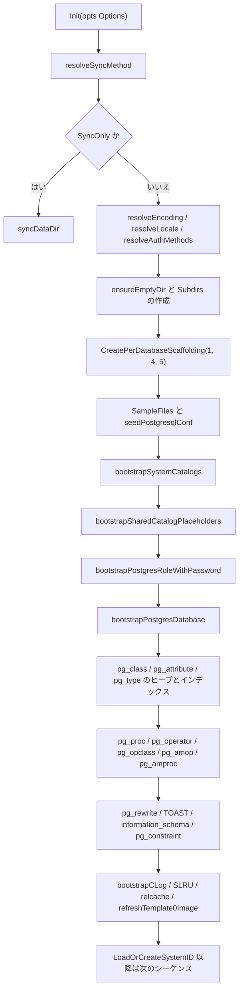
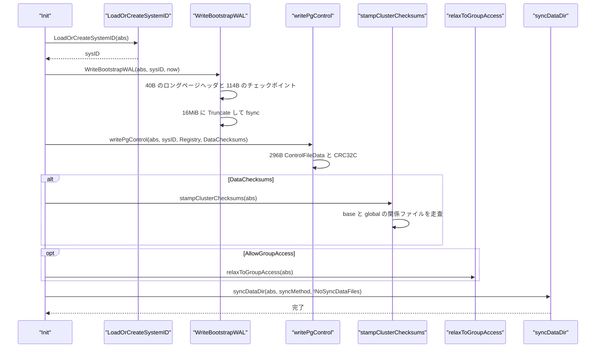

# データディレクトリの初期化

<details>
<summary>関連ソースファイル</summary>

- [`internal/initdb/initdb.go`](https://github.com/ryogrid/goopg/blob/19856410e8d497d59787e1ab35a2febb3f5953d6/internal/initdb/initdb.go)
- [`internal/initdb/auth_bootstrap.go`](https://github.com/ryogrid/goopg/blob/19856410e8d497d59787e1ab35a2febb3f5953d6/internal/initdb/auth_bootstrap.go)
- [`internal/initdb/btree_index_bootstrap.go`](https://github.com/ryogrid/goopg/blob/19856410e8d497d59787e1ab35a2febb3f5953d6/internal/initdb/btree_index_bootstrap.go)
- [`internal/initdb/catalog_seed.go`](https://github.com/ryogrid/goopg/blob/19856410e8d497d59787e1ab35a2febb3f5953d6/internal/initdb/catalog_seed.go)
- [`internal/initdb/checksum_bootstrap.go`](https://github.com/ryogrid/goopg/blob/19856410e8d497d59787e1ab35a2febb3f5953d6/internal/initdb/checksum_bootstrap.go)
- [`internal/initdb/config_seed.go`](https://github.com/ryogrid/goopg/blob/19856410e8d497d59787e1ab35a2febb3f5953d6/internal/initdb/config_seed.go)
- [`internal/initdb/encoding.go`](https://github.com/ryogrid/goopg/blob/19856410e8d497d59787e1ab35a2febb3f5953d6/internal/initdb/encoding.go)
- [`internal/initdb/locale.go`](https://github.com/ryogrid/goopg/blob/19856410e8d497d59787e1ab35a2febb3f5953d6/internal/initdb/locale.go)
- [`internal/initdb/pg_language_bootstrap.go`](https://github.com/ryogrid/goopg/blob/19856410e8d497d59787e1ab35a2febb3f5953d6/internal/initdb/pg_language_bootstrap.go)
- [`internal/initdb/pg_tablespace_bootstrap.go`](https://github.com/ryogrid/goopg/blob/19856410e8d497d59787e1ab35a2febb3f5953d6/internal/initdb/pg_tablespace_bootstrap.go)
- [`internal/initdb/pgcontrol.go`](https://github.com/ryogrid/goopg/blob/19856410e8d497d59787e1ab35a2febb3f5953d6/internal/initdb/pgcontrol.go)
- [`internal/initdb/relcache_init.go`](https://github.com/ryogrid/goopg/blob/19856410e8d497d59787e1ab35a2febb3f5953d6/internal/initdb/relcache_init.go)
- [`internal/initdb/system_view_oid_pins.go`](https://github.com/ryogrid/goopg/blob/19856410e8d497d59787e1ab35a2febb3f5953d6/internal/initdb/system_view_oid_pins.go)
- [`internal/initdb/timeline.go`](https://github.com/ryogrid/goopg/blob/19856410e8d497d59787e1ab35a2febb3f5953d6/internal/initdb/timeline.go)
- [`internal/initdb/wal_bootstrap.go`](https://github.com/ryogrid/goopg/blob/19856410e8d497d59787e1ab35a2febb3f5953d6/internal/initdb/wal_bootstrap.go)

</details>

`goopg init` は、空のディレクトリを PostgreSQL 互換のクラスタに変える。`initdb.Init` はオプションを**ファイルシステムに触る前**に検証し、`base/` `global/` `pg_wal/` `pg_xact/` などのディレクトリ、`PG_VERSION` と設定ファイル、システムカタログのヒープと btree インデックス、`pg_internal.init`、`pg_xact` の SLRU、初期 WAL セグメント、`pg_control` を順に書き出す。カタログは「まずヒープ行を書き、その TID を使って btree の IndexTuple を作る」という順序に強く依存し、最後に `template0` を完成した `postgres` のイメージで置き換える。このページでは、オプション検証から `pg_control` とチェックサムまで、`internal/initdb` の実際の順序と不変条件を追う。

## 責務

- **オプションを副作用なしで検証する。** `Init` は `resolveSyncMethod`、`resolveEncoding`、`resolveLocale`、`resolveAuthMethods`、WAL ディレクトリの絶対パス検査を `ensureEmptyDir` より前に行う。不正な encoding・locale・auth・sync method はディレクトリを 1 バイトも作らずに失敗する (`internal/initdb/initdb.go:Init`)。
- **PostgreSQL 互換のディレクトリツリーを作る。** `Subdirs` の `base` / `global` / `pg_wal` / `pg_xact` / `pg_subtrans` / `pg_multixact` / `pg_logical` / `pg_tblspc` などを `os.Mkdir` で作り、`-X/--waldir` 指定時は `pg_wal` を外部ディレクトリへのシンボリックリンクにする (`Subdirs`, `setupWALDir`)。
- **3 つのシステム DB の足場を作る。** `template1` (OID 1)、`template0` (OID 4)、`postgres` (OID 5) の `base/<oid>/` と `PG_VERSION` を `CreatePerDatabaseScaffolding` で用意する。後から `CREATE DATABASE` が `base/4` を複製できるようにするための雛形でもある。
- **設定ファイルと認証ファイルを書く。** `SampleFiles` が `PG_VERSION`、`postgresql.conf`、`postgresql.auto.conf`、`pg_hba.conf`、`pg_ident.conf`、`global/pg_filenode.map`、`global/pg_goopg_features` を決定的に生成する。`seedPostgresqlConf` は `lc_*`、`default_text_search_config`、`password_encryption`、`log_file_mode`、`-c/--set` の順で GUC を差し替える (`internal/initdb/config_seed.go:seedPostgresqlConf`)。
- **システムカタログのヒープとインデックスを二層で作る。** まず `bootstrapSystemCatalogs` が `pg_type` / `pg_class` / `pg_attribute` の初期行を `base/1` に書き、続く専用ブートストラッパが `pg_database`、`pg_authid`、`pg_tablespace`、`pg_proc`、`pg_operator`、`pg_opclass`、`pg_amop`、`pg_amproc`、`pg_rewrite` などのヒープを書く。各ヒープの TID を `heapTID` として返し、btree の IndexTuple がその TID を指す (`internal/initdb/btree_index_bootstrap.go`)。
- **PostgreSQL の syscache が起動時に辿るインデックスを埋める。** `pg_class_oid_index`、`pg_attribute_relid_attnum_index`、`pg_proc_oid_index`、`pg_type_oid_index`、`pg_database_datname_index`、`pg_authid_rolname_index` などを、メタページ + リーフルートの 2 ページ btree として書く。空のまま残すと実 PostgreSQL が `cache lookup failed` や `could not open critical system index` で停止する (`internal/initdb/btree_index_bootstrap.go`)。
- **relcache と template0 を完成させる。** `bootstrapRelcacheInitFiles` が `global/pg_internal.init` と `base/1/pg_internal.init` を作り、`base/5` に複製する。最後に `refreshTemplate0Image` が `base/5` の内容で `base/4` を上書きし、`CREATE DATABASE` の雛形が空のインデックス stub を持たないようにする (`internal/initdb/relcache_init.go`, `initdb.go:refreshTemplate0Image`)。
- **WAL と pg_control を PG の順序で書く。** `LoadOrCreateSystemID` で system identifier を確定し、`WriteBootstrapWAL` が `pg_wal/000000010000000000000001` に 40 バイトの long page header と 114 バイトの `XLOG_CHECKPOINT_SHUTDOWN` を書き、`pg_control` をその後に書く。最後に `syncDataDir` でツリー全体を fsync する (`internal/initdb/wal_bootstrap.go`, `pgcontrol.go`)。
- **データページのチェックサムを後置する。** `--data-checksums` 指定時は全ブートストラップ完了後に `stampClusterChecksums` が `base/` と `global/` の関係ファイルを走査し、全ブロックに `pd_checksum` を刻む。最後の fsync の前に行うため、チェックサム済みのバイトがそのまま durable になる (`internal/initdb/checksum_bootstrap.go:stampClusterChecksums`)。

## 処理フロー

`Init` の前半は「検証 → レイアウト → 設定 → カタログのヒープ → カタログのインデックス → relcache/template0」である。ヒープを書いた関数が返す `heapTID` を、直後のインデックス ブートストラッパだけが使う。この順序を逆にすると IndexTuple が存在しないヒープ行を指し、PostgreSQL の syscache が NULL を受ける。



`bootstrapSystemCatalogs` は `storage.NewManager` を一時的に作り、`pg_type` (1247)、`pg_class` (1259)、`pg_attribute` (1249) の初期行を `base/1` に書く。続く `bootstrapSharedCatalogPlaceholders` は `global/` に `pg_authid` (1260)、`pg_database` (1262)、`pg_tablespace` (1213) などの空ヒープページを置き、`bootstrapPostgresRoleWithPassword` と `bootstrapPostgresDatabase` がそれを実データで上書きする。`bootstrapMappedLocalCatalogHeaps` は専用ブートストラッパを持たないローカルカタログのファイルを空ページで埋めるが、`pg_class` や `pg_proc` のように行を持つカタログは**除外リスト**で守られている。空ページで上書きすると、直前に書いた行が消えるためである。



`WriteBootstrapWAL` が `pg_control` より先であることは不変条件である。WAL セグメントの long page header の `xlp_sysid` と `pg_control.system_identifier` が一致していなければ、PostgreSQL の WAL リーダはセグメントを拒否する。`writePgControl` の初期 `checkPoint` / `checkPointCopy.redo` は `16 MiB + 40`（`0x01000028`）で、これは最初の WAL レコードが long page header の直後にあることに対応する。`stampClusterChecksums` は `writePgControl` の後、`syncDataDir` の前に置かれ、`pg_control.data_checksum_version=1` の約束と全データページの実際のチェックサムを一致させる。

## 主要ファイル

| ファイル | 役割 |
|---|---|
| `internal/initdb/initdb.go:Init` | 全体の順序。`Options` 検証、ディレクトリ、カタログ、WAL、`pg_control`、checksum、fsync |
| `internal/initdb/initdb.go:Options` | initdb の全オプションと既定値・制約 |
| `internal/initdb/auth_bootstrap.go:resolveAuthMethods` | host/local 認証方式の検証、ident↔peer 変換、trust 既定警告 |
| `internal/initdb/config_seed.go:seedPostgresqlConf` | `postgresql.conf` の GUC 差し替え順序と引用規則 |
| `internal/initdb/encoding.go:resolveEncoding` | `-E/--encoding` の正規化・server-side 検証。既定 UTF8 |
| `internal/initdb/locale.go:resolveLocale` | `--locale-provider`、`lc_*`、`datlocale` の解決と encoding 整合性 |
| `internal/initdb/pgcontrol.go:writePgControl` | PostgreSQL 18 形式 `pg_control` の生成 |
| `internal/initdb/wal_bootstrap.go:WriteBootstrapWAL` | 最初の WAL セグメントと `XLOG_CHECKPOINT_SHUTDOWN` |
| `internal/initdb/timeline.go:LoadOrCreateTimelineID` | `pg_control` 優先の TLI 解決と `global/timeline_id` |
| `internal/initdb/checksum_bootstrap.go:stampClusterChecksums` | `--data-checksums` のオフライン一括付与 |
| `internal/initdb/catalog_seed.go:pgTypeBootstrapRows` | `pg_type` / `pg_class` / `pg_attribute` の初期行 |
| `internal/initdb/btree_index_bootstrap.go:pgBuildBtreeBulkLoad` | PG 互換 btree のメタページ、リーフ、内部ページ、IndexTuple |
| `internal/initdb/pg_language_bootstrap.go:bootstrapPgLanguageTuples` | `pg_language` の 3 行（internal/c/sql）とインデックス |
| `internal/initdb/pg_tablespace_bootstrap.go:bootstrapPgTablespaceTuples` | `pg_default` (1663) / `pg_global` (1664) と 2 インデックス |
| `internal/initdb/relcache_init.go:bootstrapRelcacheInitFiles` | `pg_internal.init` の共有・ローカル生成 |
| `internal/initdb/system_view_oid_pins.go:systemViewOIDPins` | システムビューと `_RETURN` ルールの OID 固定表 |

## 公開 API / エントリポイント

- `func Init(opts Options) error` — クラスタを初期化する唯一の入口。`SyncOnly` のときだけ既存ディレクトリの fsync に切り替わる。
- `func LoadOrCreateSystemID(dataDir string) (uint64, error)` — `pg_control` の `system_identifier` を優先し、無ければ `global/system_identifier`、最後に乱数で新規生成する。
- `func LoadOrCreateTimelineID(dataDir string) (uint32, error)` — `pg_control` の `CheckPointCopy.ThisTimeLineID` を優先し、無ければ `global/timeline_id`、最後に `BootstrapTimeLineID` を使う。
- `func WriteTimelineID(dataDir string, tli uint32) error` — `global/timeline_id` を 4 バイト little-endian で書き、tmp + rename で原子的に差し替える。
- `func CreatePerDatabaseScaffolding(dataDir string, dbOID uint32) error` — `base/<oid>/` と `PG_VERSION` を作る。1 / 4 / 5 以外の新規 DB は `base/4` のカタログイメージを複製する。
- `func RemovePerDatabaseScaffolding(dataDir string, dbOID uint32) error` — `DROP DATABASE` とその WAL リプレイ用の対称 API。`os.RemoveAll` なので不在は成功扱い。
- `func WriteBootstrapWAL(dataDir string, sysID uint64, now time.Time) error` — 最初の WAL セグメントを書き、`pg_control` より先に fsync する。
- `func BackupControlImage(dataDir string, redoLSN, ckptRecordLSN uint64, tli uint32) ([]byte, error)` — BASE_BACKUP 用の `pg_control` イメージを生成する。ソースの `pg_control` は書き換えない。
- `func SampleFiles() []FileSpec` — `PG_VERSION` と設定ファイルの決定的なファイル一覧を返す。
- `var Subdirs []string` — 作成するディレクトリの正本リスト。
- `const CatalogVersion = misc.MajorVersion` — `PG_VERSION` に書くメジャーバージョン。
- `const BootstrapTimeLineID uint32 = 1` — 新規クラスタの TLI。

## 主要データ構造

### `Options` — initdb の全設定

`internal/initdb/initdb.go:Options`（285 行）:

```go
type Options struct {
	// DataDir is the absolute or relative path to the directory
	// goopg init should populate. The directory is created if it
	// doesn't exist; if it exists and is non-empty, init refuses
	// (matching upstream initdb's "directory not empty" guard).
	DataDir string

	// SuperuserName is the name of the bootstrap superuser role
	// (pg_authid OID 10), matching upstream initdb's -U/--username
	// option. When empty, it defaults to "postgres". Names beginning
	// with "pg_" are rejected (reserved namespace), mirroring
	// initdb.c:3479.
	SuperuserName string

	// WALDir, when non-empty, relocates the write-ahead log directory
	// outside the data directory, mirroring upstream initdb's
	// -X/--waldir (initdb.c create_xlog_or_symlink). It must be an
	// absolute path — relative paths are rejected before any filesystem
	// layout, like initdb.c's "WAL directory location must be an
	// absolute path" — and must be empty or non-existent (a non-empty
	// directory is rejected). On success <DataDir>/pg_wal is created as
	// a symlink to WALDir, and pg_wal/archive_status and
	// pg_wal/summaries are created inside WALDir via that symlink. When
	// empty, pg_wal is a plain subdirectory of DataDir as before.
	WALDir string

	// NoSync, when true, skips the final recursive fsync of the data
	// directory that Init otherwise performs before returning, mirroring
	// upstream initdb's -N/--no-sync. Faster, but the cluster is not
	// guaranteed durable on disk if the host crashes immediately after
	// init (initdb.c: do_sync gated on nosync).
	NoSync bool

	// SyncOnly, when true, makes Init fsync an already-initialized data
	// directory to disk and return without creating a new cluster,
	// mirroring upstream initdb's -S/--sync-only (initdb.c:3439). The
	// DataDir must already exist and be accessible; a missing directory
	// is rejected (mirrors initdb.c's "could not access directory" via
	// pg_check_dir <= 0). NoSync is ignored when SyncOnly is set, since
	// syncing is the entire purpose of the operation.
	SyncOnly bool

	// SyncMethod selects how the data directory is flushed to disk:
	// "" or "fsync" (default, a recursive fsync of every file/dir) or
	// "syncfs" (one syncfs(2) per filesystem). Mirrors upstream initdb's
	// --sync-method (parse_sync_method, src/fe_utils/option_utils.c:90).
	// An unrecognized value is rejected before any work; "syncfs" is
	// rejected on builds without syncfs support (non-Linux), matching
	// upstream's HAVE_SYNCFS gate.
	SyncMethod string

	// NoSyncDataFiles, when true, excludes the per-database data files in
	// base/ from the fsync pass, mirroring upstream initdb's
	// --no-sync-data-files (sync_data_files=false, initdb.c:3396). Under
	// the syncfs method it has no effect, because syncfs flushes the whole
	// filesystem and goopg creates no tablespace symlinks (the only place
	// upstream's sync_data_files gate applies under syncfs).
	NoSyncDataFiles bool

	// TextSearchConfig, when non-empty, seeds
	// default_text_search_config in postgresql.conf as
	// 'pg_catalog.<value>', mirroring upstream initdb's
	// -T/--text-search-config (initdb.c:1343-1346, 3347). When empty the
	// template's commented-out default is left untouched.
	TextSearchConfig string

	// AllowGroupAccess, when true, relaxes the data directory so the
	// owner's group may read (and traverse) it, mirroring upstream
	// initdb's -g/--allow-group-access (initdb.c:3360
	// SetDataDirectoryCreatePerm(PG_DIR_MODE_GROUP)). Every directory is
	// created/left at 0o750 and every file at 0o640 (vs the default
	// 0o700/0o600), and postgresql.conf's log_file_mode is seeded to 0640
	// (initdb.c:1421-1425). When false the cluster is owner-only.
	AllowGroupAccess bool

	// ExtraGUC are name=value GUC overrides seeded into postgresql.conf,
	// mirroring upstream initdb's -c/--set (initdb.c:3266-3281,
	// 1430-1436). They are applied after TextSearchConfig so a -c switch
	// can override an earlier assignment (including
	// default_text_search_config). Each entry rewrites an existing
	// (possibly commented) assignment in place, or appends a new line.
	ExtraGUC []GUCSetting

	// AuthMethodHost and AuthMethodLocal select the authentication
	// methods written into pg_hba.conf for host and local connections,
	// mirroring upstream initdb's -A/--auth (sets both), --auth-host, and
	// --auth-local (initdb.c:3248-3264). Empty defaults to "trust" (with a
	// warning, like initdb's check_authmethod_unspecified). A single
	// --auth=ident maps the local side to "peer" and --auth=peer maps the
	// host side to "ident" (the ident↔peer cross-map). An invalid method,
	// or a password method (md5/password/scram-sha-256) on both sides
	// without PwFile, is rejected before any filesystem work.
	AuthMethodHost  string
	AuthMethodLocal string

	// PwFile, when non-empty, is a path whose first line is the cleartext
	// password for the bootstrap superuser, mirroring upstream initdb's
	// --pwfile (initdb.c get_su_pwd file branch). The password is encoded
	// into pg_authid.rolpassword as a SCRAM-SHA-256 verifier (or md5 when an
	// md5 auth method was chosen), and password_encryption is seeded to md5
	// in that case. An unreadable or empty file is rejected. The
	// interactive -W/--pwprompt form is not supported (goopg init is
	// non-interactive).
	PwFile string

	// Encoding selects the default character-set encoding for the new
	// cluster's databases, mirroring upstream initdb's -E/--encoding. The
	// name is matched case-insensitively and punctuation-insensitively
	// (so "UTF-8", "utf8", and "unicode" all select UTF8) and must name a
	// valid server-side encoding; an unknown name or a client-only encoding
	// (SJIS, BIG5, GBK, UHC, GB18030, JOHAB, SHIFT_JIS_2004) is rejected
	// before any filesystem work, with initdb's exact "is not a valid server
	// encoding name" wording. When empty, the default is UTF8 (goopg's locale
	// is fixed at C/UTF8 pending the --locale option family). The chosen
	// encoding ID is written into pg_database.encoding.
	Encoding string

	// LocaleProvider selects the default collation provider for the new
	// cluster, mirroring upstream initdb's --locale-provider (initdb.c:3367).
	// "" or "libc" use the operating-system C library (the default);
	// "builtin" uses PG's built-in C/C.UTF-8/PG_UNICODE_FAST locales; "icu"
	// is recognized but rejected ("ICU is not supported in this build")
	// because goopg is built without ICU. An unrecognized value is rejected
	// before any filesystem work. The chosen provider is written to
	// pg_database.datlocprovider.
	LocaleProvider string

	// Locale and the LC* fields mirror initdb's --locale and the per-category
	// --lc-collate/--lc-ctype/--lc-messages/--lc-monetary/--lc-numeric/--lc-time
	// (initdb.c setlocales). Locale supplies the default for any unset
	// category; each unset category ultimately falls back to "C" (goopg's
	// fixed locale — the running engine does not vary collation, so these are
	// recorded on disk for PG-compat only). For a non-libc provider, --locale
	// also supplies the per-database collation (datlocale) when no
	// provider-specific locale is given.
	Locale     string
	LCCollate  string
	LCCtype    string
	LCMessages string
	LCMonetary string
	LCNumeric  string
	LCTime     string

	// BuiltinLocale, ICULocale, and ICURules mirror initdb's --builtin-locale,
	// --icu-locale, and --icu-rules. Each is only legal with its matching
	// provider (initdb.c:3424-3434): --builtin-locale needs --locale-provider
	// builtin (valid values C / C.UTF-8 / PG_UNICODE_FAST, recorded in
	// pg_database.datlocale), and --icu-locale/--icu-rules need the icu
	// provider (always rejected here, as goopg has no ICU). A mismatched
	// combination is rejected before any filesystem work.
	BuiltinLocale string
	ICULocale     string
	ICURules      string

	// DataChecksums requests upstream initdb's -k/--data-checksums: a cluster
	// whose pg_control data_checksum_version is 1 and whose every data page
	// carries a valid pd_checksum. When true, Init stamps checksums into every
	// relation page in one offline pass after the bootstrap completes
	// (stampClusterChecksums, mirroring pg_checksums --enable); the storage
	// engine then verifies them on read (ManagerConfig.ChecksumsEnabled, set
	// from pg_control at Open). When false (the goopg default) the cluster is
	// checksum-less and the bootstrap + I/O path is byte-identical to before.
	// PG 18 defaults this ON; goopg keeps it off until recovery/replication
	// validation precedes flipping the default (M0102-0010). See
	// docs/design/0102-0019-initdb-data-checksums.md.
	DataChecksums bool

	// Registry, when non-nil, is the server's live GUC registry.
	// Its values for max_connections, max_worker_processes,
	// max_wal_senders, max_prepared_transactions,
	// max_locks_per_transaction, and wal_level are echoed into
	// global/pg_control so a standby's CheckRequiredParameterValues
	// sees the primary's resource sizing. When nil, hard-coded
	// upstream defaults are used.
	Registry *misc.Registry
}
```

- `DataDir` は必須。`ensureEmptyDir` が「存在しない」または「存在して空」だけを許し、非空ディレクトリを拒否する。
- `SuperuserName` の空値は `postgres`。`pg_` 接頭辞は予約名前空間として `Init` が拒否する。
- `WALDir` は絶対パスでなければならず、非空の既存ディレクトリも拒否される。成功時は `<DataDir>/pg_wal` がシンボリックリンクになる。
- `SyncMethod` は `""` / `fsync` / `syncfs`。`syncfs` は `syncfsSupported` が偽のビルドで拒否される。`NoSync` は最後の fsync を丸ごと省略し、`NoSyncDataFiles` は `base/` を fsync 対象から外す。
- `Encoding` は `resolveEncoding` で `pg_enc` ID に変換される。既定は UTF8。`LocaleProvider` は `libc` / `builtin` / `icu` で、`icu` は「このビルドでは未対応」として拒否される。
- `AuthMethodHost` / `AuthMethodLocal` は `resolveAuthMethods` を通り、`PwFile` がある場合だけパスワード認証が成立する。`DataChecksums` は `pg_control` の `data_checksum_version` と全データページの checksum を同時に有効にする。
- `Registry` は `max_connections` / `max_worker_processes` / `max_wal_senders` / `max_prepared_transactions` / `max_locks_per_transaction` / `wal_level` を `pg_control` に反映する。nil のときは上流の既定値が使われる。

### `FileSpec` — 決定的なファイルレイアウト

`internal/initdb/initdb.go:FileSpec`（180 行）:

```go
type FileSpec struct {
	Path  string
	Build func() []byte
	Mode  os.FileMode
}
```

- `Path` はデータディレクトリからの相対パス、`Build` は内容を返す関数、`Mode` は作成時のパーミッション。`SampleFiles` はこの順で `PG_VERSION`、`postgresql.conf`、`postgresql.auto.conf`、`pg_hba.conf`、`pg_ident.conf`、`global/pg_filenode.map`、`global/pg_goopg_features` を返す。
- `Build` が決定的であるため、2 回の `goopg init` は同じバイト列のレイアウトを作る。`pg_hba.conf` だけは `Init` が `buildPgHBAConf(host, local)` で上書きする。
- `global/pg_goopg_features` は goopg 固有の能力マーカーで、`clog-complete-history` などの行を持つ。クラスタが能力を持たない場合は行が無く、Open 側が保守的に機能を無効化する。

### `localeSettings` — locale と pg_database の橋渡し

`internal/initdb/locale.go:localeSettings`（40 行）:

```go
type localeSettings struct {
	provider  byte   // datlocprovider: 'c' libc / 'b' builtin / 'i' icu
	collate   string // datcollate (text, NOT NULL)
	ctype     string // datctype   (text, NOT NULL)
	datlocale string // datlocale; "" → NULL (libc records no datlocale)
	messages  string // lc_messages GUC
	monetary  string // lc_monetary GUC
	numeric   string // lc_numeric GUC
	time      string // lc_time GUC
	// specified is true when the user passed any locale option, so Init
	// knows to seed the lc_* GUCs into postgresql.conf (when false the
	// template's commented defaults are left untouched, matching the
	// established -T/--set "no-op when unset" pattern).
	specified bool
}
```

- `provider` は `datlocprovider` の 1 バイト（`'c'` libc / `'b'` builtin / `'i'` icu）。`collate` と `ctype` は `pg_database` の NOT NULL 列、`datlocale` は libc では空（NULL）、builtin では `C` / `C.UTF-8` / `PG_UNICODE_FAST` のいずれかになる。
- `messages` / `monetary` / `numeric` / `time` は `postgresql.conf` の `lc_*` に書かれる。`specified` が偽なら `localeGUCSettings()` は nil を返し、テンプレートのコメント済み既定値を触らない。
- `resolveLocale` は provider と `datlocale` の組み合わせを先に検証し、`checkLocaleEncoding` で encoding と locale の不一致を拒否する。builtin の `C.UTF-8` / `PG_UNICODE_FAST` は UTF8 を要求する。

### `nailedRel` / `nailedAttr` — relcache init の記述子

`internal/initdb/relcache_init.go:nailedRel`（55 行）:

```go
type nailedRel struct {
	OID      uint32 // relation OID
	RelName  string
	RelType  uint32 // rowtype OID (for pg_type entry)
	RelKind  byte   // 'r'=heap, 'i'=index
	RelNatts int16  // number of attributes
	IsShared bool
	Attrs    []nailedAttr
}

type nailedAttr struct {
	Name      string
	TypeOID   uint32
	Num       int16
	Len       int16
	NotNull   bool
	IsDropped bool
	// Collation is the attcollation a non-nailed column carries (M0133-S3).
	// Nailed catalogs keep the historical 0 — PG loads their descriptors from
	// pg_internal.init — but the information_schema data tables are non-nailed,
	// so their heap pg_attribute is the sole source and must carry the domain's
	// C collation (950) for ORDER BY / comparisons to work. 0 otherwise.
	Collation uint32
}
```

- `nailedRel` は 1 つの nailed リレーション（ヒープまたはインデックス）を表す。`OID` は `pg_class` の OID、`RelType` は行型 OID、`RelKind` は `'r'` / `'i'`、`RelNatts` は属性数、`IsShared` は `global/` か `base/1` かを決める。
- `nailedAttr` は属性 1 つ分。`TypeOID` と `Len` は `pg_attribute.atttypid` / `attlen` に対応し、`NotNull` と `IsDropped` が属性フラグになる。`Collation` は information_schema の非 nailed テーブルだけが非 0 を使う。
- この 2 つの構造体から `writeRelcacheInitFile` が `RelationData`（488 バイト）、`FormData_pg_class`（144 バイト）、`FormData_pg_attribute`（固定部 100 バイト + 名前 64 バイト）を組み立てる。`RelNatts` と `Attrs` の長さが食い違うと、PostgreSQL の relcache 初期化で不整合になる。

### `systemViewOIDPin` — システムビュー OID の固定

`internal/initdb/system_view_oid_pins.go:systemViewOIDPin`（73 行）:

```go
type systemViewOIDPin struct {
	ViewName        string
	ViewOID         uint32
	RuleOID         uint32
	UpstreamRelType uint32
	RelNatts        int
}
```

- `ViewOID` と `RuleOID` は PostgreSQL 18.3 の initdb が `system_views.sql` 実行時に割り当てた値である。`UpstreamRelType` は記録だけで、goopg の nailed 行は `RelType=2249`（RECORDOID）を使うという既知の差分がある。
- OID 帯は `firstUnpinnedObjectID=12000` から `firstNormalObjectID=16383`。goopg 固有のビューは `goopgOnlySystemViewOIDBase=15000` から採番し、上流の未ピン値と衝突しないようにする。
- この表は「goopg が独自に OID を選ぶ」方針を捨て、上流の initdb 実行順に追従することを宣言したものである。PG のマイナー更新で `system_views.sql` の順序が変わると OID 帯全体がずれるため、`systemViewOIDOracleVersion` と `systemViewOIDOracleCatVersion` がキャプチャ元を記録している。

### `heapTID` — ヒープ行とインデックスの接続点

`internal/initdb/initdb.go:heapTID`（6435 行）:

```go
type heapTID struct {
	Block  uint32
	Offset uint16
}
```

- `Block` はヒープファイル内の 0 始まりブロック番号、`Offset` はページ内のライン pointer 番号。`writeMultiPageHeapRows` が `PageAddHeapTuple` の戻り値をそのまま `heapTID` にし、`pgBuildIndexTuple*` がこの 2 値を IndexTuple の `ItemPointerData` に書く。
- したがって **ヒープ書き込み → TID 取得 → インデックス書き込み** の順序を守る必要がある。btree の IndexTuple はヒープを参照するだけで、行の内容を持たない。
- `writeMultiPageHeapRows` は同じバイト列を `base/1` と `base/5` の両方に書く。`base/4` は最後の `refreshTemplate0Image` まで古い可能性があるため、インデックスの TID は `base/1` / `base/5` の同じレイアウトを前提にする。

### `pg_control` の定数 — PG18 の ControlFileData レイアウト

`internal/initdb/pgcontrol.go:pgControlVersion`（39 行）:

```go
const (
	pgControlVersion      = 1800
	pgCatalogVersionNo    = misc.CatalogVersionNo
	pgControlFileSize     = 8192
	pgControlDataSize     = 296 // sizeof(ControlFileData) on x86_64
	pgControlCRCOffset    = 292 // offsetof(ControlFileData, crc) on x86_64
	pgControlMockNonceLen = 32

	// Initial checkpoint LSN: wal_segment_size(16 MiB) + SizeOfXLogLongPHD(40).
	// Segment 1 starts at byte 0x01000000; the first WAL record follows the
	// 40-byte XLogLongPageHeaderData, so the checkpoint record lands at 0x01000028.
	pgInitCheckpointLSN = uint64(16*1024*1024 + 40)

	// Bootstrap values from BootStrapXLOG (xlog.c:5115-5132).
	pgFirstNormalXID = uint64(3)     // FirstNormalTransactionId
	pgFirstGenbkiOID = uint32(10000) // FirstGenbkiObjectId
	pgFirstMultiXact = uint32(1)     // FirstMultiXactId
	pgTemplate1DbOID = uint32(1)     // Template1DbOid

	// pgFirstNormalUnloggedLSN mirrors FirstNormalUnloggedLSN
	// (src/include/access/xlogdefs.h:37). Unlogged relations use a
	// monotonically-increasing fake LSN space starting at 1000 so they
	// are always treated as "newer than any real WAL" by recovery logic.
	pgFirstNormalUnloggedLSN = uint64(1000)
)
```

- `pg_control` は 8192 バイトで、先頭 296 バイトが `ControlFileData`、残りはゼロパディングである。CRC32C は先頭 292 バイト（`crc` フィールドの直前）に対して計算し、オフセット 292 に little-endian で書く。
- `pgInitCheckpointLSN = 16 MiB + 40` は、セグメント 1 の先頭 `0x01000000` に 40 バイトの `XLogLongPageHeaderData` を置いた直後の最初のレコード位置である。`CheckPoint.redo` と `checkPoint` の両方にこの値が入る。
- `pgFirstNormalXID=3`、`pgFirstGenbkiOID=10000`、`pgFirstMultiXact=1`、`pgTemplate1DbOID=1` は `BootStrapXLOG` の初期値に対応する。`pgFirstNormalUnloggedLSN=1000` は unlogged リレーションの偽 LSN 空間の開始値。
- `dbStateShutdowned=1` は「クリーンなシャットダウン済み」を意味し、新規クラスタの初期状態である。`data_checksum_version` は `DataChecksums` が真なら 1、偽なら 0。

## 内部構造

### 検証とレイアウトの境界

`Init` の前半は、失敗してもファイルシステムを汚さないための「検証フェーズ」と、ディレクトリを作る「レイアウトフェーズ」に分かれている。

1. `opts.DataDir == ""` を拒否し、`filepath.Abs` で絶対パス化する。
2. `resolveSyncMethod` を先に呼ぶ。`syncfs` 非対応ビルドではここで失敗する。
3. `SyncOnly` なら既存ディレクトリの存在だけを確認し、`syncDataDir` を呼んで終了する。`NoSync` は無視される。
4. `SuperuserName` の `pg_` 接頭辞を拒否し、`resolveEncoding`、`resolveLocale`、`resolveAuthMethods`、`readSuperuserPasswordFile` / `encodeSuperuserPassword` を順に実行する。認証が `trust` 既定なら警告を出す。
5. `WALDir` の絶対パス検査、`ensureEmptyDir`、`os.MkdirAll`、`setupWALDir` の順で初めてディスクに触る。
6. `Subdirs` を `os.Mkdir`（`MkdirAll` ではない）で作り、`pg_wal` が外部リンクのときだけその 1 項目をスキップする。`archive_status` / `summaries` はリンク先の中に作られる。
7. `CreatePerDatabaseScaffolding(1, 4, 5)` と `SampleFiles` を書き、`pg_hba.conf` を認証方式で上書きし、`seedPostgresqlConf` を適用する。

`ensureEmptyDir` は「存在しない」を成功、「存在して空」を成功、「存在して非空」をエラーにする。`SyncOnly` だけはこのガードを通らず、既存ディレクトリを対象にする。

### カタログの二層構造

カタログのブートストラップは、**ヒープ行**と**インデックス**を別々に書き、TID で結ぶ。

- `bootstrapSystemCatalogs` は `storage.Manager` を作り、`extendWithRows` で `pg_type` / `pg_class` / `pg_attribute` のページを `base/1` に Extend する。行の `xmin` は `bootstrapXID=1` で、`FirstNormalTransactionId=3` より小さいため、最初のスナップショットから常に見える。
- `bootstrapPostgresRoleWithPassword` は共有カタログ `global/1260` に `pg_authid` ヒープを書き、OID 10 の superuser と、必要なら OS ユーザーの OID 16384 の行を作る。`rolpassword` は `--pwfile` があるとき SCRAM-SHA-256（md5 指定時は MD5）の verifier になる。
- `bootstrapPostgresDatabase` は共有カタログ `global/1262` に `pg_database` の 18 列を書き、`encoding` / `datlocprovider` / `datcollate` / `datctype` / `datlocale` を `resolveLocale` の結果で埋める。`template1` (1) と `postgres` (5) は `datallowconn=true`、`template0` (4) は `false`。
- 各 `bootstrapPg...Tuples` は `writeMultiPageHeapRows` でヒープを書き、返した `heapTID` を `bootstrapPg...Index` に渡す。インデックス側は `pgBuildIndexTupleOidKey` などのビルダーで IndexTuple を作り、`pgBuildBtreeLeafRootPage` / `pgBuildBtreeBulkLoad` でメタページ + リーフ（必要なら内部ページ）を組み立てる。
- `bootstrapSharedCatalogPlaceholders` は共有カタログの空ヒープを `global/<oid>` に置くが、**critical index の空ファイルは意図的に作らない**。インデックスファイルが存在すると PostgreSQL はインデックススキャンを選び、空の結果で確定してしまう。実際に埋めるブートストラッパが後でファイルを作成する。
- `bootstrapMappedLocalCatalogHeaps` は専用の行ブートストラッパを持たないローカルカタログに空ページを置く。`pg_class` / `pg_proc` / `pg_type` など行を持つカタログはリストから除外されており、空ページで上書きしない。

### btree の最小構成

`btree_index_bootstrap.go` は PostgreSQL の btree v4 を直接組み立てる。

- メタページはブロック 0、リーフルートはブロック 1。小さいインデックスはこの 2 ページで完結し、大きい `pg_proc_proname_args_nsp_index` などは `pgBuildBtreeBulkLoad` が複数リーフと内部ページを作る。
- `btreeMagicConst = 0x053162`、`btreeVersionConst = 4`、`P_NONE = 0`。`btpo_next` に `0xFFFFFFFF` を書くと PostgreSQL は右端リーフを非右端と誤認し、`_bt_check_natts` で落ちる。
- IndexTuple の `ItemPointerData` は `bi_hi` / `bi_lo` の 2 つの uint16 でブロック番号を表す。単純な little-endian uint32 で書くと、ブロック 3 が `196608` に化ける。
- 固定 16 バイト IndexTuple のページあたりの上限は `maxTuplesPerSingleLeafRoot = 407`。リーフがこれを超えると、バルク装填が内部ページを作る。

### システムビュー OID と relcache

`systemViewOIDPins` は PG 18.3 の initdb が `system_views.sql` で割り当てた OID を固定する。`pg_rewrite` の `ev_action` は関係を OID で参照するため、ビュー間の依存関係（例: `pg_indexes` が `pg_class` と `pg_namespace` を参照する）を保つには、上流と同じ OID である必要がある。goopg の nailed 行は `RelType=2249` を使うが、`UpstreamRelType` は将来の差分埋めのために記録されている。

`bootstrapRelcacheInitFiles` は `nailedSharedRels` / `nailedLocalRels` から `pg_internal.init` を生成する。共有側は `global/pg_internal.init`、ローカル側は `base/1/pg_internal.init` で、`base/5` に同じ内容を複製する。ファイルのマジックは `RELCACHE_INIT_FILEMAGIC = 0x573266`。`RelationData` 488 バイト、`FormData_pg_class` 144 バイト、`ATTRIBUTE_FIXED_PART_SIZE` 100 バイト、`NAMEDATALEN` 64 バイトという固定サイズを守る。

### template0 の後置更新

`bootstrapPostgresDatabase` は `template0` の `pg_database` 行を早い段階で書くが、その時点では btree の本体はまだ空の stub である。`refreshTemplate0Image` が最後に `base/5` の全ファイル（`PG_VERSION` を除く）を `base/4` に上書きする。これにより、`CREATE DATABASE` が `base/4` を複製しても、`pg_class_oid_index` などの populated btree を継承する。`copyBootstrapCatalogImage` は既存ファイルを上書きしないので、WAL リプレイの再実行に対して冪等である。

## エッジケースと不変条件

- **DataDir の必須性**: `Init` は `DataDir == ""` を `-D <data-directory> is required` で拒否する。相対パスは `filepath.Abs` で絶対化される。
- **非空ディレクトリの拒否**: `ensureEmptyDir` は既存で非空なら失敗する。`MkdirAll` で親を作るが、既存の空ディレクトリは再利用する。
- **SyncOnly**: `SyncOnly` は既存ディレクトリの fsync だけを行い、レイアウトを変更しない。`DataDir` が無い、またはディレクトリでない場合は `could not access directory` で拒否する。`NoSync` は `SyncOnly` では無視される。
- **sync method**: `""` / `fsync` は再帰 fsync、`syncfs` は `syncfsSupported` が真のビルドだけ。`NoSyncDataFiles` は fsync 方式でのみ `base/` を除外し、syncfs 方式では効果がない。
- **WALDir**: 絶対パス以外は拒否。既存で非空なら拒否。成功時は `<DataDir>/pg_wal` がシンボリックリンクになり、`pg_wal/archive_status` と `pg_wal/summaries` はリンク先に作られる。`syncDataDir` はリンクをトップレベルだけ辿り、サブディレクトリのリンクは無視する。
- **SuperuserName**: 空は `postgres`、`pg_` 接頭辞は拒否。OID 10 が bootstrap superuser、OS ユーザーが異なる場合は OID 16384 に別ロールを作る。
- **認証**: host は `trust` / `reject` / `scram-sha-256` / `md5` / `password` / `ident` / `radius` / `gss` / `sspi` / `pam` / `bsd` / `ldap` / `cert`、local は `ident` の代わりに `peer` で `cert` なし。`ident` と `peer` は host==local のとき相互変換される。両側がパスワード方式で `PwFile` が無い場合は拒否。既定は `trust` で警告を出し、`pg_hba.conf` の `0.0.0.0/0` と `::/0` は `reject` のまま残る。`buildPgHBAConf` は通常ルールに加えて `local replication all`、`host replication all 127.0.0.1/32`、`host replication all ::1/128` を書き、PostgreSQL の `all` データベースが物理レプリケーション接続にマッチしない挙動を補う。
- **パスワードファイル**: 先頭行だけを読み、末尾の `
` を落とす。空ファイルや読めないファイルは拒否。MD5 は「md5 が選ばれ、もう一方が scram-sha-256 でない」場合だけ使われ、`password_encryption=md5` が `postgresql.conf` にシードされる。
- **encoding**: 名前は大文字小文字・句読点を無視して正規化され、`utf8` / `unicode` / `UTF-8` は同じ UTF8 になる。`pg_enc` は 0..34 が server-side、35 以上は client-only として拒否される。名前長 64 バイト以上も拒否。
- **locale**: `libc` は `datlocale` 空、`builtin` は `C` / `C.UTF-8` / `PG_UNICODE_FAST` のみ、`icu` はこのビルドでは拒否。`builtin` の `C.UTF-8` / `PG_UNICODE_FAST` は UTF8 を要求する。`checkLocaleEncoding` は SQL_ASCII と未知の locale encoding を互換として扱う。
- **GUC シード**: `seedPostgresqlConf` は `lc_*` → `default_text_search_config` → `password_encryption` → `log_file_mode` → `-c/--set` の順。既存のコメント付き代入も名前で見つけて書き換え、末尾のインラインコメントを保持する。値は識別子か数値+単位以外ならシングルクォートされる。
- **data checksums**: `stampClusterChecksums` は `base/` と `global/` の数値名ファイル（`_fsm` / `_vm` / `_init` とセグメント番号を含む）だけを対象にする。空ファイルはスキップし、新規 / 全ゼロページは `PageSetChecksumCopy` がスキップする。ブロック番号はファイル内オフセット / `BlockSize` で決まる。
- **group access の順序**: `AllowGroupAccess` は `stampClusterChecksums` の後、`syncDataDir` の前に `relaxToGroupAccess` を呼び、全ディレクトリを `0o750`、全ファイルを `0o640` に緩める。`postgresql.conf` の `log_file_mode=0640` も同じ理由でシードされる。
- **WAL と pg_control の順序**: WAL セグメントを書いて fsync した後に `pg_control` を書く。`pg_control` の `system_identifier` と WAL long page header の `xlp_sysid` は同じ `sysID` でなければならない。初期 checkpoint は `0x01000028`。
- **system identifier / timeline の優先順位**: どちらも `pg_control` が authoritative。`global/system_identifier` と `global/timeline_id` はフォールバックで、`pg_control` と食い違えば上書きされる。TLI のフラットファイルは tmp + rename で原子的に更新される。
- **relcache init のモード**: `pg_internal.init` は `0o600` で書かれるが、明示的な chmod はしない。PostgreSQL が nailed-rel DDL のコミット時に unlink / 再作成できる必要がある。
- **OID 固定のドリフト**: `systemViewOIDPins` は PG 18.3 の initdb 実行順に依存する。`systemViewOIDOracleVersion` / `systemViewOIDOracleCatVersion` がキャプチャ元を示し、PG のマイナー更新で `system_views.sql` が変わると OID 帯がずれる。goopg 固有ビューは 15000 以降を使う。
- **bootstrapXID**: すべての初期カタログ行は `xmin=1`。`FirstNormalTransactionId=3` より小さいため、最初のスナップショットから committed として見える。`bootstrapCLog` は `pg_xact` の SLRU を作り、xid 1 と 2 を committed にする。
- **template0 の順序**: `refreshTemplate0Image` は全ブートストラップと relcache の後、`stampClusterChecksums` と最終 fsync の前。`base/4` を `base/5` で上書きするとき `PG_VERSION` は除外する。
- **btree の P_NONE**: `btpo_next` / `btm_root` の「なし」は `0` であり、`0xFFFFFFFF` ではない。`btpo_next=0xFFFFFFFF` は右端リーフを非右端と誤認させ、`_bt_check_natts` を失敗させる。
- **IndexTuple の TID**: `BlockIdData` は `bi_hi` / `bi_lo` の 2 つの uint16。little-endian uint32 で書くとブロック番号が壊れる。`heapTID` の `Block` / `Offset` は HeapTuple の物理位置と一致しなければならない。

## 関連ページ

- 初期化後の起動・WAL リプレイ・カタログ再構築は [2.4 起動時の復旧とカタログ再構築](2.4-Startup-Recovery.md)
- 接続ごとの goroutine とサーバー起動は [2.1 プロセスと並行性モデル](2.1-Process-and-Concurrency.md)
- クエリ実行パイプラインは [2.2 クエリ実行パイプライン](2.2-Query-Pipeline.md)
- WAL のフォーマットと耐久性は [10 WAL と耐久性](../10-WAL.md)
- システムカタログとビューは [12 カタログとシステムビュー](../12-Catalog.md)
- B-tree の構造は [8 B-tree インデックス](../8-Btree.md)

Sources:
- `internal/initdb/initdb.go`
- `internal/initdb/auth_bootstrap.go`
- `internal/initdb/btree_index_bootstrap.go`
- `internal/initdb/catalog_seed.go`
- `internal/initdb/checksum_bootstrap.go`
- `internal/initdb/config_seed.go`
- `internal/initdb/encoding.go`
- `internal/initdb/locale.go`
- `internal/initdb/pg_language_bootstrap.go`
- `internal/initdb/pg_tablespace_bootstrap.go`
- `internal/initdb/pgcontrol.go`
- `internal/initdb/relcache_init.go`
- `internal/initdb/system_view_oid_pins.go`
- `internal/initdb/timeline.go`
- `internal/initdb/wal_bootstrap.go`

<sub>Generated by deepwiki-4myself from `goopg` @ `19856410e`</sub>
