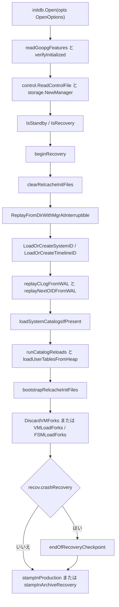
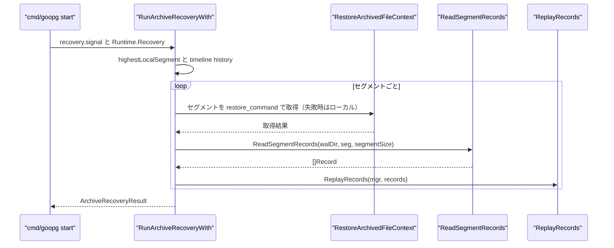

# 起動時の復旧とカタログ再構築

<details>
<summary>関連ソースファイル</summary>

- [`internal/initdb/open.go`](https://github.com/ryogrid/goopg/blob/19856410e8d497d59787e1ab35a2febb3f5953d6/internal/initdb/open.go)
- [`internal/initdb/recovery_state.go`](https://github.com/ryogrid/goopg/blob/19856410e8d497d59787e1ab35a2febb3f5953d6/internal/initdb/recovery_state.go)
- [`internal/initdb/xact_recovery.go`](https://github.com/ryogrid/goopg/blob/19856410e8d497d59787e1ab35a2febb3f5953d6/internal/initdb/xact_recovery.go)
- [`internal/initdb/catalog_heap_reload.go`](https://github.com/ryogrid/goopg/blob/19856410e8d497d59787e1ab35a2febb3f5953d6/internal/initdb/catalog_heap_reload.go)
- [`internal/initdb/catalog_cache.go`](https://github.com/ryogrid/goopg/blob/19856410e8d497d59787e1ab35a2febb3f5953d6/internal/initdb/catalog_cache.go)
- [`internal/initdb/standby.go`](https://github.com/ryogrid/goopg/blob/19856410e8d497d59787e1ab35a2febb3f5953d6/internal/initdb/standby.go)
- [`internal/initdb/timeline.go`](https://github.com/ryogrid/goopg/blob/19856410e8d497d59787e1ab35a2febb3f5953d6/internal/initdb/timeline.go)
- [`internal/catalog/relcache_inval.go`](https://github.com/ryogrid/goopg/blob/19856410e8d497d59787e1ab35a2febb3f5953d6/internal/catalog/relcache_inval.go)
- [`internal/access/transam/xlog/archive_recovery.go`](https://github.com/ryogrid/goopg/blob/19856410e8d497d59787e1ab35a2febb3f5953d6/internal/access/transam/xlog/archive_recovery.go)
- [`internal/access/transam/xlog/reader.go`](https://github.com/ryogrid/goopg/blob/19856410e8d497d59787e1ab35a2febb3f5953d6/internal/access/transam/xlog/reader.go)
- [`internal/access/transam/xlog/recovery.go`](https://github.com/ryogrid/goopg/blob/19856410e8d497d59787e1ab35a2febb3f5953d6/internal/access/transam/xlog/recovery.go)
- [`internal/access/transam/xlog/recovery_cache.go`](https://github.com/ryogrid/goopg/blob/19856410e8d497d59787e1ab35a2febb3f5953d6/internal/access/transam/xlog/recovery_cache.go)
- [`internal/storage/fsm_fork.go`](https://github.com/ryogrid/goopg/blob/19856410e8d497d59787e1ab35a2febb3f5953d6/internal/storage/fsm_fork.go)
- [`internal/storage/vm_fork.go`](https://github.com/ryogrid/goopg/blob/19856410e8d497d59787e1ab35a2febb3f5953d6/internal/storage/vm_fork.go)

</details>

`goopg start` の起動経路は、データディレクトリを開く前に「前回の終了がクリーンだったか」を `pg_control` から判定し、必要なら WAL をリプレイしてから、システムカタログをヒープから再構築する。`initdb.Open` は `PG_VERSION` と能力マーカーを検証し、`beginRecovery` で必要に応じて `DB_IN_CRASH_RECOVERY` / `DB_IN_ARCHIVE_RECOVERY` を刻み、`pg_internal.init` を全消しした後、`ReplayFromDirWithMgrAtInterruptible` で `checkPointCopy.redo` 以降の WAL を適用する。次に `replayCLogFromWAL` と `replayNextOIDFromWAL` でトランザクション状態と OID カウンタを復元し、`loadSystemCatalogsIfPresent` / `runCatalogReloads` で `pg_class` や `pg_proc` などのヒープ行からインメモリカタログを作り直す。最後に VM/FSM fork を読み込み（クラッシュ時は VM を破棄し）、end-of-recovery checkpoint と `DB_IN_PRODUCTION` のスタンプで起動を確定する。`recovery.signal` がある場合は `Open` が `Runtime.Recovery` を立て、呼び出し側が `RunArchiveRecoveryWith` で archive recovery を実行する。

## 責務

- **前回終了状態を判定し、復旧状態を先に公開する。** `beginRecovery` は `pg_control.State != DBStateShutdowned` または `CheckPointCopyRedo < CheckPoint`（オンライン checkpoint の痕跡）をクラッシュ復旧と判定し、リプレイ前に `DB_IN_CRASH_RECOVERY` を書き込む。`standby.signal` / `recovery.signal` がある場合は、クラッシュ復旧と判定されたときに限り `DB_IN_ARCHIVE_RECOVERY` を書く。クリーン判定でもシグナルがあれば、`Open` の末尾で `stampInArchiveRecovery` が archive recovery 状態にする (`internal/initdb/recovery_state.go:beginRecovery`)。
- **relcache init ファイルを無条件に消す。** `clearRelcacheInitFiles` は `global/pg_internal.init`、`base/<dboid>/pg_internal.init`、`pg_tblspc/<oid>/<version>/<dboid>/pg_internal.init` を `RelcacheInitFileRemoveAll` で掃除する。クラッシュ時だけでなくクリーン起動でも行う (`internal/initdb/recovery_state.go:clearRelcacheInitFiles`, `internal/catalog/relcache_inval.go:RelcacheInitFileRemoveAll`)。
- **リプレイ後に relcache init を再生成する。** WAL の commit レコードが HAS_INVALS を持つと `pg_internal.init` は unlink されるが、リプレイ自身は再生成しない。`Open` はカタログ復旧の後に `bootstrapRelcacheInitFiles` を呼び、`global` / `base/1` / `base/5` の init ファイルを作り直す。失敗は警告に留め、次の checkpoint の再生成に委ねる (`internal/initdb/open.go:Open`)。
- **WAL をページヘッダ付きで読み、redo から適用する。** `ReplayFromDirWithMgrAtInterruptible` は `ReadAll` で全セグメントをデコードし、`replayStartAt` で `EndLSN > redoLSN` の最初のレコードを選び、`ApplyRecord` を繰り返す。各レコードの前に `Interrupted` を確認し、停止要求では `ErrRecoveryShutdown` を返す (`internal/access/transam/xlog/recovery.go:ReplayFromDirWithMgrAtInterruptible`)。
- **ネイティブ WAL と PG 形式 WAL を同じ適用器で処理する。** `ApplyRecord` は `Record.XLog` がある場合にヘッダの `(rmid, info)` と `Payload[0]` の `RecordKind` が一致するかを確認し、一致すればネイティブの `replay*`、一致しなければ `replayDecodedXLogRecord` に振る。checkpoint / xact marker / CLOG truncate は物理ページ適用の no-op として扱う (`internal/access/transam/xlog/recovery.go:ApplyRecord`)。
- **CLOG と NextXID/NextOID を WAL から復元する。** `replayCLogFromWAL` は checkpoint 以降の全レコードを走査し、native の commit/abort と PG の `RM_XACT` commit/abort（subxact を含む）を CLOG に刻む。`replayNextOIDFromWAL` は `XLOG_NEXTOID` の最大値を返し、`pg_control` の checkpoint 時点の nextOid より新しい OID の再利用を防ぐ (`internal/initdb/xact_recovery.go`)。
- **システムカタログをヒープから再構築する。** `loadSystemCatalogsIfPresent` が `pg_type` / `pg_attribute` の relfile を登録し、`runCatalogReloads` が `catalogReloadDesc.Slot` の順に `pg_namespace`、`pg_tablespace`、`pg_class`、`pg_proc`、`pg_type`、`pg_index`、`pg_operator`、`pg_opclass` などをスキャンする。`catalogRowLive` が xmin/xmax と CLOG を見て可視行だけを採用する (`internal/initdb/catalog_heap_reload.go`)。
- **可視性マップと空き領域マップを再開する。** クラッシュ復旧で VM の WAL ログ能力がない場合、`DiscardVMForks` が `_vm` ファイルを削除して空の VM から始める。FSM は `FSMLoadForks` で `_fsm` を読み込み、破損していれば起動を失敗させる (`internal/storage/vm_fork.go:DiscardVMForks`, `internal/storage/fsm_fork.go:FSMLoadForks`)。
- **復旧を durable にしてから本番状態へ移す。** `recov.crashRecovery` なら `endOfRecoveryCheckpoint` が `Checkpointer.CheckpointNow` を呼び、その後 `stampInProduction` または `stampInArchiveRecovery` が `pg_control.State` を更新する。`Runtime.Close` の通常終了は `CheckpointShutdown` で `DB_SHUTDOWNED` にする (`internal/initdb/recovery_state.go:endOfRecoveryCheckpoint`, `internal/initdb/open.go:stampInProduction`)。
- **archive recovery を WAL セグメント供給と timeline 追跡で行う。** `RunArchiveRecoveryWith` は `restore_command` を優先してセグメントを取得し、取得できなければローカル `pg_wal` のコピーを使う。`ReadSegmentRecords` で読み、`ReplayRecords` で適用する。`recovery_target_lsn` / `recovery_target_xid` の停止点と、`ArchiveRecoveryResult` の `EndOfLog` / `EndTLI` / `NewestTLI` を返す (`internal/access/transam/xlog/archive_recovery.go:RunArchiveRecoveryWith`)。

## 処理フロー

`Open` の前半は「能力マーカーとバージョン検証 → `pg_control` 読み込み → 復旧判定 → relcache init 掃除 → WAL リプレイ」である。WAL ライターはリプレイが終わるまで起動しないため、リプレイ中に `pg_wal` が変化することはない。後半で CLOG/OID、カタログ、VM/FSM を復元し、最後に checkpoint と `pg_control` の状態更新を行う。



`beginRecovery` の判定は 2 本である。`State != DBStateShutdowned` なら前回はクリーンに終了していない。`CheckPointCopyRedo < CheckPoint` なら最後の checkpoint はオンライン checkpoint であり、その checkpoint を経てシャットダウンした形跡がない。`DBStateShutdownedInRecovery` はクリーン扱いにしない（スタンバイのクリーン停止でも整合点までリプレイが必要）。`pg_control` が無い／読めない場合は `startupRecoveryDecision{}` を返し、redo=0 のフォールバック（WAL をスキャンして最後の checkpoint を探す）でリプレイする。



`Open` は `standby.signal` / `recovery.signal` を `IsStandby` / `IsRecovery` で検出し、`Runtime.Standby` / `Runtime.Recovery` に記録する。`standby.signal` はストリーミングスタンバイ、`recovery.signal` は archive recovery の要求である。`RunArchiveRecoveryWith` の `have` はまず `restore_command` を試し、失敗した場合だけローカル `pg_wal` のコピーを使う。ローカルのコピーは古い、または部分的にしか復元されていない可能性があるため、archive のコピーを優先する。取得したセグメントは `ReadSegmentRecords` → `readAllPageAware` で絶対 LSN 付きの `Record` になり、`ReplayRecords` が `pd_lsn` の冪等性を使って適用する。

## 主要ファイル

| ファイル | 役割 |
|---|---|
| `internal/initdb/open.go:Open` | 起動全体。能力マーカー、`pg_control`、復旧判定、WAL リプレイ、CLOG/OID、カタログ、VM/FSM、最終スタンプ |
| `internal/initdb/recovery_state.go:beginRecovery` | クラッシュ／archive 復旧の判定と `pg_control` の状態スタンプ |
| `internal/initdb/recovery_state.go:clearRelcacheInitFiles` | リプレイ前の `pg_internal.init` 全掃除 |
| `internal/initdb/xact_recovery.go:replayCLogFromWAL` | WAL からの commit/abort 再スタンプと NextXID 前進 |
| `internal/initdb/xact_recovery.go:replayNextOIDFromWAL` | `XLOG_NEXTOID` の最大値による OID カウンタ復元 |
| `internal/initdb/catalog_heap_reload.go:runCatalogReloads` | `catalogReloadDesc.Slot` 順のカタログ再構築ドライバ |
| `internal/initdb/catalog_heap_reload.go:catalogRowLive` | xmin/xmax と CLOG に基づく行の可視判定 |
| `internal/initdb/catalog_cache.go:UnlinkCatalogCache` | 廃止された JSON カタログキャッシュの削除 |
| `internal/initdb/standby.go:IsStandby` | `standby.signal` / `recovery.signal` / `promote.signal` の判定 |
| `internal/initdb/timeline.go:LoadOrCreateTimelineID` | `pg_control` 優先の timeline 解決 |
| `internal/catalog/relcache_inval.go:RelcacheInitFileRemoveAll` | 全リレーションの `pg_internal.init` の削除 |
| `internal/access/transam/xlog/archive_recovery.go:RunArchiveRecoveryWith` | `restore_command` による archive recovery ループ |
| `internal/access/transam/xlog/reader.go:ReadAll` | ページヘッダ付き WAL のデコードと復旧用メモ化 |
| `internal/access/transam/xlog/recovery.go:ReplayRecordsFrom` | redo 以降のレコード適用と `ApplyRecord` ディスパッチ |
| `internal/storage/vm_fork.go:DiscardVMForks` | クラッシュ後の `_vm` fork 削除 |
| `internal/storage/fsm_fork.go:FSMLoadForks` | `_fsm` fork の読み込み |

## 公開 API / エントリポイント

- `func Open(opts OpenOptions) (*Runtime, error)` — 既存データディレクトリを開き、クラッシュ復旧・カタログ再構築・VM/FSM 読み込みまで行う。
- `func (r *Runtime) Close() error` — 通常終了では `CheckpointShutdown` を呼び、`DB_SHUTDOWNED` にする。`SetImmediateShutdown` 後は最終 checkpoint をスキップする。
- `func (r *Runtime) SaveCatalog() error` / `SaveVM() error` / `SaveFSM() error` — シャットダウン時のカタログ・VM・FSM の永続化。
- `func ReplayFromDirWithMgrAtInterruptible(mgr *storage.Manager, walDir string, segmentSize int64, redoLSN uint64, interrupted func() bool) (ReplayStats, error)` — 起動時の WAL リプレイ。`segmentSize=0` は WAL ヘッダから導出。
- `func ReplayRecordsFrom(mgr *storage.Manager, records []Record, redoLSN uint64) (ReplayStats, error)` — デコード済みレコードを redo 以降だけ適用する。
- `func ReadAll(walDir string, segmentSize int64) ([]Record, error)` — ページヘッダ付き WAL を全件デコードする。復旧中は `BeginRecoveryCache` / `EndRecoveryCache` の範囲でメモ化される。
- `func ReadSegmentRecords(walDir string, segNo uint64, segmentSize int64) ([]Record, error)` — 1 セグメント分の `Record` を返す。archive recovery が使う。
- `func RunArchiveRecoveryWith(ctx context.Context, mgr *storage.Manager, dataDir string, restoreCommand func() string, segmentSize int64, target TargetTimeline, stop RecoveryStop) (ArchiveRecoveryResult, error)` — `recovery.signal` の archive recovery。
- `func RelcacheInitFileRemoveAll(dataDir string) error` — 全 `pg_internal.init` の削除。ディレクトリ名が数字のものだけをデータベース OID として扱う。
- `func WithRelCacheInitLock(fn func() error) error` — `pg_internal.init` の unlink/再生成を直列化するプロセス内ロック。
- `func IsStandby(dataDir string) (bool, error)` / `IsRecovery(dataDir string) (bool, error)` — シグナルファイルの存在判定。
- `func CreateStandbySignal(dataDir string) error` / `RemoveStandbySignal(dataDir string) error` — スタンバイシグナルの作成・削除。
- `func RemoveRecoverySignal(dataDir string) error` — archive recovery 完了時の `recovery.signal` 削除。
- `func DiscardVMForks(dataDir string) (int, error)` / `func (v *VisibilityMap) VMLoadForks(dataDir string) error` / `func (f *FSM) FSMLoadForks(dataDir string) error` — VM/FSM fork の破棄・読み込み。

## 主要データ構造

### `Runtime` — 起動後のプロセス状態

`internal/initdb/open.go:Runtime`（35 行）:

```go
type Runtime struct {
	StorageMgr *storage.Manager
	Pool       *storage.Pool
	TxnMgr     *transam.Manager
	Catalog    catalog.Catalog
	// FSM is the in-memory free-space map (M0046-0003). VACUUM updates
	// it; INSERT consults it before extending the relation.
	FSM *storage.FSM
	// VM is the in-memory visibility map (M0046-0004). VACUUM sets the
	// ALL_VISIBLE bit; index-only scans check it to skip heap fetches.
	VM           *storage.VisibilityMap
	WAL          *xlog.Writer
	Checkpointer *xlog.Checkpointer
	Slots        *xlog.Slots
	// SyncRep is the synchronous-replication wait primitive
	// (M0102-0005). The commit-path xactMarkerLogger uses it to
	// block COMMIT until configured standbys ack the commit LSN; the
	// walsender feedback handler calls UpdateStandbyProgress. nil
	// here would disable sync replication entirely, but Open
	// constructs one unconditionally — it is a no-op when
	// `synchronous_standby_names` is empty (upstream's async default).
	SyncRep        *xlog.SyncRep
	WalSenders     *xlog.Senders
	WalReceivers   *xlog.Receivers
	WalSubscribers *xlog.Subscribers
	PubSub         *catalog.PubSub
	AIO            *aio.Engine
	DataDir        string

	// Activity is the backend-activity registry backing
	// pg_catalog.pg_stat_activity (M0022 Stage A). nil when
	// not configured.
	Activity *activity.Registry

	// Standby is true when `<DataDir>/standby.signal` was present
	// at Open time. cmd/goopg start uses this to decide whether to
	// dial the configured `primary_conninfo` and spawn a
	// `WalReceiver` instead of accepting client writes directly.
	// See docs/design/0005-0001-streaming-replication-architecture.md.
	Standby bool

	// NextMultiXact is pg_control's checkPointCopy.nextMulti as read at
	// Open time — the MultiXactId the previous run would have handed out
	// next. cmd/goopg seeds the process-shared multixact.Store from it
	// (multixact.NewStoreAt) so a restarted cluster does not re-issue
	// MultiXactIds the pre-restart run already stamped into tuple xmax
	// fields. 0 when there was no usable control file; NewStoreAt clamps
	// that up to FirstMultiXactId. M0131-S20.4.
	NextMultiXact uint32

	// Recovery is true when `<DataDir>/recovery.signal` was present
	// at Open time. cmd/goopg start uses this to enter archive recovery
	// (fetch WAL segments via restore_command, replay them, then
	// promote). See docs/design/0130-0009-recovery-signal-archive-recovery.md.
	Recovery bool

	// walwriterStop, when non-nil, is closed by Close() to signal the
	// background WAL writer loop to exit. nil when the loop wasn't
	// started (WalWriterDelay == 0 in tests).
	walwriterStop chan struct{}
	// walwriterDelay is the loop's live wal_writer_delay; walwriterKick
	// wakes it after SetWalWriterDelay changes it (a reload).
	walwriterDelay atomic.Int64 // time.Duration
	walwriterKick  chan struct{}

	// bgwriter is the background page-writer goroutine (M0048-0003).
	// nil when BgwriterDelay == 0.
	bgwriter *storage.Bgwriter

	// immediateShutdown, when true, makes Close() skip the final
	// shutdown checkpoint so pg_control's State stays DB_IN_PRODUCTION
	// (an unclean cluster). Set via SetImmediateShutdown from the
	// control-plane STOPIMMEDIATE handler (`goopg stop -mode
	// immediate`), mirroring upstream's immediate (SIGQUIT) shutdown.
	// (M0110-0004 / RW-002 b.)
	immediateShutdown bool
}
```

- `StorageMgr` / `Pool` / `TxnMgr` / `Catalog` は起動中に作られ、リプレイにも同じ `StorageMgr` が使われる。リプレイ後に別の Manager を作り直さないため、ページの `pd_lsn` と CLOG の状態が一貫する。
- `VM` / `FSM` はリプレイ後に `VMLoadForks` / `FSMLoadForks` で満たされる。`VM` はクラッシュ時かつ `VMWALLoggedFeature` が無い場合だけ `DiscardVMForks` で空になり、FSM は常に読み込まれる。
- `WAL` はリプレイが終わってから `xlog.NewWriter` で作られる。`Standby` / `Recovery` はシグナルファイルの検出結果で、呼び出し側の archive recovery / walreceiver 起動を決める。
- `NextMultiXact` は `pg_control` の `checkPointCopy.nextMulti`。`0` のときは `multixact.NewStoreAt` が `FirstMultiXactId` にクランプする。
- `immediateShutdown` は `Close` の最終 checkpoint をスキップする。`true` のまま終了すると `pg_control.State` は `DB_IN_PRODUCTION` のまま残り、次回起動がクラッシュ復旧になる。

### `startupRecoveryDecision` — 復旧判定の結果

`internal/initdb/recovery_state.go:startupRecoveryDecision`（23 行）:

```go
type startupRecoveryDecision struct {
	// crashRecovery is true when the previous run did not shut down
	// cleanly, i.e. upstream would have set InRecovery = true.
	crashRecovery bool
	// redoLSN is pg_control's checkPointCopy.redo (0-based XLogRecPtr), or
	// 0 when there is no usable control file — see wal.ReplayRecordsFrom
	// for what 0 means to the replay path.
	redoLSN uint64
	// prevState is the DBState pg_control carried on entry, kept for the
	// log line and for the post-replay stamp's before/after reporting.
	prevState uint32
	// nextMulti is pg_control's checkPointCopy.nextMulti — the MultiXactId
	// the previous run would have handed out next. 0 when there is no
	// usable control file; multixact.NewStoreAt clamps anything below
	// FirstMultiXactId, so 0 degrades to the pre-M0131-S20.4 behaviour of
	// starting the allocator at FirstMultiXactId. M0131-S20.4.
	nextMulti uint32
}
```

- `crashRecovery` が真なら `Open` は `endOfRecoveryCheckpoint` を呼ぶ。`redoLSN` は `pg_control` の 0 ベース `CheckPointCopyRedo` で、`ReplayRecordsFrom` の開始位置になる。
- `prevState` はログ用、`nextMulti` は `Runtime.NextMultiXact` に渡す。`pg_control` が無い場合はゼロ値のまま返り、`redoLSN=0` のフォールバックになる。

### `Record` / `ReplayStats` — WAL レコードと適用結果

`internal/access/transam/xlog/reader.go:Record`（15 行）:

```go
type Record struct {
	StartLSN uint64
	EndLSN   uint64
	Payload  []byte
	XLog     *XLogDecodedRecord
}
```

- `StartLSN` / `EndLSN` は 1 ベースの絶対バイト位置。`readAllPageAware` は `baseOffset + off + 1` を Start に、`baseOffset + off + consumed` を End にする。`record` の `EndLSN > redoLSN` 判定は、0 ベースの redo がレコードの内部を指す場合にそのレコードを含めるためのもの。
- `Payload` はネイティブ goopg レコードの `RecordKind` を含む本文、`XLog` はデコード済み PG 形式レコード。`ApplyRecord` は `XLog != nil` のとき両方を照合する。

`internal/access/transam/xlog/recovery.go:ReplayStats`（693 行）:

```go
type ReplayStats struct {
	Records       int
	Applied       int
	CheckpointLSN uint64
}
```

- `Records` はデコードされた総数、`Applied` は `ApplyRecord` が `true` を返した数、`CheckpointLSN` はスキャンで見つけた checkpoint の EndLSN。
- `CheckpointLSN` は redo ポインタが 0 の場合のアンカーとして使われるが、`redoLSN != 0` のときはブックキーピング専用である。

### `catalogReloadDesc` — カタログ再構築の順序

`internal/initdb/catalog_heap_reload.go:catalogReloadDesc`（171 行）:

```go
type catalogReloadDesc struct {
	Name string // "pg_namespace" — log/error labels only
	Slot int    // recovery-pass slot (02a §2.4); lower runs first
	// Fatal: a reload error aborts startup (schema/table precedent) instead
	// of warn-and-continue (statistics/index precedent, Open).
	Fatal bool
	// Reload performs the catalog's scan+apply. Simple single-heap catalogs
	// build this with simpleCatalogReload; multi-heap joins (the pg_class +
	// pg_attribute exemplar) implement it directly.
	Reload func(mgr *storage.Manager, cat *catalog.InMemory, clog *transam.CLog, heapDBOid, nsDBOid uint32) error
}
```

- `Slot` は `Open` の歴史的な recovery-pass 順序を数値化したもの。`runCatalogReloads` は `sort.SliceStable` で `Slot` 昇順に並べ、同じ Slot の相対順を保つ。
- `Fatal` が真のカタログはリロード失敗で起動を中断する。偽なら `warn` コールバックに渡して続行する。
- `Reload` は `shared` なら `global/<relOid>`、ローカルなら `base/<heapDBOid>/<relOid>` をスキャンする。`simpleCatalogReload` が単一ヒープ用の定型を提供する。

### `ArchiveRecoveryResult` / `RecoveryStop` — archive recovery の出力

`internal/access/transam/xlog/archive_recovery.go:ArchiveRecoveryResult`（38 行）:

```go
type ArchiveRecoveryResult struct {
	// EndOfLog is the end of the last record replayed — PG's EndOfLog, the
	// timeline switch point the promotion writes into the new timeline's
	// history file (xlog.c StartupXLOG → writeTimeLineHistory) and where the
	// new timeline's WAL begins. LastStart is that record's StartLSN; the
	// first record on the new timeline names LastStart-1 as its xl_prev
	// (0-based), as the streaming promotion does (StreamReplayer.LastApplied).
	// Both are 0 when nothing was replayed.
	EndOfLog, LastStart uint64
	// EndTLI is the timeline of the last segment replayed (PG's
	// EndOfLogTLI); 0 when nothing was replayed.
	EndTLI uint32
	// NewestTLI is the newest timeline whose history file exists locally or
	// in the archive, probing from the target (findNewestTimeLine). The
	// promotion's new timeline is NewestTLI+1, so it cannot collide with one
	// already in the archive.
	NewestTLI uint32
	// TargetTLI is the recovery target timeline (recoveryTargetTLI): the
	// timeline whose history recovery follows.
	TargetTLI uint32
	// ReachedTarget reports that the LSN target stopped recovery at StopLSN
	// (the ReadRecPtr of the record it stopped at), after applying that
	// record when StopAfter (recoveryStopLSN / recoveryStopAfter).
	ReachedTarget bool
	StopKind      StopKind
	StopLSN       uint64
	StopAfter     bool
	// StopXid, StopIsCommit and StopXactTime describe the transaction end
	// record an xid target stopped at (recoveryStopXid, recoveryStopTime:
	// xact_time, microseconds since 2000-01-01).
	StopXid      uint32
	StopIsCommit bool
	StopXactTime int64
	// StopPoint is where the recovered WAL ends at the target, as a PG
	// position: the stop record's start, or its end when StopAfter.
	StopPoint uint64
	// TargetHistory is TargetTLI's history file as read (nil for timeline 1
	// or when it has none). The history file is read through RECOVERYHISTORY
	// and not kept in pg_wal, so the promotion builds the new timeline's
	// history from these entries.
	TargetHistory []TimelineHistoryEntry
	// Timelines is the expected history, oldest first (expectedTLEs).
	Timelines []TimelineSpan
}
```

- `EndOfLog` / `LastStart` は最後にリプレイしたレコードの終端と開始 LSN。`EndTLI` はそのレコードの timeline。何もリプレイしなかった場合は 0 のまま。
- `NewestTLI` はローカルまたは archive にある最も新しい timeline、`TargetTLI` は recovery が追従する timeline。promotion は `NewestTLI+1` を新しい timeline にする。
- `ReachedTarget` / `StopKind` / `StopLSN` / `StopAfter` / `StopXid` は `recovery_target_lsn` / `recovery_target_xid` の結果。`StopPoint` は target に到達した WAL 位置、`TargetHistory` は新しい timeline history の材料になる。

`internal/access/transam/xlog/archive_recovery.go:RecoveryStop`（435 行）:

```go
type RecoveryStop struct {
	Set       bool
	LSN       uint64 // PG LSN (0-based)
	XidSet    bool
	Xid       uint32
	Inclusive bool
}
```

- `Set` が偽なら target なし。`LSN` と `Xid` は同時に設定できない（「複数の recovery target」は呼び出し側で拒否される）。`Inclusive` は target のレコードを含めるかどうか。

### VM fork の定数 — 可視性ビット

`internal/storage/vm_fork.go:VMBitsPerHeapPage`（21 行）:

```go
const (
	// VMBitsPerHeapPage is the number of VM bits per heap page.
	VMBitsPerHeapPage = 2
	// VMPagesPerByte is the number of heap pages tracked per byte in the VM.
	VMPagesPerByte = 8 / VMBitsPerHeapPage // 4
	// VMAllVisible is the mask for the ALL_VISIBLE bit (bit 0).
	VMAllVisible = 0x01
	// VMAllFrozen is the mask for the ALL_FROZEN bit (bit 1).
	VMAllFrozen = 0x02

	// vmDataOffset is where visibility data starts within a VM page.
	vmDataOffset = SizeOfPageHeaderData
	// vmDataSize is the number of bytes available for visibility data per page.
	vmDataSize = BlockSize - vmDataOffset
	// vmMaxHeapPagesPerPage is the max number of heap pages one VM page covers.
	vmMaxHeapPagesPerPage = vmDataSize * VMPagesPerByte
)
```

- VM は 1 ヒープページあたり 2 ビット（`ALL_VISIBLE` と `ALL_FROZEN`）を持ち、1 バイトで 4 ヒープページを表す。1 VM ページは 8 KiB で、`vmMaxHeapPagesPerPage` 個のヒープページをカバーする。
- クラッシュ後に古い VM を読むと、削除済み行を all-visible と誤認して index-only scan が誤った結果を返す。`DiscardVMForks` は `base/<dboid>/<reloid>_vm` と `global/<reloid>_vm` を削除する。

### FSM fork の定数 — 空き領域カテゴリ

`internal/storage/fsm_fork.go:FSM_CATEGORIES`（35 行）:

```go
const (
	// FSM_CATEGORIES is the number of free-space categories.
	FSM_CATEGORIES = 256
	// FSM_CAT_STEP is the byte range each category covers.
	FSM_CAT_STEP = BlockSize / FSM_CATEGORIES // 32 for 8k pages

	fsmPageHeaderSize = SizeOfPageHeaderData // 24
	fsmNextSlotSize   = 4                    // int32 fp_next_slot
	fsmNodesPerPage   = BlockSize - fsmPageHeaderSize - fsmNextSlotSize
	fsmNonLeafNodes   = BlockSize/2 - 1
	fsmLeafNodes      = fsmNodesPerPage - fsmNonLeafNodes
	fsmSlotsPerPage   = fsmLeafNodes

	// MaxFSMRequestSize is the maximum heap tuple size — the largest free-space
	// request the FSM can satisfy. Category 255 represents >= this value.
	// PG: MaxHeapTupleSize = BLCKSZ - MAXALIGN(SizeOfPageHeaderData +
	// sizeof(ItemIdData)) (htup_details.h) — 8160, not 8164: the header and
	// line pointer are MAXALIGNed together (M0146-0216).
	MaxFSMRequestSize = pgMaxFSMRequestSize
)
```

- FSM は 256 カテゴリで、1 カテゴリは `BlockSize/256 = 32` バイトの空き領域幅を表す。`MaxFSMRequestSize` はヒープタプルの最大サイズ（8160 バイト）で、カテゴリ 255 がそれ以上を表す。
- `fp_nodes` は最大値の二分木で、葉が各ヒープページのカテゴリ、内部ノードが子の最大値。`FSMLoadForks` は `_fsm` を読み、壊れたファイルは起動エラーにする。FSM の値が古くても「空きが少なめ」なら安全側だが、実装は破損を許さない。

## 内部構造

### `OpenOptions` の主要入力

`OpenOptions` は `Open` の入力で、`DataDir`（`PG_VERSION` が必要）、`Interrupted`（リプレイ中の停止要求）、`PoolSlots`（既定 16384、128 MB at 8 KiB）、`WALInitZero` / `WALSenderMemoryBuffer` / `WALBuffers` / `WALSyncMethod` / `WALMinSize` / `WALMaxSize`、`AIO*`、`WalWriterDelay`（本番既定 200ms）、`BgwriterDelay` / `BgwriterMaxPages`、`TrackIOTiming`、`TransactionBuffers`（CLOG SLRU のページ予算）を持つ。`Interrupted` は各リプレイレコードの前に呼ばれ、`ErrRecoveryShutdown` の起点になる。

### 復旧判定と `pg_control` の状態

`beginRecovery` は `pg_control` を読み、`d.redoLSN = cd.CheckPointCopyRedo`、`d.prevState = cd.State`、`d.nextMulti = cd.CheckPointCopyNextMulti` を埋める。`crashRecovery` の条件は次の 2 つである。

1. `cd.State != control.DBStateShutdowned`。
2. `cd.CheckPointCopyRedo < cd.CheckPoint`（オンライン checkpoint の redo は checkpoint レコードより前にある）。

`archiveRecovery` が真なら `DBStateInArchiveRecovery` を書き、偽なら `slog.Warn("database system was not properly shut down; automatic recovery in progress", ...)` を出して `DBStateInCrashRecovery` を書く。この分岐に入るのは `crashRecovery` が真のときだけである。`pg_control` が無い／読めない場合は何も刻まず、`ReplayFromDirWithMgrAtInterruptible` に `redoLSN=0` を渡す。

`Open` の最後では `stamp := stampInProduction` とし、`standby || recovery` なら `stampInArchiveRecovery` にする。`crashRecovery` のときは `endOfRecoveryCheckpoint` を先に呼ぶ。`stampInProduction` は `State=DBStateInProduction` と `Time=now` を書く。`stampInArchiveRecovery` は `State=DBStateInArchiveRecovery` を書く。

### リプレイ開始位置と `ApplyRecord`

`replayStartAt(records, redoLSN)` は `redoLSN != 0` のとき、`EndLSN > redoLSN` を満たす最初のレコードを開始位置にする。`redoLSN == 0` のときは `replayStart` が最後の checkpoint レコードを探し、その checkpoint の `redo` フィールドまで巻き戻す。`ReplayRecordsFrom` は `preflightIndexAMRecords` で GIN/BRIN など未対応の index AM を先に拒否し、`ApplyRecord` を順に呼ぶ。

`ApplyRecord` の分岐は次のとおり。

- `r.XLog != nil` かつ `Payload` が空: `replayDecodedXLogRecord`。
- `Payload[0]` が既知の goopg `RecordKind` で、ヘッダの `(rmid, info)` がその kind に一致: ネイティブの `replayHeapInsert` / `replayBtreeSplit` / `replaySmgrTruncateTo` など。
- ヘッダが一致しない、または未知の kind: `replayDecodedXLogRecord`。PG の checkpoint や `XLOG_NEXTOID` のような構造化レコードを、たまたま一致した `Payload[0]` で誤適用しないためのガードである。
- checkpoint / xact commit/abort / subxact / CLOG truncate は物理ページ適用では `false, nil` を返す。CLOG と subxact の状態は `replayCLogFromWAL` が別パスで扱う。

`ApplyRecord` の各 `replay*` はページの `pd_lsn` を見て適用済みならスキップする。`ReplayRecordsFrom` が redo より前を読まないのは最適化であり、仮に読んでも `pd_lsn` により二重適用は防がれる。逆に redo が古すぎる場合（`pg_control` の更新前にクラッシュ）は余分にリプレイするだけで、正しさは損なわれない。

### CLOG・NextXID・NextOID

`replayCLogFromWAL` は `xlog.ReadAll` で全レコードを取得し、`xlog.ExportedReplayStart(records)` 以降を走査する。各レコードで `r.XLog.Header.XID` が非ゼロなら `txnMgr.SetNextXID(xid+1)` を呼ぶ。これは commit に到達しなかった in-flight の XID も含めるためで、再起動後に同じ XID を再利用してクラッシュ前の半端な行を復活させる事故を防ぐ。

native の `RecordKindXactCommit` / `RecordKindXactAbort` は payload の XID を CLOG に刻む。PG 形式の `RM_XACT` は `Info & XlogXactOpMask` が commit/abort のときだけ処理し、`XLOG_XACT_ASSIGNMENT` や `XLOG_XACT_INVALIDATIONS` を誤って abort にしない。commit/abort では `ParseXactRecord` の subxacts も同じ状態に刻む。CLOG の書き込みエラーは無視する。WAL が正本で、CLOG は write-behind キャッシュだからである。

`replayNextOIDFromWAL` は全 WAL を走査して `RmgrXLog` + `XlogXLogNextOid` の最大値を取る。`pg_control` の nextOid は最後の checkpoint 時点なので、checkpoint 後に PG が確保した OID ブロックを取りこぼさないために max を併用する。

### カタログ再構築の可視判定

`scanCatalogHeapRows` はブロックごとに `PageLinePointerCount` と `PageGetHeapTuple` を回し、decode できた行だけを `catalogRowLive` に渡す。`catalogRowLive` の規則は次のとおり。

- `xmin == InvalidTransactionID` は dead。
- `xmax != InvalidTransactionID` は、`clog.GetStatus(xmax)` が `TxnStatusAborted` のときだけ「まだ live」とみなす。committed / unknown の xmax は dead。
- `clog.GetStatus(xmin) == TxnStatusAborted` は dead。
- `requireCommittedXmin` が真の legacy 行は、xmin が `TxnStatusCommitted` でなければ dead。

PG 形式の basebackup 行は xmin がローカル CLOG の範囲外で Unknown になることがあるため、`requireCommittedXmin=false` の経路では Unknown を許容する。`runCatalogReloads` は `Slot` 昇順で `Reload` を呼び、`Fatal` エラーだけ起動を止める。`simpleCatalogReload` は共有カタログなら `DBOid=0` で `global/<relOid>` を読む。

### VM/FSM とカタログキャッシュ

VM は WAL ログ能力 `VMWALLoggedFeature` がある場合、checkpoint で fork に保存され、クラッシュ後も WAL リプレイで変更が適用されているためそのまま読み込める。能力がない古いクラスタでは `DiscardVMForks` が `_vm` を消し、空の VM から始める。FSM は `FSMLoadForks` が `base/<dboid>/*_fsm` と `global/*_fsm` を読み、壊れたページは起動エラーにする。

`catalog_cache.go` の `pg_goopg_catalog_cache.json` は M0114 の廃止された高速起動キャッシュである。スナップショットが typmod・配列・identity・tablespace などを失っていたため、現在は `loadUserTablesFromHeap` が常にヒープから読む。`UnlinkCatalogCache` は古いバイナリが残したファイルを削除するだけで、読み込みは行わない。

### `Runtime.Close` と終了状態

`Runtime.Close` は通常終了で `Checkpointer.CheckpointShutdown()` を呼び、`pg_control.State` を `DB_SHUTDOWNED` にする。`SetImmediateShutdown` が立っている場合はこの checkpoint をスキップし、`DB_IN_PRODUCTION` のまま残す。その後 bgwriter と walwriter を止め、`Pool` → `WAL` → `StorageMgr` → `AIO` の順で閉じる。次回起動の `beginRecovery` はこの State を見てクラッシュ復旧かどうかを決める。

## エッジケースと不変条件

- **`pg_control` 不在**: `beginRecovery` はゼロ値の decision を返し、`redoLSN=0` のフォールバックで WAL をスキャンする。`stampInProduction` も `pg_control` 不在を警告付きで許容する。手組みのデータディレクトリは `verifyInitialized` が `PG_VERSION` だけを見るため、この経路が実際に通る。
- **end-of-recovery checkpoint の失敗**: `endOfRecoveryCheckpoint` は `CheckpointNow` の失敗を警告に留める。リプレイ自体は完了してデータファイルは整合しているため、bookkeeping の失敗でサービスを拒否しない。次の定期 checkpoint が `pg_control` を更新する。
- **復旧モード中の checkpoint**: `Open` は `Checkpointer.SetRecoveryMode(standby || recovery)` を立てる。復旧モードでは checkpoint レコードを WAL に書かず、end-of-recovery checkpoint は restartpoint 相当のフラッシュになる。これにより archive recovery が取得する primary の WAL をローカルの checkpoint レコードで汚さない (`internal/initdb/open.go:Open`)。
- **オンライン checkpoint の redo**: `State=DB_SHUTDOWNED` でも `CheckPointCopyRedo < CheckPoint` なら復旧扱いにする。PostgreSQL はこの組み合わせを PANIC にするが、goopg は警告してリプレイする。リプレイは `pd_lsn` で冪等なので、余分に適用しても安全である。
- **`DB_SHUTDOWNED_IN_RECOVERY`**: スタンバイのクリーン停止でも整合点まで戻す必要があるため、`DBStateShutdowned` と同一視しない。
- **WAL リプレイの中断**: `ReplayFromDirWithMgrAtInterruptible` は各レコードの前に `Interrupted` を呼び、真なら `ErrRecoveryShutdown` を返す。`Open` はこのエラーを起動失敗として返し、途中まで適用したページは `pd_lsn` で次回リプレイ可能な状態に残る。
- **WAL の不正終端**: `readAllPageAware` は全ゼロのページヘッダを通常の preallocated tail として静かに終えるが、未検証のレコードヘッダの後ろに durable なバイトがあれば `earlyEndOfWAL` の拒否を返す。`readAllUncached` は legacy WAL 形式を明示的に拒否する。
- **セグメントサイズ**: `IsValidWalSegSize` は 1 MiB〜1 GiB の 2 の冪だけを許す。`readAllUncached` は `segmentSize=0` のとき WAL の long page header からサイズを導出する。16 MiB と決め打つと LSN の基準が 16 倍ずれ、`pd_lsn` の冪等性が効かなくなる。
- **WAL の穴**: `firstAvailableSegment` は「最高セグメントで終わる最長の連続ラン」を選ぶ。checkpoint retention が途中で落ちた場合、古い孤立セグメントは無視され、live run の先頭から読む。
- **redo の 0 ベース / LSN の 1 ベース**: `Record.StartLSN/EndLSN` は 1 ベース、`redo` は 0 ベース。`replayStartAt` は `EndLSN > redoLSN` で比較し、redo がレコード内部を指す場合にそのレコードを含める。
- **不明な WAL レコード**: `durableUnknownRecord` は未知のヘッダでも CRC が通る record を「durable」と判断し、読み捨てずにエラーにする。`ApplyRecord` は未知の `RecordKind` を `unsupported kind` で失敗させる。
- **CLOG の空判定**: `clog.IsEmpty()` だけでは「履歴なし」と判断しない。`walHasXactRecords` が WAL に commit/abort を持つなら crash sweep 側に回す。`clog-complete-history` 能力の無い古いクラスタだけ `InitializeAsCommitted` を使う。
- **CLOG 書き込み失敗**: `xactStampAndAdvance` は `SetCommitted` / `SetAborted` のエラーを無視する。WAL が正本であり、CLOG は write-behind キャッシュだからである。ただし起動時に `replayCLogFromWAL` が失敗した場合は `Open` が起動を中止する。
- **次 XID の前進**: `replayCLogFromWAL` は commit/abort だけでなく、全レコードの `xl_xid` で `NextXID` を前進させる。これを commit 済み XID だけで済ませると、クラッシュ時に in-flight だった XID が再利用され、リプレイ済みの行が復活する。
- **NextOID の max**: `replayNextOIDFromWAL` は `XLOG_NEXTOID` の最大値を `pg_control` の nextOid と併用する。`pg_control` だけでは最後の checkpoint 以降に PG が確保した OID ブロックを取りこぼす。
- **復旧後の TLI 前進**: プライマリ起動では、WAL セグメントが永続 TLI より新しい timeline を持つ場合、`xlog.WriteHistoryAfterRecovery` が history を書き、`WriteTimelineID` が `global/timeline_id` を更新する。スタンバイでは `finalizePromotion` が担当するためスキップする (`internal/initdb/open.go:Open`)。
- **カタログ行の xmax**: `xmax` が aborted なら旧バージョンは live のまま、committed / unknown なら dead。`catalogRowLive` は xmax を単純に「非ゼロなら dead」としない。
- **PG basebackup の xmin**: PG 形式の行はローカル CLOG で Unknown になり得るため、`requireCommittedXmin=false` の経路では Unknown を許容する。legacy 行だけ committed xmin を要求する。
- **カタログリロードの順序**: `catalogReloadDesc.Slot` は歴史的な recovery pass の順序を固定する。`pg_namespace` / `pg_tablespace` は `pg_class` や `pg_index` より先に走り、`pg_class.relnamespace` や `reltablespace` の逆引きを可能にする。
- **Fatal / 非 Fatal**: `catalogReloadDesc.Fatal=true` の失敗は起動を止める。統計・インデックスなど一部の再構築は warn-and-continue で、壊れた補助情報より起動を優先する。
- **VM のクラッシュ時破棄**: `recov.crashRecovery && !vmCapability.Load()` のときは `DiscardVMForks` が `_vm` を削除する。古い VM は削除済み行を all-visible と誤認し、index-only scan が誤った行を返す。`VMWALLoggedFeature` があるクラスタは WAL リプレイで VM が更新済みなので読み込む。
- **FSM の破損**: `FSMLoadForks` は `_fsm` のサイズがページ境界でない、またはページが壊れている場合に起動エラーにする。古い空き領域情報で INSERT を誤ったページへ送ると、再試行コストが発生するためである。
- **FSM のカテゴリ**: `FSM_CATEGORIES=256`、`FSM_CAT_STEP=32`、`MaxFSMRequestSize=8160`。カテゴリ 255 は「最大タプルサイズ以上」を表し、`fsmSpaceCatToAvail(255)` は 8160 を返す。
- **`pg_internal.init` の全消し**: `RelcacheInitFileRemoveAll` は `global/`、`base/<digits>/`、`pg_tblspc/<digits>/<version>/<digits>/` を走査し、名前が全て数字のディレクトリだけを DB OID として扱う。`pgsql_tmp` のような名前は無視する。削除失敗は収集して返すが、`clearRelcacheInitFiles` は警告に留める。
- **relcache ロック**: `WithRelCacheInitLock` はプロセス内の `sync.Mutex` で、`pg_internal.init` の unlink と再生成を直列化する。PostgreSQL の `RelCacheInitLock` に相当する。
- **`standby.signal` / `recovery.signal`**: `IsStandby` / `IsRecovery` はファイル不在を `(false,nil)` として扱う。`standby.signal` はストリーミングスタンバイ、`recovery.signal` は archive recovery の要求で、`Open` は `Runtime.Standby` / `Runtime.Recovery` に記録する。
- **archive recovery の停止**: `RunArchiveRecoveryWith` は `ctx.Err()` を各フェッチ・各セグメントの前で確認し、`ErrRecoveryShutdown` を返す。`restore_command` の `RestoreFatalError` は recovery を終了させず、起動失敗にする。
- **recovery target**: `RecoveryStop` は LSN と XID の同時指定を許さず、`Inclusive` で停止レコードを含めるかを決める。`ArchiveRecoveryResult.StopReason` / `StopMessage` は promotion が新しい timeline history に書く文言を作る。
- **終了状態**: 通常の `Runtime.Close` は `CheckpointShutdown` で `DB_SHUTDOWNED` にする。`SetImmediateShutdown` 後は checkpoint をスキップし、`DB_IN_PRODUCTION` のまま残すので、次回起動はクラッシュ復旧になる。

## 関連ページ

- データディレクトリの作成は [2.3 データディレクトリの初期化](2.3-Data-Directory.md)
- プロセス起動と接続受け入れは [2.1 プロセスと並行性モデル](2.1-Process-and-Concurrency.md)
- クエリ実行パイプラインは [2.2 クエリ実行パイプライン](2.2-Query-Pipeline.md)
- WAL のフォーマットと耐久性は [10 WAL と耐久性](../10-WAL.md)
- B-tree インデックスの構造は [8 B-tree インデックス](../8-Btree.md)
- トランザクションと MVCC は [9 トランザクションと MVCC](../9-Transactions.md)
- システムカタログとビューは [12 カタログとシステムビュー](../12-Catalog.md)

Sources:
- `internal/initdb/open.go`
- `internal/initdb/recovery_state.go`
- `internal/initdb/xact_recovery.go`
- `internal/initdb/catalog_heap_reload.go`
- `internal/initdb/catalog_cache.go`
- `internal/initdb/standby.go`
- `internal/initdb/timeline.go`
- `internal/catalog/relcache_inval.go`
- `internal/access/transam/xlog/archive_recovery.go`
- `internal/access/transam/xlog/reader.go`
- `internal/access/transam/xlog/recovery.go`
- `internal/access/transam/xlog/recovery_cache.go`
- `internal/storage/fsm_fork.go`
- `internal/storage/vm_fork.go`

<sub>Generated by deepwiki-4myself from `goopg` @ `19856410e`</sub>
