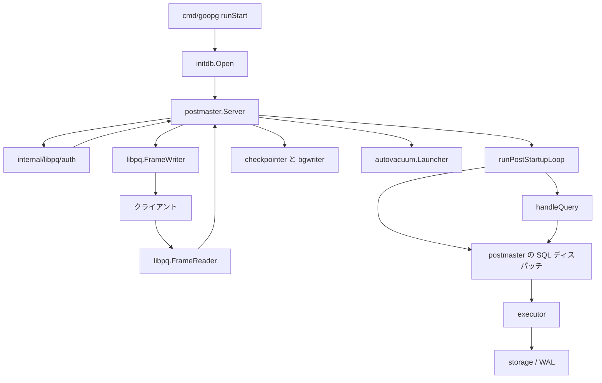
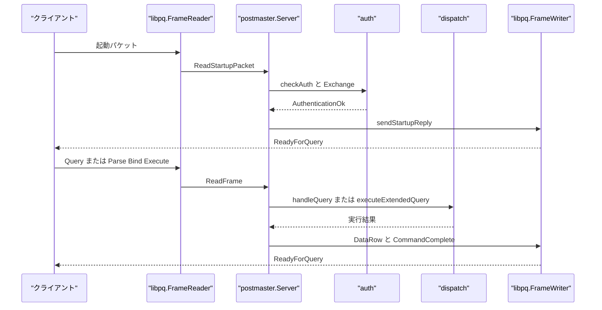

# サーバーと接続

<details>
<summary>関連ソースファイル</summary>

- [`cmd/goopg/main.go`](https://github.com/ryogrid/goopg/blob/19856410e8d497d59787e1ab35a2febb3f5953d6/cmd/goopg/main.go)
- [`internal/libpq/auth/auth.go`](https://github.com/ryogrid/goopg/blob/19856410e8d497d59787e1ab35a2febb3f5953d6/internal/libpq/auth/auth.go)
- [`internal/libpq/frame.go`](https://github.com/ryogrid/goopg/blob/19856410e8d497d59787e1ab35a2febb3f5953d6/internal/libpq/frame.go)
- [`internal/libpq/messages.go`](https://github.com/ryogrid/goopg/blob/19856410e8d497d59787e1ab35a2febb3f5953d6/internal/libpq/messages.go)
- [`internal/postmaster/dispatch.go`](https://github.com/ryogrid/goopg/blob/19856410e8d497d59787e1ab35a2febb3f5953d6/internal/postmaster/dispatch.go)
- [`internal/postmaster/server.go`](https://github.com/ryogrid/goopg/blob/19856410e8d497d59787e1ab35a2febb3f5953d6/internal/postmaster/server.go)

</details>

サーバーと接続のサブシステムは、`goopg start` がデータディレクトリを開き、TCP リスナーを bind し、クライアントごとの goroutine で PostgreSQL v3 の起動パケット、認証、SQL の受信と応答を処理する範囲である。データはクライアントから `libpq.FrameReader` に入り、`postmaster.Server.serveConn` が `runPostStartupLoop` でフレームを振り分け、simple query は `handleQuery` / `dispatchSimpleQueryViaExecutor`、拡張クエリは `Parse` / `Bind` / `Execute`、COPY は `CopyData` のストリームとして実行系へ渡る。応答は `libpq.FrameWriter` から `RowDescription` / `DataRow` / `CommandComplete` / `ReadyForQuery` として戻る。接続の背後では checkpointer、bgwriter、autovacuum launcher、WAL summarizer が同じプロセスの goroutine として動く。

`cmd/goopg` は PostgreSQL の initdb、postmaster、pg_ctl を 1 つの CLI にまとめたもので、`runStart` が設定・ロック・`initdb.Open`・`postmaster.Server.Run` の順に起動を進める。ソケット上のプロトコルとバックエンドメッセージの符号化は `internal/libpq`、接続ごとの状態と SQL の振り分けは `internal/postmaster` が担う。全体の層構成は [2 システムアーキテクチャ](2-Architecture.md)、SQL の解析・計画・実行は [4 SQL パーサー](4-SQL-Parser.md)、[5 クエリプランナー](5-Query-Planner.md)、[6 実行エンジン](6-Executor.md)、ページと WAL は [7 ストレージ](7-Storage.md) と [10 WAL と耐久性](10-WAL.md) を参照されたい。

## コンポーネント

- **CLI とライフサイクル** — `init` / `start` / `stop` / `restart` / `reload` / `checkpoint` / `promote` / `status` を提供し、設定読み込み、`postmaster.pid`、`initdb.Open`、シグナル、停止時のチェックポイントを管理する。詳細は [3.1 CLI とライフサイクル](3-Server/3.1-CLI-and-Lifecycle.md)。
- **ワイヤプロトコル** — 起動パケットと通常フレームの読み書き、サイズ上限、`Authentication` / `ParameterStatus` / `RowDescription` / `DataRow` / `CopyData` などのメッセージを提供する。詳細は [3.2 ワイヤプロトコル](3-Server/3.2-Wire-Protocol.md)。
- **認証と pg_hba** — `pg_hba.conf` を解析して接続ごとの方式を決め、`trust` / `reject` / `password` / `md5` / `scram-sha-256` の交換を実行する。詳細は [3.3 認証と pg_hba](3-Server/3.3-Authentication.md)。
- **接続管理と SQL ディスパッチ** — 接続ごとの `connTxState`、prepared statement、cancel、EOF 監視を持ち、simple / extended の SQL を parser → planner → executor に流す。詳細は [3.4 接続管理と SQL ディスパッチ](3-Server/3.4-Connection-Dispatch.md)。
- **COPY と拡張クエリプロトコル** — `CopyInResponse` / `CopyData` / `CopyDone` と TEXT / CSV / BINARY のコーデック、`Parse` / `Bind` / `Describe` / `Execute` の portal を扱う。詳細は [3.5 COPY と拡張クエリプロトコル](3-Server/3.5-COPY-and-Extended-Protocol.md)。
- **バックグラウンドワーカー** — checkpointer、bgwriter、autovacuum launcher、WAL summarizer を同じプロセス内で動かす。詳細は [3.6 バックグラウンドワーカー](3-Server/3.6-Background-Workers.md)。

## サブシステム図

`cmd/goopg` の `runStart` が `initdb.Open` でランタイムを開き、`postmaster.Server.Run` が TCP を受け付ける。接続ごとの `serveConn` は `FrameReader` から起動パケットとフレームを読み、`auth` で認証してから `runPostStartupLoop` に入る。SQL は `dispatchSimpleQueryViaExecutor` または拡張クエリのハンドラを通って executor に達し、応答は `FrameWriter` からクライアントへ戻る。バックグラウンドの checkpointer / bgwriter / autovacuum / WAL summarizer はリスナーと同じプロセスで並行して動く。



## データフロー

1. **起動** — `cmd/goopg` の `runStart` が `runInit` で作られたデータディレクトリを開き、`initdb.Open` の後に `postmaster.New` / `Run` を呼ぶ。`Runtime` のカタログ、バッファプール、WAL、チェックポインタが `postmaster.Config` に渡される (`cmd/goopg/main.go:runStart`, `internal/postmaster/server.go:New`)。
2. **待ち受け** — `Server.Run` が TCP リスナーを bind し、`acceptLoop` が接続ごとに `serveConn` を起動する。`postmaster.pid` と制御ソケットは起動時に作られる (`internal/postmaster/server.go:Run`, `startControlPlane`)。
3. **起動パケットと認証** — `serveConn` が `libpq.NewFrameReader` / `NewFrameWriter` を作り、`handleStartup` で SSL/GSS の拒否、CancelRequest、protocol 3.0 の検証、`ParseStartupParameters` を行う。`checkAuth` が `auth.RuleSet.Match` の結果を認証交換に渡し、`AuthenticationOk` を送る (`internal/postmaster/server.go:serveConn`, `handleStartup`, `checkAuth`, `internal/libpq/auth/auth.go:RuleSet.Match`).
4. **フレームループ** — `sendStartupReply` の後、`runPostStartupLoop` が `ReadFrame` の結果を COPY 中、`syncRequired`、メッセージタイプの順に処理する。`MsgQuery` は simple query のハンドラ、`Parse` / `Bind` / `Execute` は拡張クエリのハンドラへ進む (`internal/postmaster/server.go:runPostStartupLoop`).
5. **SQL 実行** — simple query の `dispatchSimpleQueryViaExecutor` が `parser.Parse` とトランザクション／スナップショットを準備し、`executeOneSimpleStmt` が `optimizer.PlanWithSettings`、`executor.BuildFastIterator`、`op.Open` / `Next` / `Close` を実行する。拡張クエリは `executeExtendedQuery` → `executeExtendedQueryViaExecutor` を通る (`internal/postmaster/dispatch.go:dispatchSimpleQueryViaExecutor`, `executeOneSimpleStmt`).
6. **応答** — 実行結果は `libpq.WriteRowDescription` / `WriteDataRow` / `WriteCommandComplete` で組み立てられ、最後に `ReadyForQuery` が送られる。COPY は `CopyOutResponse` / `CopyInResponse` と `CopyData` を使う (`internal/libpq/messages.go:WriteRowDescription`, `WriteDataRow`, `WriteCommandComplete`, `WriteCopyInResponse`, `WriteCopyOutResponse`).
7. **停止** — `SIGINT` / `SIGTERM` または制御ソケットの `STOP` が `Server.Run` を終わらせ、`Runtime.Close` が最終チェックポイントとハンドル解放を行う (`cmd/goopg/main.go:runStart`, `internal/postmaster/server.go:Run`).



## 共有データ型

### `libpq.Frame` と `libpq.FrameReader`

```go
type Frame struct {
	Type    byte
	Payload []byte
}
```

`internal/libpq/frame.go:Frame`

```go
type FrameReader struct {
	r        *bufio.Reader
	buf      []byte // grows on demand, capped by MaxRegularMessageLength
	maxStart int
	maxRegul int

	// OnBeforeRead / OnAfterRead are optional hooks called before and
	// after every ReadFrame / ReadStartupPacket. The server sets these
	// from serveConn so the activity package can record ClientRead
	// wait events (Stage B wait-event taxonomy).
	OnBeforeRead func()
	OnAfterRead  func()
}
```

`internal/libpq/frame.go:FrameReader`

`Frame.Type` は PostgreSQL のメッセージタイプ 1 バイト、`Payload` は長さヘッダを除いた本体である。`Payload` は `FrameReader` の内部バッファを指す借用スライスで、次の `ReadFrame` までしか有効でないため、保持する側はコピーする。`FrameReader` は接続ごとに 1 個で、最初に `ReadStartupPacket` を 1 回だけ呼び、以降は `ReadFrame` を使う。`maxStart` は起動パケット、`maxRegul` は通常フレームの上限で、`OnBeforeRead` / `OnAfterRead` は `pg_stat_activity` の ClientRead 待ちイベント用フックである (`internal/libpq/frame.go:ReadStartupPacket`, `ReadFrame`).

### `auth.Decision` と `auth.Method`

```go
type Method int

const (
	MethodImplicitReject Method = iota // server-emitted when no rule matches
	MethodReject
	MethodTrust
	MethodPassword
	MethodMD5
	MethodSCRAMSHA256
	MethodGSS
	MethodSSPI
	MethodIdent
	MethodPeer
	MethodCert
	MethodPAM
	MethodBSD
	MethodLDAP
	MethodRADIUS
	MethodOAuth
)
```

`internal/libpq/auth/auth.go:Method`

```go
type Decision struct {
	Method  Method
	Options map[string]string
	Rule    *Rule
}
```

`internal/libpq/auth/auth.go:Decision`

`Method` は `pg_hba.conf` の METHOD を表す enum で、`trust` / `reject` / `password` / `md5` / `scram-sha-256` などを持つ。`Decision` は `RuleSet.Match` の結果で、選ばれた方式、ルールのオプション、一致した `Rule` へのポインタを保持する。暗黙 reject のときは `Rule` が nil になり、`checkAuth` はその `Method` を見て認証交換の分岐へ渡す (`internal/libpq/auth/auth.go:Method`, `Decision`, `RuleSet.Match`, `internal/postmaster/server.go:checkAuth`).

`postmaster.Config` は `cmd/goopg` が組み立てる大きな配線用構造体で、`Address`、`Logger`、`Policy`、`UserStore`、`Registry`、`Catalog`、`Pool`、`TxnMgr`、`Checkpointer`、`Promote`、`DataDir` などを保持する。このページの各コンポーネントは、この `Config` を境界に受け渡される (`internal/postmaster/server.go:Config`).

## 主要な設計判断

- **1 プロセス・多数 goroutine** — PostgreSQL の postmaster とバックエンドプロセスの分離は行わず、TCP 接続とバックグラウンドワーカーを同じ Go プロセスの goroutine として動かす。そのため接続ごとの状態は `connTxState` などのメモリ構造に置かれ、WAL やバッファプールもプロセス内で共有される (`internal/postmaster/server.go:serveConn`, `Run`).
- **フレーム層と意味層の分離** — `internal/libpq` はフレームの読み書きとメッセージの符号化だけを担当し、認証の判断、SQL の振り分け、トランザクション状態は `internal/postmaster` が持つ。`Frame` の `Payload` が借用スライスである点は、この境界をまたぐときの重要な不変条件である (`internal/libpq/frame.go:Frame`, `ReadFrame`).
- **認証はデータ駆動** — `pg_hba.conf` を `auth.RuleSet` に解析し、接続の `ConnType` / `Database` / `User` / `Remote` を `Request` として `Match` に渡す。方式ごとの実装は認証交換に集約され、`postmaster` は結果の `Decision` だけを受け取る (`internal/libpq/auth/auth.go:RuleSet`, `Request`, `Decision`).
- **SQL は parser → planner → executor** — simple query も extended query も、最終的には `optimizer.PlanWithSettings` と `executor` の operator に落ちる。simple は結果を逐次 `DataRow` にし、extended は portal に materialise して `maxRows` ごとに返す (`internal/postmaster/dispatch.go:dispatchSimpleQueryViaExecutor`, `executeOneSimpleStmt`).
- **バックグラウンド処理は接続から独立** — checkpointer、bgwriter、autovacuum、WAL summarizer はリスナーの accept ループとは別の goroutine で動き、停止はサーバーの context と `Runtime.Close` で伝播する。接続の有無にかかわらず WAL のチェックポイントとページ書き出しは進む (`internal/postmaster/server.go:Run`, [3.6 バックグラウンドワーカー](3-Server/3.6-Background-Workers.md)).
- **停止時は最終チェックポイントが durability の境界** — `SIGINT` / `SIGTERM` や `STOP` は accept ループを終わらせ、接続の drain 後に `Runtime.Close` が `CheckpointShutdown` を実行する。`SIGQUIT` / `STOPIMMEDIATE` だけが最終チェックポイントを飛ばし、次回起動時の WAL リプレイに委ねる (`cmd/goopg/main.go:runStart`, `internal/postmaster/server.go:Run`, `StopImmediate`).

Sources:

- `cmd/goopg/main.go`
- `internal/libpq/auth/auth.go`
- `internal/libpq/frame.go`
- `internal/libpq/messages.go`
- `internal/postmaster/dispatch.go`
- `internal/postmaster/server.go`

<sub>Generated by deepwiki-4myself from `goopg` @ `19856410e`</sub>
