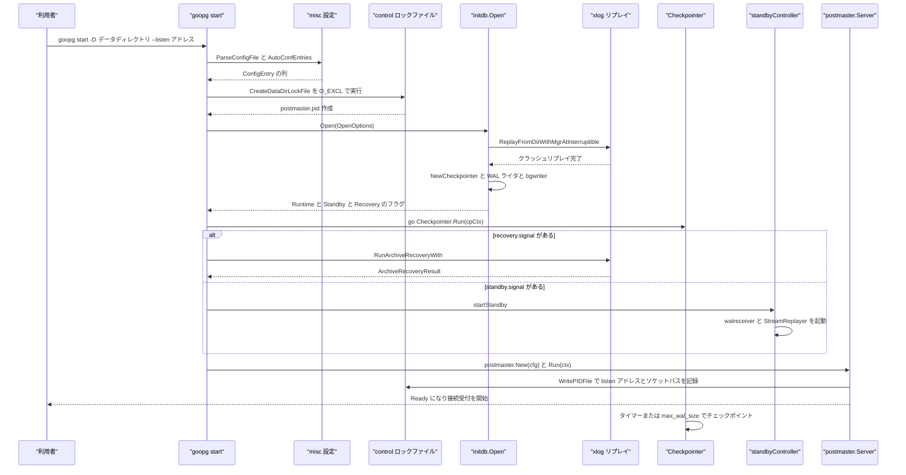
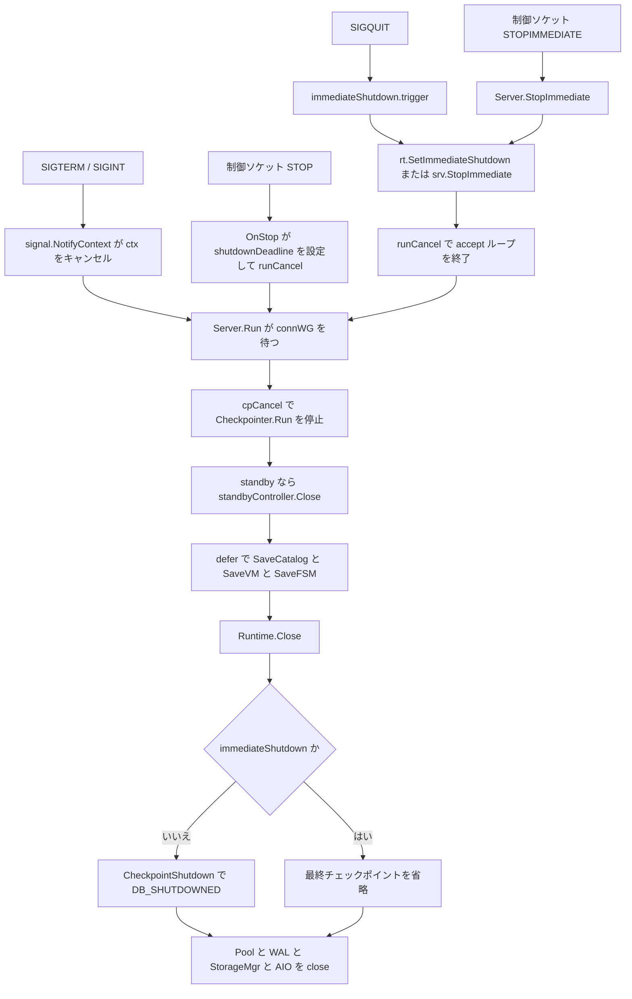

# CLI とライフサイクル

<details>
<summary>関連ソースファイル</summary>

- [`Makefile`](https://github.com/ryogrid/goopg/blob/19856410e8d497d59787e1ab35a2febb3f5953d6/Makefile)
- [`README.md`](https://github.com/ryogrid/goopg/blob/19856410e8d497d59787e1ab35a2febb3f5953d6/README.md)
- [`cmd/goopg/main.go`](https://github.com/ryogrid/goopg/blob/19856410e8d497d59787e1ab35a2febb3f5953d6/cmd/goopg/main.go)
- [`cmd/goopg/standby.go`](https://github.com/ryogrid/goopg/blob/19856410e8d497d59787e1ab35a2febb3f5953d6/cmd/goopg/standby.go)
- [`cmd/goopg/startup_reload.go`](https://github.com/ryogrid/goopg/blob/19856410e8d497d59787e1ab35a2febb3f5953d6/cmd/goopg/startup_reload.go)
- [`internal/access/transam/xlog/checkpointer.go`](https://github.com/ryogrid/goopg/blob/19856410e8d497d59787e1ab35a2febb3f5953d6/internal/access/transam/xlog/checkpointer.go)
- [`internal/initdb/open.go`](https://github.com/ryogrid/goopg/blob/19856410e8d497d59787e1ab35a2febb3f5953d6/internal/initdb/open.go)
- [`internal/postmaster/server.go`](https://github.com/ryogrid/goopg/blob/19856410e8d497d59787e1ab35a2febb3f5953d6/internal/postmaster/server.go)
- [`internal/utils/misc/parser.go`](https://github.com/ryogrid/goopg/blob/19856410e8d497d59787e1ab35a2febb3f5953d6/internal/utils/misc/parser.go)
- [`internal/utils/misc/version.go`](https://github.com/ryogrid/goopg/blob/19856410e8d497d59787e1ab35a2febb3f5953d6/internal/utils/misc/version.go)

</details>

`cmd/goopg` は、PostgreSQL が `initdb`・`postgres`・`pg_ctl` に分けている役割を 1 つのバイナリにまとめた CLI である。`main` は `run(os.Args[1:], os.Stdout, os.Stderr)` に処理を渡し、`run` が `init` / `start` / `stop` / `restart` / `reload` / `checkpoint` / `promote` / `status` / `version` のサブコマンドへディスパッチする (`cmd/goopg/main.go:run`, `cmd/goopg/main.go:subcommands`)。`start` はフォアグラウンドで動き、設定ファイルの読み込み、データディレクトリのロック、`initdb.Open` によるクラッシュ復旧・archive recovery・standby 起動、`postmaster.Server.Run` による TCP 待ち受け、シグナルまたは制御ソケット経由の停止、`Runtime.Close` の最終チェックポイントまでを一続きで面倒を見る。全体像は [2 システムアーキテクチャ](../2-Architecture.md)、WAL とチェックポイントの詳細は [10 WAL と耐久性](../10-WAL.md)、standby のレプリケーションは [11 レプリケーションとバックアップ](../11-Replication.md) を参照されたい。

## 責務

- **サブコマンドのディスパッチと終了コード** — `run` は先頭引数を `subcommands` の `name` と比較し、一致した `run` 関数を呼ぶ。`-h` / `--help` / `help` は usage を表示して 0、未知のコマンドは stderr に usage を出して 2 を返す (`cmd/goopg/main.go:run`)。
- **データディレクトリの初期化** — `runInit` が `-D` を必須とし、`-U` / `-X` / `-N` / `-S` / `-k` / `-A` / `--pwfile` / locale 系 / `-c NAME=VALUE` を `initdb.Options` に詰め替えて `initdb.Init` を呼ぶ (`cmd/goopg/main.go:runInit`)。
- **起動時の設定解決** — `runStart` は `-listen` の既定値を `127.0.0.1:5432` とし、`misc.BuildDefaultRegistry` で GUC registry を作り、`misc.ParseConfigFile` で `postgresql.conf` を、`misc.AutoConfEntries` で `postgresql.auto.conf` を重ねる。`-config` / `-hba` が空なら `-D` 配下の `postgresql.conf` と `pg_hba.conf` を自動探索する (`cmd/goopg/main.go:runStart`)。
- **二重起動の防止** — データディレクトリを触る前に `control.CreateDataDirLockFile` で `postmaster.pid` を `O_EXCL` 作成する。既存のロックが生きたプロセスを指す場合は `LockFileError` の `Message` と `Hint` を出力して終了する (`cmd/goopg/main.go:runStart`)。
- **ランタイムの構築** — `initdb.Open` が `pg_control` の状態を読み、必要なら `DB_IN_CRASH_RECOVERY` / `DB_IN_ARCHIVE_RECOVERY` を刻み、WAL をリプレイし、チェックポインタ・WAL ライタ・bgwriter を組み立て、最後に `DB_IN_PRODUCTION`（standby / recovery 中は `DB_IN_ARCHIVE_RECOVERY`）を刻んで `*initdb.Runtime` を返す (`internal/initdb/open.go:Open`)。
- **archive recovery と standby の起動** — `recovery.signal` があれば `xlog.RunArchiveRecoveryWith` を一度だけ実行し、`standby.signal` があれば `startStandby` で walreceiver と `StreamReplayer` を常駐させる (`cmd/goopg/main.go:runStart`, `cmd/goopg/standby.go:startStandby`)。
- **待ち受けと制御プレーン** — `postmaster.Server.Run` が TCP リスナーを bind し、`postmaster.pid` に listen アドレスと制御ソケットのパスを書き、`acceptLoop` で接続を受ける (`internal/postmaster/server.go:Run`, `internal/postmaster/server.go:startControlPlane`)。
- **運用コマンド** — `stop` / `restart` / `reload` / `checkpoint` / `promote` / `status` は `control.ParsePIDFile` で pidfile を読み、制御ソケットへ `STOP` / `STOPIMMEDIATE` / `RELOAD` / `CHECKPOINT` / `PROMOTE` / `PING` を送る。起動途中でソケット未作成ならシグナルへフォールバックする (`cmd/goopg/main.go:runStop`, `runReload`, `runCheckpoint`, `runPromote`, `runStatus`)。
- **シグナルの解釈** — SIGINT / SIGTERM は `signal.NotifyContext` で `ctx` をキャンセルし、SIGHUP は起動中と稼働中でそれぞれのリロード経路へ、SIGQUIT は即時シャットダウンへ回す (`cmd/goopg/main.go:runStart`, `cmd/goopg/startup_reload.go:newStartupReload`, `newImmediateShutdown`)。
- **終了時の永続化** — `Runtime.Close` が（`Checkpointer` があり、即時シャットダウンでなければ）`CheckpointShutdown` で `DB_SHUTDOWNED` を刻み、バックグラウンドループを止めてから `Pool` / `WAL` / `StorageMgr` / `AIO` を閉じる。その前に `runStart` の defer がカタログ・VM・FSM を保存する (`internal/initdb/open.go:Close`, `cmd/goopg/main.go:runStart`)。
- **バージョン情報** — `version` サブコマンドは `0.0.0-dev` を出力し、互換性に関わる `MajorVersion` / `CatalogVersionNo` / `TablespaceVersionDirectory` は `internal/utils/misc` が持つ (`cmd/goopg/main.go:runVersion`, `internal/utils/misc/version.go:MajorVersion`)。

## 処理フロー

以下のシーケンスは、データディレクトリを指定した通常の `goopg start` が、設定を読み、ロックを取得し、ランタイムを開き、バックグラウンドワーカーと待ち受けを起動する順序を示す。`-D` が空の場合は `initdb.Open`・チェックポインタ・WAL 関連の配線が丸ごと省略され、プロトコルだけが動くモードになる (`cmd/goopg/main.go:runStart`)。



この順序には意味がある。設定は `initdb.Open` より前に registry へ適用されるため、`shared_buffers` 由来のバッファプール・スロット数、`wal_buffers`、`wal_sync_method`、`fsync`、`min_wal_size` / `max_wal_size`、`wal_writer_delay`、`bgwriter_*` などが `OpenOptions` に渡る (`cmd/goopg/main.go:runStart`)。`postmaster.pid` は `Open` の前、つまりクラッシュ復旧がデータファイルへ書き込む前に作られるので、同じディレクトリを掴んだ 2 個目のサーバーは復旧を始める前に止まる。チェックポインタの goroutine は `Open` の直後、archive recovery や `srv.Run` より前に `cpCtx` で起動され、`srv.Run` が返った後に `cpCancel` で止められる (`cmd/goopg/main.go:runStart`)。

停止は 3 つの入口を持つ。通常の SIGINT / SIGTERM と制御ソケットの `STOP` は accept ループを終わらせ、接続の drain 後に最終チェックポイントを実行する。SIGQUIT と `STOPIMMEDIATE` は `Runtime.Close` の最終チェックポイントを意図的に飛ばす。



接続が確立した後のプロトコル処理は [3.2 ワイヤプロトコル](3.2-Wire-Protocol.md)、認証は [3.3 認証と pg_hba](3.3-Authentication.md)、SQL の振り分けは [3.4 接続管理と SQL ディスパッチ](3.4-Connection-Dispatch.md)、COPY と拡張クエリは [3.5 COPY と拡張クエリプロトコル](3.5-COPY-and-Extended-Protocol.md)、自動 vacuum や WAL summarizer は [3.6 バックグラウンドワーカー](3.6-Background-Workers.md) が扱う。

## 主要ファイル

| ファイル | 役割 |
| --- | --- |
| `Makefile` | `build` / `init` / `start` / `goopg-test-server` / `stop` / `restart` / `psql` / `status` / `clean-data` を提供する。`start` は `scripts/goopg-test-run.sh` 経由で cgroup のメモリ上限を掛け、`postmaster.pid` が現れるまで最大 5 秒待つ (`Makefile:build`, `Makefile:start`)。 |
| `README.md` | ビルドから `init` → `start` → `psql` → `stop` → `clean-data` までのクイックスタートと、`goopg start` が `SIGINT` / `SIGTERM` / `goopg stop` で終了することを説明する (`README.md:Quickstart`)。 |
| `cmd/goopg/main.go` | `main` / `run` / `subcommands`、`runInit` / `runStart` / `runStop` / `runRestart` / `runReload` / `runCheckpoint` / `runPromote` / `runStatus` / `runVersion`。GUC 読み取りヘルパー `boolGUC` / `stringGUC` / `intGUC` と `resolveWALBuffers` / `poolSlotsFromGUC` もここにある (`cmd/goopg/main.go:run`, `cmd/goopg/main.go:runStart`, `cmd/goopg/main.go:runStop`)。 |
| `cmd/goopg/startup_reload.go` | サーバー起動前の SIGHUP を保留フラグにし、`process` で同期的にリロードする `startupReload`。SIGQUIT を即時停止へ変換する `immediateShutdown` (`cmd/goopg/startup_reload.go:startupReload`, `cmd/goopg/startup_reload.go:immediateShutdown`)。 |
| `cmd/goopg/standby.go` | `standbyController` と `Promote` / `runPromote` / `finalizePromotion`、`promote.signal` の監視、`validateRecoveryParameters`、archive recovery 後の `promoteAfterRecovery` (`cmd/goopg/standby.go:standbyController`, `cmd/goopg/standby.go:Promote`)。 |
| `internal/initdb/open.go` | `Runtime` / `OpenOptions` / `Open` / `Close`。`pg_control` の状態遷移、クラッシュリプレイ、システム ID と TLI の復元、カタログ・VM・FSM の読み込み、WAL ライタと bgwriter の起動、`stampInProduction` を担う (`internal/initdb/open.go:Runtime`, `internal/initdb/open.go:Open`, `internal/initdb/open.go:Close`)。 |
| `internal/postmaster/server.go` | `Config` / `Server` / `New` / `Run` / `startControlPlane` / `StopImmediate` / `reloadConfig` / `acceptLoop`。TCP リスナー、pidfile、Unix ソケット制御プレーン、接続ごとの goroutine を管理する (`internal/postmaster/server.go:Server`, `internal/postmaster/server.go:Run`, `internal/postmaster/server.go:startControlPlane`)。 |
| `internal/access/transam/xlog/checkpointer.go` | `CheckpointerConfig` / `Checkpointer` / `Run` / `RequestCheckpoint` / `CheckpointNow` / `CheckpointShutdown`。タイマーと `max_wal_size` の 2 つのトリガー、シャットダウン・復旧終了チェックポイントを実装する (`internal/access/transam/xlog/checkpointer.go:Checkpointer`, `internal/access/transam/xlog/checkpointer.go:Run`)。 |
| `internal/utils/misc/parser.go` | `postgresql.conf` のパーサ。`ConfigEntry` / `ParseError` / `ParseConfigFile` と、`include` / `include_if_exists` / `include_dir` の再帰展開、引用符とバックスラッシュの解釈を提供する (`internal/utils/misc/parser.go:ParseConfigFile`)。 |
| `internal/utils/misc/version.go` | `MajorVersion = "18"`、`CatalogVersionNo = 202506291`、`TablespaceVersionDirectory = "PG_18_202506291"` を定義する (`internal/utils/misc/version.go:MajorVersion`)。 |

## 公開 API / エントリポイント

CLI 側:

- `func main()` — `os.Exit(run(os.Args[1:], os.Stdout, os.Stderr))` (`cmd/goopg/main.go:main`)。
- `func run(args []string, stdout, stderr io.Writer) int` — サブコマンド解決。終了コードは成功 0、未知コマンド 2 (`cmd/goopg/main.go:run`)。
- `type subcommand struct { name string; run func(args []string, stdout, stderr io.Writer) int }` — サブコマンド表の要素 (`cmd/goopg/main.go:subcommand`)。
- `runInit` / `runStart` / `runStop` / `runReload` / `runCheckpoint` / `runPromote` / `runStatus` / `runVersion` — 各サブコマンドの実装。`runRestart` は `runRestartWithStarter` に実 `runStart` を渡すだけの薄いラッパー (`cmd/goopg/main.go:runRestart`)。
- `func runRestartWithStarter(args []string, stdout, stderr io.Writer, start func([]string, io.Writer, io.Writer) int) int` — 既存インスタンスを停止してから `start` を呼ぶ。goopg はデーモン化しないため、再起動後のサーバーはこの CLI プロセス自身になる (`cmd/goopg/main.go:runRestartWithStarter`)。

ランタイム側:

- `func Open(opts OpenOptions) (*Runtime, error)` — 既存のデータディレクトリを開く (`internal/initdb/open.go:Open`)。
- `func (r *Runtime) Close() error` — 最終チェックポイントとハンドル解放 (`internal/initdb/open.go:Close`)。
- `func (r *Runtime) SetImmediateShutdown()` — `Close` に最終チェックポイントを飛ばさせる (`internal/initdb/open.go:SetImmediateShutdown`)。
- `func New(cfg Config) *Server` / `func (s *Server) Run(ctx context.Context) error` — サーバーの構築と待ち受け (`internal/postmaster/server.go:New`, `Run`)。
- `func (s *Server) StopImmediate(reason string)` — `OnStopImmediate` を呼んでから `runCancel` する (`internal/postmaster/server.go:StopImmediate`)。
- `func (c *Checkpointer) Run(ctx context.Context) error` / `CheckpointNow() error` / `CheckpointShutdown() error` / `RequestCheckpoint() bool` — チェックポイントの起動・同期実行・停止時実行・非同期要求 (`internal/access/transam/xlog/checkpointer.go:Run`, `CheckpointNow`, `CheckpointShutdown`, `RequestCheckpoint`)。
- `func (sc *standbyController) Promote(ctx context.Context) error` — walreceiver を止め、replay を drain し、TLI を進めて primary に切り替える (`cmd/goopg/standby.go:Promote`)。

制御ソケットのコマンド文字列は `STOP`、`STOPIMMEDIATE`、`RELOAD`、`CHECKPOINT`、`PROMOTE`、`PING` で、成功時の応答は `OK` (`cmd/goopg/main.go:runStop`, `cmd/goopg/main.go:runReload`, `cmd/goopg/main.go:runCheckpoint`, `cmd/goopg/main.go:runPromote`, `cmd/goopg/main.go:runStatus`)。

## 主要データ構造

### `subcommand` — CLI のディスパッチ表

```go
type subcommand struct {
	name string
	run  func(args []string, stdout, stderr io.Writer) int
}
```

`cmd/goopg/main.go:subcommand`

`subcommands` はこの構造体のスライスで、`name` と `run` の組を宣言順に持つ。`run` は `args[0]` を線形に比較するため、同じ名前を重複して登録すると先勝ちになる。`-h` / `help` は表より先に処理される (`cmd/goopg/main.go:run`)。

### `startupReload` — 起動中の SIGHUP を溜める

```go
type startupReload struct {
	logger  *slog.Logger
	ch      chan os.Signal
	done    chan struct{}
	pending atomic.Bool
}
```

`cmd/goopg/startup_reload.go:startupReload`

`newStartupReload` は `signal.Notify(ch, syscall.SIGHUP)` を呼び、シグナル受信用 goroutine は `pending.Store(true)` だけを行う。実際のファイル読み直しは `process` が `pending.CompareAndSwap(true, false)` で 1 回分を取り出し、呼び出し元の goroutine（起動処理）で同期的に `misc.ReloadConfigEntries` → `registry.ApplyReloadEntries` を実行する。これにより、リカバリ中に registry を読む処理とリロードが競合しない。`process` は archive recovery のフェッチ境界と、`srv.Run` の直前の 2 か所から呼ばれる (`cmd/goopg/main.go:runStart`)。

### `immediateShutdown` — SIGQUIT の即時停止

```go
type immediateShutdown struct {
	logger    *slog.Logger
	cancel    func()
	ch        chan os.Signal
	done      chan struct{}
	requested atomic.Bool
	rt        atomic.Pointer[initdb.Runtime]
	srv       atomic.Pointer[postmaster.Server]
}
```

`cmd/goopg/startup_reload.go:immediateShutdown`

`requested` は `trigger` の `CompareAndSwap(false, true)` で一度だけ真になる。SIGQUIT が `initdb.Open` の実行中（クラッシュリプレイ中）に届いた場合、`rt` はまだ nil なので `cancel` だけが走り、`runStart` は `Open` の戻り値が `xlog.ErrRecoveryShutdown` かどうかで `endInterruptedCrashRecovery` に分岐する。`Open` 完了後に `setRuntime` が呼ばれると、既に `requested` が立っている場合はその場で `rt.SetImmediateShutdown()` を適用する。`srv.Run` 開始後に届いた場合は `srv.StopImmediate` が使われる (`cmd/goopg/startup_reload.go:trigger`, `setRuntime`, `setServer`)。

### `Runtime` — 起動後に保持される長寿命ハンドル

```go
type Runtime struct {
	StorageMgr *storage.Manager
	Pool       *storage.Pool
	TxnMgr     *transam.Manager
	Catalog    catalog.Catalog
	// FSM is the in-memory free-space map (M0046-0003). VACUUM updates
	// it; INSERT consults it before extending the relation.
	FSM *storage.FSM
	// VM is the in-memory visibility map (M0046-0004). VACUUM sets the
	// ALL_VISIBLE bit; index-only scans check it to skip heap fetches.
	VM           *storage.VisibilityMap
	WAL          *xlog.Writer
	Checkpointer *xlog.Checkpointer
	Slots        *xlog.Slots
	// SyncRep is the synchronous-replication wait primitive
	// (M0102-0005). The commit-path xactMarkerLogger uses it to
	// block COMMIT until configured standbys ack the commit LSN; the
	// walsender feedback handler calls UpdateStandbyProgress. nil
	// here would disable sync replication entirely, but Open
	// constructs one unconditionally — it is a no-op when
	// `synchronous_standby_names` is empty (upstream's async default).
	SyncRep        *xlog.SyncRep
	WalSenders     *xlog.Senders
	WalReceivers   *xlog.Receivers
	WalSubscribers *xlog.Subscribers
	PubSub         *catalog.PubSub
	AIO            *aio.Engine
	DataDir        string

	// Activity is the backend-activity registry backing
	// pg_catalog.pg_stat_activity (M0022 Stage A). nil when
	// not configured.
	Activity *activity.Registry

	// Standby is true when `<DataDir>/standby.signal` was present
	// at Open time. cmd/goopg start uses this to decide whether to
	// dial the configured `primary_conninfo` and spawn a
	// `WalReceiver` instead of accepting client writes directly.
	// See docs/design/0005-0001-streaming-replication-architecture.md.
	Standby bool

	// NextMultiXact is pg_control's checkPointCopy.nextMulti as read at
	// Open time — the MultiXactId the previous run would have handed out
	// next. cmd/goopg seeds the process-shared multixact.Store from it
	// (multixact.NewStoreAt) so a restarted cluster does not re-issue
	// MultiXactIds the pre-restart run already stamped into tuple xmax
	// fields. 0 when there was no usable control file; NewStoreAt clamps
	// that up to FirstMultiXactId. M0131-S20.4.
	NextMultiXact uint32

	// Recovery is true when `<DataDir>/recovery.signal` was present
	// at Open time. cmd/goopg start uses this to enter archive recovery
	// (fetch WAL segments via restore_command, replay them, then
	// promote). See docs/design/0130-0009-recovery-signal-archive-recovery.md.
	Recovery bool

	// walwriterStop, when non-nil, is closed by Close() to signal the
	// background WAL writer loop to exit. nil when the loop wasn't
	// started (WalWriterDelay == 0 in tests).
	walwriterStop chan struct{}
	// walwriterDelay is the loop's live wal_writer_delay; walwriterKick
	// wakes it after SetWalWriterDelay changes it (a reload).
	walwriterDelay atomic.Int64 // time.Duration
	walwriterKick  chan struct{}

	// bgwriter is the background page-writer goroutine (M0048-0003).
	// nil when BgwriterDelay == 0.
	bgwriter *storage.Bgwriter

	// immediateShutdown, when true, makes Close() skip the final
	// shutdown checkpoint so pg_control's State stays DB_IN_PRODUCTION
	// (an unclean cluster). Set via SetImmediateShutdown from the
	// control-plane STOPIMMEDIATE handler (`goopg stop -mode
	// immediate`), mirroring upstream's immediate (SIGQUIT) shutdown.
	// (M0110-0004 / RW-002 b.)
	immediateShutdown bool
}
```

`internal/initdb/open.go:Runtime`

- `StorageMgr` / `Pool` / `TxnMgr` / `Catalog` は実行系の 4 点セットで、`postmaster.Config.hasStorage` がこのうち `Catalog`・`Pool`・`TxnMgr` の 3 つを要求する。`StorageMgr` はストレージ層のファイル管理、`Pool` はバッファプール、`TxnMgr` は MVCC、`Catalog` はインメモリのカタログである。
- `WAL` と `Checkpointer` はデータディレクトリを開いたときだけ非 nil になる。`WAL` が nil なら `Slots`・`SyncRep`・`WalSenders` なども実質無効で、`postmaster.Config` の該当フィールドも nil のまま渡される。
- `Standby` と `Recovery` は起動時のシグナルファイルの有無を表す。`Standby` が真なら `runStart` は `startStandby` を呼び、`Promote` と `IsStandby` を `postmaster.Config` に配線する。`Recovery` が真で `Standby` が偽なら archive recovery を 1 回実行する。
- `NextMultiXact` は `pg_control` の `checkPointCopy.nextMulti` を引き継ぐための値で、再起動後に MultiXactId を巻き戻さないための不変条件を担う。
- `walwriterStop` / `walwriterDelay` / `walwriterKick` / `bgwriter` はバックグラウンドループの制御用で、`Close` は `walwriterStop` を閉じ、`bgwriter.Stop()` を呼んでからプールを閉じる。
- `immediateShutdown` は `Close` の最終チェックポイントを飛ばす唯一のフラグである。`SetImmediateShutdown` はこのフィールドを true にするだけで、実際のスキップは `Close` が判断する。

### `standbyController` — standby の受信・再生・昇格

```go
type standbyController struct {
	rt     *initdb.Runtime
	logger *slog.Logger
	// recoveryEndCommand reads recovery_end_command (PGC_SIGHUP) at
	// promotion time; nil reads as empty (M0122-0013).
	recoveryEndCommand func() string

	receiverCancel context.CancelFunc
	receiverDone   chan struct{}
	replayerCancel context.CancelFunc
	replayerDone   chan struct{}
	replayer       *xlog.StreamReplayer

	// consistentAt is the replay position at which recovery becomes
	// consistent (CheckRecoveryConsistency: minRecoveryPoint, raised to the
	// checkpoint's redo as InitWalRecovery does, and backupEndPoint), as a
	// PG position; consistent latches once replay has passed it.
	// neverConsistent is set when pg_control says backupEndRequired — the
	// XLOG_BACKUP_END goopg never emits would be needed first.
	consistentAt    uint64
	neverConsistent bool
	consistent      atomic.Bool

	// signalCancel cancels the promote.signal poller goroutine.
	// Close cancels it explicitly; a successful Promote also
	// returns from the watcher loop on its own.
	signalCancel context.CancelFunc
	signalDone   chan struct{}

	// promoting guards against concurrent or repeated PROMOTE
	// commands. A second invocation after a successful promote is
	// a no-op that returns nil; one already in flight returns an
	// "already promoting" error so the operator notices. A promote
	// that FAILED clears the flag again — promotion is retryable,
	// which is what promoteSignalWatcher's "re-create the file to
	// retry" contract assumes (review/260831-2 CM-1).
	promoting  atomic.Bool
	promoteErr atomic.Pointer[error]
	promoted   atomic.Bool

	// lastReceived is the highest WAL position a walreceiver reported. PG's
	// pg_last_wal_receive_lsn keeps answering WalRcv->flushedUpto after the
	// walreceiver exits (promotion, a reconnect); goopg's receiver registry
	// forgets a stopped receiver, so recoveryLSNs remembers it here.
	lastReceived atomic.Uint64

	// walLevel is the wal_level enum (minimal 0, replica 1, logical 2)
	// XLOG_END_OF_RECOVERY records.
	walLevel int32
}
```

`cmd/goopg/standby.go:standbyController`

`startStandby` は受信側 (`replication.StartWalReceiver`) と再生側 (`startStandbyReplayer`) を別々の `context.WithCancel` で起動し、それぞれの `Done` チャネルをこの構造体に保持する。`Promote` はまず `receiverCancel` を呼び、`receiverDone` を待ってから `rt.WAL.WrittenLSN()` を drain 目標として固定する。この順序が「目標を読んだ後に新しいレコードが追記される」競合を防ぐ。`promoting` は同時 PROMOTE を 1 本に絞り、失敗時には `defer` で必ず false に戻すため再試行できる。`promoted` は成功後だけ true になり、2 回目以降の PROMOTE は nil を返す。`lastReceived` は walreceiver 停止後も `pg_last_wal_receive_lsn` の値を保つための記憶である (`cmd/goopg/standby.go:Promote`, `recoveryLSNs`)。

## 内部構造

### 1 プロセス・複数 goroutine のライフサイクル

goopg のサーバーは PostgreSQL のように postmaster がバックエンドを fork するのではなく、1 プロセス内の goroutine で接続とバックグラウンド処理を動かす。`initdb.Open` は WAL ライタ goroutine（`WalWriterDelay > 0` のとき）と bgwriter（`BgwriterDelay > 0` のとき）を起動し、`runStart` はさらにチェックポインタ goroutine を `cpCtx` で起動する (`internal/initdb/open.go:Open`, `cmd/goopg/main.go:runStart`)。`postmaster.Server.Run` は TCP を受け付ける accept ループと、`DataDir` が設定されていれば Unix ドメインソケットの制御プレーンを同じプロセスで動かす (`internal/postmaster/server.go:Run`, `startControlPlane`)。

チェックポインタは `Run` の中で 2 つのトリガーを待つ。`time.Timer` による `checkpoint_timeout` 相当の周期実行と、`volumeC` による `max_wal_size` の容量トリガーである。周期実行は前回チェックポイント以降に WAL が進んでいなければスキップされ、容量トリガーは `checkpointSegments` が `max_wal_size / (1 + checkpoint_completion_target)` で算出するセグメント数を使って発火する (`internal/access/transam/xlog/checkpointer.go:Run`, `checkpointSegments`, `volumeTriggerFires`)。SQL の `CHECKPOINT` や `goopg checkpoint` は `CheckpointNow` を直接呼び、`runMu` により他のチェックポイントと直列化される (`internal/access/transam/xlog/checkpointer.go:CheckpointNow`, `runCheckpointOpts`)。

### 設定の適用順とリロード

起動時は `BuildDefaultRegistry` → `ParseConfigFile(postgresql.conf)` → `ApplyConfigEntries` → `AutoConfEntries(postgresql.auto.conf)` → `ApplyConfigEntries` の順で適用される。`postgresql.auto.conf` が後なので `ALTER SYSTEM` の値が勝つ。`postgresql.conf` のパスが明示されず `-D` が指定されている場合、`<DataDir>/postgresql.conf` が存在すれば自動的に使われる (`cmd/goopg/main.go:runStart`)。`pg_hba.conf` も同じく `--hba` が空なら `<DataDir>/pg_hba.conf` を探し、見つかった場合だけ `auth.ParseHBAFile` で読み込む (`cmd/goopg/main.go:runStart`)。

起動中の SIGHUP は `startupReload` が保留し、`process` が `misc.ReloadConfigEntries(configPath, dataDir)` で `postgresql.conf` と `postgresql.auto.conf` をまとめて読み直す。`srv.Run` が始まった後は `Server.startControlPlane` がインストールする SIGHUP ハンドラと制御ソケットの `RELOAD` が `Server.reloadConfig` を呼ぶ。どちらの経路もパースに失敗した場合は古い値を保持し、`ApplyReloadEntries` の警告だけをログに出す (`internal/postmaster/server.go:reloadConfig`, `cmd/goopg/startup_reload.go:process`)。リロード後は `ApplyCheckpointGUCs` が `checkpoint_timeout` / `max_wal_size` / `checkpoint_completion_target` / `full_page_writes` / `archive_cleanup_command` を実行中のチェックポインタへ再適用し、WAL ライタと bgwriter の設定も `Runtime.ApplyWriterSettings` で更新する (`cmd/goopg/main.go:runStart`)。

### postmaster.pid と制御ソケット

`runStart` は `createDataDirLockFile` 相当の `control.CreateDataDirLockFile` を `Open` の前に呼び、`postmaster.pid` に PID・データディレクトリ・開始時刻だけを書く。リスナーが bind された後、`Server.startControlPlane` が `control.WritePIDFile` で listen アドレスと `control.SocketPathFor(dir)` のソケットパスを含む 5 行の内容に書き直す。したがって pidfile が存在しても `SocketPath` 行が空なら、サーバーはまだ起動フェーズ（クラッシュ復旧・archive recovery）にある。`goopg stop` と `goopg reload` はこの状態を検出し、制御ソケットではなくシグナルを送る (`cmd/goopg/main.go:runStop`, `runReload`, `internal/postmaster/server.go:startControlPlane`)。

正常終了時は `Server.stopControlPlane` が `control.RemovePIDFile` を先に呼び、`srv.Run` が戻った後に `Runtime.Close` が走って `CheckpointShutdown`（`Checkpointer` がある場合）で `pg_control` の `State` を `DB_SHUTDOWNED` にする。`runStart` の `control.RemoveDataDirLockFile` は最後の保険として残る。即時シャットダウンの場合はこの最終チェックポイントを飛ばすため、`pg_control` は `DB_IN_PRODUCTION` のまま残り、次回起動時に WAL リプレイが走る (`internal/initdb/open.go:Close`, `cmd/goopg/startup_reload.go:immediateShutdown`)。

### 起動時の環境変数

`runStart` は設定ファイルとは別に、いくつかの環境変数を起動時に読む。`GOOPG_LOG_STATEMENT` は `postmaster.Config.LogStatement` に入り、`none` / `ddl` / `mod` / `all` の範囲で SQL 文ログを制御する。`GOOPG_MUTEX_PROFILE_RATE` と `GOOPG_BLOCK_PROFILE_RATE` は正の整数のとき `runtime.SetMutexProfileFraction` / `runtime.SetBlockProfileRate` を呼び、pprof の mutex / block プロファイルを有効にする。`GOGC` が未設定なら `debug.SetGCPercent(200)` を適用し、`GOMEMLIMIT` が設定されていれば現在値をログに出す。pprof の HTTP エンドポイントは既定で `127.0.0.1:6060` に立ち、`GOOPG_PPROF_ADDR` で差し替えられる (`cmd/goopg/main.go:runStart`)。

### CLI と Makefile の関係

`Makefile` の `build` は `./cmd/goopg` を `bin/goopg` にビルドし、`default.pgo` があれば `-pgo` を付ける。`init` は `goopg init -D $(DATA_DIR)`、`start` は `scripts/goopg-test-run.sh` 経由で `goopg start` を起動し、`GOOPG_CG_UNIT=goopg-server` と `MemoryMax` を設定する。`start` は `postmaster.pid` が現れるまで 0.1 秒間隔で最大 50 回待ち、現れなければ `LOG_FILE` を案内して失敗する (`Makefile:build`, `Makefile:start`)。`stop` は pidfile がなければ何もせず、あれば `goopg stop -D` を呼ぶ。`restart` は `stop start` の依存関係で表現されている (`Makefile:stop`, `Makefile:restart`)。

### バージョンと互換性の表面

CLI の `version` は `cmd/goopg/main.go` のローカル定数 `version = "0.0.0-dev"` を出すだけで、ワイヤプロトコルの `server_version` とは別である (`cmd/goopg/main.go:runVersion`)。データディレクトリの互換性は `internal/utils/misc` の `MajorVersion = "18"`、`CatalogVersionNo = 202506291`、`TablespaceVersionDirectory = "PG_18_202506291"` が担う。`initdb.Open` の `verifyInitialized` は `PG_VERSION` の内容を `initdb.CatalogVersion`（`misc.MajorVersion` に等しく、値は `"18"`）と比較し、一致しなければ起動を拒否する。`CatalogVersionNo = 202506291` のほうは `pg_control` の `catalog_version_no` に書かれる別の値である (`internal/initdb/open.go:verifyInitialized`, `internal/utils/misc/version.go:MajorVersion`, `CatalogVersionNo`)。

## エッジケースと不変条件

- **ロックファイルは復旧より前** — `control.CreateDataDirLockFile` は `O_EXCL` で `postmaster.pid` を作る。既存ファイルの PID が生きている場合、または空で削除もできない場合は `LockFileError` を返し、`runStart` は `FATAL` と `HINT` を出して終了する。死んだ PID、自分の PID、親 PID、`PG_GRANDPARENT_PID` は stale として削除して再試行する (`cmd/goopg/main.go:runStart`)。
- **グレースフル停止の期限** — `postmaster.Config.ShutdownDeadline` の既定値は 120 秒。`Server.Run` は accept ループ終了後、この期限まで `connWG` を待つ。期限を超えると goroutine スタックを 1 MiB バッファにダンプし、`<DataDir>/shutdown_goroutines.txt` に書いたうえで待機を打ち切って `Run` を戻す (`internal/postmaster/server.go:defaults`, `Run`)。
- **即時停止はチェックポイントを飛ばす** — `StopImmediate` は `OnStopImmediate` を呼んで `rt.SetImmediateShutdown()` を立て、`shutdownDeadline` を 0 にして `runCancel` する。`shutdownDeadline == 0` は期限を課さない（無期限に待つ）の意味なので、`STOPIMMEDIATE` は接続へ即時停止を通知し、各接続が終了するまで待つ。最終チェックポイントだけが確実に省略される (`internal/postmaster/server.go:StopImmediate`, `Run`)。
- **SIGQUIT がクラッシュリプレイ中に届いた場合** — `initdb.Open` は `Interrupted` コールバックが真を返すと `xlog.ErrRecoveryShutdown` を返す。`runStart` は `endInterruptedCrashRecovery` に分岐し、即時なら何も書かずに 0、通常の停止要求なら `DB_SHUTDOWNED_IN_RECOVERY` を刻んで 0 を返す。WAL は書かれず、次回起動は同じ redo 点からやり直す (`internal/initdb/open.go:Open`, `cmd/goopg/standby.go:endInterruptedCrashRecovery`)。
- **archive recovery の必須パラメータ** — standby で `primary_conninfo` も `restore_command` もない場合は警告だけだが、standby でない archive recovery で `restore_command` がない場合は FATAL になり、`recovery.signal` は残る。`recovery_target_lsn` と `recovery_target_xid` の同時指定も `checkSingleRecoveryTarget` が拒否する (`cmd/goopg/standby.go:validateRecoveryParameters`, `checkSingleRecoveryTarget`)。
- **recovery target に到達した場合** — `recovery_target_action` が `shutdown`（または `hot_standby = off` で `pause` から変換された場合）なら `shutdownAtRecoveryTarget` が `DB_SHUTDOWNED_IN_RECOVERY` を刻んで終了する。`pause` は起動時 archive recovery ではサポートされず、警告のうえ shutdown として扱われる (`cmd/goopg/standby.go:recoveryTargetAction`, `shutdownAtRecoveryTarget`)。
- **archive recovery の中断** — `endInterruptedArchiveRecovery` は即時停止かつ `ErrRecoveryShutdown` なら `pg_control` を一切更新せず 0、通常の停止要求なら `DB_SHUTDOWNED_IN_RECOVERY` を書いて 0、それ以外のエラーは `FATAL` と `DETAIL` を出して 1 を返す (`cmd/goopg/standby.go:endInterruptedArchiveRecovery`)。
- **promotion の drain 期限** — `drainPollInterval = 10ms`、`drainTimeout = 5s`、`promoteSignalPollInterval = 250ms`。`Promote` は walreceiver を止めてから `WrittenLSN` を目標に固定し、`ApplyLSN` が目標に達するか `AtEndOfWAL` になるまで待つ。目標は受信済みバイト位置、`ApplyLSN` はレコード境界なので一致しないことがあり、部分レコードしか残っていない場合は `AtEndOfWAL` で正常終了する (`cmd/goopg/standby.go:Promote`, `runPromote`)。
- **promotion の失敗は再試行可能** — `promoting` は成功・失敗にかかわらず `defer` で false に戻る。失敗後に制御ソケットから再度 `PROMOTE` を送れば `runPromote` が再実行される（receiver の停止と `receiverDone` の close は冪等）。成功後の再実行は `promoted` により nil を返す。`finalizePromotion` の途中でエラーになると standby のまま中途半端な状態が残るが、これは不整合を黙って隠すより良いとコメントされている (`cmd/goopg/standby.go:Promote`, `finalizePromotion`)。
- **promote.signal の扱い** — standby 起動時に古い `<DataDir>/promote.signal` は削除される。監視 goroutine は 250ms ごとに存在を確認し、見つけるとファイルを削除してから `Promote` を呼び、その後に return する。削除に失敗しても警告だけで `Promote` は実行される (`cmd/goopg/standby.go:startStandby`, `promoteSignalWatcher`)。
- **stop のモードとシグナルの対応** — 制御ソケットがある場合、`smart` と `fast` はどちらも `STOP`（グレースフル、最終チェックポイントあり、`DB_SHUTDOWNED`）になり、`immediate` だけが `STOPIMMEDIATE` になる。ソケットがない起動フェーズでは `smart` → SIGTERM、`fast` → SIGINT、`immediate` → SIGQUIT を送る (`cmd/goopg/main.go:runStop`)。
- **status の終了コード** — pidfile がない場合は「not running」で 3、PID が死んでいる場合も stale として 3、制御ソケットの `PING` に応答すれば 0、プロセスは生きているが応答しなければ 4 を返す。`pg_ctl status` の「3 = 停止中」に合わせた契約である (`cmd/goopg/main.go:runStatus`)。
- **reload の失敗時** — `reloadConfig` と `startupReload.process` は、設定ファイルのパースに失敗してもプロセスを落とさず、古い registry の値を保持する。`ConfigPath` も `DataDir` も空の場合は「何もすることがない」として何もしない (`internal/postmaster/server.go:reloadConfig`, `cmd/goopg/startup_reload.go:process`)。
- **restart はデーモン化しない** — `runRestartWithStarter` は既存プロセスを停止した後、`start` 関数を同じプロセス内で呼ぶ。goopg の `start` はフォアグラウンドなので、再起動後のサーバーはこの CLI プロセスの寿命にそのまま縛られる (`cmd/goopg/main.go:runRestartWithStarter`)。
- **WAL バッファの解決** — `xlogBlockSize = 8192`。`wal_buffers = -1` の自動計算は `shared_buffers` のスロット数を 32 で割り、1 WAL セグメント分を上限、8 ページを下限とする。手動値が 4 未満なら 4 に切り上げる。`walWriterFlushAfterBytes` は `wal_writer_flush_after`（既定 128 ページ）を 8192 倍してバイトに直す (`cmd/goopg/main.go:xlogBlockSize`, `resolveWALBuffers`, `walWriterFlushAfterBytes`)。
- **バージョン定数の意味** — `MajorVersion` は `PG_VERSION` に書くメジャー番号、`CatalogVersionNo` は `pg_control` の `CATALOG_VERSION_NO`、`TablespaceVersionDirectory` は `pg_tblspc/<oid>` 配下のディレクトリ名である。CLI の `0.0.0-dev` は表示専用で、これらの互換性定数とは独立している (`internal/utils/misc/version.go:MajorVersion`, `CatalogVersionNo`, `TablespaceVersionDirectory`)。

Sources:

- `Makefile`
- `README.md`
- `cmd/goopg/main.go`
- `cmd/goopg/standby.go`
- `cmd/goopg/startup_reload.go`
- `internal/access/transam/xlog/checkpointer.go`
- `internal/initdb/open.go`
- `internal/postmaster/server.go`
- `internal/utils/misc/parser.go`
- `internal/utils/misc/version.go`

<sub>Generated by deepwiki-4myself from `goopg` @ `19856410e`</sub>
