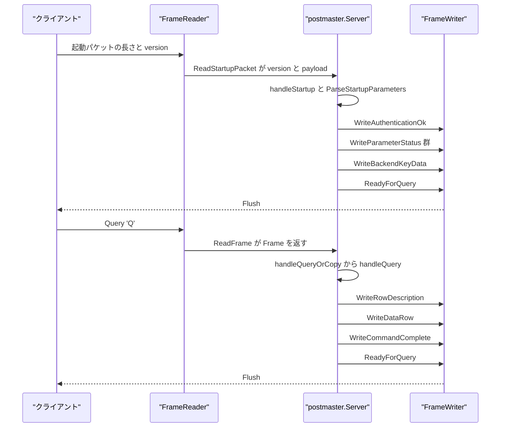
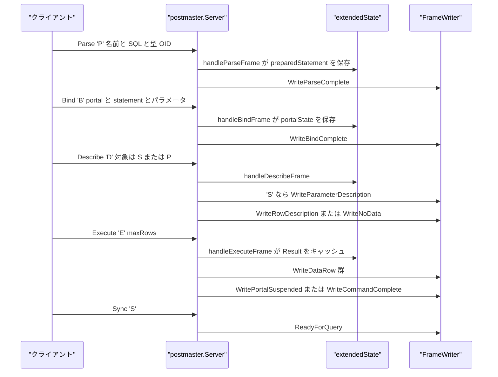
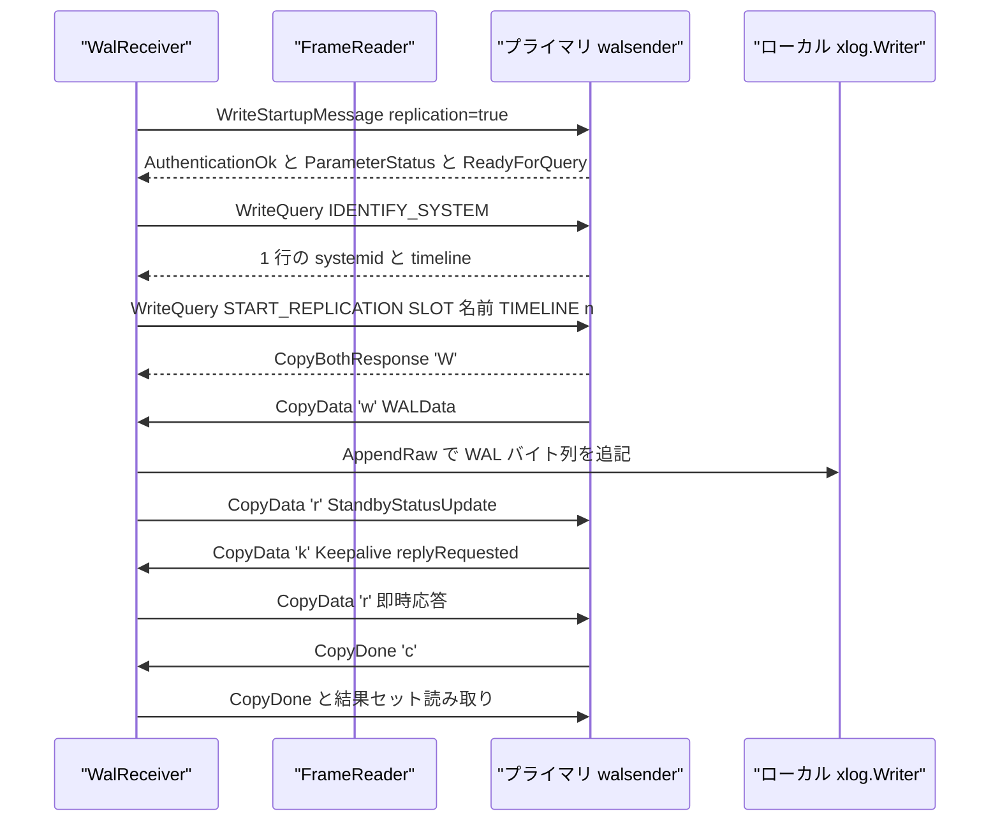
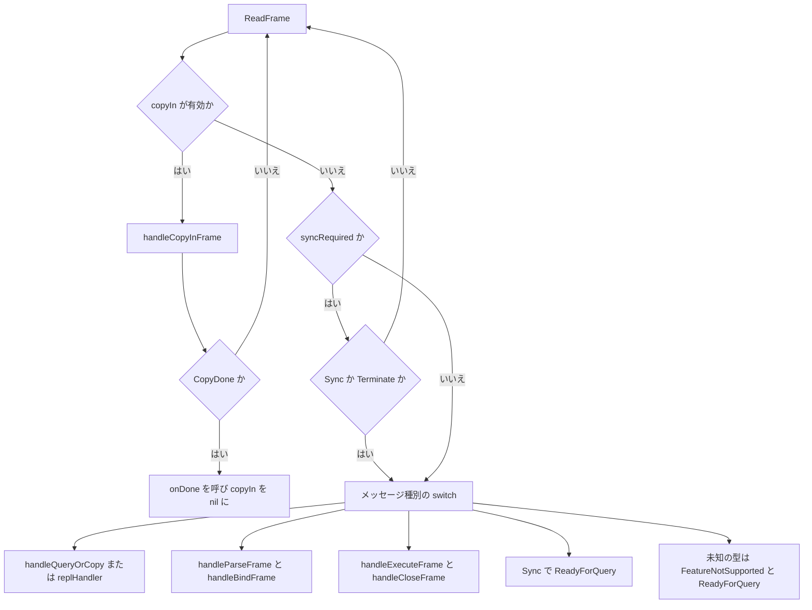

# ワイヤプロトコル

<details>
<summary>関連ソースファイル</summary>

- [`internal/libpq/frame.go`](https://github.com/ryogrid/goopg/blob/19856410e8d497d59787e1ab35a2febb3f5953d6/internal/libpq/frame.go)
- [`internal/libpq/messages.go`](https://github.com/ryogrid/goopg/blob/19856410e8d497d59787e1ab35a2febb3f5953d6/internal/libpq/messages.go)
- [`internal/libpq/protocol.go`](https://github.com/ryogrid/goopg/blob/19856410e8d497d59787e1ab35a2febb3f5953d6/internal/libpq/protocol.go)
- [`internal/libpq/replication.go`](https://github.com/ryogrid/goopg/blob/19856410e8d497d59787e1ab35a2febb3f5953d6/internal/libpq/replication.go)
- [`internal/postmaster/conn_tx.go`](https://github.com/ryogrid/goopg/blob/19856410e8d497d59787e1ab35a2febb3f5953d6/internal/postmaster/conn_tx.go)
- [`internal/postmaster/copy.go`](https://github.com/ryogrid/goopg/blob/19856410e8d497d59787e1ab35a2febb3f5953d6/internal/postmaster/copy.go)
- [`internal/postmaster/extended.go`](https://github.com/ryogrid/goopg/blob/19856410e8d497d59787e1ab35a2febb3f5953d6/internal/postmaster/extended.go)
- [`internal/postmaster/query.go`](https://github.com/ryogrid/goopg/blob/19856410e8d497d59787e1ab35a2febb3f5953d6/internal/postmaster/query.go)
- [`internal/postmaster/server.go`](https://github.com/ryogrid/goopg/blob/19856410e8d497d59787e1ab35a2febb3f5953d6/internal/postmaster/server.go)
- [`internal/replication/walreceiver.go`](https://github.com/ryogrid/goopg/blob/19856410e8d497d59787e1ab35a2febb3f5953d6/internal/replication/walreceiver.go)

</details>

`internal/libpq` は PostgreSQL v3 のフレームを読み書きし、サーバーとクライアントの双方が使うメッセージを組み立てる。`internal/postmaster` はその上に接続ごとの状態機械を実装し、起動パケットの交渉、認証後の `ParameterStatus` / `BackendKeyData` / `ReadyForQuery`、シンプルクエリ、拡張クエリ、COPY、そして `CopyBothResponse` を使うストリーミングレプリケーションを処理する。`internal/replication` の walreceiver は同じ `FrameReader` / `FrameWriter` をクライアント側で使い、プライマリとの間で `CopyData` を往復させる。全体の層構成は [2 システムアーキテクチャ](../2-Architecture.md) を参照されたい。サーバーの起動と停止は [3.1 CLI とライフサイクル](3.1-CLI-and-Lifecycle.md)、認証の判断は [3.3 認証と pg_hba](3.3-Authentication.md)、接続後の SQL 振り分けは [3.4 接続管理と SQL ディスパッチ](3.4-Connection-Dispatch.md) が扱う。

## 責務

- **フレームの符号化と復号** — `FrameReader.ReadStartupPacket` が起動パケットの 4 バイト長と version を読み、`FrameReader.ReadFrame` がタイプ 1 バイト + 4 バイト長 + payload の通常メッセージを読む。`FrameWriter.WriteFrame` は逆方向に同じ形で書き出す (`internal/libpq/frame.go:ReadStartupPacket`, `ReadFrame`, `WriteFrame`)。
- **サイズ上限の強制** — 起動パケットは `MaxStartupPacketLength = 10000`、通常メッセージの payload は `MaxRegularMessageLength = 16 << 20`（16 MiB）で制限する。超過した受信 payload は読み捨ててストリームを再同期し、`ErrFrameTooLarge` を返す (`internal/libpq/protocol.go:MaxStartupPacketLength`, `MaxRegularMessageLength`, `ErrFrameTooLarge`)。
- **起動パケットの交渉** — `handleStartup` は SSLRequest / GSSENCRequest に `'N'` を返して読み直し、CancelRequest をキャンセルレジストリへ渡して黙って閉じ、protocol 3.0 以外を `FeatureNotSupported` の FATAL にする。通常の起動パケットは `ParseStartupParameters` で NUL 区切りの key/value に分解する (`internal/postmaster/server.go:handleStartup`, `internal/libpq/frame.go:ParseStartupParameters`)。
- **バックエンドメッセージの生成** — 認証要求（`AuthenticationOk` / cleartext / MD5 / SASL）、`ParameterStatus`、`BackendKeyData`、`ReadyForQuery`、`RowDescription`、`DataRow`、`CommandComplete`、`ErrorResponse` / `NoticeResponse`、COPY 応答、`NotificationResponse` を `FrameWriter` のメソッドとして提供する (`internal/libpq/messages.go:WriteStartupMessage`, `WriteAuthenticationOk`, `WriteRowDescription`, `WriteDataRow`, `WriteCommandComplete`)。
- **シンプルクエリの実行** — 通常接続では、`runPostStartupLoop` が `MsgQuery` を受けると `handleQueryOrCopy` を呼び、COPY でなければ `handleQuery` が空クエリ、`SELECT 1`、`SHOW` / `SET` / `RESET` の高速パス、またはストレージがある場合の実行系へ振り分ける (`internal/postmaster/server.go:runPostStartupLoop`, `internal/postmaster/query.go:handleQuery`)。
- **拡張クエリプロトコル** — `Parse` / `Bind` / `Describe` / `Execute` / `Close` / `Sync` / `Flush` を `extendedState` の named statement と portal で処理する。バイナリ形式のパラメータと結果は明示的に `FeatureNotSupported` とし、テキスト形式だけを受け付ける (`internal/postmaster/extended.go:handleParseFrame`, `handleBindFrame`, `handleExecuteFrame`)。
- **COPY サブプロトコル** — `CopyInResponse` / `CopyData` / `CopyDone` / `CopyFail` を `copyInState` で処理する。テキストの `\.` 終端、途中で切れた最終行、CSV の引用符内、バイナリのトレーラー、トランザクションの commit / rollback を扱う (`internal/postmaster/copy.go:copyInState`, `handleCopyInFrame`)。
- **トランザクション状態の通知** — `ReadyForQuery` の 1 バイトは `FrameWriter.TxStatusFn` から取得し、`connTxState.wireStatus` が `'I'` / `'T'` / `'E'` を返す。エラー応答直後は `ReadyForQueryAfterError` が `'E'` を報告できる (`internal/postmaster/conn_tx.go:wireStatus`, `internal/libpq/messages.go:ReadyForQuery`, `ReadyForQueryAfterError`)。
- **NOTICE / WARNING のフィルタ** — `WriteNoticeResponse` は `client_min_messages` を `ShouldOutputToClient` で評価し、INFO は無条件、未知の severity はフェイルオープンで送る (`internal/libpq/messages.go:ShouldOutputToClient`, `WriteNoticeResponse`)。
- **ストリーミングレプリケーションのフレーム** — `CopyBothResponse ('W')` の内側の `CopyData` に `'w'`（WALData）、`'k'`（Keepalive）、`'r'`（StandbyStatusUpdate）を載せ、`EncodeWALData` / `EncodeKeepalive` / `EncodeStandbyStatusUpdate` と `DecodeReplicationMessage` で変換する (`internal/libpq/replication.go:EncodeWALData`, `DecodeReplicationMessage`)。
- **walreceiver の再接続** — `StartWalReceiver` が `primary_conninfo` を解析し、`DialWalReceiver` → `IDENTIFY_SYSTEM` → `TIMELINE_HISTORY` → `START_REPLICATION` の順で接続を確立する。失敗時は 500 ms から 30 秒まで指数バックオフし、タイムライン終端では WAL ライタの TLI が変わらなければ 5 秒待って再接続する (`internal/replication/walreceiver.go:StartWalReceiver`, `DialWalReceiver`, `walRetrieveRetryInterval`)。

## 処理フロー

### 起動からシンプルクエリまで

接続直後の起動パケットはタイプバイトを持たない。`serveConn` が `handleStartup` を呼び、`ReadStartupPacket` が長さと version を読んだ後、`ParseStartupParameters` が key/value を取り出す。認証が成功すると `sendStartupReply` が reportable GUC の `ParameterStatus`、`BackendKeyData`、`ReadyForQuery` をまとめて送る。その後の `Query` は `ReadFrame` で 1 メッセージずつ読まれ、`handleQueryOrCopy` → `handleQuery` を経て `RowDescription` / `DataRow` / `CommandComplete` / `ReadyForQuery` の順に返る (`internal/postmaster/server.go:serveConn`, `handleStartup`, `sendStartupReply`, `runPostStartupLoop`)。



`handleStartup` は SSL/GSS の拒否応答を最大 3 回まで繰り返せる。`for range 3` のループを抜けても通常の起動パケットが来なければ「too many SSL/GSS negotiation attempts」で接続を閉じる (`internal/postmaster/server.go:handleStartup`)。`CancelRequest` は payload がちょうど 8 バイトのときだけ `cancelQuery` を呼び、応答を返さずに終了する。

### 拡張クエリの往復

拡張プロトコルでは、`Parse` が named statement を登録し、`Bind` がそれを portal に結びつけ、`Describe` が必要なメタデータを返し、`Execute` が行を返す。エラーが起きると `extended.syncRequired` が立ち、`Sync` が来るまで後続のフレームは読み捨てられる。これが PostgreSQL の「エラー後の再同期」に相当する (`internal/postmaster/server.go:runPostStartupLoop`, `internal/postmaster/extended.go:handleParseFrame`, `handleBindFrame`, `handleExecuteFrame`)。



### ストリーミングレプリケーションのストリーム

物理レプリケーションは通常の SQL セッションではなく、`replication=true` の起動パケットで始まる。`WalReceiver.handshake` は `user` と `replication=true` を送り、`ReadyForQuery` までサーバーのフレームを読む。続いて `IDENTIFY_SYSTEM` で system identifier と timeline を確認し、`TIMELINE_HISTORY` で不足している履歴ファイルを取り寄せ、`START_REPLICATION ... TIMELINE n` を送る。成功するとサーバーは `CopyBothResponse ('W')` を返し、以降は双方向の `CopyData ('d')` になる (`internal/replication/walreceiver.go:handshake`, `identifySystem`, `fetchTimelineHistoryFiles`, `startStreaming`)。



`Run` は受信 goroutine とステータス送信の ticker を分けている。受信 goroutine は `ReadFrame` のたびに payload をコピーしてチャネルへ渡す。これは `FrameReader` のバッファが次の読み取りで再利用されるためである。メインループは `CopyData` を `handleCopyData` に渡し、`StatusInterval`（既定 10 秒）ごとに `sendStatus` で `'r'` を返す。`Keepalive` に `replyRequested` が立っていれば即座に `sendStatus` を呼ぶ (`internal/replication/walreceiver.go:Run`, `handleCopyData`, `sendStatus`)。

## 主要ファイル

| ファイル | 役割 |
| --- | --- |
| `internal/libpq/frame.go` | `Frame` / `FrameReader` / `FrameWriter` と起動パケットの読み取り、NUL 終端 key/value の `ParseStartupParameters`。バッファ再利用とサイズ上限、読み書きフックを実装する (`internal/libpq/frame.go:FrameReader`, `FrameWriter`, `ParseStartupParameters`)。 |
| `internal/libpq/protocol.go` | protocol 3.0 の定数、SSL/GSS/CancelRequest の特殊コード、`MaxStartupPacketLength = 10000`、`MaxRegularMessageLength = 16 << 20`、前後方向のメッセージタイプバイト、認証サブコード、`TransactionStatus` を定義する (`internal/libpq/protocol.go:ProtocolVersion3_0`, `MaxRegularMessageLength`, `MsgQuery`, `TxStatusIdle`)。 |
| `internal/libpq/messages.go` | バックエンドメッセージのエンコーダ群。認証、`ParameterStatus`、`BackendKeyData`、`ReadyForQuery`、`RowDescription`、`DataRow`、`CommandComplete`、Error/Notice、COPY、`NotificationResponse` を組み立てる (`internal/libpq/messages.go:WriteAuthenticationOk`, `WriteRowDescription`, `WriteDataRow`, `WriteNoticeResponse`)。 |
| `internal/libpq/replication.go` | CopyBoth の外枠と walprotocol の内側フレーム。`'w'` / `'k'` / `'r'` のエンコードとデコード、2000-01-01 UTC 起点のマイクロ秒タイムスタンプ変換を提供する (`internal/libpq/replication.go:EncodeWALData`, `EncodeKeepalive`, `EncodeStandbyStatusUpdate`, `DecodeReplicationMessage`)。 |
| `internal/postmaster/server.go` | 接続ごとの `serveConn`、起動交渉の `handleStartup`、起動応答の `sendStartupReply`、フレームループの `runPostStartupLoop`、`ParameterStatus` と `ReadyForQuery` の配線、replication 接続の振り分けを持つ (`internal/postmaster/server.go:serveConn`, `handleStartup`, `runPostStartupLoop`)。 |
| `internal/postmaster/query.go` | シンプルクエリの `handleQuery`、`SHOW` / `SET` / `RESET` の高速パス、`SELECT 1` の応答、`writeQueryError` による ErrorResponse + `ReadyForQuery` の生成 (`internal/postmaster/query.go:handleQuery`, `handleShow`, `respondSelectOne`, `writeQueryError`)。 |
| `internal/postmaster/extended.go` | `extendedState` と `preparedStatement` / `portalState` / `boundParam`、`Parse` / `Bind` / `Describe` / `Execute` / `Close` の各ハンドラ、payload の読み取り用 `payloadReader` (`internal/postmaster/extended.go:extendedState`, `handleParseFrame`, `handleBindFrame`, `handleExecuteFrame`)。 |
| `internal/postmaster/copy.go` | `copyInState` と `handleQueryOrCopy`、`CopyInResponse` 後の `CopyData` / `CopyDone` / `CopyFail` 処理、テキストとバイナリの COPY、`\.` 終端の扱い (`internal/postmaster/copy.go:copyInState`, `handleQueryOrCopy`, `handleCopyInFrame`)。 |
| `internal/postmaster/conn_tx.go` | 接続ごとの明示トランザクション状態 `connTxState` と、`ReadyForQuery` の `'I'` / `'T'` / `'E'` を決める `wireStatus` (`internal/postmaster/conn_tx.go:connTxState`, `wireStatus`)。 |
| `internal/replication/walreceiver.go` | クライアント側の `WalReceiver`、起動交渉、`IDENTIFY_SYSTEM` / `TIMELINE_HISTORY` / `START_REPLICATION`、`'w'` のローカル WAL への `AppendRaw`、`'r'` の定期送信、再接続ループ (`internal/replication/walreceiver.go:WalReceiver`, `DialWalReceiver`, `Run`, `StartWalReceiver`)。 |

## 公開 API / エントリポイント

フレーム層:

- `func NewFrameReader(r io.Reader) *FrameReader` / `func NewFrameReaderWithLimit(r io.Reader, maxPayload int) *FrameReader` — 通常の上限またはテスト用のカスタム上限で reader を作る (`internal/libpq/frame.go:NewFrameReader`, `NewFrameReaderWithLimit`)。
- `func (fr *FrameReader) ReadStartupPacket() (version uint32, payload []byte, err error)` — 接続の最初の 1 回だけ呼ぶ。`io.EOF` は「1 バイトも読まずに閉じた」ことを示す (`internal/libpq/frame.go:ReadStartupPacket`)。
- `func (fr *FrameReader) ReadFrame() (Frame, error)` — 通常メッセージを 1 つ読む。payload は次の呼び出しまで有効 (`internal/libpq/frame.go:ReadFrame`)。
- `func NewFrameWriter(w io.Writer) *FrameWriter` / `WriteFrame(typ byte, payload []byte) error` / `WriteRaw(b []byte) error` / `Flush() error` — バッファ付きの書き込み。`WriteRaw` は SSL/GSS 拒否の `'N'` のようなフレーム外の 1 バイトに使う (`internal/libpq/frame.go:NewFrameWriter`, `WriteFrame`, `WriteRaw`, `Flush`)。
- `func (fw *FrameWriter) WriteStartupMessage(params map[string]string) error` / `WriteQuery(sql string) error` — クライアント側の起動パケットと `'Q'` メッセージ (`internal/libpq/messages.go:WriteStartupMessage`, `WriteQuery`)。
- `func ParseStartupParameters(buf []byte) (map[string]string, error)` — version の後ろの NUL 区切り key/value を解析する (`internal/libpq/frame.go:ParseStartupParameters`)。

サーバー側:

- `func (s *Server) handleStartup(r *libpq.FrameReader, w *libpq.FrameWriter) (map[string]string, error)` — SSL/GSS/CancelRequest の特別処理と protocol 3.0 の検証 (`internal/postmaster/server.go:handleStartup`)。
- `func (s *Server) sendStartupReply(w *libpq.FrameWriter, sess *misc.SessionRegistry, pid, secret uint32) error` — `ParameterStatus`、`BackendKeyData`、`ReadyForQuery` の起動応答 (`internal/postmaster/server.go:sendStartupReply`)。
- `func (s *Server) runPostStartupLoop(...)` — `ReadyForQuery` 後の全フレームを処理するループ (`internal/postmaster/server.go:runPostStartupLoop`)。
- `func (s *Server) handleQuery(...) error` / `handleQueryOrCopy(...) (*copyInState, error)` — シンプルクエリと COPY の入口 (`internal/postmaster/query.go:handleQuery`, `internal/postmaster/copy.go:handleQueryOrCopy`)。
- `handleParseFrame` / `handleBindFrame` / `handleDescribeFrame` / `handleExecuteFrame` / `handleCloseFrame` — 拡張プロトコルの各メッセージ (`internal/postmaster/extended.go:handleParseFrame`, `handleBindFrame`, `handleDescribeFrame`, `handleExecuteFrame`, `handleCloseFrame`)。
- `func (s *Server) handleCopyInFrame(w *libpq.FrameWriter, st *copyInState, f libpq.Frame) (bool, error)` — COPY FROM STDIN のデータフレーム処理。戻り値の bool は COPY が終了したか (`internal/postmaster/copy.go:handleCopyInFrame`)。

レプリケーション:

- `func (fw *FrameWriter) WriteCopyBothResponse(overallFormat byte, columnFormats []uint16) error` — `'W'` の送出 (`internal/libpq/replication.go:WriteCopyBothResponse`)。
- `func EncodeWALData(startLSN, endLSN uint64, sendTime time.Time, walBytes []byte) []byte` / `EncodeKeepalive(...)` / `EncodeStandbyStatusUpdate(...)` — CopyData の内側 payload (`internal/libpq/replication.go:EncodeWALData`, `EncodeKeepalive`, `EncodeStandbyStatusUpdate`)。
- `func DecodeReplicationMessage(payload []byte) (any, byte, error)` — 内側タイプを判別して `*WALDataMessage` / `*KeepaliveMessage` / `*StandbyStatusUpdate` を返す (`internal/libpq/replication.go:DecodeReplicationMessage`)。
- `func DialWalReceiver(ctx context.Context, cfg WalReceiverConfig) (*WalReceiver, error)` / `func (r *WalReceiver) Run(ctx context.Context) error` / `func StartWalReceiver(...)` — 接続、ストリーム消費、再接続ループ (`internal/replication/walreceiver.go:DialWalReceiver`, `Run`, `StartWalReceiver`)。

## 主要データ構造

### `Frame` / `FrameReader` / `FrameWriter`

```go
type Frame struct {
	Type    byte
	Payload []byte
}
```

`internal/libpq/frame.go:Frame`

```go
type FrameReader struct {
	r        *bufio.Reader
	buf      []byte // grows on demand, capped by MaxRegularMessageLength
	maxStart int
	maxRegul int

	// OnBeforeRead / OnAfterRead are optional hooks called before and
	// after every ReadFrame / ReadStartupPacket. The server sets these
	// from serveConn so the activity package can record ClientRead
	// wait events (Stage B wait-event taxonomy).
	OnBeforeRead func()
	OnAfterRead  func()
}
```

`internal/libpq/frame.go:FrameReader`

```go
type FrameWriter struct {
	w   *bufio.Writer
	hdr [5]byte

	// OnBeforeWrite / OnAfterWrite are optional hooks called before and
	// after every WriteFrame / WriteRaw / Flush. The server sets these
	// from serveConn so the activity package can record ClientWrite
	// wait events (Stage B wait-event taxonomy).
	OnBeforeWrite func()
	OnAfterWrite  func()

	// TxStatusFn, when non-nil, supplies the 1-byte transaction status that
	// ReadyForQuery / ReadyForQueryAfterError put in the 'Z' message: 'I'
	// (idle), 'T' (in a transaction block) or 'E' (in a FAILED transaction
	// block). The server installs it from serveConn so the byte tracks the
	// connection's connTxState. afterError is true when the 'Z' terminates an
	// ErrorResponse — see ReadyForQueryAfterError.
	//
	// Clients act on this byte: libpq exposes it as PQtransactionStatus, and
	// pgbench uses it to decide whether a failed transaction still needs a
	// ROLLBACK. A connection that always answered 'I' made pgbench skip that
	// ROLLBACK and then hit 25P02 on the next BEGIN (AI-20260810-011258-006).
	TxStatusFn func(afterError bool) TransactionStatus

	// ClientMinMessagesFn, when non-nil, supplies the connection's current
	// client_min_messages GUC value. WriteNoticeResponse consults it to
	// decide whether a NOTICE/WARNING is visible to this client, mirroring
	// should_output_to_client in postgres/src/backend/utils/error/elog.c.
	// The server installs it from runPostStartupLoop, which is also why a
	// nil hook means "send everything": messages emitted before the startup
	// handshake completes are unfiltered, matching upstream's
	// ClientAuthInProgress carve-out (client_min_messages is honored only
	// after authentication).
	ClientMinMessagesFn func() string

	// M0092-0004: per-connection scratch buffers for WriteDataRowReuse.
	// Reused across rows AND across statements on the same connection
	// (pgbench-style workloads issue many single-row SELECTs in a row).
	// payloadBuf backs the wire-frame payload; valueBuf holds the
	// concatenated column wire-text bytes; cells indexes into valueBuf.
	dataRowPayload []byte
	dataRowValues  []byte
	dataRowCells   [][]byte
}
```

`internal/libpq/frame.go:FrameWriter`

`Frame.Payload` は `FrameReader` の内部バッファを指す借用スライスであり、次の `ReadFrame` までしか有効でない。保持する側は必ずコピーする。`FrameReader` は 1 接続につき 1 個で、`ReadStartupPacket` を最初の 1 回だけ呼び、以後は `ReadFrame` を使う。`maxStart` は起動パケットの上限、`maxRegul` は通常メッセージの payload 上限で、`NewFrameReaderWithLimit` は後者だけを差し替える。`FrameWriter` はバッファ付きで、論理的なメッセージ群を書き終えたら `Flush` する。`hdr` は 5 バイトのタイプ + 長さヘッダを再利用するための作業領域である。`TxStatusFn` と `ClientMinMessagesFn` は接続ごとに差し替えられ、`ReadyForQuery` と `WriteNoticeResponse` の振る舞いを接続状態に結びつける。

### `FieldDescription` — RowDescription の 1 列

```go
type FieldDescription struct {
	Name         string
	TableOID     uint32 // 0 when not from a base table
	ColumnAttNum uint16 // 0 when not from a base table
	TypeOID      uint32
	TypeSize     int16 // pg_type.typlen; -1 for variable-width
	TypeModifier int32 // pg_type.atttypmod; -1 when none
	Format       int16 // 0 = text, 1 = binary
}
```

`internal/libpq/messages.go:FieldDescription`

`WriteRowDescription` はこの構造体を `name\0`、`tableOID(int32)`、`columnAttNum(int16)`、`typeOID(int32)`、`typeSize(int16)`、`typeModifier(int32)`、`format(int16)` の順で並べる。`TableOID = 0` と `ColumnAttNum = 0` は基底テーブル由来でない列を表し、`TypeSize = -1` は可変長、`TypeModifier = -1` は typmod なしを意味する。`Format` は 0 がテキスト、1 がバイナリで、このページで扱う経路は 0 を使う (`internal/libpq/messages.go:WriteRowDescription`)。`WriteDataRow` は列数 `int16` の後に各列の `int32` 長と値を並べ、`nil` の列スライスを長さ `-1`（`0xFFFFFFFF`）の SQL NULL として符号化する (`internal/libpq/messages.go:WriteDataRow`)。

### `extendedState` と named statement / portal

```go
type extendedState struct {
	statements   map[string]*preparedStatement
	portals      map[string]*portalState
	syncRequired bool
	ProcNum      int32  // backend's ProcArray slot; forwarded to Begin calls
	DBName       string // connection's database; scopes pg_extension (M0110-0003 gap #7c)
}

type preparedStatement struct {
	Name       string
	Query      string
	ParamCount int
}

type portalState struct {
	Name      string
	Statement *preparedStatement
	Params    []boundParam
	Result    *extendedQueryResult
	RowPos    int
}

type boundParam struct {
	IsNull bool
	Text   string
}
```

`internal/postmaster/extended.go:extendedState`, `preparedStatement`, `portalState`, `boundParam`

`statements` は名前付き prepared statement、`portals` は Bind で作られた実行インスタンスを保持する。空文字の名前は「unnamed statement / unnamed portal」であり、`handleParseFrame` が unnamed statement を上書きしたときは unnamed portal も削除する。`syncRequired` はエラー後の再同期待ちを表し、`runPostStartupLoop` はこれが真の間、`Sync` と `Terminate` 以外のフレームを読み捨てる。`portalState.Result` は最初の `Execute` で実行した結果をキャッシュし、`RowPos` により `maxRows` で分割された続きの行を返す。`boundParam` は NULL かテキスト値だけを持ち、バイナリ形式は受け付けない。

### `copyInState` — COPY FROM STDIN の接続状態

```go
type copyInState struct {
	// Legacy path (no storage configured).
	rows       int64
	partialRow bool

	// Executor path.
	fromExec    *executor.CopyFromExecutor
	lineBuf     []byte
	tx          transam.Transaction
	mgr         *transam.Manager
	asyncCommit bool
	// onDone saves the COPY's session state (sequence currval/lastval) back
	// to the connection once the CopyIn stream ends, however it ends.
	onDone func()
}
```

`internal/postmaster/copy.go:copyInState`

`fromExec` が非 nil のときは実行系を使うパスで、`lineBuf` に `CopyData` の断片を溜め、改行ごとに `PushLine` する。nil のときはストレージ未設定のレガシーパスで、改行数を数えて `rows` を進めるだけである。`tx` は COPY 自身の自動コミットトランザクション、`mgr` はそのコミット / ロールバック先、`asyncCommit` は `synchronous_commit` のセッション値に従うかを表す。`onDone` は `handleCopyInFrame` が COPY の終了を報告したときに呼ばれ、シーケンスの `currval` / `lastval` を接続へ戻す (`internal/postmaster/copy.go:handleCopyInFrame`, `commitCopyTx`)。

### `WALDataMessage` / `KeepaliveMessage` / `StandbyStatusUpdate`

```go
// WALDataMessage is the parsed shape of a 'w' (WAL data) CopyData
// payload. WALBytes references the original payload buffer — copy
// before holding past the next FrameReader call.
type WALDataMessage struct {
	StartLSN uint64
	EndLSN   uint64 // the sender's end of WAL (walEnd), not the data's end: that is StartLSN+len(WALBytes)
	SendTime time.Time
	WALBytes []byte
}

// KeepaliveMessage is the parsed shape of a 'k' (keepalive) payload.
type KeepaliveMessage struct {
	WALEnd         uint64
	SendTime       time.Time
	ReplyRequested bool
}

// StandbyStatusUpdate is the parsed shape of an 'r' (status update)
// payload. The primary uses ApplyLSN / FlushLSN to advance the
// confirmed-flush position on the corresponding replication slot.
type StandbyStatusUpdate struct {
	WriteLSN       uint64
	FlushLSN       uint64
	ApplyLSN       uint64
	SendTime       time.Time
	ReplyRequested bool
}
```

`internal/libpq/replication.go:WALDataMessage`, `KeepaliveMessage`, `StandbyStatusUpdate`

`WALDataMessage.WALBytes` はデコード元の `payload` を参照する借用スライスで、次の `FrameReader` 呼び出しまで有効である。`EndLSN` は「このフレームのデータの終端」ではなく「送信時点のプライマリの WAL 末尾」なので、`StartLSN + len(WALBytes) <= EndLSN` であり、キャッチアップ中は不等号になる。`KeepaliveMessage` は `walEnd` と `replyRequested` を持ち、`StandbyStatusUpdate` は standby が返す write / flush / apply の 3 位置を持つ。`DecodeReplicationMessage` はそれぞれ 25 バイト以上、18 バイトちょうど、34 バイトちょうどを要求する (`internal/libpq/replication.go:decodeWALData`, `decodeKeepalive`, `decodeStandbyStatus`)。

### `WalReceiver` — クライアント側の接続状態

```go
type WalReceiver struct {
	cfg    WalReceiverConfig
	conn   net.Conn
	r      *libpq.FrameReader
	w      *libpq.FrameWriter
	mu     sync.Mutex
	closed bool

	// applyLSN tracks the last record successfully Append'd to the
	// local writer. Re-read by the status-update goroutine via the
	// writer's own WrittenLSN(), but we cache for a tiny perf win
	// and to make the test surface predictable.
	applyLSN uint64

	// monHandle is the observability registry handle this receiver
	// publishes progress through. nil when cfg.Receivers was unset
	// (in which case all the SetReceivedLSN / MarkMessageReceived
	// calls become no-ops via the nil-check helpers below).
	monHandle *xlog.Receiver

	// primaryTLI is the primary's timeline IDENTIFY_SYSTEM reported.
	primaryTLI uint32
}
```

`internal/replication/walreceiver.go:WalReceiver`

`conn`・`r`・`w` は 1 本の TCP 接続を共有し、`r` と `w` はそれぞれ `FrameReader` と `FrameWriter` である。`mu` は `applyLSN` と `closed` を保護する。`applyLSN` はローカル WAL へ正常に追記できた最後の位置で、`'w'` の `StartLSN` が期待位置より小さい場合は重複分をトリムし、大きい場合はギャップとしてエラーにする。`monHandle` は `pg_stat_wal_receiver` 用の登録ハンドルで、nil のときは観測呼び出しが no-op になる。`primaryTLI` は `IDENTIFY_SYSTEM` の結果から設定され、`StartTLI` より小さい場合は接続を拒否する (`internal/replication/walreceiver.go:handleCopyData`, `identifySystem`)。

## 内部構造

### 起動交渉の状態

`ReadStartupPacket` は最初の 1 バイトを読み、`io.EOF` または `io.ErrUnexpectedEOF` を `io.EOF` に正規化する。これは「何も送らずに閉じたクライアント」と「途中まで送ったクライアント」を区別するためである。長さは 8 未満または 10000 超で拒否し、4 バイトの version を読んだ後、残りを `payload` として返す (`internal/libpq/frame.go:ReadStartupPacket`)。`handleStartup` はこの version を見て、SSL/GSS なら `WriteRaw([]byte{'N'})` を送ってループを続け、CancelRequest ならキャンセルを処理して終了し、3.0 以外なら FATAL を返す (`internal/postmaster/server.go:handleStartup`)。

`ParseStartupParameters` は空の buffer をエラーにし、key と value を交互に読む。key が空になった時点で終端とみなす。重複キーは最初の値を残し、終端の空 key がない場合はエラーになる (`internal/libpq/frame.go:ParseStartupParameters`)。`serveConn` は `user`、`database`、`application_name`、`replication`、`options` 以外のキーを `SetStartup` で GUC として適用し、`options` の `-c name=value` も同じ経路に流す (`internal/postmaster/server.go:serveConn`)。

### フレームループの優先順位

`runPostStartupLoop` は `ReadFrame` の結果を次の優先順位で処理する。COPY FROM STDIN が進行中なら、まず `handleCopyInFrame` に渡す。次に `extended.syncRequired` が立っていれば `Sync` と `Terminate` 以外を捨てる。その後にメッセージタイプの switch へ入る。この順序により、COPY 中のフレームを通常の SQL として誤解釈せず、エラー後の拡張プロトコルも再同期できる (`internal/postmaster/server.go:runPostStartupLoop`)。



`MsgCopyData` / `MsgCopyDone` / `MsgCopyFail` は COPY 中でない限り明示的に無視される。COPY がエラーで終わった後、クライアントが送り続けるこれらのフレームに ErrorResponse や `ReadyForQuery` を返すと、次の文の応答と混ざってセッションがずれるためである。`MsgFlush` は応答フレームを持たず、ループ末尾の `w.Flush()` で保留分が送られる (`internal/postmaster/server.go:runPostStartupLoop`)。

### 拡張プロトコルの制約

`Parse` は名前、SQL、型 OID の配列を読み、末尾に余分なバイトがあれば protocol violation にする。`preparedStatement.ParamCount` は SQL 文字列中の `$n` の最大値（`inferParamCount` の結果）であり、Bind が要求するパラメータ数になる。`Bind` は statement の存在、パラメータ数、パラメータ形式の個数（0、1、またはパラメータ数と同じ）、結果形式の個数（0 または 1）を検査する。形式コードが 0 以外ならバイナリ扱いとして `FeatureNotSupported` を返す。長さが -1 なら NULL、-1 未満なら protocol violation である (`internal/postmaster/extended.go:handleParseFrame`, `inferParamCount`, `handleBindFrame`)。

`Describe` の対象が statement なら `ParameterDescription` を送ってから `RowDescription` または `NoData` を送る。portal なら `RowDescription` または `NoData` だけを送る。`Execute` は portal の結果を初回に実行してキャッシュし、`maxRows > 0` で行が残る場合は `PortalSuspended` を返す。`maxRows = 0` は全行を返す。`Close` は statement を削除すると、その statement を参照する portal も削除する (`internal/postmaster/extended.go:handleDescribeFrame`, `handleExecuteFrame`, `handleCloseFrame`)。

`Sync` は `syncRequired` を下ろし、保留中の LISTEN/NOTIFY を `NotificationResponse` として送ってから `ReadyForQuery` を返す。拡張プロトコルでは各メッセージが `Flush` を待たずにバッファされ得るが、ループ末尾で毎回 `Flush` されるため、クライアントは応答を受け取れる (`internal/postmaster/server.go:runPostStartupLoop`)。

### COPY の状態遷移

ストレージがある場合、`handleQueryOrCopy` は `COPY ... FROM STDIN` を見つけると `dispatchCopyViaExecutor` を呼び、実行系が `CopyInResponse` を送ったうえで `copyInState` を返す。`CopyInResponse` / `CopyOutResponse` / `CopyBothResponse` の本体は、いずれも `int8 overall-format`（0 = テキスト、1 = バイナリ）、`int16` の列数、列ごとの `int16` 形式の並びである。以降の `CopyData` は `handleCopyInFrame` が処理する。テキスト形式では `lineBuf` を改行で分割し、`\.` だけの行を終端マーカーとして捨てる。ただし CSV の引用符内では `\.` もデータとして扱う。`CopyDone` では未処理の最終行を `PushLine` し、`fromExec.Finish()` を呼んでからコミットし、`COPY n` と `ReadyForQuery` を返す (`internal/postmaster/copy.go:handleQueryOrCopy`, `handleCopyInFrame`, `consumeExecCopyData`, `isCopyTextEOD`)。

バイナリ形式では `PushBinaryData` がトレーラーを検出した時点で、その `CopyData` の中で COPY を完了できる。`CopyFail` はメッセージを読み、トランザクションをロールバックして `QueryCanceled` の ErrorResponse と `ReadyForQuery` を返す。想定外のメッセージは `ProtocolViolation` で COPY を終了する (`internal/postmaster/copy.go:handleCopyInFrame`)。COPY の構文・実行系・拡張クエリとの組み合わせは [3.5 COPY と拡張クエリプロトコル](3.5-COPY-and-Extended-Protocol.md) で詳しく扱う。

### レプリケーションの内側フレーム

`EncodeWALData` は `'w'`、`StartLSN`、`EndLSN`、`sendTime`、WAL バイト列を並べる。`EncodeKeepalive` は `'k'`、`walEnd`、`sendTime`、`replyRequested` を並べる。`EncodeStandbyStatusUpdate` は `'r'`、write / flush / apply の各 LSN、`sendTime`、`replyRequested` を並べる。タイムスタンプは 2000-01-01 00:00:00 UTC からのマイクロ秒で、`PgTimestampMicros` と `PgTimestampToTime` が変換する (`internal/libpq/replication.go:EncodeWALData`, `EncodeKeepalive`, `EncodeStandbyStatusUpdate`, `PgTimestampMicros`)。

walreceiver は `START_REPLICATION` の開始位置を `streamingStartLSN` でセグメント境界に丸める。プライマリはその境界から送り直すため、ローカルに既にあるバイトは受信時に `expectedStart` との差分でトリムされる。`StartLSN` が期待位置より大きい場合は「raw WAL gap」としてエラーにし、勝手に埋めない。空の `WALBytes` は「WAL の前進だけを通知するフレーム」として `EndLSN` を `applyLSN` に反映する (`internal/replication/walreceiver.go:streamingStartLSN`, `handleCopyData`)。

`sendStatus` は write と flush をどちらも受信済み位置にし、apply だけ `ApplyLSNFunc` が正の値を返せばその値を使う。これにより `synchronous_commit = remote_apply` の待ちが「受信した」ではなく「適用した」位置を見る (`internal/replication/walreceiver.go:sendStatus`)。`StartWalReceiver` は接続失敗時に 500 ms から 30 秒まで倍々に増やし、タイムライン終端では `OnEndOfTimeline` を呼んだ後、WAL ライタの TLI が変わっていなければ `walRetrieveRetryInterval = 5 * time.Second` 待つ (`internal/replication/walreceiver.go:StartWalReceiver`, `followEndOfTimeline`, `walRetrieveRetryInterval`)。レプリケーション全体の設計は [11 レプリケーションとバックアップ](../11-Replication.md) を参照されたい。

## エッジケースと不変条件

- **起動パケットの境界** — 長さが 8 未満または 10000 超なら `invalid startup packet length` で拒否する。最初の 1 バイトを読む前に EOF なら `io.EOF` を返し、それ以降の途中終了は `incomplete startup length` / `incomplete startup packet body` になる (`internal/libpq/frame.go:ReadStartupPacket`, `internal/libpq/protocol.go:MaxStartupPacketLength`)。
- **SSL/GSS の回数制限** — `handleStartup` の `for range 3` は SSL/GSS 要求を最大 3 回まで処理する。3 回とも交渉要求なら `too many SSL/GSS negotiation attempts` で接続を閉じる。goopg は TLS を実装していないため、常に `'N'` を返す (`internal/postmaster/server.go:handleStartup`)。
- **CancelRequest は無応答** — payload が 8 バイトのときだけ `targetPID` と `targetSecret` を読み、`cancelReg.cancelQuery` を呼ぶ。長さが違えば何もせず、いずれの場合も応答を書かずに接続を閉じる (`internal/postmaster/server.go:handleStartup`)。
- **不正な protocol version** — 3.0 以外は `FeatureNotSupported` の FATAL で `unsupported frontend protocol X.Y: server supports 3.0` を返す。マイナー番号だけが違う場合も拒否する (`internal/postmaster/server.go:handleStartup`)。
- **起動パラメータの重複と終端** — 同じキーが複数回現れた場合は最初の値を採用する。終端の空キーがない buffer は `missing terminating empty key` になる (`internal/libpq/frame.go:ParseStartupParameters`)。
- **replication パラメータの解釈** — `database` はそのまま複製モード、それ以外は `true` / `false` / `yes` / `no` / `on` / `off` / `1` / `0` の接頭辞として解釈する。解釈できない値は `22023` の FATAL で、`Valid values are: "false", 0, "true", 1, "database".` という HINT を付ける (`internal/postmaster/server.go:isReplicationStartupParam`, `parseStartupBool`, `serveConn`)。
- **通常フレームの上限** — payload が 16 MiB を超えると `ReadFrame` は残りを読み捨てて `ErrFrameTooLarge` を返す。`runPostStartupLoop` はこれを受けると `ProtocolViolation` の ErrorResponse と `ReadyForQuery` を送り、セッションを継続する。`WriteFrame` も 16 MiB 超の payload を拒否する (`internal/libpq/frame.go:ReadFrame`, `WriteFrame`, `internal/postmaster/server.go:runPostStartupLoop`)。
- **拡張プロトコルの再同期** — `Parse` / `Bind` / `Describe` / `Execute` のいずれかがエラーになると `syncRequired = true` になり、`Sync` か `Terminate` が来るまで他のフレームは捨てられる。エラーを返した `Parse` / `Bind` / `Describe` / `Execute` は明示トランザクションも失敗状態へ落とす (`internal/postmaster/server.go:runPostStartupLoop`, `internal/postmaster/extended.go:handleParseFrame`, `handleBindFrame`, `handleExecuteFrame`)。
- **バイナリ形式は未対応** — `Bind` のパラメータ形式が 0 以外、または結果形式が 0 以外なら `FeatureNotSupported` を返す。パラメータ長が -1 未満なら `ProtocolViolation`、-1 は NULL として扱う (`internal/postmaster/extended.go:handleBindFrame`)。
- **portal の行分割** — `Execute` の `maxRows` が正で行が残る場合、`PortalSuspended` を返して `RowPos` を進める。次の `Execute` はキャッシュ済み `Result` の続きから返す。`maxRows = 0` は全行を返す (`internal/postmaster/extended.go:handleExecuteFrame`)。
- **COPY の `\.` と最終行** — テキスト COPY では `\.` だけの行を終端として捨てるが、CSV の引用符内ではデータとして扱う。`CopyDone` が来たとき `lineBuf` に改行なしの最終行が残っていれば、それを `PushLine` してから終了する (`internal/postmaster/copy.go:consumeExecCopyData`, `handleCopyInFrame`)。
- **COPY エラー後の残留フレーム** — COPY がエラーで終わった後に届く `CopyData` / `CopyDone` / `CopyFail` は、COPY 中でなければ応答なしで無視する。ここで ErrorResponse を返すと、後続の文の `ReadyForQuery` と混ざってプロトコルがずれる (`internal/postmaster/server.go:runPostStartupLoop`)。
- **ReadyForQuery の状態バイト** — `wireStatus` は明示トランザクションが無い、または prepared transaction 中なら `'I'`、失敗中または `afterError` なら `'E'`、それ以外の明示トランザクションなら `'T'` を返す。`PREPARE TRANSACTION` 後はサーバー内部でトランザクションが開いていてもクライアントには `'I'` と報告する (`internal/postmaster/conn_tx.go:wireStatus`)。
- **NOTICE のフィルタ** — `client_min_messages` が NOTICE 以上を要求していれば NOTICE は送られない。INFO は常に送られ、未知の severity や未知の GUC 値はフェイルオープンで送られる。`ErrorResponse` はこのフィルタを通らない (`internal/libpq/messages.go:ShouldOutputToClient`, `WriteNoticeResponse`, `WriteErrorResponse`)。
- **WALData の長さと借用** — `decodeWALData` は 25 バイト未満を拒否し、`WALBytes` は元 payload のスライスを返す。`Keepalive` は 18 バイトちょうど、`StandbyStatusUpdate` は 34 バイトちょうどを要求し、それ以外はエラーにする (`internal/libpq/replication.go:decodeWALData`, `decodeKeepalive`, `decodeStandbyStatus`)。
- **WAL の重複とギャップ** — `handleCopyData` は `StartLSN` が `WAL.WrittenLSN()` より小さい場合に重複分をトリムし、大きい場合は `raw WAL gap` エラーを返す。空の WALData は `EndLSN` を `applyLSN` に反映するだけで `AppendRaw` しない (`internal/replication/walreceiver.go:handleCopyData`)。
- **レプリケーションの sslmode** — `require` / `verify-ca` / `verify-full` は TLS 未実装のため `DialWalReceiver` が拒否する。`disable` / `allow` / `prefer` / 未設定は平文で接続する (`internal/replication/walreceiver.go:checkSSLMode`)。
- **ErrorResponse のフィールド列** — `writeFieldedMessage` は各フィールドを `code 1 バイト + 値 + NUL` で並べ、最後に NUL を置く。代表的な code は `S`（severity）、`V`（non-localized severity）、`C`（SQLSTATE）、`M`（message）、`D`（detail）、`H`（hint）、`P`（1 始まりのバイト位置）である。`WriteNoticeResponse` は同じ形を `'N'` で送る (`internal/libpq/messages.go:writeFieldedMessage`, `FieldSeverity`, `FieldSQLState`, `FieldPosition`)。
- **`writeQueryError` の二重 `ReadyForQuery` 禁止** — `writeQueryError` は ErrorResponse の後に `ReadyForQueryAfterError` を書き、成功時には `errQueryErrorSent` を返す。呼び出し側はこの sentinel を「エラー応答は送信済み」と解釈し、追加の `ReadyForQuery` を送ってはならない。複数文のループでは、この判定を誤ると応答が 1 つ余分に並ぶ (`internal/postmaster/query.go:writeQueryError`, `errQueryErrorSent`)。
- **walreceiver の認証** — `handshake` は `AuthenticationOk` / `ParameterStatus` / `BackendKeyData` を特に解釈せず、`ErrorResponse` と `ReadyForQuery` だけを見る。パスワード認証を要求するサーバーに対しては `AuthenticationRequest` を処理できないため、このクライアントは trust 認証のプライマリを前提としている (`internal/replication/walreceiver.go:handshake`)。

Sources:

- `internal/libpq/frame.go`
- `internal/libpq/messages.go`
- `internal/libpq/protocol.go`
- `internal/libpq/replication.go`
- `internal/postmaster/conn_tx.go`
- `internal/postmaster/copy.go`
- `internal/postmaster/extended.go`
- `internal/postmaster/query.go`
- `internal/postmaster/server.go`
- `internal/replication/walreceiver.go`

<sub>Generated by deepwiki-4myself from `goopg` @ `19856410e`</sub>
