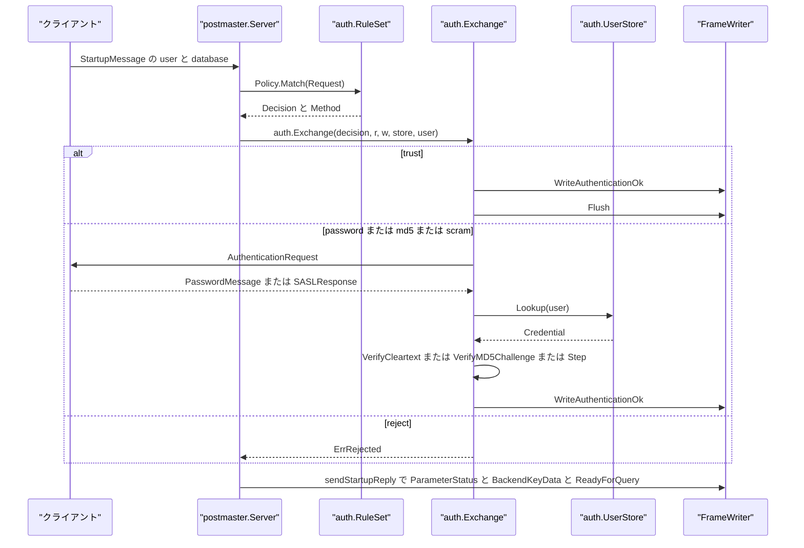
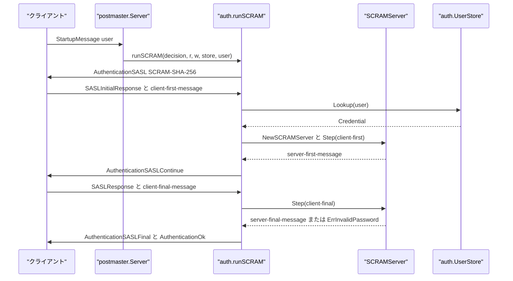
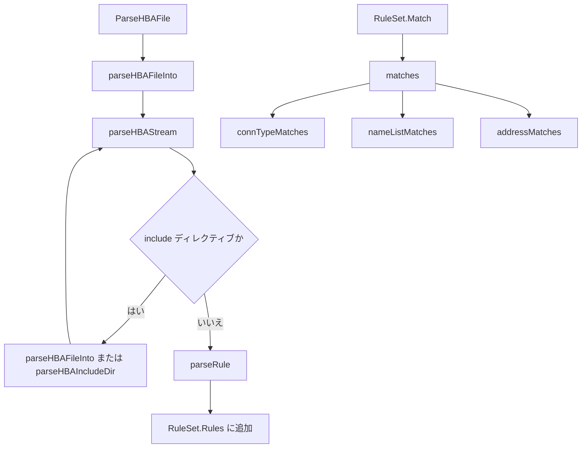

# 認証と pg_hba

<details>
<summary>関連ソースファイル</summary>

- [`internal/initdb/auth_bootstrap.go`](https://github.com/ryogrid/goopg/blob/19856410e8d497d59787e1ab35a2febb3f5953d6/internal/initdb/auth_bootstrap.go)
- [`internal/libpq/auth/auth.go`](https://github.com/ryogrid/goopg/blob/19856410e8d497d59787e1ab35a2febb3f5953d6/internal/libpq/auth/auth.go)
- [`internal/libpq/auth/exchange.go`](https://github.com/ryogrid/goopg/blob/19856410e8d497d59787e1ab35a2febb3f5953d6/internal/libpq/auth/exchange.go)
- [`internal/libpq/auth/parser.go`](https://github.com/ryogrid/goopg/blob/19856410e8d497d59787e1ab35a2febb3f5953d6/internal/libpq/auth/parser.go)
- [`internal/libpq/auth/saslprep.go`](https://github.com/ryogrid/goopg/blob/19856410e8d497d59787e1ab35a2febb3f5953d6/internal/libpq/auth/saslprep.go)
- [`internal/libpq/auth/scram.go`](https://github.com/ryogrid/goopg/blob/19856410e8d497d59787e1ab35a2febb3f5953d6/internal/libpq/auth/scram.go)
- [`internal/libpq/auth/userstore.go`](https://github.com/ryogrid/goopg/blob/19856410e8d497d59787e1ab35a2febb3f5953d6/internal/libpq/auth/userstore.go)
- [`internal/libpq/messages.go`](https://github.com/ryogrid/goopg/blob/19856410e8d497d59787e1ab35a2febb3f5953d6/internal/libpq/messages.go)
- [`internal/libpq/protocol.go`](https://github.com/ryogrid/goopg/blob/19856410e8d497d59787e1ab35a2febb3f5953d6/internal/libpq/protocol.go)
- [`internal/postmaster/server.go`](https://github.com/ryogrid/goopg/blob/19856410e8d497d59787e1ab35a2febb3f5953d6/internal/postmaster/server.go)
- [`internal/utils/misc/guc.go`](https://github.com/ryogrid/goopg/blob/19856410e8d497d59787e1ab35a2febb3f5953d6/internal/utils/misc/guc.go)

</details>

`internal/libpq/auth` は、PostgreSQL の `pg_hba.conf` を解析して接続ごとの認証方式を決め、その方式に応じたワイヤ上のやり取りを実行する。判定は `RuleSet.Match` がルールを先頭から評価して最初の一致を返し、`auth.Exchange` が `trust` / `reject` / `password` / `md5` / `scram-sha-256` のいずれかを処理する。`internal/initdb/auth_bootstrap.go` は `goopg init` 時に `pg_hba.conf` の初期内容とスーパーユーザーのパスワード検証子を作り、`internal/postmaster/server.go` の `checkAuth` が起動パケットの `user` / `database` を使ってこの判定を呼ぶ。フレームの読み書きは [3.2 ワイヤプロトコル](3.2-Wire-Protocol.md)、起動から接続受付までの流れは [3.1 CLI とライフサイクル](3.1-CLI-and-Lifecycle.md)、認証後の SQL 振り分けは [3.4 接続管理と SQL ディスパッチ](3.4-Connection-Dispatch.md) を参照されたい。

## 責務

- **`pg_hba.conf` の解析** — `ParseHBAFile` / `ParseHBAReader` が `local` / `host` / `hostssl` / `hostnossl` / `hostgssenc` / `hostnogssenc` の各行を `Rule` に変換する。`include` / `include_if_exists` / `include_dir` を再帰展開し、include の循環を検出する (`internal/libpq/auth/parser.go:ParseHBAFile`, `parseHBAStream`, `parseHBAIncludeDir`)。
- **ルールのマッチング** — `RuleSet.Match` が `Request` の接続種別、データベース、ユーザー、リモート IP を `Rule` と照合し、最初に一致したルールの `Method` / `Options` / `Rule` を `Decision` として返す。一致しなければ `MethodImplicitReject` を返す (`internal/libpq/auth/auth.go:RuleSet.Match`)。
- **既定ポリシー** — `DefaultPolicy` は `127.0.0.1/32` と `::1/128` からの TCP 接続を `trust` し、それ以外を暗黙の `reject` にする。`postmaster.Config.Policy` が nil のときは `Config.defaults` がこの値を設定する (`internal/libpq/auth/auth.go:DefaultPolicy`, `internal/postmaster/server.go:Config.defaults`)。
- **認証方式の実装** — `Exchange` は `trust`（`AuthenticationOk` を送って即成功）、`reject` / 暗黙 reject、`password`（cleartext）、`md5`（4 バイト salt の challenge）、`scram-sha-256`（SASL/SCRAM）を実装する。それ以外の方式は `ErrMethodUnsupported` になる (`internal/libpq/auth/exchange.go:Exchange`, `runCleartext`, `runMD5`, `runSCRAM`)。
- **クレデンシャルストア** — `UserStore` の実装 `MapUserStore` がユーザー名から `Credential` を引く。`Credential` は plaintext、`md5` + 32 hex、`SCRAM-SHA-256$...` の 3 形式を扱い、`CredentialFromSecret` が文字列の形から形式を判定する (`internal/libpq/auth/userstore.go:UserStore`, `Credential`, `CredentialFromSecret`)。
- **SCRAM-SHA-256 のサーバー側状態機械** — `SCRAMServer` が client-first-message から server-first-message を作り、client-final-message の proof を検証して server-final-message を返す。ユーザーが存在しない場合もダミーの secret で最後まで計算し、タイミング差を作らない (`internal/libpq/auth/scram.go:SCRAMServer`, `NewSCRAMServer`, `Step`)。
- **SASLprep** — `pgSASLPrep` が RFC 3454 / RFC 4013 に沿って非 ASCII パスワードを正規化し、失敗時は元のパスワードへフォールバックする `saslPrepOrOriginal` を提供する。ASCII はそのまま通す (`internal/libpq/auth/saslprep.go:pgSASLPrep`, `saslPrepOrOriginal`)。PostgreSQL の SCRAM 秘密と一致させるため、上流の prohibited 判定の入力位置の挙動もそのまま踏襲している。
- **初期 `pg_hba.conf` の生成** — `resolveAuthMethods` が `host` / `local` の方式を検証し、`ident` と `peer` の相互変換、未指定時の `trust` へのフォールバック、パスワード方式なのにパスワードがない場合のエラーを扱う。`buildPgHBAConf` が loopback の `trust` 行、replication 用の行、外部向けの `reject` 行を書き出す (`internal/initdb/auth_bootstrap.go:resolveAuthMethods`, `buildPgHBAConf`)。
- **スーパーユーザーの検証子生成** — `readSuperuserPasswordFile` が `--pwfile` の 1 行目を読み、`encodeSuperuserPassword` が方式に応じて `md5` 形式または SCRAM 形式の `rolpassword` を作る。SCRAM が既定で、md5 方式が選ばれたときだけ `password_encryption = md5` を返す (`internal/initdb/auth_bootstrap.go:readSuperuserPasswordFile`, `encodeSuperuserPassword`)。
- **サーバー側のエラー変換** — `checkAuth` は `ErrRejected` / `ErrInvalidPassword` / `ErrUserUnknown` を `InvalidAuthorizationSpecification`（28000）の FATAL にし、`ErrMethodUnsupported` を `FeatureNotSupported`（0A000）にする。交換中の I/O 失敗は接続が壊れているため FATAL を書かずに閉じる (`internal/postmaster/server.go:checkAuth`)。
- **認証関連 GUC の検証** — `password_encryption` や `scram_iterations` のような GUC は `misc.Variable` として登録され、`EnumOptions` や `MinVal` / `MaxVal` で値を検証する。enum の検証失敗は `ValidationError` になり、既定の SQLSTATE は 22023、必要なら HINT を運ぶ。整数の範囲外は `fmt.Errorf` で拒否される (`internal/utils/misc/guc.go:Variable`, `ValidationError`, `Registry.Set`)。

## 処理フロー

### 接続時の認証

`serveConn` は `handleStartup` で起動パケットを読み、`params` から `user` と `database` を取り出す。`database` が空ならユーザー名をデータベース名として使う。`checkAuth` は `auth.Request` を組み立て、`cfg.Policy.Match` で `Decision` を得てから `auth.Exchange` を呼ぶ。`trust` なら `AuthenticationOk` を書いて flush し、パスワード系なら要求を送って `PasswordMessage` / `SASLResponse` を読み、最後に成功時だけ `AuthenticationOk` を送る (`internal/postmaster/server.go:checkAuth`, `internal/libpq/auth/exchange.go:Exchange`)。



`Exchange` が `nil` を返した時点で `AuthenticationOk` はすでに flush 済みである。`checkAuth` はその後 `serveConn` に true を返し、`serveConn` が `sendStartupReply` で `ParameterStatus`、`BackendKeyData`、`ReadyForQuery` を送る。`ErrRejected` などが返った場合、`AuthenticationOk` は書かれず、`checkAuth` が FATAL を送って接続を閉じる (`internal/libpq/auth/exchange.go:Exchange`)。

### SCRAM-SHA-256 の往復

`runSCRAM` はまず `AuthenticationSASL` で `SCRAM-SHA-256` だけを提示する。クライアントの `SASLInitialResponse` から mechanism と client-first-message を取り出し、`UserStore.Lookup` で `Credential` を探す。`PasswordSCRAMSHA256` なら `ParseSCRAMSecret`、`PasswordPlaintext` なら `NewSCRAMSecret` で `SCRAMSecret` を作り、`NewSCRAMServer` → `Step(client-first)` で server-first-message を返す。続く `SASLResponse` を `Step(client-final)` に渡し、proof が通れば server-final-message と `AuthenticationOk` を送る (`internal/libpq/auth/exchange.go:runSCRAM`, `internal/libpq/auth/scram.go:Step`)。



未知のユーザーや `PasswordMD5` しか持たないユーザーの場合、`runSCRAM` は `secret == nil` のまま `NewSCRAMServer` を呼ぶ。`NewSCRAMServer` はランダムな salt からダミーの `SCRAMSecret` を作り、`doomed` を立てる。交換は最後まで実行されるが、proof 検証で必ず `ErrInvalidPassword` になる。これにより「ユーザーが存在しない」ことと「パスワードが違う」ことを応答時間で区別しにくくしている (`internal/libpq/auth/scram.go:NewSCRAMServer`, `handleClientFinal`, `internal/libpq/auth/exchange.go:runSCRAM`)。

### `pg_hba.conf` の解析と照合

`ParseHBAFile` はファイルを開き、`parseHBAFileInto` → `parseHBAStream` の順で行を読む。`include` 系のディレクティブは `parseHBAFileInto` / `parseHBAIncludeDir` に再帰し、通常の行は `parseRule` で `Rule` にして `RuleSet.Rules` に追加する。実行時は `RuleSet.Match` が `matches` を呼び、接続種別、データベース名、ユーザー名、アドレスの順に判定する (`internal/libpq/auth/parser.go:ParseHBAFile`, `parseRule`, `internal/libpq/auth/auth.go:RuleSet.Match`, `matches`)。



`parseHBAStream` は `looksLikeRule` で空行とコメント行を捨て、`tokenize` で空白区切りのトークンにする。ダブルクォート内の空白は保持され、`#` はトークンの先頭にあるときだけコメントになる。`include` の循環は `visited` マップで検出し、`include_dir` は拡張子 `.conf` のファイルを名前順に読む (`internal/libpq/auth/parser.go:parseHBAStream`, `tokenize`, `parseHBAIncludeDir`)。

## 主要ファイル

| ファイル | 役割 |
| --- | --- |
| `internal/libpq/auth/auth.go` | `Method` / `ConnType` の列挙、`Rule` / `Request` / `Decision` / `Policy` / `RuleSet`、最初の一致を返す `RuleSet.Match`、loopback trust の `DefaultPolicy`、`ErrRejected` / `ErrMethodUnsupported` / `ParseError` (`internal/libpq/auth/auth.go:Method`, `Rule`, `RuleSet.Match`, `DefaultPolicy`)。 |
| `internal/libpq/auth/parser.go` | `ParseHBAFile` / `ParseHBAReader`、include 展開、トークナイザ、`parseRule`、CIDR と旧式 IP+MASK の解析、method と key=value オプションの解析 (`internal/libpq/auth/parser.go:ParseHBAFile`, `parseRule`, `parseAddressField`, `parseMethodAndOptions`)。 |
| `internal/libpq/auth/exchange.go` | `Exchange` の方式分岐と `runCleartext` / `runMD5` / `runSCRAM`。`PasswordMessage` / `SASLInitialResponse` / `SASLResponse` の読み取りと `AuthenticationOk` の送出 (`internal/libpq/auth/exchange.go:Exchange`, `runCleartext`, `runMD5`, `runSCRAM`)。 |
| `internal/libpq/auth/userstore.go` | `UserStore` インターフェース、`Credential`、`PasswordType`、`MapUserStore`、`LoadUsersFile`、`CredentialFromSecret`、および `ErrInvalidPassword` / `ErrUserUnknown` / `ErrAuthExchange` (`internal/libpq/auth/userstore.go:UserStore`, `Credential`, `MapUserStore`, `LoadUsersFile`)。 |
| `internal/libpq/auth/scram.go` | `SCRAMSecret` / `SCRAMServer` / `Step`、`ParseSCRAMSecret`、`NewSCRAMSecret`、proof 検証、PBKDF2-HMAC-SHA-256。定数 `scramMechanism`、`scramKeyLen`、`scramRawNonceLen`、`scramDefaultSaltLen`、`scramDefaultIterations` (`internal/libpq/auth/scram.go:SCRAMSecret`, `SCRAMServer`, `Step`, `scramDefaultIterations`)。 |
| `internal/libpq/auth/saslprep.go` | RFC 3454 / RFC 4013 の SASLprep。`pgSASLPrep` と、失敗時に元の文字列を返す `saslPrepOrOriginal` (`internal/libpq/auth/saslprep.go:pgSASLPrep`, `saslPrepOrOriginal`)。 |
| `internal/initdb/auth_bootstrap.go` | `validAuthMethodsHost` / `validAuthMethodsLocal`、`resolveAuthMethods`、`buildPgHBAConf`、`readSuperuserPasswordFile`、`encodeSuperuserPassword`。`goopg init` の認証設定を生成する (`internal/initdb/auth_bootstrap.go:resolveAuthMethods`, `buildPgHBAConf`, `encodeSuperuserPassword`)。 |
| `internal/libpq/messages.go` | `WriteAuthenticationOk` / `WriteAuthenticationCleartextPassword` / `WriteAuthenticationMD5Password` / `WriteAuthenticationSASL` / `WriteAuthenticationSASLContinue` / `WriteAuthenticationSASLFinal` の認証メッセージ (`internal/libpq/messages.go:WriteAuthenticationOk`, `WriteAuthenticationSASL`, `WriteAuthenticationSASLContinue`, `WriteAuthenticationSASLFinal`)。 |
| `internal/libpq/protocol.go` | `AuthenticationOK` / `AuthenticationCleartextPasswd` / `AuthenticationMD5Passwd` / `AuthenticationSASL` / `AuthenticationSASLCont` / `AuthenticationSASLFinal` のサブコードと、`MsgAuthentication` / `MsgPasswordMessage` (`internal/libpq/protocol.go:AuthenticationSASL`, `MsgAuthentication`, `MsgPasswordMessage`)。 |
| `internal/postmaster/server.go` | `checkAuth` が `Policy.Match` と `auth.Exchange` を呼び、エラー種別を FATAL の SQLSTATE に変換する。起動時の `user` / `database` と `connTypeFor` / `remoteIP` もここ (`internal/postmaster/server.go:checkAuth`, `connTypeFor`, `remoteIP`)。 |
| `internal/utils/misc/guc.go` | GUC の `Variable` / `Registry` / `ValidationError`。`password_encryption` や `scram_iterations` のような認証関連 GUC の enum / int 検証と、SQLSTATE 22023 のエラーを支える (`internal/utils/misc/guc.go:Variable`, `Registry.Set`, `ValidationError`)。 |

## 公開 API / エントリポイント

HBA の解析と照合:

- `func ParseHBAFile(path string) (*RuleSet, error)` / `func ParseHBAReader(r io.Reader, label string) (*RuleSet, error)` — `pg_hba.conf` を解析する (`internal/libpq/auth/parser.go:ParseHBAFile`, `ParseHBAReader`)。
- `func (rs *RuleSet) Match(req Request) Decision` — 先頭から最初に一致したルールを返す。一致なしは `MethodImplicitReject` (`internal/libpq/auth/auth.go:RuleSet.Match`)。
- `func DefaultPolicy() *RuleSet` — loopback IPv4 / IPv6 の `trust` ポリシー (`internal/libpq/auth/auth.go:DefaultPolicy`)。

認証交換:

- `func Exchange(d Decision, r *libpq.FrameReader, w *libpq.FrameWriter, store UserStore, user string) error` — 方式に応じたワイヤ交換を実行する (`internal/libpq/auth/exchange.go:Exchange`)。
- `WriteAuthenticationOk` / `WriteAuthenticationCleartextPassword` / `WriteAuthenticationMD5Password(salt [4]byte)` / `WriteAuthenticationSASL(mechanisms []string)` / `WriteAuthenticationSASLContinue(data []byte)` / `WriteAuthenticationSASLFinal(data []byte)` — 認証用の `'R'` メッセージ (`internal/libpq/messages.go:WriteAuthenticationOk`, `WriteAuthenticationSASL`, `WriteAuthenticationSASLContinue`, `WriteAuthenticationSASLFinal`)。

クレデンシャル:

- `type UserStore interface { Lookup(user string) (Credential, bool) }` — ユーザーが存在しなければ `ok=false` を返す (`internal/libpq/auth/userstore.go:UserStore`)。
- `func NewPlaintextCredential(password string) Credential` / `NewMD5Credential(user, password string) Credential` / `ParseMD5Stored(secret string) (Credential, error)` / `CredentialFromSecret(secret string) (Credential, error)` — 各形式の `Credential` を作る (`internal/libpq/auth/userstore.go:NewPlaintextCredential`, `NewMD5Credential`, `ParseMD5Stored`, `CredentialFromSecret`)。
- `func LoadUsersFile(path string) (*MapUserStore, error)` — `username:secret` 形式のファイルを読む。`MapUserStore` は `Set` / `Remove` / `Lookup` / `Users` を持つ (`internal/libpq/auth/userstore.go:LoadUsersFile`, `MapUserStore`)。
- `func (c Credential) VerifyCleartext(user, given string) bool` / `VerifyMD5Challenge(user string, salt [4]byte, response string) bool` — cleartext と MD5 challenge の検証 (`internal/libpq/auth/userstore.go:VerifyCleartext`, `VerifyMD5Challenge`)。

SCRAM:

- `func NewSCRAMSecret(password string) (*SCRAMSecret, error)` / `NewSCRAMSecretWithIterations(password string, iterations int) (*SCRAMSecret, error)` / `ParseSCRAMSecret(secret string) (*SCRAMSecret, error)` — SCRAM 秘密の生成と解析 (`internal/libpq/auth/scram.go:NewSCRAMSecret`, `NewSCRAMSecretWithIterations`, `ParseSCRAMSecret`)。
- `func NewSCRAMServer(username string, secret *SCRAMSecret) (*SCRAMServer, error)` / `func (s *SCRAMServer) Step(input []byte) ([]byte, bool, error)` — サーバー側の 2 ステップ交換 (`internal/libpq/auth/scram.go:NewSCRAMServer`, `Step`)。

初期化:

- `func resolveAuthMethods(host, local string, hasPassword bool) (rHost, rLocal string, warn bool, err error)` — `ident`↔`peer`、既定 `trust`、パスワード必須チェック (`internal/initdb/auth_bootstrap.go:resolveAuthMethods`)。
- `func buildPgHBAConf(hostMethod, localMethod string) []byte` — `pg_hba.conf` のテンプレート生成 (`internal/initdb/auth_bootstrap.go:buildPgHBAConf`)。
- `func readSuperuserPasswordFile(path string) (string, error)` / `encodeSuperuserPassword(password, hostMethod, localMethod, username string) (verifier, passwordEncryption string, err error)` — `--pwfile` と `rolpassword` の生成 (`internal/initdb/auth_bootstrap.go:readSuperuserPasswordFile`, `encodeSuperuserPassword`)。

## 主要データ構造

### `Method` / `ConnType` — 方式と接続種別

```go
type Method int

const (
	MethodImplicitReject Method = iota // server-emitted when no rule matches
	MethodReject
	MethodTrust
	MethodPassword
	MethodMD5
	MethodSCRAMSHA256
	MethodGSS
	MethodSSPI
	MethodIdent
	MethodPeer
	MethodCert
	MethodPAM
	MethodBSD
	MethodLDAP
	MethodRADIUS
	MethodOAuth
)
```

`internal/libpq/auth/auth.go:Method`

```go
type ConnType int

const (
	ConnLocal        ConnType = iota // Unix domain socket
	ConnHost                         // TCP, encryption-agnostic
	ConnHostSSL                      // TCP, must be TLS
	ConnHostNoSSL                    // TCP, must be plaintext
	ConnHostGSSEnc                   // recognised but not applied in v0
	ConnHostNoGSSEnc                 // recognised but not applied in v0
)
```

`internal/libpq/auth/auth.go:ConnType`

`Method` は `pg_hba.conf` の METHOD 列を表す。`MethodImplicitReject` はルールに一致しなかったときに `RuleSet.Match` が返す値で、ファイルには書かれない。`MethodTrust` / `MethodReject` / `MethodPassword` / `MethodMD5` / `MethodSCRAMSHA256` が v0 の `Exchange` で実際に分岐し、それ以外は `ErrMethodUnsupported` になる。`ConnType` は `local` / `host` / `hostssl` / `hostnossl` / `hostgssenc` / `hostnogssenc` を持ち、`connTypeMatches` が接続の種別と照合する (`internal/libpq/auth/auth.go:ConnType`, `connTypeMatches`)。

### `Rule` — `pg_hba.conf` の 1 行

```go
type Rule struct {
	ConnType ConnType
	Database []string
	User     []string

	// Address constraints. Network is non-nil for TCP rules; AllAddresses
	// is true when the rule used the "all" keyword (which matches any
	// remote address). SameHost / SameNet are recognised but not yet
	// implemented; rules using them never match in v0.
	Network      *net.IPNet
	AllAddresses bool
	SameHost     bool
	SameNet      bool

	Method  Method
	Options map[string]string

	// SourceFile / SourceLine are diagnostics for the matcher's error
	// messages; they help operators trace which rule decided a match.
	SourceFile string
	SourceLine int
}
```

`internal/libpq/auth/auth.go:Rule`

`Database` と `User` はカンマ区切りを分割したリストで、`all`、`sameuser`、`samerole`、`replication`、`+groupname`、`/regex` のような特殊語も文字列のまま保持する。`Network` は CIDR か旧式 IP+MASK から作られ、`AllAddresses` は `all` のとき真になる。`SameHost` / `SameNet` は解析されるが `addressMatches` では常に偽になり、v0 では一致しない。`SourceFile` / `SourceLine` は `ErrRejected` のメッセージに使われる。

### `Request` / `Decision` / `Policy` / `RuleSet`

```go
type Request struct {
	ConnType ConnType
	Remote   net.IP // nil for ConnLocal
	Database string
	User     string
}

// Decision is what the matcher returns. The pointer to the matched Rule
// (or nil for an implicit reject) is exposed so callers can produce
// diagnostics like "rejected by line 7 of pg_hba.conf".
type Decision struct {
	Method  Method
	Options map[string]string
	Rule    *Rule
}

// Policy is the matcher interface. It is satisfied by RuleSet (the parser
// output) and by anything else tests want to inject.
type Policy interface {
	Match(req Request) Decision
}

// RuleSet is the parsed pg_hba.conf, kept in source order. It satisfies
// Policy and is what file-driven configurations produce.
type RuleSet struct {
	Rules []Rule
}
```

`internal/libpq/auth/auth.go:Request`, `Decision`, `Policy`, `RuleSet`

`Request.Remote` は `ConnLocal` では nil、TCP ではクライアント IP である。`Decision.Rule` は一致したルールへのポインタで、暗黙 reject のときは nil になる。`RuleSet` はファイルの出現順を保つ `Rules` のスライスであり、`Match` はその順序をそのまま優先順位として使う。`Options` は `parseMethodAndOptions` が `key=value` として保持するが、v0 の `Exchange` は `Method` 以外を参照しない。

### `UserStore` / `Credential` / `PasswordType`

```go
type UserStore interface {
	// Lookup returns the credential for user, and (Credential{}, false) if
	// no such user exists. Implementations must not return an error for
	// "user does not exist" — return ok=false instead.
	Lookup(user string) (Credential, bool)
}
```

`internal/libpq/auth/userstore.go:UserStore`

```go
type PasswordType int

const (
	// PasswordPlaintext is "alice secretpw" — the secret is the literal
	// password. Not appropriate for production but unavoidable for
	// development and for testing the cleartext "password" auth method.
	PasswordPlaintext PasswordType = iota

	// PasswordMD5 is "alice md5<32 hex chars>" — the secret is
	// `"md5" + md5_hex(password + username)`. This is the legacy
	// pg_authid.rolpassword shape that the `md5` auth method consumes
	// directly without ever seeing the original password.
	PasswordMD5

	// PasswordSCRAMSHA256 stores the upstream
	//   SCRAM-SHA-256$<iter>:<salt-b64>$<StoredKey-b64>:<ServerKey-b64>
	// rolpassword form. The cleartext password is unrecoverable from
	// this format; it satisfies the `scram-sha-256` auth method
	// directly, and the `password` (cleartext) method by recomputing
	// the StoredKey and comparing.
	PasswordSCRAMSHA256
)
```

`internal/libpq/auth/userstore.go:PasswordType`

```go
type Credential struct {
	Type   PasswordType
	Secret string // plaintext password OR "md5"+32-hex-MD5 string
}
```

`internal/libpq/auth/userstore.go:Credential`

`PasswordType` は保存されている秘密の形式を表す。`PasswordPlaintext` はそのまま比較でき、`PasswordMD5` は `md5` + 32 hex の形で保存され、`PasswordSCRAMSHA256` は上流の `SCRAM-SHA-256$...` 検証子である。`CredentialFromSecret` は `SCRAM-SHA-256$` 接頭辞、`md5` + 35 文字、それ以外をそれぞれの形式に振り分ける。`MapUserStore` は `sync.RWMutex` で `users` マップを保護し、`Lookup` は読み取りロックだけを取る (`internal/libpq/auth/userstore.go:MapUserStore`, `CredentialFromSecret`)。

### `SCRAMSecret` / `SCRAMServer`

```go
type SCRAMSecret struct {
	Iterations int
	Salt       []byte // base64-decoded salt bytes
	StoredKey  []byte // 32 bytes
	ServerKey  []byte // 32 bytes
}
```

`internal/libpq/auth/scram.go:SCRAMSecret`

```go
type SCRAMServer struct {
	username string
	secret   *SCRAMSecret
	doomed   bool

	clientNonce string
	serverNonce string

	// cbindFlag is the gs2-cbind-flag byte ('n' or 'y') the client sent
	// in client-first-message. Retained so client-final's c= attribute can
	// be verified to echo the SAME flag (RFC 5802 §5.1 / auth-scram.c's
	// read_client_final_message), preventing a MITM from tampering with the
	// negotiated channel-binding flag when no binding is in use.
	cbindFlag byte

	// authMessage = client-first-bare + "," + server-first + "," + client-final-without-proof
	// (RFC 5802 §3, used for verifying the client proof and computing the
	// server signature.)
	authMessage string

	state scramState
}
```

`internal/libpq/auth/scram.go:SCRAMServer`

`SCRAMSecret` の `Iterations` は既定 4096、`Salt` は既定 16 バイト、`StoredKey` / `ServerKey` はそれぞれ 32 バイトである。`SCRAMServer` は 1 接続 1 インスタンスで、`clientNonce` と `serverNonce` を結合した nonce、`cbindFlag`、`authMessage`、`state` を保持する。`Step` は `scramStateInit` で client-first を処理し、`scramStateAwaitingFinal` で client-final を検証し、`scramStateDone` 以降はエラーにする。`doomed` が真の場合は proof が偶然一致しても `ErrInvalidPassword` を返す (`internal/libpq/auth/scram.go:Step`, `handleClientFinal`)。

### `ValidationError` — 認証関連 GUC の検証エラー

```go
type ValidationError struct {
	Msg    string
	Hint   string
	Detail string
	// Code is the SQLSTATE when it is not 22023 (invalid_parameter_value),
	// e.g. interval_in's 22007 raised from inside check_timezone.
	Code string
}
```

`internal/utils/misc/guc.go:ValidationError`

`ValidationError.Error()` は `Msg` だけを返し、`SQLState()` は `Code` が空なら `22023` を返す。`Variable` は `Type`、`EnumOptions`、`MinVal` / `MaxVal`、`CheckFn` を持ち、`Registry.Set` が `Variable.Set` 経由で `canonicalize` する。`password_encryption` のような enum GUC は `EnumOptions`、`scram_iterations` のような int GUC は `MinVal` / `MaxVal` で弾かれ、失敗時は `ValidationError` として HINT 付きで SQL 層へ伝わる (`internal/utils/misc/guc.go:Variable`, `Registry.Set`, `ValidationError`)。

## 内部構造

### HBA ルールの評価順と落とし穴

`matches` は `connTypeMatches` → `nameListMatches(Database)` → `nameListMatches(User)` → `addressMatches` の順に判定する。`local` は `ConnLocal` 同士だけが一致し、アドレス制約は評価しない。`host` は `ConnHost` / `ConnHostSSL` / `ConnHostNoSSL` のいずれにも一致するが、`hostssl` は `ConnHostSSL` だけ、`hostnossl` は `ConnHost` と `ConnHostNoSSL` に一致する。goopg は TLS を実装していないため、実際の TCP 接続は `ConnHost` として扱われ、`hostssl` のルールは一致しない (`internal/libpq/auth/auth.go:matches`, `connTypeMatches`, `internal/postmaster/server.go:connTypeFor`)。

`nameListMatches` は `all` を無条件一致とし、`sameuser` / `samerole` という特殊語自体は v0 ではマッチ判定に使わない（同じリスト内の他の項目は評価される）。`replication` は要求されたデータベース名が文字通り `replication` のときだけ一致する。それ以外は文字列の完全一致で、`+groupname` や `/regex` の特殊解釈は行わない。したがって `+group` を書いたルールは、その文字列と完全一致しない限り一致しない (`internal/libpq/auth/auth.go:nameListMatches`)。

`addressMatches` は `AllAddresses` なら真、`SameHost` / `SameNet` なら偽、`Network` が nil なら偽、`ip` が nil なら偽、それ以外は `Network.Contains(ip)` を返す。`samehost` / `samenet` は「未実装なので fail closed」であり、意図せず許可するより拒否する側に倒している。ホスト名形式の ADDRESS は `parseAddressField` が `ErrUnsupportedSyntax` を含むエラーを返し、`parseRule` がそれを `ParseError` として伝播する (`internal/libpq/auth/auth.go:addressMatches`, `internal/libpq/auth/parser.go:parseAddressField`)。

### パーサの境界

`parseHBAStream` は `bufio.Scanner` のバッファを 64 KiB から最大 1 MiB まで許す。`looksLikeRule` は行の最初の非空白文字が `#` ならコメント、空行なら無視する。`tokenize` はダブルクォートを解釈するが、シェル形式のエスケープは扱わない。`#` は `cur.Len() == 0` のときだけコメント開始なので、`host ... 127.0.0.1/32 trust # comment` はコメントになり、`foo#bar` は 1 トークンとして残る (`internal/libpq/auth/parser.go:parseHBAStream`, `looksLikeRule`, `tokenize`)。

`parseRule` は最低 4 トークンを要求し、`local` なら `DATABASE USER METHOD [OPTIONS]`、それ以外なら `DATABASE USER ADDRESS METHOD [OPTIONS]` として読む。`ADDRESS` は `all` / `samehost` / `samenet` の特別語、CIDR、または旧式の `IP MASK` を受け付ける。`METHOD` は `methodNames` に存在する必要があり、`OPTIONS` は `key=value` でなければ `ParseError` になる (`internal/libpq/auth/parser.go:parseRule`, `parseAddressField`, `parseMethodAndOptions`)。

### 認証交換の実装差

`Exchange` の `trust` は `WriteAuthenticationOk` の後に `Flush` して返る。`reject` と暗黙 reject は `ErrRejected` を返し、`checkAuth` が `28000` の FATAL を書く。`password` は `AuthenticationCleartextPassword` を送り、`PasswordMessage` の NUL 終端文字列を `Credential.VerifyCleartext` で比較する。`md5` は `crypto/rand` で 4 バイトの salt を作り、`AuthenticationMD5Password` を送り、`Credential.VerifyMD5Challenge` で `md5` + `md5_hex(tail + salt)` を再計算する (`internal/libpq/auth/exchange.go:Exchange`, `runCleartext`, `runMD5`)。

`runSCRAM` は `AuthenticationSASL` に `scramMechanism` だけを入れ、クライアントが別の mechanism を選べば `ErrAuthExchange` にする。`SASLInitialResponse` の長さが -1 なら初期応答なしとして nil を返し、長さが payload を超えるとエラーにする。`readPasswordMessage` は `MsgPasswordMessage` 以外を `ErrUnexpectedFrame` にし、NUL 終端がなければ `ErrAuthExchange` にする (`internal/libpq/auth/exchange.go:runSCRAM`, `readSASLInitial`, `readPasswordMessage`)。

`Credential.VerifyCleartext` は plaintext / MD5 / SCRAM のすべてを受け付ける。plaintext は `subtle.ConstantTimeCompare`、MD5 は保存された `md5` の tail と与えられたパスワードから再計算、SCRAM は `VerifySCRAMSecretFromPassword` で StoredKey を再計算して比較する。`VerifyMD5Challenge` は MD5 と plaintext だけを受け付け、SCRAM は `false` を返す。`runSCRAM` は plaintext から SCRAM 秘密を作れるが、MD5 からは元のパスワードを復元できないため SCRAM に使えない (`internal/libpq/auth/userstore.go:VerifyCleartext`, `VerifyMD5Challenge`, `internal/libpq/auth/exchange.go:runSCRAM`)。

### SCRAM の詳細

SCRAM の定数は `scramMechanism = "SCRAM-SHA-256"`、`scramKeyLen = 32`、`scramRawNonceLen = 18`、`scramDefaultSaltLen = 16`、`scramDefaultIterations = 4096` である。`NewSCRAMSecretWithIterations` は `iterations <= 0` を 4096 に丸め、`rand.Read` で 16 バイトの salt を作り、`scramBuildSecret` で `SaltedPassword`、`ClientKey`、`StoredKey`、`ServerKey` を導出する (`internal/libpq/auth/scram.go:NewSCRAMSecretWithIterations`, `scramBuildSecret`)。

`handleClientFirst` は gs2-cbind-flag が `n` / `y` のときだけ受け付け、`p=` のチャネルバインディングを明示的に拒否する。`m=` の mandatory extension も拒否する。`handleClientFinal` は `c=` が client-first と同じ `n,,` / `y,,` を base64 したものか確認し、nonce が `clientNonce+serverNonce` と一致することを確認し、`p=` の proof が 32 バイトであることを確認する。proof が不正なら `ErrInvalidPassword`、属性の欠落や重複なら別のエラーになる (`internal/libpq/auth/scram.go:handleClientFirst`, `handleClientFinal`, `parseSCRAMAttrs`, `validNoBindingChannelAttr`)。

`SASLprep` は ASCII 入力をそのまま返し、非 ASCII では「非 ASCII 空白 → U+0020」「commonly mapped to nothing」を適用し、NFKC 正規化する。prohibited output と bidi 検査は上流の実装に合わせて「マップ後・正規化前」の `mapped` に対して行い、成功したときだけ正規化済み文字列を返す。失敗時は `saslPrepOrOriginal` が元のパスワードを返すため、SASLprep はパスワードを拒否するゲートではなくベストエフォートの正規化である (`internal/libpq/auth/saslprep.go:pgSASLPrep`, `saslPrepOrOriginal`)。

### 初期化時の HBA とパスワード

`resolveAuthMethods` は `host` と `local` が等しいときだけ `ident` → `peer`、`peer` → `ident` の相互変換を行う。これは upstream initdb の `-A` が両側に同じ値を設定する挙動を再現するためである。未指定の側は `trust` にフォールバックし、`warn` を立てる。`host` / `local` それぞれの許可リストにない方式はエラーになり、`md5` / `password` / `scram-sha-256` の両側がパスワード方式なのにパスワードがない場合は「must specify a password」エラーになる (`internal/initdb/auth_bootstrap.go:resolveAuthMethods`, `isPasswordAuthMethod`) 。

`buildPgHBAConf` は `local all all <local>`、`host all all 127.0.0.1/32 <host>`、`host all all ::1/128 <host>` と、`local replication all <local>`、`host replication all 127.0.0.1/32 <host>`、`host replication all ::1/128 <host>` を書き、最後に `host all all 0.0.0.0/0 reject` と `host all all ::/0 reject` を置く。物理レプリケーションは DATABASE が `all` のルールでは一致しないため、replication 専用行が必要になる (`internal/initdb/auth_bootstrap.go:buildPgHBAConf`)。

`encodeSuperuserPassword` は `localMethod == "md5" && hostMethod != "scram-sha-256"`、または `hostMethod == "md5" && localMethod != "scram-sha-256"` のときに `auth.MD5Shadow` を返し、`passwordEncryption` に `"md5"` を設定する。それ以外は `auth.NewSCRAMSecret` の検証子を返し、`passwordEncryption` は空のまま（SCRAM が既定）にする。`readSuperuserPasswordFile` は先頭行だけを読み、CRLF の `\r` を落とし、空ファイルをエラーにする (`internal/initdb/auth_bootstrap.go:encodeSuperuserPassword`, `readSuperuserPasswordFile`)。

### GUC 検証との接点

`password_encryption` や `scram_iterations` のような認証関連 GUC も `misc.Variable` として登録され、`EnumOptions` や `MinVal` / `MaxVal` で検証される。`Registry.Set` が `Variable.Set` → `canonicalize` を呼び、enum の不正値は `Hint: "Available values: ..."` を持つ `ValidationError` になる。`Error()` はメッセージだけを返し、`SQLState()` は既定で `22023` を返す。整数の範囲外は `fmt.Errorf` で拒否される。`ValidationError` の `Hint` / `Detail` / `Code` は、SQL の `SET` から返すときに PostgreSQL 互換の HINT や別の SQLSTATE を付けるために使える (`internal/utils/misc/guc.go:Variable`, `Registry.Set`, `ValidationError`)。

## エッジケースと不変条件

- **HBA の include と循環** — `include` / `include_if_exists` / `include_dir` は再帰し、同じ絶対パスを再度開こうとすると `include cycle detected` で失敗する。`include_if_exists` だけが存在しないファイルを無視し、`include` はエラーにする。`include_dir` は `.conf` だけを名前順に読む (`internal/libpq/auth/parser.go:parseHBAFileInto`, `parseHBAIncludeDir`)。
- **HBA の構文境界** — 最小 4 トークン、未知の接続種別・未知の METHOD・`key=value` でない OPTION は `ParseError` になる。QUOTED 文字列の途中で終わると `unterminated quote`、ホスト名形式の ADDRESS は `ErrUnsupportedSyntax` を含むエラーになる (`internal/libpq/auth/parser.go:parseHBAStream`, `tokenize`, `parseRule`, `parseAddressField`)。
- **先勝ちのルール** — `RuleSet.Match` は `Rules` の順に評価し、最初に一致したルールだけを返す。したがって `pg_hba.conf` の行順がそのまま優先順位であり、後ろの `trust` 行で前の `reject` を上書きすることはできない (`internal/libpq/auth/auth.go:RuleSet.Match`)。
- **未実装の特殊語** — `sameuser` / `samerole` という特殊語自体はマッチ判定に使われず、同じリスト内の他の項目だけが評価される。`+groupname` と `/regex` は文字列完全一致としてしか扱われない。`samehost` / `samenet` も常に不一致である。v0 ではこれらを使うルールは「意図せず許可しない」方向に倒れる (`internal/libpq/auth/auth.go:nameListMatches`, `addressMatches`)。
- **`hostssl` は実質未使用** — goopg は TLS を実装していないため、`connTypeFor` は TCP を `ConnHost`、Unix ソケットを `ConnLocal` にしか分類しない。`hostssl` が要求する `ConnHostSSL` は発生せず、`hostgssenc` / `hostnogssenc` も `connTypeMatches` が常に偽を返す (`internal/postmaster/server.go:connTypeFor`, `internal/libpq/auth/auth.go:connTypeMatches`)。
- **方式名の認識と実行の差** — `methodNames` は `gss` / `pam` / `ldap` などの方式も解析するが、`Exchange` の switch は `trust` / `reject` / `password` / `md5` / `scram-sha-256` 以外を `ErrMethodUnsupported` にする。`checkAuth` はこれを `FeatureNotSupported`（0A000）の FATAL にする (`internal/libpq/auth/auth.go:methodNames`, `internal/libpq/auth/exchange.go:Exchange`, `internal/postmaster/server.go:checkAuth`)。
- **`oauth` は initdb の許可リスト外** — `methodNames` には `oauth` があるが、`validAuthMethodsHost` / `validAuthMethodsLocal` には含まれないため、`goopg init -A oauth` は invalid method になる (`internal/libpq/auth/auth.go:methodNames`, `internal/initdb/auth_bootstrap.go:validAuthMethodsHost`, `validAuthMethodsLocal`)。
- **`Options` は保持されるが未使用** — `parseMethodAndOptions` は METHOD の後ろの `key=value` を `Rule.Options` に保存するが、v0 の `Exchange` は `Decision.Options` を参照しない。`ldap` の `ldapserver=` のようなオプションを書いても認証動作は変わらない (`internal/libpq/auth/parser.go:parseMethodAndOptions`, `internal/libpq/auth/exchange.go:Exchange`)。
- **未知ユーザーと誤パスワードの区別** — `ErrUserUnknown` と `ErrInvalidPassword` はどちらも `password authentication failed for user %q` を返す。`checkAuth` は両方を 28000 の FATAL にするため、エラーテキストからユーザーの存在を判別できない (`internal/libpq/auth/userstore.go:ErrInvalidPassword`, `ErrUserUnknown`, `internal/postmaster/server.go:checkAuth`)。
- **`nil` UserStore** — `trust` と reject は `UserStore` を必要としない。`password` / `md5` / `scram-sha-256` で `store == nil` のときは panic せず `ErrMethodUnsupported` を返す (`internal/libpq/auth/exchange.go:Exchange`, `runCleartext`, `runMD5`, `runSCRAM`)。
- **MD5 の形式** — `ParseMD5Stored` は `md5` + 32 hex の 35 文字だけを受け付ける。`VerifyMD5Challenge` は保存された tail と salt から `md5` + `md5_hex(tail + salt)` を計算し、クライアント応答と定数時間比較する。plaintext の `Credential` でも、保存時に MD5 shadow を計算するため MD5 challenge に使える (`internal/libpq/auth/userstore.go:ParseMD5Stored`, `VerifyMD5Challenge`)。
- **SCRAM の未知ユーザー** — `NewSCRAMServer` は `secret == nil` のときランダム salt でダミー秘密を作り、`doomed = true` にする。交換は成功したように見せず、`handleClientFinal` が必ず `ErrInvalidPassword` を返す。`runSCRAM` は最後に `secret == nil` を再確認し、万一 proof が通っても 28000 に落とす (`internal/libpq/auth/scram.go:NewSCRAMServer`, `handleClientFinal`, `internal/libpq/auth/exchange.go:runSCRAM`)。
- **SCRAM のチャネルバインディング** — `p=` の gs2-cbind-flag は TLS 未実装のため拒否される。`n` / `y` のときは client-final の `c=` が同じフラグの `n,,` / `y,,` を base64 したものと一致しなければならない。MITM がフラグを差し替える攻撃を防ぐための検査である (`internal/libpq/auth/scram.go:handleClientFirst`, `validNoBindingChannelAttr`)。
- **SASLprep は拒否しない** — 非 ASCII の prohibited 文字や bidi 違反は `pgSASLPrep` がエラーにするが、`saslPrepOrOriginal` が元のパスワードにフォールバックする。SCRAM の検証は「SASLprep 後の文字列で作った秘密」と「元の文字列で作った秘密」のどちらでも同じパスワードなら一致するよう、上流と同じ経路を取る (`internal/libpq/auth/saslprep.go:pgSASLPrep`, `saslPrepOrOriginal`, `internal/libpq/auth/scram.go:VerifySCRAMSecretFromPassword`)。
- **SASL フレームの長さ検査** — `readSASLInitial` は mechanism の NUL、4 バイトの長さ、payload 長を検査し、長さ -1 は「初期応答なし」として nil を返す。`readSASLResponse` と `readPasswordMessage` は `MsgPasswordMessage` 以外を `ErrUnexpectedFrame` にし、`readPasswordMessage` は NUL 終端がなければ `ErrAuthExchange` にする (`internal/libpq/auth/exchange.go:readSASLInitial`, `readSASLResponse`, `readPasswordMessage`)。
- **initdb のパスワード必須チェック** — `host` と `local` の両方が `md5` / `password` / `scram-sha-256` で、`--pwfile` も対話入力もない場合、`resolveAuthMethods` はエラーを返す。片側だけパスワード方式ならこのチェックは発火しない (`internal/initdb/auth_bootstrap.go:resolveAuthMethods`, `isPasswordAuthMethod`)。
- **生成される `pg_hba.conf` の既定拒否** — `buildPgHBAConf` は loopback と replication の行の後に `0.0.0.0/0 reject` と `::/0 reject` を置く。loopback 以外は明示的に拒否され、`all` の DATABASE が物理レプリケーションに一致しない点を補う replication 行が別途入る (`internal/initdb/auth_bootstrap.go:buildPgHBAConf`)。
- **`password_encryption` の選択** — `encodeSuperuserPassword` は md5 が指定された側と scram-sha-256 が指定された側の組み合わせを見て、md5 を選ぶのは「md5 があり、もう一方が scram-sha-256 でない」場合だけである。それ以外は SCRAM の検証子を作り、`password_encryption` を空にして既定の SCRAM を使う (`internal/initdb/auth_bootstrap.go:encodeSuperuserPassword`)。
- **GUC 検証エラーの SQLSTATE** — `ValidationError.SQLState()` は `Code` が空なら `22023` を返す。`Hint` / `Detail` は `Error()` には含まれず、呼び出し側が `errors.As` で取り出してワイヤの `H` / `D` フィールドに変換する (`internal/utils/misc/guc.go:ValidationError`)。
- **認証後の追加チェック** — `checkAuth` が成功しても、`serveConn` はロールが存在しなければ 28000、データベースが存在しなければ 3D000、`datallowconn = false` や `datconnlimit = -2` なら 55000、接続数超過なら 53300 で拒否する。これらは認証そのものではなく `InitPostgres` 相当の後続検査である (`internal/postmaster/server.go:serveConn`)。

Sources:

- `internal/initdb/auth_bootstrap.go`
- `internal/libpq/auth/auth.go`
- `internal/libpq/auth/exchange.go`
- `internal/libpq/auth/parser.go`
- `internal/libpq/auth/saslprep.go`
- `internal/libpq/auth/scram.go`
- `internal/libpq/auth/userstore.go`
- `internal/libpq/messages.go`
- `internal/libpq/protocol.go`
- `internal/postmaster/server.go`
- `internal/utils/misc/guc.go`

<sub>Generated by deepwiki-4myself from `goopg` @ `19856410e`</sub>
