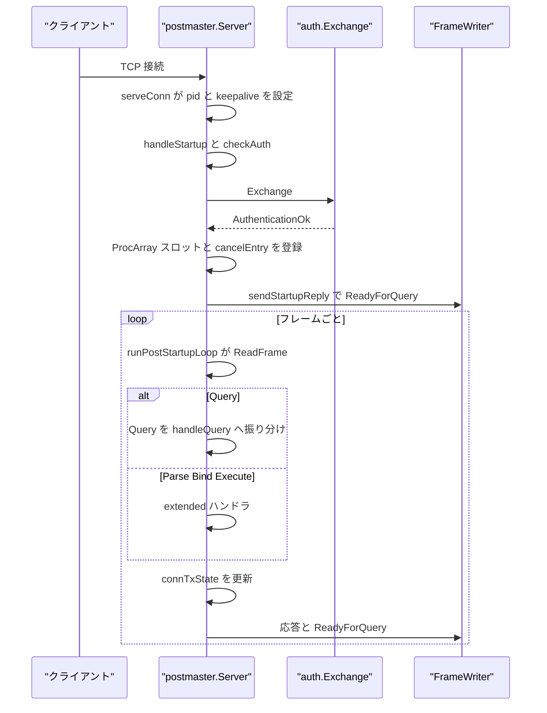
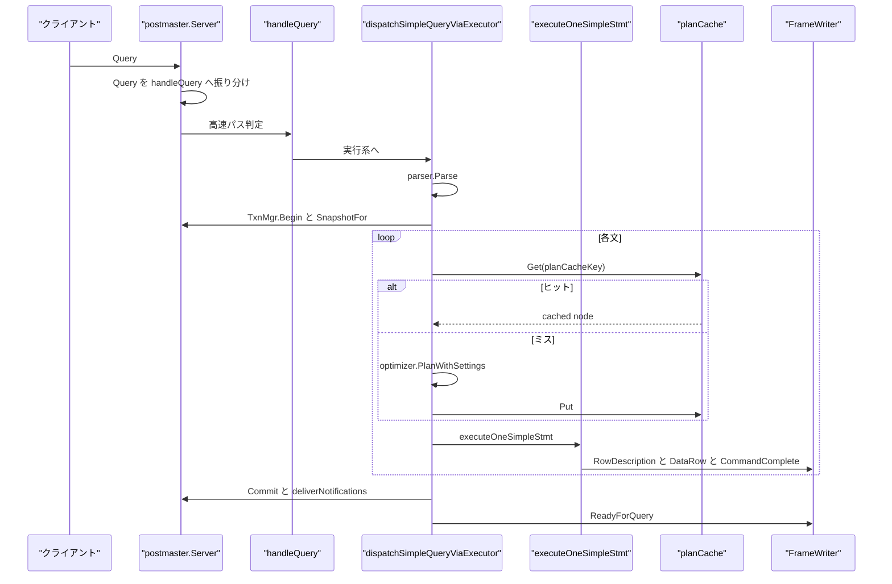
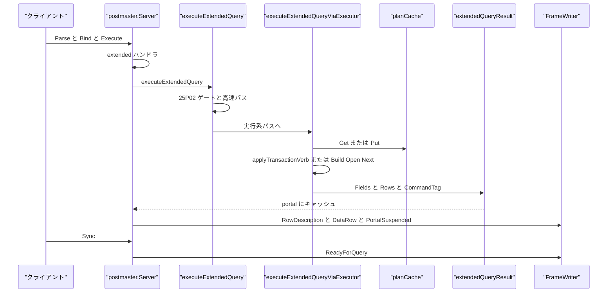

# 接続管理と SQL ディスパッチ

<details>
<summary>関連ソースファイル</summary>

- [`internal/postmaster/cancel.go`](https://github.com/ryogrid/goopg/blob/19856410e8d497d59787e1ab35a2febb3f5953d6/internal/postmaster/cancel.go)
- [`internal/postmaster/conn_tx.go`](https://github.com/ryogrid/goopg/blob/19856410e8d497d59787e1ab35a2febb3f5953d6/internal/postmaster/conn_tx.go)
- [`internal/postmaster/database_ddl.go`](https://github.com/ryogrid/goopg/blob/19856410e8d497d59787e1ab35a2febb3f5953d6/internal/postmaster/database_ddl.go)
- [`internal/postmaster/dispatch.go`](https://github.com/ryogrid/goopg/blob/19856410e8d497d59787e1ab35a2febb3f5953d6/internal/postmaster/dispatch.go)
- [`internal/postmaster/dispatch_extended.go`](https://github.com/ryogrid/goopg/blob/19856410e8d497d59787e1ab35a2febb3f5953d6/internal/postmaster/dispatch_extended.go)
- [`internal/postmaster/eof_watch.go`](https://github.com/ryogrid/goopg/blob/19856410e8d497d59787e1ab35a2febb3f5953d6/internal/postmaster/eof_watch.go)
- [`internal/postmaster/extended.go`](https://github.com/ryogrid/goopg/blob/19856410e8d497d59787e1ab35a2febb3f5953d6/internal/postmaster/extended.go)
- [`internal/postmaster/grant_ddl.go`](https://github.com/ryogrid/goopg/blob/19856410e8d497d59787e1ab35a2febb3f5953d6/internal/postmaster/grant_ddl.go)
- [`internal/postmaster/notify.go`](https://github.com/ryogrid/goopg/blob/19856410e8d497d59787e1ab35a2febb3f5953d6/internal/postmaster/notify.go)
- [`internal/postmaster/plancache.go`](https://github.com/ryogrid/goopg/blob/19856410e8d497d59787e1ab35a2febb3f5953d6/internal/postmaster/plancache.go)
- [`internal/postmaster/query.go`](https://github.com/ryogrid/goopg/blob/19856410e8d497d59787e1ab35a2febb3f5953d6/internal/postmaster/query.go)
- [`internal/postmaster/role_ddl.go`](https://github.com/ryogrid/goopg/blob/19856410e8d497d59787e1ab35a2febb3f5953d6/internal/postmaster/role_ddl.go)
- [`internal/postmaster/server.go`](https://github.com/ryogrid/goopg/blob/19856410e8d497d59787e1ab35a2febb3f5953d6/internal/postmaster/server.go)
- [`internal/postmaster/statement_log.go`](https://github.com/ryogrid/goopg/blob/19856410e8d497d59787e1ab35a2febb3f5953d6/internal/postmaster/statement_log.go)
- [`internal/postmaster/subscription_refresh.go`](https://github.com/ryogrid/goopg/blob/19856410e8d497d59787e1ab35a2febb3f5953d6/internal/postmaster/subscription_refresh.go)
- [`internal/postmaster/twophase.go`](https://github.com/ryogrid/goopg/blob/19856410e8d497d59787e1ab35a2febb3f5953d6/internal/postmaster/twophase.go)
- [`internal/postmaster/txn_verb.go`](https://github.com/ryogrid/goopg/blob/19856410e8d497d59787e1ab35a2febb3f5953d6/internal/postmaster/txn_verb.go)

</details>

`internal/postmaster` の接続管理は、1 本の TCP 接続を受け取った `serveConn` が起動パケットと認証を済ませ、接続ごとの状態（`connTxState`、prepared statement、cancel 情報、LISTEN の識別子）を作ってから `runPostStartupLoop` でフレームを処理する層である。通常の `Query` は `handleQuery` の高速パス、または `dispatchSimpleQueryViaExecutor` の parser → planner → executor 経路に流れ、拡張プロトコルの `Parse` / `Bind` / `Describe` / `Execute` は `internal/postmaster/extended.go` のハンドラ、`executeExtendedQuery`、その実行系パス `executeExtendedQueryViaExecutor` が処理する。トランザクション状態、プランキャッシュ、キャンセル、クライアント切断監視、LISTEN/NOTIFY、2 相コミット、DDL のワイヤ層バイパス、文ログまでを含む。プロトコル自体のフレームについては [3.2 ワイヤプロトコル](3.2-Wire-Protocol.md)、認証は [3.3 認証と pg_hba](3.3-Authentication.md)、COPY と拡張クエリの詳細は [3.5 COPY と拡張クエリプロトコル](3.5-COPY-and-Extended-Protocol.md) を参照されたい。SQL の解析・計画・実行は [4 SQL パーサー](../4-SQL-Parser.md)、[5 クエリプランナー](../5-Query-Planner.md)、[6 実行エンジン](../6-Executor.md)、MVCC は [9 トランザクションと MVCC](../9-Transactions.md) が扱う。

## 責務

- **接続ごとの状態の生成** — `serveConn` が `nextPID` でバックエンド PID を払い出し、TCP keepalive を 30 秒に設定し、ハンドシェイクの期限を `HandshakeTimeout` で区切る。認証後は `TxnMgr.AcquireConnSlot` で ProcArray スロットを取得し、`SessionRegistry` と `cancelEntry` を作る。`runPostStartupLoop` が `connTxState` と `preparedStatements` を作り、フレームループを開始する (`internal/postmaster/server.go:serveConn`, `runPostStartupLoop`)。
- **フレームのディスパッチ** — `runPostStartupLoop` は `ReadFrame` の結果を、COPY 中のフレーム処理、`extended.syncRequired` のゲート、メッセージタイプの switch の順に処理する。`MsgQuery`、`Parse` / `Bind` / `Describe` / `Execute` / `Close` / `Sync` / `Flush`、`CopyData` / `CopyDone` / `CopyFail`、`Terminate` を扱う (`internal/postmaster/server.go:runPostStartupLoop`)。
- **シンプルクエリの高速パス** — `handleQuery` が空クエリ、`SELECT 1`、`SHOW` / `SHOW ALL`、`SET` / `RESET`、`SET ROLE` / `SESSION AUTHORIZATION`、`GRANT` / `REVOKE` の一部を文字列マッチで処理し、それ以外を `dispatchSimpleQueryViaExecutor` に送る (`internal/postmaster/query.go:handleQuery`)。
- **parser → planner → executor のパイプライン** — `dispatchSimpleQueryViaExecutor` が `parser.Parse` とトランザクション／スナップショットの準備を行い、各文を `executeOneSimpleStmt` に渡す。計画は dispatch 側のプランキャッシュブロックか `executeOneSimpleStmt` のフォールバックで `optimizer.PlanWithSettings` を呼び、`executeOneSimpleStmt` が `executor.BuildFastIterator`、`op.Open` / `op.Next` / `op.Close` を実行して `RowDescription` / `DataRow` / `CommandComplete` を返す。複数文は文ごとに実行し、エラーでその Query メッセージの残りを中断する (`internal/postmaster/dispatch.go:dispatchSimpleQueryViaExecutor`, `executeOneSimpleStmt`)。
- **拡張プロトコルの実行** — `handleExecuteFrame` が `executeExtendedQuery` を呼び、空クエリ・`SELECT 1`・`SHOW` / `SET` などの高速パスを処理した後、必要なら `executeExtendedQueryViaExecutor` に渡す。実行系パスは 1 文だけを計画し、行を `extendedQueryResult` に materialise して portal に保持する。`Execute` の `maxRows` で分割しても同じ結果を再利用できる (`internal/postmaster/extended.go:handleExecuteFrame`, `executeExtendedQuery`, `internal/postmaster/dispatch_extended.go:executeExtendedQueryViaExecutor`)。
- **トランザクション状態機械** — `applyTransactionVerb` が `BEGIN` / `COMMIT` / `ROLLBACK` を処理し、simple と extended の両プロトコルで同じ状態遷移を使う。`connTxState` の `active` / `failed` / `preparedGid` が `ReadyForQuery` の `'I'` / `'T'` / `'E'` を決める (`internal/postmaster/txn_verb.go:applyTransactionVerb`, `internal/postmaster/conn_tx.go:wireStatus`)。
- **プリペアドステートメントとカーソル** — `preparedStatements` が `PREPARE name AS ...` を保持し、`EXECUTE` 時に `paramTypes` / `resultTypes` / `resultNames` を検証する。`cursorEntry` が `DECLARE ... CURSOR` の SQL、materialise 済みの行、現在位置、ctid を保持する (`internal/postmaster/conn_tx.go:preparedStatements`, `cursorEntry`, `internal/postmaster/dispatch.go:executeOneSimpleStmt`)。
- **DDL のワイヤ層バイパス** — parser が持たない `CREATE/DROP/ALTER DATABASE` と `CREATE/DROP/ALTER ROLE` を `tryHandleDatabaseDDL` / `tryHandleRoleDDL` が文字列レベルで補い、`GRANT` / `REVOKE` の一部は `tryRecordTableGrant` / `tryRecordTableRevoke` が ACL として記録する (`internal/postmaster/database_ddl.go:tryHandleDatabaseDDL`, `internal/postmaster/role_ddl.go:tryHandleRoleDDL`, `internal/postmaster/grant_ddl.go:tryRecordTableGrant`)。
- **プランキャッシュ** — `planCache` は 16 shard × 32 entry（最大 512）のクロスセッションキャッシュで、`planCacheKey(sql, dbOid, fingerprint)` をキーにする。DDL 後は `Invalidate` で全 shard を消し、ANALYZE / VACUUM も統計変更として無効化の対象になる (`internal/postmaster/plancache.go:planCache`, `planCacheKey`, `Invalidate`, `internal/postmaster/dispatch.go:planCacheInvalidatingStmt`)。
- **キャンセルとクライアント切断監視** — `cancelEntry` が接続ごとの secret と実行中クエリの `context.CancelFunc` を保持し、`CancelRequest` と `pg_cancel_backend(pid)` の両方を扱う。`clientEOFWatch` は 500 ms ごとに `recvfrom(MSG_PEEK)` でクライアントの FIN / RST を検出し、クエリの ctx をキャンセルする (`internal/postmaster/cancel.go:cancelEntry`, `internal/postmaster/eof_watch.go:clientEOFWatch`)。
- **非同期通知** — `notifyHub` が LISTEN の登録とセッションごとの通知キューを持ち、`NOTIFY` はトランザクションの commit 時に `deliverNotifications` で `'A'` として送られる。`notifyQueueCapacity = 1 << 20` は `pg_notification_queue_usage()` の分母で、実際のキューはアンバウンドである (`internal/postmaster/notify.go:notifyHub`, `Notification`, `deliverNotifications`)。
- **2 相コミット** — `preparedXactStore` が gid ごとの parked `connTxState` を保持する。SERIALIZABLE は same-backend の keep-open、READ COMMITTED / REPEATABLE READ は `DetachToDedicatedSlot` で専用スロットへ移して別バックエンドからの finalise を可能にする (`internal/postmaster/twophase.go:preparedXactStore`, `execPrepareTransaction`)。
- **文ログと activity** — `logStatementLevel` の `none` / `ddl` / `mod` / `all`、`GOOPG_LOG_STATEMENT` とセッション GUC の loudest 選択、`log_min_duration_statement` の duration 行を扱う。実行中は `pg_stat_activity` を `active`、完了後は `idle` / `idle in transaction` に更新する (`internal/postmaster/statement_log.go:logStatement`, `logDuration`, `internal/postmaster/dispatch.go:dispatchSimpleQueryViaExecutor`)。
- **サブスクリプションのリフレッシュ** — `RefreshSubscriptionOnPublisher` が publisher へ接続し、`RunTableSyncManager` で各テーブルを初期同期し、完了後に `pg_subscription_rel` を `sync_done` / `ready` へ進める。同期後に apply worker を停止して、次回起動で新しい slot を使わせる (`internal/postmaster/subscription_refresh.go:RefreshSubscriptionOnPublisher`)。

## 処理フロー

### 接続の確立からフレームループへ

`serveConn` は起動パケットの読み取り、認証、ホットスタンバイの受け入れ可否、`replication` パラメータの検証を順に行い、成功したら接続固有の状態を作る。`BackendKeyData` に載せる PID と secret は `cancelReg.register(pid, secret)` に登録され、`cancelEntry.setTerminate(cancel)` で `pg_terminate_backend` 用のルート ctx キャンセルも結びつく (`internal/postmaster/server.go:serveConn`)。



### シンプルクエリの実行経路

`handleQuery` の高速パスに当たらない文は `dispatchSimpleQueryViaExecutor` に渡る。ここで `parser.Parse`、`TxnMgr.Begin` または既存の明示トランザクションの再利用、`SnapshotFor`、プランキャッシュの `Get` / `Put`、`executeOneSimpleStmt` の順に進む。各文の終わりに `CommandComplete` を出し、バッチ全体の最後に一度だけ `ReadyForQuery` を返す (`internal/postmaster/dispatch.go:dispatchSimpleQueryViaExecutor`)。



### 拡張クエリの実行経路

`Parse` は prepared statement を登録し、`Bind` は portal を作り、`Execute` が `executeExtendedQuery` を呼ぶ。`executeExtendedQuery` は 25P02 ゲートと文字列高速パスを処理し、実行系が必要な文だけを `executeExtendedQueryViaExecutor` に渡す。simple 経路と違い、行は `extendedQueryResult` に materialise され、portal の `RowPos` を進めながら `maxRows` ごとに返す。`Execute` がエラーになると `handleExecuteFrame` が明示トランザクションを失敗状態へ落とし、`Sync` まで後続フレームを捨てる (`internal/postmaster/extended.go:handleParseFrame`, `handleBindFrame`, `handleExecuteFrame`, `executeExtendedQuery`, `internal/postmaster/dispatch_extended.go:executeExtendedQueryViaExecutor`)。



## 主要ファイル

| ファイル | 役割 |
| --- | --- |
| `internal/postmaster/server.go` | `serveConn`、`runPostStartupLoop`、`checkAuth`、`sendStartupReply`、`StopImmediate` と制御プレーン。接続ごとの goroutine とフレームループの起点 (`internal/postmaster/server.go:serveConn`, `runPostStartupLoop`)。 |
| `internal/postmaster/query.go` | シンプルクエリの `handleQuery`、`SHOW` / `SET` / `RESET` の高速パス、`writeQueryError` と `errQueryErrorSent` (`internal/postmaster/query.go:handleQuery`, `writeQueryError`)。 |
| `internal/postmaster/dispatch.go` | `dispatchSimpleQueryViaExecutor` と `executeOneSimpleStmt`、plan cache の参照、command tag の生成、カーソルの FETCH、GUC から executor.Context への配線 (`internal/postmaster/dispatch.go:dispatchSimpleQueryViaExecutor`, `executeOneSimpleStmt`)。 |
| `internal/postmaster/dispatch_extended.go` | 拡張プロトコルの `executeExtendedQueryViaExecutor`、`tryHandleDatabaseOrRoleDDLExtended`、`paramsToDatums`。portal 用の結果 materialise (`internal/postmaster/dispatch_extended.go:executeExtendedQueryViaExecutor`)。 |
| `internal/postmaster/extended.go` | `extendedState`、`preparedStatement`、`portalState`、`boundParam` と `Parse` / `Bind` / `Describe` / `Execute` / `Close` のハンドラ (`internal/postmaster/extended.go:extendedState`, `handleParseFrame`, `handleExecuteFrame`)。 |
| `internal/postmaster/conn_tx.go` | `connTxState`、`cursorEntry`、`preparedStatementDef` / `preparedStatements`、`wireStatus`、明示トランザクションの開始・終了 (`internal/postmaster/conn_tx.go:connTxState`, `preparedStatements`, `wireStatus`)。 |
| `internal/postmaster/txn_verb.go` | `applyTransactionVerb` と `txnVerbOutcome`、`failExplicitBlock`、`writeBackConnTxState`。simple / extended 共通の BEGIN/COMMIT/ROLLBACK 状態機械 (`internal/postmaster/txn_verb.go:applyTransactionVerb`, `failExplicitBlock`)。 |
| `internal/postmaster/plancache.go` | `planCache` / `planCacheShard`、`Get` / `Put` / `Invalidate`、doorkeeper による 2 回目以降の admission、`planCacheIsCacheable` (`internal/postmaster/plancache.go:planCache`, `Put`, `Invalidate`)。 |
| `internal/postmaster/cancel.go` | `cancelEntry` と `backendCancelRegistry`。secret 付き `CancelRequest`、secret なしの `pg_cancel_backend`、ルート ctx を切る `pg_terminate_backend` (`internal/postmaster/cancel.go:cancelEntry`, `backendCancelRegistry`)。 |
| `internal/postmaster/eof_watch.go` | `clientEOFWatch`。500 ms ごとの `recvfrom(MSG_PEEK)` で切断を検出し、クエリ ctx をキャンセルする (`internal/postmaster/eof_watch.go:clientEOFWatch`, `startClientEOFWatch`)。 |
| `internal/postmaster/notify.go` | `notifyHub` と `Notification`、LISTEN / UNLISTEN / NOTIFY、commit 時の publish、`deliverNotifications`、`discardAllSessionState` (`internal/postmaster/notify.go:notifyHub`, `execNotifyStmt`, `deliverNotifications`)。 |
| `internal/postmaster/twophase.go` | `preparedXactStore`、`execTwoPhaseStmt`、`execPrepareTransaction`。PREPARE TRANSACTION の SSI チェックと RC/RR の detach (`internal/postmaster/twophase.go:preparedXactStore`, `execPrepareTransaction`)。 |
| `internal/postmaster/database_ddl.go` | `classifyDatabaseDDL`、`tryHandleDatabaseDDL`、`handleDatabaseDDLBypass`、テンプレート複製・DB ディレクトリ・`pg_database` ヒープ更新 (`internal/postmaster/database_ddl.go:tryHandleDatabaseDDL`, `handleDatabaseDDLBypass`)。 |
| `internal/postmaster/role_ddl.go` | `tryHandleRoleDDL`、`persistRoleState`、`encryptRolePassword`、`resolvePasswordEncryption`、`resolveScramIterations`。CREATE/ALTER/DROP ROLE の補完 (`internal/postmaster/role_ddl.go:tryHandleRoleDDL`, `encryptRolePassword`)。 |
| `internal/postmaster/grant_ddl.go` | `tryRecordTableGrant` / `tryRecordTableRevoke`、schema / function / foreign server / FDW の ACL 記録、`nonTableGrantObjects` (`internal/postmaster/grant_ddl.go:tryRecordTableGrant`, `tryRecordTableRevoke`)。 |
| `internal/postmaster/statement_log.go` | `logStatementLevel` と `parseLogStatementLevel`、`logStatement`、`logDuration`、`log_line_prefix` の展開 (`internal/postmaster/statement_log.go:logStatement`, `logDuration`, `formatLogLinePrefix`)。 |
| `internal/postmaster/subscription_refresh.go` | `RefreshSubscriptionOnPublisher`、`refreshOpenWriter`、`refreshRel`。publisher への接続、初期テーブルコピー、`pg_subscription_rel` の状態遷移 (`internal/postmaster/subscription_refresh.go:RefreshSubscriptionOnPublisher`)。 |

## 公開 API / エントリポイント

接続とディスパッチ:

- `func (s *Server) serveConn(ctx context.Context, raw net.Conn)` — 接続 1 本の全ライフサイクル (`internal/postmaster/server.go:serveConn`)。
- `func (s *Server) runPostStartupLoop(...)` — `ReadyForQuery` 後のフレームループ (`internal/postmaster/server.go:runPostStartupLoop`)。
- `func (s *Server) handleQuery(...) error` — シンプルクエリの高速パスと実行系への入口 (`internal/postmaster/query.go:handleQuery`)。
- `func (s *Server) dispatchSimpleQueryViaExecutor(...) error` — parser / planner / executor のシンプルクエリ経路 (`internal/postmaster/dispatch.go:dispatchSimpleQueryViaExecutor`)。
- `func (s *Server) executeOneSimpleStmt(...) error` — 1 文の計画・実行・応答 (`internal/postmaster/dispatch.go:executeOneSimpleStmt`)。
- `func (s *Server) executeExtendedQueryViaExecutor(...) (*extendedQueryResult, *extendedQueryError)` — 拡張プロトコルの実行経路 (`internal/postmaster/dispatch_extended.go:executeExtendedQueryViaExecutor`)。

トランザクション・2PC・通知:

- `func (s *Server) applyTransactionVerb(ctx *executor.Context, connTx *connTxState, txNode *optimizer.Transaction, autoCommitPtr *bool) txnVerbOutcome` — BEGIN/COMMIT/ROLLBACK (`internal/postmaster/txn_verb.go:applyTransactionVerb`)。
- `func failExplicitBlock(connTx *connTxState)` / `writeBackConnTxState(...)` — 失敗状態と接続状態の書き戻し (`internal/postmaster/txn_verb.go:failExplicitBlock`, `writeBackConnTxState`)。
- `func (s *Server) execTwoPhaseStmt(...) (bool, error)` — PREPARE TRANSACTION / COMMIT PREPARED / ROLLBACK PREPARED (`internal/postmaster/twophase.go:execTwoPhaseStmt`)。
- `func (s *Server) execNotifyStmt(w *libpq.FrameWriter, stmt parser.Stmt, connTx *connTxState) (bool, error)` — LISTEN / NOTIFY / UNLISTEN (`internal/postmaster/notify.go:execNotifyStmt`)。

キャンセル・プランキャッシュ:

- `func (r *backendCancelRegistry) cancelQuery(pid, secretKey uint32)` / `cancelByPID(pid uint32) bool` / `terminateByPID(pid uint32) bool` — 3 種類の停止経路 (`internal/postmaster/cancel.go:cancelQuery`, `cancelByPID`, `terminateByPID`)。
- `func startClientEOFWatch(conn net.Conn, cancel context.CancelFunc, logger *slog.Logger) *clientEOFWatch` / `(*clientEOFWatch).Stop()` — 切断監視 (`internal/postmaster/eof_watch.go:startClientEOFWatch`, `Stop`)。
- `func (pc *planCache) Get(key string) (optimizer.Node, bool)` / `Put(key string, node optimizer.Node)` / `Invalidate()` — クロスセッションの計画キャッシュ (`internal/postmaster/plancache.go:Get`, `Put`, `Invalidate`)。

DDL バイパス:

- `func (s *Server) tryHandleDatabaseDDL(...)` / `handleDatabaseDDLBypass(...)` — parser のない DATABASE DDL (`internal/postmaster/database_ddl.go:tryHandleDatabaseDDL`, `handleDatabaseDDLBypass`)。
- `func (s *Server) tryHandleRoleDDL(...)` — parser のない ROLE DDL (`internal/postmaster/role_ddl.go:tryHandleRoleDDL`)。
- `func (s *Server) tryRecordTableGrant(...)` / `tryRecordTableRevoke(...)` — テーブル ACL の高速記録 (`internal/postmaster/grant_ddl.go:tryRecordTableGrant`, `tryRecordTableRevoke`)。

## 主要データ構造

### `connTxState` — 接続ごとの明示トランザクション状態

```go
type connTxState struct {
	mu     sync.Mutex
	active bool
	failed bool // 25P02: in_failed_sql_transaction
	// preparedGid is the global transaction identifier set by
	// `PREPARE TRANSACTION 'gid'`. While non-empty the connection's active
	// transaction is "prepared": its writes, locks and SSI predicate-lock
	// state persist (the transaction is kept open) until a matching
	// `COMMIT PREPARED 'gid'` / `ROLLBACK PREPARED 'gid'` finalises it via the
	// canonical commit/rollback path. Same-backend only — cross-backend commit
	// of a prepared xact and the pg_prepared_xacts view are deferred.
	// M0118-0009 (prepared-transactions).
	preparedGid string
	tx          transam.Transaction
	sess        *executor.BasicSession // session state, non-nil when active
	// SessCtx is the per-connection session-level mctx (M0107-0001).
	// Wired by serveConn after creating the session context; stmt-level
	// contexts are acquired as children in dispatchSimpleQueryViaExecutor.
	SessCtx *mmgr.Context
	// ProcNum is the backend's slot index in the Manager's ProcArray.
	// Assigned once at connection start in serveConn; used to pass an
	// explicit procNum to Manager.Begin on every statement.
	ProcNum int32
	// DBName is the database this connection is bound to (from the startup
	// packet). Assigned once at connection start; used to scope per-database
	// catalogs such as pg_extension. M0110-0003 (AC-002 gap #7c).
	DBName string
	// TempTableShadows maps table name → original permanent *catalog.Table.
	// Populated when CREATE TEMP TABLE shadows a permanent table. M0097-0003.
	TempTableShadows map[string]*catalog.Table
	// OnCommitActions carries the session's ON COMMIT {DELETE ROWS|DROP}
	// registrations across messages. Autocommit CREATE TEMP TABLE ... ON
	// COMMIT ... runs in a message-scoped throwaway session (dispatch.go
	// seeds connTx.Session()==nil with NewAutocommitUndoSession), so without
	// this write-back a DELETE ROWS registration made outside an explicit
	// transaction would vanish before the next message's explicit COMMIT —
	// PG keeps on_commits in backend-local CacheMemoryContext (tablecmds.c
	// register_on_commit_action), session-scoped, surviving autocommit
	// commits. Written back by writeBackConnTxState + dispatch.go's
	// per-statement write-back; seeded into each ectx's Session at setup.
	// M0134-0072.
	OnCommitActions []executor.OnCommitAction
	// Cursors holds open SQL cursors declared by DECLARE ... CURSOR FOR select.
	// Key = cursor name (case-insensitive), value = cursor state.
	// M0097-0042: cursor entries track materialized rows and position for
	// FETCH FORWARD/BACKWARD support.
	Cursors map[string]*cursorEntry
	// SeqCurrVals holds per-sequence last nextval values for currval().
	// Session-scoped: persists across statements and transactions. M0097-0042.
	SeqCurrVals map[string]int64
	// SeqLastVal / SeqLastSet track the most recent nextval across all sequences
	// (for lastval()). SeqLastName is the name of the sequence that produced it
	// (to detect if that sequence was dropped). Session-scoped. M0097-0042.
	SeqLastVal  int64
	SeqLastSet  bool
	SeqLastName string
	// PendingEnumValues tracks enum labels added via ALTER TYPE … ADD VALUE
	// inside the current explicit transaction.  They are "unsafe" until COMMIT.
	// map[enumTypeName][label]=true.  Cleared on COMMIT/ROLLBACK (End()).
	PendingEnumValues map[string]map[string]bool
	// PendingEnumRenames tracks ALTER TYPE … RENAME TO within the current tx.
	// On ROLLBACK, reversed in reverse order.  Cleared on COMMIT/ROLLBACK. M0097-0022.
	PendingEnumRenames []executor.EnumRenameEntry
	// PendingCreatedEnums tracks CREATE TYPE … AS ENUM within the current tx.
	// On ROLLBACK, created types are dropped.  map[name(lowercase)]=true.  M0097-0022.
	PendingCreatedEnums map[string]bool
	// PendingCreatedComposites tracks CREATE TYPE … AS (...) within the current
	// tx.  On ROLLBACK, created composite types are dropped.
	// map[name(lowercase)]=true.  DU-002 slice 244.
	PendingCreatedComposites map[string]bool
	// PendingCreatedRangeTypes tracks CREATE TYPE … AS RANGE within the
	// current tx.  On ROLLBACK, created range types are dropped.  Mirrors
	// PendingCreatedComposites — range types had no undo tracking at all
	// until this field was added.  map[name(lowercase)]=true.  M0122-0007 4e
	// follow-up (fifth loop).
	PendingCreatedRangeTypes map[string]bool
	// NonSuperuserRole is set when SET SESSION AUTHORIZATION or SET ROLE is
	// called with a non-default role name. While non-empty, privilege checks
	// that require superuser (e.g. LEAKPROOF function attribute) are
	// rejected. Cleared by RESET SESSION AUTHORIZATION / RESET ROLE or the
	// DEFAULT/postgres spellings of either.
	NonSuperuserRole string
	// SetRoleIsActive mirrors PostgreSQL's SetRoleIsActive (miscinit.c):
	// true while a SET ROLE (as opposed to SET SESSION AUTHORIZATION) is in
	// effect. current_user/current_role read NonSuperuserRole only while
	// this is true; otherwise they fall back to SessionUser. SET SESSION
	// AUTHORIZATION always clears it (PG parity: "SET SESSION AUTHORIZATION
	// implies SET ROLE NONE"). M0134-0009.
	SetRoleIsActive bool
	// LoginUser is the authenticated login role for this connection (the
	// StartupMessage "user" value), captured once at connection start and
	// never mutated thereafter. RESET SESSION AUTHORIZATION / SET SESSION
	// AUTHORIZATION DEFAULT restore SessionUser to this value. M0134-0009.
	LoginUser string
	// SessionUser is the current session_user identity (PostgreSQL's
	// GetSessionUserId(), miscinit.c). It starts equal to LoginUser and is
	// updated only by SET/RESET SESSION AUTHORIZATION — SET ROLE never
	// touches it. M0134-0009.
	SessionUser string
	// LocalRolePriorValue, when non-nil, is the NonSuperuserRole value
	// captured just before the first SET LOCAL ROLE / SET LOCAL SESSION
	// AUTHORIZATION within the current explicit transaction. End() restores
	// it at COMMIT or ROLLBACK and clears the pointer, mirroring
	// PostgreSQL's GUC_ACTION_LOCAL stack (guc.c) at the same flat,
	// non-nested fidelity config.SessionRegistry's local layer already
	// provides for ordinary GUCs (see SessionRegistry.EndTransaction).
	// Populated via SnapshotLocalRoleIfNeeded. M0119-0004.
	LocalRolePriorValue *string
	// LocalSessionUserPriorValue / LocalSetRoleIsActivePriorValue are
	// SessionUser's and SetRoleIsActive's LocalRolePriorValue siblings:
	// captured by the same first-SET-LOCAL-wins snapshot in
	// SnapshotLocalRoleIfNeeded and restored alongside LocalRolePriorValue
	// in End(). Without these, `BEGIN; SET LOCAL SESSION AUTHORIZATION
	// alice; COMMIT;` left SessionUser="alice" leaked past COMMIT for the
	// rest of the connection even though NonSuperuserRole correctly
	// reverted (M0134-0009 round-2 review, R1/R11).
	LocalSessionUserPriorValue     *string
	LocalSetRoleIsActivePriorValue *bool
	// AdvisoryID is the stable per-connection advisory-lock owner identity (the
	// SessionRegistry). It is assigned once at connection start in
	// runPostStartupLoop and matches advisorySessionIDFromContext's preferred
	// identity, so transaction-end and connection-teardown release the same
	// advisory locks that pg_advisory_*lock() acquired — regardless of whether
	// the lock was taken in autocommit or inside an explicit transaction.
	// M0118-0003.
	AdvisoryID any
	// LockBackendID is a stable lock-manager backend identity for the
	// whole connection (distinct from the per-statement BackendID minted
	// in dispatch.go) that backs transaction-scoped LOCK TABLE heavyweight
	// locks. A LOCK acquired in one statement survives the per-statement
	// ReleaseAll and is dropped only here in End() (via
	// executor.ReleaseTableLocks) on COMMIT/ROLLBACK. Assigned once at
	// connection start in runPostStartupLoop. M0118-0003 (lock-nowait).
	LockBackendID lmgr.BackendID
	// BackendPID is this connection's backend PID (the value in BackendKeyData /
	// pg_backend_pid). Stamped once at connection start; used as the source PID
	// of NOTIFY deliveries (the int32 of the 'A' NotificationResponse).
	// M0118-0009 (async-notify).
	BackendPID uint32
	// NotifySession is the stable per-connection identity used as the
	// LISTEN/NOTIFY hub key (same SessionRegistry as AdvisoryID, typed for
	// direct hub calls). M0118-0009.
	NotifySession *misc.SessionRegistry
	// pendingNotify is the savepoint-aware stack of NOTIFY messages emitted by
	// the current transaction. PostgreSQL makes notifications visible only when
	// the notifying transaction commits, so they are published to the hub at
	// COMMIT and discarded at ROLLBACK. Each entry is one (sub)transaction
	// level, mirroring async.c's per-subtransaction pendingNotifies list:
	// pendingNotify[0] is the transaction top level (name ""), and a SAVEPOINT
	// pushes a new level. ROLLBACK TO SAVEPOINT discards the notifications
	// queued since that savepoint; RELEASE SAVEPOINT merges them into the
	// enclosing level. Notifications are deduplicated by (channel,payload)
	// across ALL active levels, the way async.c collapses duplicate
	// same-transaction notifications. M0118-0009.
	pendingNotify []notifyLevel
}
```

`internal/postmaster/conn_tx.go:connTxState`

`active` は明示トランザクションが開いているか、`failed` は 25P02 の失敗状態か、`preparedGid` は `PREPARE TRANSACTION 'gid'` 後の prepared 状態を表す。`wireStatus` は `active` が偽または `preparedGid` が非空なら `'I'`、`failed` またはエラー応答直後なら `'E'`、それ以外の明示トランザクションなら `'T'` を返す。`ProcNum` は接続の ProcArray スロットで、`DBName` はスタートアップパケットのデータベース、`SessCtx` はセッション用メモリコンテキストである。`TempTableShadows`、`OnCommitActions`、`PendingEnum*` は自動コミットのメッセージをまたいで接続に残す必要がある DDL / ON COMMIT 状態で、`writeBackConnTxState` が executor 側の変更をここへ戻す。`Cursors`、`SeqCurrVals`、`LocalRolePriorValue`、`AdvisoryID`、`LockBackendID`、`BackendPID`、`NotifySession`、`pendingNotify` はセッション／トランザクションの寿命に合わせて保持される (`internal/postmaster/conn_tx.go:connTxState`, `wireStatus`, `writeBackConnTxState`)。

### `extendedState` / `preparedStatement` / `portalState` / `boundParam`

```go
type extendedState struct {
	statements   map[string]*preparedStatement
	portals      map[string]*portalState
	syncRequired bool
	ProcNum      int32  // backend's ProcArray slot; forwarded to Begin calls
	DBName       string // connection's database; scopes pg_extension (M0110-0003 gap #7c)
}

type preparedStatement struct {
	Name       string
	Query      string
	ParamCount int
}

type portalState struct {
	Name      string
	Statement *preparedStatement
	Params    []boundParam
	Result    *extendedQueryResult
	RowPos    int
}

type boundParam struct {
	IsNull bool
	Text   string
}
```

`internal/postmaster/extended.go:extendedState`, `preparedStatement`, `portalState`, `boundParam`

`statements` は named prepared statement、`portals` は Bind が作った実行インスタンスを持つ。空文字の名前は unnamed statement / unnamed portal で、unnamed statement を Parse し直すと unnamed portal も消える。`syncRequired` はエラー後の再同期待ちで、これが真の間 `runPostStartupLoop` は `Sync` と `Terminate` 以外を捨てる。`portalState.Result` は最初の Execute で materialise した結果を保持し、`RowPos` が次に返す行を指す。`boundParam` は NULL かテキストだけで、バイナリパラメータは Bind の時点で拒否される。

### `preparedStatementDef` / `preparedStatements`

```go
type preparedStatementDef struct {
	stmt        parser.Stmt
	sql         string   // original PREPARE … AS … text for pg_prepared_statements
	paramTypes  []string // declared parameter types from PREPARE (…); nil = no declaration
	resultTypes []string // inferred output column types; nil = unknown
	// resultNames holds the output column names captured at PREPARE time,
	// parallel to resultTypes. Used by EXECUTE to detect a result-type change
	// (e.g. an intervening ALTER TABLE ADD COLUMN on a `SELECT *` source) the
	// same way PostgreSQL's RevalidateCachedQuery compares
	// PlanCacheComputeResultDesc(tlist) against plansource->resultDesc via
	// equalRowTypes (postgres/src/backend/utils/cache/plancache.c:858).
	// M0134-0054 bucket 5.
	resultNames []string
}

// preparedStatements stores named prepared SQL statements for this connection.
// Keyed by statement name; value is the parsed query body. Used to implement
// PREPARE name AS … / EXECUTE name (M0096-0006).
type preparedStatements struct {
	mu    sync.Mutex
	stmts map[string]preparedStatementDef
}
```

`internal/postmaster/conn_tx.go:preparedStatementDef`, `preparedStatements`

`stmt` は Parse 済みの文、`sql` は `pg_prepared_statements.statement` 用の元テキスト、`paramTypes` は PREPARE で宣言された型、`resultTypes` / `resultNames` は PREPARE 時点の結果スキーマである。EXECUTE はこのスキーマを現在の計画と比較し、`SELECT *` の対象に列が増えたような結果型変更を `0A000` で拒否する。`preparedStatements` は `sync.Mutex` で接続内の map を保護し、`Store` は同名の重複を拒否する。

### `planCache` / `planCacheShard`

```go
type planCache struct {
	shards [planCacheNumShards]planCacheShard
	// doorkeeper is the admission filter (perf-optimize-take3/06 candidate H).
	// Lock-free: one atomic Swap per Put.
	doorkeeper [planCacheDoorkeeperSize]atomic.Uint64
}

type planCacheShard struct {
	mu      sync.RWMutex
	entries map[string]optimizer.Node
	// order tracks insertion order for simple FIFO eviction.
	order []string
}
```

`internal/postmaster/plancache.go:planCache`, `planCacheShard`

`planCacheNumShards = 16`、`planCacheMaxPerShard = 32` で最大 512 entry、`planCacheDoorkeeperSize = 8192` の doorkeeper を持つ。キーは正規化 SQL、接続の DB OID、セッションの planner fingerprint を結合した `planCacheKey` である。`Get` は shard の `RWMutex` の読み取りロックだけで引き、`Put` は doorkeeper の `admit` を通ったキーだけを書き、満杯なら `order` の先頭を FIFO で追い出す。`Invalidate` は全 shard の `entries` と `order` をクリアする (`internal/postmaster/plancache.go:Get`, `Put`, `Invalidate`, `admit`)。

### `cancelEntry` / `clientEOFWatch`

```go
type cancelEntry struct {
	mu          sync.Mutex
	secretKey   uint32
	queryCancel context.CancelFunc
	// terminate cancels the connection's ROOT context (set once at connection
	// start). Firing it makes the backend's serve loop tear the connection down
	// — the engine behind pg_terminate_backend(pid) for a peer backend. nil
	// until set by the backend goroutine. M0118-0009.
	terminate context.CancelFunc
}
```

`internal/postmaster/cancel.go:cancelEntry`

```go
type clientEOFWatch struct {
	stop chan struct{}
	done chan struct{}
}
```

`internal/postmaster/eof_watch.go:clientEOFWatch`

`secretKey` は接続の生存期間で固定で、`CancelRequest` の照合に使う。`queryCancel` は実行中のクエリだけを指し、`clearQueryCancel` で idle 時には nil になる。`terminate` は接続のルート ctx をキャンセルし、`pg_terminate_backend(pid)` の peer 向け経路になる。`clientEOFWatch` は `stop` / `done` の 2 チャネルだけを持ち、`startClientEOFWatch` が 500 ms の ticker と `syscall.RawConn` の `recvfrom` を回す。`Stop` は nil レシーバでも安全で、クエリ終了時に watcher の goroutine を待つ (`internal/postmaster/eof_watch.go:clientEOFWatch`, `startClientEOFWatch`, `Stop`)。

### `txnVerbOutcome`

```go
type txnVerbOutcome struct {
	Handled bool
	// Warn asks the caller to emit the 25P01 "there is no transaction in
	// progress" WARNING before the command tag — PG's response to COMMIT or
	// ROLLBACK outside a block.
	Warn bool
	// Tag is the CommandComplete tag to write when Err is nil. Note it is
	// not always transactionTag(verb): a COMMIT in a failed block reports
	// "ROLLBACK".
	Tag string
	Err *txnVerbError
}
```

`internal/postmaster/txn_verb.go:txnVerbOutcome`

`Handled` が偽なら `SAVEPOINT` / `RELEASE` / `ROLLBACK TO` のように executor 側が処理する文であり、呼び出し元は `Build` / `BuildFastIterator` にフォールバックする。`Warn` はトランザクション外の COMMIT / ROLLBACK に対する 25P01 WARNING、`Tag` は失敗ブロックの COMMIT が `ROLLBACK` になるような通常と異なるタグを含む。`Err` は SQLSTATE・メッセージ・DETAIL/HINT/POSITION を保持する `txnVerbError` で、simple と extended がそれぞれのフレーム形式に変換する (`internal/postmaster/txn_verb.go:txnVerbOutcome`, `applyTransactionVerb`)。

### `notifyHub` / `Notification`

```go
type notifyHub struct {
	mu sync.Mutex
	// listeners[channel] is the set of sessions LISTENing on that channel.
	listeners map[string]map[*misc.SessionRegistry]struct{}
	// pending[session] is the FIFO of notifications delivered to but not yet
	// drained by that session.
	pending map[*misc.SessionRegistry][]Notification
}

// Notification is one delivered LISTEN/NOTIFY message. PID is the backend PID of
// the notifying session (rendered as the int32 of the 'A' NotificationResponse
// and joined to pg_stat_activity by clients).
type Notification struct {
	PID     uint32
	Channel string
	Payload string
}
```

`internal/postmaster/notify.go:notifyHub`, `Notification`

`listeners` はチャネルから `*misc.SessionRegistry` への集合、`pending` はセッションごとの FIFO である。`Notify` は現在 LISTEN している全セッション（通知元自身を含む）に `Notification` を積む。commit 時に `publishPendingNotify` が `connTxState.pendingNotify` を hub に流し、`deliverNotifications` が `'A'` フレームにする。`pendingNotify` は savepoint の階層ごとに分かれ、ROLLBACK TO でその階層以降を捨てる (`internal/postmaster/conn_tx.go:pendingNotify`, `pendingNotify` type, `internal/postmaster/notify.go:notifyHub`).

## 内部構造

### 接続状態とトランザクションの 2 モード

`serveConn` は接続ごとに `connTxState` を作り、`runPostStartupLoop` に渡す。`connTxState` の `active` が偽なら自動コミットで、各 Query メッセージが 1 つのトランザクションを持つ。`dispatchSimpleQueryViaExecutor` はメッセージ先頭で `TxnMgr.Begin` を呼び、複数文ならその 1 トランザクションを共有する。`BEGIN` が来ると `applyTransactionVerb` がそのトランザクションを明示ブロックへ昇格し、`autoCommitPtr` を false にする。以降の文は `connTx.Tx()` の同じトランザクションで実行され、`COMMIT` / `ROLLBACK` が `connTx.End()` と遅延制約・SSI・enum DDL undo を含む終了処理を呼ぶ (`internal/postmaster/dispatch.go:dispatchSimpleQueryViaExecutor`, `internal/postmaster/txn_verb.go:applyTransactionVerb`).

`connTxState.failed` が立つと、`COMMIT` / `ROLLBACK` / `ROLLBACK TO SAVEPOINT` / 2PC 以外の文は 25P02 で拒否される。これは simple の per-statement ループで `connTx.IsFailed()` を先に見るゲートと、extended の `executeExtendedQuery` が持つ同じゲートの両方で守られる。パースエラーや計画エラーも `connTx.Fail()` を呼び、PostgreSQL の「ブロック内の任意のエラーで abort」に合わせる (`internal/postmaster/dispatch.go:dispatchSimpleQueryViaExecutor`, `internal/postmaster/extended.go:executeExtendedQuery`, `internal/postmaster/txn_verb.go:failExplicitBlock`).

### ディスパッチの順序と高速パス

`runPostStartupLoop` は COPY 中なら全フレームを COPY 用ハンドラに渡し、`extended.syncRequired` が立っていれば `Sync` / `Terminate` 以外を捨てる。その後 `MsgQuery` は replication 接続なら `replHandler.HandleCommand` を先に試し、通常接続なら Query の振り分けに進む。`handleQuery` の高速パスは `SELECT 1`、`SHOW`、`SET` / `RESET`、`SET ROLE`、`GRANT` / `REVOKE` の一部を文字列で処理し、それ以外は `dispatchSimpleQueryViaExecutor` に渡す。高速パスでも `connTx.IsFailed()` の 25P02 ゲートは先に置かれ、`SELECT 1` すら失敗ブロックでは通らない (`internal/postmaster/server.go:runPostStartupLoop`, `internal/postmaster/query.go:handleQuery`).

`dispatchSimpleQueryViaExecutor` はまず `classifyDatabaseDDL` で DROP DATABASE を検出し、`handleDatabaseDDLBypass` に渡す。DROP DATABASE は parser の `DropCompatStmt` が実カタログ処理を影で覆うため、Parse より前に横取りする。Parse が失敗した場合は DATABASE / ROLE の文字列バイパス、`splitLeadingRoleDDL` による先頭 ROLE 文の分離、`splitLeadingCompatNoopDDL`、`compatNoopCommandTag` の順に試す (`internal/postmaster/dispatch.go:dispatchSimpleQueryViaExecutor`, `internal/postmaster/database_ddl.go:classifyDatabaseDDL`, `handleDatabaseDDLBypass`).

### プランキャッシュ

simple 経路のキャッシュは、単一の文で、NOTIFY / 2PC / CURRENT OF ではなく、temp inheritance / partition detach / inheritance change が進行中でないときだけ使う。キーは `planCacheKey(sql, ectx.CurrentDatabaseOid, sessionPlannerFingerprint(sess))` で、DB OID を混ぜることで別データベースのプランが混ざらない。ヒット時は `precached` を使い、ミス時は `PlanWithSettings` して `planCacheIsCacheable` なら `Put` する。キャッシュには serial plan を入れ、parallel の Gather は `applyParallelPostPass` で文ごとに後付けする (`internal/postmaster/dispatch.go:dispatchSimpleQueryViaExecutor`, `internal/postmaster/plancache.go:planCache`).

無効化は `executeOneSimpleStmt` の最後で `planCacheInvalidatingStmt` が真なら `s.pc.Invalidate()` を呼ぶ。DDL に加えて `ANALYZE` / `VACUUM` も対象で、これは統計変更がキャッシュされた計画のコストを変えるためである。`ON COMMIT DROP` のように DDL 文を伴わないカタログ変更は `ectx.OnCommitDDL` から `s.pc.Invalidate` を呼ぶ (`internal/postmaster/dispatch.go:planCacheInvalidatingStmt`, `internal/postmaster/plancache.go:Invalidate`).

### 拡張プロトコルと portal

`executeExtendedQueryViaExecutor` は Parse / Bind 済みの query を受け取り、まず plan cache を引く。ヒットすれば Parse を省略し、ミス時だけ `parser.Parse` する。1 文だけを許し、2 文以上は `SyntaxError`、0 文は `extendedQueryResult{Empty: true}` にする。`LISTEN` / `NOTIFY` / `UNLISTEN` は server 層で処理し、`NOTIFY` が自動コミットならその場で publish する (`internal/postmaster/dispatch_extended.go:executeExtendedQueryViaExecutor`).

`Execute` の結果は `extendedQueryResult.Fields` / `Rows` / `CommandTag` に materialise され、portal にキャッシュされる。`maxRows > 0` で行が残れば `PortalSuspended`、0 なら全行を返す。`Execute` は新しいトランザクションを所有する場合と、明示ブロックの `connTx.Tx()` に参加する場合があり、後者では commit しない。SAVEPOINT などのトランザクション制御は `applyTransactionVerb` が `Handled=false` を返し、executor の `transactionOp` にフォールバックする (`internal/postmaster/dispatch_extended.go:executeExtendedQueryViaExecutor`, `internal/postmaster/txn_verb.go:applyTransactionVerb`).

### キャンセルと EOF 監視

各 Query / Execute は `context.WithCancel` の子 ctx を作り、`cancelEntry.setQueryCancel` に登録する。`CancelRequest` は PID と secret の両方が一致したときだけ `queryCancel` を呼び、関係のない要求や idle 中の要求は無視する。`pg_cancel_backend(pid)` は認証済みの peer からの要求なので secret を要求せず、`cancelNoSecret` を呼ぶ。戻り値は「その PID の entry が存在するか」で、idle でも true になる (`internal/postmaster/cancel.go:cancel`, `cancelByPID`, `internal/postmaster/server.go:runPostStartupLoop`).

`clientEOFWatch` は `syscall.Conn` から `RawConn` を取り、`recvfrom(fd, 1, MSG_PEEK|MSG_DONTWAIT)` を 500 ms ごとに呼ぶ。`EAGAIN` はデータなし、`n > 0` は保留データありでどちらも生存、`n == 0` は orderly FIN、その他の errno は reset とみなして `cancel()` する。`MSG_PEEK` はデータを消費しないので、バックエンドの `FrameReader` や COPY の読み取りと競合しない。`syscall.Conn` でない `net.Pipe` などは watcher が nil になり、`Stop` も nil 安全である (`internal/postmaster/eof_watch.go:startClientEOFWatch`, `Stop`).

### LISTEN/NOTIFY、2PC、文ログ

`LISTEN` は `notifyHub.Listen` でセッションを登録し、`UNLISTEN *` は `UnlistenAll` で全チャネルを外す。`NOTIFY` は `connTx.bufferNotify` で `pendingNotify` に積み、commit 時に `publishPendingNotify` が hub へ流す。通知は同じトランザクション内の完全一致 `(channel, payload)` を階層をまたいで重複排除し、`ROLLBACK TO SAVEPOINT` はその階層以降を捨てる (`internal/postmaster/notify.go:notifyHub`, `internal/postmaster/conn_tx.go:bufferNotify`).

`PREPARE TRANSACTION` は明示ブロックでのみ有効で、失敗ブロックでは ROLLBACK として扱う。SERIALIZABLE は SSI の pre-commit チェックを行い、成功なら `connTx.MarkPrepared` で same-backend keep-open にする。READ COMMITTED / REPEATABLE READ は `DetachToDedicatedSlot` で専用 ProcArray スロットへ移し、`preparedXactStore` に gid で park する。`COMMIT PREPARED` / `ROLLBACK PREPARED` は同じ gid を `take` し、通常の commit / rollback 経路へ流す (`internal/postmaster/twophase.go:execPrepareTransaction`, `execFinalizePrepared`).

`logStatementLevel` は `none` < `ddl` < `mod` < `all` の 4 段階で、`GOOPG_LOG_STATEMENT` のサーバー既定とセッションの `log_statement` GUC のうち loudest を使う。`logStatement` は文の先頭キーワードで `ddl` / `mod` を判定し、`log_min_duration_statement` は `-1` を無効、`0` を全件、正値を閾値として `logDuration` が duration 行を出す (`internal/postmaster/statement_log.go:logStatementLevel`, `logStatement`, `logDuration`).

## エッジケースと不変条件

- **空クエリと複数文** — `handleQuery` は空白のみの Query に `EmptyQueryResponse` を返す。`dispatchSimpleQueryViaExecutor` は `parser.Parse` が 0 文を返した場合も `EmptyQueryResponse`、複数文は文ごとに実行して各文の `CommandComplete` を出し、最後に 1 回だけ `ReadyForQuery` を返す (`internal/postmaster/query.go:handleQuery`, `internal/postmaster/dispatch.go:dispatchSimpleQueryViaExecutor`)。
- **25P02 の許可リスト** — 失敗ブロックでは `COMMIT` / `ROLLBACK` / `ROLLBACK TO SAVEPOINT` / 2PC 文だけが通り、`SELECT 1` や `SHOW` も 25P02 で拒否される。`ROLLBACK TO` は `connTx.ClearFailed()` で失敗状態を解除する (`internal/postmaster/dispatch.go:dispatchSimpleQueryViaExecutor`, `internal/postmaster/txn_verb.go:allowedInAbortedBlock`).
- **パース／計画エラーもブロックを落とす** — simple の `parser.Parse` エラー、計画キャッシュミス時の `PlanWithSettings` エラー、extended の Parse エラー・計画エラーは、明示ブロック中なら `connTx.Fail()` と `ReleasePinnedSnapshotOnFail` を呼ぶ。これがないと `BEGIN; <missing table>; SELECT 1` が成功してしまう (`internal/postmaster/dispatch.go:dispatchSimpleQueryViaExecutor`, `internal/postmaster/extended.go:handleExecuteFrame`).
- **`errQueryErrorSent` の二重 RFQ 防止** — `writeQueryError` は ErrorResponse と `ReadyForQueryAfterError` を書き、`errQueryErrorSent` を返す。呼び出し元はこれを「応答送信済み」として追加の `ReadyForQuery` を出さない。二重に出すとクライアントが idle 中に `0x5a` を受け取り、psql が「message type 0x5a arrived from server while idle」を出す (`internal/postmaster/query.go:writeQueryError`, `internal/postmaster/dispatch.go:dispatchSimpleQueryViaExecutor`).
- **statement_timeout と lock_timeout** — 各文の直前に `context.WithTimeout` を作り、`statement_timeout` を適用する。`lock_timeout` は `lockwait.WithTimeout` で別の期限として重ね、ロック待ちだけを先に打ち切る。文の終了時に `stmtCancel` を呼び、`ectx.Ctx` を元に戻す (`internal/postmaster/dispatch.go:dispatchSimpleQueryViaExecutor`).
- **プランキャッシュのバイパス** — 複数文、NOTIFY、2PC、WHERE CURRENT OF、temp inheritance、partition detach、inheritance change の進行中はキャッシュを使わない。これは計画が単一のスナップショットや一時的なカタログ状態に依存し、別の文やセッションで再利用すると誤った結果になるためである (`internal/postmaster/dispatch.go:dispatchSimpleQueryViaExecutor`).
- **キャッシュ無効化の範囲** — DDL だけでなく `ANALYZE` / `VACUUM` も `planCacheInvalidatingStmt` で `Invalidate` を起こす。`ON COMMIT DROP` は DDL 文ではないので `ectx.OnCommitDDL` 経由で同じ Invalidate を呼ぶ。`planCacheIsCacheable` は DDL / Transaction / Copy をキャッシュ対象外にする (`internal/postmaster/dispatch.go:planCacheInvalidatingStmt`, `internal/postmaster/plancache.go:planCacheIsCacheable`).
- **プリペアドステートメントの検証** — `PREPARE` の同名重複は 42P05、`EXECUTE` の未定義名は 26000、宣言済みパラメータ数と実引数の不一致は 08P01、結果型が変わった場合は 0A000 になる。`resultTypes` が空の文（データを返さない DML/DDL）は結果型変更の検査対象外である (`internal/postmaster/dispatch.go:dispatchSimpleQueryViaExecutor`).
- **カーソル** — `DECLARE ... CURSOR` は宣言時に `materializeCursor` で全行を読み、`cursorEntry.Rows` / `Tids` / `Pos` に保持する。`FETCH` は materialise 済みの行を進めるだけで、存在しないカーソルは 34000 になる。`CLOSE` は名前が空なら全カーソルを閉じる (`internal/postmaster/dispatch.go:executeOneSimpleStmt`, `executeFetch`, `internal/postmaster/conn_tx.go:cursorEntry`).
- **キャンセルの照合** — `CancelRequest` は `secretKey` が一致し、かつ `queryCancel` が非 nil のときだけ発火する。idle 中の要求や secret 不一致は no-op で、`cancelByPID` は entry が存在すれば idle でも true を返す。`terminateByPID` はルート ctx をキャンセルし、接続を FATAL で閉じる (`internal/postmaster/cancel.go:cancel`, `cancelByPID`, `terminateByPID`).
- **EOF watcher の非干渉** — watcher は生の fd に対する `MSG_PEEK` だけで、`FrameReader` の読み取りも接続の deadline も変更しない。`syscall.Conn` でない接続では `startClientEOFWatch` が nil を返し、`Stop` は nil で安全に何もしない。replication 接続では watcher を起動しない (`internal/postmaster/eof_watch.go:startClientEOFWatch`, `internal/postmaster/server.go:runPostStartupLoop`).
- **2PC の gid と分離レベル** — 既存 gid への `PREPARE TRANSACTION` は 42710（DuplicateObject）で拒否する。SERIALIZABLE は SSI チェックに失敗すると abort して prepared を作らず、成功時は same-backend の keep-open になる。RC/RR は専用スロットへ detach でき、detach に失敗した場合は same-backend keep-open にフォールバックする (`internal/postmaster/twophase.go:execPrepareTransaction`).
- **LISTEN/NOTIFY の重複と queue usage** — `bufferNotify` は同じトランザクション内の完全一致 `(channel, payload)` を全 savepoint 階層で重複排除する。`notifyQueueCapacity = 1 << 20` は `pg_notification_queue_usage()` の表示用の分母で、実キューはアンバウンドである。`QueueUsage` は total が 0 なら 0、1 を超えると 1 に clamp する (`internal/postmaster/conn_tx.go:bufferNotify`, `internal/postmaster/notify.go:QueueUsage`).
- **DDL バイパスの優先順位** — `DROP DATABASE` は parser の `DropCompatStmt` より前に `handleDatabaseDDLBypass` で処理する。Parse 失敗時は DATABASE / ROLE、先頭 ROLE + 残り、compat no-op DDL の順に試し、複数文の先頭 ROLE 文を処理したら残りを再帰的に `dispatchSimpleQueryViaExecutor` に渡す。extended 経路では 1 Parse = 1 文なので同じ分割は不要である (`internal/postmaster/dispatch.go:dispatchSimpleQueryViaExecutor`, `internal/postmaster/dispatch_extended.go:tryHandleDatabaseOrRoleDDLExtended`).
- **文ログのレベル** — `GOOPG_LOG_STATEMENT` は `none` / `ddl` / `mod` / `all` を受け、セッションの `log_statement` と比較して loudest を採用する。`log_min_duration_statement` は `-1` が無効、`0` が全件、正値が閾値で、`logStatement` が文を出した場合は `logDuration` が statement を再掲しない (`internal/postmaster/statement_log.go:parseLogStatementLevel`, `effectiveLogStatementLevel`, `logDuration`).
- **activity の状態** — `dispatchSimpleQueryViaExecutor` は実行前に `pg_stat_activity` を `active` にし、完了後に `idle` または `idle in transaction` にする。SQL 文字列は 1024 バイトで切り詰める (`internal/postmaster/dispatch.go:dispatchSimpleQueryViaExecutor`).
- **サブスクリプションの同期** — `RefreshSubscriptionOnPublisher` は `RunTableSyncManager` で各テーブルをコピーし、結果に応じて `pg_subscription_rel` を `sync_done` / `ready` に進める。同期後は `StopWorker` を呼び、次回起動時に新しい slot を使わせる。worker の停止は同期失敗時にも行う (`internal/postmaster/subscription_refresh.go:RefreshSubscriptionOnPublisher`).

Sources:

- `internal/postmaster/cancel.go`
- `internal/postmaster/conn_tx.go`
- `internal/postmaster/database_ddl.go`
- `internal/postmaster/dispatch.go`
- `internal/postmaster/dispatch_extended.go`
- `internal/postmaster/eof_watch.go`
- `internal/postmaster/extended.go`
- `internal/postmaster/grant_ddl.go`
- `internal/postmaster/notify.go`
- `internal/postmaster/plancache.go`
- `internal/postmaster/query.go`
- `internal/postmaster/role_ddl.go`
- `internal/postmaster/server.go`
- `internal/postmaster/statement_log.go`
- `internal/postmaster/subscription_refresh.go`
- `internal/postmaster/twophase.go`
- `internal/postmaster/txn_verb.go`

<sub>Generated by deepwiki-4myself from `goopg` @ `19856410e`</sub>
