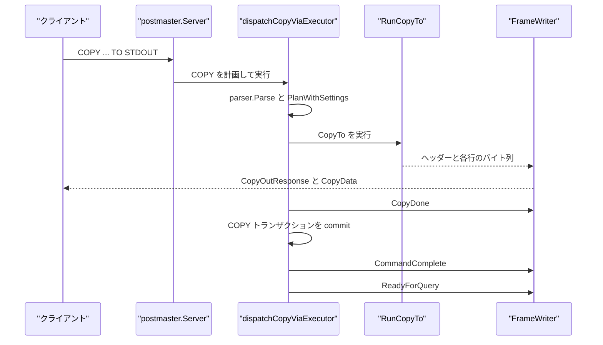
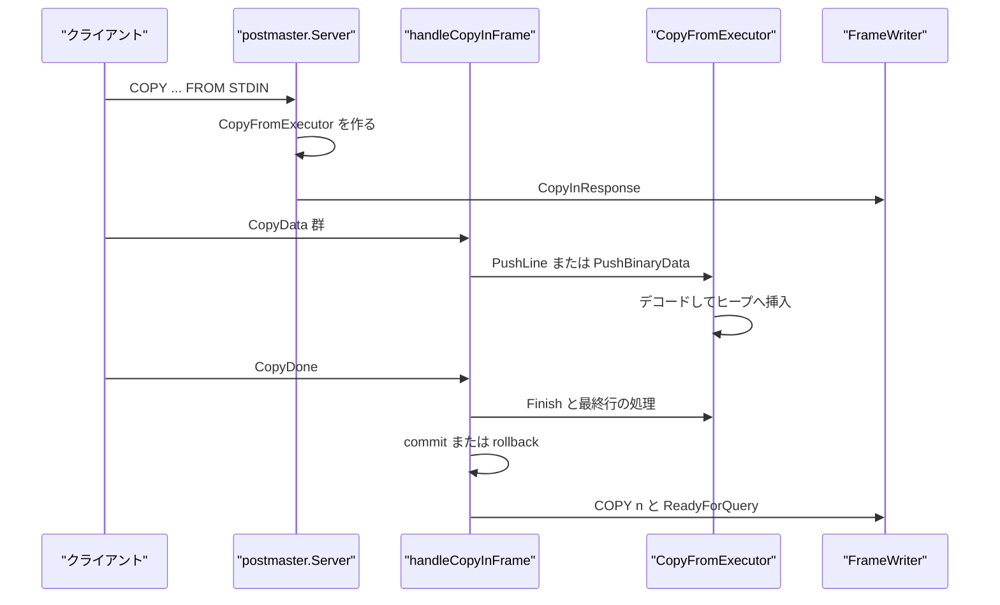
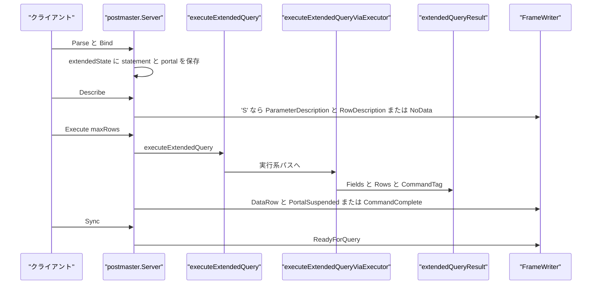

# COPY と拡張クエリプロトコル

<details>
<summary>関連ソースファイル</summary>

- [`internal/executor/copy.go`](https://github.com/ryogrid/goopg/blob/19856410e8d497d59787e1ab35a2febb3f5953d6/internal/executor/copy.go)
- [`internal/executor/copy_binary.go`](https://github.com/ryogrid/goopg/blob/19856410e8d497d59787e1ab35a2febb3f5953d6/internal/executor/copy_binary.go)
- [`internal/executor/copy_csv.go`](https://github.com/ryogrid/goopg/blob/19856410e8d497d59787e1ab35a2febb3f5953d6/internal/executor/copy_csv.go)
- [`internal/executor/copy_text.go`](https://github.com/ryogrid/goopg/blob/19856410e8d497d59787e1ab35a2febb3f5953d6/internal/executor/copy_text.go)
- [`internal/libpq/messages.go`](https://github.com/ryogrid/goopg/blob/19856410e8d497d59787e1ab35a2febb3f5953d6/internal/libpq/messages.go)
- [`internal/postmaster/conn_tx.go`](https://github.com/ryogrid/goopg/blob/19856410e8d497d59787e1ab35a2febb3f5953d6/internal/postmaster/conn_tx.go)
- [`internal/postmaster/copy.go`](https://github.com/ryogrid/goopg/blob/19856410e8d497d59787e1ab35a2febb3f5953d6/internal/postmaster/copy.go)
- [`internal/postmaster/dispatch_extended.go`](https://github.com/ryogrid/goopg/blob/19856410e8d497d59787e1ab35a2febb3f5953d6/internal/postmaster/dispatch_extended.go)
- [`internal/postmaster/extended.go`](https://github.com/ryogrid/goopg/blob/19856410e8d497d59787e1ab35a2febb3f5953d6/internal/postmaster/extended.go)
- [`internal/postmaster/query.go`](https://github.com/ryogrid/goopg/blob/19856410e8d497d59787e1ab35a2febb3f5953d6/internal/postmaster/query.go)

</details>

このページが扱うのは、PostgreSQL の COPY サブプロトコルと拡張クエリプロトコルの 2 つである。COPY は `optimizer.Copy` を `executor.RunCopyTo` / `CopyFromExecutor` で実行し、クライアントとは `CopyOutResponse` / `CopyInResponse`、`CopyData`、`CopyDone`、`CopyFail` をやり取りする。拡張クエリは `Parse` で prepared statement を作り、`Bind` で portal を作り、`Describe` でメタデータを返し、`Execute` で行を materialise して `maxRows` ごとに返す。COPY は simple query 専用で、拡張プロトコルから `COPY` を実行すると `FeatureNotSupported` になる。フレームの符号化は [3.2 ワイヤプロトコル](3.2-Wire-Protocol.md)、接続と simple query の全体は [3.4 接続管理と SQL ディスパッチ](3.4-Connection-Dispatch.md)、実行系は [6 実行エンジン](../6-Executor.md)、COPY が書き込むヒープは [7 ストレージ](../7-Storage.md) が扱う。

## 責務

- **COPY TO の行生成** — `RunCopyTo` が `optimizer.Copy` の `CopyTo` 方向を検査し、`buildCopySource` でテーブルスキャンまたは内側のクエリを組み立て、`RunCopyTo` の `emit` コールバックへ 1 行ずつ渡す。バイナリなら `CopyBinaryHeader`、テキスト / CSV ならヘッダー行の有無を見て先頭を出す (`internal/executor/copy.go:RunCopyTo`, `runCopyToCore`, `buildCopySource`)。
- **COPY FROM の行取り込み** — ワイヤ層が `CopyData` を改行で分割して `PushLine` を呼び、`CopyFromExecutor` が COPY TEXT / CSV をデコードしてヒープへ挿入する。バイナリは `PushBinaryData` がチャンクを蓄積し、完全な行だけを `ParseCopyBinaryRows` で取り出す (`internal/executor/copy.go:CopyFromExecutor`, `PushLine`, `PushBinaryData`)。
- **COPY オプションの解釈** — `copyToFormatFromOptions` が `FORMAT csv` / `HEADER` / `DELIMITER` / `QUOTE` / `ESCAPE` / `NULL` / `FORCE_QUOTE` を `copyToFormat` にまとめる。TEXT の既定はタブ区切り・`\N` NULL、CSV の既定はカンマ区切り・空 NULL である (`internal/executor/copy_csv.go:copyToFormat`, `copyToFormatFromOptions`)。
- **TEXT コーデック** — `EncodeCopyTextRow` が値をバックスラッシュエスケープし、`DecodeCopyTextRow` が未エスケープのタブで分割して `\N` を NULL として扱う。`copyField` は 1 フィールドのバイト列と NULL フラグを保持する (`internal/executor/copy_text.go:EncodeCopyTextRow`, `DecodeCopyTextRow`, `copyField`)。
- **CSV コーデック** — `EncodeCopyCsvRow` / `DecodeCopyCsvRow` が引用符、エスケープ、区切り文字、NULL 文字列、`FORCE_QUOTE` を扱う。引用符内の改行でレコードが物理行をまたぐ場合は `errCsvIncompleteRecord` を返し、ワイヤ層が次の行を連結する (`internal/executor/copy_csv.go:EncodeCopyCsvRow`, `DecodeCopyCsvRow`, `parseCopyCsvFields`)。
- **BINARY コーデック** — `CopyBinaryHeader` が 19 バイトの PGCOPY ヘッダーを返し、`AppendCopyBinaryRow` が `int16` フィールド数と各フィールドの `int32` 長 + 値を書く。`ParseCopyBinaryHeader` / `ParseCopyBinaryRows` がヘッダー、行、2 バイトのトレーラーを読む (`internal/executor/copy_binary.go:CopyBinaryHeader`, `AppendCopyBinaryRow`, `ParseCopyBinaryHeader`, `ParseCopyBinaryRows`)。
- **COPY TO のワイヤ出力** — `dispatchCopyViaExecutor` が `COPY ... TO STDOUT` を計画し、`runCopyToStream` が `WriteCopyOutResponse`、`WriteCopyData`、`WriteCopyDone` を送る。COPY のトランザクションは `CommandComplete` の前に commit し、`COPY (INSERT ... RETURNING)` の変更がクライアントに完了を告げる前に見えるようにする (`internal/postmaster/copy.go:dispatchCopyViaExecutor`, `runCopyToStream`)。
- **COPY FROM のワイヤ入力** — `CopyInResponse` の後にクライアントが送る `CopyData` を `handleCopyInFrame` が処理し、`CopyDone` で最終行を flush して `Finish` を呼び、commit 後に `COPY n` と `ReadyForQuery` を返す。`CopyFail` はトランザクションを rollback して `QueryCanceled` を返す (`internal/postmaster/copy.go:handleCopyInFrame`).
- **複数文バッチ内の COPY** — `runInlineCopy` は `BEGIN; COPY ...; COMMIT` のような 1 つの Query メッセージ内の COPY を、バッチ共有のトランザクションと `ectx` で実行する。COPY FROM STDIN だけは `runInlineCopyFromStdin` が `FrameReader` から直接フレームを読む (`internal/postmaster/copy.go:runInlineCopy`, `runInlineCopyFromStdin`).
- **拡張プロトコルの prepared statement** — `handleParseFrame` が名前、SQL、型 OID を読み、`preparedStatement` を `extendedState.statements` に登録する。`handleBindFrame` がパラメータを検証して `portalState` を作る (`internal/postmaster/extended.go:handleParseFrame`, `handleBindFrame`)。
- **拡張プロトコルの Describe / Execute** — `handleDescribeFrame` が statement に `ParameterDescription` と `RowDescription` / `NoData` を返し、`handleExecuteFrame` が `executeExtendedQuery` を呼ぶ。実行結果は `extendedQueryResult` にキャッシュされ、`maxRows` に応じて `PortalSuspended` または `CommandComplete` になる (`internal/postmaster/extended.go:handleDescribeFrame`, `handleExecuteFrame`, `extendedQueryResult`)。
- **拡張プロトコルの実行系** — `executeExtendedQueryViaExecutor` が plan cache を引き、Parse / Plan / Build / Open / Next を実行して `Fields` / `Rows` / `CommandTag` を返す。`Sync` までエラー後のフレームは捨てられ、portal の結果は再利用される (`internal/postmaster/dispatch_extended.go:executeExtendedQueryViaExecutor`).
- **COPY のプロトコル制限** — `executeExtendedQuery` は `COPY ` で始まる文を `FeatureNotSupported` で拒否し、メッセージに「COPY is only supported in the simple query protocol」を返す (`internal/postmaster/extended.go:executeExtendedQuery`).

## 処理フロー

### COPY TO STDOUT

クライアントが simple query で `COPY ... TO STDOUT` を送ると、`handleQueryOrCopy` が COPY と判定し、`dispatchCopyViaExecutor` が `parser.Parse` → `PlanWithSettings` → `optimizer.Copy` の確認を行う。`CopyTo` なら `runCopyToStream` が `CopyOutResponse` を送り、`RunCopyTo` の `emit` が `WriteCopyData` を呼ぶ。最後に `CopyDone` を送り、commit 後に `CommandComplete` と `ReadyForQuery` を返す (`internal/postmaster/copy.go:dispatchCopyViaExecutor`, `runCopyToStream`, `internal/executor/copy.go:RunCopyTo`).



### COPY FROM STDIN

`CopyFrom` では `dispatchCopyViaExecutor` が `CopyFromExecutor` を作り、`CopyInResponse` を送って `copyInState` を返す。メインループは以降のフレームを `handleCopyInFrame` に渡し、テキスト / CSV は `consumeExecCopyData` が改行ごとに `PushLine`、バイナリは `PushBinaryData` がチャンクを蓄積する。`CopyDone` で最終行と `Finish` を処理し、commit 後に `COPY n` と `ReadyForQuery` を返す (`internal/postmaster/copy.go:dispatchCopyViaExecutor`, `handleCopyInFrame`, `internal/executor/copy.go:CopyFromExecutor`).



### 拡張クエリ

`Parse` / `Bind` / `Describe` / `Execute` / `Sync` のうち、`Execute` が `executeExtendedQuery` を呼ぶ。`executeExtendedQuery` は 25P02 ゲートと高速パスを処理し、必要なら `executeExtendedQueryViaExecutor` に渡す。結果は `extendedQueryResult` として portal に保持され、`Execute` のたびに `maxRows` 分だけ `DataRow` を返す。COPY はここでは受け付けず、`FeatureNotSupported` になる (`internal/postmaster/extended.go:handleExecuteFrame`, `executeExtendedQuery`, `internal/postmaster/dispatch_extended.go:executeExtendedQueryViaExecutor`).



## 主要ファイル

| ファイル | 役割 |
| --- | --- |
| `internal/executor/copy.go` | `RunCopyTo` / `RunCopyToFile` / `CopyFromExecutor`、`PushLine` / `PushBinaryData` / `Finish`、COPY のトランザクションとマルチインサートのバッチ処理 (`internal/executor/copy.go:RunCopyTo`, `CopyFromExecutor`, `PushLine`) |
| `internal/executor/copy_text.go` | COPY TEXT の `EncodeCopyTextRow` / `DecodeCopyTextRow`、`copyField`、バックスラッシュエスケープと `\N` NULL (`internal/executor/copy_text.go:EncodeCopyTextRow`, `DecodeCopyTextRow`, `copyField`) |
| `internal/executor/copy_csv.go` | `copyToFormat` と `EncodeCopyCsvRow` / `DecodeCopyCsvRow`、引用符・エスケープ・`FORCE_QUOTE`、不完全な CSV レコード (`internal/executor/copy_csv.go:copyToFormat`, `EncodeCopyCsvRow`, `DecodeCopyCsvRow`) |
| `internal/executor/copy_binary.go` | PGCOPY の 19 バイトヘッダー、行エンコード / デコード、2 バイトトレーラー、型ごとのバイナリ変換 (`internal/executor/copy_binary.go:CopyBinaryHeader`, `AppendCopyBinaryRow`, `ParseCopyBinaryRows`) |
| `internal/libpq/messages.go` | `WriteCopyInResponse` / `WriteCopyOutResponse` / `WriteCopyData` / `WriteCopyDone`、`RowDescription` / `DataRow` / `CommandComplete` (`internal/libpq/messages.go:WriteCopyInResponse`, `WriteCopyOutResponse`, `WriteCopyData`, `WriteCopyDone`) |
| `internal/postmaster/copy.go` | `dispatchCopyViaExecutor`、`runCopyToStream`、`handleCopyInFrame`、`runInlineCopy`、`runInlineCopyFromStdin`、`copyInState` (`internal/postmaster/copy.go:dispatchCopyViaExecutor`, `runCopyToStream`, `handleCopyInFrame`) |
| `internal/postmaster/extended.go` | `extendedState` / `preparedStatement` / `portalState` / `boundParam`、`handleParseFrame` / `handleBindFrame` / `handleDescribeFrame` / `handleExecuteFrame` / `handleCloseFrame`、`extendedQueryResult` (`internal/postmaster/extended.go:extendedState`, `handleParseFrame`, `handleExecuteFrame`) |
| `internal/postmaster/dispatch_extended.go` | `executeExtendedQueryViaExecutor` と plan cache、`paramsToDatums`、portal 用結果の materialise (`internal/postmaster/dispatch_extended.go:executeExtendedQueryViaExecutor`, `paramsToDatums`) |
| `internal/postmaster/conn_tx.go` | `connTxState`、`cursorEntry`、`preparedStatementDef` / `preparedStatements`、COPY のトランザクション状態とセッション状態の引き継ぎ (`internal/postmaster/conn_tx.go:connTxState`, `preparedStatements`) |
| `internal/postmaster/query.go` | `handleQuery` の高速パスと `writeQueryError`、simple query から COPY / 実行系への入口 (`internal/postmaster/query.go:handleQuery`, `writeQueryError`) |

## 公開 API / エントリポイント

COPY の実行:

- `func IsBinaryFormat(opts []parser.CopyOption) bool` — `FORMAT binary` と旧式 `BINARY` を判定する (`internal/executor/copy.go:IsBinaryFormat`).
- `func RunCopyTo(ctx *Context, plan *optimizer.Copy, emit func([]byte) error) (int64, bool, error)` — CopyTo の行を `emit` に流す。戻り値は行数、バイナリ形式か、エラー (`internal/executor/copy.go:RunCopyTo`).
- `func RunCopyToFile(ctx *Context, plan *optimizer.Copy) (int64, error)` — サーバー側ファイルへの COPY TO (`internal/executor/copy.go:RunCopyToFile`).
- `func NewCopyFromExecutor(ctx *Context, plan *optimizer.Copy) (*CopyFromExecutor, error)` — CopyFrom の executor を作る。ファイル / PROGRAM エンドポイントやストレージハンドル不足を拒否する (`internal/executor/copy.go:NewCopyFromExecutor`).
- `func (c *CopyFromExecutor) PushLine(line []byte) error` / `PushBinaryData(chunk []byte) (bool, error)` / `Finish() error` / `RowsInserted() int64` / `IsBinary() bool` — COPY FROM の入力 API (`internal/executor/copy.go:PushLine`, `PushBinaryData`, `Finish`, `RowsInserted`).
- `func RunCopyFromFile(ctx *Context, plan *optimizer.Copy) (int64, error)` — サーバー側ファイルからの COPY FROM (`internal/executor/copy.go:RunCopyFromFile`).

コーデック:

- `EncodeCopyTextRow` / `DecodeCopyTextRow` — TEXT の 1 行 (`internal/executor/copy_text.go:EncodeCopyTextRow`, `DecodeCopyTextRow`).
- `EncodeCopyCsvRow` / `DecodeCopyCsvRow` — CSV の 1 レコード (`internal/executor/copy_csv.go:EncodeCopyCsvRow`, `DecodeCopyCsvRow`).
- `CopyBinaryHeader` / `AppendCopyBinaryRow` / `AppendCopyBinaryTrailer` / `ParseCopyBinaryHeader` / `ParseCopyBinaryRows` — BINARY のヘッダー、行、トレーラー (`internal/executor/copy_binary.go:CopyBinaryHeader`, `AppendCopyBinaryRow`, `AppendCopyBinaryTrailer`, `ParseCopyBinaryRows`).

ワイヤ / プロトコル:

- `func (s *Server) dispatchCopyViaExecutor(...) (*copyInState, error)` — COPY の計画と CopyTo / CopyFrom の開始 (`internal/postmaster/copy.go:dispatchCopyViaExecutor`).
- `func (s *Server) runCopyToStream(...) (int64, bool, error)` — CopyOutResponse / CopyData / CopyDone (`internal/postmaster/copy.go:runCopyToStream`).
- `func (s *Server) handleCopyInFrame(w *libpq.FrameWriter, st *copyInState, f libpq.Frame) (bool, error)` — COPY FROM STDIN のフレーム処理 (`internal/postmaster/copy.go:handleCopyInFrame`).
- `func (s *Server) runInlineCopy(...) error` / `runInlineCopyFromStdin(...) error` — 複数文バッチ内の COPY (`internal/postmaster/copy.go:runInlineCopy`, `runInlineCopyFromStdin`).
- `handleParseFrame` / `handleBindFrame` / `handleDescribeFrame` / `handleExecuteFrame` / `handleCloseFrame` — 拡張プロトコルの各メッセージ (`internal/postmaster/extended.go:handleParseFrame`, `handleBindFrame`, `handleDescribeFrame`, `handleExecuteFrame`, `handleCloseFrame`).
- `func (s *Server) executeExtendedQueryViaExecutor(...) (*extendedQueryResult, *extendedQueryError)` — 拡張プロトコルの実行系 (`internal/postmaster/dispatch_extended.go:executeExtendedQueryViaExecutor`).

## 主要データ構造

### `copyToFormat` — COPY のテキスト / CSV オプション

```go
type copyToFormat struct {
	csv     bool
	header  bool
	delim   byte
	quote   byte
	escape  byte
	nullStr string
	// forceQuote selects the columns (by name) that are always quoted in
	// CSV output. forceQuoteAll is the `FORCE QUOTE *` form.
	forceQuote    map[string]bool
	forceQuoteAll bool
}
```

`internal/executor/copy_csv.go:copyToFormat`

`csv` が真なら CSV、`header` が真なら先頭行に列名を出す。`delim` / `quote` / `escape` は 1 バイトで、TEXT の既定はタブ・`\N`、CSV の既定はカンマ・空文字列である。`forceQuote` は列名ごとの強制引用、`forceQuoteAll` は `FORCE QUOTE *` を表す。COPY TO と COPY FROM が同じ `copyToFormat` を読むため、出力したものをそのまま入力できる (`internal/executor/copy_csv.go:copyToFormatFromOptions`).

### `copyField` — TEXT の 1 フィールド

```go
type copyField struct {
	bytes  []byte
	isNull bool
}
```

`internal/executor/copy_text.go:copyField`

`bytes` はエスケープを解いたフィールド本体、`isNull` は `\N` 由来の SQL NULL を表す。TEXT は未エスケープのタブで分割し、各フィールドを `unescapeCopyTextField` で処理する。`\N` は NULL、リテラルの `\\N` は文字列の `\N` になる (`internal/executor/copy_text.go:splitCopyTextFields`, `unescapeCopyTextField`).

### `CopyFromExecutor` — COPY FROM の実行状態

```go
type CopyFromExecutor struct {
	ctx    *Context
	plan   *optimizer.Copy
	cols   []catalog.Column // table's full column list, in declared order
	rowsIn int64
	// defaults holds, per column, the resolved DEFAULT expression of a
	// column the COPY column list omits (nil otherwise). Resolved once per
	// statement and evaluated per row through the full evaluator, as PG's
	// BeginCopyFrom prepares defexprs — so a volatile default such as
	// random() or clock_timestamp() gets a fresh value per row (M0146-0054).
	defaults []optimizer.Expr
	// Trigger state (M0146-0055). PG's CopyFrom fires BEFORE STATEMENT
	// before the first row, BEFORE ROW per row (ExecBRInsertTriggers,
	// which may suppress the row), queues AFTER ROW events and fires them,
	// then AFTER STATEMENT, when the statement ends (AfterTriggerEndQuery).
	// hasRowBefore / hasRowAfter / hasStmtTriggers are computed once;
	// stmtBegun / stmtEnded make the statement-level hooks fire exactly
	// once whichever entry point (text, binary trailer, Finish) reaches
	// them; afterRows holds the stored rows awaiting their AFTER ROW
	// triggers.
	hasRowBefore    bool
	hasRowAfter     bool
	hasStmtTriggers bool
	stmtBegun       bool
	stmtEnded       bool
	afterRows       []Row
	// lineNo is the 1-based physical line counter PG's CONTEXT message
	// reports ("COPY tbl, line N", copyfromparse.c CopyFromErrorCallback).
	// Incremented once per PushLine call, matching cur_lineno's per-line
	// bump — HEADER's discarded first line counts too, same as upstream.
	lineNo int64
	// format carries the text/CSV knobs (delimiter, quote, escape, NULL
	// string, header) parsed from the option list. The same struct drives
	// COPY TO; input and output MUST read the option list identically or a
	// session cannot COPY back in what it just COPYed out.
	format copyToFormat

	// headerPending is set while the first line of the stream is still the
	// column-name header that HEADER asked us to discard.
	headerPending bool
	// csvPartial holds a CSV record whose quoted field was cut in half by
	// the wire layer's split on '\n'.
	csvPartial []byte

	// binary path state
	binaryBuf        []byte
	binaryHeaderSeen bool

	// srcEnc is the resolved PG encoding ID that incoming raw lines must be
	// converted FROM (into the UTF8 server encoding) before decoding, or -1
	// when no conversion is needed (UTF8 source, or the encoding could not
	// be resolved — matching PG's "no proc needed" fast paths in
	// pg_do_encoding_conversion). Resolved once per statement in
	// newCopyFromExecutor from the COPY ENCODING option, falling back to
	// the session's client_encoding GUC — mirrors PG's ProcessCopyOptions /
	// BeginCopyFrom precedence (options.c: an explicit ENCODING option wins
	// over client_encoding for that one COPY). M0134-0107.
	srcEnc int32

	// missing[i]=true when column i is absent from the COPY column list
	// (PG copyfrom.c defmap: only columns NOT in the list get a default —
	// a column present in the list but holding an explicit NULL input is
	// not "missing"). Computed once per statement since plan.ColumnIndex
	// is immutable across rows. M0134-0005l.
	missing []bool
	// needsConstraints is the fast-path guard: true only when the target
	// table actually has DEFAULTs, NOT NULL columns, CHECK constraints, or
	// domain-typed columns to enforce. COPY is the bulk-load path, so a
	// constraint-free table (the common case for staging loads) skips the
	// whole default/constraint sequence below rather than paying a
	// per-row cost for work that can never fire. M0134-0005l.
	needsConstraints bool

	// PG's CopyMultiInsertBuffer and BulkInsertState (copyfrom.c,
	// M0146-0009h). multiInsert is CopyFrom's CIM_MULTI: rows are buffered
	// and flushed in batches of MAX_BUFFERED_TUPLES rows or MAX_BUFFERED_BYTES
	// of input lines, each batch prepared before any of it is placed. bulk
	// lives for the whole COPY and drives page choice and relation extension
	// for every heap write it makes, batched or not.
	multiInsert bool
	batch       []Row
	batchBytes  int
	// lineLen is the current input record's length without its line end —
	// the size CopyMultiInsertInfoStore counts (cstate->line_buf.len); 0 for
	// binary input.
	lineLen int
	bulk    *bulkInsertState
}
```

`internal/executor/copy.go:CopyFromExecutor`

`ctx` / `plan` / `cols` は実行コンテキスト、COPY 計画、対象テーブルの全列を保持する。`defaults` は COPY の列リストから省略された列の DEFAULT 式で、行ごとに評価される。`hasRowBefore` / `hasRowAfter` / `hasStmtTriggers` と `afterRows` は INSERT トリガーの状態、`lineNo` はエラー時の `COPY <table>, line N` の行番号、`format` は COPY オプション、`csvPartial` は引用符内の改行で分割された CSV レコードの継続、`binaryBuf` / `binaryHeaderSeen` はバイナリ入力のバッファとヘッダー状態である。`srcEnc` は入力エンコーディング、`missing` は列リストにない列、`needsConstraints` は DEFAULT / NOT NULL / CHECK / domain の高速パス判定、`batch` / `batchBytes` / `bulk` はマルチインサートのバッファである (`internal/executor/copy.go:newCopyFromExecutor`, `PushLine`, `PushBinaryData`).

### `copyBinarySignature` と PGCOPY フォーマット

```go
var copyBinarySignature = []byte("PGCOPY\n\377\r\n\000")
```

`internal/executor/copy_binary.go:copyBinarySignature`

BINARY のヘッダーは 11 バイトの署名、`int32` の flags（0）、`int32` の extension area length（0）の合計 19 バイトである。各行は `int16` のフィールド数、各フィールドの `int32` 長（-1 は NULL）と値、最後に `int16(-1)` のトレーラーが続く。`CopyBinaryHeader` は flags と extension を常に 0 で作り、`ParseCopyBinaryHeader` は署名だけを検査して flags / extension を無視する (`internal/executor/copy_binary.go:CopyBinaryHeader`, `ParseCopyBinaryHeader`, `ParseCopyBinaryRows`).

### `copyInState` — COPY FROM STDIN の接続状態

```go
type copyInState struct {
	// Legacy path (no storage configured).
	rows       int64
	partialRow bool

	// Executor path.
	fromExec    *executor.CopyFromExecutor
	lineBuf     []byte
	tx          transam.Transaction
	mgr         *transam.Manager
	asyncCommit bool
	// onDone saves the COPY's session state (sequence currval/lastval) back
	// to the connection once the CopyIn stream ends, however it ends.
	onDone func()
}
```

`internal/postmaster/copy.go:copyInState`

`fromExec` が非 nil なら executor の `CopyFromExecutor` にデータを流す。`lineBuf` は改行前の断片、`tx` / `mgr` は COPY 自身の自動コミットトランザクション、`asyncCommit` はセッションの `synchronous_commit` に従うかを表す。`rows` / `partialRow` はストレージ未設定時の文字列マッチ経路で、改行数と最終行の有無を数える。`onDone` は COPY の終了時に `currval` / `lastval` を接続へ戻す (`internal/postmaster/copy.go:handleCopyInFrame`, `commitCopyTx`).

### `extendedState` / `preparedStatement` / `portalState` / `boundParam`

```go
type extendedState struct {
	statements   map[string]*preparedStatement
	portals      map[string]*portalState
	syncRequired bool
	ProcNum      int32  // backend's ProcArray slot; forwarded to Begin calls
	DBName       string // connection's database; scopes pg_extension (M0110-0003 gap #7c)
}

type preparedStatement struct {
	Name       string
	Query      string
	ParamCount int
}

type portalState struct {
	Name      string
	Statement *preparedStatement
	Params    []boundParam
	Result    *extendedQueryResult
	RowPos    int
}

type boundParam struct {
	IsNull bool
	Text   string
}
```

`internal/postmaster/extended.go:extendedState`, `preparedStatement`, `portalState`, `boundParam`

`statements` は named prepared statement、`portals` は Bind が作った portal を保持する。`syncRequired` が真の間は `Sync` / `Terminate` 以外のフレームが捨てられる。`portalState.Result` は最初の Execute で materialise した結果、`RowPos` は次に返す行の位置である。`boundParam` は NULL かテキスト値だけを持ち、バイナリパラメータは Bind で拒否される (`internal/postmaster/extended.go:extendedState`, `internal/postmaster/dispatch_extended.go:paramsToDatums`).

### `extendedQueryResult` — Execute の materialise 結果

```go
type extendedQueryResult struct {
	Fields     []libpq.FieldDescription
	Rows       [][][]byte
	CommandTag string
	Empty      bool
	Notice     string // NoticeResponse text to emit before CommandComplete; "" = none
	// WarnFields is a fully-formed NoticeResponse field set to emit before
	// CommandComplete — the shape PG's "there is no transaction in progress"
	// WARNING needs (severity WARNING + SQLSTATE 25P01), which the plain
	// Notice string above cannot express. M0132-S2.
	WarnFields []libpq.ErrorField
	// NoticeFrames are the executor's queued NOTICE/WARNING messages
	// (executorNoticeFrames), emitted before CommandComplete as the
	// simple-query path does. Before they were carried here, every
	// operator-raised NOTICE or WARNING was dropped on the extended protocol.
	NoticeFrames [][]libpq.ErrorField
}
```

`internal/postmaster/extended.go:extendedQueryResult`

`Fields` は `RowDescription` の列定義、`Rows` は materialise 済みの行、`CommandTag` は `CommandComplete` のタグである。`Empty` は空クエリ、`Notice` / `WarnFields` / `NoticeFrames` は `CommandComplete` の前に送る Notice / Warning を表す。`Rows` を portal に保持するため、同じ Execute を `maxRows` で分割しても再実行せずに続きを返せる (`internal/postmaster/extended.go:handleExecuteFrame`).

## 内部構造

### COPY TO のコーデック選択

`RunCopyTo` は `IsBinaryFormat` が真なら `CopyBinaryHeader` を先頭に出し、各行を `AppendCopyBinaryRow` でエンコードし、最後に `AppendCopyBinaryTrailer` を出す。テキスト系は `copyToFormatFromOptions` の結果に従い、`format.csv` なら `EncodeCopyCsvRow`、そうでなければ `EncodeCopyTextRow` を使う。`format.hasHeader()` が真なら最初に `format.appendHeader` の列名行を出す。`RunCopyTo` は `emit` に渡すバイト列をコピーしてから渡すので、呼び出し側は次の行の生成後も安全に保持できる (`internal/executor/copy.go:runCopyToCore`).

`runCopyToCore` は `datestyle` / `timezone` / `bytea_output` を `ctx.GetSetting` から読み、`catalog.Catalog` と検索パスの可視性を渡して regclass / regprocedure の出力を SELECT と同じ規則にする。`buildCopySource` はテーブルなら SeqScan、クエリなら内側の `plan.Query` を組み立て、列リストによる projection を適用する (`internal/executor/copy.go:runCopyToCore`, `buildCopySource`).

### COPY FROM のデコードとヒープ書き込み

テキスト経路では、ワイヤ層が `CopyData` を改行で分割し、改行を含まない 1 行を `PushLine` に渡す。`PushLine` は HEADER の最初の行を捨て、必要なら `srcEnc` から UTF-8 へ変換し、`DecodeCopyTextRow` で `Row` にして `insertSourceRow` に渡す。CSV は `pushCsvLine` が `csvPartial` を前置して `DecodeCopyCsvRow` を呼び、`errCsvIncompleteRecord` なら次の物理行を待つ。`Finish` は未完了の CSV レコードを `22P04` の「unterminated CSV quoted field」にし、残りのバッチを flush して statement trigger を終了する (`internal/executor/copy.go:PushLine`, `pushCsvLine`, `Finish`).

バイナリ経路では `PushBinaryData` がチャンクを `binaryBuf` に追加し、最初の 19 バイトで `ParseCopyBinaryHeader` を呼ぶ。ヘッダーがまだ揃っていなければ何もせず、揃ったら `ParseCopyBinaryRows` で完全な行だけを取り出す。行のフィールド数が `cols` と違えばエラー、`-1` は NULL、途中で切れた行は次回のチャンクに持ち越す。トレーラー `int16(-1)` を見つけた時点でバッチを flush し、`endStatement` を呼んで COPY を完了する (`internal/executor/copy.go:PushBinaryData`, `internal/executor/copy_binary.go:ParseCopyBinaryRows`).

`CopyFromExecutor` は `defaults` を列ごとに解決し、`missing` が真の列だけ DEFAULT を評価する。`needsConstraints` が偽なら DEFAULT / NOT NULL / CHECK / domain の検査を丸ごと省略する。マルチインサートは `copyMaxBufferedTuples = 1000` または `copyMaxBufferedBytes = 65535` に達するまで行を `batch` に貯め、`flushBatch` で一括して書き込む (`internal/executor/copy.go:newCopyFromExecutor`, `flushBatch`, `copyMaxBufferedTuples`, `copyMaxBufferedBytes`).

### COPY のトランザクション境界

単独の `COPY ... FROM STDIN` は `dispatchCopyViaExecutor` が専用の READ COMMITTED トランザクションを開始し、`copyInState.tx` に保持する。`CopyDone` の処理で commit し、`CommandComplete` と `ReadyForQuery` を返す。`CopyFail` やデコードエラーでは rollback し、エラー応答を返す。明示トランザクション内でも COPY は独自の自動コミットトランザクションを使うが、空き ProcArray スロットを自動で探す (`internal/postmaster/copy.go:dispatchCopyViaExecutor`, `handleCopyInFrame`).

`COPY ... TO STDOUT` も独自トランザクションで実行する。`runCopyToStream` は `CopyDone` まで送るが、`CommandComplete` は呼び出し側が commit した後に出す。これは `COPY (INSERT/UPDATE/DELETE ... RETURNING)` の変更を、クライアントが完了を知る前に durable / visible にするためである (`internal/postmaster/copy.go:runCopyToStream`).

複数文バッチ内の COPY は `runInlineCopy` がバッチ共有の `ectx.Tx` とスナップショットを使い、`ReadyForQuery` を出さない。COPY FROM STDIN だけは `runInlineCopyFromStdin` が接続の `FrameReader` から `CopyData` / `CopyDone` / `CopyFail` を直接読み、バッチ全体の最後に 1 回だけ `ReadyForQuery` が出る (`internal/postmaster/copy.go:runInlineCopy`, `runInlineCopyFromStdin`).

### 拡張プロトコルの状態機械

`handleParseFrame` は名前、SQL、型 OID の配列を読み、`preparedStatement{Name, Query, ParamCount}` を作る。`ParamCount` は SQL 中の `$n` の最大値である。`handleBindFrame` は statement の存在、パラメータ形式の個数（0、1、またはパラメータ数と同じ）、パラメータ数、結果形式の個数（0 または 1）を検査し、`boundParam` の portal を作る。バイナリパラメータとバイナリ結果は `FeatureNotSupported` になる (`internal/postmaster/extended.go:handleParseFrame`, `handleBindFrame`).

`handleDescribeFrame` は statement なら `ParameterDescription` を送ってから `RowDescription` または `NoData`、portal なら `RowDescription` または `NoData` だけを送る。`handleExecuteFrame` は portal の `Result` が nil なら `executeExtendedQuery` を呼び、結果を portal にキャッシュする。`maxRows > 0` で行が残れば `PortalSuspended`、そうでなければ `CommandComplete` を返す (`internal/postmaster/extended.go:handleDescribeFrame`, `handleExecuteFrame`).

`executeExtendedQuery` は空クエリ、`SELECT 1`、`SHOW` / `SET` / `RESET` の高速パスを処理し、`COPY ` で始まる文を `FeatureNotSupported` で拒否する。通常の SQL は `executeExtendedQueryViaExecutor` に渡り、plan cache の `Get` / `Put`、`applyTransactionVerb` または `Build` / `Open` / `Next`、`extendedQueryResult` の生成を行う。エラー時は `syncRequired` が立ち、`Sync` まで後続のフレームは捨てられる (`internal/postmaster/extended.go:executeExtendedQuery`, `internal/postmaster/dispatch_extended.go:executeExtendedQueryViaExecutor`).

### バイナリの型変換

`AppendCopyBinaryRow` は `datumToCopyBinary` を列型ごとに呼ぶ。`copyBinaryToDatum` は逆方向で、配列は `rejectBinaryCopyArray` により拒否される。JSONB はバイナリバージョン 1 を持ち、timestamp / numeric などは PostgreSQL のバイナリ表現に合わせて変換される (`internal/executor/copy_binary.go:datumToCopyBinary`, `copyBinaryToDatum`, `rejectBinaryCopyArray`, `jsonbBinaryVersion`).

## エッジケースと不変条件

- **COPY は simple query 専用** — `executeExtendedQuery` は `COPY ` で始まる文を `FeatureNotSupported`（0A000）で拒否し、「COPY is only supported in the simple query protocol」を返す。COPY は必ず simple query の `Query` メッセージから実行する (`internal/postmaster/extended.go:executeExtendedQuery`).
- **TEXT の NULL とエスケープ** — `splitCopyTextFields` は未エスケープのタブで分割し、`\N` を NULL、`\\N` を文字列 `\N` として扱う。末尾がバックスラッシュだけのフィールドは「trailing backslash」エラーになる (`internal/executor/copy_text.go:splitCopyTextFields`, `unescapeCopyTextField`).
- **CSV の物理行とレコード** — 引用符内の改行はレコードを次の物理行へ続ける。`DecodeCopyCsvRow` が `errCsvIncompleteRecord` を返したら、ワイヤ層は `csvPartial` に保持して次の `PushLine` で連結する。EOF まで閉じない引用符は `Finish` が `22P04` の「unterminated CSV quoted field」にする (`internal/executor/copy_csv.go:errCsvIncompleteRecord`, `internal/executor/copy.go:pushCsvLine`, `Finish`).
- **TEXT / CSV の最終行** — `CopyDone` の時点で `lineBuf` に改行なしの最終行が残っていれば、`PushLine` してから `Finish` を呼ぶ。`\.` だけの行は TEXT の終端マーカーとして捨てるが、CSV の引用符内ではデータとして扱う (`internal/postmaster/copy.go:handleCopyInFrame`, `runInlineCopyFromStdin`).
- **BINARY のヘッダー** — 19 バイト未満では `ParseCopyBinaryHeader` がエラーになり、ワイヤ層は追加データを待つ。署名の 11 バイトが一致しない場合は `22P04` で拒否する。flags と extension area length は読み捨てる (`internal/executor/copy_binary.go:CopyBinaryHeader`, `ParseCopyBinaryHeader`, `CopyFromExecutor.PushBinaryData`).
- **BINARY の行境界** — 行の `int16` フィールド数が列数と違えばエラー、フィールド長 `-1` は NULL、`-1` 未満や `pos+length` がバッファを超える場合は不完全行として次回に持ち越す。トレーラー `int16(-1)` を見つけると COPY を完了する (`internal/executor/copy_binary.go:ParseCopyBinaryRows`).
- **COPY FROM のバッチ境界** — `copyMaxBufferedTuples = 1000` または `copyMaxBufferedBytes = 65535` に達すると `flushBatch` が走る。COPY の終了時にも必ず flush し、`endStatement` で AFTER ROW / AFTER STATEMENT トリガーを発火する (`internal/executor/copy.go:copyMaxBufferedTuples`, `copyMaxBufferedBytes`, `flushBatch`, `endStatement`).
- **DEFAULT / 制約 / トリガー** — `defaults` は COPY の列リストにない列だけに適用され、`needsConstraints` が偽なら DEFAULT / NOT NULL / CHECK / domain の検査を省略する高速パスに入る。BEFORE ROW トリガーが行を抑制した場合も、AFTER ROW / AFTER STATEMENT の順序は保たれる (`internal/executor/copy.go:newCopyFromExecutor`, `storeCopyRow`, `endStatement`).
- **COPY TO の commit 順序** — `runCopyToStream` は `CopyDone` まで送るが、`CommandComplete` は呼び出し側が COPY のトランザクションを commit した後に出す。`COPY (INSERT ... RETURNING)` の変更が完了通知より先に durable / visible になる (`internal/postmaster/copy.go:runCopyToStream`, `dispatchCopyViaExecutor`).
- **インライン COPY の RFQ** — 複数文バッチ内の COPY はバッチ共有トランザクションで動き、`CommandComplete` だけを出す。`ReadyForQuery` はバッチ全体の最後に 1 回だけ出る。`runInlineCopyFromStdin` がエラーを返した場合は `errQueryErrorSent` で残りの文を中断する (`internal/postmaster/copy.go:runInlineCopy`, `runInlineCopyFromStdin`).
- **拡張プロトコルのエラー** — Parse / Bind / Describe / Execute のいずれかがエラーになると `extended.syncRequired` が立ち、`Sync` か `Terminate` まで後続フレームは処理されない。エラーを返した Execute は明示トランザクションを失敗状態へ落とす (`internal/postmaster/extended.go:handleExecuteFrame`, `handleParseFrame`).
- **portal の行分割** — `maxRows > 0` で行が残る場合、`PortalSuspended` を返して `RowPos` を進める。次の Execute はキャッシュ済み `Result` の続きを返し、`maxRows = 0` は全行を返す (`internal/postmaster/extended.go:handleExecuteFrame`).
- **バイナリ型の制限** — BINARY COPY の配列型は `rejectBinaryCopyArray` で拒否される。JSONB は `jsonbBinaryVersion = 1` の形式だけを扱う (`internal/executor/copy_binary.go:rejectBinaryCopyArray`, `jsonbBinaryVersion`).
- **エンコーディング** — COPY FROM の `ENCODING` オプションは `client_encoding` より優先され、`srcEnc >= 0` のときだけ `mb.DoEncodingConversion` で UTF-8 に変換する。変換失敗は `22021` になる (`internal/executor/copy.go:resolveCopyFromEncoding`, `PushLine`).
- **ファイルエンドポイント** — サーバー側の `COPY ... TO 'file'` / `COPY ... FROM 'file'` はワイヤの `CopyData` を使わず、`RunCopyToFile` / `RunCopyFromFile` がファイルを直接読み書きする。ファイルを開けない場合は `58P01`、書き込み失敗は `58030` になる (`internal/executor/copy.go:RunCopyToFile`, `RunCopyFromFile`).

Sources:

- `internal/executor/copy.go`
- `internal/executor/copy_binary.go`
- `internal/executor/copy_csv.go`
- `internal/executor/copy_text.go`
- `internal/libpq/messages.go`
- `internal/postmaster/conn_tx.go`
- `internal/postmaster/copy.go`
- `internal/postmaster/dispatch_extended.go`
- `internal/postmaster/extended.go`
- `internal/postmaster/query.go`

<sub>Generated by deepwiki-4myself from `goopg` @ `19856410e`</sub>
