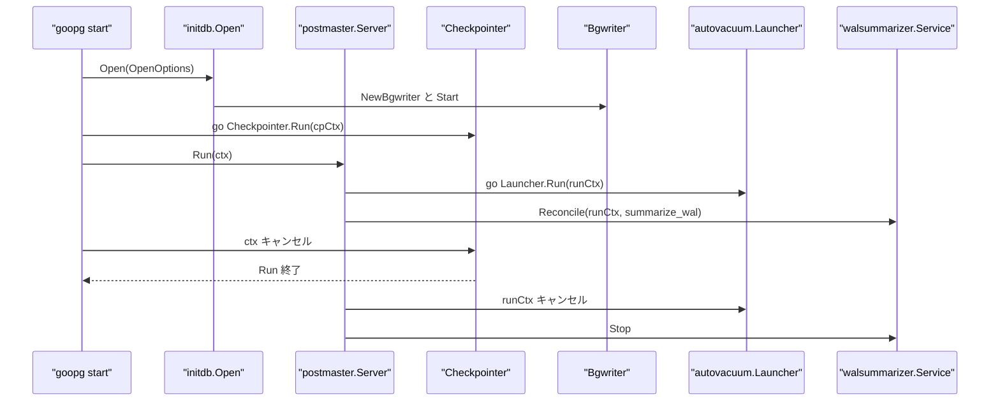
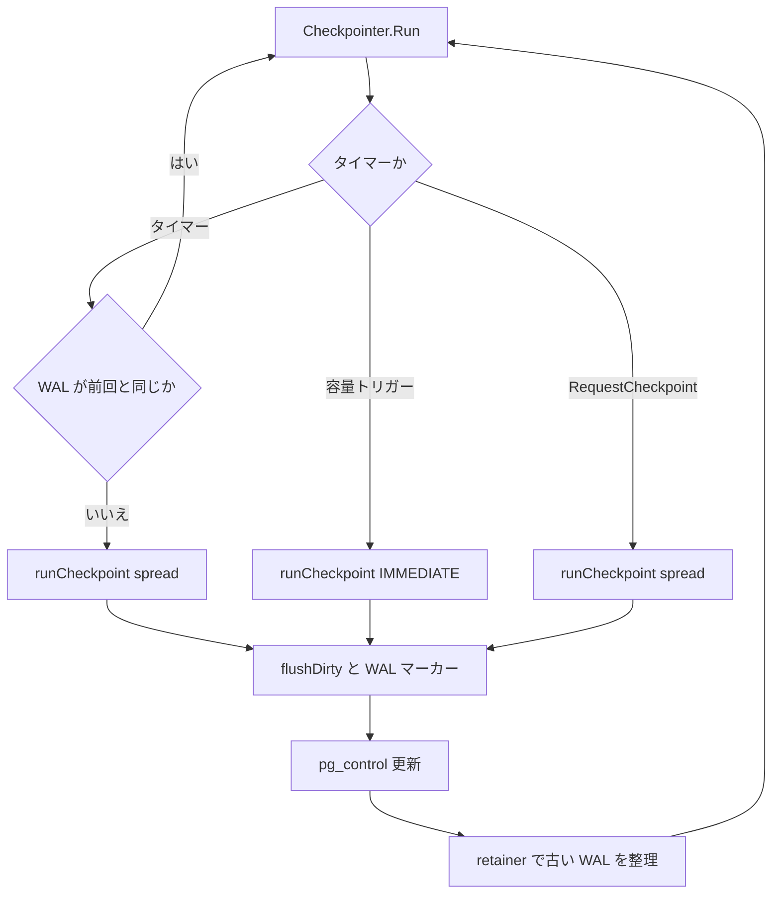
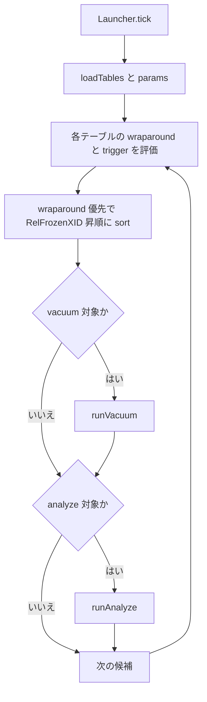
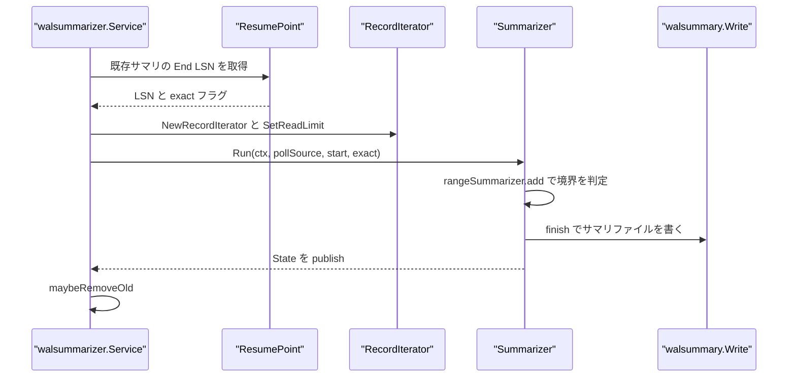

# バックグラウンドワーカー

<details>
<summary>関連ソースファイル</summary>

- [`internal/access/transam/xlog/checkpointer.go`](https://github.com/ryogrid/goopg/blob/19856410e8d497d59787e1ab35a2febb3f5953d6/internal/access/transam/xlog/checkpointer.go)
- [`internal/executor/operators_checkpoint.go`](https://github.com/ryogrid/goopg/blob/19856410e8d497d59787e1ab35a2febb3f5953d6/internal/executor/operators_checkpoint.go)
- [`internal/postmaster/autovacuum/launcher.go`](https://github.com/ryogrid/goopg/blob/19856410e8d497d59787e1ab35a2febb3f5953d6/internal/postmaster/autovacuum/launcher.go)
- [`internal/postmaster/walsummarizer/live.go`](https://github.com/ryogrid/goopg/blob/19856410e8d497d59787e1ab35a2febb3f5953d6/internal/postmaster/walsummarizer/live.go)
- [`internal/postmaster/walsummarizer/service.go`](https://github.com/ryogrid/goopg/blob/19856410e8d497d59787e1ab35a2febb3f5953d6/internal/postmaster/walsummarizer/service.go)
- [`internal/postmaster/walsummarizer/summarize.go`](https://github.com/ryogrid/goopg/blob/19856410e8d497d59787e1ab35a2febb3f5953d6/internal/postmaster/walsummarizer/summarize.go)
- [`internal/storage/bgwriter.go`](https://github.com/ryogrid/goopg/blob/19856410e8d497d59787e1ab35a2febb3f5953d6/internal/storage/bgwriter.go)
- [`internal/storage/writeback.go`](https://github.com/ryogrid/goopg/blob/19856410e8d497d59787e1ab35a2febb3f5953d6/internal/storage/writeback.go)
- [`internal/storage/writeback_linux.go`](https://github.com/ryogrid/goopg/blob/19856410e8d497d59787e1ab35a2febb3f5953d6/internal/storage/writeback_linux.go)
- [`internal/storage/writeback_other.go`](https://github.com/ryogrid/goopg/blob/19856410e8d497d59787e1ab35a2febb3f5953d6/internal/storage/writeback_other.go)

</details>

goopg のバックグラウンドワーカーは、PostgreSQL の checkpointer、bgwriter、autovacuum launcher、WAL summarizer を 1 プロセス内の goroutine として動かす。checkpointer は `checkpoint_timeout` と `max_wal_size` をトリガーにダーティページを書き出して WAL のチェックポイントレコードと `pg_control` を更新し、bgwriter はタイマーで先回りしてページを書き出す。autovacuum launcher はカタログのユーザーテーブルを走査して VACUUM / ANALYZE を実行し、WAL summarizer は WAL をレンジごとに要約して増分バックアップ用のサマリファイルを作る。起動と停止の順序は [3.1 CLI とライフサイクル](3.1-CLI-and-Lifecycle.md)、WAL の内容と耐久性は [10 WAL と耐久性](../10-WAL.md)、バッファプールとページ書き出しは [7 ストレージ](../7-Storage.md)、VACUUM の実行系は [6 実行エンジン](../6-Executor.md) を参照されたい。

## 責務

- **チェックポイントの周期・容量・要求トリガー** — `Checkpointer.Run` は `time.Timer` による周期実行、`volumeReporter.WrittenLSN` を使う `max_wal_size` トリガー、`RequestCheckpoint` の要求チャネルを待つ。周期実行は前回チェックポイント以降に WAL が進んでいなければスキップする (`internal/access/transam/xlog/checkpointer.go:Run`, `volumeTriggerFires`).
- **チェックポイントの直列化** — `runCheckpointOpts` は `runMu` を取り、タイマー・容量・SQL `CHECKPOINT`・シャットダウン・復旧終了を 1 本ずつ実行する。`announceImmediate` は実行中の spread チェックポイントの pacer を起こし、待機中の即時要求を優先させる (`internal/access/transam/xlog/checkpointer.go:runCheckpointOpts`, `announceImmediate`).
- **ダーティページの書き出しと WAL マーカー** — `flushDirty` がバッファプールのダーティページを書き出し、`CheckpointNow` / `CheckpointShutdown` が同期チェックポイントを実行する。`CheckpointShutdown` は `pg_control` の `State` を `DB_SHUTDOWNED` にし、`CheckpointEndOfRecovery` は復旧終了用のチェックポイントを取る (`internal/access/transam/xlog/checkpointer.go:flushDirty`, `CheckpointNow`, `CheckpointShutdown`, `CheckpointEndOfRecovery`).
- **SQL `CHECKPOINT` の実行** — `checkpointOp.Open` が `Context.Checkpointer.CheckpointNow` を同期呼び出しし、行を返さない operator として `CommandComplete` だけを出させる。Checkpointer がない場合は `0A000` のエラーにする (`internal/executor/operators_checkpoint.go:checkpointOp.Open`, `Next`, `Close`).
- **バックグラウンドページライタ** — `Bgwriter.run` は `BgwriterDelay` ごとに `Pool.WriteDirtyPages(maxPages)` を呼び、最大 `BgwriterMaxPages` ページだけを書く。fsync はせず、ダーティページの先回り書き出しだけを担う (`internal/storage/bgwriter.go:Bgwriter`, `run`).
- **writeback ヒント** — `accountCheckpointerWrite` / `accountBgwriterWrite` / `accountBackendWrite` が `*_flush_after` のページ数を数え、閾値に達したら `Pool.mgr.SyncFileRangeHint(rel)` を呼ぶ。Linux では `sync_file_range(2)` の `SYNC_FILE_RANGE_WRITE` を使い、未対応環境では `ErrWritebackUnsupported` を返す (`internal/storage/writeback.go:accountWrite`, `internal/storage/writeback_linux.go:syncFileRangeHint`, `internal/storage/writeback_other.go:syncFileRangeHint`).
- **autovacuum の候補選択** — `Launcher.tick` が `loadTables` でユーザーテーブルを列挙し、`wraparound` を優先して `RelFrozenXID` の昇順に並べ、`needsVacuum` / `needsAnalyze` が真のテーブルを処理する (`internal/postmaster/autovacuum/launcher.go:tick`, `needsVacuum`, `needsAnalyze`).
- **VACUUM / ANALYZE の実行** — `runVacuum` が `vacuum.TryLockRelationForVacuum` で ShareUpdateExclusiveLock を取り、`freezeCutoff` / `aggressiveByAge` を計算して `vacuum.VacuumWithOptions` を呼ぶ。`runAnalyze` は `executor.AnalyzeRelationSampled` で統計を作る (`internal/postmaster/autovacuum/launcher.go:runVacuum`, `runAnalyze`, `freezeCutoff`, `aggressiveByAge`).
- **WAL summarizer の起動・停止** — `Service.Reconcile` が `summarize_wal` の値に合わせて summarizer を起動・停止し、`Service.Stop` がキャンセルして goroutine の終了を待つ。`OnStart` / `OnStop` は `pg_stat_activity` の `walsummarizer` スロット用である (`internal/postmaster/walsummarizer/service.go:Reconcile`, `Stop`).
- **WAL の再開点とレンジ要約** — `ResumePoint` が既存サマリの最大 End LSN を返し、`Summarizer.Run` が `Source.Next` からレコードを読み、`rangeSummarizer.add` が redo point などの境界でレンジを閉じる。`rangeSummarizer.finish` が `walsummary.Write` でサマリを書く (`internal/postmaster/walsummarizer/live.go:ResumePoint`, `Summarizer.Run`, `internal/postmaster/walsummarizer/summarize.go:rangeSummarizer.add`, `finish`).
- **サマリの状態公開と保持** — `Summarizer.State` が `SummarizedLSN` / `PendingLSN` / `LSNIsExact` / `Running` を公開し、`Service.KeepLSN` が WAL 保持に必要な最小 LSN を返す。`maybeRemoveOld` は checkpoint の redo が進むたびに `wal_summary_keep_time` を超えたサマリを消す (`internal/postmaster/walsummarizer/live.go:State`, `internal/postmaster/walsummarizer/service.go:KeepLSN`, `maybeRemoveOld`).

## 処理フロー

### 起動時のワーカー起動

`initdb.Open` は WAL ライタと bgwriter を起動し、`cmd/goopg start` は checkpointer の goroutine を `cpCtx` で起動する。autovacuum launcher は `Launcher.Run`、WAL summarizer は `Service.Reconcile` で起動し、停止は run ctx のキャンセルで伝播する (`internal/postmaster/autovacuum/launcher.go:Run`, `internal/postmaster/walsummarizer/service.go:Reconcile`).



### チェックポイントの 1 サイクル

`Checkpointer.Run` はタイマー、`max_wal_size` の容量チェック、`RequestCheckpoint` の 3 系統を select する。周期実行は前回の WAL 位置と同じならスキップし、実行する場合は `runCheckpoint(ctx, spread=true, shutdown=false)` を呼ぶ。容量トリガーは `checkpointSegments` が `max_wal_size / segmentSize / (1 + checkpoint_completion_target)` で計算したセグメント数を超えたときに発火し、IMMEDIATE 速度で実行する (`internal/access/transam/xlog/checkpointer.go:Run`, `checkpointSegments`, `volumeTriggerFires`).



`runCheckpointOpts` は `recoveryMode` なら `runRecoveryFlush` に分岐し、通常はダーティページを flush してから WAL にチェックポイントレコードを追加する。チェックポイントレコードは `PGCompatCheckpoints` が真なら PG18 互換の `CheckPoint` 構造体で、ONLINE チェックポイントの前には `XLOG_RUNNING_XACTS` が入る (`internal/access/transam/xlog/checkpointer.go:runCheckpointOpts`, `runCheckpoint`).

### autovacuum の 1 tick

`Launcher.tick` は `loadTables` で `*catalog.InMemory` の `AllTables` を取得し、`avParams` を GUC から組み立てる。各テーブルについて `wraparound` と `needsVacuum` / `needsAnalyze` を評価し、anti-wraparound のテーブルを先頭に、`RelFrozenXID` の小さい順に並べる。候補ごとに `MinVacuumAge` / `MinAnalyzeAge` を確認し、`runVacuum` / `runAnalyze` を順に呼ぶ (`internal/postmaster/autovacuum/launcher.go:tick`, `params`, `loadTables`).



### WAL summarizer の 1 回の実行

`Service.loop` は `runOnce` を繰り返し、エラー時は `RetryDelay` だけ待って再開する。`runOnce` は `ResumePoint` で既存サマリの続きを探し、なければ WAL ディレクトリの最古セグメントから `FindNextRecord` で最初のレコードを見つけ、それもなければ最新の redo point を開始点にする。`NewRecordIterator` に `FlushedLSN` の読み取り上限を設定し、`pollSource` 経由で `Summarizer.Run` に渡す (`internal/postmaster/walsummarizer/service.go:loop`, `runOnce`, `internal/postmaster/walsummarizer/live.go:Run`).



## 主要ファイル

| ファイル | 役割 |
| --- | --- |
| `internal/access/transam/xlog/checkpointer.go` | `Checkpointer` / `CheckpointerConfig`、周期・容量・要求トリガー、`CheckpointNow` / `CheckpointShutdown` / `CheckpointEndOfRecovery`、`runMu` による直列化 (`internal/access/transam/xlog/checkpointer.go:Checkpointer`, `Run`, `CheckpointShutdown`) |
| `internal/executor/operators_checkpoint.go` | SQL `CHECKPOINT` の `checkpointOp`。`Open` で `CheckpointNow` を同期実行し、行を返さない (`internal/executor/operators_checkpoint.go:checkpointOp`, `newCheckpointOp`) |
| `internal/storage/bgwriter.go` | `Bgwriter` と `run`。`BgwriterDelay` ごとに `Pool.WriteDirtyPages` を呼び、fsync はしない (`internal/storage/bgwriter.go:Bgwriter`, `run`, `SetDelay`, `SetMaxPages`) |
| `internal/storage/writeback.go` | `accountCheckpointerWrite` / `accountBgwriterWrite` / `accountBackendWrite` と共通の `accountWrite`。`*_flush_after` の閾値で writeback ヒントを出す (`internal/storage/writeback.go:accountWrite`) |
| `internal/storage/writeback_linux.go` | Linux の `syncFileRangeHint`。`sync_file_range(2)` の `SYNC_FILE_RANGE_WRITE` を使い、`ENOSYS` / `EINVAL` を `ErrWritebackUnsupported` にする (`internal/storage/writeback_linux.go:syncFileRangeHint`) |
| `internal/storage/writeback_other.go` | 非 Linux の `syncFileRangeHint`。常に `ErrWritebackUnsupported` を返す (`internal/storage/writeback_other.go:syncFileRangeHint`) |
| `internal/postmaster/autovacuum/launcher.go` | `Launcher`、`tick`、`avParams`、`params`、`needsVacuum` / `needsAnalyze`、`runVacuum` / `runAnalyze`、`freezeCutoff` / `aggressiveByAge` (`internal/postmaster/autovacuum/launcher.go:Launcher`, `tick`, `runVacuum`) |
| `internal/postmaster/walsummarizer/service.go` | `Service` / `ServiceConfig`、`Reconcile` / `Stop`、`runOnce` / `loop`、`KeepLSN`、`maybeRemoveOld`、`pollSource` (`internal/postmaster/walsummarizer/service.go:Service`, `Reconcile`, `runOnce`) |
| `internal/postmaster/walsummarizer/live.go` | `Summarizer` / `State` / `IOCounters`、`ResumePoint`、`Run`、`publish`。1 レンジごとのサマリ作成 (`internal/postmaster/walsummarizer/live.go:Summarizer`, `Run`, `ResumePoint`) |
| `internal/postmaster/walsummarizer/summarize.go` | `rangeSummarizer` / `boundary` / `Summarize`、rmgr ごとの `summarizeDbase` / `summarizeSmgr` / `summarizeXact` / `summarizeNative` (`internal/postmaster/walsummarizer/summarize.go:rangeSummarizer`, `Summarize`, `boundary`) |

## 公開 API / エントリポイント

checkpointer:

- `func NewCheckpointer(flusher DirtyPageFlusher, wal checkpointWAL, cfg CheckpointerConfig) *Checkpointer` — チェックポインタを構築する (`internal/access/transam/xlog/checkpointer.go:NewCheckpointer`)。
- `func (c *Checkpointer) Run(ctx context.Context) error` — 周期・容量・要求トリガーのループ (`internal/access/transam/xlog/checkpointer.go:Run`)。
- `func (c *Checkpointer) CheckpointNow() error` / `CheckpointShutdown() error` / `CheckpointEndOfRecovery(prevTLI uint32) error` — 同期 IMMEDIATE、シャットダウン、復旧終了の各チェックポイント (`internal/access/transam/xlog/checkpointer.go:CheckpointNow`, `CheckpointShutdown`, `CheckpointEndOfRecovery`)。
- `func (c *Checkpointer) RequestCheckpoint() bool` / `SetInterval(d time.Duration)` / `SetMaxWALBytes(b uint64)` / `SetCompletionTarget(t float64)` — 非同期要求と実行時パラメータ更新 (`internal/access/transam/xlog/checkpointer.go:RequestCheckpoint`, `SetInterval`, `SetMaxWALBytes`, `SetCompletionTarget`)。

bgwriter / writeback:

- `func NewBgwriter(pool *Pool, delay time.Duration, maxPages int) *Bgwriter` / `Start()` / `Stop()` / `SetDelay(d time.Duration)` / `SetMaxPages(n int)` (`internal/storage/bgwriter.go:NewBgwriter`, `Start`, `Stop`, `SetDelay`, `SetMaxPages`)。
- `func (p *Pool) accountCheckpointerWrite(rel RelFileNode)` / `accountBgwriterWrite(rel RelFileNode)` / `accountBackendWrite(rel RelFileNode)` (`internal/storage/writeback.go:accountCheckpointerWrite`, `accountBgwriterWrite`, `accountBackendWrite`)。

autovacuum:

- `func NewLauncher(pool *storage.Pool, txnMgr *transam.Manager, cat catalog.Catalog) *Launcher` / `Run(ctx context.Context) error` (`internal/postmaster/autovacuum/launcher.go:NewLauncher`, `Run`)。
- `func (l *Launcher) tick(ctx context.Context, log *slog.Logger)` / `runVacuum(...)` / `runAnalyze(...)` (`internal/postmaster/autovacuum/launcher.go:tick`, `runVacuum`, `runAnalyze`)。

WAL summarizer:

- `func NewService(cfg ServiceConfig) *Service` / `Reconcile(parent context.Context, enabled bool)` / `Stop()` / `State() State` / `WALReads() (reads, bytes int64)` / `KeepLSN() uint64` (`internal/postmaster/walsummarizer/service.go:NewService`, `Reconcile`, `Stop`, `State`, `KeepLSN`)。
- `func NewSummarizer(dataDir string, tli uint32) *Summarizer` / `Run(ctx context.Context, src Source, start uint64, exact bool) error` / `State() State` / `Changed() <-chan struct{}` (`internal/postmaster/walsummarizer/live.go:NewSummarizer`, `Run`, `State`, `Changed`)。
- `func Summarize(dataDir string, tli uint32, recs []xlog.Record, start uint64) ([]walsummary.File, uint64, error)` — オフラインでレコード列を要約する (`internal/postmaster/walsummarizer/summarize.go:Summarize`)。

## 主要データ構造

### `Checkpointer` — チェックポイントの状態と同期点

```go
type Checkpointer struct {
	flusher DirtyPageFlusher
	wal     checkpointWAL
	cfg     CheckpointerConfig

	// recoveryMode is set for a physical standby.  Recovery may flush dirty
	// data pages, but it must never manufacture a local checkpoint record:
	// the standby WAL stream is owned by the primary and its reconnect LSN is
	// derived from that stream's durable tail.
	recoveryMode atomic.Bool
	// restartPointSrc, set on a standby, reports the last checkpoint record
	// replay applied; runRecoveryFlush adopts it into pg_control after the
	// flush, as CreateRestartPoint does (M0122-0013). nil: no restartpoints.
	restartPointSrc atomic.Pointer[func() (ReplayedCheckpoint, bool)]
	// replayPosSrc, set on a standby, reports the replay position (the
	// end of the last applied record, in WrittenLSN's units). In recovery
	// the max_wal_size trigger measures it instead of the received WAL, as
	// PG's XLogPageRead tests XLogCheckpointNeeded(readSegNo) on the segment
	// replay is reading (M0122-0013). nil: the writer's position.
	replayPosSrc atomic.Pointer[func() uint64]
	// recoveryVolumeSegNo is the replay segment of the last recovery
	// volume request (+1; 0 before any): a request fires only from a newer
	// segment, PG's evaluation point — XLogPageRead tests once per segment
	// it leaves, not on every poll.
	recoveryVolumeSegNo atomic.Uint64

	// retainer, when non-nil, runs after each successful
	// checkpoint marker is durable. The slot-aware production
	// implementation lives in retention.go; tests can wire a
	// fake. nil disables WAL pruning entirely (the v0 default —
	// caller opts in by passing SetRetainer).
	retainer Retainer
	// archiveCleanupSrc reports archive_cleanup_command's current value
	// (PGC_SIGHUP, read at each restartpoint); nil: none (M0122-0013).
	archiveCleanupSrc atomic.Pointer[func() string]

	// intervalOverrideNS carries SIGHUP/reload-driven interval changes to
	// the Run loop (parity bundle D-2): the armed ticker is rebuilt from
	// this value at every fire, so a live SET/postgresql.conf reload takes
	// effect on the NEXT timeout checkpoint without restart.
	intervalOverrideNS     atomic.Int64
	lastCheckpointLSN      atomic.Uint64
	lastCheckpointRedoLSN  atomic.Uint64
	lastCheckpointStartLSN atomic.Uint64

	// volumeAnchor is the fallback RedoRecPtr for the max_wal_size
	// trigger before this process has completed its first checkpoint:
	// the writer position observed when Run started. Upstream always has
	// a RedoRecPtr — recovery seeds it from the checkpoint it started
	// from — so the elapsed-segment count is measured from "where this
	// server began writing" rather than from LSN 0. Anchoring at 0 would
	// make every restart of a cluster whose WAL has already passed
	// max_wal_size fire a checkpoint on the first poll (M0131-S30.4).
	volumeAnchor atomic.Uint64

	// distMu guards priorRedoLSN/checkPointDistanceEstimate. Checkpoints
	// are infrequent (seconds-to-minutes apart) so a plain mutex — rather
	// than lock-free float CAS — is fine here.
	distMu                     sync.Mutex
	priorRedoLSN               uint64
	checkPointDistanceEstimate float64

	// runMu makes checkpoints one at a time, as PG's single checkpointer
	// process does: the timer and volume triggers, SQL CHECKPOINT, base
	// backup, promotion and the shutdown checkpoint used to be able to run
	// runCheckpoint concurrently (M0122-0013).
	runMu sync.Mutex
	// pendingImmediate counts callers waiting for runMu that want an
	// IMMEDIATE checkpoint; immediateWake interrupts a spread checkpoint's
	// pacer sleep. Together they are PG's ImmediateCheckpointRequested:
	// CheckpointWriteDelay stops throttling once an immediate request is
	// queued, so the running checkpoint finishes at full speed and the
	// waiter's own checkpoint follows.
	pendingImmediate atomic.Int32
	immediateWake    chan struct{}
	// requestC carries RequestCheckpoint's no-wait requests to Run;
	// loopRunning reports whether Run is serving it.
	requestC    chan struct{}
	loopRunning atomic.Bool

	// Aggregate counters surfaced through pg_stat_checkpointer.
	// Mirror the upstream PG 18 view's counter shape:
	// num_timed     — timer-driven cycles
	// num_requested — SQL CHECKPOINT, CLI ctl, max_wal_size volume
	// write_time_ms — cumulative wall time inside flushDirty
	// statsResetAt  — timestamp of the last counter reset
	//                 (currently only set at construction)
	numTimed     stats.Counter
	numRequested stats.Counter
	writeTimeMs  stats.Counter
	statsResetAt atomic.Int64 // unix nanos
}
```

`internal/access/transam/xlog/checkpointer.go:Checkpointer`

`flusher` はダーティページの書き出し先、`wal` は WAL の書き込み・LSN 参照、`cfg` は `CheckpointerConfig` である。`recoveryMode` はスタンバイの復旧中にローカルのチェックポイントレコードを書かないためのフラグ、`restartPointSrc` / `replayPosSrc` は復旧中に採用する restartpoint と再生位置を供給する。`retainer` はチェックポイント後の WAL 整理、`intervalOverrideNS` は SIGHUP で変更された周期、`lastCheckpointLSN` / `lastCheckpointRedoLSN` / `lastCheckpointStartLSN` はそれぞれマーカー、redo 点、チェックポイントレコードの開始位置を保持する。`runMu` はチェックポイントを 1 本に直列化し、`pendingImmediate` / `immediateWake` は即時要求を spread チェックポイントへ割り込ませる。`requestC` と `loopRunning` は `RequestCheckpoint` の非同期要求と、`Run` が要求を処理できる状態かを表す (`internal/access/transam/xlog/checkpointer.go:Checkpointer`, `Run`, `RequestCheckpoint`).

### `Bgwriter` — ダーティページの先回り書き出し

```go
type Bgwriter struct {
	pool     *Pool
	delay    atomic.Int64 // time.Duration
	maxPages atomic.Int64
	// kick wakes the loop after SetDelay so a new delay takes effect
	// at once, as the SIGHUP latch wakes PG's bgwriter from its sleep.
	kick   chan struct{}
	stop   chan struct{}
	done   chan struct{}
	logger *slog.Logger

	// OnLoopStart/OnLoopEnd, when set, bracket the goroutine's entire run
	// (called once each, not per-tick) so a caller can register this
	// goroutine's identity with the activity registry the same way
	// wal.Config's OnLoopStart/OnLoopEnd let initdb.Open track the WAL
	// writer goroutine (walProcNum). Without this the bgwriter's dirty-page
	// flushes (WriteDirtyPages → accountBgwriterWrite) have no registered
	// goroutine to attribute a wait event to (M0122-0003 writeback
	// simplification 3 follow-up).
	OnLoopStart func()
	OnLoopEnd   func()
}
```

`internal/storage/bgwriter.go:Bgwriter`

`delay` は tick 間隔、`maxPages` は 1 tick に書く最大ページ数である。`kick` は `SetDelay` 後に ticker を即時リセットするための 1 要素チャネル、`stop` / `done` は停止要求と終了通知、`logger` は flush のログ出力に使う。`OnLoopStart` / `OnLoopEnd` は activity registry の goroutine 帰属を設定するフックで、tick ごとではなくループ全体の前後で 1 回ずつ呼ばれる (`internal/storage/bgwriter.go:NewBgwriter`, `run`).

### `Launcher` / `avParams` — autovacuum の設定と状態

```go
type Launcher struct {
	Pool   *storage.Pool
	TxnMgr *transam.Manager
	Cat    catalog.Catalog
	// FSM, when non-nil, is updated by each autovacuum pass so
	// subsequent INSERT operations can reuse freed pages (M0046-0003).
	FSM *storage.FSM
	// VM, when non-nil, gets ALL_VISIBLE bits set per page after
	// autovacuum so index-only scans can skip heap fetches (M0046-0004).
	VM *storage.VisibilityMap

	// MultiXact is the process-shared MultiXact member store, passed to
	// vacuum.Analyze so its live-row count resolves an updater-bearing multi
	// xmax to its updater rather than undercounting an only-row-locked tuple.
	// nil disables the multi path (single-holder behaviour). M0118-0003.
	MultiXact *multixact.Store

	// NapInterval is the time between launcher wakeups.
	NapInterval time.Duration

	// MinVacuumAge is the minimum time between vacuums of the same table.
	MinVacuumAge time.Duration

	// MinAnalyzeAge is the minimum time between analyzes of the same table.
	MinAnalyzeAge time.Duration

	// WorkerLimit caps the number of concurrent vacuum/analyze workers.
	WorkerLimit int

	// GUCs, when non-nil, supplies autovacuum_* / vacuum_freeze_* values;
	// nil falls back to upstream boot defaults.
	GUCs *misc.Registry

	// OnRunStart / OnRunEnd are optional hooks called at the start
	// and end of Run(), so the caller can register the autovacuum
	// launcher goroutine in the activity registry.
	OnRunStart func()
	OnRunEnd   func()

	lastVacuum  map[string]time.Time // key: qualified table name
	lastAnalyze map[string]time.Time

	logger *slog.Logger
}
```

`internal/postmaster/autovacuum/launcher.go:Launcher`

```go
type avParams struct {
	vacThresh      int64
	vacScale       float64
	anlThresh      int64
	anlScale       float64
	insThresh      int64
	insScale       float64
	maxThreshold   int64
	freezeMaxAge   int64
	freezeMinAge   int64
	freezeTableAge int64
	failsafeAge    int64
}
```

`internal/postmaster/autovacuum/launcher.go:avParams`

`Pool` / `TxnMgr` / `Cat` は VACUUM と統計の実行に必要なハンドル、`FSM` / `VM` は autovacuum 後に更新するマップ、`MultiXact` は multi-xmax の updater 解決に使う。`NapInterval` は launcher の wakeup 間隔、`MinVacuumAge` / `MinAnalyzeAge` は同じテーブルの連続実行を抑える時間、`WorkerLimit` は同時 worker 数の上限として設定される値である（v0 の `tick` は候補を順に処理する）。`lastVacuum` / `lastAnalyze` はテーブルごとの最終実行時刻を保持する。`avParams` は 1 tick の GUC スナップショットで、VACUUM / ANALYZE の threshold と scale factor、insert threshold、freeze の各 age、failsafe age を持つ (`internal/postmaster/autovacuum/launcher.go:params`, `needsVacuum`, `needsAnalyze`).

### `Service` / `State` / `Summarizer` — WAL summarizer

```go
type Service struct {
	cfg ServiceConfig

	// lastRemovalRedo is redo_pointer_at_last_summary_removal: removal runs
	// once per checkpoint cycle. Touched only by the summarizer goroutine.
	lastRemovalRedo uint64

	io IOCounters

	mu     sync.Mutex
	parent context.Context
	cancel context.CancelFunc
	done   chan struct{}
	sum    *Summarizer
}
```

`internal/postmaster/walsummarizer/service.go:Service`

```go
type State struct {
	Initialized   bool
	SummarizedTLI uint32
	SummarizedLSN uint64
	LSNIsExact    bool
	PendingLSN    uint64
	Running       bool
}
```

`internal/postmaster/walsummarizer/live.go:State`

```go
type Summarizer struct {
	DataDir string
	TLI     uint32

	mu    sync.Mutex
	state State
	// changed is closed and replaced on every published summary, so
	// waiters (WaitForWalSummarization) can block on it.
	changed chan struct{}

	// AfterSummary, when set, runs after each summarized range, where
	// WalSummarizerMain calls MaybeRemoveOldWalSummaries.
	AfterSummary func()

	// IO, when set, counts the WAL pages read.
	IO *IOCounters
}
```

`internal/postmaster/walsummarizer/live.go:Summarizer`

`Service` は config、`lastRemovalRedo`、累積 I/O カウンタ、goroutine の `parent` / `cancel` / `done`、現在の `Summarizer` を保持する。`lastRemovalRedo` は checkpoint の redo が動いたときだけサマリ削除を走らせるための記憶である。`State` の `SummarizedLSN` は最後に書いたサマリの終端、`PendingLSN` は最後に読んだレコードの終端、`LSNIsExact` は次のサマリが正確に開始できるレコード境界か、`Running` は summarizer が動作中かを表す。`Summarizer` は `dataDir` と `TLI`、公開状態、`Changed` の待機チャネル、レンジ後の削除フック、I/O カウンタを持つ (`internal/postmaster/walsummarizer/service.go:Service`, `internal/postmaster/walsummarizer/live.go:State`, `Summarizer`).

### `rangeSummarizer` — 1 レンジの BlockRefTable

```go
type rangeSummarizer struct {
	tli         uint32
	start, end  uint64
	fastForward bool
	tab         *blkreftable.Table
}
```

`internal/postmaster/walsummarizer/summarize.go:rangeSummarizer`

`start` / `end` はレンジの開始・終了 LSN、`fastForward` は `wal_level=minimal` の WAL を要約せずに読み飛ばすか、`tab` はこのレンジで変更されたブロックを記録する `blkreftable.Table` である。`add` は redo point などの boundary で `done=true` を返し、そのレコードを次のレンジに渡す。`finish` は空レンジまたは fast-forward レンジならファイルを書かず、それ以外は `walsummary.Write` で `pg_wal/summaries` に書く (`internal/postmaster/walsummarizer/summarize.go:rangeSummarizer`, `add`, `finish`).

## 内部構造

### checkpointer の周期と容量

`Checkpointer.Run` は `time.NewTimer(effectiveInterval())` を使う。`effectiveInterval` は `intervalOverrideNS` があればその値を、なければ `cfg.Interval` を返すので、reload で `checkpoint_timeout` が変わっても次のタイマー発火から反映される。タイマー発火時は `lastCheckpointStartLSN` と `WrittenLSN` を比べ、WAL が進んでいなければスキップする。容量トリガーは `MaxWALBytes` が設定され、WAL ライタが `volumeReporter` を満たす場合だけ `VolumeCheckInterval` の ticker を作る (`internal/access/transam/xlog/checkpointer.go:Run`).

`checkpointSegments` は `max_wal_size / segmentSize / (1 + completionTarget)` を切り捨て、最低 1 にする。`volumeTriggerFires` は `lastCheckpointRedoLSN` を 1-based から 0-based に戻してアンカーにし、`WrittenLSN` のセグメント番号との差が `elapsedSegmentsNeeded`（`checkpointSegments - 1`、最低 1）以上なら発火する。`RequestCheckpoint` は `requestC` に 1 つだけ要求を積み、既に要求があれば新しい要求を捨てる（合流する） (`internal/access/transam/xlog/checkpointer.go:checkpointSegments`, `elapsedSegmentsNeeded`, `volumeTriggerFires`, `RequestCheckpoint`).

### チェックポイントの直列化と復旧モード

`runCheckpointOpts` は最初に `runMu.Lock()` を取る。`spread` が真で `pendingImmediate` が 0 のときは、前回の即時要求が残した `immediateWake` を drain してから pacer を作る。`recoveryMode` が真なら `runRecoveryFlush` に分岐し、データページを flush してもローカルのチェックポイントレコードは作らない。これはスタンバイが受信 WAL の durable tail を勝手に進めないためである (`internal/access/transam/xlog/checkpointer.go:runCheckpointOpts`, `runRecoveryFlush`, `SetRecoveryMode`).

`CheckpointNow` / `CheckpointShutdown` / `CheckpointEndOfRecovery` は `announceImmediate` で `pendingImmediate` を増やし、既存の spread チェックポイントの pacer を起こしてから `runCheckpointOpts` を呼ぶ。`CheckpointShutdown` は `shutdown` オプションで `pg_control` を `DB_SHUTDOWNED` にし、`CheckpointEndOfRecovery` は `endOfRecovery` と `prevTLI` を渡す。`Runtime.Close` は通常終了時に `CheckpointShutdown` を呼び、即時シャットダウンでは呼ばない (`internal/access/transam/xlog/checkpointer.go:CheckpointNow`, `CheckpointShutdown`, `CheckpointEndOfRecovery`).

### bgwriter と writeback

`Bgwriter.run` は `delay` が 0 以下なら即座に戻る。`time.NewTicker(delay)` の tick ごとに `MaxPages` が正なら `Pool.WriteDirtyPages(maxPages)` を呼び、書き出したページ数をログに出す。`SetDelay` は正の値だけを受け付け、`delay` を更新して `kick` に非ブロッキング送信し、ticker を新しい間隔でリセットさせる。`SetMaxPages(0)` は書き出しだけを止め、goroutine 自体は残す (`internal/storage/bgwriter.go:run`, `SetDelay`, `SetMaxPages`).

`accountWrite` は `threshold <= 0` なら何もしない。`pendingBlocks.Add(1)` が threshold 未満なら戻り、閾値に達したらカウンタを 0 に戻して `SyncFileRangeHint(rel)` を呼ぶ。`onWait` / `onDone` は `pg_stat_io` の writeback 待ち時間計測用で、成功したときだけ `writebackCount` を増やす。Linux の `syncFileRangeHint` は `sync_file_range(2)` の `SYNC_FILE_RANGE_WRITE` だけを使い、fsync はしない。`ENOSYS` / `EINVAL` は `ErrWritebackUnsupported` になり、非 Linux は常にこのエラーを返す (`internal/storage/writeback.go:accountWrite`, `internal/storage/writeback_linux.go:syncFileRangeHint`, `internal/storage/writeback_other.go:syncFileRangeHint`).

### autovacuum の判定と実行

`Launcher.tick` は `loadTables` の `AllTables` を対象にし、`params` で `autovacuum_vacuum_threshold` / `autovacuum_vacuum_scale_factor` / `autovacuum_analyze_*` / `autovacuum_vacuum_insert_*` / `autovacuum_vacuum_max_threshold` / `autovacuum_freeze_max_age` / `vacuum_freeze_min_age` / `vacuum_failsafe_age` / `vacuum_freeze_table_age` を読む。`vacuum_freeze_table_age` は `autovacuum_freeze_max_age` の 95% を上限にする (`internal/postmaster/autovacuum/launcher.go:params`).

`needsVacuum` は dead tuple が `vacThresh + vacScale * reltuples` を超えるか、insert-only の増分が `insThresh + insScale * reltuples` を超えるかを見る。`maxThreshold >= 0` のときは threshold をその値で上限化する。`needsAnalyze` は変更行数が `anlThresh + anlScale * reltuples` を超えるかを見る。`wraparound` は `nextXID - relFrozenXID > autovacuum_freeze_max_age` のとき真で、未設定の `relfrozenxid` は対象外である (`internal/postmaster/autovacuum/launcher.go:needsVacuum`, `needsAnalyze`, `wraparound`).

`runVacuum` は `vacuum.TryLockRelationForVacuum` でロックを取れなければそのテーブルをスキップする。`freezeCutoff` は `nextXID - min(freeze_min_age, freeze_max_age/2)` を計算し、`OldestXmin` で clamp する。計算は signed で行い、若いクラスタで underflow しないようにしている。`aggressiveByAge` は `relfrozenxid` の age が `vacuum_freeze_table_age` 以上なら aggressive にする。`VacuumWithOptions` の後、dead TID があれば index pass と second heap pass を行い、`RelFrozenXID` を更新する (`internal/postmaster/autovacuum/launcher.go:runVacuum`, `freezeCutoff`, `aggressiveByAge`).

### WAL summarizer の再開と境界

`Service.runOnce` は `ResumePoint` で既存サマリの最大 End LSN を取得する。存在しなければ `oldestSegmentLSN` で最古の WAL セグメントを探し、`xlog.FindNextRecord` でそのセグメント内の最初のレコードを見つける。それもなければ `cfg.RedoLSN` を開始点にする。`NewRecordIterator` には `start+1` を渡す（goopg の LSN は 1-based で、PG の LSN は 0-based のため）。`SetReadLimit(s.cfg.WAL.FlushedLSN)` で flush 済みの範囲だけを読む (`internal/postmaster/walsummarizer/service.go:runOnce`, `internal/postmaster/walsummarizer/live.go:ResumePoint`).

`pollSource.Next` は `PollInterval` の timeout 付きで `RecordIterator.Next` を呼び、timeout なら次のポーリングを繰り返す。これにより append ではなく flush だけが起きた場合でも、flush されたレコードを拾える。`Summarizer.Run` は `State` を `Initialized=true`、`SummarizedLSN=start`、`PendingLSN=start`、`Running=true` で初期化し、レコードを `rangeSummarizer.add` に渡す。boundary で `finish` → `publish` → `AfterSummary` を呼び、次のレンジを boundary レコードから始める (`internal/postmaster/walsummarizer/service.go:pollSource.Next`, `internal/postmaster/walsummarizer/live.go:Run`).

`rangeSummarizer.add` は `rmXlogID` の `CHECKPOINT_REDO` / `CHECKPOINT_SHUTDOWN` / `PARAMETER_CHANGE` / `END_OF_RECOVERY` を boundary とし、そのレコードの `wal_level` が minimal なら次のレンジを fast-forward する。`rmDbaseID` / `rmSmgrID` / `rmXactID` はそれぞれ `summarizeDbase` / `summarizeSmgr` / `summarizeXact` に渡され、goopg-native レコードは `summarizeNative` で処理される。FSM fork のブロック変更は意図的に BlockRefTable にマークしない (`internal/postmaster/walsummarizer/summarize.go:boundary`, `rangeSummarizer.add`).

### SQL CHECKPOINT

`checkpointOp` は `optimizer.Checkpoint` だけを持ち、`Schema()` は nil、`Next()` は常に `EOF` を返す。`Open` は `ctx.Checkpointer` が nil なら `0A000`、`CheckpointNow` がエラーなら `XX000` を返す。成功時は行を返さないため、ワイヤ層は `CommandComplete("CHECKPOINT")` だけを送る (`internal/executor/operators_checkpoint.go:checkpointOp`, `Open`, `Next`).

## エッジケースと不変条件

- **チェックポイントの直列化** — `runCheckpointOpts` は `runMu` を取るため、タイマー、容量トリガー、SQL `CHECKPOINT`、シャットダウン、復旧終了が同時に走ることはない。`RequestCheckpoint` は `requestC` のバッファ 1 を使い、要求が既にあれば新しい要求を捨てて 1 回のチェックポイントに合流させる (`internal/access/transam/xlog/checkpointer.go:runCheckpointOpts`, `RequestCheckpoint`).
- **周期チェックポイントの idle skip** — タイマー発火時に `lastCheckpointStartLSN` が非 0 で `WrittenLSN` がそれ以下なら、新しい WAL がないのでスキップする。容量トリガーと要求はこのスキップをしない (`internal/access/transam/xlog/checkpointer.go:Run`).
- **`max_wal_size` の換算** — `checkpointSegments` は `MaxWALBytes / segmentSize / (1 + completionTarget)` を切り捨て最低 1 にする。`volumeTriggerFires` は `lastCheckpointRedoLSN` を 1-based から 0-based に戻して比較するため、セグメント番号のずれで早発・遅発しない (`internal/access/transam/xlog/checkpointer.go:checkpointSegments`, `volumeTriggerFires`).
- **復旧中のチェックポイント** — `recoveryMode` が真のときは `runRecoveryFlush` に分岐し、データページを flush してもローカルのチェックポイントレコードを作らない。スタンバイの durable tail を勝手に進めないための不変条件である (`internal/access/transam/xlog/checkpointer.go:runCheckpointOpts`, `runRecoveryFlush`, `SetRecoveryMode`).
- **bgwriter は fsync しない** — `Bgwriter` の唯一の仕事は `Pool.WriteDirtyPages` でダーティページを先に書くことで、fsync の責任は checkpointer にある。`maxPages = 0` は書き出しだけを止め、goroutine は停止しない (`internal/storage/bgwriter.go:Bgwriter`, `run`).
- **writeback の無効化** — `accountWrite` は `threshold <= 0` ならカウンタを進めず、ヒントも出さない。`onWait` / `onDone` は threshold を超えたときだけ呼ばれ、`SyncFileRangeHint` が `ErrWritebackUnsupported` を返した場合は `writebackCount` を増やさない (`internal/storage/writeback.go:accountWrite`).
- **writeback のプラットフォーム差** — Linux は `sync_file_range(2)` の `SYNC_FILE_RANGE_WRITE` を使うが、`ENOSYS` / `EINVAL` は未対応として返す。非 Linux は常に `ErrWritebackUnsupported` を返し、fsync で代用しない (`internal/storage/writeback_linux.go:syncFileRangeHint`, `internal/storage/writeback_other.go:syncFileRangeHint`).
- **autovacuum の優先順位** — `tick` は anti-wraparound のテーブルを先頭にし、同じグループ内では `RelFrozenXID` の小さい順に処理する。`wraparound` は `relfrozenxid` が無効または 0 のテーブルを対象外にする (`internal/postmaster/autovacuum/launcher.go:tick`, `wraparound`).
- **autovacuum の間隔制限** — `MinVacuumAge` / `MinAnalyzeAge` は同じテーブルの連続実行を抑えるが、anti-wraparound の VACUUM は `MinVacuumAge` を無視する。`autovacuum_enabled = false` のテーブルは通常の VACUUM / ANALYZE の候補から外れるが、`wraparound` が真なら VACUUM は強制される (`internal/postmaster/autovacuum/launcher.go:tick`).
- **freezeCutoff の underflow 回避** — `nextXID - eff` を signed で計算し、`FrozenTransactionID` 以下なら `0` を返してその回の凍結を無効にする。若いクラスタで uint32 の wrap により全タプルを誤って凍結しないための処理である (`internal/postmaster/autovacuum/launcher.go:freezeCutoff`).
- **autovacuum のロック競合** — `runVacuum` は `vacuum.TryLockRelationForVacuum` を取れない場合、そのテーブルをスキップしてログを出し、他のテーブルの処理を続ける。VACUUM の失敗もログだけで tick 全体を止めない (`internal/postmaster/autovacuum/launcher.go:runVacuum`).
- **WAL summarizer の再開点** — `ResumePoint` は既存サマリの最大 End LSN を返し、`ok=false` なら `runOnce` が最古セグメントの最初のレコードを探し、それもなければ `RedoLSN` にフォールバックする。`NewRecordIterator` には `start+1` を渡し、`SetReadLimit(FlushedLSN)` で flush 済みの範囲だけを読む (`internal/postmaster/walsummarizer/live.go:ResumePoint`, `internal/postmaster/walsummarizer/service.go:runOnce`).
- **WAL summarizer の retry** — `Service.loop` は `runOnce` がエラーを返すと `RetryDelay`（既定 10 秒）だけ待って再開する。ctx がキャンセルされていれば待たずに終了する (`internal/postmaster/walsummarizer/service.go:loop`, `NewService`).
- **minimal WAL の fast-forward** — `rangeSummarizer.add` は boundary レコードの `wal_level` が `minimal` なら `fastForward=true` にし、そのレンジのブロック変更を要約しない。`finish` は fast-forward レンジのファイルを書かない (`internal/postmaster/walsummarizer/summarize.go:boundary`, `rangeSummarizer.add`, `finish`).
- **FSM fork の除外** — `rangeSummarizer.add` は `b.Rel.Fork != fsmFork` のブロックだけを `MarkBlockModified` する。FSM は再構築可能な補助構造なので、サマリの対象から外している (`internal/postmaster/walsummarizer/summarize.go:rangeSummarizer.add`).
- **full_page_writes の警告** — `Service.Reconcile` は `FullPageWrites()` が偽なら、goopg がブロック参照なしでダーティにしたページ（MultiXact の lock stamp など）は最初の FPI でしかサマリに入らないと警告する (`internal/postmaster/walsummarizer/service.go:Reconcile`).
- **サマリ削除の頻度** — `maybeRemoveOld` は `RedoLSN` が前回の `lastRemovalRedo` と同じなら何もせず、checkpoint の redo が進んだときだけ `walsummary.RemoveOld` を呼ぶ。`wal_summary_keep_time <= 0` なら削除しない (`internal/postmaster/walsummarizer/service.go:maybeRemoveOld`).
- **KeepLSN の範囲** — `KeepLSN` は summarizer が動作していない、または `State.Initialized` が偽なら 0 を返す。動作中なら `State.SummarizedLSN` を返し、WAL 保持が未要約の WAL を消さないようにする (`internal/postmaster/walsummarizer/service.go:KeepLSN`).
- **SQL CHECKPOINT の前提** — `checkpointOp.Open` は `ctx.Checkpointer` が nil なら `0A000`、`CheckpointNow` の失敗なら `XX000` を返す。行を返さないため、成功時の応答は `CommandComplete("CHECKPOINT")` だけである (`internal/executor/operators_checkpoint.go:checkpointOp.Open`, `Next`).

Sources:

- `internal/access/transam/xlog/checkpointer.go`
- `internal/executor/operators_checkpoint.go`
- `internal/postmaster/autovacuum/launcher.go`
- `internal/postmaster/walsummarizer/live.go`
- `internal/postmaster/walsummarizer/service.go`
- `internal/postmaster/walsummarizer/summarize.go`
- `internal/storage/bgwriter.go`
- `internal/storage/writeback.go`
- `internal/storage/writeback_linux.go`
- `internal/storage/writeback_other.go`

<sub>Generated by deepwiki-4myself from `goopg` @ `19856410e`</sub>
