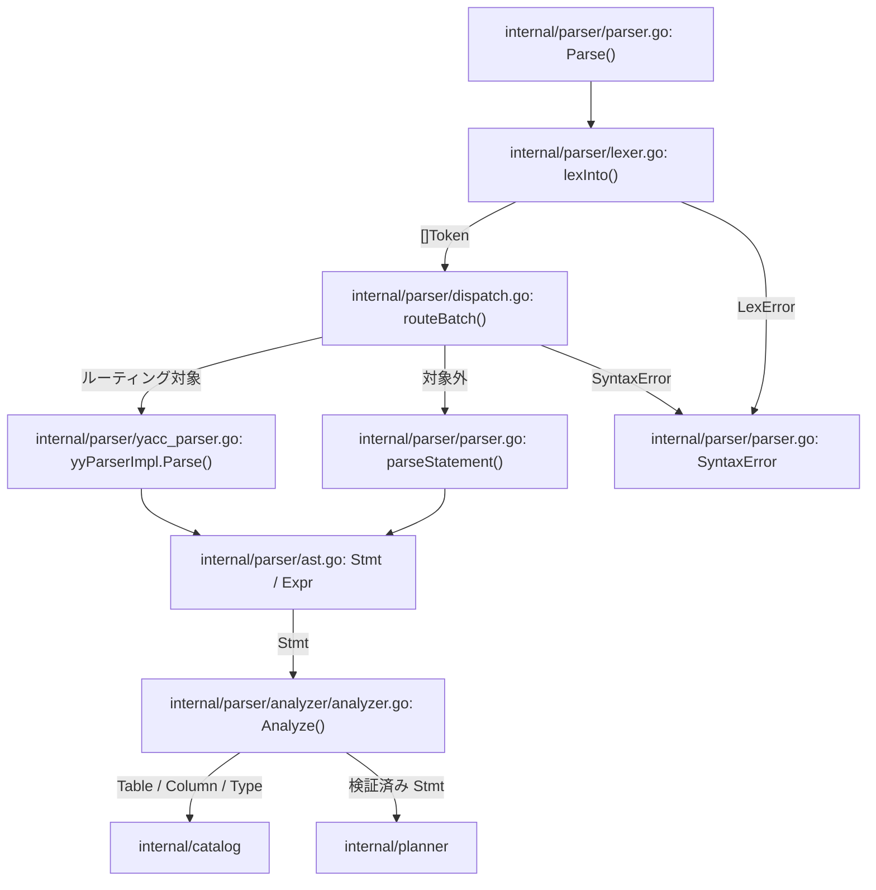

# SQL パーサー

<details>
<summary>関連ソースファイル</summary>

- [`internal/parser/lexer.go`](https://github.com/ryogrid/goopg/blob/19856410e8d497d59787e1ab35a2febb3f5953d6/internal/parser/lexer.go)
- [`internal/parser/parser.go`](https://github.com/ryogrid/goopg/blob/19856410e8d497d59787e1ab35a2febb3f5953d6/internal/parser/parser.go)
- [`internal/parser/dispatch.go`](https://github.com/ryogrid/goopg/blob/19856410e8d497d59787e1ab35a2febb3f5953d6/internal/parser/dispatch.go)
- [`internal/parser/adapter.go`](https://github.com/ryogrid/goopg/blob/19856410e8d497d59787e1ab35a2febb3f5953d6/internal/parser/adapter.go)
- [`internal/parser/yacc_parser.go`](https://github.com/ryogrid/goopg/blob/19856410e8d497d59787e1ab35a2febb3f5953d6/internal/parser/yacc_parser.go)
- [`internal/parser/ast.go`](https://github.com/ryogrid/goopg/blob/19856410e8d497d59787e1ab35a2febb3f5953d6/internal/parser/ast.go)
- [`internal/parser/token.go`](https://github.com/ryogrid/goopg/blob/19856410e8d497d59787e1ab35a2febb3f5953d6/internal/parser/token.go)
- [`internal/parser/expr.go`](https://github.com/ryogrid/goopg/blob/19856410e8d497d59787e1ab35a2febb3f5953d6/internal/parser/expr.go)
- [`internal/parser/keywords.go`](https://github.com/ryogrid/goopg/blob/19856410e8d497d59787e1ab35a2febb3f5953d6/internal/parser/keywords.go)
- [`internal/parser/base_yylex.go`](https://github.com/ryogrid/goopg/blob/19856410e8d497d59787e1ab35a2febb3f5953d6/internal/parser/base_yylex.go)
- [`internal/nodes/resolver_expr.go`](https://github.com/ryogrid/goopg/blob/19856410e8d497d59787e1ab35a2febb3f5953d6/internal/nodes/resolver_expr.go)
- [`internal/parser/analyzer/analyzer.go`](https://github.com/ryogrid/goopg/blob/19856410e8d497d59787e1ab35a2febb3f5953d6/internal/parser/analyzer/analyzer.go)

</details>

SQL テキストを `Stmt` と `Expr` の木に変換し、その木を実行可能な意味情報へ仕上げるサブシステムである。SQL は [3 サーバーと接続](3-Server.md) から `parser.Parse` に入り、字句解析器が `[]Token` を作り、文ディスパッチャが文ごとに LALR 文法か手書きパーサーかを選ぶ。得られた AST は [5 クエリプランナー](5-Query-Planner.md) へ渡される前に `analyzer.Analyze` で名前解決・型解決され、必要に応じて [12 カタログとシステムビュー](12-Catalog.md) の `Catalog` を参照する。パースと解析は分離されており、パーサーは AST を返し、アナライザは主に検証結果と型情報を返す。名前付きウィンドウ参照の解決など一部の正規化だけは `resolveNamedWindowRefs` が AST に反映する。

## コンポーネント

- **字句解析** — SQL 文字列を `Token` の列にし、キーワード・識別子・リテラル・演算子・`TokenEOF` を生成する。`Lex`/`lexInto` と `lexer.next` が入口である。詳細は [4.1 字句解析とトークン](4-SQL-Parser/4.1-Lexer.md)。`path:internal/parser/lexer.go:Lex`
- **文法と文ディスパッチ** — `SplitStatements` でバッチを分割し、`routeBatch`/`fragmentRouted` が LALR 文法と手書きパーサーの担当を決める。goyacc 側は `yyParserImpl.Parse` と `lexerState` が終端を供給する。詳細は [4.2 文法と文ディスパッチ](4-SQL-Parser/4.2-Grammar-and-Dispatch.md)。`path:internal/parser/dispatch.go:routeBatch`
- **AST と式** — `Stmt`/`Expr` の共通契約、`SelectStmt`・DML ノード・式ノード、Pratt パーサーによる式の組み立てを扱う。詳細は [4.3 AST と式の構造](4-SQL-Parser/4.3-AST-and-Expressions.md)。`path:internal/parser/ast.go:Stmt`
- **手書き DDL・DML** — LALR 文法へ移行していない DDL と、COPY の内側クエリなどで使う DML を処理する。未対応 DDL は `parseSkipToSemicolon` で `CompatNoopStmt` にする。詳細は [4.4 手書き DDL・DML パーサー](4-SQL-Parser/4.4-Handwritten-DDL-DML.md)。`path:internal/parser/parser.go:parseStatement`
- **アナライザと型解決** — `Analyze` がスコープと列参照を解決し、式の型を `catalog.Type` として求める。canonical IR を生成する `nodes` のリゾルバもここで扱う。詳細は [4.5 アナライザと型解決](4-SQL-Parser/4.5-Analyzer.md)。`path:internal/parser/analyzer/analyzer.go:Analyze`

## サブシステム図



## データフロー

1. `Parse` は `tokenSlicePool` から `[]Token` を取り、`lexInto` に渡す。`lexInto` は `TokenEOF` を追加するまで `lexer.next` を繰り返す。字句エラーは `*LexError` として返り、途中までのトークン列は返さない。`path:internal/parser/parser.go:Parse`、`path:internal/parser/lexer.go:lexInto`
2. `parseBatch` は `routeBatch(input, toks)` を呼ぶ。`routeBatch` は `SplitStatements` でトップレベルの `;` ごとにフラグメントを作り、空フラグメントを飛ばす。`path:internal/parser/dispatch.go:routeBatch`、`path:internal/parser/dispatch.go:SplitStatements`
3. 各フラグメントは `fragmentRouted` で判定される。対象なら `ParseOneSrc` が `lexerState` を作り、`yyParserImpl.Parse` を呼ぶ。対象外なら `parseOneLegacyFragment` が `parseStatement` を呼ぶ。`path:internal/parser/dispatch.go:fragmentRouted`、`path:internal/parser/adapter.go:ParseOneSrc`、`path:internal/parser/parser.go:parseStatement`
4. LALR 経路では `lexerState.Lex` が `Token` を goyacc の終端へ写像し、`base_yylex.go` の先読み置換を適用する。文法アクションが `ast.go` のノードを組み立て、`root` アクションが結果を `l.out` に渡す。`path:internal/parser/adapter.go:Lex`、`path:internal/parser/yacc_parser.go:yyParserImpl.Parse`、`path:internal/parser/base_yylex.go:initSubstRules`
5. 手書き経路では `parseCreate`/`parseDrop`/`parseAlter`/`parseCopy` と識別子先導の互換文が `Stmt` を作る。COPY の内側クエリでは `parseInsert`/`parseUpdate`/`parseDelete` も使われる。`path:internal/parser/parser.go:parseStatement`
6. プランナーは得られた `Stmt` を `Analyze` に渡す。`Analyze` は `*SelectStmt`/`*InsertStmt`/`*UpdateStmt`/`*DeleteStmt` を解析し、DDL は通過させる。`path:internal/parser/analyzer/analyzer.go:Analyze`
7. アナライザは `scope` を構築し、`buildSelectScopeIn` で FROM の関係を解決し、`analyzeExpr` で各ノードの `catalog.Type` を求める。列が見つからなければ 42703、関係が見つからなければ 42P01 を返す。`path:internal/parser/analyzer/analyzer.go:analyzeExpr`
8. パースエラーは `*SyntaxError`、字句エラーは `*LexError`、意味解析エラーは `*AnalyzeError` として、それぞれ絶対バイト位置 `Pos` を持つ。エラーは最初の 1 件で処理を止める。`path:internal/parser/parser.go:SyntaxError`、`path:internal/parser/analyzer/analyzer.go:AnalyzeError`
9. 式だけを解析する `ParseExpr` は、トークン列を合成 `SELECT` で包んで `routeExpr` に渡す。PL/pgSQL の式や DDL の DEFAULT 式も同じ `parseExpr` 系の AST を経由する。`path:internal/parser/parser.go:ParseExpr`、`path:internal/parser/dispatch.go:routeExpr`

## 共有データ型

### `Token` — 字句解析器とパーサーの語彙

`path:internal/parser/token.go:Token`

```go
// Token is one lexer output. Value is the source bytes (lower-cased
// for keywords/idents, raw payload for literals). Pos is the byte
// offset in the original input.
type Token struct {
	Kind    TokenKind
	Keyword Keyword // populated when Kind == TokenKeyword
	Value   string
	Pos     int
}
```

`Kind` がトークンの種類、`Keyword` は `Kind == TokenKeyword` のときだけ有効なキーワード値、`Value` は小文字化済みの識別子・キーワードまたはリテラル内容、`Pos` は元の SQL に対する絶対バイト位置である。`Pos` はアダプタ、AST、`SyntaxError`、`AnalyzeError` まで一貫して引き継がれる。`path:internal/parser/token.go:Token`

### `Node` / `Stmt` — 文の共通契約

`path:internal/parser/ast.go:Node`

```go
// Node is implemented by every AST node. Pos returns the byte offset
// of the node's first token, used by error messages.
type Node interface {
	Pos() int
}

// Stmt is implemented by every top-level SQL statement.
type Stmt interface {
	Node
	stmtNode()
}
```

`Node` は `Pos() int` だけを要求し、`Stmt` は `stmtNode()` で文であることを示す。DDL と DML の両方が同じ `Stmt` として `Parse` の戻り値になり、アナライザの型スイッチもこの型で文種別を判定する。`path:internal/parser/ast.go:Stmt`

### `Expr` — 式の共通契約

`path:internal/parser/expr.go:Expr`

```go
// Expr is implemented by every expression-tree node.
type Expr interface {
	Node
	exprNode()
}
```

`Expr` は `Node` に `exprNode()` を加える。`Stmt` と `Expr` は別のマーカーメソッドを持つため、文を式の位置に渡す取り違えをコンパイル時に防ぐ。`Stmt` のフィールドは `Expr` を、式ノードは子 `Expr` を再帰的に保持する。`path:internal/parser/expr.go:Expr`

### `SyntaxError` — パースエラー

`path:internal/parser/parser.go:SyntaxError`

```go
// SyntaxError is the parser's structured error. Message mirrors
// upstream's `syntax error at or near "TOKEN"` shape so psql users
// can reason about it.
type SyntaxError struct {
	Pos     int
	Message string
	// Raw suppresses the "syntax error at or near …" wrapper: Error() returns
	// Message verbatim. Used for semantic errors caught during parsing (e.g.
	// "SELECT … INTO is not allowed here") that have their own wording.
	Raw bool
	// Code overrides the SQLSTATE the wire layer reports for this error.
	// Empty means the parser default, 42601 (syntax_error). PG's grammar
	// raises a handful of non-42601 errors from inside a production — e.g.
	// opt_float's precision checks are ERRCODE_INVALID_PARAMETER_VALUE
	// (22023) — and those cases set this so goopg reports the same code.
	// Kept as a bare string so internal/parser stays free of an sqlstate
	// import.
	Code string
	// Hint carries an optional HINT wire field alongside Code, for the same
	// kind of non-syntax error raised during parsing (e.g. SIMILAR TO's
	// parse-time constant-fold rejecting a >1-char ESCAPE string with
	// 22025/"Escape string must be empty or one character."). Empty means no
	// HINT field. M0134-0070.
	Hint string
}
```

`Pos` はエラー位置、`Message` は `syntax error at or near "..."` の対象、`Raw` はラップを抑制するフラグ、`Code` は SQLSTATE の上書き、`Hint` は HINT フィールドである。字句解析器の `LexError` は別型だが、どちらも `Pos` をバイト位置として持つ。`path:internal/parser/parser.go:SyntaxError`

### `AnalyzeError` — 意味解析エラー

`path:internal/parser/analyzer/analyzer.go:AnalyzeError`

```go
type AnalyzeError struct {
	Pos     int
	Code    string
	Message string
	Hint    string // optional hint; propagated to PlanError.Hint by toPlanError. M0097-0004.
}
```

`Code` は SQLSTATE、`Pos` は AST ノードの位置、`Hint` は任意のヒントである。パース段階の `SyntaxError` と分けることで、構文エラーと意味エラーを呼び出し側が区別できる。`path:internal/parser/analyzer/analyzer.go:AnalyzeError`

## 主要な設計判断

- **字句解析・文法・手書きパーサーを共存させる。** `Parse` はまず手書き字句解析器で `[]Token` を作り、その後 `routeBatch` が文ごとに LALR 文法か手書き DDL/DML かを選ぶ。バッチ全体を一度にどちらかへ送るのではなく、フラグメント単位で担当を分ける。`path:internal/parser/dispatch.go:routeBatch`
- **ルーティング後にフォールバックしない。** `fragmentRouted` が真なら goyacc がその文を所有し、構文エラーもそのまま返す。未対応構文を手書きパーサーで再試行する経路はない。`path:internal/parser/dispatch.go:routeBatch`
- **位置は絶対バイトオフセットで統一する。** `Token.Pos` を起点に、AST の `Pos()`、`SyntaxError.Pos`、`AnalyzeError.Pos` がすべて同じ入力文字列上の位置を指す。エラー位置の変換を層ごとに行わない。`path:internal/parser/token.go:Token`
- **パースと意味解析を分離する。** パーサーは `Stmt` を返すだけで、名前解決や型付けは `Analyze` が行う。アナライザは主に検証と型付けを行い、名前付きウィンドウ参照の解決だけは `resolveNamedWindowRefs` が `WindowDef` の `PartitionBy`/`OrderBy` をコピーして AST に反映する。DDL はそのまま実行側へ渡す。`path:internal/parser/analyzer/analyzer.go:Analyze`、`path:internal/parser/analyzer/analyzer.go:resolveNamedWindowRefs`
- **キーワードを識別子として使える範囲を分類する。** `KeywordCategory` と `IsColNameKeyword` が、予約語・型/関数名用・列名用・非予約語を区別し、引用なし識別子としての受理を決める。`path:internal/parser/keywords.go:IsColNameKeyword`（詳細は [4.1](4-SQL-Parser/4.1-Lexer.md)）
- **PostgreSQL 互換の canonical IR は別経路。** 実行用の `analyzer` とは別に、`internal/nodes` が DEFAULT 式やビューを `pg_node_tree` へ変換する。対応不能な式は `ErrUnsupported` で SQL テキスト保存へ退避する。`path:internal/nodes/resolver_expr.go:ResolveExpr`（詳細は [4.5](4-SQL-Parser/4.5-Analyzer.md)）
- **goyacc の意味値は全フィールドの和である。** `yySymType` は C の union ではなく、`%type` で宣言されたフィールドをすべて持つ。パーサーのプール再利用時には前の文の値が残らないようゼロ埋めが必要になる。`path:internal/parser/yacc_parser.go:yySymType`（詳細は [4.2](4-SQL-Parser/4.2-Grammar-and-Dispatch.md)）

Sources:

- `internal/parser/lexer.go`
- `internal/parser/parser.go`
- `internal/parser/dispatch.go`
- `internal/parser/adapter.go`
- `internal/parser/yacc_parser.go`
- `internal/parser/ast.go`
- `internal/parser/token.go`
- `internal/parser/expr.go`
- `internal/parser/keywords.go`
- `internal/parser/base_yylex.go`
- `internal/nodes/resolver_expr.go`
- `internal/parser/analyzer/analyzer.go`

<sub>Generated by deepwiki-4myself from `goopg` @ `19856410e`</sub>
